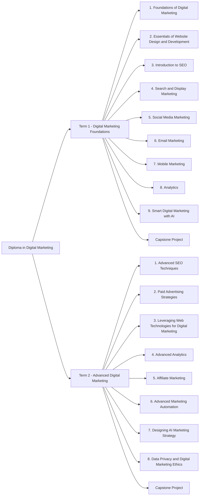

# 🔥 Diploma in Digital Marketing

Prepared by **Hamna Zahid Khan**, Junior Lecturer

A complete, two-term study companion: **17 modules · 87 sessions**, each with clear explanations, Mermaid diagrams, worked metric calculations, real HTML/CSS/JavaScript and schema code, Python analytics with real outputs (plus Colab notebooks), labs, quizzes and practice tests.

## 🎯 What you will learn

| Area | You will be able to… |
|---|---|
| Marketing foundations | Explain the marketing process, 4Ps/7Ps, STP, USPs, customer journeys and buyer personas |
| Websites | Build and style responsive pages with HTML5, CSS3 and JavaScript, and add schema markup |
| SEO | Research keywords, optimise pages on and off site, fix technical issues, and win local and voice search |
| Paid media | Plan, structure, budget and optimise search, display, social and PPC campaigns |
| Social, email & mobile | Run content calendars, ad campaigns, email programmes, SMS/WhatsApp and push campaigns |
| Analytics | Calculate CTR, CPC, CPA, ROAS, ROI, CLV and funnel conversion; build dashboards; model attribution |
| AI & automation | Use AI for segmentation, personalisation, prediction and workflow automation |
| Ethics & privacy | Apply consent, data minimisation and fairness under GDPR, CCPA and Pakistan's draft data-protection rules |

## 🗺️ Roadmap

## 📚 Table of contents

### [Term 1 · Digital Marketing Foundations](term-1/README.md)

<b>Module 1 · Foundations of Digital Marketing</b> (5 sessions)

- 📘 [Module overview & cheat-sheet](term-1/01-foundations-of-digital-marketing/README.md)
- Session 1 · [Introduction to Marketing](term-1/01-foundations-of-digital-marketing/session-01-introduction-to-marketing.md)
- Session 2 · [Marketing Fundamentals: Brand Truth](term-1/01-foundations-of-digital-marketing/session-02-marketing-fundamentals-brand-truth.md)
- Session 3 · [Customer Journey and the AIDA Model](term-1/01-foundations-of-digital-marketing/session-03-customer-journey-aida.md)
- Session 4 · [Role of Digital Media](term-1/01-foundations-of-digital-marketing/session-04-role-of-digital-media.md)
- Session 5 · [Presentation Skills and Website Basics](term-1/01-foundations-of-digital-marketing/session-05-presentation-skills-and-website-basics.md)
- 📝 [Practice test](term-1/01-foundations-of-digital-marketing/practice-test.md)

<b>Module 2 · Essentials of Website Design and Development</b> (5 sessions)

- 📘 [Module overview & cheat-sheet](term-1/02-website-design-and-development/README.md)
- Session 1 · [Introduction to the Web and HTML5](term-1/02-website-design-and-development/session-01-web-and-html5-introduction.md)
- Session 2 · [Formatting Text, Hyperlinks and Anchors](term-1/02-website-design-and-development/session-02-formatting-text-hyperlinks-anchors.md)
- Session 3 · [Introduction to CSS3](term-1/02-website-design-and-development/session-03-introduction-to-css3.md)
- Session 4 · [Formatting Using Style Sheets](term-1/02-website-design-and-development/session-04-formatting-with-style-sheets.md)
- Session 5 · [HTML Layout, Forms and Elements](term-1/02-website-design-and-development/session-05-html-layout-forms-elements.md)
- 📝 [Practice test](term-1/02-website-design-and-development/practice-test.md)

<b>Module 3 · Introduction to SEO</b> (8 sessions)

- 📘 [Module overview & cheat-sheet](term-1/03-introduction-to-seo/README.md)
- Session 1 · [Understanding Search Engines and SEO Components](term-1/03-introduction-to-seo/session-01-search-engines-and-seo-components.md)
- Session 2 · [On-Page and Off-Page Optimization](term-1/03-introduction-to-seo/session-02-on-page-and-off-page-optimization.md)
- Session 3 · [Mobile SEO, SEO-Friendly Content and Local SEO](term-1/03-introduction-to-seo/session-03-mobile-seo-and-content.md)
- Session 4 · [Advanced SEO Techniques and Tools](term-1/03-introduction-to-seo/session-04-advanced-seo-techniques-and-tools.md)
- Session 5 · [Technical SEO and Site Performance](term-1/03-introduction-to-seo/session-05-technical-seo-and-site-performance.md)
- Session 6 · [Voice Search Optimization](term-1/03-introduction-to-seo/session-06-voice-search-optimization.md)
- Session 7 · [Artificial Intelligence and Machine Learning in SEO](term-1/03-introduction-to-seo/session-07-ai-and-ml-in-seo.md)
- Session 8 · [Enhancing User Experience and SEO with AI](term-1/03-introduction-to-seo/session-08-ux-and-seo-with-ai.md)
- 📝 [Practice test](term-1/03-introduction-to-seo/practice-test.md)

<b>Module 4 · Search and Display Marketing</b> (5 sessions)

- 📘 [Module overview & cheat-sheet](term-1/04-search-and-display-marketing/README.md)
- Session 1 · [History of Search Advertising](term-1/04-search-and-display-marketing/session-01-history-of-search-advertising.md)
- Session 2 · [Google Ads and How Search Marketing Works](term-1/04-search-and-display-marketing/session-02-google-ads-search-study.md)
- Session 3 · [Google Ads Campaign Types, Challenges and Privacy](term-1/04-search-and-display-marketing/session-03-google-ads-campaign-types.md)
- Session 4 · [Google Analytics](term-1/04-search-and-display-marketing/session-04-google-analytics.md)
- Session 5 · [SEO and Competitor Tools: Semrush, SpyFu, WordStream](term-1/04-search-and-display-marketing/session-05-seo-tools-semrush-spyfu-wordstream.md)
- 📝 [Practice test](term-1/04-search-and-display-marketing/practice-test.md)

<b>Module 5 · Social Media Marketing</b> (7 sessions)

- 📘 [Module overview & cheat-sheet](term-1/05-social-media-marketing/README.md)
- Session 1 · [Impact of Social Media on Businesses](term-1/05-social-media-marketing/session-01-impact-of-social-media-on-business.md)
- Session 2 · [Managing and Enhancing Social Media Presence](term-1/05-social-media-marketing/session-02-managing-social-media-presence.md)
- Session 3 · [Fundamentals of Social Media Advertising](term-1/05-social-media-marketing/session-03-social-media-advertising.md)
- Session 4 · [Social Listening and Copywriting](term-1/05-social-media-marketing/session-04-social-listening-and-copywriting.md)
- Session 5 · [YouTube Marketing](term-1/05-social-media-marketing/session-05-youtube-marketing.md)
- Session 6 · [Social Media ROI and Performance Metrics](term-1/05-social-media-marketing/session-06-social-roi-and-performance-metrics.md)
- Session 7 · [A/B Split Testing and AI in Social Media](term-1/05-social-media-marketing/session-07-ab-testing-and-ai-in-social.md)
- 📝 [Practice test](term-1/05-social-media-marketing/practice-test.md)

<b>Module 6 · Email Marketing</b> (3 sessions)

- 📘 [Module overview & cheat-sheet](term-1/06-email-marketing/README.md)
- Session 1 · [Fundamentals of Email Marketing](term-1/06-email-marketing/session-01-email-marketing-fundamentals.md)
- Session 2 · [Building an Email Marketing Strategy](term-1/06-email-marketing/session-02-building-email-strategy.md)
- Session 3 · [Measuring Email Success and AI Tools](term-1/06-email-marketing/session-03-email-metrics-and-ai-tools.md)
- 📝 [Practice test](term-1/06-email-marketing/practice-test.md)

<b>Module 7 · Mobile Marketing</b> (4 sessions)

- 📘 [Module overview & cheat-sheet](term-1/07-mobile-marketing/README.md)
- Session 1 · [Introduction to Mobile Marketing](term-1/07-mobile-marketing/session-01-introduction-to-mobile-marketing.md)
- Session 2 · [Developing Mobile Marketing Strategies](term-1/07-mobile-marketing/session-02-mobile-marketing-strategy.md)
- Session 3 · [Advanced Mobile Channels and Techniques](term-1/07-mobile-marketing/session-03-advanced-mobile-channels.md)
- Session 4 · [AI Tools in Mobile Marketing](term-1/07-mobile-marketing/session-04-ai-tools-in-mobile-marketing.md)
- 📝 [Practice test](term-1/07-mobile-marketing/practice-test.md)

- Module 8 · Analytics *(coming soon)*
- Module 9 · Smart Digital Marketing with AI *(coming soon)*

### [Term 2 · Advanced Digital Marketing](term-2/README.md)

- Module 1 · Advanced SEO Techniques *(coming soon)*
- Module 2 · Paid Advertising Strategies *(coming soon)*
- Module 3 · Leveraging Web Technologies for Digital Marketing *(coming soon)*
- Module 4 · Advanced Analytics *(coming soon)*
- Module 5 · Affiliate Marketing *(coming soon)*
- Module 6 · Advanced Marketing Automation *(coming soon)*
- Module 7 · Designing AI Marketing Strategy *(coming soon)*
- Module 8 · Data Privacy and Digital Marketing Ethics *(coming soon)*

🎓 Capstone projects for both terms: [capstone/README.md](capstone/README.md)

## 🧭 How to use this repository

1. **Go in order.** Every session has ⬅ Previous / Next ➡ links, and builds on the one before.
2. **Read, then do.** Each session follows the same rhythm: 🎯 objectives → 📖 concepts → 🧭 diagram → 💻 worked examples → 📊 data → 🧪 lab → ✅ quiz → 📝 summary.
3. **Run the code.** Code lives in each module's `code/` folder. Python files run with `python3 file.py`; notebooks open in Google Colab with one click. HTML files open directly in a browser.
4. **Hide the answers.** Quiz answers and lab hints sit inside collapsible `
` blocks. Try first, then check.
5. **Test yourself.** Finish each module with its 📝 practice test (20 MCQs + 3 practical scenarios).
6. **Build your portfolio.** The capstone projects turn what you learn into work you can show employers.

> 💡 Metric formulas used throughout: **CTR** = clicks ÷ impressions · **CPC** = cost ÷ clicks · **CPM** = cost ÷ impressions × 1000 · **CVR** = conversions ÷ clicks · **CPA** = cost ÷ conversions · **ROAS** = revenue ÷ ad spend · **ROI** = (revenue − cost) ÷ cost.

## ✅ Progress checklist

Copy this list into your own notes (or fork the repo) and tick modules off as you finish them.

**Term 1**

- [ ] Module 1 · Foundations of Digital Marketing
- [ ] Module 2 · Essentials of Website Design and Development
- [ ] Module 3 · Introduction to SEO
- [ ] Module 4 · Search and Display Marketing
- [ ] Module 5 · Social Media Marketing
- [ ] Module 6 · Email Marketing
- [ ] Module 7 · Mobile Marketing
- [ ] Module 8 · Analytics
- [ ] Module 9 · Smart Digital Marketing with AI
- [ ] Capstone Project · Term 1

**Term 2**

- [ ] Module 1 · Advanced SEO Techniques
- [ ] Module 2 · Paid Advertising Strategies
- [ ] Module 3 · Leveraging Web Technologies for Digital Marketing
- [ ] Module 4 · Advanced Analytics
- [ ] Module 5 · Affiliate Marketing
- [ ] Module 6 · Advanced Marketing Automation
- [ ] Module 7 · Designing AI Marketing Strategy
- [ ] Module 8 · Data Privacy and Digital Marketing Ethics
- [ ] Capstone Project · Term 2

---

Prepared by **Hamna Zahid Khan**, Junior Lecturer · Diploma in Digital Marketing
