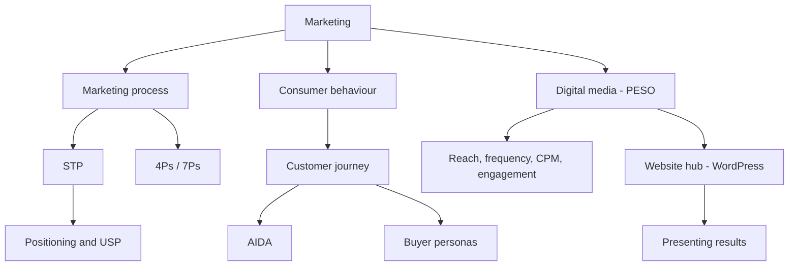

# Module 1 · Foundations of Digital Marketing

> 🏠 [Diploma in Digital Marketing](../../README.md) › [Term 1](../README.md) › **Module 1**

[⬅ Previous module](../README.md) · [Start Session 1 ➡](session-01-introduction-to-marketing.md) · [Next module ➡](../02-website-design-and-development/README.md)

---

Marketing fundamentals come before any tool or platform. This module explains how marketing works, how customers decide, how digital media fits in, and how to present ideas and build a basic website.

## 🎯 Module objectives

- Explain the purpose of marketing and the steps of the marketing process.
- Apply the 4Ps, 7Ps, USP and STP to real products and services.
- Map customer journeys, apply AIDA and build buyer personas from data.
- Classify digital media (PESO) and calculate reach, frequency, CPM and engagement rate.
- Present a persuasive, data-led pitch and set up a WordPress website.

## 📅 Sessions

| # | Session | Prerequisites |
|---|---|---|
| 1 | [Introduction to Marketing](session-01-introduction-to-marketing.md) | None, this is the first session |
| 2 | [Marketing Fundamentals: Brand Truth](session-02-marketing-fundamentals-brand-truth.md) | Session 1 |
| 3 | [Customer Journey and the AIDA Model](session-03-customer-journey-aida.md) | Sessions 1-2 |
| 4 | [Role of Digital Media](session-04-role-of-digital-media.md) | Sessions 1-3 |
| 5 | [Presentation Skills and Website Basics](session-05-presentation-skills-and-website-basics.md) | Sessions 1-4 |
|  | 📝 [Module practice test](practice-test.md) | All sessions |

## 🧭 Concept map

## 📄 One-page cheat-sheet

| Topic | Remember this |
|---|---|
| Marketing | Find needs → create value → communicate and deliver profitably |
| Process | Research → Segment/Target → Position → Mix → Implement → Measure (loop) |
| 4Ps | Product · Price · Place · Promotion |
| 7Ps | 4Ps + People · Process · Physical evidence |
| Buying stages | Need → Search → Evaluate → Purchase → Post-purchase |
| Behaviour factors | Cultural · Social · Personal · Psychological |
| USP formula | For [who] with [need], we're the only [category] that [benefit] because [proof] |
| Segmentation bases | Demographic · Geographic · Psychographic · Behavioural |
| Targeting strategies | Undifferentiated · Differentiated · Concentrated · Micro |
| Journey | Awareness → Consideration → Decision → Retention → Advocacy |
| AIDA | Attention · Interest · Desire · Action |
| PESO | Paid · Earned · Shared · Owned |

| Formula | Calculation |
|---|---|
| Break-even units | Fixed costs ÷ (Price − Variable cost) |
| Stage conversion | Next stage ÷ Current stage × 100 |
| Frequency | Impressions ÷ Reach |
| CPM | Cost ÷ Impressions × 1,000 |
| Engagement rate | Engagements ÷ Reach × 100 |
| Pitch structure | Problem → Insight → Solution → Proof → Ask |

**Common mistakes:** confusing marketing with advertising · personas built from guesses · targeting the biggest segment instead of the most profitable · slide headlines that name topics instead of takeaways · relying only on rented social media instead of an owned website.

---

Prepared by **Hamna Zahid Khan**, Junior Lecturer · Diploma in Digital Marketing
