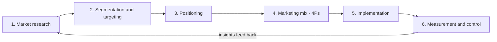
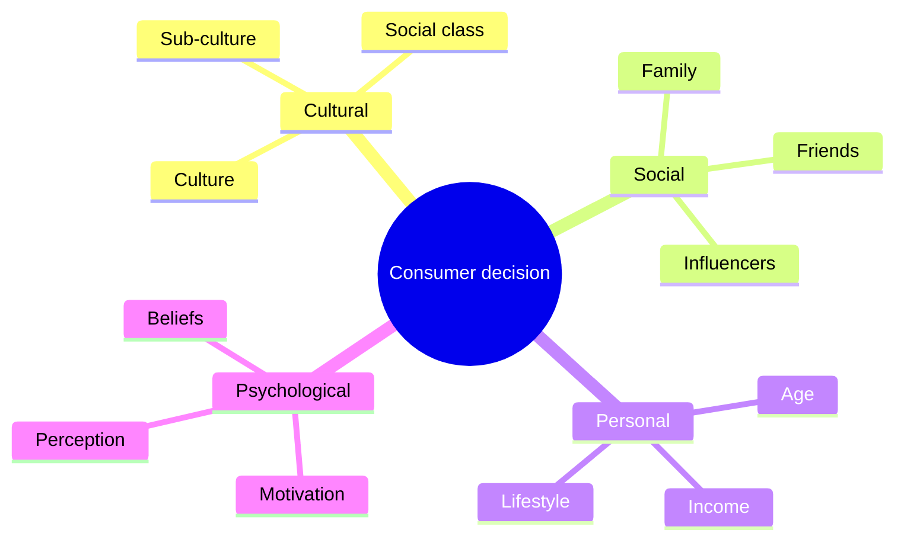
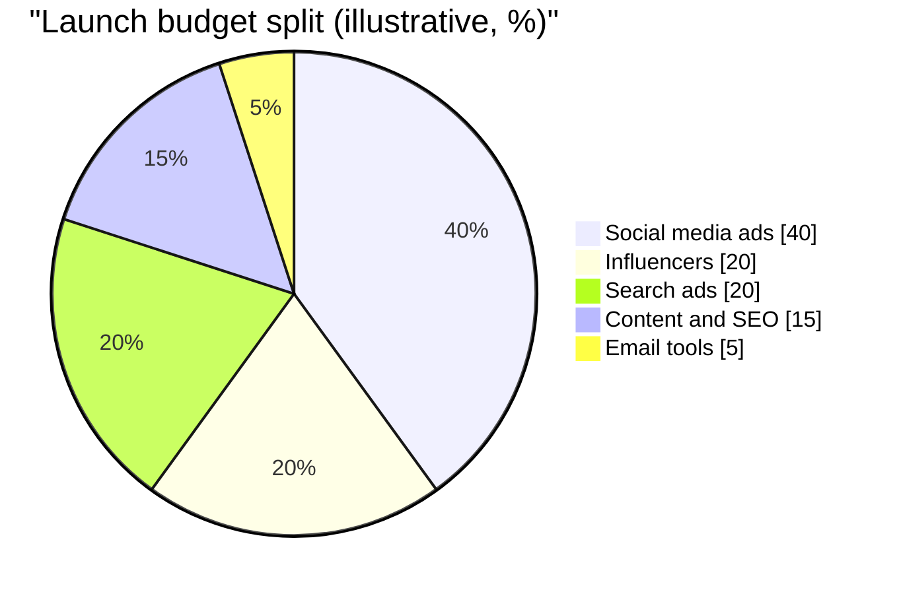

# Session 1 · Introduction to Marketing

> 🏠 [Diploma in Digital Marketing](../../README.md) › [Term 1](../README.md) › [Foundations of Digital Marketing](README.md) › **Session 1**
>
> ⏱ **Estimated time:** 2 hours (1 h theory + 1 h lab) · 📋 **Prerequisites:** None, this is the first session

[⬅ Previous: Foundations of Digital Marketing overview](README.md) · [Next: Session 2 ➡](session-02-marketing-fundamentals-brand-truth.md)

---

## 🎯 Learning objectives

By the end of this session you will be able to:

- Define **marketing** in your own words and explain why every business depends on it.
- Walk through the **sequential steps of the marketing process**, from research to measurement.
- Use the **4Ps** (Product, Price, Place, Promotion) to describe any offer.
- Explain the main forces that shape **consumer behaviour** and the five-stage buying decision.
- Compare common **sales strategies** and choose one that fits a situation.

## 📖 Concepts

### 1. What marketing really is

Marketing is the work of **finding out what people need, creating an offer that meets that need, and communicating and delivering it at a profit**. Advertising is only one small part of it. Marketing also decides *what* to sell, *who* to sell it to, *how much* to charge and *where* customers can buy.

A useful way to remember the idea: **selling** pushes what you already have; **marketing** shapes what you have so that it pulls customers in.

| Term | Plain meaning | Example (a Karachi bakery) |
|---|---|---|
| **Need** | A basic human requirement | Hunger, celebration |
| **Want** | A need shaped by culture and personality | A chocolate fudge cake for a birthday |
| **Demand** | A want backed by the ability to pay | 300 families a month who can spend PKR 3,000 on a cake |
| **Value** | Benefits received minus costs paid | Fresh, on time, delivered, fair price |
| **Exchange** | Giving something to receive something | Money for the cake |

### 2. Why marketing matters

- **Revenue:** without customers there is no business.
- **Focus:** research stops a company wasting money on products nobody wants.
- **Relationships:** repeat customers cost far less to serve than new ones.
- **Competition:** clear positioning helps a small brand stand out against larger rivals.

### 3. The sequential steps of marketing

Marketing is a loop, not a straight line. Each step feeds the next, and results feed back into research.

1. **Market research** – study customers, competitors and trends.
2. **Segmentation and targeting** – split the market into groups and choose whom to serve.
3. **Positioning** – decide the single idea you want customers to remember.
4. **Marketing mix (4Ps)** – design product, price, place and promotion.
5. **Implementation** – launch campaigns, train staff, stock shelves, publish content.
6. **Measurement and control** – compare results with goals and adjust.

### 4. The 4Ps of marketing

| P | Key questions | Digital-era example |
|---|---|---|
| **Product** | What problem does it solve? Features, quality, packaging, brand? | A ride-hailing app's features: live tracking, ratings, cash or card |
| **Price** | What will customers pay? Discounts, bundles, payment terms? | Surge pricing, monthly subscriptions, "buy now pay later" |
| **Place** | Where and how do customers buy? | Website, app, marketplace (Daraz), physical store, delivery partners |
| **Promotion** | How do customers hear about it? | Search ads, Instagram reels, influencers, email, SMS |

> 🧠 **Analogy:** the 4Ps are the four legs of a table. A great product with the wrong price, or a cheap price with no way to buy, makes the whole table wobble.

### 5. Consumer behaviour

**Consumer behaviour** is the study of how people choose, buy, use and dispose of products. Four groups of factors influence every decision:

| Factor group | Examples |
|---|---|
| **Cultural** | Culture, sub-culture (region, religion), social class – e.g. Eid shopping peaks |
| **Social** | Family, friends, reference groups, online communities, influencers |
| **Personal** | Age, occupation, income, lifestyle, personality |
| **Psychological** | Motivation, perception, learning, beliefs and attitudes |

**The five-stage buying decision process**

1. **Need recognition** – "My phone battery dies by noon."
2. **Information search** – reads reviews, watches YouTube comparisons, asks friends.
3. **Evaluation of alternatives** – compares price, camera, battery, brand.
4. **Purchase decision** – chooses a model and a seller (installments matter).
5. **Post-purchase behaviour** – satisfied? Leaves a review, recommends, or returns it.

Digital marketing can influence *every* stage: search ads during information search, comparison content during evaluation, easy checkout at purchase, and follow-up emails after purchase.

### 6. Sales strategies

| Strategy | How it works | Best for |
|---|---|---|
| **Transactional selling** | Quick, price-led, one-off sales | Low-cost everyday items |
| **Consultative selling** | Ask questions, diagnose, recommend | Software, insurance, education |
| **Solution selling** | Sell the outcome, not the product | B2B services |
| **Relationship selling** | Long-term trust and repeat business | Agencies, wholesale, banking |
| **Inbound selling** | Attract with content, then nurture leads | Online businesses, courses |
| **Upselling / cross-selling** | Offer a better version or a related item | E-commerce ("frequently bought together") |

## 🧭 Diagram

## 💻 Worked examples

### Example 1 – Applying the 4Ps to a real-style launch

**Scenario:** "ChaiBox", a Karachi start-up, wants to sell monthly boxes of premium loose-leaf tea.

| P | Decision | Reason |
|---|---|---|
| Product | 4 tea blends per month, recyclable tin, brewing card | Tea lovers want variety and gifting appeal |
| Price | PKR 2,499 / month, PKR 6,999 for 3 months | 3-month plan locks in loyalty (saves PKR 498) |
| Place | Own website + Instagram shop, courier delivery in 5 cities | Online-first keeps costs low |
| Promotion | Instagram reels, food bloggers, launch discount code `CHAI10` | Audience is young and mobile-first |

### Example 2 – A simple break-even calculation

Marketing decisions must make financial sense. Suppose:

- Fixed costs per month (rent, salaries, website): **PKR 300,000**
- Variable cost per box (tea, tin, courier): **PKR 1,250**
- Selling price per box: **PKR 2,499**

**Contribution per box** = 2,499 − 1,250 = **PKR 1,249**

**Break-even boxes** = 300,000 ÷ 1,249 = 240.19 → **241 boxes per month**

If promotion costs an extra PKR 60,000 per month, the new break-even is 360,000 ÷ 1,249 = 288.2 → **289 boxes**. The campaign must therefore bring in at least **48 extra boxes** a month to pay for itself.

### Example 3 – Mapping a purchase journey to the 5 stages

| Stage | What Ayesha does | Marketing touchpoint |
|---|---|---|
| Need recognition | Wants a gift for her mother's birthday | Instagram story: "Gifts she'll actually use" |
| Information search | Googles "tea gift box Karachi" | Search ad + blog post |
| Evaluation | Compares 3 brands on reviews and price | Review widget, comparison table |
| Purchase | Pays by card on the website | One-page checkout, free delivery over PKR 2,000 |
| Post-purchase | Posts an unboxing story | Thank-you email asking for a review |

## 📊 Data snapshot

Illustrative split of where a small online brand might spend its first marketing budget:

## 🧪 Lab / practice tasks

**Task 1 (easy):** Pick a product you used today (toothpaste, an app, a snack). Write one line each for its 4Ps.

💡 Hint

Ask: what is it, what did it cost, where did you get it, and how did you first hear about it?

**Task 2 (medium):** Write the five buying-decision stages for your last mobile phone purchase. Next to each stage, note one thing a marketer could have done better.

💡 Hint

Think about the evaluation stage: was there a clear comparison anywhere, or did you have to build it yourself?

**Task 3 (medium):** A shoe brand sells at PKR 4,500, variable cost PKR 2,700, fixed costs PKR 540,000/month. Find the break-even quantity.

✅ Solution

Contribution = 4,500 − 2,700 = 1,800. Break-even = 540,000 ÷ 1,800 = **300 pairs per month**.

**Task 4 (challenge):** Choose a local business (a salon, tuition centre or restaurant). Propose which sales strategy from the table suits it best and justify your choice in 100 words, using one consumer-behaviour factor.

💡 Hint

A tuition centre sells to parents who worry about results: consultative or relationship selling usually fits better than price-led transactional selling.

## ✅ Quick quiz

1. Which statement best describes marketing?
   a) Only advertising  b) Identifying needs and delivering value profitably  c) Cold calling  d) Packaging design
2. "Daraz store and home delivery" belongs to which P?
   a) Product  b) Price  c) Place  d) Promotion
3. Reading YouTube reviews before buying is which buying stage?
   a) Need recognition  b) Information search  c) Purchase  d) Post-purchase
4. Influencers mainly act on which factor group?
   a) Cultural  b) Social  c) Personal  d) Psychological
5. Asking diagnostic questions and recommending a tailored plan is…
   a) Transactional selling  b) Consultative selling  c) Upselling  d) Discounting

Show answers

1-b · 2-c · 3-b · 4-b · 5-b

## 📝 Summary

- Marketing = understanding needs + creating value + communicating and delivering it profitably.
- The process loops: **research → STP → mix → implement → measure → research**.
- **4Ps:** Product, Price, Place, Promotion – all four must fit together.
- Consumer behaviour is shaped by **cultural, social, personal and psychological** factors.
- Buying decision: **need → search → evaluate → purchase → post-purchase**.
- Match the **sales strategy** to the product's price, complexity and relationship length.
- Break-even quantity = fixed costs ÷ (price − variable cost).

**Interview / viva questions**

1. How is marketing different from selling?
2. Explain the 4Ps using a product of your choice.
3. Which stage of the buying process is most influenced by online reviews, and why?
4. Why must marketing results feed back into research?
5. How would you calculate whether a campaign pays for itself?

---

[⬅ Previous: Foundations of Digital Marketing overview](README.md) · [Next: Session 2 ➡](session-02-marketing-fundamentals-brand-truth.md)

Prepared by **Hamna Zahid Khan**, Junior Lecturer · Diploma in Digital Marketing
