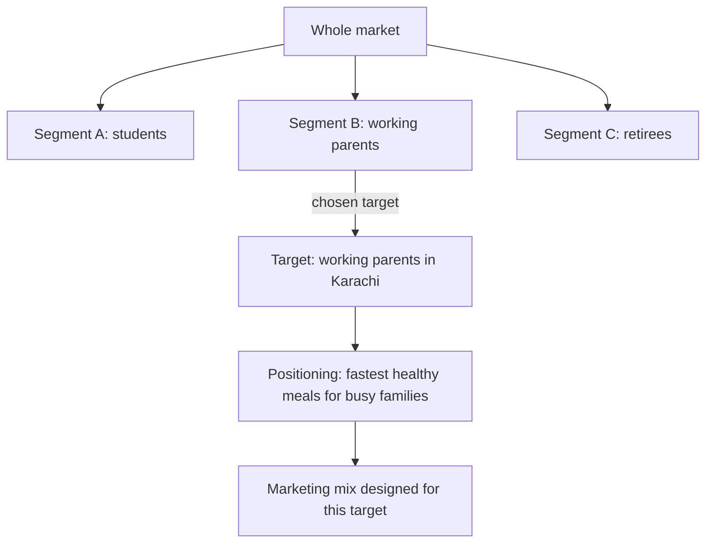
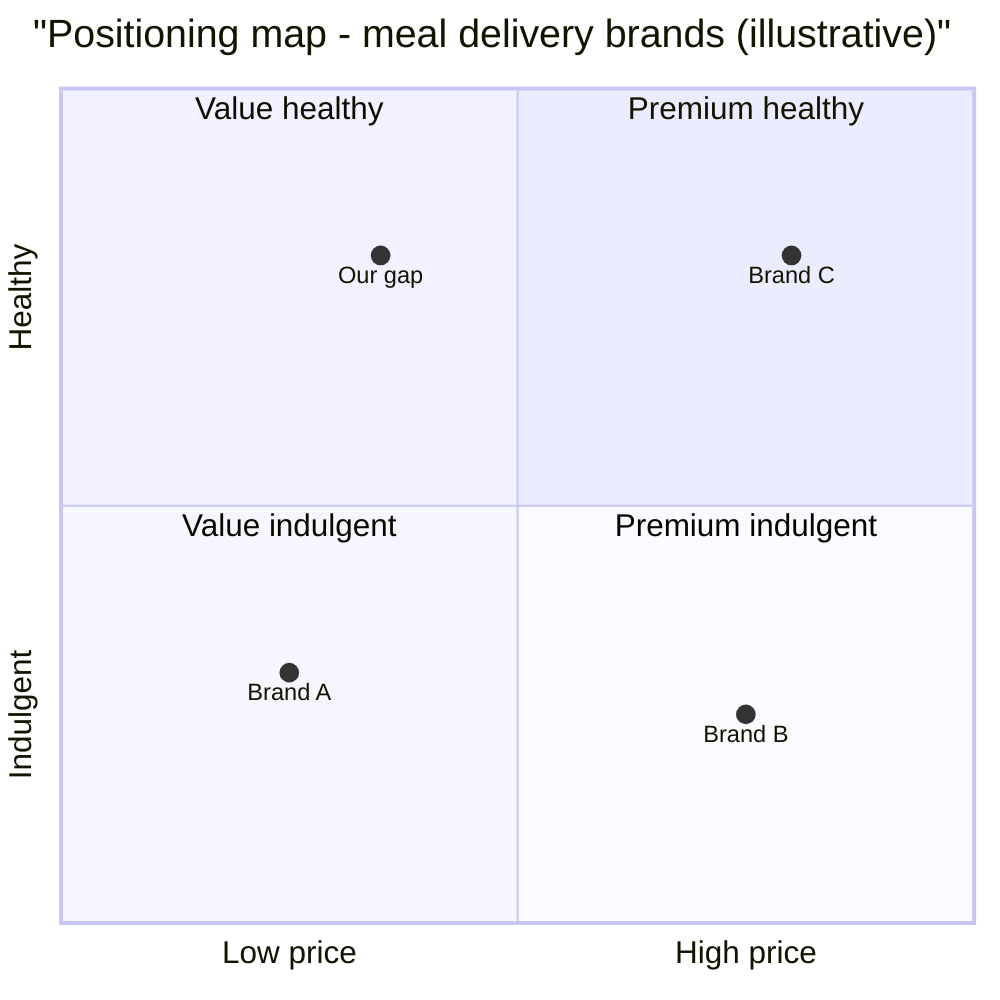

# Session 2 · Marketing Fundamentals: Brand Truth

> 🏠 [Diploma in Digital Marketing](../../README.md) › [Term 1](../README.md) › [Foundations of Digital Marketing](README.md) › **Session 2**
>
> ⏱ **Estimated time:** 2 hours (1 h theory + 1 h lab) · 📋 **Prerequisites:** Session 1

[⬅ Previous: Session 1](session-01-introduction-to-marketing.md) · [Next: Session 3 ➡](session-03-customer-journey-aida.md)

---

## 🎯 Learning objectives

- Define the main **types of digital marketing** and what each is good at.
- **Compare traditional and digital marketing** on reach, cost, targeting and measurement.
- Extend the 4Ps to the **7Ps** for service businesses.
- Write a sharp **Unique Selling Proposition (USP)**.
- Apply **Segmentation, Targeting and Positioning (STP)** and draw a **positioning map**.

## 📖 Concepts

### 1. Types of digital marketing

| Type | What it is | Typical goal |
|---|---|---|
| **Search Engine Optimization (SEO)** | Earning free (organic) rankings on Google/Bing | Long-term traffic |
| **Search Engine Marketing (SEM / PPC)** | Paying for ads on search results | Fast, intent-driven traffic |
| **Social Media Marketing (SMM)** | Organic posts and paid ads on Facebook, Instagram, TikTok, LinkedIn | Awareness, engagement |
| **Content marketing** | Blogs, videos, guides, podcasts that teach or entertain | Trust and leads |
| **Email marketing** | Newsletters, offers and automated sequences | Retention, repeat sales |
| **Display advertising** | Banner, image and video ads on websites and apps | Awareness, retargeting |
| **Affiliate marketing** | Partners earn commission for sales they drive | Performance-based sales |
| **Influencer marketing** | Creators recommend the brand to followers | Social proof |
| **Mobile marketing** | SMS, WhatsApp, push notifications, in-app ads | Immediate engagement |

### 2. Traditional vs digital marketing

| Dimension | Traditional (TV, radio, print, billboards) | Digital |
|---|---|---|
| Reach | Broad, local or national | Global, but can be hyper-local |
| Targeting | By channel/region only | By age, interest, behaviour, location, device |
| Cost to start | High (production + media) | Low – start with PKR 1,000/day |
| Measurement | Estimates (ratings, circulation) | Exact clicks, conversions, revenue |
| Speed of change | Slow – reprint, re-shoot | Edit an ad in minutes |
| Interaction | One-way | Two-way (comments, DMs, reviews) |
| Trust | Often high for established media | Varies; social proof matters |

Smart brands **blend** both: a billboard with a QR code, or a TV ad that pushes viewers to search a hashtag.

### 3. From 4Ps to 7Ps

Services cannot be touched or stored, so three extra Ps matter:

| P | Meaning | Example (online tutoring service) |
|---|---|---|
| Product | The service itself | 1-to-1 maths tutoring |
| Price | Fee, packages | PKR 8,000/month for 8 sessions |
| Place | Where it is delivered | Zoom + learning portal |
| Promotion | Communication | Facebook parent groups, referral codes |
| **People** | Staff who deliver it | Qualified, friendly tutors |
| **Process** | How the service flows | Free trial → placement test → schedule → monthly report |
| **Physical evidence** | Tangible proof of quality | Website, certificates, progress reports, reviews |

### 4. Unique Selling Proposition (USP)

A **USP** is the one clear reason a customer should choose you over competitors. A strong USP is **specific, relevant, provable and hard to copy**.

**USP formula:** *For* [target customer] *who* [need], *our* [product] *is the only* [category] *that* [unique benefit] *because* [proof].

- ❌ Weak: "We sell the best biryani."
- ✅ Strong: "The only biryani delivery in Clifton that arrives hot in 30 minutes – or it's free."

### 5. STP – Segmentation, Targeting, Positioning

**Segmentation** splits a market into groups with similar needs:

| Basis | Variables | Example |
|---|---|---|
| Demographic | Age, gender, income, education | Women 25-40, household income PKR 200k+ |
| Geographic | Country, city, climate, urban/rural | Lahore and Islamabad only |
| Psychographic | Lifestyle, values, personality | Fitness-focused, eco-conscious |
| Behavioural | Usage rate, loyalty, benefits sought, occasion | First-time buyers during Ramadan |

**Targeting** chooses which segment(s) to serve using size, growth, profitability, reachability and fit with your strengths. Strategies: **undifferentiated** (one offer for all), **differentiated** (different offers per segment), **concentrated / niche** (one segment), **micro** (individual/local).

**Positioning** is the place your brand occupies in the customer's mind relative to competitors. A **positioning statement** and a **perceptual (positioning) map** help.

### 6. Brand positioning and "brand truth"

A **brand truth** is something genuinely true about your brand that customers care about. Positioning built on a truth lasts; positioning built on hype collapses after the first bad review. Steps:

1. List what customers value most (research).
2. List what you do genuinely better (evidence).
3. Find the overlap that competitors do not own.
4. Express it in one sentence and prove it in every touchpoint.

## 🧭 Diagram

## 💻 Worked examples

### Example 1 – Writing a positioning statement

**Template:** For **[target]**, **[brand]** is the **[frame of reference]** that **[point of difference]** because **[reason to believe]**.

**Filled in:** For **busy working parents in Karachi**, **FitTiffin** is the **meal-delivery service** that **delivers dietitian-planned family dinners in under 40 minutes** because **we cook in four neighbourhood kitchens, not one central one**.

### Example 2 – Choosing a target segment with a scoring matrix

Score each segment 1–5 on each criterion, multiply by the weight, and add.

| Criterion (weight) | Students | Working parents | Retirees |
|---|---|---|---|
| Size (0.25) | 5 | 4 | 2 |
| Ability to pay (0.30) | 1 | 5 | 3 |
| Reachability online (0.20) | 5 | 4 | 2 |
| Fit with our strengths (0.25) | 2 | 5 | 3 |
| **Weighted score** | **3.05** | **4.55** | **2.55** |

Working: Students = 5×0.25 + 1×0.30 + 5×0.20 + 2×0.25 = 1.25 + 0.30 + 1.00 + 0.50 = **3.05**
Working parents = 4×0.25 + 5×0.30 + 4×0.20 + 5×0.25 = 1.00 + 1.50 + 0.80 + 1.25 = **4.55**
Retirees = 2×0.25 + 3×0.30 + 2×0.20 + 3×0.25 = 0.50 + 0.90 + 0.40 + 0.75 = **2.55**

➡ **Target: working parents** (highest score).

> ✏️ Students score high on size and reach but low on ability to pay – a big segment is not always the best segment.

### Example 3 – Cost comparison: newspaper vs Facebook

| | Newspaper quarter-page | Facebook/Instagram ads |
|---|---|---|
| Spend | PKR 150,000 | PKR 150,000 |
| Estimated reach | 200,000 readers (circulation estimate) | 375,000 people at CPM PKR 400 |
| Measurable clicks | None directly | 4,500 clicks at 1.2% CTR |

Facebook reach = 150,000 ÷ 400 × 1,000 = **375,000 impressions**. Clicks = 375,000 × 0.012 = **4,500**.
The digital option is not automatically "better" – but it is **measurable**, which lets you improve it.

## 📊 Data snapshot

| Metric | Traditional | Digital |
|---|---|---|
| Minimum test budget | High | Low |
| Precision targeting | ★☆☆☆☆ | ★★★★★ |
| Real-time optimisation | ★☆☆☆☆ | ★★★★★ |
| Trust for older audiences | ★★★★☆ | ★★★☆☆ |

## 🧪 Lab / practice tasks

**Task 1 (easy):** List five brands you follow online and name the main digital-marketing type each uses to reach you.

**Task 2 (medium):** Rewrite this weak USP into a strong one: *"Quality tailoring at good prices."*

💡 Possible answer

"The only tailor in Gulshan who stitches a perfectly fitted shalwar kameez in 48 hours, with free alterations for 30 days."

**Task 3 (medium):** Apply the 7Ps to a gym of your choice. Spend extra time on People, Process and Physical evidence.

**Task 4 (challenge):** Build a 3-segment scoring matrix (4 criteria, weights summing to 1.0) for an online English-speaking course. Show every multiplication and pick a target.

💡 Hint

Weights must add to 1.00. Re-add each column twice before you decide.

## ✅ Quick quiz

1. Which is a paid, intent-driven channel? a) SEO b) PPC search ads c) Organic Instagram d) Word of mouth
2. The three extra Ps for services are… a) Profit, Plan, Press b) People, Process, Physical evidence c) Packaging, Partners, Public d) Price, Pitch, Place
3. A strong USP must be… a) Funny b) Specific and provable c) Long d) About price only
4. "Women 25–40 with income above PKR 200k" is which segmentation? a) Demographic b) Geographic c) Psychographic d) Behavioural
5. Serving one small segment very deeply is… a) Undifferentiated b) Differentiated c) Concentrated d) Mass

Show answers

1-b · 2-b · 3-b · 4-a · 5-c

## 📝 Summary

- Digital marketing types: SEO, SEM, social, content, email, display, affiliate, influencer, mobile.
- Digital beats traditional on **targeting, measurability and flexibility**; traditional can win on **broad trust**.
- **7Ps** = 4Ps + People, Process, Physical evidence.
- A USP is specific, relevant, provable and hard to copy.
- **STP:** segment the market → target the most attractive segment → position against competitors.
- Build positioning on a genuine **brand truth**.

**Interview / viva questions**

1. Why do service businesses need the extra 3Ps?
2. Give an example of behavioural segmentation.
3. What makes a positioning statement believable?
4. When might a newspaper ad still beat a social ad?
5. How do you choose between two attractive segments?

---

[⬅ Previous: Session 1](session-01-introduction-to-marketing.md) · [Next: Session 3 ➡](session-03-customer-journey-aida.md)

Prepared by **Hamna Zahid Khan**, Junior Lecturer · Diploma in Digital Marketing
