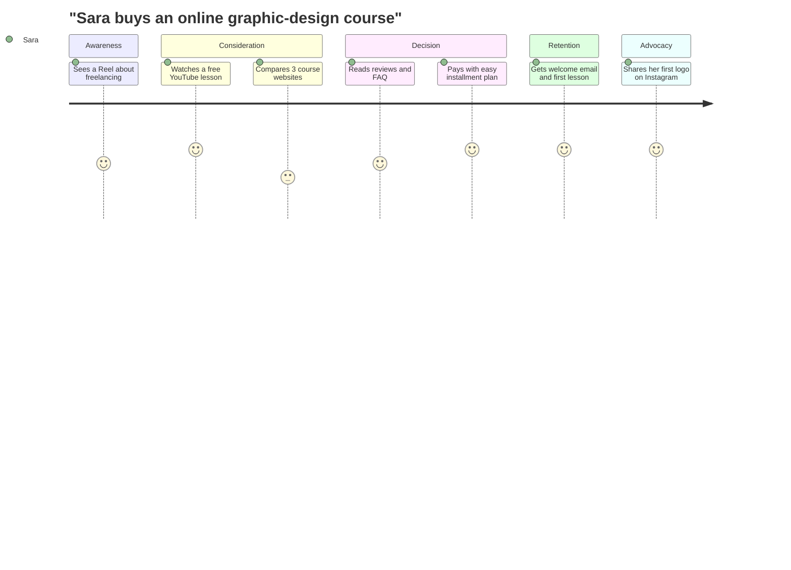
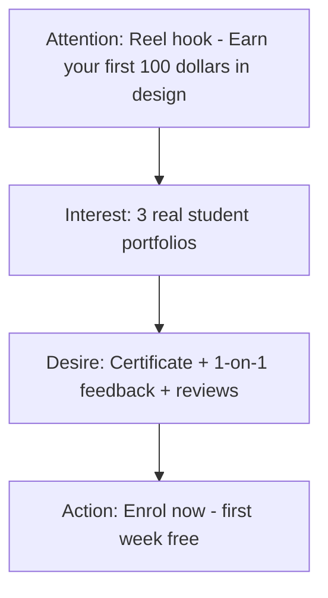
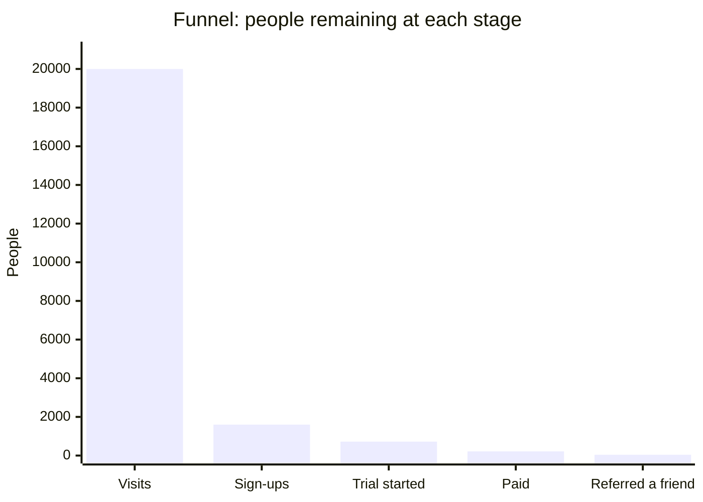

# Session 3 · Customer Journey and the AIDA Model

> 🏠 [Diploma in Digital Marketing](../../README.md) › [Term 1](../README.md) › [Foundations of Digital Marketing](README.md) › **Session 3**
>
> ⏱ **Estimated time:** 2 hours (1 h theory + 1 h lab) · 📋 **Prerequisites:** Sessions 1-2

[⬅ Previous: Session 2](session-02-marketing-fundamentals-brand-truth.md) · [Next: Session 4 ➡](session-04-role-of-digital-media.md)

---

## 🎯 Learning objectives

- Define the **customer journey** and explain each of its stages.
- Apply the **AIDA model** (Attention, Interest, Desire, Action) to ads, pages and emails.
- List the main **digital marketing platforms** and match them to journey stages.
- Build a detailed **buyer persona** from research data.
- Calculate stage-by-stage **funnel conversion rates**.

## 📖 Concepts

### 1. The customer journey

The **customer journey** is every step a person takes from first hearing about a brand to becoming a loyal fan. A common five-stage version:

| Stage | Customer mindset | Marketer's job | Example content |
|---|---|---|---|
| **Awareness** | "I have a problem / I've seen this brand" | Get noticed | Reels, display ads, PR |
| **Consideration** | "What are my options?" | Educate, compare | Blog guides, comparison videos, webinars |
| **Decision / Purchase** | "Which one, and is it safe to buy?" | Remove doubts | Reviews, free trials, discounts, easy checkout |
| **Retention** | "Did I choose well?" | Deliver and support | Onboarding emails, tutorials, support chat |
| **Advocacy** | "I love this – I'll tell others" | Reward and amplify | Referral codes, user-generated content, loyalty points |

A **touchpoint** is any moment the customer meets the brand (an ad, a DM reply, a delivery rider). A **journey map** lists touchpoints, the customer's feelings and the pain points at each stage.

### 2. The AIDA model

AIDA is a 100-year-old model that still structures modern ads and landing pages.

| Letter | Goal | Techniques |
|---|---|---|
| **A**ttention | Stop the scroll | Bold headline, striking image, motion in first 2 seconds, a question |
| **I**nterest | Keep them reading | Relatable problem, surprising fact, short story |
| **D**esire | Make them want it | Benefits (not features), social proof, demo, scarcity |
| **A**ction | Tell them exactly what to do | Clear call-to-action (CTA): "Book a free class", "Shop now – 20% off today" |

Modern variants add stages, e.g. **AIDAS** (+ Satisfaction) or **AIDCA** (+ Conviction).

### 3. Funnels and conversion rates

Each stage loses people. A **funnel** shows how many move from one stage to the next.

- **Stage conversion rate** = people at next stage ÷ people at this stage × 100
- **Overall conversion rate** = final customers ÷ people at the top × 100

### 4. Digital marketing platforms by stage

| Platform | Strongest stage | Why |
|---|---|---|
| TikTok, Instagram Reels, YouTube Shorts | Awareness | Massive discovery feeds |
| Google Search, YouTube long-form | Consideration | People actively researching |
| Google Shopping, Daraz, website | Decision | High purchase intent |
| Email, WhatsApp Business | Retention | Direct, owned channel |
| Instagram/Facebook communities, review sites | Advocacy | Sharing and social proof |
| LinkedIn | All stages for B2B | Professional audience |

### 5. Buyer personas

A **buyer persona** is a semi-fictional profile of your ideal customer, built from **real data** (surveys, analytics, interviews, sales calls) – not guesses.

A persona includes: name and photo (fictional), demographics, job, goals, pain points, objections, information sources, preferred channels, buying triggers and a quote in their own words.

## 🧭 Diagram





## 💻 Worked examples

### Example 1 – Funnel maths

A course website tracked one month of data. The calculation is done in Python so every number is exact:

📄 `code/session-03_funnel.py`

```python
# Funnel conversion calculator - Session 3, Foundations of Digital Marketing
stages = [
    ("Website visits", 20000),
    ("Free sign-ups", 1600),
    ("Started trial lesson", 720),
    ("Paid for course", 216),
    ("Referred a friend", 43),
]

top = stages[0][1]
print(f"{'Stage':<22}{'People':>8}{'Step CVR':>10}{'From top':>10}")
for i, (name, n) in enumerate(stages):
    step = "-" if i == 0 else f"{n / stages[i-1][1]:.1%}"
    print(f"{name:<22}{n:>8,}{step:>10}{n / top:>10.2%}")

# find the leakiest step (lowest step conversion)
steps = [(stages[i][0], stages[i+1][0], stages[i+1][1] / stages[i][1]) for i in range(len(stages) - 1)]
worst = min(steps, key=lambda s: s[2])
print(f"\nLeakiest step: {worst[0]} -> {worst[1]} ({worst[2]:.1%})")

# what if we lift the leakiest step from 8% to 10%?
new_signups = int(20000 * 0.10)
new_paid = new_signups * (720 / 1600) * (216 / 720)
print(f"If sign-up rate rises to 10%: {new_signups} sign-ups -> about {new_paid:.0f} paid customers (was 216)")
```

**Output**

```text
Stage                   People  Step CVR  From top
Website visits          20,000         -   100.00%
Free sign-ups            1,600      8.0%     8.00%
Started trial lesson       720     45.0%     3.60%
Paid for course            216     30.0%     1.08%
Referred a friend           43     19.9%     0.21%

Leakiest step: Website visits -> Free sign-ups (8.0%)
If sign-up rate rises to 10%: 2000 sign-ups -> about 270 paid customers (was 216)
```

**Reading the result:** the weakest step is *visit → sign-up*. Improving the landing page there gives the biggest gain, because every later stage multiplies from it.

### Example 2 – AIDA ad copy for a Facebook ad

| Stage | Copy |
|---|---|
| Attention | "Still paying PKR 15,000 a month for a gym you never visit? 🏋️" |
| Interest | "Our 25-minute home workouts need zero equipment – 3,200 Karachi members already train with us." |
| Desire | "Personal plan, live coach on WhatsApp, and members lose an average of 4 kg in 8 weeks." |
| Action | "Tap **Start Free Week** – no card needed." |

### Example 3 – A complete buyer persona

| Field | "Busy Bilal" |
|---|---|
| Age / location | 32, DHA Karachi |
| Job / income | Software team lead, PKR 450k/month |
| Goals | Get fit without losing family time |
| Pain points | Long work hours, traffic, gym crowded after 7 pm |
| Objections | "I've quit gyms before", "Online coaching feels impersonal" |
| Information sources | YouTube, LinkedIn, colleagues |
| Preferred channels | Instagram (evenings), WhatsApp, email for receipts |
| Buying trigger | Doctor warns about cholesterol; New Year |
| Quote | "Give me a plan that fits 30 minutes, and I'll stick to it." |

**How the persona changes the campaign:** schedule ads 9–11 pm, lead with "30 minutes", show results from people with desk jobs, and offer WhatsApp check-ins to beat the "impersonal" objection.

## 📊 Data snapshot



## 🧪 Lab / practice tasks

**Task 1 (easy):** Find one Instagram ad in your feed. Label which part is A, I, D and A.

**Task 2 (medium):** A store has 50,000 impressions, 1,000 clicks, 120 add-to-carts and 30 purchases. Compute each stage conversion rate and the overall rate (purchases ÷ impressions).

<details><summary>✅ Solution</summary>

Clicks/impressions = 2.0% · carts/clicks = 12.0% · purchases/carts = 25.0% · overall = 30 ÷ 50,000 = **0.06%**.

</details>

**Task 3 (medium):** Interview two classmates about a recent online purchase and draft a buyer persona from the answers.

**Task 4 (challenge):** Draw a customer journey map (table form) for a bank opening a digital account. Include touchpoints, emotions and one pain point per stage, and propose a fix for the worst pain point.

<details><summary>💡 Hint</summary>

Typical pain points: confusing KYC documents, long verification wait, unclear fees. Fixes: video guide, SMS status updates, fee calculator.

</details>

## ✅ Quick quiz

1. Comparing three brands' prices belongs to which stage? a) Awareness b) Consideration c) Retention d) Advocacy
2. In AIDA, "Shop now – 20% off today" is… a) Attention b) Interest c) Desire d) Action
3. Personas should be built from… a) Guesses b) Real research data c) Competitor ads d) Stock photos
4. 2,000 visitors, 100 sign-ups. Stage conversion rate? a) 2% b) 5% c) 20% d) 50%
5. Best channel for retention? a) Billboards b) Email/WhatsApp c) TV d) Display prospecting

<details><summary>Show answers</summary>

1-b · 2-d · 3-b · 4-b · 5-b

</details>

## 📝 Summary

- Journey: **Awareness → Consideration → Decision → Retention → Advocacy**.
- **AIDA:** grab Attention, build Interest, create Desire, prompt Action.
- Stage conversion = next ÷ current; overall = final ÷ top.
- Fix the **leakiest stage** first – improvements multiply down the funnel.
- Personas turn data into a person you can design campaigns for.

**Interview / viva questions**

1. What is a touchpoint? Give three examples.
2. Why is AIDA still useful for short-form video?
3. How would you find the weakest stage in a funnel?
4. What data sources would you use to build a persona?
5. Which platforms suit awareness and which suit decision?

---

[⬅ Previous: Session 2](session-02-marketing-fundamentals-brand-truth.md) · [Next: Session 4 ➡](session-04-role-of-digital-media.md)

<sub>Prepared by **Hamna Zahid Khan**, Junior Lecturer · Diploma in Digital Marketing</sub>
