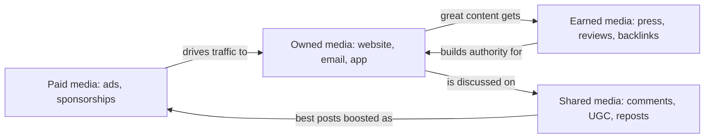
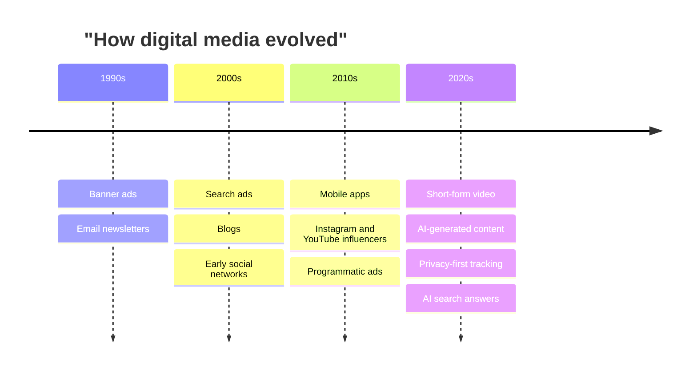
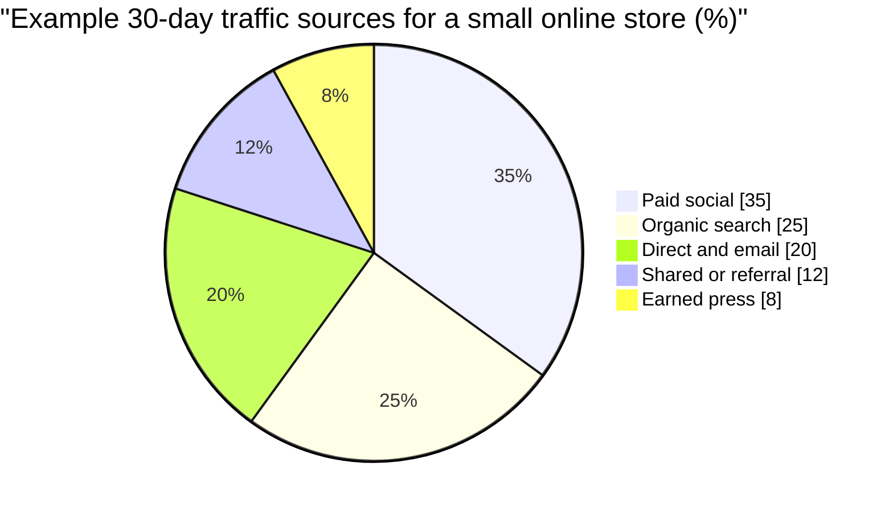

# Session 4 · Role of Digital Media

> 🏠 [Diploma in Digital Marketing](../../README.md) › [Term 1](../README.md) › [Foundations of Digital Marketing](README.md) › **Session 4**
>
> ⏱ **Estimated time:** 2 hours (1 h theory + 1 h lab) · 📋 **Prerequisites:** Sessions 1-3

[⬅ Previous: Session 3](session-03-customer-journey-aida.md) · [Next: Session 5 ➡](session-05-presentation-skills-and-website-basics.md)

---

## 🎯 Learning objectives

- Define **digital media** and its role in marketing.
- Classify digital media into **paid, owned, earned and shared (PESO)**.
- Weigh the **pros and cons** of digital media for a business.
- Describe current **trends in AI and digital media**.
- Calculate basic media metrics: **reach, frequency, CPM and engagement rate**.

## 📖 Concepts

### 1. What is digital media?

**Digital media** is any content created, stored and delivered in a digital format – text, images, audio, video, interactive tools – through the internet, apps or connected devices. For marketers, digital media is both the **message** (a video) and the **vehicle** (YouTube).

### 2. Types of digital media – the PESO model

| Type | You… | Examples | Cost | Control | Credibility |
|---|---|---|---|---|---|
| **Paid** | Pay for exposure | Google Ads, Meta ads, sponsored posts, influencer fees | 💰💰💰 | High | Low–medium |
| **Owned** | Own the channel | Website, blog, app, email list, YouTube channel | 💰 (time) | Full | Medium |
| **Earned** | Earn coverage from others | Press articles, reviews, organic shares, backlinks | Free (but hard) | Low | High |
| **Shared** | Co-create on social platforms | Comments, community posts, user-generated content, reposts | 💰 (time) | Medium | Medium–high |

The best strategies **combine all four**: paid ads drive people to owned content, which earns shares and press.

### 3. Content formats

| Format | Strength | Typical platforms |
|---|---|---|
| Short-form video | Discovery, emotion | TikTok, Reels, Shorts |
| Long-form video | Education, trust | YouTube |
| Images / carousels | Quick storytelling | Instagram, Facebook, LinkedIn |
| Articles / blogs | SEO, depth | Website, Medium, LinkedIn |
| Podcasts / audio | Loyalty, multitasking | Spotify, YouTube |
| Interactive (quizzes, calculators) | Engagement, lead capture | Website |
| Live streams | Real-time connection | Instagram Live, TikTok Live, YouTube |

### 4. Pros and cons of digital media

| ✅ Advantages | ⚠️ Disadvantages |
|---|---|
| Precise targeting by interest, location, behaviour | Ad fatigue and banner blindness |
| Measurable in real time | Ad blockers, tracking limits (cookies, iOS privacy) |
| Low entry cost, scalable | Intense competition and rising ad costs |
| Two-way interaction with customers | Negative comments spread fast |
| Easy to test and optimise | Platform algorithm changes reduce organic reach |
| Global reach 24/7 | Requires constant content production |

### 5. Key media metrics

| Metric | Formula | Meaning |
|---|---|---|
| **Impressions** | count | Times content was shown |
| **Reach** | count | Unique people who saw it |
| **Frequency** | impressions ÷ reach | Average times each person saw it |
| **CPM** | cost ÷ impressions × 1,000 | Cost per thousand impressions |
| **Engagement rate (by reach)** | (likes + comments + shares + saves) ÷ reach × 100 | How interesting the content was |

### 6. Trends in AI and digital media

- **Generative AI content:** tools draft captions, images and video scripts in seconds; humans edit for brand voice and accuracy.
- **Algorithmic feeds:** platforms show content based on predicted interest, not follower count – quality and watch-time matter more than ever.
- **Personalisation at scale:** AI tailors product recommendations and email subject lines per user.
- **Conversational marketing:** AI chatbots on WhatsApp and websites answer questions 24/7.
- **AI search experiences:** search engines now give AI-written summaries, so brands must be the trusted source those summaries cite.
- **Privacy-first measurement:** fewer third-party cookies → more first-party data and modelled conversions.
- **Creator economy:** micro-influencers with high trust often outperform celebrities on cost per result.

## 🧭 Diagram





## 💻 Worked examples

### Example 1 – Calculating reach, frequency, CPM and engagement

A clothing brand ran a 7-day Instagram campaign. The numbers are processed in Python:

📄 `code/session-04_media_metrics.py`

```python
# Media metrics for two Instagram ad creatives - Session 4
ads = {
    "Video A": {"cost": 45000, "impressions": 150000, "reach": 50000,
                "likes": 1200, "comments": 90, "shares": 60, "saves": 150},
    "Video B": {"cost": 45000, "impressions": 112500, "reach": 45000,
                "likes": 2300, "comments": 310, "shares": 280, "saves": 510},
}

for name, a in ads.items():
    frequency = a["impressions"] / a["reach"]
    cpm = a["cost"] / a["impressions"] * 1000
    engagements = a["likes"] + a["comments"] + a["shares"] + a["saves"]
    er = engagements / a["reach"] * 100
    cost_per_eng = a["cost"] / engagements
    print(f"{name}: frequency={frequency:.2f}  CPM=PKR {cpm:.0f}  "
          f"engagements={engagements:,}  ER={er:.2f}%  cost/engagement=PKR {cost_per_eng:.2f}")
```

**Output**

```text
Video A: frequency=3.00  CPM=PKR 300  engagements=1,500  ER=3.00%  cost/engagement=PKR 30.00
Video B: frequency=2.50  CPM=PKR 400  engagements=3,400  ER=7.56%  cost/engagement=PKR 13.24
```

**Interpretation:** Video B costs more per thousand but earns over twice the engagement rate, so it is the better creative to scale. A frequency above ~4 in one week can start causing ad fatigue.

### Example 2 – Building a PESO plan for a café launch

| Media | Action | KPI |
|---|---|---|
| Paid | PKR 40,000 Instagram ads targeting 3 km radius, ages 18–35 | Reach 120k, CPM < PKR 350 |
| Owned | Google Business Profile, Instagram page, simple website with menu | 500 profile actions |
| Earned | Invite 10 local food bloggers to a tasting night | 5 posts, 3 reviews |
| Shared | "Post your latte art, win a free drink" contest | 150 UGC posts |

### Example 3 – Responding to a negative comment (crisis mini-playbook)

1. **Respond fast** (within 1–2 hours on social).
2. **Acknowledge** publicly: "Sorry your order arrived cold, Hamza – that's not our standard."
3. **Move to private** for details: "We've sent you a DM to sort this out."
4. **Fix and follow up**: refund or replacement.
5. **Learn**: log the issue; if many similar complaints, fix the process.

## 📊 Data snapshot



## 🧪 Lab / practice tasks

**Task 1 (easy):** Classify these as paid, owned, earned or shared: a newspaper review, your brand's TikTok account, a boosted post, a customer's unboxing video.

<details><summary>✅ Answer</summary>

Earned · Owned · Paid · Shared (it is UGC; if the brand reposts it, it is still shared media).

</details>

**Task 2 (medium):** An ad got 240,000 impressions, reached 80,000 people and cost PKR 72,000. Compute frequency and CPM.

<details><summary>✅ Solution</summary>

Frequency = 240,000 ÷ 80,000 = **3.0**. CPM = 72,000 ÷ 240,000 × 1,000 = **PKR 300**.

</details>

**Task 3 (medium):** Write a 5-row pros/cons table for a local school considering TikTok marketing.

**Task 4 (challenge):** Use an AI writing tool to draft 3 captions for a product, then edit each one for accuracy, brand voice and a clear CTA. Submit "before" and "after" and explain your edits.

## ✅ Quick quiz

1. A brand's email list is… a) Paid b) Owned c) Earned d) Shared
2. Frequency = a) reach ÷ impressions b) impressions ÷ reach c) clicks ÷ impressions d) cost ÷ reach
3. Spend PKR 50,000 for 200,000 impressions. CPM? a) PKR 25 b) PKR 250 c) PKR 2,500 d) PKR 4
4. Which media type usually has the highest credibility? a) Paid b) Owned c) Earned d) Banner
5. A major risk of relying only on social platforms is… a) Too much control b) Algorithm changes reducing reach c) No mobile users d) Zero cost

<details><summary>Show answers</summary>

1-b · 2-b · 3-b · 4-c · 5-b

</details>

## 📝 Summary

- Digital media = digital content + the digital channels that carry it.
- **PESO:** Paid, Owned, Earned, Shared – combine them so each feeds the others.
- Pros: targeting, measurement, low entry cost; cons: fatigue, privacy limits, competition.
- Frequency = impressions ÷ reach; CPM = cost ÷ impressions × 1,000.
- AI trends: generative content, personalisation, chatbots, AI search, privacy-first measurement.

**Interview / viva questions**

1. Explain the PESO model with one example each.
2. Why is owned media called a long-term asset?
3. What does a very high frequency tell you?
4. How has AI changed content creation – and what still needs a human?
5. How should a brand handle a viral negative comment?

---

[⬅ Previous: Session 3](session-03-customer-journey-aida.md) · [Next: Session 5 ➡](session-05-presentation-skills-and-website-basics.md)

<sub>Prepared by **Hamna Zahid Khan**, Junior Lecturer · Diploma in Digital Marketing</sub>
