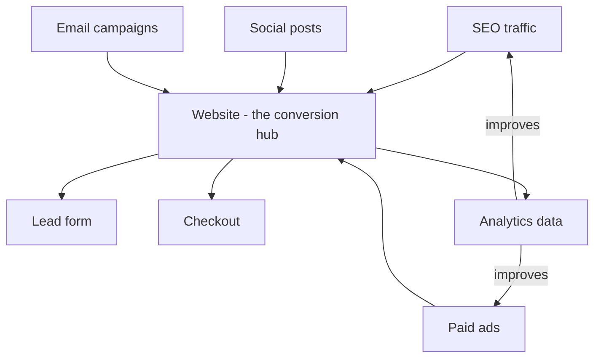
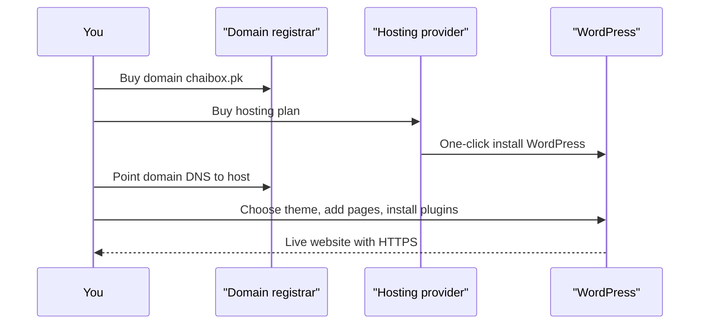

# Session 5 · Presentation Skills and Website Basics

> 🏠 [Diploma in Digital Marketing](../../README.md) › [Term 1](../README.md) › [Foundations of Digital Marketing](README.md) › **Session 5**
>
> ⏱ **Estimated time:** 2 hours (1 h theory + 1 h lab) · 📋 **Prerequisites:** Sessions 1-4

[⬅ Previous: Session 4](session-04-role-of-digital-media.md) · [Next: Foundations of Digital Marketing practice test ➡](practice-test.md)

---

## 🎯 Learning objectives

- Explain why **presentation skills** matter for marketers and structure a persuasive pitch.
- Design clear, data-led **slides** and present campaign results confidently.
- Explain the importance of a **website** as the hub of digital marketing.
- List the essential **pages and elements** of a marketing website.
- Create a basic **WordPress website** step by step.

## 📖 Concepts

### 1. Why marketers must present well

Marketers constantly sell ideas: pitching a campaign to a client, asking a manager for budget, reporting monthly results. A brilliant plan that is presented badly often gets rejected.

### 2. Structuring a persuasive presentation

A reliable structure is **Problem → Insight → Solution → Proof → Ask** (it mirrors AIDA):

| Part | Question it answers | Example (pitching an Instagram campaign) |
|---|---|---|
| Problem | What is wrong now? | "Online sales dropped 18% since March." |
| Insight | Why is it happening? | "72% of our buyers discover products on Instagram, but we post twice a month." |
| Solution | What do we do? | "A 6-week Reels + creator campaign." |
| Proof | Why believe it will work? | "Our pilot reel got 9× normal reach; competitor X grew 30% this way." |
| Ask | What do you need? | "Approve PKR 400,000 and two creator partnerships." |

### 3. Slide design rules

- **One idea per slide**; the headline states the takeaway ("Reels cut our CPA by 35%"), not a topic ("Results").
- **6 × 6 guideline**: at most ~6 bullets of ~6 words – better still, use a visual.
- Use **charts** for trends, **tables** for exact comparisons, **big numbers** for key results.
- Consistent fonts (max two), brand colours, high contrast, readable at the back of the room (24 pt+).
- Cite data sources on the slide.

### 4. Delivery skills

| Skill | Tip |
|---|---|
| Voice | Vary pace; pause after key numbers |
| Body language | Stand open, face the audience, purposeful gestures |
| Eye contact | 3–5 seconds per person, sweep the room |
| Nerves | Rehearse aloud 3 times; memorise the first 30 seconds |
| Q&A | Repeat the question, answer briefly, bridge back to your message; "I'll check and email you" is fine |
| Online presenting | Camera at eye level, good light in front, mute notifications |

### 5. Why websites matter for digital marketing

Social platforms are rented land; a **website is owned land**. It is where ads, SEO, email and social all point.

- **Credibility:** customers check websites before trusting a business.
- **Conversion hub:** sales, bookings, lead forms happen here.
- **Data:** analytics show who visits and what they do.
- **SEO:** only a website can rank for most Google searches.
- **Control:** no algorithm can switch it off.

### 6. Essential website elements

| Element | Purpose |
|---|---|
| Domain name (e.g. `chaibox.pk`) | Brand identity, memorable |
| Hosting | Server space that stores the site |
| SSL certificate (HTTPS) | Security and trust (padlock); a ranking signal |
| Home page | Clear value proposition + main CTA above the fold |
| About, Products/Services, Contact | Core information |
| Blog | SEO and education |
| Lead capture form / checkout | Conversions |
| Mobile-responsive design | Most traffic is mobile |
| Fast loading (< 3 s) | Users leave slow sites |
| Analytics + privacy policy | Measurement and legal compliance |

### 7. WordPress in a nutshell

**WordPress** is a free, open-source **Content Management System (CMS)** that powers a large share of all websites. It separates content (posts, pages) from design (**themes**) and adds features with **plugins**.

| Term | Meaning |
|---|---|
| WordPress.org | Self-hosted, full control (you buy hosting) |
| WordPress.com | Hosted service, easier but more limited on free plans |
| Theme | Controls look and layout |
| Plugin | Adds features (SEO, forms, shop, security) |
| Block editor (Gutenberg) | Drag-and-drop blocks for building pages |
| Dashboard | Admin area at `/wp-admin` |

## 🧭 Diagram





## 💻 Worked examples

### Example 1 – Building a WordPress site, step by step

1. **Buy a domain** from a registrar (for `.pk` domains, through PKNIC-approved resellers).
2. **Buy hosting** with one-click WordPress install and free SSL.
3. **Install WordPress** from the hosting control panel; set admin username (not "admin") and a strong password.
4. **Settings › General:** site title, tagline, timezone (Karachi). **Settings › Permalinks:** choose "Post name" for clean URLs like `/tea-gift-box/`.
5. **Appearance › Themes:** install a lightweight, responsive theme.
6. **Create pages:** Home, About, Shop/Services, Blog, Contact, Privacy Policy.
7. **Appearance › Menus:** build the main navigation.
8. **Plugins:** an SEO plugin, a form plugin, a caching plugin, a security plugin, WooCommerce if selling.
9. **Connect analytics** (Google Analytics 4 via Site Kit or a tag manager).
10. **Test** on mobile, check speed, submit the sitemap to Google Search Console.

### Example 2 – What a page looks like under the hood

Every WordPress page is ultimately HTML. This is a minimal landing page (you will learn the code properly in Module 2):

📄 `code/session-05_landing.html`

```html
<!DOCTYPE html>
<html lang="en">
<head>
  <meta charset="UTF-8">
  <meta name="viewport" content="width=device-width, initial-scale=1.0">
  <title>ChaiBox – Premium Tea Subscription in Pakistan</title>
  <meta name="description" content="Four premium loose-leaf teas delivered to your door every month.">
  <style>
    body { margin: 0; font-family: Arial, sans-serif; background: #fffaf3; color: #222; }
    header { background: #1d1029; color: #fff; padding: 16px 24px; font-weight: bold; }
    main { max-width: 640px; margin: 60px auto; padding: 0 24px; text-align: center; }
    h1 { font-size: 2.2rem; margin-bottom: 12px; }
    .cta { display: inline-block; background: #ff6b1a; color: #fff; padding: 14px 28px;
           border-radius: 8px; text-decoration: none; font-weight: bold; }
  </style>
</head>
<body>
  <header>ChaiBox</header>
  <main>
    <h1>Premium tea, delivered monthly</h1>
    <p>Four hand-picked blends, a brewing guide and free delivery in 5 cities.</p>
    <a class="cta" href="#subscribe">Start my subscription</a>
  </main>
</body>
</html>
```

**Output (what the browser shows):** a dark header with the brand name, a large headline "Premium tea, delivered monthly", one sentence of supporting text and an orange **Start my subscription** button.

### Example 3 – Turning results into a 5-slide report

| Slide | Headline (states the takeaway) | Visual |
|---|---|---|
| 1 | "October: Instagram drove 41% of sales" | Big number |
| 2 | "Reels cut cost per sale from PKR 900 to PKR 585" | Bar chart: CPA by format |
| 3 | "Most buyers came 8–11 pm on weekdays" | Heat-map table |
| 4 | "Checkout drop-off is our biggest leak (62%)" | Funnel |
| 5 | "Ask: PKR 150k more for Reels + fix checkout" | 3 bullets |

CPA improvement = (900 − 585) ÷ 900 = **35%**.

## 📊 Data snapshot

| Website factor | Why users leave if it fails |
|---|---|
| Load time > 3 s | Impatience on mobile data |
| No HTTPS padlock | Security fears at checkout |
| Unclear headline | Can't tell what you sell in 5 seconds |
| Hidden contact info | Low trust |
| Too many form fields | Effort > reward |

## 🧪 Lab / practice tasks

**Task 1 (easy):** Rewrite these topic headlines as takeaway headlines: "Traffic", "Budget", "Competitors".

<details><summary>💡 Example</summary>

"Traffic grew 22% after the blog launch" · "We spent 8% under budget" · "Competitor A out-posts us 3 to 1 on TikTok".

</details>

**Task 2 (medium):** Prepare and record a 2-minute pitch using Problem → Insight → Solution → Proof → Ask for a product of your choice.

**Task 3 (medium):** Create a free WordPress site (WordPress.com free plan or a local install) with Home, About, Blog and Contact pages and a menu.

**Task 4 (challenge):** Audit a local business website against the "Essential elements" table. Score each element 0–2 and present your top three fixes in three slides.

## ✅ Quick quiz

1. A good slide headline… a) Names the topic b) States the takeaway c) Is a question only d) Is in capitals
2. Which is "owned land"? a) Instagram page b) Website c) TikTok profile d) Facebook group
3. In WordPress, features are added with… a) Themes b) Plugins c) Permalinks d) Widgets only
4. HTTPS requires… a) A plugin only b) An SSL certificate c) A blog d) A theme
5. Best permalink setting for SEO? a) Plain `?p=123` b) Day and name c) Post name d) Numeric

<details><summary>Show answers</summary>

1-b · 2-b · 3-b · 4-b · 5-c

</details>

## 📝 Summary

- Present with **Problem → Insight → Solution → Proof → Ask**; one idea per slide.
- Headlines state the **takeaway**; use visuals for data.
- The website is the **owned hub** every channel points to.
- Essentials: domain, hosting, HTTPS, clear value proposition, mobile design, speed, analytics.
- WordPress = CMS with **themes** (look) + **plugins** (features).

**Interview / viva questions**

1. How do you handle a question you can't answer during a pitch?
2. Why shouldn't a business rely only on social media profiles?
3. What is the difference between WordPress.com and WordPress.org?
4. Name four plugins every marketing site needs and why.
5. How would you present a campaign that missed its target?

---

[⬅ Previous: Session 4](session-04-role-of-digital-media.md) · [Next: Foundations of Digital Marketing practice test ➡](practice-test.md)

<sub>Prepared by **Hamna Zahid Khan**, Junior Lecturer · Diploma in Digital Marketing</sub>
