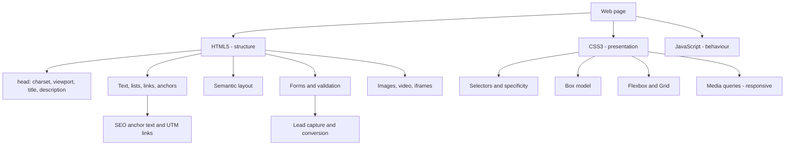

# Module 2 · Essentials of Website Design and Development

> 🏠 [Diploma in Digital Marketing](../../README.md) › [Term 1](../README.md) › **Module 2**

[⬅ Previous module](../01-foundations-of-digital-marketing/README.md) · [Start Session 1 ➡](session-01-web-and-html5-introduction.md) · [Next module ➡](../03-introduction-to-seo/README.md)

---

A marketer who understands how web pages are built can brief developers clearly, fix landing pages without waiting, and spot the technical issues that hurt SEO and conversion. This module covers HTML5 structure, text and links, CSS3 styling and layout, and forms that capture leads.

## 🎯 Module objectives

- Explain how the web works and write a valid **HTML5** page with a correct `<head>`.
- Format text, build lists, and create **hyperlinks, anchors and UTM-tracked links**.
- Style pages with **CSS3**: selectors, the cascade, specificity, colours and units.
- Control spacing and layout with the **box model, flexbox, grid** and **media queries**.
- Build accessible **tables, forms and media** and design a lead-capture landing page.

## 📅 Sessions

| # | Session | Prerequisites |
|---|---|---|
| 1 | [Introduction to the Web and HTML5](session-01-web-and-html5-introduction.md) | Basic computer and browser use |
| 2 | [Formatting Text, Hyperlinks and Anchors](session-02-formatting-text-hyperlinks-anchors.md) | Session 1 |
| 3 | [Introduction to CSS3](session-03-introduction-to-css3.md) | Sessions 1-2 |
| 4 | [Formatting Using Style Sheets](session-04-formatting-with-style-sheets.md) | Session 3 |
| 5 | [HTML Layout, Forms and Elements](session-05-html-layout-forms-elements.md) | Sessions 1-4 |
|  | 📝 [Module practice test](practice-test.md) | All sessions |

## 🧭 Concept map

## 📄 One-page cheat-sheet

| Topic | Remember this |
|---|---|
| Page skeleton | `<!DOCTYPE html>` → `<html lang>` → `<head>` (charset, viewport, title, description) + `<body>` |
| Three layers | HTML = structure · CSS = presentation · JavaScript = behaviour |
| Void tags | `br hr img input meta link` – no closing tag |
| Headings | One `<h1>`, don't skip levels; size is CSS's job |
| Semantic text | `strong em mark small del ins abbr blockquote` |
| Lists | `ul` unordered · `ol` steps · `dl` term/definition |
| Links | Absolute for other sites · relative inside yours · `mailto:` `tel:` `wa.me` |
| New tab | `target="_blank" rel="noopener noreferrer"` |
| Link `rel` | `nofollow` · `sponsored` (paid) · `ugc` (user content) |
| Anchor | `id="faq"` + `href="#faq"` (or `page.html#faq`) |
| UTM | `utm_source` · `utm_medium` · `utm_campaign` · `utm_content` · `utm_term` |
| Add CSS | Inline < Internal < **External** (cached, site-wide) |
| Cascade | `!important` → specificity → last rule wins |
| Specificity | (ID, Class, Element) – inline beats all selectors |
| Inherits | `color`, `font-*`, `line-height` – not margin/padding/border |
| Units | `rem` for text · `%`/`fr` for layout · `px` for borders · `vw/vh` for full-screen |
| Box model | Content → Padding → Border → Margin; use `box-sizing: border-box` |
| Shorthand order | Top · Right · Bottom · Left ("TRouBLe") |
| Layout | Flexbox = one row/column · Grid = rows and columns |
| Position | `relative` parent + `absolute` badge · `fixed` WhatsApp button · `sticky` header |
| Responsive | Viewport meta + `@media (min-width: 768px)`, mobile-first |
| Contrast | ≥ 4.5:1 normal text, ≥ 3:1 large text |
| Forms | `action` + `method="post"` · every field has `name` + `<label for>` |
| Validation | `required pattern min max minlength maxlength type` – re-check on server |
| Media | `img` needs `alt`, `width`, `height`, `loading="lazy"`; autoplay video must be `muted` |

| Formula | Calculation |
|---|---|
| content-box width | width + 2 × padding + 2 × border |
| border-box width | width (content shrinks) |
| Form conversion rate | Submissions ÷ Visits × 100 |

**Common mistakes:** using ` ` for spacing · "click here" anchor text · forgetting the viewport meta tag · inline styles everywhere · fighting specificity with `!important` · placeholder instead of label · light-grey text on white · tables for page layout · images without `alt` · long forms asking for data you don't need yet.

---

Prepared by **Hamna Zahid Khan**, Junior Lecturer · Diploma in Digital Marketing
