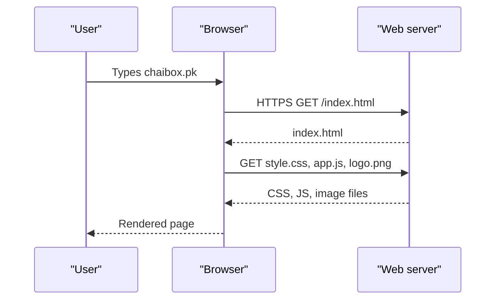
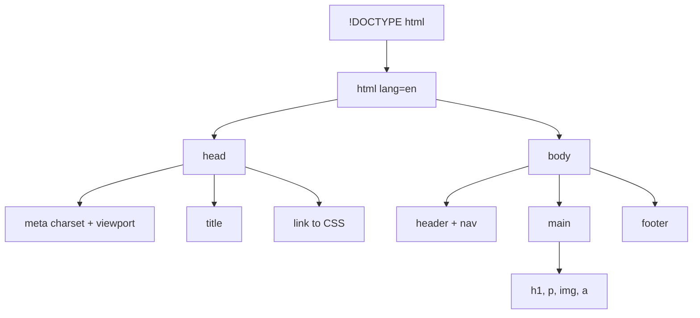

# Session 1 · Introduction to the Web and HTML5

> 🏠 [Diploma in Digital Marketing](../../README.md) › [Term 1](../README.md) › [Essentials of Website Design and Development](README.md) › **Session 1**
>
> ⏱ **Estimated time:** 2 hours (1 h theory + 1 h lab) · 📋 **Prerequisites:** Basic computer and browser use

[⬅ Previous: Essentials of Website Design and Development overview](README.md) · [Next: Session 2 ➡](session-02-formatting-text-hyperlinks-anchors.md)

---

## 🎯 Learning objectives

- Trace the **evolution of HTML** and explain the drawbacks of HTML 4 and XHTML.
- Describe the **page structure** of an HTML5 document, the **doctype**, and the parts of a tag.
- Explain the roles of **HTML, CSS, JavaScript and jQuery** on a web page.
- Use basic tags, **attributes, entities**, and tell **container** from **standalone (void)** tags.
- Explain **browser support** for HTML5 and why HTML5 matters on **mobile devices**.

## 📖 Concepts

### 1. How the web works (in 30 seconds)

A **browser** (client) asks a **web server** for a page using **HTTP/HTTPS**. The server returns files – HTML, CSS, JavaScript, images – and the browser turns them into what you see.

### 2. A short history of HTML

| Year | Version | Key point |
|---|---|---|
| 1991 | HTML (Tim Berners-Lee) | ~18 tags for linking documents |
| 1995 | HTML 2.0 | First formal standard, forms |
| 1997 | HTML 3.2 / 4.0 | Tables, styles, scripts – but presentational tags like `<font>` |
| 2000 | XHTML 1.0 | HTML rewritten with strict XML rules |
| 2014 | HTML5 (W3C Recommendation) | Semantic tags, audio/video, canvas, forms, APIs |
| Today | HTML Living Standard (WHATWG) | Continuously updated, no more version numbers |

**Drawbacks of HTML 4 and XHTML**

- HTML 4 mixed **content and presentation** (`<font>`, `<center>`), making sites hard to maintain.
- No native **audio/video** – needed plug-ins like Flash (insecure, battery-hungry, unsupported on phones).
- Only generic `<div>`s – no meaning for search engines or screen readers.
- XHTML was **unforgiving**: one unclosed tag could break the whole page when served as XML.
- Weak form controls – dates, emails and validation needed JavaScript.

### 3. What's new in HTML5

| Feature | Examples |
|---|---|
| **Semantic elements** | `<header> <nav> <main> <article> <section> <aside> <footer>` |
| **Multimedia** | `<audio>`, `<video>` without plug-ins |
| **Graphics** | `<canvas>`, inline `<svg>` |
| **New form inputs** | `type="email" "date" "number" "range" "tel" "url"`, `required`, `placeholder` |
| **APIs** | Geolocation, Local Storage, Drag and Drop, Web Workers |
| **Simpler syntax** | `<!DOCTYPE html>`, `<meta charset="UTF-8">` |

### 4. The three layers of a web page (+ jQuery)

| Layer | Job | Analogy |
|---|---|---|
| **HTML** | Structure and meaning | The skeleton |
| **CSS** | Presentation – colours, layout, fonts | The clothes |
| **JavaScript** | Behaviour – interactivity, data | The muscles |
| **jQuery** | A JavaScript library that shortened common tasks (`$('#btn').click(...)`) | A power tool – useful in older sites; modern JS now does most of it natively |

### 5. Anatomy of an HTML element

```text
<a  href="https://example.com"  target="_blank">  Visit us  </a>
 │   │                           │                 │         │
 │   attribute (name="value")    attribute        content   closing tag
 opening tag ───────────────────────────────────┘
```

- **Container tags** wrap content and need a closing tag: `<p>…</p>`, `<h1>…</h1>`, `<a>…</a>`.
- **Standalone (void) tags** have no content or closing tag: `<br>`, `<hr>`, ``, `<meta>`, `<link>`, `<input>`.

### 6. Doctype and basic page structure

`<!DOCTYPE html>` tells the browser to use **standards mode**. Every page then has `<html>`, a `<head>` (information *about* the page) and a `<body>` (what users see).

| Tag | Purpose |
|---|---|
| `<html lang="en">` | Root; `lang` helps screen readers and search engines |
| `<head>` | Metadata container |
| `<meta charset="UTF-8">` | Character encoding (supports Urdu, emoji, etc.) |
| `<meta name="viewport" …>` | Makes the page scale correctly on phones |
| `<title>` | Text on the browser tab and in Google results |
| `<meta name="description">` | Often shown as the search snippet |
| `<body>` | Visible content |
| `<h1>`–`<h6>`, `<p>`, `<br>`, `<hr>`, ``, `<a>` | Core content tags |

### 7. Attributes, data types and entities

- **Global attributes** work on any element: `id`, `class`, `style`, `title`, `lang`, `hidden`, `data-*`.
- Attribute values have types: text, URL (`href`, `src`), number (`width`), boolean (`required`, `disabled` – presence means true).
- **Entities** display reserved or special characters:

| Entity | Shows | Use |
|---|---|---|
| `&lt;` `&gt;` | < > | Show tags as text |
| `&amp;` | & | Ampersand |
| `&nbsp;` | (non-breaking space) | Keep words together |
| `&copy;` | © | Copyright line |
| `&quot;` | " | Quote inside attributes |
| `&#8377;` / `&#x20A8;` | ₹ / ₨ | Numeric code points |

### 8. Browser support and HTML5 on mobile

All modern browsers (Chrome, Edge, Firefox, Safari, Samsung Internet) support HTML5. For marketers, HTML5 on mobile means: video plays without plug-ins, the **viewport meta tag** makes pages responsive, `type="tel"` brings up the number keypad, and **geolocation** enables "stores near me".

## 🧭 Diagram





## 💻 Worked examples

### Example 1 – Your first HTML5 page

📄 `code/session-01_first_page.html`

```html
<!DOCTYPE html>
<html lang="en">
<head>
  <meta charset="UTF-8">
  <meta name="viewport" content="width=device-width, initial-scale=1.0">
  <title>Karachi Book Café | Books &amp; Coffee</title>
  <meta name="description" content="A cosy café in Karachi with 5,000 books, specialty coffee and weekend readings.">
</head>
<body>
  <h1>Karachi Book Café</h1>
  <p>Read, sip and relax. Every page title on this site uses one &lt;h1&gt; tag.</p>
  <hr>
  
  <p>
    <a href="https://instagram.com/" target="_blank" rel="noopener">Visit our Instagram</a>
  </p>
  <p>&copy; 2026 Karachi Book Café &ndash; Prices in &#8360;</p>
</body>
</html>
```

**Output (rendered in a browser):** tab title "Karachi Book Café | Books & Coffee"; a large heading **Karachi Book Café**; a paragraph; a horizontal line; a link "Visit our Instagram" that opens in a new tab; and a footer line "© 2026 Karachi Book Café – Prices in ₨". The `&lt;h1&gt;` entity displays literally as `<h1>`.

### Example 2 – Adding a dash of JavaScript

HTML gives structure; JavaScript adds behaviour. The same logic runs in Node.js so you can see its output:

📄 `code/session-01_greeting.js`

```javascript
// Personalised greeting based on the hour - Session 1
function greeting(hour, name) {
  let part;
  if (hour < 12) part = "Good morning";
  else if (hour < 17) part = "Good afternoon";
  else part = "Good evening";
  return `${part}, ${name}! Your coffee is 10% off until 6 pm.`;
}

for (const h of [9, 14, 20]) {
  console.log(`${String(h).padStart(2, "0")}:00 ->`, greeting(h, "Sana"));
}
```

**Output**

```text
09:00 -> Good morning, Sana! Your coffee is 10% off until 6 pm.
14:00 -> Good afternoon, Sana! Your coffee is 10% off until 6 pm.
20:00 -> Good evening, Sana! Your coffee is 10% off until 6 pm.
```

In a browser you would write the message into the page with `document.getElementById("greeting").textContent = message;`.

### Example 3 – jQuery vs modern JavaScript

```javascript
// jQuery (needs the library loaded)
$("#subscribe").on("click", () => $("#thanks").show());

// Modern JavaScript (no library)
document.querySelector("#subscribe")
  .addEventListener("click", () => document.querySelector("#thanks").hidden = false);
```

## 📊 Comparison table

| | HTML 4.01 | XHTML 1.0 | HTML5 |
|---|---|---|---|
| Doctype length | Long DTD URL | Long DTD URL | `<!DOCTYPE html>` |
| Error handling | Forgiving, inconsistent | Strict (XML) | Forgiving, *specified* |
| Video/audio | Plug-ins | Plug-ins | Native |
| Semantics | `div` only | `div` only | `header`, `nav`, `article`… |
| Mobile friendliness | Poor | Poor | Viewport, touch inputs |

## 🧪 Lab / practice tasks

**Task 1 (easy):** Create `index.html` for a fictional shop with doctype, `lang`, charset, viewport, title, description, one `<h1>`, two paragraphs and an image with `alt` text.

**Task 2 (medium):** Display this text exactly on a page: `Use <strong> for important text & keep it short`.

<details><summary>✅ Solution</summary>

```html
<p>Use &lt;strong&gt; for important text &amp; keep it short</p>
```

</details>

**Task 3 (medium):** Classify as container or void: `p, img, br, a, input, h2, meta, ul, hr, li`.

<details><summary>✅ Answer</summary>

Container: p, a, h2, ul, li. Void: img, br, input, meta, hr.

</details>

**Task 4 (challenge):** Validate your page with the W3C validator (validator.w3.org). Deliberately break one rule (e.g. remove `alt`), note the warning, and fix it.

## ✅ Quick quiz

1. The HTML5 doctype is… a) `<!DOCTYPE html>` b) `<html5>` c) `<!DOCTYPE HTML PUBLIC…>` d) not needed
2. Which tag is void? a) `<p>` b) `` c) `<a>` d) `<li>`
3. Which layer controls behaviour? a) HTML b) CSS c) JavaScript d) Doctype
4. `&copy;` displays… a) © b) ® c) & d) a space
5. Why is the viewport meta tag important? a) SEO keywords b) Correct scaling on mobile c) Adds video d) Loads jQuery

<details><summary>Show answers</summary>

1-a · 2-b · 3-c · 4-a · 5-b

</details>

## 📝 Summary

- HTML evolved from simple linked documents to HTML5's **semantic, multimedia, mobile-ready** standard.
- HTML = structure, CSS = presentation, JavaScript = behaviour; jQuery is an optional older helper library.
- Every page: `<!DOCTYPE html>` → `<html>` → `<head>` + `<body>`.
- Elements have opening tags, attributes, content and closing tags; void tags have no closing tag.
- Use **entities** for reserved characters.

**Interview / viva questions**

1. What problems in HTML 4 did HTML5 solve?
2. Why do search engines care about semantic tags?
3. What's the difference between `<head>` and `<header>`?
4. When would you still meet jQuery in the real world?
5. What does `lang="en"` do?

---

[⬅ Previous: Essentials of Website Design and Development overview](README.md) · [Next: Session 2 ➡](session-02-formatting-text-hyperlinks-anchors.md)

<sub>Prepared by **Hamna Zahid Khan**, Junior Lecturer · Diploma in Digital Marketing</sub>
