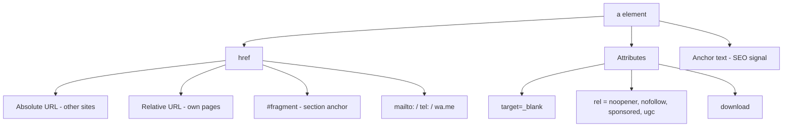
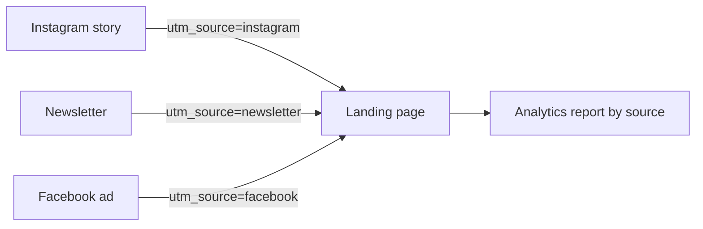

# Session 2 · Formatting Text, Hyperlinks and Anchors

> 🏠 [Diploma in Digital Marketing](../../README.md) › [Term 1](../README.md) › [Essentials of Website Design and Development](README.md) › **Session 2**
>
> ⏱ **Estimated time:** 2 hours (1 h theory + 1 h lab) · 📋 **Prerequisites:** Session 1

[⬅ Previous: Session 1](session-01-web-and-html5-introduction.md) · [Next: Session 3 ➡](session-03-introduction-to-css3.md)

---

## 🎯 Learning objectives

- Structure content with **headings, paragraphs and line breaks** in a logical hierarchy.
- Apply **phrase (inline) formatting tags** and know which ones carry meaning versus appearance.
- Build **ordered, unordered and description lists**, including nested lists.
- Create **hyperlinks** with absolute and relative URLs, `target`, `rel`, `mailto:`, `tel:` and `download`.
- Use **anchors (fragment links)** to jump to sections on the same page or another page.
- Write **SEO-friendly anchor text** and build **UTM-tagged links** for campaign tracking.

## 📖 Concepts

### 1. Headings and paragraphs

HTML has six heading levels, `<h1>` to `<h6>`. They describe the **outline** of a page, not the size of text (CSS controls size).

| Rule | Why it matters |
|---|---|
| One `<h1>` per page, describing the main topic | Search engines and screen readers treat it as the page title |
| Do not skip levels (`h2` → `h4`) | Keeps the outline logical for assistive technology |
| Use `<p>` for paragraphs, not `<br><br>` | Paragraphs can be styled and spaced consistently |
| `<br>` only for real line breaks (addresses, poems) | `<br>` is not a spacing tool |
| `<hr>` marks a **thematic break** | A change of topic, not just a line |

### 2. Phrase (inline) formatting tags

Some tags add **meaning** (semantic); others mostly change **appearance** (presentational). Prefer the semantic ones.

| Tag | Meaning | Default look |
|---|---|---|
| `<strong>` | Strong importance | **Bold** |
| `<em>` | Stress emphasis | *Italic* |
| `<b>` / `<i>` | Draw attention / alternate voice, no extra importance | Bold / italic |
| `<mark>` | Highlighted, relevant text | Yellow background |
| `<small>` | Side comments, fine print | Smaller text |
| `<del>` / `<ins>` | Deleted / inserted text | ~~Strikethrough~~ / underline |
| `<sub>` / `<sup>` | Subscript / superscript | H₂O, x² |
| `<abbr title="…">` | Abbreviation with expansion | Dotted underline on hover |
| `<q>` / `<blockquote>` | Short inline quote / long block quote | Quotation marks / indented block |
| `<cite>` | Title of a work | Italic |
| `<code>`, `<kbd>`, `<pre>` | Code, keyboard input, preformatted text | Monospace; `<pre>` keeps spaces |

**Marketing use:** `<del>₨ 180</del> <ins>₨ 150</ins>` shows a price drop clearly and is understood by assistive technology; `<small>` is the right tag for terms and conditions.

### 3. Lists

| List | Tag | Use for | Useful attributes |
|---|---|---|---|
| Unordered | `<ul>` + `<li>` | Features, benefits – order doesn't matter | – |
| Ordered | `<ol>` + `<li>` | Steps, rankings | `start="5"`, `reversed`, `type="A" / "i"` |
| Description | `<dl>` + `<dt>` + `<dd>` | Term–definition pairs, FAQs, specs | – |

Lists can be **nested**: put a complete `<ul>` *inside* an `<li>`. Navigation menus are almost always a `<ul>` of links styled with CSS.

### 4. Hyperlinks

A link is the `<a>` (anchor) element with an `href`.

| Link type | Example `href` | Notes |
|---|---|---|
| **Absolute URL** | `https://chaibox.pk/menu` | Full address – use for other websites |
| **Relative URL** | `menu.html`, `../about.html`, `images/logo.png` | Relative to the current file – use inside your own site |
| **Root-relative** | `/contact` | From the site's root folder |
| **Email** | `mailto:hello@chaibox.pk?subject=Order` | Opens the mail app |
| **Phone** | `tel:+922100000000` | Tap-to-call on mobiles – a big conversion booster |
| **Download** | `files/menu.pdf` + `download` attribute | Downloads instead of opening |
| **WhatsApp** | `https://wa.me/923001234567` | Common for Pakistani businesses |

**Important attributes**

- `target="_blank"` opens a new tab. Pair it with `rel="noopener noreferrer"` for security.
- `title="…"` gives extra hover information (don't rely on it for key content).
- `rel` values marketers must know:

| `rel` value | Tells search engines |
|---|---|
| `nofollow` | Don't pass ranking credit through this link |
| `sponsored` | This is a paid or affiliate link |
| `ugc` | This link is user-generated (comments, forums) |

### 5. Anchors (fragment links)

Give any element an `id`, then link to it with `#id`.

```html
<h2 id="pricing">Pricing</h2>
...
<a href="#pricing">See pricing</a>            <!-- same page -->
<a href="services.html#pricing">Pricing</a>   <!-- section on another page -->
<a href="#">Back to top</a>                   <!-- top of page -->
```

Rules: an `id` must be **unique** on the page, contain **no spaces**, and match the link exactly (case-sensitive). Long landing pages, FAQs and tables of contents use anchors so users jump straight to what they need.

### 6. Anchor text and SEO

The clickable words are the **anchor text**. Search engines use it to understand the target page.

| ❌ Weak | ✅ Strong |
|---|---|
| "Click here" | "View our winter chai menu" |
| "Read more" | "Read the 2026 Karachi café price guide" |
| A bare URL | Descriptive words that match the destination |

### 7. Tracking links with UTM parameters

Add `utm_source`, `utm_medium`, `utm_campaign` (and optionally `utm_content`, `utm_term`) to a URL so analytics tools report **which ad, post or email** sent each visitor. You build the link; HTML doesn't change.

## 🧭 Diagram





## 💻 Worked examples

### Example 1 – A menu page with formatting, lists and links

📄 `code/session-02_text_links.html`

```html
<!DOCTYPE html>
<html lang="en">
<head>
  <meta charset="UTF-8">
  <meta name="viewport" content="width=device-width, initial-scale=1.0">
  <title>Chai Box Menu | Karachi</title>
</head>
<body>
  <!-- In-page navigation using anchors -->
  <nav>
    <a href="#menu">Menu</a> |
    <a href="#offers">Offers</a> |
    <a href="#contact">Contact</a>
  </nav>

  <h1 id="top">Chai Box</h1>
  <p>Karachi's <strong>freshest</strong> doodh patti, brewed <em>to order</em>.</p>

  <h2 id="menu">Menu</h2>
  <ol>
    <li>Doodh Patti – <del>₨ 180</del> <ins>₨ 150</ins></li>
    <li>Kashmiri Chai – ₨ 250</li>
    <li>Green Tea – ₨ 120</li>
  </ol>

  <h2 id="offers">Offers</h2>
  <p><mark>Buy 2, get 1 free</mark> every Friday.<sup>*</sup></p>
  <p><small>*Valid at DHA branch only.</small></p>
  <blockquote cite="https://g.page/chaibox">
    "Best chai in Clifton, hands down." – Google review
  </blockquote>

  <h2 id="contact">Contact</h2>
  <dl>
    <dt>Phone</dt>
    <dd><a href="tel:+922100000000">021-0000-0000</a></dd>
    <dt>Email</dt>
    <dd><a href="mailto:hello@chaibox.pk?subject=Bulk%20order">hello@chaibox.pk</a></dd>
    <dt>Menu PDF</dt>
    <dd><a href="files/menu.pdf" download>Download menu</a></dd>
    <dt>Instagram</dt>
    <dd><a href="https://www.instagram.com/" target="_blank" rel="noopener noreferrer">Follow us</a></dd>
  </dl>

  <p><a href="#top">Back to top ↑</a></p>
</body>
</html>
```

**Output (rendered):** a top navigation of three links that jump down the page; a heading and a paragraph with **freshest** in bold and *to order* in italics; a numbered menu showing the old price ~~₨ 180~~ beside the new ₨ 150; a highlighted Friday offer with a superscript asterisk and small fine print; an indented review quote; a contact list where the phone number dials on a mobile, the email opens a pre-filled subject, the menu downloads, and Instagram opens in a new tab.

### Example 2 – Building UTM-tracked campaign links

📄 `code/session-02_utm_builder.js`

```javascript
// Build tracked campaign links (UTM parameters) for a landing page
function buildUtm(base, { source, medium, campaign, content }) {
  const url = new URL(base);
  url.searchParams.set("utm_source", source);
  url.searchParams.set("utm_medium", medium);
  url.searchParams.set("utm_campaign", campaign);
  if (content) url.searchParams.set("utm_content", content);
  return url.toString();
}

const page = "https://chaibox.pk/offers";
const placements = [
  { source: "instagram", medium: "social", campaign: "friday_bogo", content: "story" },
  { source: "facebook", medium: "cpc", campaign: "friday_bogo", content: "carousel" },
  { source: "newsletter", medium: "email", campaign: "friday_bogo" },
];

for (const p of placements) {
  console.log(`${p.source.padEnd(10)} → ${buildUtm(page, p)}`);
}

// Anchor links point to a section on the same or another page
const anchor = new URL("https://chaibox.pk/menu#kashmiri");
console.log("\nPage:", anchor.pathname, "| Section (fragment):", anchor.hash);
```

**Output**

```text
instagram  → https://chaibox.pk/offers?utm_source=instagram&utm_medium=social&utm_campaign=friday_bogo&utm_content=story
facebook   → https://chaibox.pk/offers?utm_source=facebook&utm_medium=cpc&utm_campaign=friday_bogo&utm_content=carousel
newsletter → https://chaibox.pk/offers?utm_source=newsletter&utm_medium=email&utm_campaign=friday_bogo

Page: /menu | Section (fragment): #kashmiri
```

Each placement gets its own link, so the analytics report can separate story clicks from carousel clicks and email clicks for the same campaign.

### Example 3 – Relative paths in a site folder

```text
site/
├── index.html
├── about.html
├── images/logo.png
└── blog/
    └── post-1.html
```

| From | To | Relative `href` |
|---|---|---|
| `index.html` | `about.html` | `about.html` |
| `index.html` | `logo.png` | `images/logo.png` |
| `blog/post-1.html` | `index.html` | `../index.html` |
| `blog/post-1.html` | `logo.png` | `../images/logo.png` |

## 📊 Comparison table

| | `<strong>` | `<b>` | `<em>` | `<i>` |
|---|---|---|---|---|
| Adds meaning | Yes – importance | No | Yes – stress | No |
| Screen reader | May change tone | Normal | May change tone | Normal |
| Typical use | Warnings, key benefits | Product names, keywords | Spoken stress | Foreign words, terms |

## 🧪 Lab / practice tasks

**Task 1 (easy):** Create an "About us" page with one `<h1>`, two `<h2>` sections, a bulleted list of four benefits and a numbered list of three steps to order.

**Task 2 (medium):** Write a link that opens `https://wa.me/923001234567` in a new tab safely, with the anchor text "Order on WhatsApp".

<details><summary>✅ Solution</summary>

```html
<a href="https://wa.me/923001234567" target="_blank" rel="noopener noreferrer">Order on WhatsApp</a>
```

</details>

**Task 3 (medium):** Build an FAQ page with five questions. Add a table of contents at the top that jumps to each answer, and a "Back to top" link after each answer.

<details><summary>✅ Solution outline</summary>

```html
<ul>
  <li><a href="#delivery">Do you deliver?</a></li>
  <li><a href="#payment">How can I pay?</a></li>
</ul>
<h2 id="delivery">Do you deliver?</h2>
<p>Yes, across Karachi within 45 minutes.</p>
<p><a href="#">Back to top</a></p>
```

</details>

**Task 4 (challenge):** A blog post at `blog/2026/winter-menu.html` must link to `index.html` and `images/chai.jpg` at the site root. Write both relative links, then generate three UTM links (Instagram, email, Facebook ads) for the post.

<details><summary>✅ Answer</summary>

`../../index.html` and `../../images/chai.jpg`. UTM example: `https://chaibox.pk/blog/2026/winter-menu.html?utm_source=instagram&utm_medium=social&utm_campaign=winter_menu`.

</details>

## ✅ Quick quiz

1. Which tag adds *importance* rather than just bold styling? a) `<b>` b) `<strong>` c) `<mark>` d) `<big>`
2. A link to `#faq` goes to… a) a file called faq b) the element with `id="faq"` c) Google d) the top of the site
3. Which attribute pair is recommended when opening a link in a new tab? a) `target="_blank" rel="noopener"` b) `href="_new"` c) `rel="nofollow"` only d) `download`
4. For a paid affiliate link, the correct `rel` value is… a) `ugc` b) `sponsored` c) `author` d) `next`
5. Which is the best anchor text? a) "Click here" b) "Link" c) "Compare our three internet packages" d) "More"

<details><summary>Show answers</summary>

1-b · 2-b · 3-a · 4-b · 5-c

</details>

## 📝 Summary

- Headings form the page **outline**: one `<h1>`, no skipped levels; size is CSS's job.
- Prefer **semantic** inline tags (`<strong>`, `<em>`, `<del>`, `<ins>`, `<small>`) over purely visual ones.
- Lists: `<ul>` for unordered, `<ol>` for steps, `<dl>` for term–definition pairs.
- Links use absolute URLs for other sites and **relative** URLs inside your own; `mailto:`, `tel:` and WhatsApp links drive conversions.
- **Anchors** (`#id`) jump to sections; ids must be unique.
- Descriptive **anchor text**, correct `rel` values and **UTM** parameters connect HTML to SEO and analytics.

**Interview / viva questions**

1. What is the difference between an absolute and a relative URL? When would you use each?
2. Why should you avoid "click here" as anchor text?
3. Explain `nofollow`, `sponsored` and `ugc`.
4. Why add `rel="noopener"` to links with `target="_blank"`?
5. How do UTM parameters help a marketer judge campaign performance?

---

[⬅ Previous: Session 1](session-01-web-and-html5-introduction.md) · [Next: Session 3 ➡](session-03-introduction-to-css3.md)

<sub>Prepared by **Hamna Zahid Khan**, Junior Lecturer · Diploma in Digital Marketing</sub>
