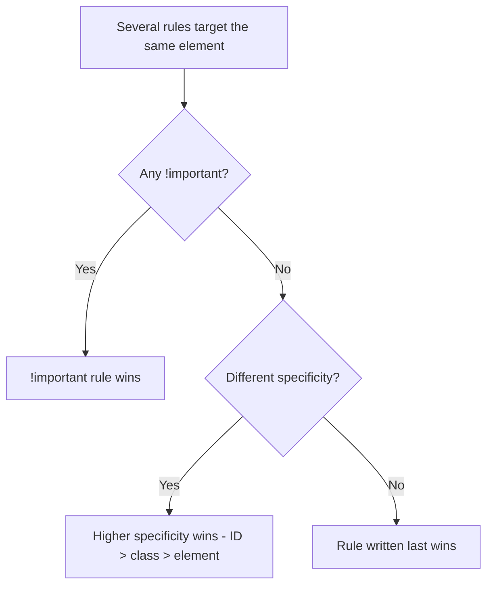
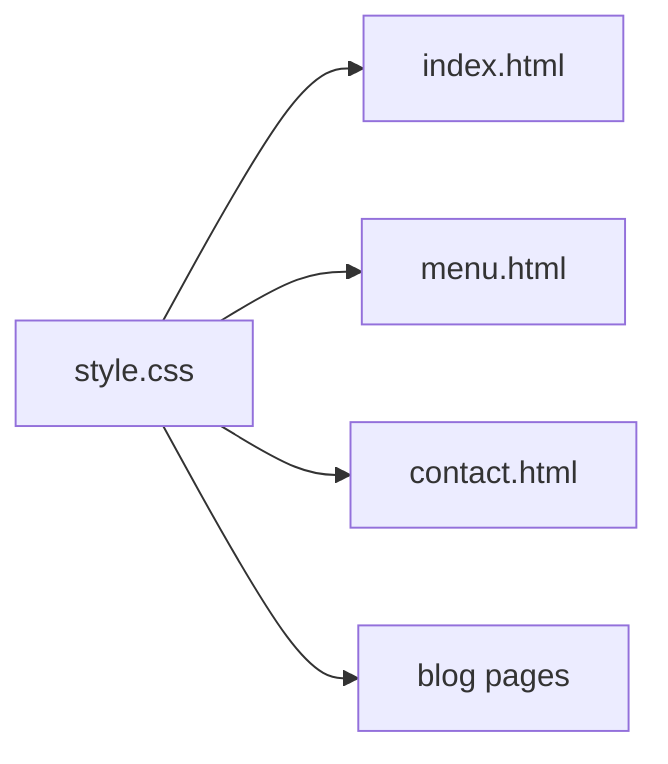

# Session 3 · Introduction to CSS3

> 🏠 [Diploma in Digital Marketing](../../README.md) › [Term 1](../README.md) › [Essentials of Website Design and Development](README.md) › **Session 3**
>
> ⏱ **Estimated time:** 2 hours (1 h theory + 1 h lab) · 📋 **Prerequisites:** Sessions 1-2

[⬅ Previous: Session 2](session-02-formatting-text-hyperlinks-anchors.md) · [Next: Session 4 ➡](session-04-formatting-with-style-sheets.md)

---

## 🎯 Learning objectives

- Explain what **CSS** is and why presentation is kept separate from HTML structure.
- Write CSS **rules** using correct syntax: selector, property, value, declaration block.
- Attach CSS in three ways – **inline, internal and external** – and choose the right one.
- Use the main **selector types**: element, class, ID, universal, grouping, descendant, child, attribute, pseudo-class and pseudo-element.
- Explain the **cascade, specificity and inheritance**, and predict which rule wins.
- Use CSS **colour formats** (names, hex, RGB, HSL) and **units** (px, %, em, rem, vw/vh).

## 📖 Concepts

### 1. What CSS does

**CSS (Cascading Style Sheets)** controls how HTML looks: colours, fonts, spacing, layout and animation. One external style sheet can restyle hundreds of pages at once, which keeps a brand consistent and makes redesigns cheap. **CSS3** is the name for the modular set of CSS features added after CSS 2.1 – rounded corners, shadows, gradients, transitions, flexbox, grid and media queries.

### 2. Anatomy of a CSS rule

```text
  selector      declaration block
     │      ┌──────────────────────────────┐
     h1     {  color: #7a3e00;  font-size: 2rem;  }
               │       │
            property  value      ← property: value; = one declaration
```

- Each declaration ends with a **semicolon**.
- Comments use `/* … */`.
- Property names are lowercase; values like colours are not case-sensitive.

### 3. Three ways to add CSS

| Method | How | Scope | When to use |
|---|---|---|---|
| **Inline** | `<p style="color:red">` | One element | Quick tests, email templates |
| **Internal** | `<style>` in the `<head>` | One page | One-off landing pages |
| **External** | `<link rel="stylesheet" href="style.css">` | Whole site | ✅ Default choice – cached, reusable, consistent |

External files are downloaded once and **cached** by the browser, so later pages load faster – good for user experience and SEO.

### 4. Selectors

| Selector | Syntax | Selects |
|---|---|---|
| Universal | `*` | Every element |
| Element (type) | `p` | All `<p>` |
| Class | `.price` | Elements with `class="price"` – reusable, many per page |
| ID | `#offer-banner` | The one element with that id |
| Grouping | `h1, h2` | Both |
| Descendant | `nav a` | `<a>` anywhere inside `<nav>` |
| Child | `ul > li` | Direct children only |
| Adjacent sibling | `h2 + p` | The first `<p>` right after an `<h2>` |
| Attribute | `a[target="_blank"]` | Links that open in a new tab |
| Pseudo-class | `a:hover`, `li:first-child`, `input:focus` | Elements in a state or position |
| Pseudo-element | `p::first-line`, `a::after` | A part of an element, or generated content |

**Link states** must be written in the order `:link`, `:visited`, `:hover`, `:active` (memory aid: **LoVe HAte**). Always style `:focus` too, so keyboard users can see where they are.

### 5. The cascade, specificity and inheritance

When several rules set the same property on the same element, the browser decides in this order:

1. **Importance** – `!important` declarations win (avoid; they make CSS hard to maintain).
2. **Specificity** – the more specific selector wins.
3. **Source order** – if specificity ties, the rule written **last** wins.

**Specificity score (ID, Class, Element)**

| Selector | Score |
|---|---|
| `p` | (0, 0, 1) |
| `.price` | (0, 1, 0) |
| `nav a:hover` | (0, 1, 2) |
| `#menu .price` | (1, 1, 0) |
| Inline `style=""` | Beats any selector |

Compare left to right: one ID beats any number of classes; one class beats any number of elements.

**Inheritance:** text properties such as `color`, `font-family`, `font-size` and `line-height` pass from a parent to its children. Box properties such as `margin`, `padding`, `border` and `background` do **not** inherit. That's why setting `font-family` on `body` styles the whole page.

### 6. Colours

| Format | Example | Notes |
|---|---|---|
| Named | `crimson` | 140+ names, limited control |
| Hex | `#7a3e00`, short `#fa0` | Most common in brand guidelines |
| RGB / RGBA | `rgb(255, 214, 102)`, `rgba(0,0,0,0.5)` | A = transparency (0–1) |
| HSL / HSLA | `hsl(140, 60%, 30%)` | Hue, Saturation, Lightness – easy to make lighter/darker shades |

Marketers usually receive brand colours as hex codes in a style guide; keep them in one place (for example as CSS **custom properties**: `:root { --brand: #7a3e00; }` then `color: var(--brand);`).

### 7. Units

| Unit | Relative to | Good for |
|---|---|---|
| `px` | Screen pixel | Borders, fine details |
| `%` | Parent element | Widths in fluid layouts |
| `em` | Current element's font size | Padding that scales with text |
| `rem` | Root (`html`) font size, usually 16px | ✅ Font sizes and spacing – respects user settings |
| `vw` / `vh` | 1% of viewport width / height | Full-screen hero sections |

## 🧭 Diagram





## 💻 Worked examples

### Example 1 – An external style sheet

📄 `code/session-03_style.css`

```css
/* style.css – external style sheet for the Chai Box page */

/* Universal selector: a predictable starting point */
* {
  box-sizing: border-box;
}

/* Element selector */
body {
  font-family: "Segoe UI", Arial, sans-serif;
  color: #333333;
  background-color: #fffaf3;
  line-height: 1.6;
  margin: 0;
}

/* Grouping selector */
h1, h2 {
  color: #7a3e00;
}

/* Class selector – reusable */
.price {
  color: hsl(140, 60%, 30%);
  font-weight: bold;
}

/* ID selector – one unique element */
#offer-banner {
  background: rgb(255, 214, 102);
  padding: 1rem;
  text-align: center;
}

/* Descendant selector: links inside nav only */
nav a {
  color: #7a3e00;
  text-decoration: none;
}

/* Pseudo-classes: link states (LoVe HAte order) */
nav a:hover,
nav a:focus {
  text-decoration: underline;
}

/* Attribute selector: external links */
a[target="_blank"]::after {
  content: " ↗";
}

/* Pseudo-element: style the first line of the intro */
.intro::first-line {
  font-variant: small-caps;
}

/* Relative units scale with the user's font settings */
.container {
  max-width: 60rem;
  margin: 0 auto;
  padding: 0 5%;
}
```

### Example 2 – Linking it, plus internal and inline styles

📄 `code/session-03_page.html`

```html
<!DOCTYPE html>
<html lang="en">
<head>
  <meta charset="UTF-8">
  <meta name="viewport" content="width=device-width, initial-scale=1.0">
  <title>Chai Box | Styled with CSS</title>
  <!-- 1. External style sheet (recommended) -->
  <link rel="stylesheet" href="session-03_style.css">
  <!-- 2. Internal style sheet (this page only) -->
  <style>
    footer { font-size: 0.875rem; color: #777; }
  </style>
</head>
<body>
  <div id="offer-banner">Friday deal: buy 2 chais, get 1 free</div>
  <div class="container">
    <nav>
      <a href="#menu">Menu</a> · <a href="https://www.instagram.com/" target="_blank" rel="noopener">Instagram</a>
    </nav>
    <h1>Chai Box</h1>
    <p class="intro">Freshly brewed doodh patti, delivered hot across Karachi.</p>
    <h2 id="menu">Menu</h2>
    <p>Doodh Patti <span class="price">₨ 150</span></p>
    <p>Kashmiri Chai <span class="price">₨ 250</span></p>
    <!-- 3. Inline style (avoid except for quick tests) -->
    <p style="color: crimson;">Limited stock today!</p>
  </div>
  <footer class="container">© 2026 Chai Box</footer>
</body>
</html>
```

**Output (rendered):** a cream background with dark-grey text; a yellow centred offer banner across the top; brown headings; green bold prices; navigation links that underline on hover or keyboard focus; an arrow ↗ automatically added after the Instagram link because it opens in a new tab; the intro's first line in small capitals; red "Limited stock today!" from the inline style; and a small grey footer from the internal style.

### Example 3 – Calculating specificity

📄 `code/session-03_specificity.js`

```javascript
// Simple CSS specificity calculator: (IDs, classes/attributes/pseudo-classes, elements/pseudo-elements)
function specificity(selector) {
  let s = selector;
  const count = (re) => { const m = s.match(re) || []; s = s.replace(re, " "); return m.length; };
  const pe  = count(/::[\w-]+/g);                 // pseudo-elements
  const ids = count(/#[\w-]+/g);
  const cls = count(/\.[\w-]+|\[[^\]]+\]|:[\w-]+(\([^)]*\))?/g);
  const el  = count(/(^|[\s>+~])[a-zA-Z][\w-]*/g) + pe;
  return [ids, cls, el];
}

const selectors = ["p", ".price", "nav a", "nav a:hover", "#offer-banner", "#menu .price", "a[target=\"_blank\"]::after", "body div.container p"];
const rows = selectors.map(sel => ({ sel, spec: specificity(sel) }));
rows.sort((a, b) => b.spec[0] - a.spec[0] || b.spec[1] - a.spec[1] || b.spec[2] - a.spec[2]);

console.log("Selector".padEnd(28), "Specificity (ID, Class, Element)");
for (const r of rows) console.log(r.sel.padEnd(28), "(" + r.spec.join(", ") + ")");
console.log("\nHighest specificity (wins if these targeted the same element):", rows[0].sel);
console.log("Inline style=\"…\" beats all of these; !important beats inline (use rarely).");
```

**Output**

```text
Selector                     Specificity (ID, Class, Element)
#menu .price                 (1, 1, 0)
#offer-banner                (1, 0, 0)
body div.container p         (0, 1, 3)
nav a:hover                  (0, 1, 2)
a[target="_blank"]::after    (0, 1, 2)
.price                       (0, 1, 0)
nav a                        (0, 0, 2)
p                            (0, 0, 1)

Highest specificity (wins if these targeted the same element): #menu .price
Inline style="…" beats all of these; !important beats inline (use rarely).
```

## 📊 Comparison table

| | Class `.name` | ID `#name` |
|---|---|---|
| Uses per page | Many | One |
| Specificity | (0, 1, 0) | (1, 0, 0) |
| Best for | Reusable styles (buttons, prices, cards) | Unique anchors, JavaScript hooks |
| Recommended for styling | ✅ Yes | Use sparingly – hard to override |

## 🧪 Lab / practice tasks

**Task 1 (easy):** Link an external `style.css` to your Session 1 page. Set the body font, a background colour and a heading colour from a brand palette of your choice.

**Task 2 (medium):** Predict the colour of the paragraph, then test it.

```html
<p id="note" class="alert">Sale ends tonight</p>
```

```css
#note { color: blue; }
.alert { color: red; }
p { color: green; }
```

<details><summary>✅ Answer</summary>

**Blue** – the ID selector (1,0,0) beats the class (0,1,0) and the element (0,0,1), regardless of order.

</details>

**Task 3 (medium):** Write one selector for each: (a) all links inside the footer, (b) only list items that are direct children of `.menu`, (c) every input that is `required`, (d) the first paragraph after any `<h2>`.

<details><summary>✅ Answer</summary>

(a) `footer a` (b) `.menu > li` (c) `input[required]` (d) `h2 + p`

</details>

**Task 4 (challenge):** Define three brand colours as custom properties in `:root` and use them for headings, buttons and links. Change one value and confirm the whole page updates.

<details><summary>✅ Solution</summary>

```css
:root { --brand: #7a3e00; --accent: #ffd666; --text: #333; }
h1, h2 { color: var(--brand); }
.btn { background: var(--accent); color: var(--text); }
a { color: var(--brand); }
```

</details>

## ✅ Quick quiz

1. Which method is best for styling a whole website? a) Inline b) Internal c) External d) `<font>` tags
2. `.price` is a… a) ID selector b) class selector c) element selector d) pseudo-element
3. Which wins: `#box` or `.card.box.big`? a) `#box` b) `.card.box.big` c) whichever is last d) neither
4. Which property is inherited by child elements? a) `border` b) `margin` c) `color` d) `padding`
5. `rem` units are relative to… a) the parent b) the root font size c) the viewport d) the screen pixel

<details><summary>Show answers</summary>

1-c · 2-b · 3-a (1,0,0 beats 0,3,0) · 4-c · 5-b

</details>

## 📝 Summary

- CSS separates **presentation** from **structure**; one external sheet styles a whole site and is cached.
- A rule = **selector + declaration block** of `property: value;` pairs.
- Classes for reusable styles, IDs for unique elements; pseudo-classes for states such as `:hover` and `:focus`.
- Conflicts are resolved by **importance → specificity → source order**; text properties **inherit**, box properties don't.
- Use **hex/HSL** brand colours stored in custom properties, and **rem** for scalable sizes.

**Interview / viva questions**

1. Why is an external style sheet better than inline styles for a real website?
2. Explain specificity with an example of a class and an ID in conflict.
3. Why should `!important` be avoided?
4. What is the difference between a pseudo-class and a pseudo-element?
5. Why do accessibility experts prefer `rem` over `px` for font sizes?

---

[⬅ Previous: Session 2](session-02-formatting-text-hyperlinks-anchors.md) · [Next: Session 4 ➡](session-04-formatting-with-style-sheets.md)

<sub>Prepared by **Hamna Zahid Khan**, Junior Lecturer · Diploma in Digital Marketing</sub>
