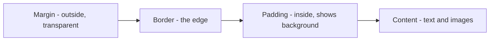
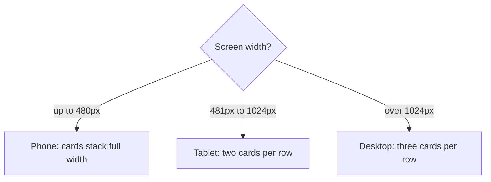

# Session 4 · Formatting Using Style Sheets

> 🏠 [Diploma in Digital Marketing](../../README.md) › [Term 1](../README.md) › [Essentials of Website Design and Development](README.md) › **Session 4**
>
> ⏱ **Estimated time:** 2 hours (1 h theory + 1 h lab) · 📋 **Prerequisites:** Session 3

[⬅ Previous: Session 3](session-03-introduction-to-css3.md) · [Next: Session 5 ➡](session-05-html-layout-forms-elements.md)

---

## 🎯 Learning objectives

- Format text with **font and text properties**, including web fonts from Google Fonts.
- Apply **backgrounds**: colours, images, gradients and overlays.
- Explain and apply the **CSS box model** – content, padding, border, margin – and `box-sizing`.
- Add polish with **border-radius, box-shadow and transitions**.
- Control layout with **display, position and flexbox** basics.
- Make pages **responsive** with media queries and check **colour contrast** for accessibility.

## 📖 Concepts

### 1. Font and text properties

| Property | Example | Effect |
|---|---|---|
| `font-family` | `"Poppins", Arial, sans-serif` | Font stack – browser uses the first one available |
| `font-size` | `1rem`, `clamp(1.75rem, 4vw, 2.75rem)` | Size; `clamp()` scales between a min and max |
| `font-weight` | `400`, `600`, `bold` | Thickness |
| `font-style` | `italic` | Slant |
| `line-height` | `1.6` | Space between lines – 1.5–1.7 reads best |
| `color` | `#333` | Text colour |
| `text-align` | `left`, `center`, `justify` | Horizontal alignment |
| `text-transform` | `uppercase` | Case without retyping |
| `letter-spacing` | `0.05em` | Space between letters |
| `text-decoration` | `none`, `underline` | Remove/add underlines on links |
| `text-shadow` | `1px 1px 2px #000` | Shadow behind text |

**Web fonts:** link a font from Google Fonts in the `<head>`, then use it in `font-family`. Load only the weights you need – each one adds download time. Always end the stack with a generic family (`sans-serif`, `serif`).

### 2. Backgrounds

| Property | Example |
|---|---|
| `background-color` | `#fffaf3` |
| `background-image` | `url("images/chai.jpg")` |
| `background-size` | `cover` (fill, crop) / `contain` (fit, no crop) |
| `background-position` | `center` |
| `background-repeat` | `no-repeat` |
| Gradient | `linear-gradient(to right, #ffb703, #fb8500)` |
| Shorthand | `background: url(x.jpg) center / cover no-repeat;` |

A dark **gradient overlay** on a photo (`linear-gradient(rgba(0,0,0,.45), rgba(0,0,0,.45)), url(...)`) keeps white headline text readable – a standard hero-banner technique.

### 3. The box model

Every element is a rectangular box made of four layers:

| Layer | Property | Notes |
|---|---|---|
| **Content** | `width`, `height` | The text or image |
| **Padding** | `padding: 1rem;` | Space *inside* the border; takes the background colour |
| **Border** | `border: 1px solid #ccc;` | The edge |
| **Margin** | `margin: 1rem auto;` | Space *outside*; transparent; `auto` left/right centres a block |

Shorthand order is **top, right, bottom, left** (clockwise – "TRouBLe"): `padding: 10px 20px;` = 10px top/bottom, 20px left/right.

**`box-sizing`**

- `content-box` (default): `width` is the content only, so padding and border are **added** on top.
- `border-box`: `width` **includes** padding and border – far easier to plan layouts. Most sites start with `* { box-sizing: border-box; }`.

### 4. Polish: corners, shadows, transitions

| Property | Example | Use |
|---|---|---|
| `border-radius` | `12px`; `50%` for a circle; `999px` for a pill | Cards, buttons, avatars |
| `box-shadow` | `0 4px 12px rgba(0,0,0,.08)` | Depth for cards |
| `opacity` | `0.8` | Transparency |
| `transition` | `transform .2s ease` | Smooth hover effects |
| `transform` | `translateY(-4px)`, `scale(1.05)` | Lift or grow on hover |

### 5. Display and position

| `display` | Behaviour | Examples |
|---|---|---|
| `block` | Starts on a new line, full width | `div`, `p`, `h1` |
| `inline` | Flows in text; width/height ignored | `span`, `a`, `strong` |
| `inline-block` | Flows in text but accepts width, height, padding | Buttons |
| `none` | Removed from the page | Hidden menus |
| `flex` | Lays out children in a row or column | Card rows, nav bars |
| `grid` | Two-dimensional rows and columns | Page layouts (Session 5) |

| `position` | Positioned relative to | Typical use |
|---|---|---|
| `static` | Normal flow (default) | Most elements |
| `relative` | Its own normal spot | A container for absolute children |
| `absolute` | Nearest positioned ancestor | Badges, labels on images |
| `fixed` | The browser window | Sticky "Order now" or WhatsApp button |
| `sticky` | Normal until scrolled to a point | Headers that stay on top |

### 6. Flexbox basics

Set `display: flex` on a **container**; its children become flex items.

| Container property | Does |
|---|---|
| `flex-direction` | `row` (default) or `column` |
| `justify-content` | Main-axis alignment: `flex-start`, `center`, `space-between` |
| `align-items` | Cross-axis alignment: `stretch`, `center` |
| `flex-wrap: wrap` | Lets items move to a new line |
| `gap` | Space between items |

### 7. Responsive design with media queries

More than half of web traffic in Pakistan comes from phones. A **media query** applies rules only when a condition is true:

```css
@media (max-width: 480px) {
  .card { width: 100%; }
}
```

**Mobile-first** means writing the phone styles first, then adding `@media (min-width: 768px)` rules for larger screens. Remember the viewport meta tag from Session 1 – without it, media queries won't work on phones.

### 8. Contrast and readability

WCAG requires a contrast ratio of at least **4.5:1** for normal text (3:1 for large text). Low-contrast buttons look stylish but lose clicks and exclude users with low vision.

## 🧭 Diagram





## 💻 Worked examples

### Example 1 – Styled product cards with flexbox and a hero banner

📄 `code/session-04_card.html`

```html
<!DOCTYPE html>
<html lang="en">
<head>
  <meta charset="UTF-8">
  <meta name="viewport" content="width=device-width, initial-scale=1.0">
  <title>Chai Box | Product cards</title>
  <link rel="preconnect" href="https://fonts.googleapis.com">
  <link href="https://fonts.googleapis.com/css2?family=Poppins:wght@400;600&display=swap" rel="stylesheet">
  <style>
    :root { --brand: #7a3e00; --accent: #ffb703; --bg: #fffaf3; }
    * { box-sizing: border-box; }

    /* Text and font properties */
    body {
      font-family: "Poppins", Arial, sans-serif;
      font-size: 1rem;
      line-height: 1.6;
      color: #333;
      background: var(--bg);
      margin: 0;
    }
    h1 {
      font-size: clamp(1.75rem, 4vw, 2.75rem);
      text-align: center;
      letter-spacing: 0.05em;
      text-transform: uppercase;
      color: var(--brand);
    }

    /* Hero background with a gradient overlay on an image */
    .hero {
      background: linear-gradient(rgba(0,0,0,.45), rgba(0,0,0,.45)), url("images/chai.jpg") center / cover no-repeat;
      color: #fff;
      padding: 4rem 1rem;
      text-align: center;
    }

    /* Flexbox row of cards */
    .cards {
      display: flex;
      flex-wrap: wrap;
      gap: 1.5rem;
      justify-content: center;
      padding: 2rem 1rem;
    }

    /* The box model in action */
    .card {
      width: 16rem;
      padding: 1.25rem;               /* space inside the border */
      border: 1px solid #eadbc8;      /* the edge */
      margin: 0;                      /* space outside (gap handles it) */
      border-radius: 12px;
      background: #fff;
      box-shadow: 0 4px 12px rgba(0,0,0,.08);
      transition: transform .2s ease, box-shadow .2s ease;
    }
    .card:hover {
      transform: translateY(-4px);
      box-shadow: 0 8px 20px rgba(0,0,0,.15);
    }
    .card h2 { margin-top: 0; font-size: 1.25rem; }
    .hero h1 { color: #fff; }   /* more specific than h1, so it wins */

    .badge {
      position: absolute;             /* positioned relative to .card-wrap */
      top: -10px; right: -10px;
      background: var(--accent);
      padding: .25rem .6rem;
      border-radius: 999px;
      font-size: .75rem; font-weight: 600;
    }
    .card-wrap { position: relative; }

    .btn {
      display: inline-block;
      padding: .6rem 1.2rem;
      background: var(--brand);
      color: #fff;
      text-decoration: none;
      border-radius: 6px;
      font-weight: 600;
    }
    .btn:hover, .btn:focus { background: #5c2e00; }

    /* Responsive: stack cards full-width on small phones */
    @media (max-width: 480px) {
      .card { width: 100%; }
      .hero { padding: 2.5rem 1rem; }
    }
  </style>
</head>
<body>
  <header class="hero">
    <h1>Chai Box</h1>
    <p>Hot chai delivered in 30 minutes</p>
  </header>
  <main class="cards">
    <div class="card-wrap">
      <span class="badge">Bestseller</span>
      <article class="card">
        <h2>Doodh Patti</h2>
        <p>Strong, creamy and classic.</p>
        <p><strong>₨ 150</strong></p>
        <a class="btn" href="#order">Order now</a>
      </article>
    </div>
    <article class="card">
      <h2>Kashmiri Chai</h2>
      <p>Pink, nutty and festive.</p>
      <p><strong>₨ 250</strong></p>
      <a class="btn" href="#order">Order now</a>
    </article>
    <article class="card">
      <h2>Green Tea</h2>
      <p>Light, with fresh mint.</p>
      <p><strong>₨ 120</strong></p>
      <a class="btn" href="#order">Order now</a>
    </article>
  </main>
</body>
</html>
```

**Output (rendered):** a full-width hero with a darkened chai photo and a white, uppercase "CHAI BOX" heading; below it, three white rounded cards with soft shadows sitting side by side and centred; a yellow "Bestseller" pill badge pinned to the top-right corner of the first card; each card lifts slightly and its shadow deepens on hover; brown "Order now" buttons darken on hover. On a phone narrower than 480px the cards stack and fill the width. (If `images/chai.jpg` is missing, the hero shows the dark overlay only.)

### Example 2 – Box model maths and contrast checking

📄 `code/session-04_box_and_contrast.js`

```javascript
// 1) Box model: rendered width under content-box vs border-box
function renderedWidth({ width, padding, border }, sizing) {
  return sizing === "content-box" ? width + 2 * padding + 2 * border : width;
}
const box = { width: 256, padding: 20, border: 1 };
console.log("Card: width 256px, padding 20px, border 1px");
console.log("  content-box total width:", renderedWidth(box, "content-box"), "px");
console.log("  border-box  total width:", renderedWidth(box, "border-box"), "px",
            "(content area shrinks to", box.width - 2 * box.padding - 2 * box.border, "px)");

// 2) Colour contrast ratio (WCAG) – is the button text readable?
function luminance(hex) {
  const [r, g, b] = hex.match(/\w\w/g).map(h => parseInt(h, 16) / 255)
    .map(c => (c <= 0.03928 ? c / 12.92 : ((c + 0.055) / 1.055) ** 2.4));
  return 0.2126 * r + 0.7152 * g + 0.0722 * b;
}
function contrast(a, b) {
  const [l1, l2] = [luminance(a), luminance(b)].sort((x, y) => y - x);
  return (l1 + 0.05) / (l2 + 0.05);
}
const pairs = [["#ffffff", "#7a3e00"], ["#ffffff", "#ffb703"], ["#333333", "#ffb703"], ["#999999", "#ffffff"]];
console.log("\nText on background   Ratio   WCAG AA (4.5:1 normal text)");
for (const [fg, bg] of pairs) {
  const r = contrast(fg, bg);
  console.log(`${fg} on ${bg}`.padEnd(20), r.toFixed(2).padStart(6), "  ", r >= 4.5 ? "PASS" : "FAIL");
}
```

**Output**

```text
Card: width 256px, padding 20px, border 1px
  content-box total width: 298 px
  border-box  total width: 256 px (content area shrinks to 214 px)

Text on background   Ratio   WCAG AA (4.5:1 normal text)
#ffffff on #7a3e00     8.34    PASS
#ffffff on #ffb703     1.75    FAIL
#333333 on #ffb703     7.24    PASS
#999999 on #ffffff     2.85    FAIL
```

The yellow accent works as a background **only with dark text** – white text on it fails. Light-grey text on white is a common mistake on price notes and form hints.

## 📊 Comparison table

| | Padding | Margin |
|---|---|---|
| Position | Inside the border | Outside the border |
| Shows background colour | Yes | No (transparent) |
| Can be negative | No | Yes |
| Can be `auto` | No | Yes – centres blocks horizontally |
| Clickable area of a button | Increases it | Doesn't |

## 🧪 Lab / practice tasks

**Task 1 (easy):** Style a "Subscribe" button: brand background, white text, `0.75rem 1.5rem` padding, rounded corners and a darker colour on `:hover` and `:focus`.

**Task 2 (medium):** A box has `width: 300px; padding: 15px; border: 5px solid; margin: 10px;` with the default `box-sizing`. What horizontal space does it occupy, including margin? What changes with `border-box`?

<details><summary>✅ Answer</summary>

content-box: 300 + 2×15 + 2×5 = **340px** visible box, + 2×10 margin = **360px** of space.
border-box: visible box = **300px** (content shrinks to 260px), + margin = **320px**.

</details>

**Task 3 (medium):** Build a navigation bar with flexbox: logo on the left, three links on the right, vertically centred.

<details><summary>✅ Solution</summary>

```css
.navbar { display: flex; justify-content: space-between; align-items: center; padding: 1rem; }
.navbar ul { display: flex; gap: 1.5rem; list-style: none; margin: 0; padding: 0; }
```

</details>

**Task 4 (challenge):** Add a fixed WhatsApp button to the bottom-right corner of every page, circular, with a shadow. Hide its text label on screens under 480px but keep it readable by screen readers (`aria-label`).

<details><summary>✅ Solution</summary>

```css
.wa { position: fixed; right: 1rem; bottom: 1rem; background: #25d366; color: #fff;
      padding: .9rem 1.2rem; border-radius: 999px; box-shadow: 0 4px 12px rgba(0,0,0,.25); }
@media (max-width: 480px) { .wa span { display: none; } }
```

```html
<a class="wa" href="https://wa.me/923001234567" aria-label="Chat on WhatsApp">💬 <span>Chat with us</span></a>
```

</details>

## ✅ Quick quiz

1. Which layer of the box model shows the element's background colour? a) Margin b) Padding c) Outline d) None
2. `margin: 0 auto;` on a block with a set width… a) hides it b) centres it horizontally c) removes padding d) makes it fixed
3. With `box-sizing: border-box`, `width` includes… a) content only b) content + padding + border c) margin too d) nothing
4. Which `position` keeps a button in the same place while the page scrolls? a) `static` b) `relative` c) `fixed` d) `absolute`
5. The minimum WCAG AA contrast for normal text is… a) 2:1 b) 3:1 c) 4.5:1 d) 10:1

<details><summary>Show answers</summary>

1-b · 2-b · 3-b · 4-c · 5-c

</details>

## 📝 Summary

- Font properties plus a sensible **font stack** and limited web-font weights give readable, on-brand text.
- Backgrounds support images, **gradients** and overlays for hero sections.
- The **box model** (content → padding → border → margin) controls spacing; use `box-sizing: border-box`.
- `border-radius`, `box-shadow` and `transition` add modern polish.
- `display`, `position` and **flexbox** arrange elements; **media queries** adapt them to phones.
- Check **contrast** – readable buttons convert better and are accessible.

**Interview / viva questions**

1. Draw and explain the CSS box model.
2. What is the difference between `inline`, `block` and `inline-block`?
3. When would you use `position: absolute` inside a `position: relative` parent?
4. What does "mobile-first" CSS mean and why is it preferred?
5. How can poor colour contrast hurt a marketing campaign?

---

[⬅ Previous: Session 3](session-03-introduction-to-css3.md) · [Next: Session 5 ➡](session-05-html-layout-forms-elements.md)

<sub>Prepared by **Hamna Zahid Khan**, Junior Lecturer · Diploma in Digital Marketing</sub>
