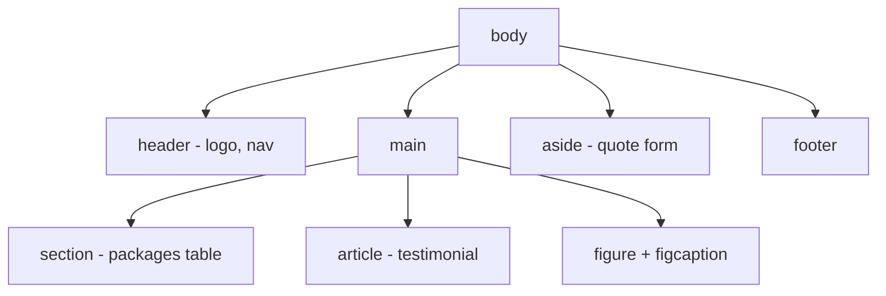
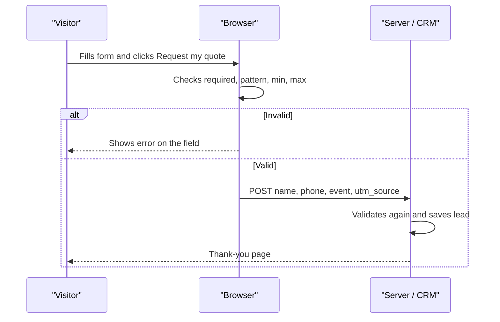

# Session 5 · HTML Layout, Forms and Elements

> 🏠 [Diploma in Digital Marketing](../../README.md) › [Term 1](../README.md) › [Essentials of Website Design and Development](README.md) › **Session 5**
>
> ⏱ **Estimated time:** 2 hours (1 h theory + 1 h lab) · 📋 **Prerequisites:** Sessions 1-4

[⬅ Previous: Session 4](session-04-formatting-with-style-sheets.md) · [Next: Essentials of Website Design and Development practice test ➡](practice-test.md)

---

## 🎯 Learning objectives

- Build a page skeleton with **semantic layout elements** and know when to use `<div>` and `<span>`.
- Lay out a page with **CSS Grid** that rearranges for mobile and desktop.
- Create accessible **data tables** with captions, headers and scope.
- Build **forms** with the right input types, labels, groups and built-in **validation**.
- Embed **images, figures, audio, video and iframes** correctly and efficiently.
- Design a **lead-capture form** that balances data needs with conversion rate.

## 📖 Concepts

### 1. Semantic layout elements

| Element | Meaning |
|---|---|
| `<header>` | Introductory content – logo, title, navigation (can appear in sections too) |
| `<nav>` | A block of main navigation links |
| `<main>` | The unique main content of the page – **one per page** |
| `<section>` | A themed group of content, usually with a heading |
| `<article>` | Self-contained content that makes sense alone – blog post, product card, review |
| `<aside>` | Related but secondary content – sidebar, quote form, ads |
| `<footer>` | Closing content – copyright, contact, links |
| `<figure>` + `<figcaption>` | An image, chart or code sample with its caption |

**`<div>`** (block) and **`<span>`** (inline) are **generic containers with no meaning** – use them only for styling hooks when no semantic element fits. Semantic layout helps screen readers jump between regions and helps search engines find the main content.

### 2. Page layout with CSS Grid

Grid is two-dimensional: you define **columns and rows**, then place regions into them.

```css
.page { display: grid; grid-template-areas: "header" "main" "aside" "footer"; }
@media (min-width: 768px) {
  .page { grid-template-columns: 2fr 1fr;
          grid-template-areas: "header header" "main aside" "footer footer"; }
}
```

`fr` = a **fraction** of the free space. Use **Grid** for whole-page layout and **Flexbox** (Session 4) for a single row or column of items.

### 3. Tables – for data, not layout

| Tag | Purpose |
|---|---|
| `<table>` | The table |
| `<caption>` | Title – read first by screen readers |
| `<thead>`, `<tbody>`, `<tfoot>` | Header, body and footer groups |
| `<tr>` | Row |
| `<th scope="col">` / `scope="row"` | Header cell for a column or row |
| `<td>` | Data cell |
| `colspan`, `rowspan` | Merge cells across columns or rows |

Use `border-collapse: collapse` in CSS for clean single borders. Never use tables to position page sections – that was a 1990s practice and breaks on phones.

### 4. Forms

```html
<form action="https://example.com/leads" method="post"> … </form>
```

- **`action`** – where the data is sent. **`method`** – `get` (data in the URL; searches and filters) or `post` (data in the request body; sign-ups, payments, personal data).
- Every input needs a **`name`** – that is the key the server receives.
- Every input needs a **`<label for="id">`** – clicking the label focuses the field and screen readers announce it. A placeholder is **not** a label.

**Input types**

| Type | Shows / does |
|---|---|
| `text`, `password` | Plain text / hidden characters |
| `email`, `url`, `tel` | Correct mobile keyboard; `email`/`url` are format-checked |
| `number`, `range` | Numeric spinner / slider (`min`, `max`, `step`) |
| `date`, `time` | Native pickers |
| `checkbox`, `radio` | Many choices / one choice per `name` group |
| `file` | Upload (`accept=".pdf,.jpg"`) |
| `hidden` | Data the user doesn't see – e.g. the campaign source |
| `submit` / `<button type="submit">` | Sends the form |

Other controls: **`<select>`** + `<option>` (drop-down), **`<textarea>`** (multi-line), **`<fieldset>`** + **`<legend>`** (group related controls, such as radio buttons).

**Built-in validation attributes:** `required`, `pattern="03[0-9]{9}"`, `min` / `max`, `minlength` / `maxlength`, `type="email"`. The browser blocks submission and shows a message. Servers **must** validate again, because browser checks can be bypassed.

**Helpful attributes:** `placeholder` (example value), `autocomplete="name"` (browser autofill – fewer typing errors), `value` (default), `checked`, `disabled`, `readonly`.

### 5. Forms and conversion

Each extra field lowers the share of visitors who finish. Ask only what you need **now**, make optional fields clearly optional, use the right input types so phones show the right keyboard, and say what happens next on the button ("Request my quote", not "Submit"). Ask for **consent** to contact people – this is required by privacy law in many markets (covered in Term 2).

### 6. Media elements

| Element | Key attributes | Tips |
|---|---|---|
| `` | `src`, `alt`, `width`, `height`, `loading="lazy"` | `alt` describes the image (SEO + accessibility); width/height prevent layout jumps |
| `<picture>` + `<source>` | `srcset`, `type="image/webp"` | Serve smaller/modern formats to phones |
| `<audio>` | `controls`, `<source>` | Podcasts, jingles |
| `<video>` | `controls`, `poster`, `muted`, `autoplay`, `playsinline` | Browsers only autoplay **muted** video |
| `<iframe>` | `src`, `title`, `loading="lazy"` | Embed YouTube or Google Maps; `title` is required for accessibility |

## 🧭 Diagram





## 💻 Worked examples

### Example 1 – A complete event landing page with grid, table, media and a lead form

📄 `code/session-05_landing_form.html`

```html
<!DOCTYPE html>
<html lang="en">
<head>
  <meta charset="UTF-8">
  <meta name="viewport" content="width=device-width, initial-scale=1.0">
  <title>Chai Box Catering | Book for your event</title>
  <meta name="description" content="Live chai stalls for weddings and office events in Karachi. Get a quote in 2 hours.">
  <style>
    * { box-sizing: border-box; }
    body { margin: 0; font-family: Arial, sans-serif; line-height: 1.6; color: #333; }
    /* CSS Grid page layout */
    .page {
      display: grid;
      grid-template-areas: "header" "main" "aside" "footer";
      gap: 1rem;
      max-width: 64rem; margin: 0 auto; padding: 1rem;
    }
    @media (min-width: 768px) {
      .page { grid-template-columns: 2fr 1fr; grid-template-areas: "header header" "main aside" "footer footer"; }
    }
    header { grid-area: header; } main { grid-area: main; }
    aside { grid-area: aside; background: #fff4e0; padding: 1rem; border-radius: 8px; }
    footer { grid-area: footer; font-size: .875rem; color: #666; }
    nav ul { display: flex; gap: 1rem; list-style: none; padding: 0; }
    table { border-collapse: collapse; width: 100%; }
    th, td { border: 1px solid #ddd; padding: .5rem; text-align: left; }
    thead { background: #7a3e00; color: #fff; }
    form { display: grid; gap: .75rem; }
    label { font-weight: bold; }
    input, select, textarea { width: 100%; padding: .5rem; font: inherit; border: 1px solid #bbb; border-radius: 4px; }
    input:invalid:not(:placeholder-shown) { border-color: crimson; }
    fieldset { border: 1px solid #ddd; border-radius: 4px; }
    fieldset label { font-weight: normal; }
    fieldset input { width: auto; }
    button { padding: .75rem; background: #7a3e00; color: #fff; border: 0; border-radius: 4px; font-size: 1rem; cursor: pointer; }
    figure { margin: 0; }
    img, video { max-width: 100%; height: auto; }
  </style>
</head>
<body>
  <div class="page">
    <header>
      <nav aria-label="Main">
        <ul>
          <li><a href="#packages">Packages</a></li>
          <li><a href="#quote">Get a quote</a></li>
        </ul>
      </nav>
      <h1>Live Chai Stalls for Your Event</h1>
    </header>

    <main>
      <section id="packages">
        <h2>Packages</h2>
        <table>
          <caption>Prices for Karachi, 2026</caption>
          <thead>
            <tr><th scope="col">Package</th><th scope="col">Guests</th><th scope="col">Price (₨)</th></tr>
          </thead>
          <tbody>
            <tr><td>Office</td><td>up to 50</td><td>25,000</td></tr>
            <tr><td>Mehndi</td><td>up to 200</td><td>75,000</td></tr>
            <tr><td>Wedding</td><td>up to 500</td><td>160,000</td></tr>
          </tbody>
        </table>
      </section>

      <figure>
        
        <figcaption>Our stall at a DHA wedding, December 2025.</figcaption>
      </figure>

      <video controls width="640" poster="images/video-poster.jpg">
        <source src="media/stall-tour.mp4" type="video/mp4">
        Your browser does not support HTML5 video.
      </video>
    </main>

    <aside id="quote">
      <h2>Get a quote in 2 hours</h2>
      <form action="https://example.com/leads" method="post">
        <label for="name">Full name</label>
        <input id="name" name="name" type="text" placeholder="Ayesha Khan" required autocomplete="name">

        <label for="phone">Mobile number</label>
        <input id="phone" name="phone" type="tel" placeholder="03001234567" pattern="03[0-9]{9}" required>

        <label for="email">Email (optional)</label>
        <input id="email" name="email" type="email" placeholder="you@example.com">

        <label for="event">Event type</label>
        <select id="event" name="event" required>
          <option value="">Choose…</option>
          <option>Office</option>
          <option>Mehndi</option>
          <option>Wedding</option>
        </select>

        <label for="date">Event date</label>
        <input id="date" name="date" type="date" min="2026-11-01" required>

        <label for="guests">Number of guests</label>
        <input id="guests" name="guests" type="number" min="10" max="1000" step="10" value="100">

        <fieldset>
          <legend>Preferred contact</legend>
          <label><input type="radio" name="contact" value="whatsapp" checked> WhatsApp</label>
          <label><input type="radio" name="contact" value="call"> Phone call</label>
        </fieldset>

        <label for="notes">Anything else?</label>
        <textarea id="notes" name="notes" rows="3" maxlength="300"></textarea>

        <label><input type="checkbox" name="consent" required> I agree to be contacted about my booking.</label>

        <input type="hidden" name="utm_source" value="instagram">
        <button type="submit">Request my quote</button>
      </form>
    </aside>

    <footer>
      <p>© 2026 Chai Box Catering · <a href="tel:+922100000000">021-0000-0000</a></p>
    </footer>
  </div>
</body>
</html>
```

**Output (rendered):** on a phone, everything stacks: navigation, heading, the packages table, the image with its caption, the video player, then the quote form and footer. On screens 768px and wider, the form moves into a cream sidebar to the right of the main content. The table has a brown header row and a caption. The form shows the numeric keypad for the mobile field, a date picker, a guests spinner in steps of 10, two radio buttons with WhatsApp pre-selected, and a consent checkbox. Clicking "Request my quote" with an empty name, a phone like `3001234567`, or no consent shows the browser's error message instead of sending. A mistyped phone number turns the field border red once something has been typed.

### Example 2 – The same validation in JavaScript, plus form conversion rate

📄 `code/session-05_validate_lead.js`

```javascript
// The same checks the HTML form performs (required, pattern, min/max), written in JavaScript.
// Servers must always re-check: browser validation can be bypassed.
const rules = {
  name:    v => v.trim().length >= 2 || "Enter your full name (2+ characters)",
  phone:   v => /^03\d{9}$/.test(v) || "Use the format 03XXXXXXXXX",
  email:   v => v === "" || /^[^\s@]+@[^\s@]+\.[^\s@]+$/.test(v) || "Email looks wrong",
  event:   v => ["Office", "Mehndi", "Wedding"].includes(v) || "Choose an event type",
  guests:  v => (Number(v) >= 10 && Number(v) <= 1000) || "Guests must be 10-1000",
  consent: v => v === true || "Consent is required",
};

function validate(lead) {
  return Object.entries(rules)
    .map(([field, check]) => [field, check(lead[field])])
    .filter(([, result]) => result !== true);
}

const leads = [
  { name: "Ayesha Khan", phone: "03001234567", email: "", event: "Wedding", guests: 300, consent: true },
  { name: "B", phone: "3001234567", email: "bilal@mail", event: "", guests: 5, consent: false },
];

leads.forEach((lead, i) => {
  const errors = validate(lead);
  console.log(`Lead ${i + 1}: ${errors.length ? "REJECTED" : "ACCEPTED"}`);
  errors.forEach(([f, msg]) => console.log(`  - ${f}: ${msg}`));
});

// Simple form conversion rate for the landing page
const visits = 2400, submissions = 132;
console.log(`\nForm conversion rate: ${(submissions / visits * 100).toFixed(1)}%`);
```

**Output**

```text
Lead 1: ACCEPTED
Lead 2: REJECTED
  - name: Enter your full name (2+ characters)
  - phone: Use the format 03XXXXXXXXX
  - email: Email looks wrong
  - event: Choose an event type
  - guests: Guests must be 10-1000
  - consent: Consent is required

Form conversion rate: 5.5%
```

## 📊 Comparison table

| | `get` | `post` |
|---|---|---|
| Where data goes | In the URL (`?q=chai`) | In the request body |
| Bookmarkable / shareable | Yes | No |
| Visible in history and logs | Yes | No |
| Size limit | Small | Large (files allowed) |
| Use for | Search, filters | Sign-ups, orders, personal data |

## 🧪 Lab / practice tasks

**Task 1 (easy):** Convert a page built with `<div class="header">`, `<div class="nav">`, `<div class="content">`, `<div class="footer">` into semantic elements.

<details><summary>✅ Answer</summary>

`<header>`, `<nav>`, `<main>`, `<footer>` – keep the classes only if you still need them for styling.

</details>

**Task 2 (medium):** Build a price-comparison table for three internet packages (speed, data, price) with a caption, `<thead>`, `scope` attributes and a final row that spans all columns saying "Prices include tax".

<details><summary>✅ Hint</summary>

The last row: `<tr><td colspan="3">Prices include tax</td></tr>` inside `<tfoot>`.

</details>

**Task 3 (medium):** Create a newsletter sign-up form with: name, email (required), a drop-down of interests, and a consent checkbox. Use correct labels and `method="post"`.

**Task 4 (challenge):** Embed a YouTube video and a Google Map of your business on a "Visit us" page. Make both lazy-load, give each iframe a `title`, and make the video scale to 100% width on phones with `aspect-ratio: 16 / 9`.

<details><summary>✅ Solution</summary>

```html
<iframe src="https://www.youtube.com/embed/VIDEO_ID" title="Store tour video" loading="lazy" allowfullscreen></iframe>
```

```css
iframe { width: 100%; aspect-ratio: 16 / 9; border: 0; }
```

</details>

## ✅ Quick quiz

1. Which element should appear only once per page and holds the main content? a) `<section>` b) `<main>` c) `<article>` d) `<div>`
2. Which input type brings up the phone keypad on mobiles? a) `number` b) `text` c) `tel` d) `phone`
3. Personal data from a sign-up form should be sent with… a) `get` b) `post` c) `put` in the URL d) a hidden field
4. Why is `<label for="email">` important? a) It styles the input b) It links text to the field for clicks and screen readers c) It validates email d) It hides the field
5. Tables should be used for… a) page layout b) tabular data c) navigation menus d) image galleries

<details><summary>Show answers</summary>

1-b · 2-c · 3-b · 4-b · 5-b

</details>

## 📝 Summary

- Semantic elements (`header`, `nav`, `main`, `section`, `article`, `aside`, `footer`) describe page regions; `div`/`span` are generic.
- **CSS Grid** handles page layout and can rearrange regions with a media query.
- Tables are for **data**, with `caption`, `th` and `scope` for accessibility.
- Forms need `action`, `method`, `name` and a `<label>` for every field; use specific input types and built-in validation – and validate again on the server.
- Short, clear forms with helpful button text convert better; include consent.
- Images need `alt`, dimensions and lazy loading; videos autoplay only when muted.

**Interview / viva questions**

1. What is the difference between `<section>`, `<article>` and `<div>`?
2. When would you use Grid instead of Flexbox?
3. Why must forms be validated on the server even if the browser validates them?
4. How does the number of form fields affect a landing page's conversion rate?
5. Why are `alt` text and image dimensions important for both SEO and user experience?

---

[⬅ Previous: Session 4](session-04-formatting-with-style-sheets.md) · [Next: Essentials of Website Design and Development practice test ➡](practice-test.md)

<sub>Prepared by **Hamna Zahid Khan**, Junior Lecturer · Diploma in Digital Marketing</sub>
