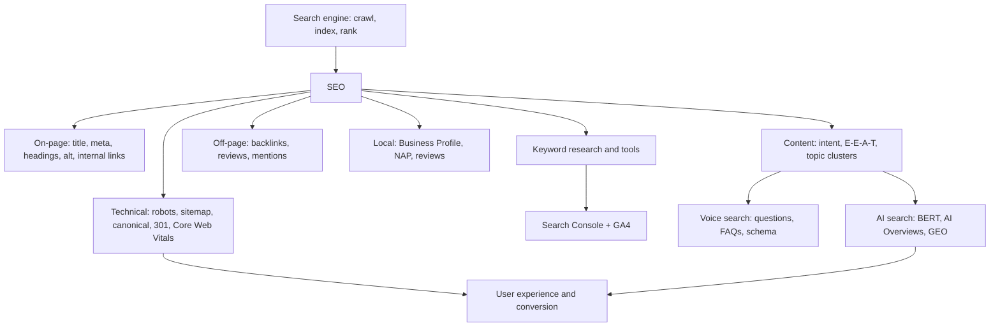

# Module 3 · Introduction to SEO

> 🏠 [Diploma in Digital Marketing](../../README.md) › [Term 1](../README.md) › **Module 3**

[⬅ Previous module](../02-website-design-and-development/README.md) · [Start Session 1 ➡](session-01-search-engines-and-seo-components.md) · [Next module ➡](../04-search-and-display-marketing/README.md)

---

Search is where customers go when they already want something. This module explains how search engines crawl, index and rank pages, and how to earn organic visibility through on-page, off-page, technical, mobile and local SEO. It then looks ahead to voice search, AI-driven search and the user-experience signals that now decide which pages win.

## 🎯 Module objectives

- Explain how search engines **crawl, index and rank** pages and read every part of a modern **SERP**.
- Optimise pages **on-page** (titles, descriptions, headings, content, images, internal links) and build authority **off-page** with quality backlinks and reviews.
- Apply **mobile SEO**, write **people-first content** with E-E-A-T, and run **local SEO** with Google Business Profile and NAP consistency.
- Carry out **keyword research**, competitor and content-gap analysis, and use **Search Console, GA4, Semrush, Ahrefs, Moz and Screaming Frog**.
- Fix **technical SEO**: robots.txt, noindex, sitemaps, canonicals, redirects, site architecture and **Core Web Vitals**.
- Optimise for **voice search** with direct answers, FAQs and structured data.
- Explain how **AI and machine learning** shape search and use AI tools responsibly for SEO and **UX**.

## 📅 Sessions

| # | Session | Prerequisites |
|---|---|---|
| 1 | [Understanding Search Engines and SEO Components](session-01-search-engines-and-seo-components.md) | Module 2 (basic HTML) |
| 2 | [On-Page and Off-Page Optimization](session-02-on-page-and-off-page-optimization.md) | Session 1 |
| 3 | [Mobile SEO, SEO-Friendly Content and Local SEO](session-03-mobile-seo-and-content.md) | Sessions 1-2 |
| 4 | [Advanced SEO Techniques and Tools](session-04-advanced-seo-techniques-and-tools.md) | Sessions 1-3 |
| 5 | [Technical SEO and Site Performance](session-05-technical-seo-and-site-performance.md) | Session 4 |
| 6 | [Voice Search Optimization](session-06-voice-search-optimization.md) | Session 5 |
| 7 | [Artificial Intelligence and Machine Learning in SEO](session-07-ai-and-ml-in-seo.md) | Sessions 1-6 |
| 8 | [Enhancing User Experience and SEO with AI](session-08-ux-and-seo-with-ai.md) | Session 7 |
|  | 📝 [Module practice test](practice-test.md) | All sessions |

## 🧭 Concept map

## 📄 One-page cheat-sheet

| Topic | Remember this |
|---|---|
| Three stages | **Crawl** (bots follow links) → **Index** (stored and understood) → **Rank** (ordered per query) |
| SERP parts | Ads · AI Overview · featured snippet · local pack · People Also Ask · organic results |
| SEO components | Technical · On-page · Content · Off-page · Local |
| Hats | White = guidelines · Grey = risky · Black = stuffing, cloaking, bought links → penalties |
| Search intent | Informational · Navigational · Commercial · Transactional – check the live SERP |
| E-E-A-T | Experience · Expertise · Authoritativeness · Trustworthiness (most critical for YMYL) |
| Title tag | ≈ 50–60 chars, keyword first, unique, benefit; ranks **and** earns clicks |
| Meta description | ≈ 150–160 chars; **not** a ranking factor; your SERP advert |
| URLs | Short, lowercase, hyphens, keyword; 301 if changed |
| Headings | One H1; H2/H3 outline; keyword naturally, no stuffing |
| Images | Descriptive file name + `alt` + width/height + WebP + lazy-load (not the hero) |
| Internal links | Descriptive anchor text; pillar ↔ cluster; no orphan pages |
| Backlinks | Relevance + authority + editorial + diverse domains > quantity |
| Link `rel` | `sponsored` = paid · `ugc` = user content · `nofollow` = don't vouch |
| Mobile | Mobile-first indexing; responsive design; viewport tag; 48px tap targets; no intrusive pop-ups |
| Local ranking | **Relevance · Distance · Prominence**; GBP, NAP consistency, genuine reviews |
| Keyword process | Seed → expand → measure (volume, KD, CPC, trend) → intent → prioritise & map |
| Long-tail | Lower volume, lower competition, higher conversion – new sites start here |
| Cannibalisation | Two pages, one keyword → merge (301), re-target or link to the main page |
| Snippets | Question heading + 40–60-word answer; lists and tables |
| Structured data | JSON-LD + schema.org; validate with Rich Results Test; eligibility, not a guarantee |
| Tools | GSC = before the click · GA4 = after the click · Semrush/Ahrefs/Moz = competitors & links · Screaming Frog = crawl |
| robots.txt | Controls **crawling**, not indexing; never `Disallow: /` on a live site |
| noindex | Controls **indexing**; page must be crawlable to see it |
| Canonical | Names the preferred URL among duplicates (a hint) |
| Status codes | 200 OK · 301 permanent · 302 temporary · 404 not found · 410 gone · 503 maintenance |
| Architecture | Key pages ≤ 3 clicks deep; breadcrumbs; handle faceted URLs |
| Core Web Vitals | **LCP ≤ 2.5 s** · **INP ≤ 200 ms** · **CLS ≤ 0.1** at the 75th percentile of real users |
| Voice | Long conversational questions, often local; ~30-word direct answers; GBP, Apple Business Connect, Bing Places |
| AI in Google | RankBrain 2015 · Neural matching 2018 · BERT 2019 · MUM 2021 · AI Overviews 2024 |
| AI content | Judged on helpfulness, not on how it was made; **scaled content abuse** is spam |
| GA4 engaged session | > 10 s **or** a conversion **or** 2+ page views; bounce rate = 100% − engagement rate |
| A/B test | One change, enough traffic and time, canonical on variants, no cloaking |

| Formula | Calculation |
|---|---|
| CTR | Clicks ÷ Impressions × 100 |
| Estimated clicks | Search volume × CTR at position |
| Keyword opportunity (simple) | Volume × intent value ÷ difficulty (only for KD the site can win) |
| Conversion rate | Conversions ÷ Visitors × 100 |
| Relative uplift | (B rate − A rate) ÷ A rate × 100 |
| Engagement rate | Engaged sessions ÷ Sessions × 100 |

**Common mistakes:** blocking the whole site in robots.txt after launch · using robots.txt to "noindex" a page · keyword stuffing · duplicate titles across pages · "click here" anchors · buying links · keyword-stuffed Google Business Profile names · inconsistent NAP · several pages chasing one keyword · redirecting every old URL to the home page · lazy-loading the hero image · images without dimensions · publishing AI drafts without fact-checking · judging every page type by the same engagement benchmark.

---

Prepared by **Hamna Zahid Khan**, Junior Lecturer · Diploma in Digital Marketing
