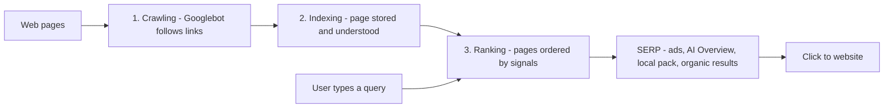
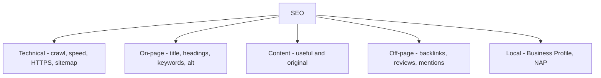

# Session 1 · Understanding Search Engines and SEO Components

> 🏠 [Diploma in Digital Marketing](../../README.md) › [Term 1](../README.md) › [Introduction to SEO](README.md) › **Session 1**
>
> ⏱ **Estimated time:** 2 hours (1 h theory + 1 h lab) · 📋 **Prerequisites:** Module 2 (basic HTML)

[⬅ Previous: Introduction to SEO overview](README.md) · [Next: Session 2 ➡](session-02-on-page-and-off-page-optimization.md)

---

## 🎯 Learning objectives

- Explain what a **search engine** is and why it matters to every business that wants to be found online.
- Describe the three stages every search engine runs: **crawling, indexing and ranking**.
- Read a **search engine results page (SERP)** and name its parts: organic results, ads, local pack, featured snippets and AI answers.
- Define **SEO** and list its main components: technical, on-page, off-page, content and local.
- Distinguish **white-hat, grey-hat and black-hat** SEO and explain the risk of penalties.
- Classify searches by **search intent**: informational, navigational, commercial and transactional.

## 📖 Concepts

### 1. What a search engine does

A search engine is a system that finds, stores and orders web pages so that it can answer a person's question in a fraction of a second. Google handles roughly nine out of ten searches worldwide; Bing, Yandex (Russia), Baidu (China), Naver (South Korea) and DuckDuckGo share the rest. YouTube and Amazon behave like search engines too: people type what they want and the platform ranks results.

For a business, search is valuable because the customer **comes to you** with a need already in mind. Someone typing "AC repair Gulshan" is ready to call a technician today. That is different from social media, where you interrupt people who were not looking.

### 2. The three stages: crawl, index, rank

| Stage | What happens | What can go wrong |
|---|---|---|
| **Crawling** | Automated programs called **crawlers**, **spiders** or **bots** (Google's is **Googlebot**) follow links and download pages | Page has no links pointing to it; blocked by `robots.txt`; server errors; very slow site |
| **Indexing** | The engine reads each page – text, headings, images, links, structured data – and stores it in a giant database called the **index** | Thin or duplicate content; `noindex` tag; content only visible after JavaScript fails |
| **Ranking** | When someone searches, the engine pulls matching pages from the index and orders them using hundreds of signals | Page is less relevant, less trusted or slower than competitors |

Think of a library. Crawling is the librarian collecting every new book. Indexing is writing the catalogue card: title, subject, author, keywords. Ranking is the librarian deciding which ten books to hand you first when you ask a question.

**Key point:** if a page is not crawled it cannot be indexed, and if it is not indexed it cannot rank. Many "SEO problems" are really crawling or indexing problems.

### 3. How ranking works (in plain words)

Google does not publish its formula, but it has explained the main groups of signals:

| Signal group | Question the engine asks | Examples |
|---|---|---|
| **Meaning** | What is the searcher really asking? | Synonyms, spelling fixes, language understanding (BERT, MUM) |
| **Relevance** | Does this page answer that? | Keywords in title, headings and body; topic coverage |
| **Quality** | Is this page trustworthy and helpful? | **E-E-A-T**: Experience, Expertise, Authoritativeness, Trustworthiness; links from respected sites |
| **Usability** | Will the page work well for this person? | Mobile-friendly, fast, secure (HTTPS), no intrusive pop-ups |
| **Context** | Who is searching, where and on what device? | Location ("near me"), language, search settings |

**E-E-A-T** comes from Google's Search Quality Rater Guidelines. It matters most for **YMYL** ("Your Money or Your Life") topics – health, finance, law, safety – where bad advice can hurt people. A pharmacy blog written by a qualified pharmacist with clear contact details shows more E-E-A-T than an anonymous page.

### 4. A short timeline of Google ranking updates

| Year | Update | What it targeted |
|---|---|---|
| 1998 | **PageRank** | Ranked pages by the number and quality of links pointing to them |
| 2011 | **Panda** | Thin, low-quality and copied content |
| 2012 | **Penguin** | Spammy and paid link schemes |
| 2013 | **Hummingbird** | Understanding the meaning of whole queries, not single words |
| 2015 | **RankBrain** | First machine-learning system used in ranking |
| 2015 | **Mobile-friendly update** | Boosted pages that work on phones |
| 2019 | **BERT** | Understanding words in context ("to", "for", "without") |
| 2021 | **Page experience / Core Web Vitals** | Speed, responsiveness and visual stability |
| 2022–2024 | **Helpful content** (folded into core ranking in 2024) | Content made for search engines rather than people |
| 2024 | **AI Overviews** | AI-written summaries shown above many results |

You do not need to memorise dates. The pattern matters: every update rewards pages that genuinely help people and punishes shortcuts.

### 5. Anatomy of a SERP

A **SERP** (Search Engine Results Page) is no longer "ten blue links". Depending on the query you may see:

| Element | What it is | How you get there |
|---|---|---|
| **Paid ads** | "Sponsored" results at the top and bottom | Google Ads (Module 4) |
| **AI Overview** | An AI summary with source links | Clear, well-structured, trustworthy content |
| **Featured snippet** | A boxed answer quoted from one page | Answer a question directly in 40–60 words, lists or tables |
| **Local pack** | Map with three businesses | Google Business Profile + local SEO (Session 3) |
| **People Also Ask** | Expandable related questions | Cover related questions in your content |
| **Organic results** | Normal ranked listings: title, URL, description | Everything in this module |
| **Image / video / news packs** | Visual results | Optimised images, YouTube videos, news content |
| **Knowledge panel** | Fact box about a brand, person or place | Consistent information across the web |

An organic listing has three parts you control: the **title link** (usually from your `<title>`), the **URL**, and the **snippet** (often from your meta description, sometimes from page text).

### 6. What is SEO?

**Search Engine Optimization (SEO)** is the practice of improving a website so that it earns more **unpaid (organic)** visits from search engines. It is different from **SEM / paid search**, where you pay per click.

| | SEO (organic) | Paid search (PPC) |
|---|---|---|
| Cost per click | Free (but costs time and content) | You pay for each click |
| Speed | Slow – weeks to months | Instant once the campaign is live |
| Lasts | Keeps working after the work is done | Stops when you stop paying |
| Trust | Users often trust organic results more | Labelled "Sponsored" |
| Control | Indirect – Google decides | Direct – you choose keywords, text, budget |

Smart businesses use both: paid search for quick results and testing keywords, SEO for long-term, lower-cost traffic.

### 7. The components of SEO

| Component | Focus | Examples |
|---|---|---|
| **Technical SEO** | Can search engines crawl, render and index the site? | Site speed, HTTPS, `robots.txt`, XML sitemap, mobile layout, clean URLs |
| **On-page SEO** | Is each page clearly about its topic? | Title tag, meta description, headings, keywords, image `alt`, internal links |
| **Content** | Is the content useful, original and complete? | Guides, product pages, FAQs, videos |
| **Off-page SEO** | Do other sites trust and mention you? | Backlinks, reviews, brand mentions, social signals |
| **Local SEO** | Can nearby customers find you? | Google Business Profile, reviews, NAP consistency |

Sessions 2–5 cover each component in depth. Sessions 6–8 add voice search, AI and user experience.

### 8. White-hat, grey-hat and black-hat SEO

| Type | Meaning | Examples | Risk |
|---|---|---|---|
| **White-hat** | Follows search engine guidelines; helps users | Useful content, fast site, earned links | Low |
| **Grey-hat** | Not clearly banned but manipulative | Buying expired domains for their links, mass guest posting | Medium |
| **Black-hat** | Breaks guidelines to trick rankings | **Keyword stuffing**, **cloaking** (showing bots different content), hidden text, buying links, link farms, scraped content | High – rankings drop or the site is removed |

Google can apply a **manual action** (a human reviewer penalises the site, shown in Search Console) or an **algorithmic demotion** (an update simply stops trusting the site). Recovering can take months. Black-hat tricks are a bad trade for any business that plans to be around next year.

### 9. Search intent

**Search intent** is the reason behind a query. Matching intent is the single most important ranking idea: Google shows the type of page that best satisfies what people want.

| Intent | The searcher wants to… | Example query | Best page type |
|---|---|---|---|
| **Informational** | Learn something | "how to remove tea stains" | Guide, blog post, video |
| **Navigational** | Reach a specific site | "daraz login" | Home or login page |
| **Commercial** | Compare before buying | "best air fryer 2026" | Comparison, review, "top 10" list |
| **Transactional** | Buy or act now | "buy air fryer online" | Product or service page |

A quick way to check intent: search the keyword yourself and look at what already ranks. If the top ten are all blog guides, a product page will struggle to rank there.

## 🧭 Diagram





## 💻 Worked examples

### Example 1 – A mini search engine in Python

This script imitates indexing and ranking. It builds an **inverted index** (word → pages that contain it) and scores pages with a simple **TF-IDF** idea: a word counts more when it appears often on a page (term frequency) and rarely across all pages (inverse document frequency).

📄 `code/session-01_mini_search_engine.py`

```python
# A tiny search engine: crawl (a dict of pages), index (inverted index), rank (TF-IDF style score).
import math, re
from collections import Counter, defaultdict

pages = {
    "/biryani-recipe":   "Karachi biryani recipe step by step biryani masala rice chicken",
    "/best-biryani-khi": "Best biryani restaurants in Karachi ranked by price and taste biryani",
    "/nihari-guide":     "Nihari guide Karachi breakfast slow cooked beef nihari",
    "/rice-types":       "Basmati rice types for pulao and biryani cooking guide",
}

def tokens(text):
    return re.findall(r"[a-z]+", text.lower())

# 1) Indexing: word -> {page: count}
index = defaultdict(dict)
for url, text in pages.items():
    for word, n in Counter(tokens(text)).items():
        index[word][url] = n
print("Index entries for 'biryani':", index["biryani"])

# 2) Ranking: sum of tf * idf for each query word
def search(query):
    N = len(pages)
    scores = Counter()
    for word in tokens(query):
        postings = index.get(word, {})
        if not postings:
            continue
        idf = math.log((N + 1) / len(postings)) + 1   # rare words count more
        for url, tf in postings.items():
            scores[url] += tf * idf
    return scores.most_common()

for q in ["best biryani karachi", "nihari"]:
    print(f"\nQuery: {q}")
    for rank, (url, s) in enumerate(search(q), 1):
        print(f"  {rank}. {url:18} score={s:.2f}")
```

**Output**

```text
Index entries for 'biryani': {'/biryani-recipe': 2, '/best-biryani-khi': 2, '/rice-types': 1}

Query: best biryani karachi
  1. /best-biryani-khi  score=7.14
  2. /biryani-recipe    score=4.53
  3. /rice-types        score=1.51
  4. /nihari-guide      score=1.51

Query: nihari
  1. /nihari-guide      score=5.22
```

**What to notice:** `/best-biryani-khi` wins for "best biryani karachi" because it contains all three words. `/nihari-guide` scores for "karachi" alone, which shows why **relevance across the whole query** matters. Real search engines add hundreds of further signals – links, freshness, location, page experience – but the index-then-rank idea is the same.

### Example 2 – Reading intent from a live SERP (manual exercise)

Search each query on Google in a private/incognito window and fill in the table.

| Query | Ads shown? | Local pack? | Featured snippet / AI Overview? | Type of pages in top 5 | Intent |
|---|---|---|---|---|---|
| how to make doodh patti | | | | | |
| buy school shoes online | | | | | |
| best mobile under 50000 | | | | | |
| hbl | | | | | |

**Expected pattern:** recipes and videos for the first (informational), shopping ads and product pages for the second (transactional), reviews and comparison lists for the third (commercial), and the bank's own site for the fourth (navigational).

## 📊 Comparison table

| | Crawling | Indexing | Ranking |
|---|---|---|---|
| Question | Can the bot reach the page? | Has the engine stored and understood it? | Is it the best answer for this query? |
| Main tools | Links, sitemap, `robots.txt` | Content, headings, structured data, `noindex` | Relevance, quality, links, page experience |
| How to check | Search Console › Crawl stats | `site:example.com` search, URL Inspection | Search Console › Performance (average position) |

## 🧪 Lab / practice tasks

**Task 1 (easy):** Type `site:` followed by your college or a local brand's domain (for example `site:iobm.edu.pk`) into Google. Roughly how many pages are indexed? Find one page you think should not be indexed.

<details><summary>✅ Hint</summary>

The `site:` operator shows an approximate count only. Pages that often should not be indexed: login pages, internal search results, test pages, thank-you pages and duplicate printer-friendly versions.

</details>

**Task 2 (easy):** Classify the intent of: "daraz", "how to start a YouTube channel", "best web hosting Pakistan", "order cake online Lahore".

<details><summary>✅ Answer</summary>

Navigational · Informational · Commercial · Transactional.

</details>

**Task 3 (medium):** Search "dentist near me" and "what causes tooth sensitivity". List every SERP element you see for each and explain why they differ.

<details><summary>✅ Model answer</summary>

"Dentist near me" shows ads, a **local pack** with a map and reviews, then clinic websites – the searcher wants a nearby provider (local + transactional). "What causes tooth sensitivity" shows an **AI Overview** or **featured snippet**, **People Also Ask**, and health-information pages – the searcher wants to learn (informational, YMYL, so trusted medical sources rank).

</details>

**Task 4 (challenge):** Extend the Python mini search engine: add a fifth page, then give each page a "links pointing to it" number and multiply the score by `1 + links/10`. How does the ranking change? What real ranking idea does this imitate?

<details><summary>✅ Solution</summary>

Add `link_counts = {"/biryani-recipe": 12, ...}` and in `search()` multiply each page's final score by `1 + link_counts[url] / 10`. A page with many links can overtake a slightly more relevant page. This imitates **PageRank** – links act as votes of trust.

</details>

## ✅ Quick quiz

1. What is the correct order of a search engine's work? a) Rank, crawl, index b) Index, crawl, rank c) Crawl, index, rank d) Crawl, rank, index
2. Googlebot is an example of a… a) ranking factor b) crawler c) keyword tool d) ad format
3. The query "best power bank 2026" has which intent? a) Navigational b) Informational c) Commercial d) Transactional
4. Showing search engines different content from users is called… a) Canonicalisation b) Cloaking c) Crawling d) Caching
5. Which is a key difference between SEO and paid search? a) SEO is instant b) Paid search keeps working after you stop paying c) SEO clicks are not paid per click d) SEO results are labelled "Sponsored"

<details><summary>Show answers</summary>

1-c · 2-b · 3-c · 4-b · 5-c

</details>

## 📝 Summary

- Search engines **crawl** pages by following links, **index** them in a database and **rank** them for each query.
- Ranking weighs meaning, relevance, quality (E-E-A-T), usability and context.
- A SERP contains ads, AI Overviews, featured snippets, local packs, People Also Ask and organic listings.
- SEO earns **organic** traffic; it is slower than paid search but keeps working.
- SEO has five components: technical, on-page, content, off-page and local.
- White-hat SEO is the only safe long-term approach; black-hat tricks lead to penalties.
- Always match **search intent** – check what already ranks before creating a page.

**Interview / viva questions**

1. Explain crawling, indexing and ranking with an everyday example.
2. What does E-E-A-T stand for and why does it matter more for YMYL topics?
3. Name five elements you might see on a modern SERP.
4. Why might a business invest in both SEO and paid search?
5. How would you work out the search intent of a keyword before writing content for it?

---

[⬅ Previous: Introduction to SEO overview](README.md) · [Next: Session 2 ➡](session-02-on-page-and-off-page-optimization.md)

<sub>Prepared by **Hamna Zahid Khan**, Junior Lecturer · Diploma in Digital Marketing</sub>
