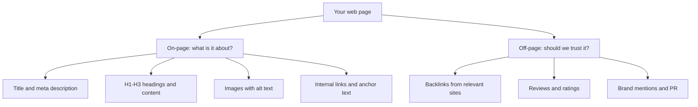
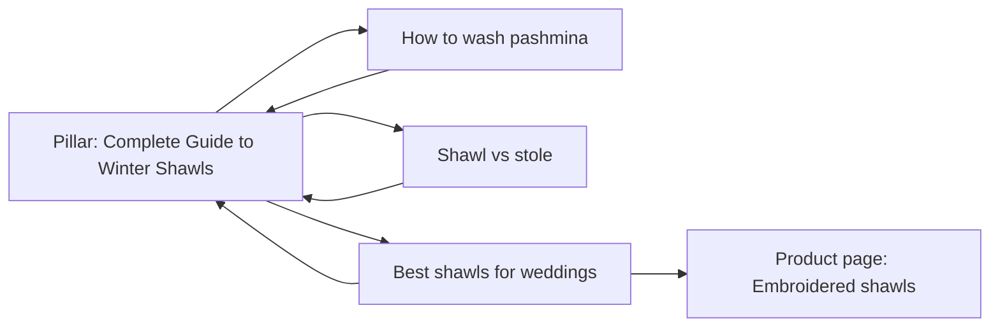

# Session 2 · On-Page and Off-Page Optimization

> 🏠 [Diploma in Digital Marketing](../../README.md) › [Term 1](../README.md) › [Introduction to SEO](README.md) › **Session 2**
>
> ⏱ **Estimated time:** 2 hours (1 h theory + 1 h lab) · 📋 **Prerequisites:** Session 1

[⬅ Previous: Session 1](session-01-search-engines-and-seo-components.md) · [Next: Session 3 ➡](session-03-mobile-seo-and-content.md)

---

## 🎯 Learning objectives

- Optimise the core **on-page elements**: title tag, meta description, URL, headings, body copy, images and internal links.
- Write titles and descriptions that earn clicks on the SERP, not only rankings.
- Use **internal linking** and **anchor text** to show search engines how pages relate.
- Explain **off-page SEO**: backlinks, link quality, `rel` attributes, brand mentions and reviews.
- Plan safe **link-building** tactics and recognise toxic link schemes.
- Run a simple **on-page audit** with Python.

## 📖 Concepts

### 1. On-page vs off-page

| | On-page SEO | Off-page SEO |
|---|---|---|
| Where | On your own pages | On other people's sites and platforms |
| You control | Fully | Partly – you can earn, not force |
| Main signals | Relevance and clarity | Trust and authority |
| Examples | Title, headings, content, alt text, internal links | Backlinks, reviews, mentions, social sharing, PR |

On-page work tells Google **what** a page is about. Off-page signals tell Google **whether to trust it**. You need both: a perfectly optimised page with no reputation struggles against a trusted competitor, and a famous brand with confusing pages wastes its authority.

### 2. The title tag

```html
<title>Hand-Woven Wool Shawls in Lahore | Free Delivery – ShawlHouse</title>
```

| Rule | Why |
|---|---|
| Put the **main keyword near the start** | Readers scan the first words; it signals relevance |
| Keep it about **50–60 characters** | Longer titles are cut off ("…") on most screens |
| Make each page's title **unique** | Duplicate titles confuse Google about which page to rank |
| Add a **benefit or detail** ("Free Delivery", "2026 Guide", "From PKR 4,500") | Improves click-through rate (CTR) |
| End with the brand (optional) | Builds recognition |

Google may rewrite a title link if it thinks yours is unclear, stuffed or misleading – another reason to write honest, specific titles.

### 3. The meta description

```html
<meta name="description" content="Shop hand-woven pure wool shawls from PKR 4,500. Free delivery across Lahore in 48 hours. Easy 7-day returns.">
```

The meta description is **not a ranking factor**, but it is your advert on the SERP. Aim for roughly **150–160 characters**, include the keyword (Google bolds matching words), state a benefit and a reason to click. Google sometimes replaces it with text from the page that better matches the query.

### 4. URLs

| Poor | Good |
|---|---|
| `example.com/index.php?id=4831&cat=7` | `example.com/shawls/pashmina-grey` |
| `example.com/Products/Shawls_Grey_NEW_final` | `example.com/shawls/grey-pashmina` |

Use short, lowercase words separated by **hyphens**, include the main keyword, avoid dates in evergreen URLs, and never change a URL without a **301 redirect** (Session 5).

### 5. Headings and body content

- One **`<h1>`** that states the page topic (usually close to the title).
- **`<h2>`** for main sections, **`<h3>`** for sub-points – a logical outline, as you learned in Module 2.
- Use the main keyword in the H1, early in the first paragraph, and naturally in a few subheadings.
- Use **related terms and synonyms** ("pashmina", "winter wrap", "wool stole"). Modern search understands topics, not exact-match repetition.
- **Keyword stuffing** (repeating a phrase unnaturally) hurts readability and can trigger demotion.
- Cover the topic completely: answer the questions a buyer or reader would actually ask.

### 6. Images

```html

```

Descriptive **file names**, accurate **`alt` text** (for screen readers and image search), modern compressed formats (**WebP/AVIF**), and `width`/`height` to prevent layout shift. Alt text describes the image; it is not a place to stuff keywords.

### 7. Internal links and anchor text

**Internal links** connect pages on your own site. They help crawlers discover pages, spread authority from strong pages to weaker ones, and guide visitors.

| Anchor text type | Example | Use |
|---|---|---|
| Descriptive | "see our **grey pashmina shawls**" | ✅ Best – tells users and Google what's behind the link |
| Branded | "ShawlHouse" | ✅ Natural for home page links |
| Generic | "click here", "read more" | ❌ Says nothing about the target |
| Exact-match everywhere | "cheap shawls lahore" on every link | ⚠️ Looks manipulative, especially on backlinks |

A useful structure is the **hub-and-spoke** (or **topic cluster**) model: one broad **pillar page** ("Complete Guide to Winter Shawls") links to detailed **cluster pages** ("How to wash pashmina", "Shawl vs stole"), and each cluster page links back to the pillar.

### 8. Other on-page elements

| Element | Purpose |
|---|---|
| **Canonical tag** `<link rel="canonical" href="…">` | Names the preferred version when similar pages exist |
| **Structured data** (schema.org JSON-LD) | Helps Google understand products, reviews, events, FAQs – can earn rich results |
| **Open Graph tags** | Control how the page looks when shared on social media |
| **HTTPS** | Security; a light ranking signal and a trust signal for users |
| **Mobile-friendly layout** | Google indexes the mobile version first (Session 3) |

### 9. Off-page SEO and backlinks

A **backlink** is a link from another website to yours. Since PageRank, links have acted as **votes of confidence**. Not all votes are equal:

| A strong backlink is… | A weak or harmful backlink is… |
|---|---|
| From a **relevant**, respected site (a fashion magazine linking to a shawl shop) | From an unrelated or spammy site |
| **Editorial** – given because the content is good | Bought, swapped or auto-generated |
| In the main content, with natural anchor text | Hidden in footers or widgets across thousands of pages |
| From many **different domains** | Hundreds of links from one domain |
| A followed link | Usually marked `nofollow` / `sponsored` / `ugc` (passes little or no value) |

**Link `rel` attributes** (from Module 2): `rel="sponsored"` for paid or affiliate links, `rel="ugc"` for user-generated content such as comments and forums, `rel="nofollow"` when you do not want to vouch for a link. Google treats these as hints. Paid links **must** be marked; selling followed links breaks Google's spam policies.

### 10. Safe link-building tactics

| Tactic | How it works |
|---|---|
| **Create linkable assets** | Original research, free tools, calculators, statistics pages, great guides |
| **Digital PR** | Pitch stories and data to journalists and bloggers |
| **Guest contributions** | Write genuinely useful articles for relevant publications (not mass spam) |
| **Broken link building** | Find broken links on relevant sites and suggest your page as a replacement |
| **Unlinked mentions** | Ask sites that mention your brand to add a link |
| **Directories and associations** | Chambers of commerce, industry bodies, reputable local directories |
| **Partnerships** | Suppliers, event sponsorships, university collaborations |

**Avoid:** private blog networks (PBNs), link farms, mass directory submissions, paid followed links, and "link exchanges" at scale. If spam links point to you, Google mostly ignores them; the **disavow tool** in Search Console exists for serious cases, such as after a manual action.

### 11. Other off-page signals

- **Reviews** on Google, Facebook and industry sites build trust (and matter hugely for local SEO).
- **Brand mentions** and searches for your brand name show real-world reputation.
- **Social media** shares do not directly raise rankings, but they spread content to people who may link to it.

## 🧭 Diagram





## 💻 Worked examples

### Example 1 – Automated on-page audit

This script reads a page's HTML and checks five on-page basics.

📄 `code/session-02_onpage_audit.py`

```python
# On-page SEO audit of an HTML page using only the Python standard library.
from html.parser import HTMLParser

html = """<!DOCTYPE html><html lang="en"><head>
<title>Home</title>
</head><body>
<h1>Welcome</h1><h1>Our Shawls</h1>

<p>Buy hand-woven wool shawls in Lahore. <a href="/contact">click here</a>
<a href="https://partner.example" rel="sponsored">Partner store</a></p>
</body></html>"""

class Audit(HTMLParser):
    def __init__(self):
        super().__init__()
        self.title, self.desc, self.h1 = "", None, 0
        self.imgs, self.no_alt, self.links, self.weak_anchors = 0, 0, 0, []
        self._in_title = self._in_a = False
    def handle_starttag(self, tag, attrs):
        a = dict(attrs)
        if tag == "title": self._in_title = True
        if tag == "meta" and a.get("name") == "description": self.desc = a.get("content", "")
        if tag == "h1": self.h1 += 1
        if tag == "img":
            self.imgs += 1
            if not a.get("alt"): self.no_alt += 1
        if tag == "a": self.links += 1; self._in_a = True
    def handle_endtag(self, tag):
        if tag == "title": self._in_title = False
        if tag == "a": self._in_a = False
    def handle_data(self, data):
        if self._in_title: self.title += data
        if self._in_a and data.strip().lower() in ("click here", "read more", "here"):
            self.weak_anchors.append(data.strip())

p = Audit(); p.feed(html)
checks = [
    ("Title 30-60 characters", 30 <= len(p.title) <= 60, f"'{p.title}' ({len(p.title)} chars)"),
    ("Meta description present", bool(p.desc), p.desc or "missing"),
    ("Exactly one H1", p.h1 == 1, f"{p.h1} found"),
    ("All images have alt text", p.no_alt == 0, f"{p.no_alt} of {p.imgs} missing alt"),
    ("Descriptive anchor text", not p.weak_anchors, ", ".join(p.weak_anchors) or "ok"),
]
score = 0
for name, ok, detail in checks:
    score += ok
    print(f"{'PASS' if ok else 'FAIL'}  {name:28} -> {detail}")
print(f"\nOn-page score: {score}/{len(checks)}")
```

**Output**

```text
FAIL  Title 30-60 characters       -> 'Home' (4 chars)
FAIL  Meta description present     -> missing
FAIL  Exactly one H1               -> 2 found
FAIL  All images have alt text     -> 1 of 2 missing alt
FAIL  Descriptive anchor text      -> click here

On-page score: 0/5
```

**Fixed version of the page head and body (what the audit is asking for):**

```html
<title>Hand-Woven Wool Shawls in Lahore | ShawlHouse</title>
<meta name="description" content="Shop hand-woven wool shawls from PKR 4,500. Free delivery across Lahore in 48 hours.">
<h1>Hand-Woven Wool Shawls</h1>

<a href="/contact">Contact our Lahore store</a>
```

### Example 2 – Quantity vs quality of backlinks

📄 `code/session-02_link_profile.py`

```python
# Compare two sites' backlink profiles: quantity is not quality.
links = {
    "SiteA": [  # (referring domain, authority 0-100, relevant?, rel)
        ("dawn.com", 90, True, "follow"), ("techjuice.pk", 60, True, "follow"),
        ("university.edu.pk", 75, True, "follow"), ("forum-post", 20, True, "ugc"),
    ],
    "SiteB": [("spam-dir-%d.xyz" % i, 5, False, "follow") for i in range(40)],
}

def quality(profile):
    score = 0
    for domain, auth, relevant, rel in profile:
        weight = 1.0 if rel == "follow" else 0.3   # nofollow/ugc/sponsored pass little value
        score += auth * (1.0 if relevant else 0.1) * weight
    return round(score)

for site, profile in links.items():
    domains = len({d for d, *_ in profile})
    print(f"{site}: {len(profile):3} links from {domains:3} domains -> quality score {quality(profile)}")
```

**Output**

```text
SiteA:   4 links from   4 domains -> quality score 231
SiteB:  40 links from  40 domains -> quality score 20
```

**What to notice:** Site B has ten times more links, but they come from irrelevant, low-authority directories. Four relevant, trusted links outweigh forty spam ones – exactly how modern ranking treats link quality.

## 📊 Comparison table

| Element | Ranking factor? | Click factor? | Ideal |
|---|---|---|---|
| Title tag | ✅ Strong | ✅ Strong | 50–60 chars, keyword first, unique |
| Meta description | ❌ | ✅ Strong | 150–160 chars, benefit + call to action |
| URL | ✅ Light | ✅ Light | Short, hyphenated, keyword |
| H1 | ✅ | – | One per page, states the topic |
| Image alt | ✅ (image search) | – | Accurate description |
| Backlinks | ✅ Strong | – | Relevant, editorial, diverse domains |
| Reviews | ✅ (local) | ✅ (stars) | Steady flow of genuine reviews |

## 🧪 Lab / practice tasks

**Task 1 (easy):** Rewrite this title: `Home - Welcome to Our Website`. The business is a bakery in DHA Karachi famous for custom birthday cakes.

<details><summary>✅ Model answer</summary>

`Custom Birthday Cakes in DHA Karachi | Sweet Crumbs Bakery` (57 characters) – keyword first, location, brand.

</details>

**Task 2 (easy):** Write a meta description (max 160 characters) for the same page.

<details><summary>✅ Model answer</summary>

`Order custom birthday cakes in DHA Karachi from PKR 3,500. Your design, fresh cream, same-day delivery. Order on WhatsApp in 2 minutes.` (≈ 135 characters)

</details>

**Task 3 (medium):** Plan a topic cluster for a driving school: one pillar page and five cluster pages, with the anchor text you would use from the pillar to each cluster.

<details><summary>✅ Model answer</summary>

Pillar: "How to Get a Driving Licence in Karachi". Clusters: "Learner permit requirements" (anchor: *learner permit documents*), "Driving test route tips" (*driving test tips*), "Manual vs automatic lessons" (*manual or automatic lessons*), "Driving lesson fees" (*driving lesson prices*), "Women-only driving instructors" (*female driving instructors*). Each cluster links back with anchor "complete driving licence guide".

</details>

**Task 4 (challenge):** Extend `session-02_onpage_audit.py` to also check (a) that the page has a canonical tag and (b) that the title contains a target keyword passed in a variable.

<details><summary>✅ Solution</summary>

In `handle_starttag` add: `if tag == "link" and a.get("rel") == "canonical": self.canonical = a.get("href")` (initialise `self.canonical = None`). Add checks `("Canonical tag present", bool(p.canonical), p.canonical or "missing")` and `("Keyword in title", keyword.lower() in p.title.lower(), keyword)`.

</details>

## ✅ Quick quiz

1. Which element is **not** a direct ranking factor but strongly affects CTR? a) Title tag b) Meta description c) H1 d) Backlinks
2. The best anchor text for an internal link to a pricing page is… a) "click here" b) "this" c) "see our wedding photography prices" d) "link"
3. A paid influencer link should carry… a) `rel="ugc"` b) `rel="sponsored"` c) no attribute d) `rel="canonical"`
4. Which backlink is most valuable to a Karachi restaurant? a) 100 links from a foreign spam directory b) A review link from a respected Karachi food blog c) A link in a hidden footer d) A bought link from a casino site
5. A recommended title length is roughly… a) 10–20 characters b) 50–60 characters c) 150–160 characters d) 300 characters

<details><summary>Show answers</summary>

1-b · 2-c · 3-b · 4-b · 5-b

</details>

## 📝 Summary

- **On-page SEO** makes each page clearly about its topic; **off-page SEO** builds trust from outside.
- Titles (≈50–60 chars) rank and earn clicks; meta descriptions (≈150–160 chars) earn clicks.
- Use clean hyphenated URLs, one H1, a logical heading outline, natural keyword use and descriptive alt text.
- Internal links with **descriptive anchor text** and **topic clusters** spread authority and help discovery.
- Backlink **quality and relevance** beat quantity; mark paid links `sponsored` and user links `ugc`.
- Earn links with useful assets, PR and partnerships – never buy them.

**Interview / viva questions**

1. What is the difference between on-page and off-page SEO?
2. Is the meta description a ranking factor? Why write one anyway?
3. What makes one backlink more valuable than another?
4. Explain the pillar-and-cluster content model.
5. Name three link-building tactics you would avoid and explain why.

---

[⬅ Previous: Session 1](session-01-search-engines-and-seo-components.md) · [Next: Session 3 ➡](session-03-mobile-seo-and-content.md)

<sub>Prepared by **Hamna Zahid Khan**, Junior Lecturer · Diploma in Digital Marketing</sub>
