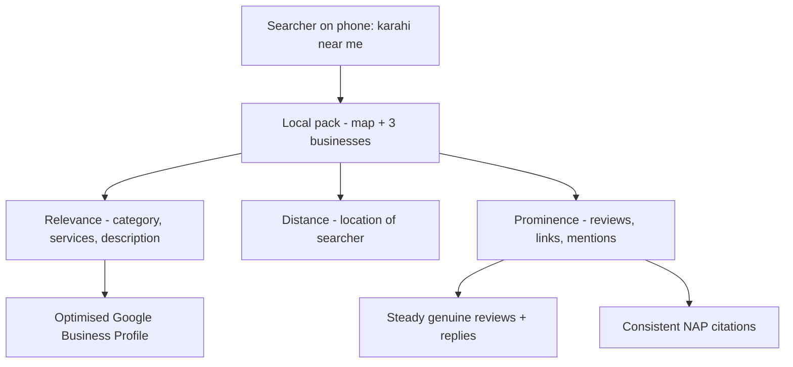
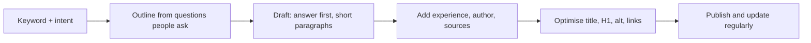

# Session 3 · Mobile SEO, SEO-Friendly Content and Local SEO

> 🏠 [Diploma in Digital Marketing](../../README.md) › [Term 1](../README.md) › [Introduction to SEO](README.md) › **Session 3**
>
> ⏱ **Estimated time:** 2 hours (1 h theory + 1 h lab) · 📋 **Prerequisites:** Sessions 1-2

[⬅ Previous: Session 2](session-02-on-page-and-off-page-optimization.md) · [Next: Session 4 ➡](session-04-advanced-seo-techniques-and-tools.md)

---

## 🎯 Learning objectives

- Explain **mobile-first indexing** and why the mobile version of a site is the one Google ranks.
- Compare **responsive, dynamic serving and separate mobile URL** set-ups and choose the right one.
- Apply a **mobile SEO checklist**: viewport, tap targets, font sizes, speed and intrusive pop-ups.
- Write **SEO-friendly content** that matches intent, is easy to read and shows E-E-A-T.
- Set up and optimise a **Google Business Profile** and explain the three local ranking factors.
- Check **NAP consistency** and plan a review strategy for a local business.

## 📖 Concepts

### 1. Why mobile comes first

In Pakistan, as in most of the world, the majority of web visits come from phones. Many people's only internet device is a smartphone. Google responded by switching to **mobile-first indexing**: it crawls and indexes the **mobile version** of every page and uses that to rank both mobile and desktop results. Google completed the move for virtually all sites by 2023–2024.

**Consequence:** if your mobile page hides content, drops structured data, removes internal links or loads slowly, that weaker version is what Google judges.

### 2. Three ways to serve mobile users

| Set-up | How it works | SEO verdict |
|---|---|---|
| **Responsive design** | One URL, one HTML; CSS media queries adapt the layout (Module 2) | ✅ **Recommended by Google** – simplest to maintain, no duplicate content |
| **Dynamic serving** | One URL, but the server sends different HTML depending on the device | ⚠️ Works, but needs the `Vary: User-Agent` header and careful testing |
| **Separate mobile URLs** | `m.example.com` for phones, `www.example.com` for desktop | ⚠️ Legacy; needs `rel="alternate"` and `rel="canonical"` links between versions; easy to break |

### 3. Mobile SEO checklist

| Check | Good practice |
|---|---|
| **Viewport tag** | `<meta name="viewport" content="width=device-width, initial-scale=1">` |
| **Readable text** | Base font about 16px; line height around 1.5 |
| **Tap targets** | Buttons and links at least about 48 × 48 px with space between them |
| **Content parity** | Same main content, headings, images, alt text and structured data as desktop |
| **No horizontal scrolling** | Images and tables fit the screen (`max-width: 100%`) |
| **Speed** | Compressed images, lazy loading, fewer scripts (Session 5) |
| **No intrusive interstitials** | Avoid full-screen pop-ups that hide content on arrival; small banners and legally required notices are fine |
| **Click-to-call / WhatsApp** | `tel:` and `wa.me` links for quick action |
| **Forms** | Few fields, correct input types (`tel`, `email`) |

Test with **Lighthouse** in Chrome DevTools (device toolbar + Lighthouse tab) and **PageSpeed Insights**. Search Console shows Core Web Vitals for real mobile users. (Google retired its standalone Mobile-Friendly Test tool in 2023.)

### 4. What makes content SEO-friendly

SEO-friendly content is content written **for people first** that is also easy for search engines to understand. Google's guidance on "helpful, reliable, people-first content" asks questions such as: Would someone who came directly to this page feel they learned enough? Does it show first-hand experience or expertise? Would you trust it?

| Principle | In practice |
|---|---|
| **Match intent** | Guide for "how to", comparison for "best", product page for "buy" |
| **Answer first** | Put the direct answer in the first paragraph ("inverted pyramid"), then details |
| **Cover the topic fully** | Answer the follow-up questions people ask (People Also Ask, comments, sales calls) |
| **Show E-E-A-T** | Author name and credentials, first-hand photos, real examples, sources, dates, contact details |
| **Original value** | Your own data, prices, case studies and opinions – not a rewrite of the top result |
| **Easy to scan** | Short paragraphs (2–4 lines), descriptive subheadings, bullet lists, tables |
| **Plain language** | Average sentence under about 20 words; explain jargon |
| **Keywords naturally** | Main keyword in title, H1, first 100 words and a subheading; related terms throughout |
| **Keep it fresh** | Update prices, statistics and screenshots; show "last updated" dates |
| **Multimedia** | Images, short videos, diagrams – each with alt text or captions |

**How long should content be?** As long as it needs to be to satisfy the intent. A "what time does Dolmen Mall close" page needs one line; "how to start an online store in Pakistan" needs a full guide. There is no magic word count.

### 5. Content formats that rank well

| Format | Good for |
|---|---|
| How-to guides and tutorials | Informational queries; featured snippets |
| Lists and comparisons ("Top 7…", "X vs Y") | Commercial investigation |
| FAQs | Voice search and People Also Ask |
| Product and service pages | Transactional queries |
| Local landing pages ("AC repair in Gulshan-e-Iqbal") | Local intent – only with genuinely local content |
| Original research and statistics | Earning backlinks |
| Videos (YouTube) | "How to" queries; video packs in the SERP |

### 6. Local SEO

**Local SEO** helps a business appear when people nearby search for what it offers: "pharmacy near me", "best karahi in Lahore", "plumber Bahria Town". These searches often show the **local pack** – a map with three businesses – above the organic results.

Google says local ranking depends on three main factors:

| Factor | Meaning | How to improve |
|---|---|---|
| **Relevance** | How well the business profile matches the search | Correct primary category, complete services and descriptions |
| **Distance** | How far the business is from the searcher or the location in the query | You can't move, but you can set an accurate pin and service areas |
| **Prominence** | How well-known and trusted the business is | Reviews (count and rating), links, mentions, organic ranking of your website |

### 7. Google Business Profile (GBP)

A **Google Business Profile** (formerly Google My Business) is the free listing that appears on Google Maps and in the local pack.

**Set-up and optimisation checklist:**

1. Claim and **verify** the profile (by phone, email, video or postcard, depending on what Google offers).
2. Use the **real business name** – adding keywords ("Chai Corner Best Tea Karachi") breaks Google's guidelines.
3. Choose the most accurate **primary category** and relevant secondary categories.
4. Add the exact **address** (or service area for businesses that visit customers), **phone**, **website** and **opening hours**, including holiday hours (Eid, Ramadan timings).
5. Write a clear description and list **products and services** with prices where possible.
6. Upload real **photos**: storefront, interior, team, products.
7. Publish **posts** for offers and events.
8. Ask for and **reply to reviews** – positive and negative.
9. Answer common questions and keep information current.

### 8. NAP consistency and citations

**NAP** = **Name, Address, Phone**. A **citation** is any online mention of your NAP: directories, social profiles, maps apps, news articles. When the details match everywhere, search engines are more confident the information is correct. Conflicting addresses or old phone numbers confuse both Google and customers.

### 9. Reviews

- Ask every happy customer – a QR code on the receipt or a WhatsApp message with your review link.
- Never buy reviews, offer rewards for positive reviews, or post fake ones; this breaks Google's policies and consumer protection rules in many countries.
- Reply to every review within a few days. For negative reviews: thank, apologise for the experience, offer to fix it offline, stay professional.
- Words in reviews ("best chicken karahi", "fast delivery") can help relevance.

## 🧭 Diagram





## 💻 Worked examples

### Example 1 – Content checker

This script checks whether a solar-installer page uses its keyword in the right places, keeps sentences short and avoids stuffing.

📄 `code/session-03_content_checker.py`

```python
# SEO-friendly content checker: keyword placement, density and readability.
import re

keyword = "solar panels karachi"
title = "Solar Panels in Karachi: 2026 Price Guide for Homes"
text = """Solar panels in Karachi can cut a home's electricity bill sharply.
This guide explains prices, sizes and net metering. A 5 kW system suits most
three-bedroom homes. Ask installers for a written warranty. Compare at least
three quotes before you pay a deposit. Net metering lets you sell spare units
back to K-Electric. Clean the panels every two weeks because dust lowers output."""

words = re.findall(r"[A-Za-z0-9']+", text)
sentences = [s for s in re.split(r"[.!?]+", text) if s.strip()]
kw_words = keyword.split()

def contains_kw(s):
    s = s.lower()
    return all(w in s for w in kw_words)

first_100 = " ".join(words[:100])
avg_sentence = len(words) / len(sentences)
# density = how often the main keyword word appears per 100 words
main_hits = sum(1 for w in words if w.lower() == "solar")
density = main_hits / len(words) * 100

print(f"Words: {len(words)}, sentences: {len(sentences)}")
print(f"Keyword in title:          {contains_kw(title)}")
print(f"Keyword in first 100 words: {contains_kw(first_100)}")
print(f"Average sentence length:   {avg_sentence:.1f} words ({'easy' if avg_sentence <= 20 else 'hard'} to read)")
print(f"'solar' density:           {density:.1f}% ({'natural' if density <= 3 else 'possible stuffing'})")
```

**Output**

```text
Words: 65, sentences: 7
Keyword in title:          True
Keyword in first 100 words: True
Average sentence length:   9.3 words (easy to read)
'solar' density:           1.5% (natural)
```

**What to notice:** the keyword appears in the title and opening, sentences average under 10 words, and keyword density is low – the page reads naturally. A density above roughly 3% for a single word is usually a sign of stuffing; there is no "ideal" density, but this check catches extreme cases.

### Example 2 – NAP consistency checker

📄 `code/session-03_nap_consistency.py`

```python
# Local SEO: check that Name, Address, Phone (NAP) match across listings.
import re

listings = {
    "Google Business Profile": ("Chai Corner", "Shop 4, Block 2, Clifton, Karachi", "+92 300 1234567"),
    "Website footer":          ("Chai Corner", "Shop 4, Block-2, Clifton, Karachi", "0300-1234567"),
    "Facebook page":           ("Chai Corner Cafe", "Shop 4, Block 2, Clifton, Karachi", "0300 1234567"),
    "Food directory":          ("Chai Corner", "Shop 14, Block 5, Clifton, Karachi", "021-35870000"),
}

def norm_phone(p):
    d = re.sub(r"\D", "", p)
    return "92" + d[1:] if d.startswith("0") else d

def norm_text(t):
    return re.sub(r"[^a-z0-9]", "", t.lower())

ref = listings["Google Business Profile"]
for source, (name, addr, phone) in listings.items():
    issues = []
    if norm_text(name) != norm_text(ref[0]): issues.append("name")
    if norm_text(addr) != norm_text(ref[1]): issues.append("address")
    if norm_phone(phone) != norm_phone(ref[2]): issues.append("phone")
    print(f"{source:24} {'OK' if not issues else 'FIX: ' + ', '.join(issues)}")
```

**Output**

```text
Google Business Profile  OK
Website footer           OK
Facebook page            FIX: name
Food directory           FIX: address, phone
```

**What to notice:** the script normalises formatting ("Block 2" vs "Block-2", "+92 300…" vs "0300-…") so harmless differences pass. The Facebook page uses a different name and the food directory has an old address and landline – both should be corrected.

## 📊 Comparison table

| | Organic SEO | Local SEO |
|---|---|---|
| Goal | Rank web pages | Rank the business in maps and the local pack |
| Main asset | Website | Google Business Profile + website |
| Key signals | Content, links, technical health | Relevance, distance, prominence, reviews, NAP |
| Typical query | "how to choose a solar inverter" | "solar installer near me" |
| Audience | Anyone, anywhere | People in a specific area |

## 🧪 Lab / practice tasks

**Task 1 (easy):** Open any local business website on your phone. List three mobile problems you notice (text size, buttons, pop-ups, speed, horizontal scroll).

**Task 2 (medium):** Find a café near you on Google Maps. Score its Business Profile out of 10 using the checklist in Concept 7. What three improvements would help most?

<details><summary>✅ Hint</summary>

Common gaps: missing opening hours for holidays, few or old photos, no replies to reviews, wrong primary category, no products/menu, no posts.

</details>

**Task 3 (medium):** Rewrite this paragraph to be SEO-friendly and easy to read for the keyword "home tuition in Karachi":

> *"In today's world education has become very important and parents are always searching for the best options available to them for their children so we at our academy are providing services of tutors who are qualified and experienced for all classes."*

<details><summary>✅ Model answer</summary>

"Looking for home tuition in Karachi? We send qualified, background-checked tutors to your home for classes 1–12, O and A Levels. Most tutors have at least three years' teaching experience. Book a free trial class on WhatsApp."

Answer first, keyword early, short sentences, specific details, clear call to action.

</details>

**Task 4 (challenge):** Write a reply to this one-star review: *"Ordered biryani, came 1 hour late and cold. Never again."*

<details><summary>✅ Model answer</summary>

"Assalam o Alaikum, and thank you for telling us. We're sorry your biryani arrived late and cold – that isn't the standard we aim for. We've shared this with our delivery team. Please WhatsApp us on 0300-1234567 with your order number and we'll make it right. – Manager, Biryani House"

Thank, apologise, explain the action, move offline, sign off personally. Never argue or reveal customer details.

</details>

## ✅ Quick quiz

1. Under mobile-first indexing, Google mainly uses… a) the desktop page b) the mobile page c) the AMP page only d) the sitemap
2. Google's recommended mobile set-up is… a) separate m-dot site b) dynamic serving c) responsive design d) a mobile app only
3. Which is **not** one of Google's three main local ranking factors? a) Relevance b) Distance c) Prominence d) Domain age
4. NAP stands for… a) Name, Address, Phone b) Network, Authority, Page c) New Audience Plan d) Name, Area, Price
5. Which content practice best supports E-E-A-T? a) Anonymous author b) First-hand photos and a qualified author bio c) Repeating the keyword d) Copying top results

<details><summary>Show answers</summary>

1-b · 2-c · 3-d · 4-a · 5-b

</details>

## 📝 Summary

- Google ranks the **mobile version** of your site; responsive design is the recommended set-up.
- Mobile SEO needs a viewport tag, readable text, large tap targets, content parity, speed and no intrusive pop-ups.
- SEO-friendly content matches intent, answers first, covers the topic, shows **E-E-A-T** and reads easily.
- Local SEO depends on **relevance, distance and prominence**.
- A complete, verified **Google Business Profile**, consistent **NAP** and a steady flow of genuine **reviews** drive local visibility.

**Interview / viva questions**

1. What is mobile-first indexing and what problems can it expose?
2. Why does Google recommend responsive design over separate mobile URLs?
3. How would you show E-E-A-T on a blog about personal finance?
4. A client's address changed. What local SEO steps would you take?
5. How should a business respond to a negative review?

---

[⬅ Previous: Session 2](session-02-on-page-and-off-page-optimization.md) · [Next: Session 4 ➡](session-04-advanced-seo-techniques-and-tools.md)

<sub>Prepared by **Hamna Zahid Khan**, Junior Lecturer · Diploma in Digital Marketing</sub>
