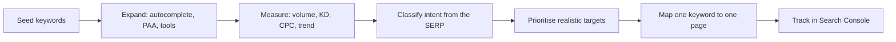
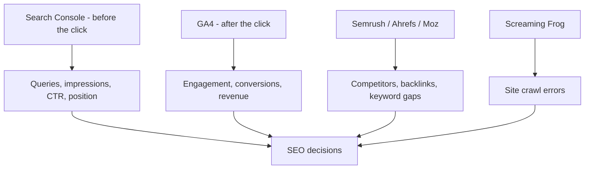

# Session 4 · Advanced SEO Techniques and Tools

> 🏠 [Diploma in Digital Marketing](../../README.md) › [Term 1](../README.md) › [Introduction to SEO](README.md) › **Session 4**
>
> ⏱ **Estimated time:** 2 hours (1 h theory + 1 h lab) · 📋 **Prerequisites:** Sessions 1-3

[⬅ Previous: Session 3](session-03-mobile-seo-and-content.md) · [Next: Session 5 ➡](session-05-technical-seo-and-site-performance.md)

---

## 🎯 Learning objectives

- Run a complete **keyword research** process: seed terms, expansion, metrics, intent and prioritisation.
- Explain **search volume, keyword difficulty, CPC and long-tail keywords** and use them to choose targets.
- Carry out a **competitor and content-gap analysis**.
- Win **featured snippets** and **rich results** with formatting and structured data.
- Use the main **SEO tools**: Google Search Console, Google Analytics 4, Keyword Planner, Google Trends, Semrush, Ahrefs, Moz, Screaming Frog and others.
- Track SEO with the right **KPIs** and estimate traffic gains from ranking improvements.

## 📖 Concepts

### 1. Keyword research – the foundation

**Keyword research** finds the words and phrases your audience types into search engines, so you can create pages that match them. Good research stops you writing content nobody searches for, or chasing keywords you can't win.

**The five-step process**

| Step | What you do | Tools |
|---|---|---|
| 1. **Seed** | List the basic terms that describe the business ("quran classes", "tajweed") | Brainstorm, customers, sales team |
| 2. **Expand** | Find variations, questions and long-tail phrases | Google autocomplete, People Also Ask, related searches, Keyword Planner, Semrush, AnswerThePublic |
| 3. **Measure** | Record volume, difficulty, CPC and trend for each | Keyword tools, Google Trends |
| 4. **Classify intent** | Informational, navigational, commercial, transactional | Look at the live SERP |
| 5. **Prioritise and map** | Pick realistic targets and assign each to one page | Spreadsheet, keyword map |

### 2. Keyword metrics

| Metric | Meaning | How to use it |
|---|---|---|
| **Search volume** | Average monthly searches (usually an estimate, rounded) | Shows demand, but high volume often means high competition |
| **Keyword difficulty (KD)** | Tool score (0–100) estimating how hard it is to reach the top 10, mainly from competitors' backlinks | New sites should start with low-KD terms |
| **CPC** | What advertisers pay per click in Google Ads | High CPC = commercial value – buyers search this |
| **Trend / seasonality** | How interest changes over time | "Eid dresses" peaks before each Eid; "school bags" before term starts |
| **SERP features** | Snippets, local pack, videos, AI Overviews on the page | Fewer organic clicks if the SERP is crowded |
| **Clicks** | Some tools estimate how many searches actually lead to a click | Questions answered directly on the SERP get fewer clicks |

Different tools give different numbers – they all estimate from samples. Use them to **compare** keywords, not as exact truth. Google Search Console shows your **real** impressions and clicks once your site ranks.

### 3. Head, body and long-tail keywords

| Type | Example | Volume | Competition | Conversion |
|---|---|---|---|---|
| **Head** (1–2 words) | "quran" | Very high | Very high | Low – vague intent |
| **Body** (2–3 words) | "online quran classes" | Medium | High | Medium |
| **Long-tail** (4+ words) | "online quran classes for kids in the UK" | Low | Low | **High** – specific need |

Long-tail keywords are individually small, but together they make up most searches, and they are where new sites win first.

### 4. Keyword mapping and cannibalisation

A **keyword map** assigns one main keyword (plus its close variations) to **one** page.

| Page | Primary keyword | Secondary keywords | Intent |
|---|---|---|---|
| `/online-quran-classes-kids` | online quran classes for kids | kids quran tutor online, quran for children | Transactional |
| `/fees` | quran academy fees | online quran class price | Transactional |
| `/blog/learn-tajweed-at-home` | how to learn tajweed at home | tajweed rules for beginners | Informational |

**Keyword cannibalisation** happens when several of your pages target the same keyword and compete with each other; Google may swap between them and none ranks well. Fix it by merging pages (with a 301 redirect), re-targeting one, or linking clearly to the main page.

### 5. Competitor and content-gap analysis

1. **Find real search competitors** – the sites ranking for your target keywords (they may differ from business competitors; a news site or Wikipedia might be your search rival).
2. **Compare authority** – referring domains, organic traffic estimates (Semrush, Ahrefs, Moz).
3. **Content gap** – keywords competitors rank for but you don't. Tools: Semrush *Keyword Gap*, Ahrefs *Content Gap*.
4. **Backlink gap** – sites linking to competitors but not to you: outreach targets.
5. **Page-level review** – for each top result: format, length, depth, freshness, media, E-E-A-T. Plan a page that is **better**, not just longer – more useful, more original, clearer.

### 6. Featured snippets and rich results

**Featured snippets** quote one page in a box above the regular results. Formats: **paragraph** (definitions, "what is"), **list** (steps, rankings), **table** (comparisons, prices).

How to target them:
- Use the question as a heading (`<h2>What is net metering?</h2>`).
- Answer directly in **40–60 words** straight after it.
- Use `<ol>`/`<ul>` for steps and `<table>` for comparisons.
- You usually need to rank on page one already.

**Rich results** are enhanced listings – star ratings, prices, availability, event dates, recipe times – enabled by **structured data** in **JSON-LD** using schema.org vocabulary.

```html
<script type="application/ld+json">
{
  "@context": "https://schema.org",
  "@type": "Product",
  "name": "Grey Pashmina Shawl",
  "image": "https://shawlhouse.pk/img/grey-pashmina.webp",
  "offers": { "@type": "Offer", "price": "4500", "priceCurrency": "PKR", "availability": "https://schema.org/InStock" },
  "aggregateRating": { "@type": "AggregateRating", "ratingValue": "4.7", "reviewCount": "128" }
}
</script>
```

Validate with Google's **Rich Results Test** and the **Schema Markup Validator**. Structured data must match what is visible on the page; marking up fake reviews breaks Google's policies. Structured data makes you **eligible** for rich results – it does not guarantee them.

### 7. The SEO toolkit

| Tool | Cost | Main uses |
|---|---|---|
| **Google Search Console (GSC)** | Free | Real queries, impressions, clicks, CTR, average position; indexing status; sitemaps; Core Web Vitals; manual actions |
| **Google Analytics 4 (GA4)** | Free | What visitors do after arriving: engagement, conversions, revenue by channel |
| **Google Keyword Planner** | Free with an Ads account | Volume ranges, CPC, keyword ideas |
| **Google Trends** | Free | Relative interest over time and by region; seasonality |
| **PageSpeed Insights / Lighthouse** | Free | Speed, Core Web Vitals, accessibility, SEO basics |
| **Semrush** | Paid (limited free) | Keyword research, competitor traffic, keyword gap, site audit, rank tracking |
| **Ahrefs** | Paid (free Webmaster Tools for your own site) | Backlink analysis, content gap, keyword explorer |
| **Moz Pro** | Paid (free MozBar) | Domain Authority (DA), keyword research, link explorer |
| **Ubersuggest** | Freemium | Beginner-friendly keyword and site audit |
| **Screaming Frog SEO Spider** | Free up to 500 URLs | Crawls your site like a bot: broken links, missing titles, redirects, duplicate content |
| **AnswerThePublic / AlsoAsked** | Freemium | Questions people ask around a topic |
| **Yoast SEO / Rank Math** | Freemium WordPress plugins | Edit titles, descriptions, sitemaps, schema in WordPress |

Third-party "authority" scores (Moz **DA**, Ahrefs **DR**, Semrush **Authority Score**) are each company's own estimate. Google does not use them. They are handy for comparing sites, nothing more.

### 8. SEO KPIs

| KPI | Where | Tells you |
|---|---|---|
| **Impressions** | GSC | How often you appear in results |
| **Clicks and CTR** | GSC | How often people choose you (CTR = clicks ÷ impressions × 100) |
| **Average position** | GSC | Typical ranking (lower number = higher on the page) |
| **Organic sessions / users** | GA4 | Traffic from search |
| **Engagement rate** | GA4 | Share of sessions that were engaged |
| **Conversions from organic** | GA4 | Leads, sales, calls – the business result |
| **Indexed pages** | GSC › Pages | Whether your content is in the index |
| **Referring domains** | Ahrefs/Semrush/Moz | Growth of your link profile |
| **Keyword rankings** | Rank tracker | Movement on priority keywords |

**Traffic estimate:** Monthly clicks ≈ search volume × CTR at your position. CTR falls steeply down the page: position 1 typically gets several times the clicks of position 5. Treat any CTR curve as a rough guide; your own Search Console data is the real one.

## 🧭 Diagram





## 💻 Worked examples

### Example 1 – Prioritising keywords for a new online Quran academy

The opportunity score rewards volume and buyer intent and penalises difficulty. Keywords harder than the site can realistically win are parked for later.

📄 `code/session-04_keyword_priority.py`

```python
# Prioritise keywords: opportunity = volume x intent value / difficulty,
# but only for keywords a young site can realistically win (KD at or below its reach).
keywords = [  # keyword, monthly searches, difficulty 0-100, intent
    ("online quran classes", 9900, 72, "commercial"),
    ("online quran classes for kids uk", 880, 28, "transactional"),
    ("how to learn tajweed at home", 1300, 22, "informational"),
    ("quran academy fees", 590, 18, "transactional"),
    ("quran", 450000, 98, "navigational"),
]
intent_value = {"transactional": 3, "commercial": 2, "informational": 1, "navigational": 0.2}
SITE_MAX_KD = 40   # a new site with few backlinks

rows = []
for kw, vol, kd, intent in keywords:
    score = vol * intent_value[intent] / max(kd, 1)
    plan = "target now" if kd <= SITE_MAX_KD else "later (too hard)"
    rows.append((kd > SITE_MAX_KD, -score, kw, vol, kd, intent, score, plan))

print(f"{'Keyword':34}{'Vol':>8}{'KD':>4}  {'Intent':14}{'Score':>6}  Plan")
for _, _, kw, vol, kd, intent, score, plan in sorted(rows):
    print(f"{kw:34}{vol:>8}{kd:>4}  {intent:14}{score:>6.0f}  {plan}")
```

**Output**

```text
Keyword                                Vol  KD  Intent         Score  Plan
quran academy fees                     590  18  transactional     98  target now
online quran classes for kids uk       880  28  transactional     94  target now
how to learn tajweed at home          1300  22  informational     59  target now
quran                               450000  98  navigational     918  later (too hard)
online quran classes                  9900  72  commercial       275  later (too hard)
```

**What to notice:** "quran" has by far the biggest raw score, but a new site cannot rank for a KD 98 term – and its intent is vague. The plan starts with specific, low-difficulty, high-intent long-tail keywords, then moves to harder terms as the site gains links and authority.

### Example 2 – What is a ranking improvement worth?

📄 `code/session-04_ctr_traffic.py`

```python
# Estimate monthly clicks from rankings using an illustrative CTR curve.
# Real CTRs vary by query, SERP features and device; use Search Console data for your site.
ctr = {1: 0.28, 2: 0.15, 3: 0.10, 4: 0.07, 5: 0.05, 6: 0.04, 7: 0.03, 8: 0.025, 9: 0.02, 10: 0.018}

def clicks(volume, position):
    return volume * ctr.get(position, 0.005)

volume = 1300
for now, target in [(9, 3), (4, 1), (15, 8)]:
    gain = clicks(volume, target) - clicks(volume, now)
    print(f"Move from #{now:>2} to #{target}: {clicks(volume, now):6.0f} -> {clicks(volume, target):6.0f} clicks/month (+{gain:.0f})")
```

**Output**

```text
Move from # 9 to #3:     26 ->    130 clicks/month (+104)
Move from # 4 to #1:     91 ->    364 clicks/month (+273)
Move from #15 to #8:      6 ->     32 clicks/month (+26)
```

**What to notice:** moving from position 4 to 1 more than triples clicks. Moving from page two (#15) to #8 adds little, because few people scroll that far. Focus effort on keywords already ranking in positions 4–15 ("striking distance") – small improvements there give the biggest gains.

## 📊 Comparison table

| | Google Search Console | Google Analytics 4 | Semrush / Ahrefs |
|---|---|---|---|
| Data source | Google's own search data for **your** site | Tracking code on **your** site | Third-party crawlers and estimates for **any** site |
| Shows queries | ✅ Real | ❌ (mostly hidden) | ✅ Estimated |
| Shows competitors | ❌ | ❌ | ✅ |
| Shows conversions | ❌ | ✅ | ❌ |
| Cost | Free | Free | Paid |

## 🧪 Lab / practice tasks

**Task 1 (easy):** Type "how to start" into Google and note 8 autocomplete suggestions. Then open People Also Ask for "how to start a blog" and record 4 questions.

**Task 2 (medium):** In Google Trends, compare "lawn" and "khaddar" in Pakistan over the past five years. Describe the seasonal pattern and when a clothing brand should publish content for each.

<details><summary>✅ Model answer</summary>

"Lawn" rises in spring and peaks in summer; "khaddar" rises in autumn and peaks in early winter. Publish lawn content and collections from about February–March and khaddar content from about September–October, a few weeks before demand peaks so pages have time to be indexed and rank.

</details>

**Task 3 (medium):** Build a keyword map of five keywords for a Karachi wedding photographer, with page URL, primary keyword, two secondary keywords and intent.

**Task 4 (challenge):** Write the HTML for a section designed to win a featured snippet for "how to clean solar panels": an H2 question, a 40–60-word answer paragraph and a numbered list of steps.

<details><summary>✅ Solution</summary>

```html
<h2>How do you clean solar panels?</h2>
<p>Clean solar panels early in the morning with plain water and a soft brush or sponge. Avoid soap, pressure washers and abrasive pads, which can scratch the glass. In dusty cities like Karachi, clean every two to four weeks to keep output high.</p>
<ol>
  <li>Switch off the system at the inverter.</li>
  <li>Rinse the panels with a gentle stream of water.</li>
  <li>Wipe with a soft brush or sponge.</li>
  <li>Rinse again and let the panels air-dry.</li>
  <li>Switch the system back on and check the inverter reading.</li>
</ol>
```

</details>

## ✅ Quick quiz

1. Which keyword is long-tail? a) "shoes" b) "running shoes" c) "waterproof running shoes for women size 7" d) "nike"
2. Keyword difficulty mainly estimates… a) monthly searches b) how hard it is to reach the top 10 c) cost per click d) page speed
3. Which free tool shows the real queries your site appears for? a) Semrush b) Google Search Console c) Moz DA d) AnswerThePublic
4. Two of your pages compete for the same keyword. This is… a) cloaking b) keyword cannibalisation c) link building d) canonical tagging
5. Structured data mainly helps you… a) rank first automatically b) become eligible for rich results c) hide content d) avoid crawling

<details><summary>Show answers</summary>

1-c · 2-b · 3-b · 4-b · 5-b

</details>

## 📝 Summary

- Keyword research = **seed → expand → measure → classify intent → prioritise and map**.
- Use volume, difficulty, CPC and trend together; new sites win first with **long-tail**, low-difficulty, high-intent terms.
- Map **one keyword to one page** to avoid cannibalisation.
- Competitor and **content-gap** analysis reveals keywords and links to pursue.
- Direct answers and lists/tables win **featured snippets**; JSON-LD **structured data** enables rich results.
- Search Console (before the click), GA4 (after the click) and third-party tools (competitors, links) work together.
- Focus on "striking distance" keywords – ranking gains near the top deliver most clicks.

**Interview / viva questions**

1. Walk me through your keyword research process for a new client.
2. Why might you choose a keyword with 500 searches over one with 50,000?
3. What is keyword cannibalisation and how do you fix it?
4. What is the difference between Google Search Console and GA4?
5. How would you try to win a featured snippet?

---

[⬅ Previous: Session 3](session-03-mobile-seo-and-content.md) · [Next: Session 5 ➡](session-05-technical-seo-and-site-performance.md)

<sub>Prepared by **Hamna Zahid Khan**, Junior Lecturer · Diploma in Digital Marketing</sub>
