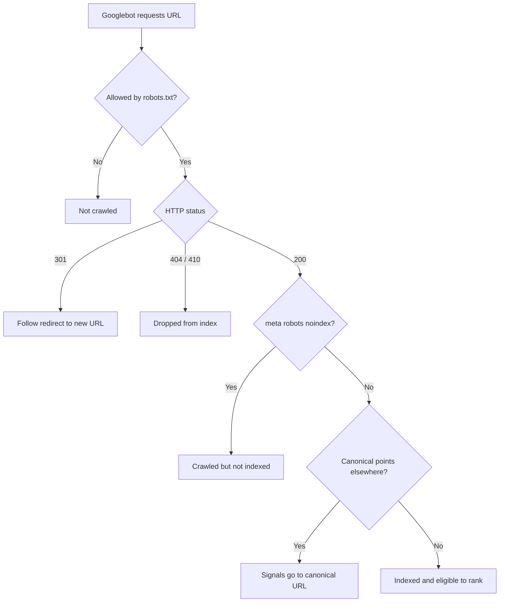
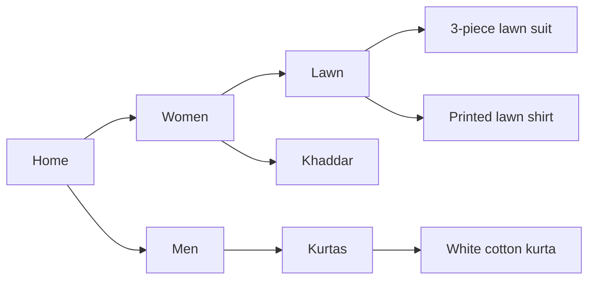

# Session 5 · Technical SEO and Site Performance

> 🏠 [Diploma in Digital Marketing](../../README.md) › [Term 1](../README.md) › [Introduction to SEO](README.md) › **Session 5**
>
> ⏱ **Estimated time:** 2 hours (1 h theory + 1 h lab) · 📋 **Prerequisites:** Session 4

[⬅ Previous: Session 4](session-04-advanced-seo-techniques-and-tools.md) · [Next: Session 6 ➡](session-06-voice-search-optimization.md)

---

## 🎯 Learning objectives

- Explain what **technical SEO** covers and why it comes before content and links.
- Control crawling and indexing with **robots.txt, meta robots, XML sitemaps and canonical tags**.
- Use **HTTP status codes** and **301 redirects** correctly when pages move or disappear.
- Plan a **site architecture** with shallow depth, clean URLs and breadcrumbs.
- Measure and improve **Core Web Vitals**: LCP, INP and CLS.
- Run a basic **technical SEO audit** with Search Console, PageSpeed Insights and a crawler.

## 📖 Concepts

### 1. What technical SEO is

**Technical SEO** makes sure search engines can **crawl**, **render**, **index** and **understand** your site, and that real users get a fast, secure, stable experience. It is the foundation: brilliant content cannot rank if Googlebot can't reach it or the page takes eight seconds to load on a phone.

| Area | Questions |
|---|---|
| Crawlability | Can bots find and fetch every important page? |
| Indexability | Are the right pages indexed – and the wrong ones kept out? |
| Architecture | Is the site logically organised and easy to navigate? |
| Performance | Is it fast and stable on real phones? |
| Security | Is it served over HTTPS? |
| Rendering | Does key content appear if JavaScript is slow or fails? |
| Structured data | Is content described in a machine-readable way? |

### 2. robots.txt

A plain-text file at the **root** of the domain (`https://example.com/robots.txt`) that tells crawlers which paths they may **crawl**.

```text
User-agent: *
Disallow: /cart/
Disallow: /search
Allow: /

Sitemap: https://shop.example.pk/sitemap.xml
```

| Directive | Meaning |
|---|---|
| `User-agent:` | Which bot the rules apply to (`*` = all; `Googlebot` = Google only) |
| `Disallow:` | Path the bot should not crawl |
| `Allow:` | Exception inside a disallowed path |
| `Sitemap:` | Location of the XML sitemap |

**Important:** robots.txt controls **crawling, not indexing**. A blocked URL can still appear in results (without a description) if other sites link to it. To keep a page **out of the index**, let it be crawled and use `noindex`. Never block CSS or JavaScript files Google needs to render the page. One wrong line – `Disallow: /` – blocks the whole site; this is a classic mistake when a test site goes live.

### 3. Meta robots and X-Robots-Tag

```html
<meta name="robots" content="noindex, follow">
```

| Value | Effect |
|---|---|
| `index` / `noindex` | Allow or prevent the page from appearing in results |
| `follow` / `nofollow` | Allow or prevent following links on the page |
| `noarchive`, `nosnippet`, `max-snippet:50` | Control cached copies and snippet length |

Use `noindex` for thank-you pages, internal search results, thin tag pages and staging sites. For PDFs and images, send the same instruction as an HTTP header: `X-Robots-Tag: noindex`.

### 4. XML sitemaps

An **XML sitemap** lists the URLs you want indexed, with optional `lastmod` dates. It helps Google discover pages, especially on new or large sites.

- Include only **canonical, indexable pages that return 200**.
- Maximum **50,000 URLs or 50 MB** per file; larger sites use a **sitemap index**.
- Submit it in Search Console and list it in robots.txt.
- CMS plugins (Yoast, Rank Math) and platforms (Shopify, Wix) generate sitemaps automatically.

### 5. Canonical tags and duplicate content

The same content often appears at several URLs:

```text
https://shop.pk/shoes/runner
https://shop.pk/shoes/runner?color=black
https://shop.pk/shoes/runner?utm_source=facebook
http://www.shop.pk/shoes/runner
```

A **canonical tag** tells Google which version is the main one:

```html
<link rel="canonical" href="https://shop.pk/shoes/runner">
```

Google treats it as a strong hint. Also pick one preferred domain version (`https://` + with or without `www`) and redirect the others to it.

### 6. HTTP status codes

| Code | Meaning | SEO use |
|---|---|---|
| **200** OK | Page loads normally | What every indexable page should return |
| **301** Moved Permanently | Page has a new permanent URL | Passes ranking signals to the new URL – use for site moves, renamed URLs, merged pages |
| **302 / 307** Temporary redirect | Temporary move | Use only for genuinely temporary changes |
| **404** Not Found | Page doesn't exist | Fine for truly deleted pages; fix internal links pointing to them |
| **410** Gone | Removed on purpose | Slightly faster removal from the index |
| **500 / 503** Server error | Server problem / temporarily unavailable | Repeated errors reduce crawling; use 503 during maintenance |

**Redirect best practice:** redirect old URLs to the **most relevant** new page (not all to the home page), avoid **chains** (A → B → C) and **loops**, and update internal links to point directly at the final URL.

### 7. Site architecture

A good structure lets users and bots reach any important page in **about three clicks** from the home page.

| Good practice | Why |
|---|---|
| Logical categories (`/men/kurtas/`, `/women/lawn/`) | Groups related pages; clear topical signals |
| Shallow depth | Important pages get crawled more often and receive more internal authority |
| **Breadcrumbs** (`Home › Women › Lawn › 3-Piece`) | Navigation aid; can appear in search results with `BreadcrumbList` schema |
| No **orphan pages** | Every page needs at least one internal link |
| Clean, consistent URLs | Readable, shareable, keyword-rich |
| Careful **faceted navigation** | Filters (size, colour, price) can create thousands of near-duplicate URLs; canonicalise or block them |
| Pagination with crawlable links | Bots must be able to reach page 2, 3… through normal `<a href>` links |

### 8. HTTPS and security

HTTPS encrypts the connection with an SSL/TLS certificate (free from Let's Encrypt or included by most hosts). It is a light ranking signal, browsers label HTTP pages "Not secure", and it is required for many modern browser features. After moving to HTTPS: 301-redirect all HTTP URLs, update internal links, canonicals and the sitemap, and fix **mixed content** (HTTP images or scripts on HTTPS pages).

### 9. Core Web Vitals and page speed

**Core Web Vitals** are Google's user-experience metrics, measured on **real users' visits** (the Chrome User Experience Report). A page passes when the **75th percentile** of visits is "good" for all three:

| Metric | Measures | Good | Poor |
|---|---|---|---|
| **LCP** – Largest Contentful Paint | Loading: when the main content (hero image, headline) appears | ≤ **2.5 s** | > 4.0 s |
| **INP** – Interaction to Next Paint | Responsiveness: delay after taps, clicks and key presses | ≤ **200 ms** | > 500 ms |
| **CLS** – Cumulative Layout Shift | Visual stability: how much the layout jumps while loading | ≤ **0.1** | > 0.25 |

INP replaced the older **FID** (First Input Delay) in March 2024. Other useful speed metrics: **TTFB** (Time to First Byte – server speed) and **FCP** (First Contentful Paint).

**Common fixes**

| Problem | Fix |
|---|---|
| Slow LCP | Compress and resize images; use WebP/AVIF; preload the hero image; faster hosting; a **CDN**; caching; don't lazy-load the hero image |
| Poor INP | Reduce and defer JavaScript; remove unused plugins and third-party scripts; break up long tasks |
| High CLS | Set `width`/`height` on images, videos and ad slots; reserve space for banners; use `font-display: swap` carefully |
| Slow TTFB | Better hosting, server caching, a CDN close to users |
| Heavy pages | Minify CSS/JS, enable compression (gzip/Brotli), lazy-load below-the-fold images |

**Lab data vs field data:** Lighthouse runs a simulated test on one device (lab data) – good for debugging. Search Console and the top of PageSpeed Insights show **field data** from real Chrome users – what Google actually uses.

### 10. JavaScript and rendering

Google can render JavaScript, but rendering is delayed and can fail. Keep essential content, links and meta tags in the initial HTML where possible (**server-side rendering** or **static generation**), use real `<a href>` links rather than click handlers, and check with Search Console's **URL Inspection › View crawled page**.

### 11. A technical audit checklist

1. **Search Console › Pages**: which URLs are indexed, which are excluded and why.
2. **robots.txt** and **sitemap** reviewed; sitemap submitted.
3. **Crawl** the site with Screaming Frog: 4xx/5xx errors, redirect chains, missing/duplicate titles, orphan pages.
4. **Canonicals** and the preferred domain version are consistent.
5. **HTTPS** everywhere, no mixed content.
6. **Core Web Vitals** report and PageSpeed Insights for key templates (home, category, product, blog).
7. **Mobile** rendering and content parity.
8. **Structured data** validated with the Rich Results Test.
9. **Prioritise** fixes by impact × effort and re-check after changes.

## 🧭 Diagram





## 💻 Worked examples

### Example 1 – Testing robots.txt rules and generating a sitemap

📄 `code/session-05_robots_sitemap.py`

```python
# Technical SEO: test robots.txt rules and generate an XML sitemap (standard library only).
from urllib import robotparser
from xml.sax.saxutils import escape

robots_txt = """User-agent: *
Disallow: /cart/
Disallow: /search
Allow: /

Sitemap: https://shop.example.pk/sitemap.xml"""

rp = robotparser.RobotFileParser()
rp.parse(robots_txt.splitlines())
for path in ["/", "/products/lawn-suit-3pc", "/cart/checkout", "/search?q=lawn"]:
    ok = rp.can_fetch("Googlebot", "https://shop.example.pk" + path)
    print(f"{'ALLOW' if ok else 'BLOCK'}  {path}")

pages = [("/", "2026-10-20"), ("/products/lawn-suit-3pc", "2026-10-18"), ("/blog/lawn-care-tips", "2026-09-30")]
urls = "\n".join(
    f"  <url><loc>{escape('https://shop.example.pk' + p)}</loc><lastmod>{d}</lastmod></url>" for p, d in pages)
sitemap = f'<?xml version="1.0" encoding="UTF-8"?>\n<urlset xmlns="http://www.sitemaps.org/schemas/sitemap/0.9">\n{urls}\n</urlset>'
print("\n" + sitemap)
```

**Output**

```text
ALLOW  /
ALLOW  /products/lawn-suit-3pc
BLOCK  /cart/checkout
BLOCK  /search?q=lawn

<?xml version="1.0" encoding="UTF-8"?>
<urlset xmlns="http://www.sitemaps.org/schemas/sitemap/0.9">
  <url><loc>https://shop.example.pk/</loc><lastmod>2026-10-20</lastmod></url>
  <url><loc>https://shop.example.pk/products/lawn-suit-3pc</loc><lastmod>2026-10-18</lastmod></url>
  <url><loc>https://shop.example.pk/blog/lawn-care-tips</loc><lastmod>2026-09-30</lastmod></url>
</urlset>
```

**What to notice:** product pages stay crawlable while the cart and internal search are blocked – those pages waste crawl effort and add no search value. The sitemap lists only clean, canonical URLs with their last-modified dates.

### Example 2 – Rating pages against Core Web Vitals

📄 `code/session-05_core_web_vitals.py`

```python
# Rate pages against Core Web Vitals thresholds (75th percentile of real-user visits).
THRESHOLDS = {  # metric: (good up to, poor above)
    "LCP_s":  (2.5, 4.0),    # Largest Contentful Paint, seconds
    "INP_ms": (200, 500),    # Interaction to Next Paint, milliseconds
    "CLS":    (0.1, 0.25),   # Cumulative Layout Shift, unitless
}

def rate(metric, value):
    good, poor = THRESHOLDS[metric]
    return "good" if value <= good else ("needs improvement" if value <= poor else "poor")

pages = {
    "/":                 {"LCP_s": 1.9, "INP_ms": 120, "CLS": 0.05},
    "/products/lawn":    {"LCP_s": 4.6, "INP_ms": 180, "CLS": 0.31},
    "/blog/care-tips":   {"LCP_s": 2.8, "INP_ms": 260, "CLS": 0.02},
}
for url, m in pages.items():
    ratings = {k: rate(k, v) for k, v in m.items()}
    passed = all(r == "good" for r in ratings.values())
    print(f"{url:18} " + "  ".join(f"{k}={m[k]} ({r})" for k, r in ratings.items()) + f"  -> {'PASS' if passed else 'FAIL'}")
```

**Output**

```text
/                  LCP_s=1.9 (good)  INP_ms=120 (good)  CLS=0.05 (good)  -> PASS
/products/lawn     LCP_s=4.6 (poor)  INP_ms=180 (good)  CLS=0.31 (poor)  -> FAIL
/blog/care-tips    LCP_s=2.8 (needs improvement)  INP_ms=260 (needs improvement)  CLS=0.02 (good)  -> FAIL
```

**What to notice:** a page must be "good" on **all three** metrics to pass. The product page fails on loading (a heavy hero image is the usual cause) and layout shift (images without dimensions, or a late-loading banner). The blog page needs lighter JavaScript to fix INP.

## 📊 Comparison table

| Tool | Controls | Stops crawling? | Stops indexing? |
|---|---|---|---|
| robots.txt `Disallow` | Crawling | ✅ | ❌ (URL may still be listed) |
| `<meta name="robots" content="noindex">` | Indexing | ❌ (page must be crawled to see it) | ✅ |
| Canonical tag | Which duplicate gets the signals | ❌ | Usually keeps duplicates out (a hint) |
| 301 redirect | Moves users and signals to a new URL | – | Old URL replaced by new |
| Password protection | Access | ✅ | ✅ |

## 🧪 Lab / practice tasks

**Task 1 (easy):** Open `/robots.txt` on three well-known sites (for example a news site, an e-commerce site and a university). Which paths do they block? Do they list a sitemap?

**Task 2 (easy):** Match each situation to the right status code: (a) a product renamed with a new URL forever; (b) a page deleted with no replacement; (c) the site is down for one hour of maintenance.

<details><summary>✅ Answer</summary>

(a) 301 · (b) 404 or 410 · (c) 503

</details>

**Task 3 (medium):** Run PageSpeed Insights on a local business's home page (mobile). Record LCP, INP and CLS from field data (if available) and the top three Lighthouse opportunities. Write a short fix list for the developer.

**Task 4 (challenge):** A shop is moving from `http://oldshop.pk` to `https://newshop.pk` with a new URL structure. Write a migration checklist of at least eight steps.

<details><summary>✅ Model answer</summary>

1. Crawl the old site and export every URL. 2. Build a one-to-one **301 redirect map** (old URL → most relevant new URL). 3. Keep titles, content and internal links equivalent. 4. Install HTTPS on the new domain. 5. Set canonicals to new URLs. 6. Create and submit the new sitemap. 7. Verify both domains in Search Console and use the **Change of Address** tool. 8. Update backlinks you control (social profiles, directories, Google Business Profile). 9. Launch at a quiet time; test redirects. 10. Monitor 404s, indexing and rankings daily for several weeks. Keep redirects in place for at least a year.

</details>

## ✅ Quick quiz

1. Which file tells bots which paths they may crawl? a) sitemap.xml b) robots.txt c) .htaccess d) index.html
2. To keep a crawlable page out of search results, use… a) `Disallow` b) `noindex` c) a 200 status d) a canonical to itself
3. Which redirect passes ranking signals for a permanent move? a) 302 b) 301 c) 404 d) 503
4. A good LCP is… a) ≤ 2.5 s b) ≤ 5 s c) ≤ 0.1 d) ≤ 200 ms
5. Which metric measures layout jumping while a page loads? a) LCP b) INP c) CLS d) TTFB

<details><summary>Show answers</summary>

1-b · 2-b · 3-b · 4-a · 5-c

</details>

## 📝 Summary

- Technical SEO makes sites **crawlable, indexable, fast, secure and understandable**.
- **robots.txt** controls crawling; **noindex** controls indexing; **canonical** tags consolidate duplicates.
- **XML sitemaps** list indexable URLs; submit them in Search Console.
- Use **301** for permanent moves, avoid chains, and redirect to the most relevant page.
- Keep important pages within about **three clicks**, with breadcrumbs and no orphans.
- **Core Web Vitals**: LCP ≤ 2.5 s, INP ≤ 200 ms, CLS ≤ 0.1, measured on real users.

**Interview / viva questions**

1. What is the difference between blocking a page in robots.txt and adding `noindex`?
2. When would you use a canonical tag instead of a 301 redirect?
3. Explain LCP, INP and CLS and one fix for each.
4. What steps would you take during a domain migration to protect rankings?
5. What is the difference between lab data and field data?

---

[⬅ Previous: Session 4](session-04-advanced-seo-techniques-and-tools.md) · [Next: Session 6 ➡](session-06-voice-search-optimization.md)

<sub>Prepared by **Hamna Zahid Khan**, Junior Lecturer · Diploma in Digital Marketing</sub>
