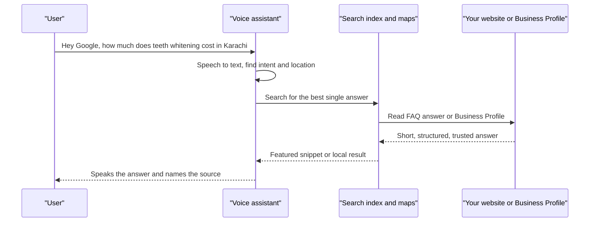
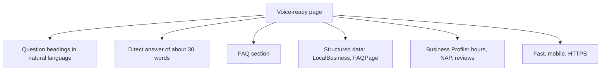

# Session 6 · Voice Search Optimization

> 🏠 [Diploma in Digital Marketing](../../README.md) › [Term 1](../README.md) › [Introduction to SEO](README.md) › **Session 6**
>
> ⏱ **Estimated time:** 2 hours (1 h theory + 1 h lab) · 📋 **Prerequisites:** Session 5

[⬅ Previous: Session 5](session-05-technical-seo-and-site-performance.md) · [Next: Session 7 ➡](session-07-ai-and-ml-in-seo.md)

---

## 🎯 Learning objectives

- Explain how **voice search** works, from speech recognition to a spoken answer.
- Name the main **voice assistants** and where each takes its answers from.
- Describe how voice queries differ from typed queries: **longer, conversational, question-based and local**.
- Optimise content for voice with **direct answers, FAQ sections, featured snippets and structured data**.
- Apply **local voice SEO** for "near me" and "open now" searches.
- Recognise the limits of voice search and how it connects to AI assistants.

## 📖 Concepts

### 1. What voice search is

**Voice search** means speaking a query instead of typing it – "Hey Google, where's the nearest petrol pump?" – to a phone, smart speaker, car system, smartwatch or TV. The assistant either reads out one answer or shows results on a screen.

For marketers the key difference is this: **on a screen you compete for a place in a list; in a spoken answer there is often only one winner.**

### 2. How a voice query is answered

| Step | What happens |
|---|---|
| 1. **Wake word** | "Hey Google", "Hey Siri", "Alexa" activates the device |
| 2. **Speech recognition (ASR)** | Audio is converted to text |
| 3. **Natural language processing (NLP)** | The assistant works out intent and entities ("nearest" + "petrol pump" + user's location) |
| 4. **Retrieval** | It searches its index, maps data or knowledge graph |
| 5. **Answer selection** | It picks the best single answer: a featured snippet, a business listing, a knowledge panel fact, or an AI-generated summary |
| 6. **Text-to-speech** | The answer is read aloud, often naming the source ("According to…") |

### 3. The main assistants

| Assistant | Devices | Main answer sources |
|---|---|---|
| **Google Assistant / Gemini** | Android phones, Nest speakers, Android Auto, Wear OS | Google Search, featured snippets, Google Maps / Business Profiles |
| **Siri** | iPhone, iPad, Mac, Apple Watch, HomePod | Apple Maps, web results, apps; can hand questions to ChatGPT on newer devices |
| **Amazon Alexa** | Echo speakers, Fire TV | Bing and Amazon data, Alexa Skills |
| **Microsoft Copilot** (Cortana retired) | Windows, Edge | Bing |

Assistants are increasingly powered by **large language models** (LLMs), which blur the line between voice search and AI chat. The optimisation principles in this session – clear, direct, trustworthy answers – serve both.

### 4. Voice queries vs typed queries

| | Typed | Spoken |
|---|---|---|
| Length | Short: "weather karachi" | Longer: "what's the weather going to be like in Karachi tomorrow" |
| Style | Keywords | Natural sentences |
| Form | Phrases | **Questions** – who, what, where, when, why, how, can, is |
| Location | Sometimes | Very often local – "near me", "open now", "closest" |
| Intent | Mixed | Often immediate – directions, calls, quick facts |
| Language | Mostly English in search boxes | Users often speak Urdu, Roman Urdu or mixed English–Urdu |

Assistants in Pakistan support Urdu increasingly well, so a business serving Urdu speakers should consider Urdu content and FAQs, not only English.

### 5. Optimising content for voice

**a) Target conversational, question keywords.** Use People Also Ask, AnswerThePublic, Search Console queries that start with "how/what/why", and the questions customers actually ask your staff or on WhatsApp.

**b) Answer directly and briefly.** Put the question in a heading and answer it in roughly **one to three sentences (about 30 words)** immediately below. Then expand. Spoken answers are short; Google often reads a featured snippet aloud.

**c) Write the way people speak.** Plain, natural language; short sentences; avoid jargon. Read the answer aloud – if it sounds stiff, rewrite it.

**d) Build an FAQ section or page.** One question per heading, a concise answer, then detail. Group FAQs by topic.

**e) Aim for featured snippets.** Voice answers on Google often come from position zero, so the snippet techniques from Session 4 apply directly.

**f) Use structured data.** JSON-LD helps machines understand facts:

| Schema type | Use |
|---|---|
| `LocalBusiness` (and subtypes like `Restaurant`, `Dentist`) | Name, address, phone, hours, geo-coordinates |
| `FAQPage` | Question-and-answer pairs |
| `HowTo` | Step-by-step instructions |
| `Product`, `Offer` | Price and availability |
| `Event` | Date, venue, tickets |
| `Speakable` (beta, limited to news publishers) | Marks sections suitable for text-to-speech |

**Honest note:** since 2023 Google shows **FAQ rich results** only for well-known, authoritative government and health sites, and has deprecated **HowTo** rich results. The markup is still valid schema.org and helps machines understand your page, but most sites should not expect the visual rich result. Write good FAQ content anyway – it is what voice and AI answers draw on.

**g) Be fast, mobile-friendly and secure.** Most voice searches happen on phones; the technical basics from Sessions 3 and 5 still apply.

**h) Build authority.** Assistants prefer trusted sources – E-E-A-T, backlinks and accurate information matter even more when only one answer is read.

### 6. Local voice search

"Ok Google, find a pharmacy open now near me." Local voice searches lead directly to calls, directions and visits.

| Action | Why it matters for voice |
|---|---|
| Complete, verified **Google Business Profile** | The assistant reads the name, distance, rating and hours from it |
| Accurate **opening hours**, including holidays | "Open now" queries filter by hours |
| Consistent **NAP** everywhere | Assistants cross-check sources |
| Correct **categories** | "Find a dentist" matches the category |
| **Reviews** and ratings | "Best rated" queries use them |
| **Apple Business Connect** and **Bing Places** listings | Siri uses Apple Maps; Alexa and Copilot use Bing |
| Location pages with landmarks | People say "near Teen Talwar" or "next to Lucky One Mall" |

### 7. Measuring voice search

There is no "voice" filter in Google Search Console or GA4 – voice queries are mixed with typed ones. Practical proxies:

- Track **question-style** and **long conversational queries** in Search Console (filter with a regex such as `^(how|what|where|when|why|who|can|is|does)`).
- Track **featured snippet** ownership in rank-tracking tools.
- Monitor Google Business Profile **calls and direction requests**.
- Ask customers how they found you.

### 8. Limits and opportunities

- Voice answers often give **no click** – brand mention and direct actions (calls, directions) are the reward.
- Many people still prefer to see results on a screen for anything complex (shopping comparisons, research).
- Voice shopping remains small; voice is strongest for **quick facts, local search, directions and how-to** questions.
- The same optimisation helps with **AI assistants and AI Overviews**, which also need concise, well-structured, trustworthy answers.

## 🧭 Diagram





## 💻 Worked examples

### Example 1 – Spotting voice-style queries and building FAQ structured data

The script labels queries that look spoken (question words, long phrasing, "near me", "open now") and generates `FAQPage` JSON-LD for a Clifton dental clinic, checking that each answer is short enough to be read aloud.

📄 `code/session-06_voice_queries.py`

```python
# Sort search queries into voice-style questions vs typed keywords, then build FAQ JSON-LD.
import json, re

queries = [
    "dentist clifton",
    "where is the nearest dentist open now",
    "how much does teeth whitening cost in karachi",
    "teeth whitening price",
    "can i eat after a filling",
    "best dentist near me",
]
QUESTION_WORDS = ("who", "what", "where", "when", "why", "how", "can", "is", "does", "should")

def is_voice_style(q):
    w = q.split()
    return w[0] in QUESTION_WORDS or len(w) >= 6 or "near me" in q or "open now" in q

for q in queries:
    print(f"{'VOICE' if is_voice_style(q) else 'TYPED'}  {q}")

faqs = [
    ("How much does teeth whitening cost in Karachi?",
     "At our Clifton clinic, in-chair whitening costs PKR 25,000 and takes about one hour."),
    ("Can I eat after a filling?",
     "Wait until the numbness wears off, usually two to three hours, before eating."),
]
schema = {
    "@context": "https://schema.org",
    "@type": "FAQPage",
    "mainEntity": [
        {"@type": "Question", "name": q, "acceptedAnswer": {"@type": "Answer", "text": a}} for q, a in faqs
    ],
}
print('\n<script type="application/ld+json">')
print(json.dumps(schema, indent=2))
print("</script>")
for q, a in faqs:
    print(f"Answer length: {len(a.split())} words -> {'good for voice' if len(a.split()) <= 30 else 'too long'}")
```

**Output**

```text
TYPED  dentist clifton
VOICE  where is the nearest dentist open now
VOICE  how much does teeth whitening cost in karachi
TYPED  teeth whitening price
VOICE  can i eat after a filling
VOICE  best dentist near me

<script type="application/ld+json">
{
  "@context": "https://schema.org",
  "@type": "FAQPage",
  "mainEntity": [
    {
      "@type": "Question",
      "name": "How much does teeth whitening cost in Karachi?",
      "acceptedAnswer": {
        "@type": "Answer",
        "text": "At our Clifton clinic, in-chair whitening costs PKR 25,000 and takes about one hour."
      }
    },
    {
      "@type": "Question",
      "name": "Can I eat after a filling?",
      "acceptedAnswer": {
        "@type": "Answer",
        "text": "Wait until the numbness wears off, usually two to three hours, before eating."
      }
    }
  ]
}
</script>
Answer length: 14 words -> good for voice
Answer length: 13 words -> good for voice
```

**What to notice:** the typed queries are short keyword fragments; the spoken ones are full questions or local requests. Each FAQ answer is under 30 words and leads with the fact (price, time). The same questions and answers must appear **visibly** on the page – structured data must never describe content users cannot see.

### Example 2 – Rewriting a page section for voice

**Before (typed-keyword style):**

> *Teeth whitening Karachi. Best teeth whitening services Karachi. Affordable teeth whitening Clifton. Contact us for teeth whitening prices.*

**After (voice-friendly):**

```html
<h2>How much does teeth whitening cost in Karachi?</h2>
<p>At our Clifton clinic, in-chair teeth whitening costs PKR 25,000 and takes about one hour.
   Take-home kits cost PKR 12,000.</p>
<p>The price includes a check-up, the whitening session and a follow-up visit after two weeks...</p>
```

**Why it works:** the heading matches how people ask; the first sentence answers with a specific figure, a place and a time; details follow for people who keep reading.

## 📊 Comparison table

| | Traditional SEO | Voice SEO |
|---|---|---|
| Query | Short keywords | Natural questions |
| Result | List of ten links | Often one spoken answer |
| Content focus | Full page relevance | Short direct answer + full page |
| Key SERP feature | Organic ranking | Featured snippet, local listing |
| Success measure | Clicks, rankings | Snippet ownership, calls, directions, brand mentions |
| Local importance | Medium | Very high |

## 🧪 Lab / practice tasks

**Task 1 (easy):** Ask a voice assistant three questions about your city ("best biryani near me", "what time does [mall] close", "how far is the airport"). Note where each answer came from.

**Task 2 (easy):** Convert these typed keywords into natural voice questions: "gym fees DHA", "iPhone repair Saddar", "visa requirements Dubai Pakistanis".

<details><summary>✅ Model answer</summary>

"How much does a gym membership cost in DHA?" · "Where can I get my iPhone repaired in Saddar?" · "What do Pakistanis need to get a visa for Dubai?"

</details>

**Task 3 (medium):** Write five FAQ questions and short answers (max 30 words each) for a Karachi tutoring academy. Then write the `FAQPage` JSON-LD for two of them.

**Task 4 (challenge):** Modify `session-06_voice_queries.py` so it also outputs a `LocalBusiness` (`Dentist`) JSON-LD block with name, address, telephone and opening hours.

<details><summary>✅ Solution</summary>

```python
local = {
    "@context": "https://schema.org", "@type": "Dentist",
    "name": "Smile Dental Clinic", "telephone": "+92-300-1234567",
    "address": {"@type": "PostalAddress", "streetAddress": "Plot 12, Block 5, Clifton",
                "addressLocality": "Karachi", "addressCountry": "PK"},
    "openingHours": ["Mo-Sa 10:00-20:00"],
}
print(json.dumps(local, indent=2))
```

</details>

## ✅ Quick quiz

1. Compared with typed searches, voice searches are usually… a) shorter b) longer and conversational c) only in English d) never local
2. On Google, a voice answer often comes from… a) a paid ad b) a featured snippet or Business Profile c) the footer d) the robots.txt file
3. A good spoken answer is about… a) 5 words b) 30 words c) 300 words d) 1,000 words
4. Which listing helps Siri find a local business? a) Apple Business Connect b) Bing Ads c) Yoast d) Screaming Frog
5. Which schema type describes a clinic's address and opening hours? a) `FAQPage` b) `LocalBusiness` / `Dentist` c) `Product` d) `Event`

<details><summary>Show answers</summary>

1-b · 2-b · 3-b · 4-a · 5-b

</details>

## 📝 Summary

- Voice search converts speech to text, interprets intent and often reads **one** answer.
- Voice queries are **longer, conversational, question-based and frequently local**.
- Optimise with question headings, ~30-word direct answers, FAQ sections and featured-snippet formatting.
- Structured data (`LocalBusiness`, `FAQPage`) helps machines understand facts, even where rich results are limited.
- Local voice depends on complete **Google Business Profile, Apple Business Connect and Bing Places** listings, accurate hours and reviews.
- Measure through question queries, snippet ownership, calls and direction requests.

**Interview / viva questions**

1. How does a voice assistant decide which answer to read aloud?
2. How would you change a service page to perform better in voice search?
3. Why is local SEO so important for voice search?
4. How can you measure the impact of voice search when analytics doesn't separate it?
5. How are voice search and AI assistants changing the value of a click?

---

[⬅ Previous: Session 5](session-05-technical-seo-and-site-performance.md) · [Next: Session 7 ➡](session-07-ai-and-ml-in-seo.md)

<sub>Prepared by **Hamna Zahid Khan**, Junior Lecturer · Diploma in Digital Marketing</sub>
