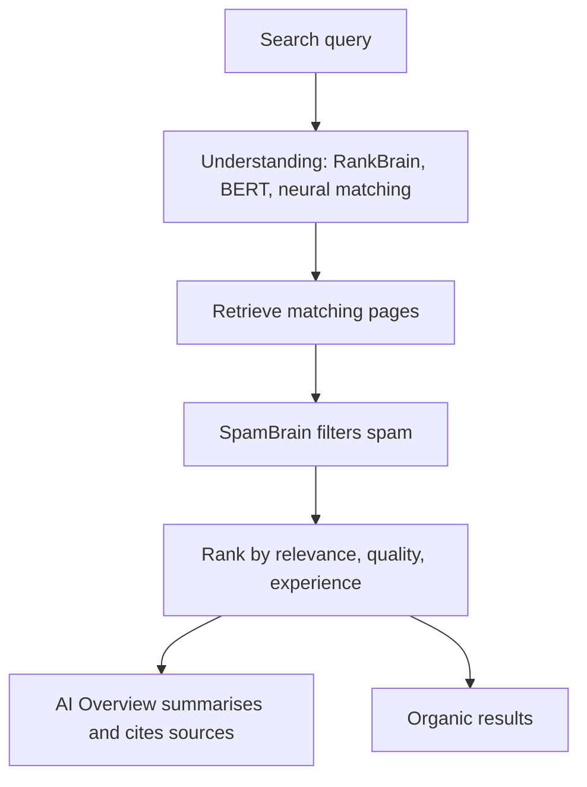

# Session 7 · Artificial Intelligence and Machine Learning in SEO

> 🏠 [Diploma in Digital Marketing](../../README.md) › [Term 1](../README.md) › [Introduction to SEO](README.md) › **Session 7**
>
> ⏱ **Estimated time:** 2 hours (1 h theory + 1 h lab) · 📋 **Prerequisites:** Sessions 1-6

[⬅ Previous: Session 6](session-06-voice-search-optimization.md) · [Next: Session 8 ➡](session-08-ux-and-seo-with-ai.md)

---

## 🎯 Learning objectives

- Define **artificial intelligence (AI)**, **machine learning (ML)**, **natural language processing (NLP)** and **large language models (LLMs)** in plain terms.
- Explain how Google uses AI in search: **RankBrain, neural matching, BERT, MUM** and **AI Overviews**.
- Describe how AI changes what ranks: **meaning and intent over exact keywords**, entities and topical authority.
- Use **AI tools** responsibly for keyword research, content briefs, writing support, technical tasks and analysis.
- Apply Google's guidance on **AI-generated content** and avoid scaled, low-value content.
- Build and explain a small **machine-learning model** that classifies search intent.

## 📖 Concepts

### 1. The key terms

| Term | Plain meaning | SEO example |
|---|---|---|
| **Artificial intelligence (AI)** | Computers doing tasks that normally need human intelligence | An assistant answering a question |
| **Machine learning (ML)** | Systems that **learn patterns from examples** instead of following hand-written rules | Learning which results satisfy searchers |
| **Deep learning** | ML with many-layered **neural networks** | Understanding images and language |
| **Natural language processing (NLP)** | AI that reads and understands human language | Knowing "jaguar speed" is about the animal, not the car |
| **Large language model (LLM)** | A deep-learning model trained on huge amounts of text to predict and generate language | Gemini, GPT, Claude, Llama |
| **Generative AI** | AI that creates new text, images, audio or code | Drafting meta descriptions |
| **Entity** | A distinct "thing" – person, place, brand, concept – that a search engine recognises | "IoBM", "Karachi", "Shan Foods" |

**Supervised learning** learns from **labelled** examples (queries tagged with their intent). **Unsupervised learning** finds groups in unlabelled data (clustering thousands of keywords into topics). Both are used in SEO tools.

### 2. How Google uses AI in search

| System | Year | What it does |
|---|---|---|
| **RankBrain** | 2015 | Relates words to concepts, so Google can handle queries it has never seen before |
| **Neural matching** | 2018 | Connects the concepts in a query to the concepts in pages, even without shared words |
| **BERT** | 2019 | Understands how words in a sentence relate ("2019 brazil traveler **to** usa need a visa" – direction matters) |
| **MUM** | 2021 | A more powerful multilingual, multimodal model used for specific tasks such as understanding information across languages |
| **SpamBrain** | 2018 onward | AI system that detects spam sites and link schemes |
| **AI Overviews** (Gemini-based) | 2024 | Generates a summary answer with links to sources at the top of many results |
| **AI Mode** | 2025 | A conversational, AI-led search experience for complex, multi-step questions |

**What this means for marketers:** you no longer need to repeat an exact phrase. Google understands synonyms, context and intent. What it rewards is the page that **best and most trustworthily answers** the need.

### 3. How AI changes what ranks

| Old approach (keyword-matching era) | AI-era approach |
|---|---|
| Repeat the exact keyword many times | Use natural language and related terms; cover the topic |
| One page per keyword variant ("cheap shoes", "affordable shoes", "low-cost shoes") | One strong page per **topic and intent** |
| Focus on individual pages | Build **topical authority** – clusters of genuinely expert content |
| Write for bots | Write for people; satisfy intent so users don't return to the results |
| Text only | Text, images, video, structured data – multimodal understanding |
| Rank for clicks | Be **cited** in AI Overviews and AI assistants as well as ranked |

**Generative engine optimisation (GEO)** – sometimes called **AI search optimisation** – is the emerging practice of making content easy for AI systems to find, understand and cite. Its advice largely overlaps with good SEO: clear structure, direct answers, original facts and data, author expertise, up-to-date information, and being mentioned by trusted sources.

### 4. AI tools for SEO tasks

| Task | How AI helps | Example tools |
|---|---|---|
| **Keyword research** | Clustering thousands of keywords by topic and intent; suggesting questions | Semrush, Ahrefs, Keyword Insights, ChatGPT/Gemini/Claude |
| **Content briefs** | Summarising top-ranking pages, headings and questions to cover | Surfer, Frase, Clearscope, MarketMuse |
| **Writing support** | Outlines, first drafts, rewrites, titles and meta descriptions | ChatGPT, Gemini, Claude, Jasper |
| **Optimisation** | Scoring content for topic coverage and readability | Surfer, Clearscope, Yoast |
| **Technical SEO** | Writing regex, schema JSON-LD, redirect maps, Python scripts; explaining errors | General-purpose LLMs, Screaming Frog + AI integrations |
| **Analysis** | Spotting patterns and anomalies in Search Console and GA4 data | GA4 insights, Looker Studio, spreadsheets with AI |
| **Images and accessibility** | Suggesting alt text; generating original illustrations | Built-in CMS tools, image generators |
| **Translation and localisation** | Drafting Urdu or other language versions for human review | LLMs, DeepL |

### 5. Google's position on AI-generated content

Google's guidance (2023 onward) can be summarised as:

- Google rewards **helpful, reliable, people-first** content **however it is produced** – AI use is not automatically against the rules.
- Using automation **primarily to manipulate rankings** breaks spam policies. The **scaled content abuse** policy (2024) targets mass-producing many pages with little value, whether by AI, humans or both.
- Content should show **E-E-A-T**. AI cannot have first-hand experience – people must add real experience, data and judgement.
- Be transparent where readers would reasonably expect to know how content was made.

### 6. Risks of using AI in SEO

| Risk | Example | Safeguard |
|---|---|---|
| **Hallucinations** | AI invents a statistic, law or price | Fact-check every claim against a primary source |
| **Generic content** | Same points as every other page; no original value | Add your own data, photos, examples and opinions |
| **Scaled low-quality pages** | 500 auto-written city pages with swapped names | Publish only pages that genuinely help users |
| **Outdated information** | Model trained before recent changes | Verify dates and current facts |
| **Privacy and confidentiality** | Pasting client data into public tools | Follow company policy; anonymise data |
| **Bias** | Stereotyped wording or images | Human editorial review |
| **Copyright** | Generated text or images resembling others' work | Check originality; understand tool terms |

**A safe workflow:** human strategy → AI-assisted research and outline → human expert writes or heavily edits → fact-check → add original experience and media → human final review → publish → measure.

### 7. How machine learning "learns" – a simple view

1. **Collect examples** with the correct answers (queries labelled by intent).
2. **Train**: the algorithm finds patterns linking inputs (words) to outputs (labels).
3. **Test** on examples it has never seen to measure accuracy.
4. **Use** it to predict labels for new data.
5. **Improve** with more and better examples.

**Naive Bayes** is a simple classic algorithm: it counts how often each word appears with each label and uses probability to pick the most likely label for a new query. Worked Example 1 builds one in about 40 lines of Python.

## 🧭 Diagram




## 💻 Worked examples

### Example 1 – Training a search-intent classifier

The model learns from 16 labelled queries, then predicts the intent of solar-panel queries it has never seen.

📄 `code/session-07_intent_classifier.py`

```python
# A tiny machine-learning model: Naive Bayes that learns search intent from labelled examples.
import math, re
from collections import Counter, defaultdict

train = [
    ("how to tie a hijab", "informational"), ("what is net metering", "informational"),
    ("why is my phone slow", "informational"), ("how does seo work", "informational"),
    ("buy iphone 15 online", "transactional"), ("order pizza near me", "transactional"),
    ("lawn suit price sale", "transactional"), ("cheap flights karachi to dubai book", "transactional"),
    ("best laptop under 150000", "commercial"), ("daraz vs amazon review", "commercial"),
    ("top 10 seo tools compared", "commercial"), ("best solar company reviews", "commercial"),
    ("facebook login", "navigational"), ("daraz", "navigational"),
    ("youtube", "navigational"), ("hbl internet banking login", "navigational"),
]

def words(t): return re.findall(r"[a-z0-9]+", t.lower())

word_counts, class_counts, vocab = defaultdict(Counter), Counter(), set()
for text, label in train:                      # "training" = counting
    class_counts[label] += 1
    for w in words(text):
        word_counts[label][w] += 1; vocab.add(w)

def predict(text):
    best, best_lp = None, -1e9
    for label in class_counts:
        lp = math.log(class_counts[label] / len(train))
        total = sum(word_counts[label].values())
        for w in words(text):                  # Laplace smoothing for unseen words
            lp += math.log((word_counts[label][w] + 1) / (total + len(vocab)))
        if lp > best_lp: best, best_lp = label, lp
    return best

for q in ["how to clean solar panels", "buy solar panels online", "best solar panels review", "k-electric login"]:
    print(f"{q:30} -> {predict(q)}")
```

**Output**

```text
how to clean solar panels      -> informational
buy solar panels online        -> transactional
best solar panels review       -> commercial
k-electric login               -> navigational
```

**What to notice:** the model was never told rules like "how to = informational". It **learned** them from examples: "how" appeared with informational queries, "buy" with transactional, "best" and "review" with commercial, "login" with navigational. With only 16 examples it will make mistakes on unusual queries; real SEO tools train on millions. This is the same idea – at tiny scale – that lets tools group keywords by intent automatically.

### Example 2 – An AI-assisted content brief (prompt and human review)

**Prompt to an LLM:**

```text
You are an SEO content strategist. Create a content brief for the keyword
"how to clean solar panels" for a solar installer in Karachi.
Include: search intent, a suggested title (max 60 characters), meta description
(max 155 characters), H2/H3 outline, 5 questions to answer, and 3 places where
the installer's own experience or data should be added. Do not invent statistics.
```

**Human review checklist before using the output:**

| Check | Why |
|---|---|
| Does the intent match what actually ranks today? | AI may guess wrongly; look at the SERP |
| Are all facts verifiable? | Remove or source any figure |
| Is local context correct (dust, water scarcity, K-Electric net metering)? | Generic advice misses what local readers need |
| Where is our **first-hand experience**? | Add real cleaning photos, output data before/after, technician tips |
| Is the outline better than the current top results? | Otherwise there's no reason to rank it |

## 📊 Comparison table

| | Rule-based system | Machine-learning system |
|---|---|---|
| How it works | Humans write explicit rules ("if 'buy' then transactional") | Learns patterns from labelled examples |
| Handles new cases | Poorly – needs new rules | Better – generalises from patterns |
| Needs | Expert time | Data (lots of good examples) |
| Explainability | Easy | Can be harder |
| Search example | Early keyword matching | RankBrain, BERT, SpamBrain |

## 🧪 Lab / practice tasks

**Task 1 (easy):** Search a question in Google that triggers an AI Overview (for example "how to reduce electricity bill in summer"). List the sources it cites. What do those pages have in common?

<details><summary>✅ Hint</summary>

Look for: clear headings, direct answers near the top, lists, trustworthy publishers (utilities, government, established brands), recent updates and specific facts.

</details>

**Task 2 (medium):** Add six more training examples to `session-07_intent_classifier.py` (at least one per intent) and test five new queries of your own. Which predictions improved?

**Task 3 (medium):** Use an AI tool to write three meta descriptions for a Lahore bakery's custom-cake page. Then edit them: check length (≤ 160 characters), accuracy, a clear benefit and a call to action. Explain each change.

**Task 4 (challenge):** Write a one-page **AI usage policy** for a small SEO agency covering: what AI may be used for, what must always be done by a human, fact-checking, client data privacy and disclosure.

<details><summary>✅ Model outline</summary>

1. **Allowed:** research, keyword clustering, outlines, first drafts, code/regex/schema, data summaries. 2. **Human-only:** strategy, final approval, expert claims (health, finance, legal), client communication. 3. **Fact-checking:** every statistic, date, price and quote verified against a primary source and linked. 4. **Privacy:** no personal or confidential client data in public tools; use approved enterprise tools only. 5. **Quality bar:** every page must add original value (data, experience, media) – no mass-produced pages. 6. **Disclosure:** follow client agreements and be transparent where readers would expect it. 7. **Review:** an editor signs off every published piece.

</details>

## ✅ Quick quiz

1. Machine learning means… a) humans write every rule b) systems learn patterns from examples c) only image recognition d) keyword stuffing
2. Which Google system helps understand how words relate in a sentence? a) Panda b) Penguin c) BERT d) PageRank
3. Google's stance on AI-written content is that… a) it is always banned b) it is fine if helpful and not made mainly to manipulate rankings c) it always ranks higher d) it must be labelled with schema
4. An AI tool invents a statistic. This is called a… a) canonical b) hallucination c) backlink d) crawl error
5. The 2024 policy against mass-producing low-value pages is called… a) scaled content abuse b) mobile-first indexing c) Core Web Vitals d) E-E-A-T

<details><summary>Show answers</summary>

1-b · 2-c · 3-b · 4-b · 5-a

</details>

## 📝 Summary

- AI ⊃ machine learning ⊃ deep learning; NLP and LLMs let machines read and write language.
- Google uses AI to understand queries (RankBrain, neural matching, BERT, MUM), fight spam (SpamBrain) and generate **AI Overviews**.
- Rankings now reward **meaning, intent, topical authority and trust** over exact keywords.
- AI tools speed up keyword clustering, briefs, drafts, schema and analysis – but humans must add experience, verify facts and own quality.
- Google judges content by helpfulness, not by whether AI was used; **scaled low-value content** breaks its policies.
- Even a 40-line Naive Bayes model shows how ML learns intent from labelled examples.

**Interview / viva questions**

1. Explain the difference between AI, machine learning and an LLM.
2. How did BERT change the way marketers should write content?
3. What is Google's position on AI-generated content?
4. Describe a safe workflow for using AI to produce a blog post.
5. What is generative engine optimisation and how does it relate to traditional SEO?

---

[⬅ Previous: Session 6](session-06-voice-search-optimization.md) · [Next: Session 8 ➡](session-08-ux-and-seo-with-ai.md)

<sub>Prepared by **Hamna Zahid Khan**, Junior Lecturer · Diploma in Digital Marketing</sub>
