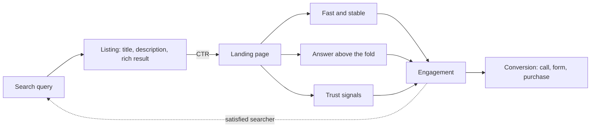
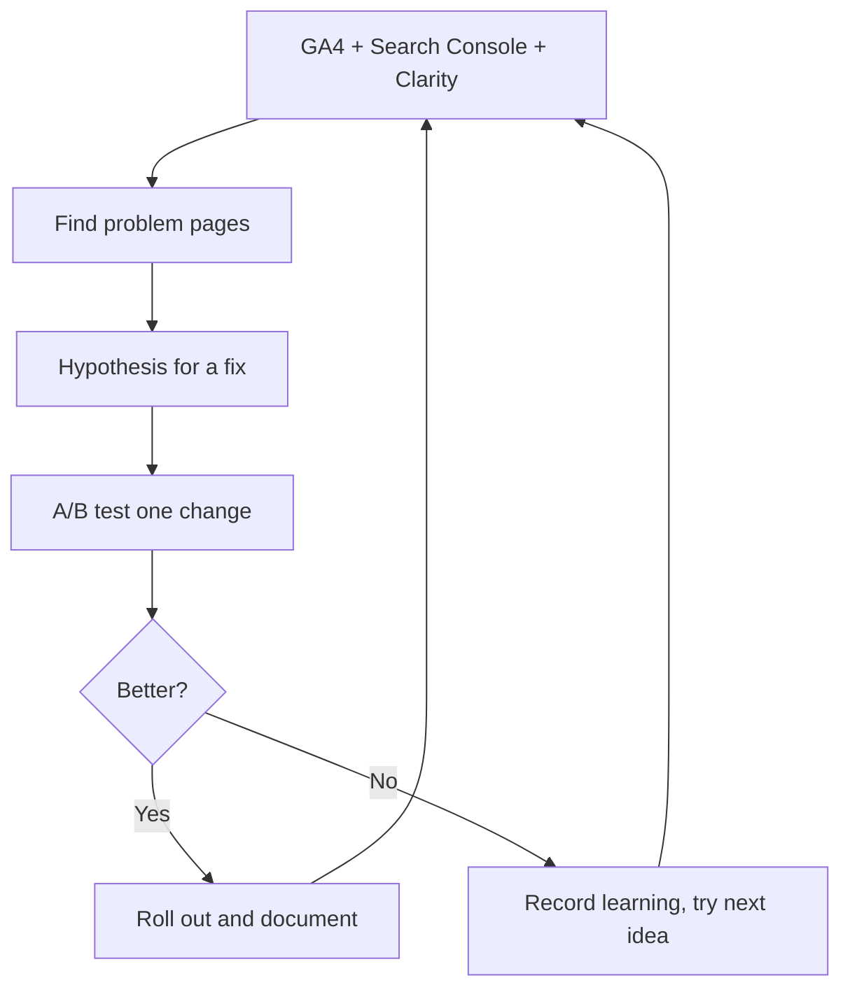

# Session 8 · Enhancing User Experience and SEO with AI

> 🏠 [Diploma in Digital Marketing](../../README.md) › [Term 1](../README.md) › [Introduction to SEO](README.md) › **Session 8**
>
> ⏱ **Estimated time:** 2 hours (1 h theory + 1 h lab) · 📋 **Prerequisites:** Session 7

[⬅ Previous: Session 7](session-07-ai-and-ml-in-seo.md) · [Next: Introduction to SEO practice test ➡](practice-test.md)

---

## 🎯 Learning objectives

- Explain why **user experience (UX)** and SEO now work toward the same goal: satisfying the searcher.
- Describe the **UX signals** that matter: page experience, engagement, navigation, readability and accessibility.
- Read **engagement metrics** in GA4 and Search Console and diagnose pages that fail users.
- Use **AI tools** to improve UX: heatmap and session analysis, personalisation, chatbots, search, accessibility and testing.
- Plan and interpret a simple **A/B test** for a page element.
- Combine everything in this module into an **SEO + UX improvement plan**.

## 📖 Concepts

### 1. Why UX and SEO converge

Search engines want to send people to pages that solve their problem. If visitors land, get frustrated and go straight back to the results to try another page, that is a sign the page did not help. Google's systems are built to reward pages that people find useful, and its **page experience** guidance says great experience supports success in Search.

**SEO gets people to the page; UX decides whether they stay, trust you and convert.** A page that ranks but doesn't convert wastes traffic. A beautiful page nobody finds wastes design.

### 2. The building blocks of good UX

| Element | What good looks like | SEO link |
|---|---|---|
| **Speed and stability** | Main content in ≤ 2.5 s, no jumping layout, quick taps | Core Web Vitals (Session 5) |
| **Mobile usability** | Readable text, big tap targets, no horizontal scrolling | Mobile-first indexing (Session 3) |
| **Clear answer above the fold** | The searcher sees what they came for without hunting | Satisfies intent; snippet and AI citation |
| **Navigation and information architecture** | Logical menus, breadcrumbs, search, ≤ 3 clicks to key pages | Crawlability and internal links |
| **Readability** | Short paragraphs, headings, lists, good contrast, 16px+ body text | Helps users and comprehension |
| **Trust** | HTTPS, contact details, reviews, author bios, clear policies | E-E-A-T |
| **No intrusive interstitials** | No full-screen pop-up on arrival | Page experience guidance |
| **Accessibility** | Alt text, labels, keyboard use, contrast, captions | Better for everyone; overlaps with on-page SEO |
| **Clear calls to action** | One obvious next step per page ("Book a free trial class") | Converts organic traffic into results |

### 3. Measuring UX: the metrics

**GA4 engagement metrics**

| Metric | Definition | Use |
|---|---|---|
| **Engaged session** | A session that lasts longer than 10 seconds, **or** has a conversion event, **or** has 2+ page/screen views | The basic "did they engage?" test |
| **Engagement rate** | Engaged sessions ÷ total sessions | Higher is better; compare similar page types |
| **Bounce rate** (GA4) | 100% − engagement rate – the share of sessions that were **not** engaged | Low is better (different from old Universal Analytics bounce rate) |
| **Average engagement time** | Time the page was in focus on screen | Content depth and interest |
| **Conversions / key events** | Form submits, calls, purchases, WhatsApp clicks | The business outcome |
| **Scroll** (enhanced measurement) | Fires when a user reaches 90% of the page | Whether people read to the end |

**Search Console metrics** – impressions, clicks, **CTR** and position – show how well your **listing** attracts the click. Low CTR at a good position usually means the title and description don't match what searchers want.

**Context matters:** a contact page with one visit and a phone call is a success even with low time on page. Always compare pages of the same type and intent.

### 4. Diagnosing problems

| Symptom | Likely cause | Fix |
|---|---|---|
| High impressions, low CTR | Weak or mismatched title/description; rich results on competitors | Rewrite title and description; add structured data; match intent |
| Good CTR, low engagement | Page doesn't deliver what the listing promised; slow; cluttered | Put the answer first; speed up; match intent |
| High engagement, low conversions | Unclear or weak call to action; long form; trust gaps | Clearer CTA, shorter form, reviews and guarantees |
| Mobile engagement much lower than desktop | Mobile layout problems, pop-ups, slow on 4G | Mobile UX fixes; test on a mid-range phone |
| Users leave at the same point | A confusing section, a wall of text, an ad | Session recordings and scroll maps to find it |

### 5. AI tools that improve UX

| Use | What AI does | Example tools |
|---|---|---|
| **Behaviour analytics** | Heatmaps, scroll maps, session recordings, with AI summaries of frustration signals such as **rage clicks** and **dead clicks** | Microsoft Clarity (free), Hotjar |
| **Personalisation** | Shows content or products based on behaviour, location or past purchases | Recommendation engines in Shopify, Dynamic Yield, Optimizely |
| **Chatbots and assistants** | Answer questions instantly on site or WhatsApp; route leads | Website chat tools, WhatsApp Business API bots, LLM-based assistants |
| **On-site search** | Understands natural language and typos ("blu lawn suit undr 5000") | Algolia, Shopify search, AI search plugins |
| **Accessibility** | Suggests alt text, captions and transcripts; flags contrast issues | CMS AI features, YouTube auto-captions, Lighthouse |
| **Testing and optimisation** | Generates variations, predicts attention areas, analyses test results | Optimizely, VWO, attention-prediction tools |
| **Content clarity** | Rewrites complex text in plain language; summarises long pages | LLMs, Hemingway Editor |
| **Insights** | Detects anomalies and trends in analytics | GA4 insights, Looker Studio with AI |

**Cautions:** an over-eager pop-up chatbot can itself be intrusive; personalisation must respect privacy and consent; AI-generated alt text and captions need human checking; and changes must keep the content Google sees equivalent to what users see (no cloaking).

### 6. A/B testing

An **A/B test** shows version A (control) to half of visitors and version B (one change) to the other half, then compares a metric such as conversion rate.

| Step | Example |
|---|---|
| 1. **Hypothesis** | "Moving the price table above the fold will raise enquiries, because visitors look for price first." |
| 2. **One change** | Only the position of the price table changes |
| 3. **Metric** | Enquiry form conversion rate |
| 4. **Sample size and duration** | Run long enough (usually at least one to two full weeks) to cover weekday/weekend patterns and reach enough conversions |
| 5. **Analyse** | Compare rates; check statistical significance (tools calculate this) |
| 6. **Decide and document** | Keep the winner, record what you learned, test the next idea |

**SEO-safe testing:** keep tests temporary, use `rel="canonical"` on variant URLs pointing to the original, use 302 (temporary) redirects if redirecting, and never show Googlebot a different version from users.

### 7. Putting the module together: an SEO + UX improvement plan

| Priority | Area | Action |
|---|---|---|
| 1 | **Technical** | Fix indexing errors, HTTPS, broken links, Core Web Vitals on key templates |
| 2 | **Intent and content** | Map keywords to pages; rewrite pages that don't match intent; answer first |
| 3 | **On-page** | Titles, descriptions, headings, alt text, internal links, structured data |
| 4 | **UX and conversion** | Clear CTAs, short forms, trust signals, mobile layout, accessibility |
| 5 | **Local and voice** | Business Profile, NAP, reviews, FAQ answers |
| 6 | **Authority** | Linkable assets, digital PR, partnerships |
| 7 | **Measure and iterate** | Search Console + GA4 dashboards; A/B tests; monthly review |

## 🧭 Diagram





## 💻 Worked examples

### Example 1 – A UX + SEO scorecard

The script combines Search Console data (impressions, clicks) with GA4 engagement and mobile LCP to flag pages that fail searchers and suggest fixes.

📄 `code/session-08_ux_scorecard.py`

```python
# UX + SEO scorecard: flag pages where engagement signals suggest the page fails the searcher.
# Data shaped like a GA4 export joined with Search Console (illustrative numbers).
pages = [  # url, impressions, clicks, engagement rate, avg engagement time (s), mobile LCP (s)
    ("/blog/how-to-start-freelancing", 42000, 1890, 0.71, 145, 2.1),
    ("/services/web-design",            9000,  140, 0.38,  22, 4.3),
    ("/blog/best-laptops-students",    30000,  450, 0.44,  31, 2.4),
    ("/contact",                        1200,   90, 0.80,  50, 1.6),
]

def diagnose(impr, clicks, eng, secs, lcp):
    ctr = clicks / impr
    issues = []
    if ctr < 0.02:  issues.append(f"low CTR {ctr:.1%}: rewrite title/description")
    if eng < 0.50:  issues.append(f"engagement {eng:.0%}: content may not match intent")
    if secs < 40:   issues.append(f"{secs}s engaged: add answer near the top, improve layout")
    if lcp > 2.5:   issues.append(f"LCP {lcp}s: compress hero image, lazy-load below the fold")
    return ctr, issues

for url, impr, clicks, eng, secs, lcp in pages:
    ctr, issues = diagnose(impr, clicks, eng, secs, lcp)
    status = "HEALTHY" if not issues else f"{len(issues)} ISSUE(S)"
    print(f"{url:34} CTR {ctr:5.1%}  {status}")
    for i in issues:
        print(f"    - {i}")
```

**Output**

```text
/blog/how-to-start-freelancing     CTR  4.5%  HEALTHY
/services/web-design               CTR  1.6%  4 ISSUE(S)
    - low CTR 1.6%: rewrite title/description
    - engagement 38%: content may not match intent
    - 22s engaged: add answer near the top, improve layout
    - LCP 4.3s: compress hero image, lazy-load below the fold
/blog/best-laptops-students        CTR  1.5%  3 ISSUE(S)
    - low CTR 1.5%: rewrite title/description
    - engagement 44%: content may not match intent
    - 31s engaged: add answer near the top, improve layout
/contact                           CTR  7.5%  HEALTHY
```

**What to notice:** the web-design service page fails at every stage – few people click its listing, those who do leave quickly, and it loads slowly on phones. Fix in order: speed (affects everything), then match the content to intent (portfolio and prices near the top), then rewrite the title and description to promise what the page now delivers. The laptops page loads fast but its listing and content don't satisfy commercial intent – it probably needs a clear comparison table and up-to-date picks.

### Example 2 – Reading an A/B test result

A Karachi tutoring academy tests its landing page.

| Version | Change | Visitors | Enquiries | Conversion rate |
|---|---|---|---|---|
| A (control) | 9-field form at the bottom | 2,000 | 50 | 2.5% |
| B | 4-field form beside the headline + 3 parent reviews | 2,000 | 84 | 4.2% |

**Calculation:** conversion rate = enquiries ÷ visitors × 100 → A = 50 ÷ 2,000 × 100 = 2.5%; B = 84 ÷ 2,000 × 100 = 4.2%. **Relative uplift** = (4.2 − 2.5) ÷ 2.5 × 100 = **68%**.

**Interpretation:** B is clearly better. Strictly, B changed two things (form and reviews), so we can't say which caused the gain – the next test could isolate the reviews. With 1,000 organic visitors a month, B means about 17 more enquiries per month from the same traffic.

## 📊 Comparison table

| | SEO focus | UX focus | Shared goal |
|---|---|---|---|
| Speed | Core Web Vitals | Less waiting | Fast pages |
| Content | Relevance to query | Clarity and usefulness | Satisfy intent |
| Structure | Crawlable headings and links | Easy navigation | Logical hierarchy |
| Images | Alt text, file size | Visual clarity | Accessible, fast media |
| Trust | E-E-A-T | Confidence to act | Credibility |
| Measure | Rankings, CTR | Engagement, conversion | Business results |

## 🧪 Lab / practice tasks

**Task 1 (easy):** Open a site you use often on your phone. Write down three UX problems and three things it does well, using the table in Concept 2.

**Task 2 (medium):** Install **Microsoft Clarity** (free) on a practice website or look at its public demo. Explain what a heatmap, scroll map, rage click and dead click each tell you.

<details><summary>✅ Model answer</summary>

**Heatmap:** where people click or tap most. **Scroll map:** how far down people get – content below the drop-off point is rarely seen. **Rage click:** repeated rapid clicks on one spot – frustration, often a slow or broken element. **Dead click:** clicks on something that isn't clickable – users expected a link or button there.

</details>

**Task 3 (medium):** A page ranks at position 3 for "online quran classes for kids" with 8,000 impressions and 160 clicks a month, 35% engagement and 18 seconds average engagement time. Diagnose it and write five fixes.

<details><summary>✅ Model answer</summary>

CTR = 160 ÷ 8,000 = **2%**, low for position 3 → listing problem. Engagement 35% and 18 s → page doesn't satisfy intent. Fixes: (1) rewrite the title/description with benefits (free trial, female tutors, flexible UK/US timings); (2) put a short answer, prices and a "Book free trial" button above the fold; (3) add parent reviews and tutor credentials; (4) compress images and remove heavy scripts to speed up mobile; (5) add an FAQ answering timings, fees and safety; then A/B test the CTA.

</details>

**Task 4 (challenge):** Extend `session-08_ux_scorecard.py` to give each page a priority score (`impressions × number of issues`) and print pages from highest to lowest priority. Why is this a sensible way to decide what to fix first?

<details><summary>✅ Solution</summary>

Collect `(impr * len(issues), url, issues)` in a list, sort with `reverse=True`, then print. It weights problems by how many searchers they affect: a fix on a page with 30,000 impressions helps far more people than the same fix on a page with 1,200.

</details>

## ✅ Quick quiz

1. In GA4, an engaged session is one that lasts more than 10 seconds, has a conversion, or… a) uses Chrome b) has 2+ page views c) comes from Google d) scrolls 10%
2. High impressions but low CTR usually means… a) slow server b) a weak or mismatched title and description c) too many backlinks d) a broken sitemap
3. Repeated rapid clicks on one spot are called… a) dead clicks b) rage clicks c) bounces d) impressions
4. In an SEO-safe A/B test, variant URLs should… a) be blocked in robots.txt b) carry a canonical to the original c) use 301 redirects d) show Googlebot only version A
5. Version A converts 2% and version B 3%. The relative uplift is… a) 1% b) 33% c) 50% d) 150%

<details><summary>Show answers</summary>

1-b · 2-b · 3-b · 4-b · 5-c

</details>

## 📝 Summary

- SEO and UX share one goal: **satisfy the searcher**; SEO brings the visit, UX earns the result.
- Good UX = speed, mobile usability, answer first, clear navigation, readability, trust, accessibility and a clear CTA.
- Use **Search Console** for listing performance (CTR) and **GA4** for on-page engagement and conversions.
- AI tools – behaviour analytics, personalisation, chatbots, smart search, accessibility helpers – reveal and fix UX problems, with human oversight.
- **A/B test** one change at a time, run long enough, and keep tests SEO-safe.
- Improve in order: technical → intent and content → on-page → UX → local/voice → authority → measure.

**Interview / viva questions**

1. Why do SEO and UX need to work together?
2. How is GA4's bounce rate defined, and how does it differ from engagement rate?
3. A page has good rankings but few conversions. What would you investigate?
4. Name three AI tools that improve UX and what each does.
5. How would you run an A/B test without harming SEO?

---

[⬅ Previous: Session 7](session-07-ai-and-ml-in-seo.md) · [Next: Introduction to SEO practice test ➡](practice-test.md)

<sub>Prepared by **Hamna Zahid Khan**, Junior Lecturer · Diploma in Digital Marketing</sub>
