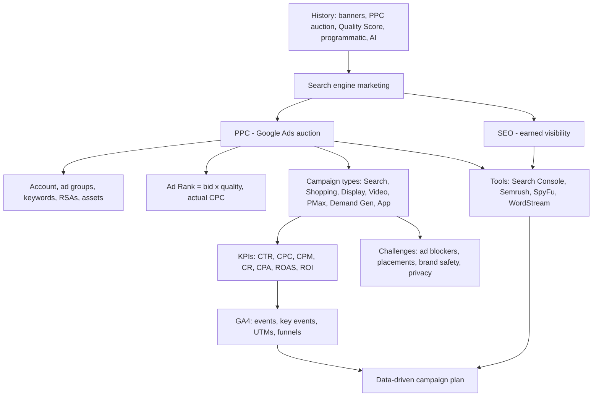

# Module 4 · Search and Display Marketing

> 🏠 [Diploma in Digital Marketing](../../README.md) › [Term 1](../README.md) › **Module 4**

[⬅ Previous module](../03-introduction-to-seo/README.md) · [Start Session 1 ➡](session-01-history-of-search-advertising.md) · [Next module ➡](../05-social-media-marketing/README.md)

---

Search ads catch people at the moment they want something; display and video ads put a brand in front of people before they start looking. This module traces how paid search and programmatic display grew up, shows how Google Ads auctions, campaign types and pricing really work (with the maths), teaches you to measure everything in Google Analytics 4, and ends with the research tools professionals use to spy on competitors and plan campaigns: Semrush, SpyFu and WordStream.

## 🎯 Module objectives

- Trace the **history of search and display advertising** from banner ads and the first pay-per-click auction to programmatic buying, privacy rules, voice search and AI-driven bidding.
- Explain **SEM = SEO + PPC**, structure a **Google Ads** account, choose **match types and negatives**, write **responsive search ads**, and calculate **Ad Rank and actual CPC**.
- Choose between **Search, Shopping, Display, Video, Performance Max, Demand Gen and App** campaigns; price them with **CPC, CPM, vCPM and CPV**.
- Calculate **CTR, CPC, CPM, conversion rate, CPA, ROAS, ROI and break-even ROAS**, and plan budgets **backwards from targets**.
- Handle **ad blockers, complex placements, brand safety and privacy regulations**.
- Set up **GA4**, read its reports, track campaigns with **UTMs** and **events**, and diagnose funnels.
- Use **Search Console, GA4, Semrush, SpyFu and WordStream** to run keyword-gap and competitor-spend analyses.

## 📅 Sessions

| # | Session | Prerequisites |
|---|---|---|
| 1 | [History of Search Advertising](session-01-history-of-search-advertising.md) | Module 3 |
| 2 | [Google Ads and How Search Marketing Works](session-02-google-ads-search-study.md) | Session 1 |
| 3 | [Google Ads Campaign Types, Challenges and Privacy](session-03-google-ads-campaign-types.md) | Session 2 |
| 4 | [Google Analytics](session-04-google-analytics.md) | Session 3 |
| 5 | [SEO and Competitor Tools: Semrush, SpyFu, WordStream](session-05-seo-tools-semrush-spyfu-wordstream.md) | Sessions 1-4 |
|  | 📝 [Module practice test](practice-test.md) | All sessions |

## 🧭 Concept map

## 💻 Code and charts in this module

All examples are runnable. See **[code/README.md](code/README.md)** for every file and how to run it. Python files need Python 3.10+; the chart scripts also need `pip install matplotlib`.

| Session | Code | Chart |
|---|---|---|
| 1 | RTB auction simulator | Timeline of search and display advertising |
| 2 | Ad Rank auction, RSA checker | SEO vs PPC over 18 months |
| 3 | Campaign KPI comparison, budget planner | CPA and ROAS by campaign type |
| 4 | UTM builder, GA4 report from events, gtag.js demo page | Purchase funnel |
| 5 | Keyword gap analyser, competitor spend estimator | Estimated competitor spend by keyword |

## 📄 One-page cheat-sheet

| Topic | Remember this |
|---|---|
| Milestones | 1994 banner ad · 1998 GoTo.com PPC auction · 2000 AdWords · 2002 CPC + quality · 2003 Yahoo buys Overture, AdSense · 2005 Quality Score · 2008 DoubleClick to Google · 2018 Google Ads + GDPR · 2021 Performance Max · 2022 RSAs standard |
| Programmatic | Advertiser → **DSP** → **ad exchange** ← **SSP** ← publisher; **RTB** in ~100–200 ms |
| Deal types | Open auction · Private marketplace · Preferred deal · Programmatic guaranteed |
| Auctions | Second-price = pay runner-up + 1 · First-price = pay your bid (bid shading) |
| Viewability | Display: ≥ 50% pixels for ≥ 1 s · Video: ≥ 50% for ≥ 2 s |
| Privacy | GDPR (2018), CCPA (2020), Safari/Firefox block 3rd-party cookies, Apple ATT (2021), Consent Mode v2 (EEA, 2024); Pakistan: PECA 2016, data-protection bill in draft |
| Privacy-first | First-party data · contextual targeting · consent · data minimisation · modelled conversions |
| Voice | Longer, conversational, local queries → search-terms review, negatives, location assets |
| SEM | SEO (slow, durable) + PPC (fast, stops with budget) – share data |
| Structure | Account → campaign (budget, location, bidding) → ad group (one theme) → keywords + RSAs + landing page |
| Match types | Broad (meaning, widest) · "Phrase" · [Exact] · negatives block |
| RSA | 3–15 headlines × 30 chars · 2–4 descriptions × 90 chars · 2 paths × 15 chars |
| Quality Score | 1–10: expected CTR · ad relevance · landing page experience |
| Ad Rank | ≈ Bid × QS (+ thresholds, context, assets) · Actual CPC ≈ next Ad Rank ÷ your QS + 1 |
| Bidding | Manual CPC · Max clicks · Max conversions (tCPA) · Max conv. value (tROAS) · Target impression share |
| Campaign types | Search · Shopping (Merchant Center feed) · Display (GDN) · Video · Performance Max · Demand Gen · App |
| YouTube formats | Skippable (skip at 5 s) · Non-skippable (≤ 15 s) · Bumper (≤ 6 s) · In-feed · Shorts · Outstream |
| Challenges | Ad blockers → native, light formats · Complex placements → responsive assets, unified mgmt, UTMs · Brand safety → exclusions · Privacy → consent, minimisation |
| GA4 model | Everything is an **event**; account → property → data streams (G- ID) |
| Engaged session | > 10 s **or** key event **or** 2+ views; bounce = 100% − engagement rate |
| Key events | Business-critical events; import to Ads as conversions |
| UTMs | source · medium · campaign (+ content, term); lowercase; never on internal links |
| GA4 day-one | 14-month retention · internal traffic filter · link Ads + Search Console · Consent Mode |
| Tools | GSC = real queries · GA4 = after the click · Semrush = all-in-one + gaps · SpyFu = rival PPC history · WordStream = Ads grader + benchmarks |
| Gap actions | Missing → new page · Weak → improve · Strong → protect · Untapped → publish first |

| Formula | Calculation |
|---|---|
| CTR | Clicks ÷ Impressions × 100 |
| CPC | Cost ÷ Clicks |
| CPM | Cost ÷ Impressions × 1,000 |
| vCPM | CPM ÷ viewability rate |
| CPV / View rate | Cost ÷ Views · Views ÷ Impressions × 100 |
| Conversion rate | Conversions ÷ Clicks (or sessions) × 100 |
| CPA | Cost ÷ Conversions |
| ROAS | Revenue ÷ Ad cost |
| ROI | (Revenue × Margin − Ad cost) ÷ Ad cost × 100 |
| Break-even ROAS / CPA | 1 ÷ Margin · Order value × Margin |
| Budget from target | (Target conversions ÷ CR) × CPC |
| Competitor spend estimate | Volume × impression share × CTR at position × CPC |
| Engagement rate | Engaged sessions ÷ Sessions × 100 |

**Common mistakes:** judging the auction by bid alone · one ad group with unrelated keywords · broad match without negatives · all ads to the home page · no conversion tracking before Smart Bidding · Display expansion left on in a first search campaign · judging Display/Video only by last-click ROAS · no frequency cap · ignoring placement reports · ROAS without knowing margin · mixed-case or internal UTMs · duplicate GA4 tags · personal data in events · reporting third-party traffic estimates as fact.

---

Prepared by **Hamna Zahid Khan**, Junior Lecturer · Diploma in Digital Marketing
