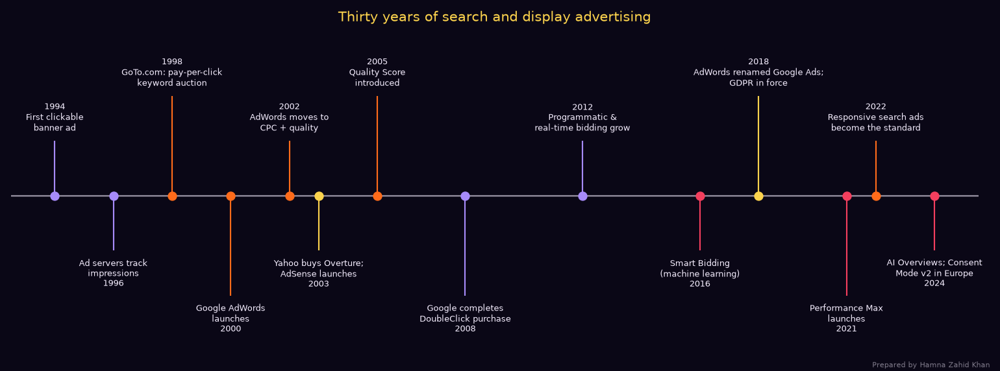
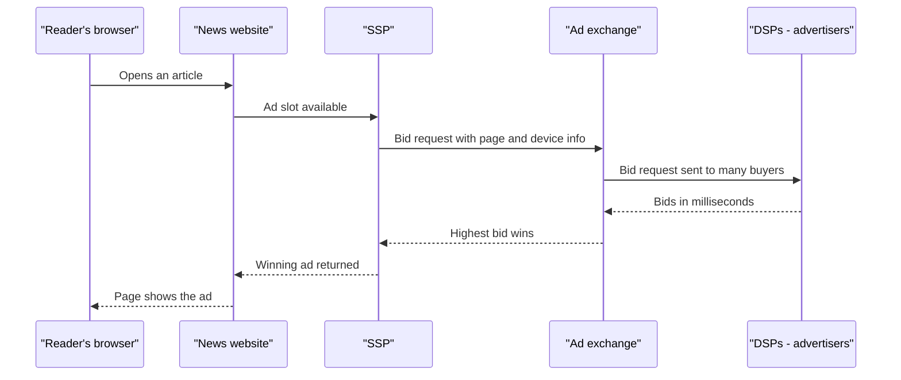
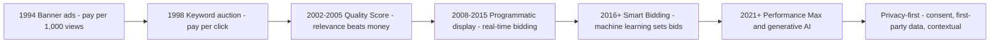
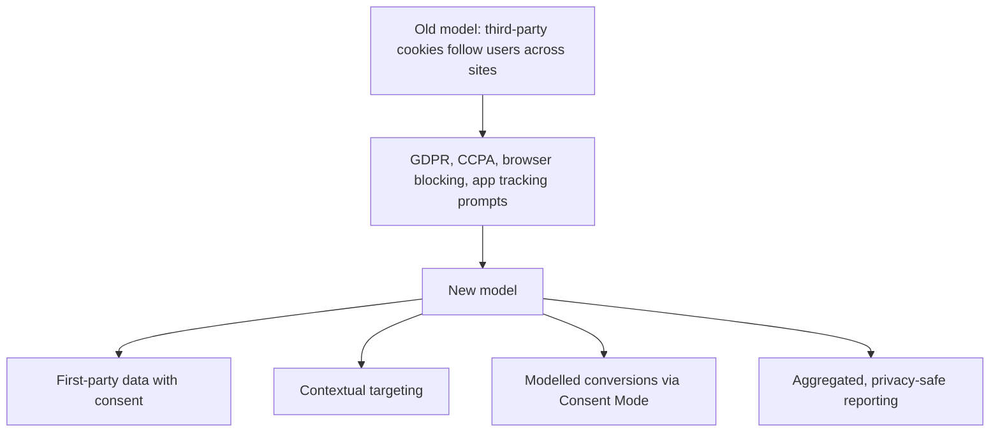
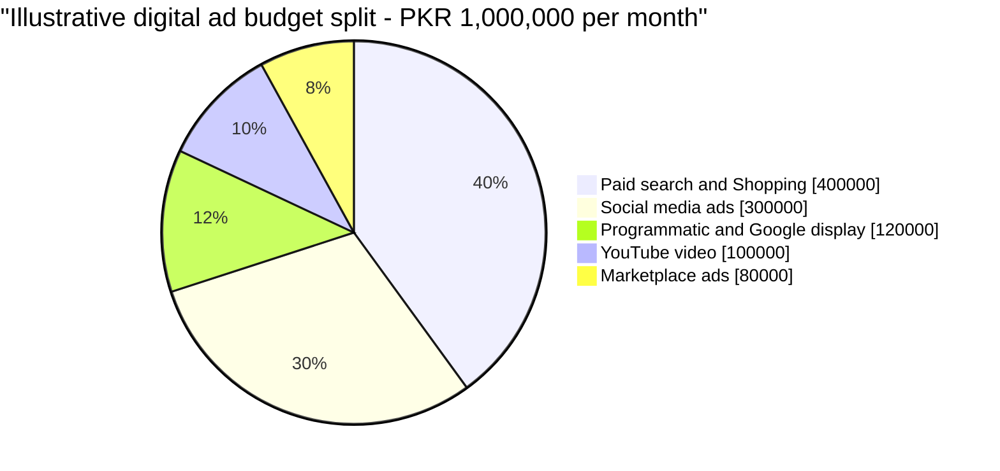

# Session 1 · History of Search Advertising

> 🏠 [Diploma in Digital Marketing](../../README.md) › [Term 1](../README.md) › [Search and Display Marketing](README.md) › **Session 1**
>
> ⏱ **Estimated time:** 2.5 hours (1.5 h theory + 1 h lab) · 📋 **Prerequisites:** Module 3

[⬅ Previous: Search and Display Marketing overview](README.md) · [Next: Session 2 ➡](session-02-google-ads-search-study.md)

---

## 🎯 Learning objectives

By the end of this session you will be able to:

- Explain **why search advertising was born** and how the early web turned "a list of links" into a business model.
- Trace the **evolution of paid search and display**: banners, pay-per-click (PPC), keyword auctions, Quality Score, Shopping, and responsive ads.
- Describe how **programmatic advertising** and **real-time bidding (RTB)** buy display ads automatically, and calculate CPM, cost per impression and viewable cost.
- Explain how **privacy laws** (GDPR, CCPA, Pakistan's data-protection draft) and the decline of **third-party cookies** change targeting and measurement.
- Explain how **voice search** changes the queries advertisers bid on.
- Define **AI and machine learning** and give concrete examples of how they now run bidding, targeting and ad creation.

## 📖 Concepts

### 1. Why search advertising exists

In the mid-1990s the web grew from a few thousand sites to millions. People needed a way to *find* things, so **directories** (Yahoo! started as a hand-made list of sites in 1994) and **search engines** (AltaVista, Lycos, Excite, Ask Jeeves, and later Google in 1998) appeared.

Running a search engine is expensive: crawlers, data centres and engineers all cost money, while users pay nothing. The engines needed revenue that **did not ruin the results**. Search advertising solved this with one powerful idea:

> Show an ad **only when someone is already searching for what you sell**.

That is why search ads are often called **intent-based** advertising. A billboard on Shahrah-e-Faisal shows the same message to thousands of people, most of whom don't care. A search ad for "AC repair Gulshan" appears only to the person whose AC has just stopped working on a 42°C afternoon. Higher relevance means a higher chance of a sale, so search ads usually give a strong **return on investment (ROI)**.

**Key terms**

| Term | Meaning |
|---|---|
| **SERP** | Search Engine Results Page – the page you see after searching |
| **Paid listing / sponsored result** | An ad on the SERP, labelled "Sponsored" or "Ad" |
| **Organic result** | A free listing earned through SEO |
| **Keyword** | The word or phrase an advertiser chooses to trigger an ad |
| **Search term / query** | What the user actually typed |
| **Impression** | One showing of an ad |
| **Click** | One user clicking the ad |

### 2. The genesis: from banners to pay-per-click

**Display came first.** In October 1994 the first widely recognised clickable **banner ad** appeared on the HotWired website. It asked a simple question and invited a click – and a surprisingly large share of viewers clicked, because everything online was new. Banner ads were sold by **CPM (cost per mille = per 1,000 impressions)**, just like magazine space.

Banners had a problem: they were paid for whether anyone cared or not. Click-through rates fell fast as people learned to ignore them (**banner blindness**).

**Pay-per-click was the breakthrough.** In **1998**, a company called **GoTo.com** (founded by Bill Gross's incubator, Idealab) let advertisers **bid on keywords**. The highest bidder appeared at the top of the results, and the advertiser paid **only when someone clicked**. Three ideas arrived together:

1. **Keyword targeting** – ads are matched to what people search.
2. **Auction pricing** – the market sets the price, not a rate card.
3. **Pay for performance** – no click, no charge.

GoTo.com renamed itself **Overture** in 2001 and powered ads for big portals. In **2003 Yahoo! bought Overture for about US$1.63 billion**, showing how valuable paid search had become.

### 3. Google AdWords and the rise of quality

**Google AdWords launched in October 2000** with a few hundred advertisers. At first it sold ads on a CPM basis. In **2002** it switched to a **cost-per-click auction** with a crucial twist: the ad's position depended not only on the bid but also on **how often people clicked it**. An ad people found useful could beat a richer advertiser's ad.

In **2005** this became the **Quality Score** – a 1–10 rating built from expected click-through rate, ad relevance and landing-page experience (you will calculate with it in Session 2). This changed the industry: **relevance became cheaper than money**.

Other milestones you should know:

| Year | Milestone | Why it matters |
|---|---|---|
| 2003 | **AdSense** launches | Website owners (bloggers, news sites) can show Google ads and earn money – the start of Google's display network |
| 2006 | **Microsoft adCenter** launches | A second search ad platform; today called **Microsoft Advertising** (Bing) |
| 2008 | Google completes its purchase of **DoubleClick** | Google gains the leading display ad server and later its ad exchange |
| 2010–2012 | **Product Listing Ads → Google Shopping** | Image + price ads for e-commerce products |
| 2013 | **Enhanced campaigns** | Mobile and desktop managed together as smartphones take over |
| 2016 | **Expanded text ads** and early **Smart Bidding** | Longer ads; machine learning starts setting bids |
| 2018 | **AdWords renamed Google Ads** | The platform now covers search, display, YouTube, apps and Shopping |
| 2021 | **Performance Max** | One AI-driven campaign that runs across all Google channels |
| 2022 | **Responsive search ads (RSAs)** become the only new search text ad format | Advertisers give up to 15 headlines and 4 descriptions; Google's system assembles the best combination |
| 2024 | **AI Overviews** on Google results; **Consent Mode v2** required for European traffic | AI answers change click behaviour; consent signals become mandatory for measurement in Europe |



*Chart produced by [`code/session-01_search_ad_timeline.py`](code/session-01_search_ad_timeline.py) – run it to regenerate the image.*

### 4. Evolution and expansion in the 2000s

The 2000s turned PPC from an experiment into the backbone of online business.

- **Better targeting:** location (city, radius), language, device, time of day (**ad scheduling**), and audience lists.
- **Match types:** advertisers choose how closely a search must match their keyword – **broad**, **phrase** or **exact**, plus **negative keywords** to block unwanted searches ("free", "jobs", "used").
- **Measurement:** **conversion tracking** linked ad clicks to sales and leads, so advertisers could calculate **cost per acquisition (CPA)** and **return on ad spend (ROAS)**.
- **Marketplaces joined in:** eBay and Amazon were early heavy buyers of search ads, and Amazon later built its own ad business on its product search.

**Pakistani lens.** When internet access spread through **3G/4G licences in 2014**, Pakistani businesses moved online fast. Today it is normal for a Karachi furniture maker, a Lahore tuition academy or an Islamabad real-estate agent to run Google search ads in PKR, while marketplaces like Daraz, property portals like Zameen.com and car portals like PakWheels sell their own on-site ad placements. The principle is identical to 1998: **people search, advertisers bid, relevance wins**.

### 5. Display advertising and the programmatic revolution

**Display advertising** means visual ads – images, animations, video and rich media – shown on websites and apps while people are reading or watching something else. Display is mainly for **awareness** and **remarketing** (reminding people who already visited you).

Buying display used to be manual: a media planner phoned a newspaper's website, agreed a price, emailed banner files and waited for a report. **Programmatic advertising** automates this buying with software and algorithms.

| Player | Works for | Job |
|---|---|---|
| **Advertiser / agency** | The brand | Sets goal, budget, audience and creative |
| **DSP (Demand-Side Platform)** | Advertisers | Decides automatically which impressions to bid on and how much (e.g. Google Display & Video 360, The Trade Desk) |
| **Ad exchange** | Both | The marketplace where bids meet impressions |
| **SSP (Supply-Side Platform)** | Publishers | Offers each impression to many buyers to get the best price (e.g. Google Ad Manager, Magnite) |
| **Publisher** | Itself | The website or app that owns the ad space |
| **DMP / CDP** | Advertisers | Stores audience data used for targeting |

**Real-time bidding (RTB)** is the most common programmatic method. Every time a page loads, the impression is **auctioned in roughly 100–200 milliseconds** – faster than the page itself appears.

Other programmatic deal types:

| Deal | How it works | Best for |
|---|---|---|
| **Open auction (RTB)** | Any buyer can bid on any impression | Scale, low CPMs |
| **Private marketplace (PMP)** | Invite-only auction for selected buyers | Premium sites, brand safety |
| **Preferred deal** | Fixed price, first look, no guarantee of volume | Predictable pricing |
| **Programmatic guaranteed** | Fixed price **and** guaranteed volume, delivered automatically | Big launches, festival campaigns |

**Auction type matters.** Early exchanges used **second-price auctions** (the winner pays just above the second-highest bid). Most of the industry, including Google Ad Manager in 2019, has moved to **first-price auctions** (the winner pays what it bid), so DSPs now use **bid shading** to avoid overpaying. You will calculate both in the worked example.

**Viewability.** An impression is only "viewable" if enough of it is seen for long enough – the common industry standard is **at least 50% of the ad's pixels on screen for at least 1 second** (2 seconds for video). Many advertisers now buy on **vCPM** (cost per 1,000 *viewable* impressions).

### 6. Privacy: the rules changed the game

For years, display targeting depended on **third-party cookies** – small files placed by ad companies that followed users across many websites. Regulators and browsers have pushed back.

| Rule / change | Where | What it means for advertisers |
|---|---|---|
| **GDPR** (in force May 2018) | European Union and EEA | Need a **lawful basis** (often consent) to process personal data; fines up to 4% of global turnover |
| **CCPA / CPRA** (from January 2020) | California, USA | Users can opt out of the **sale or sharing** of their data |
| **Safari ITP / Firefox ETP** | Apple and Mozilla browsers | Third-party cookies are blocked by default |
| **Apple App Tracking Transparency** (2021) | iPhone apps | Apps must ask permission before tracking across other apps |
| **Google Consent Mode v2** (required from March 2024 for EEA traffic) | Google Ads / Analytics | Your site must pass the user's consent choices to Google |
| **Chrome third-party cookies** | Worldwide | Google announced a phase-out in 2020, then reversed course in 2024–2025 and kept them; many advertisers still plan for a cookieless future because Safari and Firefox already block them |
| **Pakistan** | National | The **Prevention of Electronic Crimes Act (PECA) 2016** covers unauthorised access to data; a **Personal Data Protection Bill** has been in draft for several years – always check its current status before advising a client |

**What advertisers do now:**

- **First-party data** – collect data directly with consent (newsletter sign-ups, loyalty programmes, WhatsApp opt-ins) and upload it with **Customer Match**.
- **Contextual targeting** – target the *content* of the page ("cricket news", "recipes") instead of tracking the person.
- **Consent banners** and **Consent Mode** – respect choices and let platforms model missing conversions.
- **Server-side tagging and enhanced conversions** – send hashed, consented data more reliably.
- **Data minimisation** – collect only what you need, keep it only as long as you need it.

### 7. Voice search and search advertising

Voice assistants (Google Assistant, Siri, Alexa) and the microphone button in the Google app changed *how* people search:

| Typed search | Spoken search |
|---|---|
| "biryani karachi" | "Where can I get good biryani near me that's open now?" |
| 2–3 words | Full questions, 6–10+ words |
| Many results scanned | Often **one** answer read out |
| Mostly English keywords | Mixed English, Urdu and Roman Urdu |

**Effect on advertisers:**

- More **long-tail, question-style** search terms – broad and phrase match plus strong negative keywords matter more.
- More **local intent** ("near me", "open now") – keep your **Google Business Profile** accurate and use **location assets** in ads.
- Fewer screen results on smart speakers – organic answers, local listings and structured data become more important.
- Review your **search terms report** to see the conversational queries that triggered your ads.

### 8. AI, machine learning and the future of search ads

**Artificial intelligence (AI)** is the broad field of making computers perform tasks that normally need human judgement. **Machine learning (ML)** is the part of AI where systems **learn patterns from data** instead of following hand-written rules.

| AI / ML use | What it does | Example |
|---|---|---|
| **Smart Bidding** | Sets a different bid for every auction using signals such as device, location, time, browser, audience lists and query | *Target CPA* aims for a set cost per sale; *Target ROAS* aims for a set revenue per rupee spent |
| **Predictive targeting** | Finds people likely to convert, based on similar past converters | Optimised targeting and lookalike-style audiences |
| **Dynamic / responsive ads** | Assembles headlines, images and descriptions into the combination most likely to work for each person | Responsive search ads, responsive display ads |
| **Broad match + AI** | Matches your keyword to the meaning of a search, not just the words | "ac repair" matching "my air conditioner is leaking water" |
| **Performance Max** | One campaign that places ads across Search, YouTube, Display, Gmail, Maps and Discover using AI | E-commerce brands with good conversion data |
| **Generative AI** | Writes ad text, generates images, and suggests keywords | Asset generation inside Google Ads |

**Emerging trends to watch:** ads appearing inside **AI-generated answers**, **conversational ad creation** (describe your business, the platform drafts the campaign), **augmented reality** try-on ads for makeup, glasses and shoes, and growing **retail media** (ads inside shopping sites).

**The human still matters.** AI optimises towards the goal and data you give it. If conversion tracking is wrong, or you tell it to maximise "page views" when you need "orders", it will efficiently optimise the wrong thing.

## 🧭 Diagrams

### How a programmatic (RTB) display ad is bought



### From banners to AI – the big shifts



### Why privacy changes targeting



## 💻 Worked examples

### Example 1 – Cost models in plain numbers

A Lahore bakery spends **PKR 30,000** on a display campaign and gets **1,200,000 impressions** and **3,000 clicks**, leading to **60 cake orders**.

| Metric | Formula | Working | Result |
|---|---|---|---|
| CPM | Cost ÷ Impressions × 1,000 | 30,000 ÷ 1,200,000 × 1,000 | **PKR 25** |
| CTR | Clicks ÷ Impressions × 100 | 3,000 ÷ 1,200,000 × 100 | **0.25%** |
| CPC | Cost ÷ Clicks | 30,000 ÷ 3,000 | **PKR 10** |
| Conversion rate | Conversions ÷ Clicks × 100 | 60 ÷ 3,000 × 100 | **2%** |
| CPA | Cost ÷ Conversions | 30,000 ÷ 60 | **PKR 500** |

Now the same bakery runs **search ads** on "birthday cake delivery lahore": PKR 30,000 buys **1,000 clicks** at PKR 30 CPC, and with a 9% conversion rate that is **90 orders** → CPA = 30,000 ÷ 90 = **PKR 333**. Search clicks cost three times more, but intent is so much higher that each order is cheaper. Display still has a job: it builds awareness and brings back past visitors.

### Example 2 – Simulating a real-time bidding auction

Four DSPs bid for one ad slot on a Pakistani news site. The publisher has set a **floor price** of PKR 250 CPM.

📄 `code/session-01_rtb_auction.py`

```python
# Simulate one real-time bidding (RTB) auction and scale it to a campaign.
# Prepared by Hamna Zahid Khan, Junior Lecturer. All bids are illustrative (PKR per 1,000 impressions).

bids = {               # DSP bidding on one ad slot on a Pakistani news site, in PKR CPM
    "DSP-A (mobile phone brand)": 420,
    "DSP-B (food delivery app)": 365,
    "DSP-C (bank credit card)": 390,
    "DSP-D (clothing retailer)": 210,
}
floor_cpm = 250        # minimum price the publisher (via its SSP) will accept

eligible = {k: v for k, v in bids.items() if v >= floor_cpm}
ranked = sorted(eligible.items(), key=lambda kv: kv[1], reverse=True)
winner, top_bid = ranked[0]
runner_up = ranked[1][1]

second_price = runner_up + 1          # classic second-price: pay 1 rupee more than runner-up
first_price = top_bid                 # first-price: pay what you bid

print("Eligible bids (floor PKR %d CPM):" % floor_cpm)
for name, bid in ranked:
    print(f"  {name:<30} PKR {bid:>4} CPM")
print(f"Removed by floor: {[k for k in bids if k not in eligible]}")
print(f"\nWinner: {winner}")
print(f"  Second-price auction clears at PKR {second_price} CPM -> PKR {second_price/1000:.3f} per impression")
print(f"  First-price auction clears at  PKR {first_price} CPM -> PKR {first_price/1000:.3f} per impression")

# Scale to a campaign
impressions = 500_000
for label, cpm in [("second-price", second_price), ("first-price", first_price)]:
    spend = impressions / 1000 * cpm
    print(f"\n{label}: {impressions:,} impressions x PKR {cpm} CPM = PKR {spend:,.0f}")

# Frequency cap: how many people can we reach at 3 impressions per person per week?
cap = 3
print(f"\nWith a frequency cap of {cap}/week, 500,000 impressions reach at least {impressions // cap:,} different people")

# Viewability: only viewable impressions count under a vCPM deal
viewable_rate = 0.62
print(f"At {viewable_rate:.0%} viewability, {int(impressions * viewable_rate):,} impressions were actually viewable")
print(f"Effective cost per 1,000 viewable impressions (first-price): PKR {first_price / viewable_rate:,.0f}")
```

**Output**

```text
Eligible bids (floor PKR 250 CPM):
  DSP-A (mobile phone brand)     PKR  420 CPM
  DSP-C (bank credit card)       PKR  390 CPM
  DSP-B (food delivery app)      PKR  365 CPM
Removed by floor: ['DSP-D (clothing retailer)']

Winner: DSP-A (mobile phone brand)
  Second-price auction clears at PKR 391 CPM -> PKR 0.391 per impression
  First-price auction clears at  PKR 420 CPM -> PKR 0.420 per impression

second-price: 500,000 impressions x PKR 391 CPM = PKR 195,500

first-price: 500,000 impressions x PKR 420 CPM = PKR 210,000

With a frequency cap of 3/week, 500,000 impressions reach at least 166,666 different people
At 62% viewability, 310,000 impressions were actually viewable
Effective cost per 1,000 viewable impressions (first-price): PKR 677
```

**What to notice:**

- The clothing retailer never entered the auction – its bid was below the **floor**.
- In a **second-price** auction the winner pays just above the runner-up (PKR 391), saving PKR 29 per 1,000 impressions compared with first-price.
- Only **62%** of impressions were viewable, so the real price per 1,000 *seen* ads is **PKR 677**, not PKR 420. Always ask what you are actually paying for.

### Example 3 – A privacy-first targeting plan (walkthrough)

A Karachi online pharmacy wants to remind past visitors about refills.

1. **Check the data type.** Health purchases are **sensitive**. Google's personalised advertising policies restrict targeting based on health conditions, so remarketing on "diabetes medicine" pages is not allowed.
2. **Use consented first-party data.** Customers who ticked "send me refill reminders" can receive **email or WhatsApp** reminders directly – no ad tracking needed.
3. **Use contextual display** for awareness: health-news and wellness content, with a general message ("Medicines delivered in 2 hours across Karachi").
4. **Search ads** for high-intent terms ("online pharmacy karachi", "medicine delivery near me") – intent-based, not person-based.
5. **Measure with consent**: a cookie banner, Consent Mode, and aggregated reports.

## 📊 Chart · How spending shifted (illustrative)

The pie below is a teaching illustration of how a typical mid-sized Pakistani e-commerce brand might split a digital budget today. Real splits vary by industry and goal.



## ⚠️ Common mistakes

| Mistake | Why it hurts | Better approach |
|---|---|---|
| Thinking the highest bid always wins | Quality and relevance also decide position | Improve ad relevance and landing pages |
| Judging display by last-click sales only | Display mainly creates awareness and assists later sales | Track reach, view-through and assisted conversions |
| Paying CPM without checking viewability | Many impressions are never seen | Buy vCPM or set viewability targets |
| Collecting data "just in case" | Breaks data-minimisation principles and creates risk | Collect only what the campaign needs, with consent |
| Ignoring voice-style queries | Missed long-tail demand, wasted spend on irrelevant matches | Review the search terms report weekly |
| Trusting AI bidding with broken conversion tracking | The algorithm optimises the wrong signal | Verify tracking before switching to Smart Bidding |

## ✅ Best practices checklist

- [ ] Know whether your goal is **awareness** (CPM, reach, display/video) or **action** (CPC/CPA, search).
- [ ] Set **floor-aware** and **viewability-aware** expectations for display.
- [ ] Use **first-party data** collected with clear consent.
- [ ] Add **negative keywords** from day one.
- [ ] Keep **Google Business Profile** and location assets accurate for local/voice searches.
- [ ] Confirm conversion tracking is correct before using **Smart Bidding**.
- [ ] Revisit privacy rules in every market you advertise in.

## 🧪 Lab / practice tasks

**Task 1 (easy) – Spot the ads.** Search Google for "laptop price in pakistan", "dentist near me" and "eid dresses". For each, count the sponsored results, Shopping ads and organic results above the fold on your phone. Record them in a table.

<details><summary>💡 Hint</summary>

Sponsored results carry a "Sponsored" label. Shopping ads show product images and prices. Compare mobile with desktop – mobile often shows fewer organic results above the fold.

</details>

**Task 2 (easy) – Metrics practice.** A campaign gets 250,000 impressions, 2,000 clicks and 50 sales for PKR 80,000. Calculate CTR, CPC, CPM, conversion rate and CPA.

<details><summary>✅ Solution</summary>

CTR = 2,000 ÷ 250,000 × 100 = **0.8%** · CPC = 80,000 ÷ 2,000 = **PKR 40** · CPM = 80,000 ÷ 250,000 × 1,000 = **PKR 320** · Conversion rate = 50 ÷ 2,000 × 100 = **2.5%** · CPA = 80,000 ÷ 50 = **PKR 1,600**.

</details>

**Task 3 (medium) – Build a history poster.** Make a one-page timeline (Canva, PowerPoint or paper) with eight milestones from this session. For each, write one line on *why it changed advertising*.

**Task 4 (medium) – Run the RTB simulation.** Open `code/session-01_rtb_auction.py`. Change the floor price to PKR 380 and add a fifth DSP bidding PKR 400. Who wins, and what is the second-price clearing CPM?

<details><summary>✅ Solution</summary>

With a PKR 380 floor only DSP-A (420), the new DSP (400) and DSP-C (390) are eligible. DSP-A still wins. Second-price clearing = 400 + 1 = **PKR 401 CPM**. The higher floor and extra competition raised the publisher's revenue.

</details>

**Task 5 (challenge) – Privacy-first plan.** Write a half-page plan for a Lahore fitness studio that wants to advertise to people who visited its pricing page but did not sign up, while respecting consent. Include data collected, channels, consent mechanism and how you would measure success.

<details><summary>✅ Model answer</summary>

**Data:** consented website visitors (cookie banner with Consent Mode), newsletter/WhatsApp opt-ins collected with a free-trial-class form. **Channels:** remarketing to *consented* visitors on Google Display and YouTube; Customer Match upload of opted-in emails; search ads on "gym near me Johar Town" and "ladies gym lahore". **Message:** free trial class, limited-time joining offer. **Consent:** clear banner, easy opt-out, privacy policy explaining use. **Measurement:** sign-ups (conversion), cost per sign-up, modelled conversions in Google Ads, and walk-in trial attendance tracked in the studio's CRM. **Data minimisation:** collect name, phone and preferred time only; delete leads that don't convert after 6 months.

</details>

## ✅ Quick quiz

1. Which company first ran a pay-per-click keyword auction in 1998?
   a) Google b) GoTo.com c) Yahoo! d) Microsoft
2. CPM means the advertiser pays:
   a) per click b) per 1,000 impressions c) per sale d) per minute of viewing
3. In programmatic buying, the platform that works for **advertisers** is the:
   a) SSP b) DSP c) Publisher d) Ad server of the website
4. Which statement about Quality Score is correct?
   a) Only the bid decides ad position b) A relevant ad can beat a higher bid c) It is a 1–100 score d) It applies only to display ads
5. A practical response to stricter privacy rules is to:
   a) buy more third-party data lists b) rely on consented first-party data and contextual targeting c) hide the cookie banner d) stop measuring conversions

<details><summary>Show answers</summary>

1-b · 2-b · 3-b · 4-b · 5-b

</details>

## 📝 Summary

- Search advertising matches ads to **intent**: people searching for what you sell.
- **1994** banners (CPM) → **1998** GoTo.com keyword auction (PPC) → **2000** Google AdWords → **2002–2005** quality-based ranking and **Quality Score** → **2018** Google Ads → **2021+** Performance Max and AI.
- **Programmatic** advertising automates display buying through DSPs, ad exchanges and SSPs; **RTB** auctions each impression in milliseconds.
- **Viewability** and floor prices change what you really pay.
- **GDPR, CCPA, browser blocking and app-tracking prompts** push marketers towards first-party data, consent and contextual targeting.
- **Voice search** brings longer, local, conversational queries.
- **AI/ML** now set bids, choose audiences and assemble ads – but only as well as your goals and tracking allow.

**Formulas:** CPM = Cost ÷ Impressions × 1,000 · CTR = Clicks ÷ Impressions × 100 · CPC = Cost ÷ Clicks · CPA = Cost ÷ Conversions · vCPM = CPM ÷ viewability rate.

**Interview / viva questions**

1. Why did pay-per-click become more popular than CPM banners for small businesses?
2. Explain the difference between a DSP and an SSP with an example.
3. What is the difference between a first-price and a second-price auction?
4. How has the loss of third-party cookies changed display targeting?
5. Give two ways machine learning is used in Google Ads today, and one risk of relying on it.
6. How do voice searches differ from typed searches, and what would you change in a campaign because of it?

---

[⬅ Previous: Search and Display Marketing overview](README.md) · [Next: Session 2 ➡](session-02-google-ads-search-study.md)

<sub>Prepared by **Hamna Zahid Khan**, Junior Lecturer · Diploma in Digital Marketing</sub>
