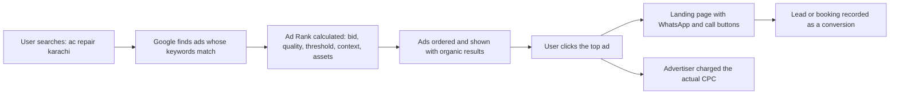
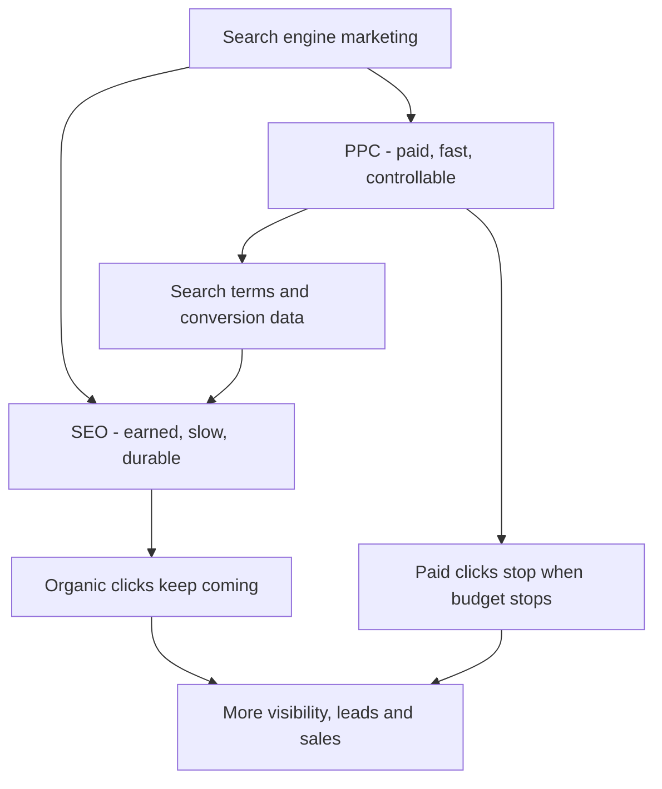
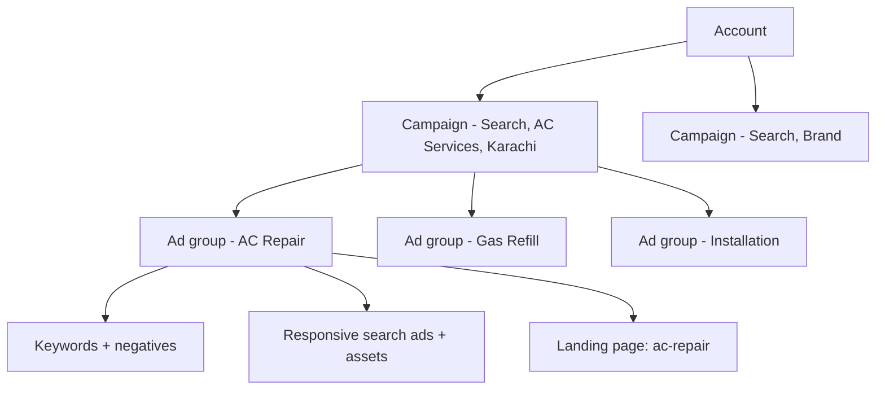
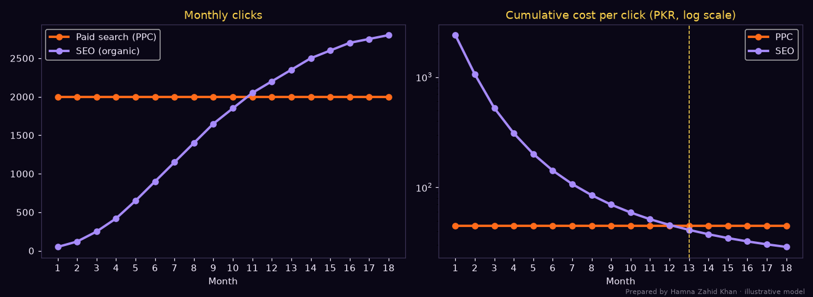
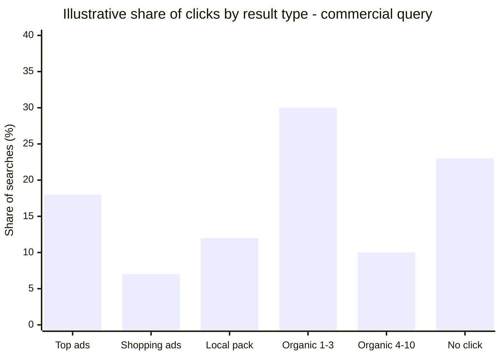

# Session 2 · Google Ads and How Search Marketing Works

> 🏠 [Diploma in Digital Marketing](../../README.md) › [Term 1](../README.md) › [Search and Display Marketing](README.md) › **Session 2**
>
> ⏱ **Estimated time:** 2.5 hours (1.5 h theory + 1 h lab) · 📋 **Prerequisites:** Session 1

[⬅ Previous: Session 1](session-01-history-of-search-advertising.md) · [Next: Session 3 ➡](session-03-google-ads-campaign-types.md)

---

## 🎯 Learning objectives

By the end of this session you will be able to:

- Define **Google Ads** and **search engine marketing (SEM)**, and explain how SEO and PPC work together.
- Explain the **SEO process** and contrast **white-hat** and **black-hat** tactics (a quick recap from Module 3, now seen through an advertiser's eyes).
- Describe the **PPC process** step by step: account structure, keywords, match types, ads, assets, bidding and measurement.
- Calculate **Ad Rank**, predict ad positions and estimate the **actual CPC** in a simplified auction.
- Write a **responsive search ad (RSA)** within Google's character limits.
- Build a combined **SEO + PPC** plan and judge when each one pays off.

## 📖 Concepts

### 1. Google Ads in one paragraph

**Google Ads** (called **Google AdWords** until July 2018) is Google's self-service advertising platform. Advertisers create campaigns, choose where ads appear – **Search**, **Shopping**, **YouTube**, the **Google Display Network**, **Gmail**, **Maps**, **Discover** and partner apps – set a budget in their own currency (PKR works fine), and pay mainly **per click** for search or **per 1,000 impressions / per view** for display and video. Every time someone searches, Google runs an **auction** in a fraction of a second to decide which ads appear and in what order.

Why businesses use it:

| Benefit | What it means in practice |
|---|---|
| **Intent** | Ads appear exactly when people search for the product |
| **Speed** | Traffic can start the same day a campaign is approved |
| **Control** | Choose keywords, locations, times, devices and daily budget |
| **Measurability** | Every impression, click, call and sale can be tracked |
| **Flexibility** | Pause, change or scale campaigns any time; no long contract |

### 2. Search engine marketing (SEM): two engines, one goal

**Search engine marketing** is everything a business does to gain visibility on search engines. Most marketers use **SEM** to mean the combination of:

- **SEO (search engine optimisation)** – earning **free, organic** positions through relevant content, good technical setup and quality backlinks.
- **PPC / paid search** – buying **sponsored** positions through an ad auction.

| | SEO | PPC (paid search) |
|---|---|---|
| Cost per click | No direct cost (but content, tech and time cost money) | Pay every click |
| Speed | Slow: usually 3–12 months to build | Fast: hours to days |
| Durability | Traffic continues if you stop investing for a while | Traffic stops when the budget stops |
| Control over message | Limited – Google writes some snippets | Full – you write the ad text |
| Position | Below ads, can't be bought | Top of page if Ad Rank is high enough |
| Trust | Many users trust organic results more | Labelled "Sponsored" |
| Testing | Slow to test | Fast A/B testing of headlines and offers |
| Best for | Long-term, informational and evergreen demand | Launches, promotions, high-intent commercial keywords |

**Case – a Seattle-style lesson in Karachi.** Imagine a small software company in Karachi selling school-management software. It invests in SEO (guides like "how to manage fee collection in a school") to build long-term organic traffic, *and* runs PPC on "school management software pakistan" to win demo requests while SEO is still growing. PPC search-term data also shows which phrases convert, so the SEO team knows which pages to write next. That feedback loop is the real power of SEM.

### 3. The SEO process (recap for advertisers)

1. **Audit** the website – technical health, speed, mobile usability, indexing.
2. **Keyword research** – volume, difficulty, intent (Module 3, Session 4).
3. **On-page optimisation** – titles, meta descriptions, headings, content, images, internal links.
4. **Technical optimisation** – speed, mobile, sitemaps, robots.txt, structured data.
5. **Content creation** – helpful pages that match intent and show E-E-A-T.
6. **Link building and local SEO** – earn mentions, reviews and backlinks.
7. **Measure and refine** – Search Console, GA4, rank tracking.

| White-hat SEO ✅ | Black-hat SEO ❌ |
|---|---|
| Helpful original content | Keyword stuffing |
| Earned, relevant backlinks | Buying links, link farms, private blog networks |
| Honest structured data | Fake reviews in schema |
| Fast, mobile-friendly pages | Cloaking (showing Google different content) |
| Clear titles and descriptions | Hidden text, doorway pages |

Black-hat SEO risks **manual actions** that remove pages from Google – the same mindset (misleading users) also gets ads **disapproved** and accounts **suspended** in Google Ads.

### 4. How PPC works – the process

1. **Campaign setup** – choose a goal (sales, leads, website traffic, awareness), campaign type (Search), networks, locations, languages, budget and bidding strategy.
2. **Account structure** – organise everything so each ad matches its keywords closely.
3. **Keyword selection** – choose keywords, match types and negative keywords.
4. **Ad creation** – write responsive search ads and add assets (sitelinks, callouts, call buttons).
5. **Auction** – every search triggers an auction; Ad Rank decides who shows and where.
6. **Immediate visibility** – winning ads appear above (and sometimes below) organic results.
7. **Pay per click** – you pay only when someone clicks; the price is set by the auction, not your full bid.
8. **Measure and optimise** – track conversions, cut wasted search terms, test new ads, adjust bids.

### 5. Account structure

```text
Google Ads account  (one business, billing in PKR)
└── Campaign: "Search – AC Services – Karachi"   ← budget, location, bidding, schedule
    ├── Ad group: "AC Repair"                     ← tightly related keywords + ads
    │     keywords: "ac repair karachi", [ac repair near me], "split ac repair"
    │     ads: 1–3 responsive search ads
    ├── Ad group: "AC Gas Refill"
    │     keywords: "ac gas refill", [ac gas charging price]
    └── Ad group: "AC Installation"
          keywords: "ac installation service", "inverter ac fitting"
```

**Rule of thumb:** one ad group = one theme. If a searcher types "ac gas refill price", the ad should say *gas refill* and *price*, and the landing page should show the refill price. That closeness raises Quality Score and conversion rate.

### 6. Keywords and match types

| Match type | Symbol in the account | Example keyword | Can trigger on | Won't trigger on |
|---|---|---|---|---|
| **Broad** | ac repair | ac repair | "air conditioner fixing service", "ac not cooling" | – (very wide reach) |
| **Phrase** | "ac repair" | "ac repair" | "ac repair in clifton", "best ac repair near me" | "repair of washing machine" |
| **Exact** | [ac repair] | [ac repair] | "ac repair", "repair ac", "ac repairing" (same meaning) | "ac repair course" |
| **Negative** | -jobs, -course, -free | | Blocks searches containing these words | |

Today all match types match on **meaning**, not just exact words, so the **search terms report** (what people actually typed) is essential. Add irrelevant terms as negatives every week – "ac repair course", "ac technician jobs" and "ac repair pdf" waste money for a service business.

### 7. Responsive search ads (RSAs)

An RSA lets you provide many building blocks and Google tests combinations automatically.

| Element | Limit | Tips |
|---|---|---|
| **Headlines** | 3–15, **30 characters** each | Include the keyword, a benefit, a price/offer, proof (reviews), and a call to action |
| **Descriptions** | 2–4, **90 characters** each | Explain the offer, add trust signals, end with an action |
| **Display path** | 2 fields, **15 characters** each | Shows a tidy URL like `example.pk/ac-repair/karachi` |
| **Final URL** | – | The landing page – must match the ad's promise |

Google rates each ad's **Ad strength** (Poor → Excellent). More distinct, relevant headlines usually improve it. You can **pin** a headline to position 1, but pinning reduces combinations, so use it only when legally or brand-required.

**Assets (formerly extensions)** make ads bigger and more useful:

| Asset | Shows | Example |
|---|---|---|
| Sitelinks | Extra links | "Gas Refill · Installation · Prices · Reviews" |
| Callouts | Short benefits | "Same-Day Visit · 30-Day Warranty" |
| Structured snippets | Lists | "Services: Repair, Refill, Installation" |
| Call | Phone button | Tap to call from mobile |
| Location | Address + map | Links to the Google Business Profile |
| Price | Price cards | "Gas refill from PKR 4,500" |
| Image | Thumbnail | Photo of a technician at work |

### 8. Quality Score and the ad auction

**Quality Score** (1–10, per keyword) is Google's diagnostic of how relevant your ads and landing page are, built from three parts:

| Component | Question | How to improve |
|---|---|---|
| **Expected CTR** | Will people click this ad for this keyword? | Keyword in headline, compelling offer, assets |
| **Ad relevance** | Does the ad match the search intent? | Tight ad groups, one theme each |
| **Landing page experience** | Is the page useful, fast and trustworthy? | Matching content, speed, mobile, clear contact info |

**Ad Rank** decides whether and where your ad shows. Google uses your **bid**, the **quality** of the ad and landing page, **Ad Rank thresholds** (minimum quality to show), the **context** of the search (location, device, time), and the expected impact of **assets**. For learning, we use the classic simplified model:

> **Ad Rank ≈ Max CPC bid × Quality Score**
> **Actual CPC ≈ (Ad Rank of the advertiser below you ÷ your Quality Score) + PKR 1**

You never pay more than your max bid, and a strong Quality Score lowers the price you pay.

### 9. Bidding strategies (overview)

| Strategy | You tell Google | Use when |
|---|---|---|
| **Manual CPC** | The max price per click for each keyword | Learning, very small budgets, tight control |
| **Maximise clicks** | Get as many clicks as the budget allows | New campaigns gathering traffic data |
| **Maximise conversions** (optional **target CPA**) | Get the most conversions / at this cost per conversion | Conversion tracking works and you have some history |
| **Maximise conversion value** (optional **target ROAS**) | Get the most revenue / at this revenue-to-cost ratio | E-commerce with sales values tracked |
| **Target impression share** | Show at the top X% of the time | Brand protection on your own name |

### 10. SEM strategy: making SEO and PPC work together

- **Launch with PPC, grow with SEO** – buy visibility now while organic content matures.
- **Use PPC data to choose SEO topics** – keywords with high conversion rates in ads deserve strong organic pages.
- **Cover the whole SERP** – an ad *and* an organic listing for high-value keywords increases total clicks and trust.
- **Bid on your brand** when competitors bid on it – brand clicks are cheap and protect your traffic.
- **Reduce PPC where SEO is strong** – test lowering bids on keywords where you rank #1 organically, and measure total clicks.
- **Adapt to change** – AI answers, new ad formats and algorithm updates mean reviewing the plan every quarter.
- **Tools:** Google Ads Keyword Planner, Search Console, GA4, Semrush, SpyFu, WordStream (Session 5).

## 🧭 Diagrams

### The life of one search ad click



### SEM = SEO + PPC



### Account structure



## 💻 Worked examples

### Example 1 – Who wins the auction, and what do they pay?

Five Karachi AC-service companies bid on "ac repair karachi". Watch how Quality Score changes the result.

📄 `code/session-02_ad_auction.py`

```python
# A simplified Google Ads auction: Ad Rank = max CPC bid x Quality Score.
# Prepared by Hamna Zahid Khan, Junior Lecturer.
# Google's real Ad Rank also uses ad-rank thresholds, context (device, location, time) and expected
# impact of assets, so treat this as a teaching model of the core idea, not the exact formula.

keyword = "ac repair karachi"
advertisers = [  # name, max CPC bid (PKR), Quality Score (1-10)
    ("CoolFix Services", 120, 9),
    ("AC Wala Express", 180, 5),
    ("Gulshan Cooling Co", 140, 7),
    ("Budget AC Repairs", 200, 3),
    ("Arctic Home Care", 90, 8),
]
AD_RANK_THRESHOLD = 650   # illustrative minimum Ad Rank needed to show at all

rows = [(name, bid, qs, bid * qs) for name, bid, qs in advertisers]
rows.sort(key=lambda r: r[3], reverse=True)

print(f'Auction for "{keyword}"\n')
print(f"{'Pos':<4}{'Advertiser':<22}{'Bid':>6}{'QS':>4}{'Ad Rank':>9}{'Actual CPC':>12}")
for i, (name, bid, qs, rank) in enumerate(rows):
    if rank < AD_RANK_THRESHOLD:
        print(f"{'--':<4}{name:<22}{bid:>6}{qs:>4}{rank:>9}{'not shown':>12}")
        continue
    nxt = rows[i + 1][3] if i + 1 < len(rows) else AD_RANK_THRESHOLD
    nxt = max(nxt, AD_RANK_THRESHOLD)
    actual = min(bid, nxt / qs + 1)       # pay just enough to beat the next Ad Rank, never above your bid
    print(f"{i+1:<4}{name:<22}{bid:>6}{qs:>4}{rank:>9}{actual:>12.2f}")

best = rows[0]
print(f"\n{best[0]} bids PKR {best[1]} but wins position 1 because its Quality Score is {best[2]}.")
budget = [r for r in rows if r[0] == "Budget AC Repairs"][0]
print(f"{budget[0]} bids the most (PKR {budget[1]}) yet Ad Rank {budget[3]} is too low to show.")

# What a Quality Score improvement is worth for one advertiser
name, bid, qs = "AC Wala Express", 180, 5
target_rank = rows[0][3] + 1
for new_qs in (5, 7, 9):
    need = target_rank / new_qs
    print(f"{name} with QS {new_qs}: needs a bid of about PKR {need:,.1f} to take position 1")
```

**Output**

```text
Auction for "ac repair karachi"

Pos Advertiser               Bid  QS  Ad Rank  Actual CPC
1   CoolFix Services         120   9     1080      109.89
2   Gulshan Cooling Co       140   7      980      129.57
3   AC Wala Express          180   5      900      145.00
4   Arctic Home Care          90   8      720       82.25
--  Budget AC Repairs        200   3      600   not shown

CoolFix Services bids PKR 120 but wins position 1 because its Quality Score is 9.
Budget AC Repairs bids the most (PKR 200) yet Ad Rank 600 is too low to show.
AC Wala Express with QS 5: needs a bid of about PKR 216.2 to take position 1
AC Wala Express with QS 7: needs a bid of about PKR 154.4 to take position 1
AC Wala Express with QS 9: needs a bid of about PKR 120.1 to take position 1
```

**Hand-check one line.** CoolFix's Ad Rank = 120 × 9 = 1,080. The advertiser below it (Gulshan Cooling) has Ad Rank 980. CoolFix pays 980 ÷ 9 + 1 = **PKR 109.89** – less than its PKR 120 bid, and far less than the PKR 180 that AC Wala Express bids for third place.

**Lessons:**

1. **Quality beats money.** CoolFix bids less than three of its rivals (PKR 120) yet wins position 1.
2. **Low quality is expensive** – Budget AC Repairs bids PKR 200 and does not show at all because its Ad Rank is below the threshold.
3. **Improving Quality Score from 5 to 9** would let AC Wala Express win position 1 with a bid of about PKR 120 instead of PKR 216 – a **44% cheaper** route to the top.

### Example 2 – Checking a responsive search ad before launch

📄 `code/session-02_rsa_checker.py`

```python
# Check a responsive search ad (RSA) against Google Ads character limits and basic quality rules.
# Prepared by Hamna Zahid Khan, Junior Lecturer.
LIMITS = {"headline": 30, "description": 90, "path": 15}

ad = {
    "keyword": "ac repair",
    "headlines": [
        "AC Repair in Karachi",
        "Same-Day Technician Visit",
        "Gas Refill From PKR 4,500",
        "Inverter AC Specialists",
        "Book on WhatsApp in 1 Minute",
        "4.8 Stars From 900+ Customers",
        "Free Checkup With Every Service Visit",   # too long on purpose
        "AC Repair in Karachi",                    # duplicate on purpose
    ],
    "descriptions": [
        "Certified technicians for split and inverter ACs. Clear prices, 30-day service warranty.",
        "Open 7 days, 9am-9pm. Serving DHA, Clifton, Gulshan and North Nazimabad. Book now.",
    ],
    "paths": ["ac-repair", "karachi"],
}

problems = 0
for kind, items in (("headline", ad["headlines"]), ("description", ad["descriptions"]), ("path", ad["paths"])):
    for text in items:
        n = len(text)
        ok = n <= LIMITS[kind]
        problems += not ok
        print(f"{'OK ' if ok else 'TOO LONG'} {kind:<11} {n:>3}/{LIMITS[kind]:<3} {text}")

dupes = {h for h in ad["headlines"] if ad["headlines"].count(h) > 1}
unique = len(set(ad["headlines"]))
kw = sum(ad["keyword"] in h.lower() for h in set(ad["headlines"]))
print(f"\nUnique headlines: {unique} (Google allows 3-15; aim for 8-15 distinct ones)")
print(f"Descriptions: {len(ad['descriptions'])} (Google allows 2-4)")
print(f"Duplicates: {sorted(dupes) or 'none'}")
print(f"Headlines containing the keyword '{ad['keyword']}': {kw}")
print(f"Has a number/price: {any(ch.isdigit() for h in ad['headlines'] for ch in h)}")
print(f"\nProblems to fix: {problems + len(dupes)}")
```

**Output**

```text
OK  headline     20/30  AC Repair in Karachi
OK  headline     25/30  Same-Day Technician Visit
OK  headline     25/30  Gas Refill From PKR 4,500
OK  headline     23/30  Inverter AC Specialists
OK  headline     28/30  Book on WhatsApp in 1 Minute
OK  headline     29/30  4.8 Stars From 900+ Customers
TOO LONG headline     37/30  Free Checkup With Every Service Visit
OK  headline     20/30  AC Repair in Karachi
OK  description  88/90  Certified technicians for split and inverter ACs. Clear prices, 30-day service warranty.
OK  description  82/90  Open 7 days, 9am-9pm. Serving DHA, Clifton, Gulshan and North Nazimabad. Book now.
OK  path          9/15  ac-repair
OK  path          7/15  karachi

Unique headlines: 7 (Google allows 3-15; aim for 8-15 distinct ones)
Descriptions: 2 (Google allows 2-4)
Duplicates: ['AC Repair in Karachi']
Headlines containing the keyword 'ac repair': 1
Has a number/price: True

Problems to fix: 2
```

**Fixes:** shorten "Free Checkup With Every Service Visit" to "Free Checkup With Every Visit" (29 characters), delete the duplicate, and add more distinct headlines (e.g. "Technicians Across Karachi", "30-Day Service Warranty", "Call Now – Open 9am to 9pm") so you reach 10–15 unique headlines. Only one headline contains the exact keyword – add "Split & Inverter AC Repair" too.

### Example 3 – SEO vs PPC over 18 months

A small business compares a PKR 90,000/month PPC budget with an SEO programme (PKR 120,000 setup, then PKR 40,000/month for content and links).

📄 `code/session-02_seo_vs_ppc.py`

```python
# Compare 18 months of paid search (PPC) and SEO traffic and cost for one small business.
# Prepared by Hamna Zahid Khan, Junior Lecturer. All figures are an illustrative model.
import matplotlib
matplotlib.use("Agg")
import matplotlib.pyplot as plt

BG, FIRE, GOLD, VIOLET, TEXT = "#0A0716", "#FF6B1A", "#FCD34D", "#A78BFA", "#F5EEFF"
months = list(range(1, 19))
CPC = 45                     # PKR per click
ppc_budget = 90_000          # PKR per month
ppc_clicks = [ppc_budget // CPC] * 18

seo_cost = [120_000, 60_000] + [40_000] * 16         # setup, then content + links each month
seo_clicks = [50, 120, 250, 420, 650, 900, 1150, 1400, 1650, 1850, 2050, 2200,
              2350, 2500, 2600, 2700, 2750, 2800]

cum = lambda xs: [sum(xs[:i + 1]) for i in range(len(xs))]
ppc_cpc = [c / k for c, k in zip(cum([ppc_budget] * 18), cum(ppc_clicks))]
seo_cpc = [c / k for c, k in zip(cum(seo_cost), cum(seo_clicks))]

print(f"{'Month':<6}{'PPC clicks':>11}{'SEO clicks':>11}{'PPC cost/click':>16}{'SEO cost/click':>16}")
for m in months:
    print(f"{m:<6}{ppc_clicks[m-1]:>11,}{seo_clicks[m-1]:>11,}{ppc_cpc[m-1]:>16.1f}{seo_cpc[m-1]:>16.1f}")
cross = next(m for m in months if seo_cpc[m - 1] < ppc_cpc[m - 1])
monthly_cross = next(m for m in months if seo_cost[m - 1] / seo_clicks[m - 1] < CPC)
print(f"\n18-month totals: PPC {sum(ppc_clicks):,} clicks for PKR {ppc_budget*18:,}; "
      f"SEO {sum(seo_clicks):,} clicks for PKR {sum(seo_cost):,}")
print(f"SEO's cost per click within a single month drops below PPC's in month {monthly_cross}")
print(f"SEO's cumulative cost per click (all spend so far) drops below PPC's in month {cross}")
print("If the PPC budget stops, paid clicks fall to 0 the next day; organic clicks keep coming.")

fig, (a1, a2) = plt.subplots(1, 2, figsize=(12, 4.4), facecolor=BG)
for ax in (a1, a2):
    ax.set_facecolor(BG); ax.tick_params(colors=TEXT)
    for s in ax.spines.values(): s.set_color("#3b3355")
    ax.set_xlabel("Month", color=TEXT); ax.set_xticks(months)
a1.plot(months, ppc_clicks, color=FIRE, lw=2.5, marker="o", label="Paid search (PPC)")
a1.plot(months, seo_clicks, color=VIOLET, lw=2.5, marker="o", label="SEO (organic)")
a1.set_title("Monthly clicks", color=GOLD); a1.legend(facecolor=BG, labelcolor=TEXT)
a2.plot(months, ppc_cpc, color=FIRE, lw=2.5, marker="o", label="PPC")
a2.plot(months, seo_cpc, color=VIOLET, lw=2.5, marker="o", label="SEO")
a2.set_yscale("log"); a2.set_title("Cumulative cost per click (PKR, log scale)", color=GOLD)
a2.axvline(cross, color=GOLD, ls="--", lw=1); a2.legend(facecolor=BG, labelcolor=TEXT)
fig.text(0.99, 0.01, "Prepared by Hamna Zahid Khan · illustrative model", color=TEXT, alpha=0.5, ha="right", fontsize=7)
plt.tight_layout(); plt.savefig("session-02_seo_vs_ppc.png", dpi=110, facecolor=BG)
print("Saved session-02_seo_vs_ppc.png")
```

**Output**

```text
Month  PPC clicks SEO clicks  PPC cost/click  SEO cost/click
1           2,000         50            45.0          2400.0
2           2,000        120            45.0          1058.8
3           2,000        250            45.0           523.8
4           2,000        420            45.0           309.5
5           2,000        650            45.0           201.3
6           2,000        900            45.0           142.3
7           2,000      1,150            45.0           107.3
8           2,000      1,400            45.0            85.0
9           2,000      1,650            45.0            69.8
10          2,000      1,850            45.0            59.2
11          2,000      2,050            45.0            51.5
12          2,000      2,200            45.0            45.7
13          2,000      2,350            45.0            41.2
14          2,000      2,500            45.0            37.6
15          2,000      2,600            45.0            34.8
16          2,000      2,700            45.0            32.4
17          2,000      2,750            45.0            30.5
18          2,000      2,800            45.0            28.9

18-month totals: PPC 36,000 clicks for PKR 1,620,000; SEO 28,390 clicks for PKR 820,000
SEO's cost per click within a single month drops below PPC's in month 6
SEO's cumulative cost per click (all spend so far) drops below PPC's in month 13
If the PPC budget stops, paid clicks fall to 0 the next day; organic clicks keep coming.
Saved session-02_seo_vs_ppc.png
```



**Reading the chart:** PPC delivers 2,000 clicks from month 1, while SEO starts near zero. SEO's *monthly* cost per click beats PPC from month 6 and its *cumulative* cost per click (including the setup) beats PPC from month 13. The smart plan is **both**: PPC for immediate leads, SEO for long-term cheap traffic – then gradually rebalance.

### Example 4 – Step-by-step: building your first search campaign (walkthrough)

Business: **Noor Tutors**, home tuition in Lahore. Goal: tutor enquiries via form and WhatsApp.

1. **Goal & conversion:** set up conversion actions for *form submit* and *WhatsApp click*.
2. **Campaign:** Search only (untick Display expansion for a first campaign), location **Lahore + 15 km**, language English and Urdu, budget **PKR 2,000/day**, bidding **Maximise clicks** for 2–3 weeks then **Maximise conversions**.
3. **Ad groups:** "O Level tutor", "Matric tutor", "Quran tutor at home".
4. **Keywords (O Level group):** "o level home tutor lahore", [o level tutor], "o level maths tutor near me". **Negatives:** jobs, salary, vacancy, free, pdf, notes.
5. **Ad:** 12 headlines incl. "O Level Home Tutors in Lahore", "Female Tutors Available", "Free Demo Class", "Fees From PKR 15,000/Month"; 3 descriptions; path `/o-level/lahore`.
6. **Assets:** call, sitelinks (Subjects, Fees, Reviews, Become a Tutor – the last one with its own negative strategy), callouts (Verified Tutors, Free Demo).
7. **Landing page:** headline matching the ad, fee table, tutor profiles, reviews, short form + WhatsApp button.
8. **After launch:** check search terms every 2–3 days in week one; add negatives; pause ads with low CTR after enough impressions.

## 📊 Chart · Where clicks go on a commercial SERP (illustrative)



These numbers are a teaching illustration. Real shares change by query, device and country; your own Search Console and Google Ads reports are the truth for your business.

## 📋 Template · Search campaign planning sheet

| Field | Your entry |
|---|---|
| Business & offer | |
| Goal (sales / leads / calls) | |
| Conversion actions tracked | |
| Locations & radius | |
| Languages | |
| Daily budget (PKR) | |
| Bidding strategy (start → later) | |
| Ad groups (one theme each) | |
| Keywords per ad group + match types | |
| Negative keyword list | |
| Headlines (≥ 10, ≤ 30 chars) | |
| Descriptions (≥ 2, ≤ 90 chars) | |
| Assets | |
| Landing page URL per ad group | |
| Review schedule | |

## ⚠️ Common mistakes

| Mistake | Result | Fix |
|---|---|---|
| One ad group with 80 unrelated keywords | Generic ads, low Quality Score | One theme per ad group |
| Broad match with no negatives | Money spent on "jobs", "free", "course" searches | Negative list from day one, weekly search-term review |
| Sending all ads to the home page | Low conversion, poor landing page experience | Dedicated page per ad group |
| No conversion tracking | Can't judge what works; Smart Bidding fails | Track forms, calls and WhatsApp clicks first |
| Leaving "Display expansion" on in a first search campaign | Cheap, low-intent clicks | Keep Search and Display separate |
| Judging an ad after 20 clicks | Random noise drives decisions | Wait for enough data (hundreds of impressions, dozens of clicks) |
| Stopping SEO because PPC "works" | Traffic disappears when budget stops | Build both |

## ✅ Best practices

- Write ads that **mirror the searcher's words** and promise exactly what the landing page delivers.
- Use **numbers** (prices, ratings, delivery time) – they stand out.
- Add **all relevant assets**; they increase ad size and CTR at no extra cost per impression.
- Start with **tight locations and schedules** when budgets are small.
- Review **search terms weekly**, Quality Score components monthly, strategy quarterly.
- Feed winning paid keywords into your **SEO content plan**.

## 🧪 Lab / practice tasks

**Task 1 (easy) – Match types.** For the keyword *phrase match* "bridal makeup", say whether each search can trigger the ad: (a) "bridal makeup artist lahore" (b) "makeup for bride price" (c) "bridal makeup course online" (d) "party makeup".

<details><summary>✅ Solution</summary>

(a) Yes – contains the phrase meaning. (b) Likely yes – same meaning ("makeup for bride" ≈ "bridal makeup"). (c) Yes – which is why "course" should be a **negative keyword** for a salon. (d) No – "party makeup" is a different meaning.

</details>

**Task 2 (easy) – Ad Rank.** Three advertisers bid on "wedding photographer karachi": A bids PKR 150 with QS 6; B bids PKR 100 with QS 10; C bids PKR 200 with QS 4. Rank them and calculate A's actual CPC if A finishes second.

<details><summary>✅ Solution</summary>

Ad Ranks: A = 900, B = 1,000, C = 800. Order: **B (1), A (2), C (3)**. A's actual CPC = 800 ÷ 6 + 1 ≈ **PKR 134.33**.

</details>

**Task 3 (medium) – Write an RSA.** For "Sana's Kitchen – frozen parathas delivered in Islamabad", write 10 headlines (≤ 30 chars) and 3 descriptions (≤ 90 chars). Then paste them into `code/session-02_rsa_checker.py` and fix every problem it reports.

<details><summary>💡 Hint</summary>

Mix keyword headlines ("Frozen Parathas Islamabad"), benefit ("Ready in 3 Minutes"), offer ("Free Delivery Over PKR 2,000"), proof ("Rated 4.9 by 600 Families") and action ("Order on WhatsApp Today").

</details>

**Task 4 (medium) – Structure an account.** Design the campaign/ad-group/keyword structure for a Faisalabad textile shop selling bedsheets, curtains and towels online, with at least 3 keywords and 3 negatives per ad group.

**Task 5 (challenge) – SEO or PPC?** Change `code/session-02_seo_vs_ppc.py` so the CPC is PKR 25 instead of PKR 45. When does SEO's cumulative cost per click now beat PPC? Explain what this tells you about competitive vs cheap keywords.

<details><summary>✅ Solution</summary>

With CPC = 25 the PPC budget buys 3,600 clicks a month, and SEO's cumulative cost per click (PKR 28.9 at month 18) is still **above** PKR 25 – so in this 18-month window the script's `next(...)` finds no crossover and raises `StopIteration`. Guard it with `next(..., None)`. Lesson: when paid clicks are **cheap**, PPC stays efficient for longer; SEO wins most clearly on **expensive, competitive** keywords – but SEO traffic also keeps coming after month 18 without new click costs.

</details>

## ✅ Quick quiz

1. Google AdWords was renamed Google Ads in:
   a) 2005 b) 2012 c) 2018 d) 2022
2. Which factor is **not** one of the three Quality Score components?
   a) Expected CTR b) Ad relevance c) Landing page experience d) Number of keywords in the account
3. A negative keyword:
   a) lowers your bid b) stops your ad showing for searches containing it c) is a keyword with a low CTR d) is only for display campaigns
4. The headline limit in a responsive search ad is:
   a) 15 characters b) 30 characters c) 90 characters d) 120 characters
5. Which statement best describes SEM?
   a) SEO only b) Social media ads c) Gaining search visibility through both SEO and paid search d) Email marketing on Gmail

<details><summary>Show answers</summary>

1-c · 2-d · 3-b · 4-b · 5-c

</details>

## 📝 Summary

- **Google Ads** sells intent-based ads through an auction run for every search.
- **SEM = SEO + PPC**: SEO is slow and durable, PPC is fast and controllable; the best plans combine them and share data.
- Structure accounts as **campaign → ad group (one theme) → keywords + ads + landing page**.
- **Match types** (broad, phrase, exact) control reach; **negative keywords** stop waste.
- **RSAs**: up to 15 headlines (30 chars) and 4 descriptions (90 chars); add **assets**.
- **Quality Score** (expected CTR, ad relevance, landing page) and **Ad Rank** mean relevance can beat a bigger bid; actual CPC is usually below your max bid.

**Formulas:** Ad Rank ≈ Bid × QS · Actual CPC ≈ (Ad Rank below ÷ your QS) + 1 · CTR = Clicks ÷ Impressions × 100 · Cost per click over time = total spend ÷ total clicks.

**Interview / viva questions**

1. Explain how a business can pay less per click than a competitor and still rank above it.
2. What are the three components of Quality Score and how would you improve each?
3. When would you recommend PPC over SEO, and when the opposite?
4. Why are negative keywords important? Give five negatives for a university admissions campaign.
5. Walk me through the structure of a Google Ads account for a multi-service business.
6. What is a responsive search ad and how does Google decide which headline combination to show?

---

[⬅ Previous: Session 1](session-01-history-of-search-advertising.md) · [Next: Session 3 ➡](session-03-google-ads-campaign-types.md)

<sub>Prepared by **Hamna Zahid Khan**, Junior Lecturer · Diploma in Digital Marketing</sub>
