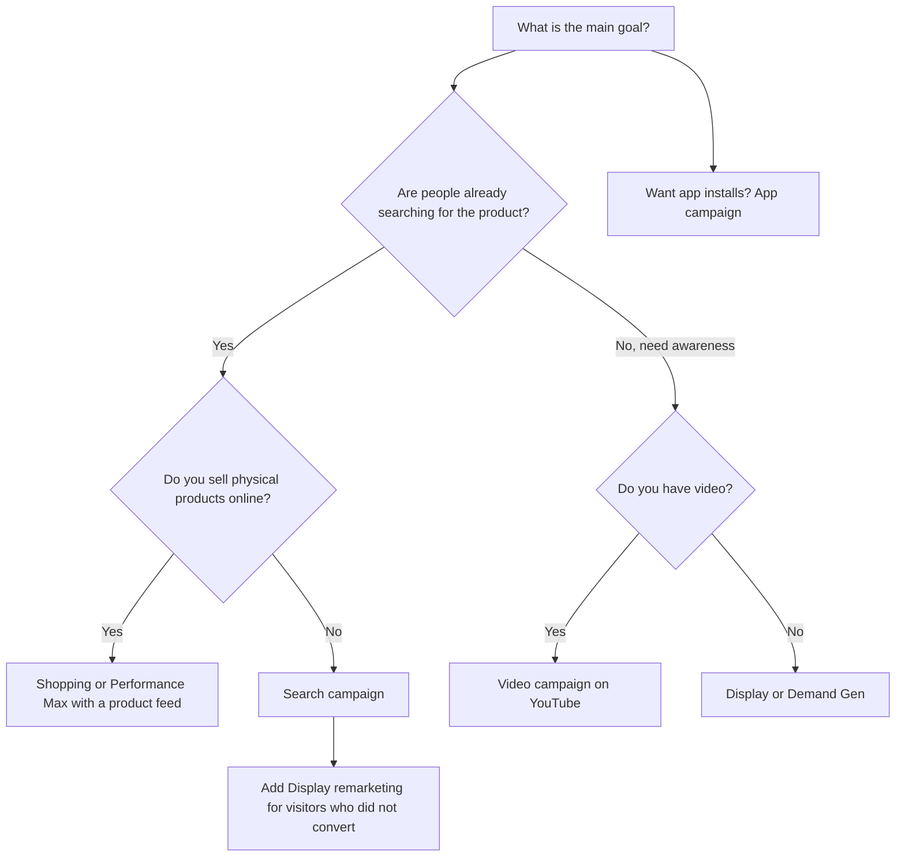
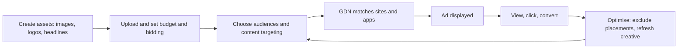
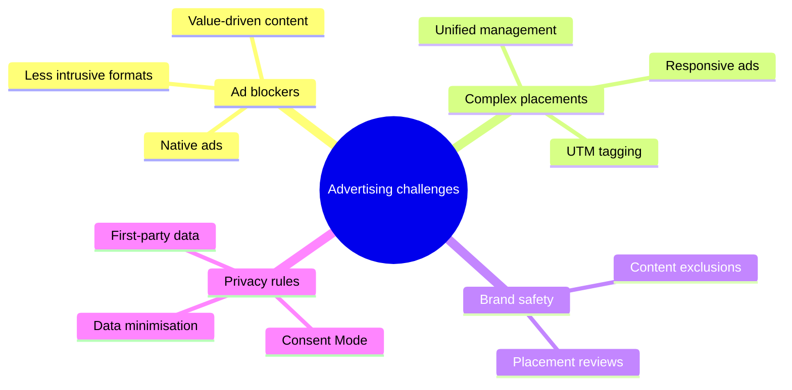
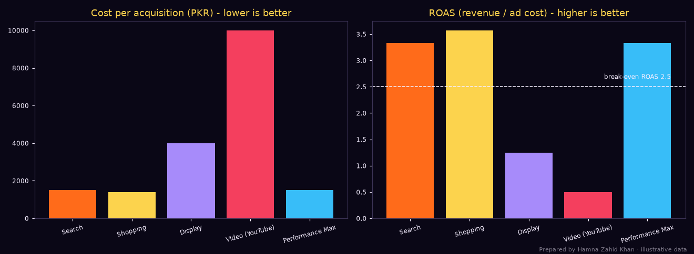
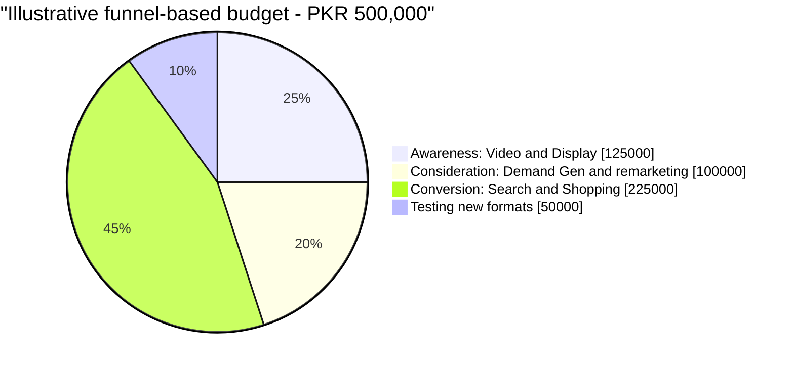

# Session 3 · Google Ads Campaign Types, Challenges and Privacy

> 🏠 [Diploma in Digital Marketing](../../README.md) › [Term 1](../README.md) › [Search and Display Marketing](README.md) › **Session 3**
>
> ⏱ **Estimated time:** 3 hours (2 h theory + 1 h lab) · 📋 **Prerequisites:** Session 2

[⬅ Previous: Session 2](session-02-google-ads-search-study.md) · [Next: Session 4 ➡](session-04-google-analytics.md)

---

## 🎯 Learning objectives

By the end of this session you will be able to:

- Compare the main **Google Ads campaign types** – Search, Display, Video, Shopping, Performance Max, Demand Gen and App – and choose the right one for a goal.
- Explain the main **pricing models**: CPC, CPM, vCPM, CPV and CPA-based bidding.
- Set up a **Display** and a **Video** campaign step by step and apply best practices for each.
- Calculate and interpret **CTR, CPC, CPM, conversion rate, CPA, ROAS and ROI** across campaigns, including **break-even ROAS**.
- Plan a budget by working **backwards from a sales target**.
- Identify the main **challenges** in digital advertising – ad blockers, complex placements, brand safety, privacy rules – and apply strategies to overcome them.

## 📖 Concepts

### 1. Recap: what Google Ads sells

Google Ads lets advertisers reach people in two broad situations:

- **When they are searching** – Search and Shopping campaigns (high intent, pay per click).
- **When they are browsing, watching or scrolling** – Display, YouTube, Demand Gen, Gmail, Discover (lower intent, larger reach, often pay per impression or view).

**Performance Max** sits across both, using AI to place ads wherever it predicts results.

### 2. Pricing models

| Model | You pay for | Typical use | Example |
|---|---|---|---|
| **CPC** – cost per click | Each click | Search, Shopping, performance display | PKR 40 per click on "school bags online" |
| **CPM** – cost per mille | 1,000 impressions | Awareness display, bumper video | PKR 120 per 1,000 impressions |
| **vCPM** – viewable CPM | 1,000 *viewable* impressions | Brand display | Only ads at least 50% on screen for 1 s count |
| **CPV** – cost per view | A view (skippable in-stream: 30 s watched, or the full ad if shorter, or an interaction) | YouTube consideration | PKR 2.5 per view |
| **CPA / tCPA** – target cost per acquisition | Clicks, but Google bids to hit your target cost per conversion | Lead generation, sales | Aim for PKR 1,200 per lead |
| **tROAS** – target return on ad spend | Clicks, bidding towards a revenue ratio | E-commerce | Aim for 400% (PKR 4 revenue per PKR 1 spent) |

Note: with CPA and ROAS strategies you are still usually billed per click – the "target" tells the algorithm how much to bid.

### 3. The campaign types

| Campaign type | Where ads appear | Ad formats | Best for | Main metric |
|---|---|---|---|---|
| **Search** | Google results, search partners | Text ads (RSAs) + assets | Capturing existing demand | Conversions, CPA |
| **Shopping** | Shopping tab, top of results, Images | Product image, title, price, store | E-commerce with a product feed | ROAS |
| **Display** | 2+ million sites and apps in the **Google Display Network (GDN)**, Gmail, YouTube | Responsive display ads, image banners | Awareness, remarketing | Reach, CPM, view-through and assisted conversions |
| **Video** | YouTube and video partners | In-stream, in-feed, Shorts, bumper | Brand awareness and consideration | Views, CPV, view rate, brand lift |
| **Performance Max (PMax)** | All Google channels from one campaign | Mixed assets (text, images, video, product feed) | Sales/leads with good conversion data | Conversions, ROAS |
| **Demand Gen** (replaced Discovery in 2023–24) | YouTube, Discover feed, Gmail | Image, carousel, video | Social-style visual demand creation | Conversions, CPA |
| **App** | Search, Play Store, YouTube, Display | Auto-built from app assets | App installs and in-app actions | Cost per install |

### 4. Search ads recap: text ads and Shopping

**Text ads** (responsive search ads) were covered in Session 2.

**Shopping ads** are built from a **product feed** uploaded to **Google Merchant Center** (title, price, image, availability, brand, GTIN). Instead of keywords, Google matches searches to products using the feed – so the **product title** works like your keyword list.

Feed title formula that works well: **Brand + Product type + Key attributes (colour, size, material) + Model**
❌ "Item 4471 new" ✅ "Zari Shoes Red Velvet Khussa – Women, Size 38, Hand-Embroidered"

### 5. Display campaigns: how they work

**Step-by-step lifecycle:**

1. **Creation of the ad** – upload headlines, descriptions, logos and images (Google builds **responsive display ads** in many sizes) or upload your own banner files.
2. **Uploading to Google Ads** – choose goal, locations, languages, budget and **bidding** (e.g. maximise conversions, target CPA, viewable CPM).
3. **Targeting** – audiences (remarketing lists, Customer Match, in-market, affinity, custom segments, demographics) and/or content (topics, keywords, specific placements).
4. **Ad matching** – the GDN finds websites, apps and videos that fit the targeting.
5. **Ad display** – the ad shows as users browse those sites.
6. **User interaction** – users view, click and convert; results feed back into optimisation.

**Benefits:** broad reach, visual appeal, precise targeting, brand awareness and **retargeting** (remarketing to past visitors who left without buying).

**Best practices for Display:**

| Practice | Why | How |
|---|---|---|
| **High-quality visuals** | People scan, not read | Clear product, minimal text, strong contrast, brand logo |
| **Mobile first** | Most Pakistani browsing is on phones | Test square and portrait images; big readable text |
| **Clear, concise message** | You have about a second | One offer + one call to action: "Eid Sale – 30% Off. Shop Now" |
| **Strategic targeting** | Wide reach wastes money | Start with remarketing and custom segments; exclude poor placements |
| **Monitor and optimise** | Placements vary hugely in quality | Check the "where ads showed" report; exclude low-quality apps and sites |
| **Frequency capping** | Seeing an ad 20 times annoys people | Cap at around 3–5 impressions per user per week |

### 6. Video campaigns on YouTube

YouTube is one of the most used platforms in Pakistan, which makes video advertising a powerful awareness tool.

| Format | Length / behaviour | Billing | Use |
|---|---|---|---|
| **Skippable in-stream** | Plays before/during/after videos; skip after 5 s | CPV (view = 30 s or full ad if shorter, or a click) or CPM / conversions | Consideration, sales |
| **Non-skippable in-stream** | Up to 15 s (longer on TV screens), can't skip | CPM | Full message delivery |
| **Bumper** | Up to 6 s, can't skip | CPM | Reach, reminders |
| **In-feed video** | Thumbnail in search results, home feed, watch-next | Pay when clicked to watch | Content discovery |
| **Shorts ads** | Vertical, between Shorts | Varies by campaign | Younger audiences, mobile |
| **Outstream** | On partner sites/apps, mobile, starts muted | vCPM | Extra mobile reach |

**Benefits:** enhanced brand visibility, emotional storytelling, advanced targeting (interests, life events, custom segments), and detailed metrics (views, view rate, watch time, earned actions).

**Best practices for Video:**

1. **Hook in the first 5 seconds** – show the brand and the problem/benefit before the skip button appears.
2. **Eye-catching thumbnails** for in-feed ads – faces, contrast, 2–4 words of text.
3. **Mobile-first framing** – large text, centred subjects, captions (many watch muted).
4. **One clear message and CTA** – "Order on Foodpanda", "Visit our Dolmen Mall store".
5. **Monitor and adjust** – view rate, average watch time, CTR; swap creatives that fall below average.

### 7. Key performance metrics and formulas

| Metric | Formula | Example (PKR) |
|---|---|---|
| **CTR** | Clicks ÷ Impressions × 100 | 9,000 ÷ 180,000 × 100 = **5%** |
| **CPC** | Cost ÷ Clicks | 405,000 ÷ 9,000 = **PKR 45** |
| **CPM** | Cost ÷ Impressions × 1,000 | 405,000 ÷ 180,000 × 1,000 = **PKR 2,250** |
| **Conversion rate (CR)** | Conversions ÷ Clicks × 100 | 270 ÷ 9,000 × 100 = **3%** |
| **CPA** | Cost ÷ Conversions | 405,000 ÷ 270 = **PKR 1,500** |
| **ROAS** | Revenue ÷ Ad cost | 1,350,000 ÷ 405,000 = **3.33** (333%) |
| **ROI** | (Profit from sales − Ad cost) ÷ Ad cost × 100 | (1,350,000 × 40% − 405,000) ÷ 405,000 × 100 = **33%** |
| **Break-even ROAS** | 1 ÷ Gross margin | 1 ÷ 0.40 = **2.5** |
| **View rate (video)** | Views ÷ Impressions × 100 | 45,000 ÷ 150,000 × 100 = **30%** |
| **CPV** | Cost ÷ Views | 90,000 ÷ 45,000 = **PKR 2** |

**ROAS vs ROI.** ROAS looks at **revenue**, ROI looks at **profit**. A ROAS of 3 sounds great, but if your margin is only 25% (break-even ROAS = 4), you are losing money on every sale from that campaign.

### 8. Challenges in digital advertising

#### 8a. Ad blockers

**Ad blockers** are browser extensions, apps or built-in browser features that stop ads from loading. Some mobile browsers and networks include blocking by default.

| Format | Impact |
|---|---|
| **Video ads** | Pre-roll can be blocked on some websites (YouTube itself fights blockers) |
| **Banner ads** | Most easily blocked, reducing impressions and reach |
| **Rich media / pop-ups** | Heavily blocked because they are the most intrusive |

**Strategies:**

- **Create value-driven content** people want to see (guides, tools, entertainment).
- **Native advertising** – sponsored articles and in-feed placements that match the site's look (always labelled as sponsored).
- **Less intrusive formats** – follow the **Better Ads Standards** (no pop-ups, auto-playing sound or full-screen interstitials).
- **Encourage whitelisting** – publishers can politely ask readers to allow ads.
- **Diversify** – search, social, email, influencer and first-party channels are less affected.

#### 8b. Complex ad placements

Ads now run across phones, tablets, laptops, smart TVs, apps, websites, YouTube, Gmail and Maps, in dozens of sizes.

| Challenge | Impact | Strategy |
|---|---|---|
| **Cross-platform consistency** | Brand looks different everywhere | Brand guidelines, shared asset library, consistent message |
| **Targeting accuracy** | The same person seen as several users | Signed-in data, Customer Match, deduplicated reach reports |
| **Creative optimisation** | Many sizes and aspect ratios | Responsive ads; supply square, landscape and vertical assets |
| **Tracking and attribution** | Hard to know which ad caused the sale | Consistent UTM tags, GA4, data-driven attribution |
| **Management effort** | Too many campaigns to manage manually | Unified campaign management, automated rules, PMax where suitable |

#### 8c. Brand safety and fraud

Your ad could appear next to harmful content or be "seen" by bots.

- Use **content exclusions** (sensitive categories), **placement exclusions** and **inventory type** settings.
- Watch for suspiciously high CTR from apps (accidental clicks) and exclude them.
- Google refunds detected **invalid clicks** – check the invalid click column.

#### 8d. Privacy concerns and regulations

| Concern | Impact |
|---|---|
| **Compliance costs** | Consent platforms, legal advice, data audits |
| **Limited data access** | Less third-party tracking, smaller remarketing lists, modelled conversions |
| **Consumer trust** | Misuse of data damages the brand quickly on social media |

**Strategies:**

1. **Ensure compliance** – know the rules where your customers live (GDPR for EU visitors, platform policies everywhere, local law).
2. **Transparency** – clear privacy policy and cookie banner in plain language (and in Urdu where your audience needs it).
3. **Data minimisation** – collect only what you need.
4. **Privacy-first technologies** – Consent Mode, enhanced conversions with hashed data, server-side tagging, contextual targeting.
5. **Regular audits** – check tags, data retention and who has account access every quarter.

## 🧭 Diagrams

### Choosing a campaign type



### Display campaign lifecycle



### Challenges and responses



## 💻 Worked examples

### Example 1 – Comparing five campaign types for one clothing store

One month of data for an online clothing store with a **40% gross margin**.

📄 `code/session-03_campaign_kpis.py`

```python
# Compare Google Ads campaign types for one online clothing store using the core KPIs.
# Prepared by Hamna Zahid Khan, Junior Lecturer. Figures are an illustrative month, in PKR.
import matplotlib
matplotlib.use("Agg")
import matplotlib.pyplot as plt

BG, FIRE, GOLD, VIOLET, EMBER, TEXT = "#0A0716", "#FF6B1A", "#FCD34D", "#A78BFA", "#F43F5E", "#F5EEFF"
GROSS_MARGIN = 0.40          # 40% of revenue is profit before advertising

campaigns = {  # type: impressions, clicks, cost, conversions, revenue
    "Search":           (180_000, 9_000, 405_000, 270, 1_350_000),
    "Shopping":         (420_000, 8_400, 294_000, 210, 1_050_000),
    "Display":        (2_400_000, 6_000, 120_000,  30,   150_000),
    "Video (YouTube)":(1_500_000, 4_500, 150_000,  15,    75_000),
    "Performance Max":  (900_000, 12_600, 378_000, 252, 1_260_000),
}

def kpis(imp, clk, cost, conv, rev):
    ctr = clk / imp * 100
    cpc = cost / clk
    cpm = cost / imp * 1000
    cr = conv / clk * 100
    cpa = cost / conv
    roas = rev / cost
    roi = (rev * GROSS_MARGIN - cost) / cost * 100
    return ctr, cpc, cpm, cr, cpa, roas, roi

print(f"{'Campaign':<17}{'CTR%':>6}{'CPC':>7}{'CPM':>7}{'CR%':>6}{'CPA':>8}{'ROAS':>6}{'ROI%':>7}")
res = {}
for name, v in campaigns.items():
    res[name] = k = kpis(*v)
    print(f"{name:<17}{k[0]:>6.2f}{k[1]:>7.1f}{k[2]:>7.0f}{k[3]:>6.2f}{k[4]:>8,.0f}{k[5]:>6.1f}{k[6]:>7.0f}")

tot = [sum(v[i] for v in campaigns.values()) for i in range(5)]
t = kpis(*tot)
print(f"{'TOTAL':<17}{t[0]:>6.2f}{t[1]:>7.1f}{t[2]:>7.0f}{t[3]:>6.2f}{t[4]:>8,.0f}{t[5]:>6.1f}{t[6]:>7.0f}")
breakeven = 1 / GROSS_MARGIN
print(f"\nBreak-even ROAS at a {GROSS_MARGIN:.0%} margin = 1 / {GROSS_MARGIN} = {breakeven:.1f}")
for name, k in res.items():
    verdict = "profitable" if k[5] > breakeven else "loses money on last-click sales"
    print(f"  {name:<17} ROAS {k[5]:.1f} -> {verdict}")
print("Note: Display and Video are usually judged on reach, views and assisted conversions, not last-click ROAS.")

fig, (a1, a2) = plt.subplots(1, 2, figsize=(12, 4.4), facecolor=BG)
names = list(res)
cols = [FIRE, GOLD, VIOLET, EMBER, "#38BDF8"]
for ax in (a1, a2):
    ax.set_facecolor(BG); ax.tick_params(colors=TEXT, labelsize=8)
    for s in ax.spines.values(): s.set_color("#3b3355")
a1.bar(names, [res[n][4] for n in names], color=cols)
a1.set_title("Cost per acquisition (PKR) - lower is better", color=GOLD)
a2.bar(names, [res[n][5] for n in names], color=cols)
a2.axhline(breakeven, color=TEXT, ls="--", lw=1)
a2.text(4.4, breakeven + 0.15, "break-even ROAS 2.5", color=TEXT, ha="right", fontsize=8)
a2.set_title("ROAS (revenue / ad cost) - higher is better", color=GOLD)
for ax in (a1, a2):
    ax.set_xticks(range(len(names))); ax.set_xticklabels(names, rotation=15)
fig.text(0.99, 0.01, "Prepared by Hamna Zahid Khan · illustrative data", color=TEXT, alpha=0.5, ha="right", fontsize=7)
plt.tight_layout(); plt.savefig("session-03_campaign_kpis.png", dpi=110, facecolor=BG)
print("Saved session-03_campaign_kpis.png")
```

**Output**

```text
Campaign           CTR%    CPC    CPM   CR%     CPA  ROAS   ROI%
Search             5.00   45.0   2250  3.00   1,500   3.3     33
Shopping           2.00   35.0    700  2.50   1,400   3.6     43
Display            0.25   20.0     50  0.50   4,000   1.2    -50
Video (YouTube)    0.30   33.3    100  0.33  10,000   0.5    -80
Performance Max    1.40   30.0    420  2.00   1,500   3.3     33
TOTAL              0.75   33.3    249  1.92   1,734   2.9     15

Break-even ROAS at a 40% margin = 1 / 0.4 = 2.5
  Search            ROAS 3.3 -> profitable
  Shopping          ROAS 3.6 -> profitable
  Display           ROAS 1.2 -> loses money on last-click sales
  Video (YouTube)   ROAS 0.5 -> loses money on last-click sales
  Performance Max   ROAS 3.3 -> profitable
Note: Display and Video are usually judged on reach, views and assisted conversions, not last-click ROAS.
Saved session-03_campaign_kpis.png
```



**Interpretation:**

- **Shopping** has the lowest CPA (PKR 1,400) and highest ROAS (3.6) – product images and prices pre-qualify clickers.
- **Search** and **PMax** are both profitable (ROAS 3.3 > break-even 2.5).
- **Display** and **Video** look terrible on last-click ROAS – but they are **top-of-funnel** channels. Before cutting them, check **assisted conversions** and whether branded searches rise when they run. A fair test: pause video in one city for four weeks and compare branded search and sales with a similar city.

### Example 2 – How big should the budget be?

An online kitchenware shop wants **120 orders** next month. Past data: CR 2.5%, CPC PKR 38, CTR 4.5%, average order PKR 5,200, margin 35%.

📄 `code/session-03_budget_planner.py`

```python
# Work backwards from a sales target to the Google Ads budget you need (reverse funnel).
# Prepared by Hamna Zahid Khan, Junior Lecturer.
import math

target_orders = 120          # orders wanted this month
conv_rate = 0.025            # 2.5% of clicks become orders (from past data)
cpc = 38                     # PKR average cost per click
ctr = 0.045                  # 4.5% click-through rate on search ads
avg_order_value = 5_200      # PKR
margin = 0.35                # gross margin
days = 30

clicks = math.ceil(target_orders / conv_rate)
budget = clicks * cpc
impressions = math.ceil(clicks / ctr)
revenue = target_orders * avg_order_value
cpa = budget / target_orders
roas = revenue / budget
profit = revenue * margin - budget
max_cpa = avg_order_value * margin

print(f"Target orders           : {target_orders}")
print(f"Clicks needed           : {target_orders} / {conv_rate:.1%} = {clicks:,}")
print(f"Impressions needed      : {clicks:,} / {ctr:.1%} = {impressions:,}")
print(f"Monthly budget          : {clicks:,} x PKR {cpc} = PKR {budget:,}")
print(f"Daily budget            : PKR {budget/days:,.0f}")
print(f"Expected CPA            : PKR {cpa:,.0f}  (break-even CPA = PKR {max_cpa:,.0f})")
print(f"Expected revenue / ROAS : PKR {revenue:,} / {roas:.1f}x")
print(f"Profit after ads        : PKR {profit:,.0f}")

print("\nWhat if conversion rate improves with a better landing page?")
for cr in (0.02, 0.025, 0.03, 0.04):
    c = math.ceil(target_orders / cr)
    print(f"  CR {cr:.1%}: {c:>5,} clicks -> budget PKR {c*cpc:>8,} -> CPA PKR {c*cpc/target_orders:,.0f}")
```

**Output**

```text
Target orders           : 120
Clicks needed           : 120 / 2.5% = 4,800
Impressions needed      : 4,800 / 4.5% = 106,667
Monthly budget          : 4,800 x PKR 38 = PKR 182,400
Daily budget            : PKR 6,080
Expected CPA            : PKR 1,520  (break-even CPA = PKR 1,820)
Expected revenue / ROAS : PKR 624,000 / 3.4x
Profit after ads        : PKR 36,000

What if conversion rate improves with a better landing page?
  CR 2.0%: 6,000 clicks -> budget PKR  228,000 -> CPA PKR 1,900
  CR 2.5%: 4,800 clicks -> budget PKR  182,400 -> CPA PKR 1,520
  CR 3.0%: 4,000 clicks -> budget PKR  152,000 -> CPA PKR 1,267
  CR 4.0%: 3,000 clicks -> budget PKR  114,000 -> CPA PKR 950
```

**Hand-check:** 120 ÷ 0.025 = 4,800 clicks; 4,800 × 38 = PKR 182,400; ÷ 30 days = PKR 6,080/day. Break-even CPA = 5,200 × 0.35 = PKR 1,820, so the expected CPA of PKR 1,520 leaves a profit.

**Key insight:** improving the landing page so CR rises from 2.5% to 4% cuts the budget needed for the same 120 orders from PKR 182,400 to PKR 114,000 – a **37% saving** without touching bids.

### Example 3 – Video maths

A Peshawar tea brand runs a skippable in-stream campaign: **PKR 90,000**, **150,000 impressions**, **45,000 views**, **1,350 clicks**, average watch 18 s of a 30 s ad.

| Metric | Working | Result |
|---|---|---|
| View rate | 45,000 ÷ 150,000 × 100 | **30%** |
| CPV | 90,000 ÷ 45,000 | **PKR 2** |
| CPM | 90,000 ÷ 150,000 × 1,000 | **PKR 600** |
| CTR (on impressions) | 1,350 ÷ 150,000 × 100 | **0.9%** |
| Average watched | 18 ÷ 30 × 100 | **60%** of the ad |

A 30% view rate and 60% average watch suggest the hook works. If people drop out in the first 5 seconds, move the brand and product into the opening shot.

### Example 4 – Diagnosing a Display campaign (walkthrough)

A Karachi real-estate developer's display campaign shows CTR **2.8%** (very high for display), CR **0.1%** and placements dominated by mobile game apps.

1. **Spot the symptom** – high CTR + almost no conversions = likely **accidental clicks** on mobile apps.
2. **Check placements report** – "Where ads showed" → sort by clicks.
3. **Exclude** low-quality apps (or the whole mobile app category).
4. **Tighten targeting** – custom segment of people searching "apartments in Bahria Town Karachi", "2 bed flat installment".
5. **Change bidding** – from Maximise clicks to Maximise conversions once tracking works.
6. **Result to expect** – fewer, more expensive clicks, but real leads.

## 📊 Chart · Where a balanced budget goes by funnel stage (illustrative)



## 📋 Checklist · Before launching any campaign

- [ ] Goal and **primary conversion** defined and tested (form, call, WhatsApp, purchase).
- [ ] Correct **campaign type** for the goal.
- [ ] Location, language, schedule and device settings checked.
- [ ] Budget calculated from a target (Example 2).
- [ ] **Bidding strategy** matches data maturity.
- [ ] Ads/assets in all needed sizes and aspect ratios; spelling and prices checked.
- [ ] **Negative keywords** (Search) or **content exclusions** (Display/Video).
- [ ] **Frequency cap** set for Display.
- [ ] UTM / auto-tagging on; GA4 linked.
- [ ] Privacy: cookie banner, Consent Mode, privacy policy live.

## ⚠️ Common mistakes

| Mistake | Fix |
|---|---|
| Judging Video/Display by last-click sales only | Use reach, view rate, assisted conversions, brand-search lift |
| Using one landscape banner for everything | Supply square, landscape and vertical assets |
| No frequency cap | Cap Display at roughly 3–5 per week |
| Running PMax without good conversion tracking | Fix tracking first; give it quality assets and audience signals |
| Ignoring placement reports | Review weekly; exclude junk apps and sites |
| Comparing ROAS without knowing margin | Calculate break-even ROAS = 1 ÷ margin |
| Treating privacy as a legal afterthought | Plan consent and data use before launch |

## 🧪 Lab / practice tasks

**Task 1 (easy) – Pick the campaign.** Choose the best campaign type: (a) A new energy drink wants 2 million people in Pakistan to know its name. (b) An online bookshop wants sales of 5,000 products. (c) A plumber in Rawalpindi wants calls. (d) A food-delivery startup wants app installs.

<details><summary>✅ Solution</summary>

(a) Video (bumper + skippable in-stream) and Display for reach. (b) Shopping or Performance Max with a Merchant Center feed. (c) Search with call assets and location targeting. (d) App campaign.

</details>

**Task 2 (easy) – Metrics.** A display campaign costs PKR 60,000 for 800,000 impressions, 2,400 clicks and 24 sales worth PKR 120,000. Margin 30%. Calculate CPM, CTR, CPC, CR, CPA, ROAS, break-even ROAS and ROI.

<details><summary>✅ Solution</summary>

CPM = 60,000 ÷ 800,000 × 1,000 = **PKR 75** · CTR = 2,400 ÷ 800,000 × 100 = **0.3%** · CPC = 60,000 ÷ 2,400 = **PKR 25** · CR = 24 ÷ 2,400 × 100 = **1%** · CPA = 60,000 ÷ 24 = **PKR 2,500** · ROAS = 120,000 ÷ 60,000 = **2.0** · Break-even ROAS = 1 ÷ 0.30 = **3.33** · ROI = (120,000 × 0.30 − 60,000) ÷ 60,000 × 100 = **−40%**. Unprofitable on last-click – review its role or improve targeting.

</details>

**Task 3 (medium) – Budget planning.** Edit `code/session-03_budget_planner.py` for a tuition academy: target 40 enrolments, CR 6%, CPC PKR 55, CTR 5%, fee per enrolment PKR 18,000, margin 50%. What daily budget is needed, and is it profitable?

<details><summary>✅ Solution</summary>

Clicks = 40 ÷ 0.06 = 666.7 → **667**; budget = 667 × 55 = **PKR 36,685**; daily ≈ **PKR 1,223**; CPA ≈ PKR 917 vs break-even CPA = 18,000 × 0.5 = PKR 9,000 – very profitable. Revenue = PKR 720,000; ROAS ≈ 19.6.

</details>

**Task 4 (medium) – Display creative brief.** Write a creative brief for a responsive display ad for a Hyderabad mango exporter's "Sindhri mangoes delivered nationwide" offer: 5 short headlines (≤ 30 chars), 1 long headline (≤ 90 chars), 3 descriptions (≤ 90 chars), image ideas for square and landscape, and a CTA.

**Task 5 (challenge) – Fix the challenges.** A Lahore electronics retailer reports: (1) its banner campaign's impressions dropped 20% on desktop, (2) ads looked stretched on phones, (3) the same customer saw 25 ads in a week, (4) EU visitors from its overseas-Pakistani audience trigger consent questions. Propose a fix for each and say which challenge category it belongs to.

<details><summary>✅ Model answer</summary>

(1) **Ad blockers** – shift part of the budget to search, YouTube and native/sponsored content; use lighter, Better-Ads-compliant formats. (2) **Complex placements** – use responsive display ads with square, landscape and vertical images and logos. (3) **Complex placements / user experience** – set a frequency cap (e.g. 4 per week) and exclude recent purchasers. (4) **Privacy** – add a GDPR-compliant consent banner and Consent Mode v2 for EEA traffic; update the privacy policy; minimise data collected.

</details>

## ✅ Quick quiz

1. Which campaign type uses a product feed from Merchant Center?
   a) Video b) Shopping c) Display d) App
2. A bumper ad is:
   a) up to 6 seconds, non-skippable b) 30 seconds, skippable c) a text ad d) a pop-up
3. With a 25% gross margin, break-even ROAS is:
   a) 1.25 b) 2.5 c) 4.0 d) 25
4. A display campaign with very high CTR but almost no conversions most likely suffers from:
   a) too few keywords b) accidental clicks on low-quality placements c) a high Quality Score d) ad blockers
5. Which is a privacy-first strategy?
   a) Buying email lists b) Data minimisation and Consent Mode c) Hiding the privacy policy d) Tracking users without telling them

<details><summary>Show answers</summary>

1-b · 2-a · 3-c · 4-b · 5-b

</details>

## 📝 Summary

- Campaign types match goals: **Search/Shopping** capture demand, **Display/Video/Demand Gen** create it, **PMax** spans everything with AI, **App** drives installs.
- Pricing: **CPC, CPM, vCPM, CPV**; CPA/ROAS targets steer automated bidding.
- Display success = good visuals, mobile-first, clear message, strategic targeting, placement reviews and frequency caps.
- Video success = 5-second hook, thumbnails, mobile framing, one CTA, constant monitoring.
- Know your **break-even ROAS (1 ÷ margin)** and plan budgets **backwards from targets**.
- Challenges – **ad blockers, complex placements, brand safety, privacy** – each has practical responses.

**Formulas:** CTR · CPC · CPM · CR · CPA · ROAS = Revenue ÷ Cost · ROI = (Revenue × Margin − Cost) ÷ Cost × 100 · Break-even ROAS = 1 ÷ Margin · View rate = Views ÷ Impressions × 100 · CPV = Cost ÷ Views · Budget = (Target conversions ÷ CR) × CPC.

**Interview / viva questions**

1. A client says "Display doesn't work, ROAS is 0.8." How do you respond?
2. Explain the difference between ROAS and ROI with numbers.
3. When would you choose Performance Max over separate Search and Shopping campaigns?
4. What are the best practices for a YouTube skippable ad's first five seconds?
5. Name three strategies to reduce the impact of ad blockers.
6. How do privacy regulations affect remarketing, and what can you do instead?

---

[⬅ Previous: Session 2](session-02-google-ads-search-study.md) · [Next: Session 4 ➡](session-04-google-analytics.md)

<sub>Prepared by **Hamna Zahid Khan**, Junior Lecturer · Diploma in Digital Marketing</sub>
