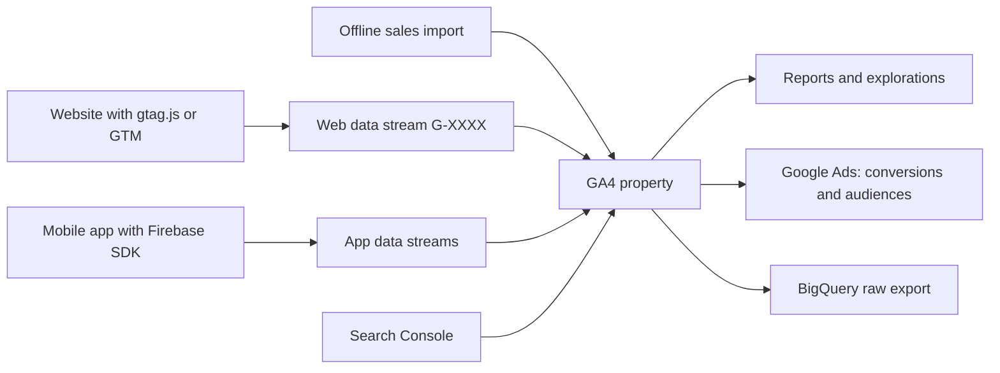
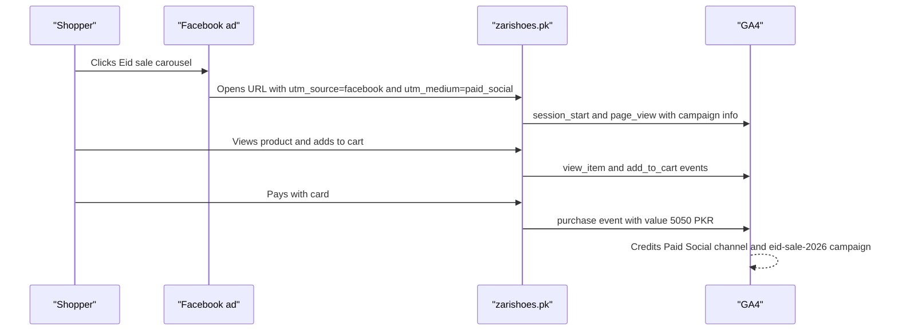
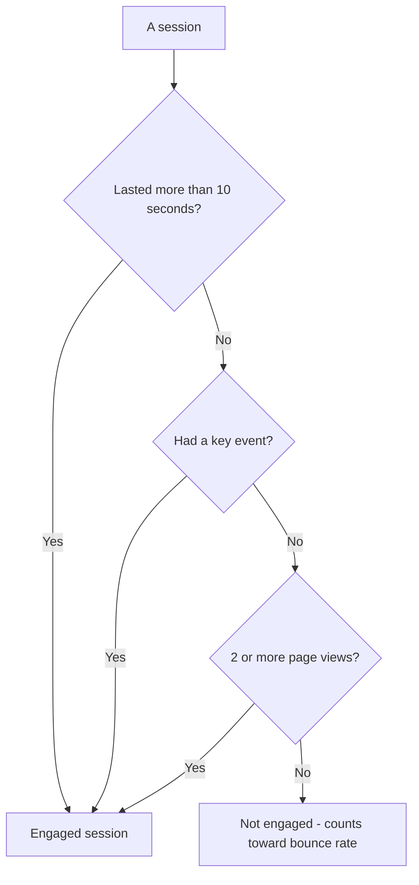
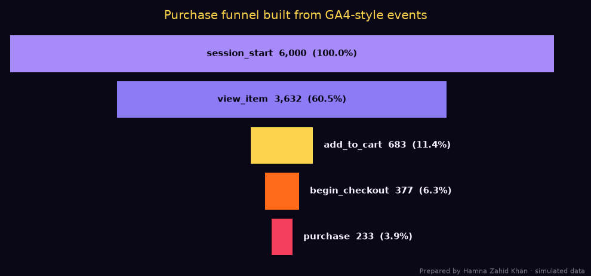
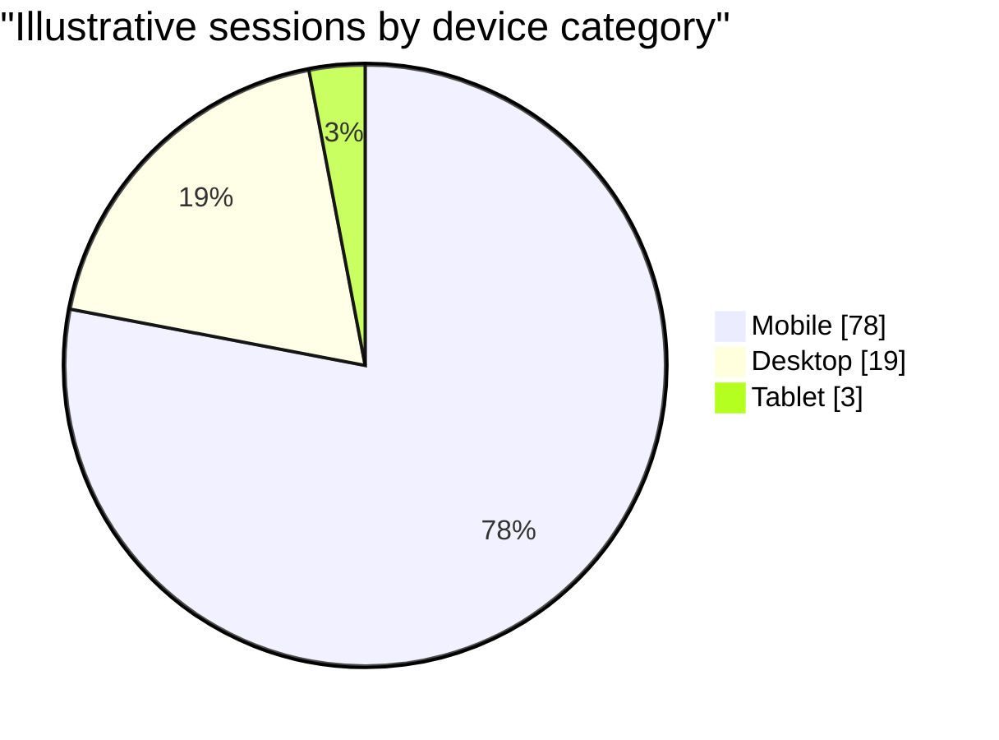

# Session 4 · Google Analytics

> 🏠 [Diploma in Digital Marketing](../../README.md) › [Term 1](../README.md) › [Search and Display Marketing](README.md) › **Session 4**
>
> ⏱ **Estimated time:** 3 hours (1.5 h theory + 1.5 h lab) · 📋 **Prerequisites:** Session 3

[⬅ Previous: Session 3](session-03-google-ads-campaign-types.md) · [Next: Session 5 ➡](session-05-seo-tools-semrush-spyfu-wordstream.md)

---

## 🎯 Learning objectives

By the end of this session you will be able to:

- Explain what **Google Analytics 4 (GA4)** is, how its **event-based** model works and how it differs from the older Universal Analytics.
- Set up a GA4 **property** and **data streams**, and link GA4 with **Google Ads** and **Search Console**.
- Read the core reports: **users, sessions, acquisition (channels, source/medium), engagement, key events (conversions), e-commerce, demographics, technology and real-time**.
- Calculate **engagement rate, bounce rate, conversion rate, revenue per user** and **funnel drop-off** from raw numbers.
- Track campaigns with **UTM parameters** and send custom **events** with gtag.js.
- Use advanced features – **custom dimensions, e-commerce tracking, User-ID, explorations, audiences** – and follow best practices for accurate data.

## 📖 Concepts

### 1. What Google Analytics does

**Google Analytics** is a free tool that measures what people do on your website or app: where they came from, what they looked at, and whether they did what you wanted (buy, sign up, call). Google Ads tells you what happened **before the click**; Google Analytics tells you what happened **after the click**.

**GA4** has been the only standard version since **1 July 2023**, when Universal Analytics (UA) stopped processing data.

| | Universal Analytics (old) | GA4 (current) |
|---|---|---|
| Data model | Sessions and pageviews; separate "hits" | **Everything is an event** with parameters |
| Platforms | Websites (apps separate) | **Web and apps in one property** |
| Main quality metric | Bounce rate | **Engagement rate** (bounce rate = its opposite) |
| Goals | Goals (destination, duration…) | **Key events** (called "conversions" until 2024) |
| Privacy | Cookie-heavy | Consent Mode, modelled data, no IP storage |
| Analysis | Custom reports | **Explorations** (funnel, path, segment overlap) |

### 2. Core building blocks

```text
Google Analytics account  (your organisation)
└── Property  (one business / brand – reports live here, e.g. "Zari Shoes")
    ├── Web data stream      (www.zarishoes.pk  → Measurement ID G-XXXXXXXXXX)
    ├── iOS app data stream
    └── Android app data stream
```

**Data streams** are the pipes that send data into a property. A **web data stream** gives you a **Measurement ID** (starts with `G-`) that you add to every page with **gtag.js** or **Google Tag Manager (GTM)**. **Enhanced measurement** (on by default) automatically tracks page views, scrolls (90%), outbound clicks, site search, video engagement and file downloads.

Offline interactions (e.g. in-store sales) can be imported through **data import** or the **Measurement Protocol**.

### 3. Events, parameters and key events

In GA4 **every interaction is an event**.

| Event type | Examples | Set up by |
|---|---|---|
| **Automatically collected** | `first_visit`, `session_start`, `user_engagement` | Google, automatically |
| **Enhanced measurement** | `page_view`, `scroll`, `click` (outbound), `view_search_results`, `file_download` | Toggle in the data stream |
| **Recommended** | `generate_lead`, `sign_up`, `view_item`, `add_to_cart`, `begin_checkout`, `purchase` | You add, using Google's names |
| **Custom** | `whatsapp_click`, `size_guide_open` | You invent and add |

Each event can carry **parameters** – extra details such as `value`, `currency`, `item_name` or `method`.

A **key event** is any event you mark as important to the business (e.g. `purchase`, `generate_lead`). In Google Ads, key events you import become **conversions** used for bidding.

### 4. Linking other Google services

| Link | What you gain |
|---|---|
| **Google Ads** | Import GA4 key events as Ads conversions; see campaign, ad group and keyword data inside GA4; build remarketing audiences |
| **Search Console** | Organic search queries and landing-page performance in GA4 reports |
| **Merchant Center** | Product performance for Shopping campaigns |
| **BigQuery** (free export) | Raw event data for advanced analysis with SQL |

### 5. Key metrics and reports

#### Users and sessions

| Metric | Meaning |
|---|---|
| **Total users / active users** | People who visited (active = had an engaged session; GA4's main "Users" figure) |
| **New users** | First-time visitors |
| **Sessions** | Visits. A session ends after **30 minutes of inactivity** by default |
| **Engaged session** | A session that lasted **more than 10 seconds**, **or** had a **key event**, **or** had **2+ page/screen views** |
| **Engagement rate** | Engaged sessions ÷ Sessions × 100 |
| **Bounce rate** | 100% − engagement rate (sessions that were *not* engaged) |
| **Average engagement time** | Time the page was actually in focus on the screen |
| **Views** | Page views (web) + screen views (app) |

#### Acquisition – where users came from

| Dimension | Example values |
|---|---|
| **Default channel group** | Organic Search, Paid Search, Organic Social, Paid Social, Email, Referral, Direct, Display, Organic Video |
| **Source** | google, facebook, newsletter, daraz.pk |
| **Medium** | organic, cpc, email, referral, (none) |
| **Campaign** | eid-sale-2026 |

GA4 assigns channels using **source/medium** – which is why consistent **UTM tagging** (section 6) matters.

#### Engagement, monetisation and key events

- **Pages and screens** – which pages get views and engagement.
- **Events** – counts for each event.
- **Key events** – leads, purchases, sign-ups by channel.
- **E-commerce purchases** – item views, add-to-carts, purchases and revenue per product.

#### User attributes and technology

- **Demographics** – country, city, language, age and gender (age/gender only when **Google signals** is enabled and thresholds are met).
- **Tech** – device category (mobile/desktop/tablet), browser, operating system, screen resolution.

#### Real-time

Shows the last **30 minutes**: active users, sources, pages, events and key events. Use it to **test** that tags fire after launching a campaign or a new event.

### 6. UTM parameters – tagging campaign links

Google Ads uses **auto-tagging** (`gclid`), but for every other link (Facebook, Instagram, email, WhatsApp, QR codes) add **UTM parameters**, or GA4 will mislabel the traffic.

| Parameter | Required? | Example | Meaning |
|---|---|---|---|
| `utm_source` | ✅ | facebook | Who sent the traffic |
| `utm_medium` | ✅ | paid_social | The type of channel |
| `utm_campaign` | ✅ | eid-sale-2026 | The campaign name |
| `utm_content` | Optional | carousel-red | Which ad/link/creative |
| `utm_term` | Optional | khussa | Paid keyword |

**Rules:** lowercase everything (`Facebook` and `facebook` show as two sources), use a shared **naming sheet**, never put UTMs on **internal** links (it restarts attribution), and test links before launch.

### 7. Advanced features

| Feature | What it does | Example |
|---|---|---|
| **Custom dimensions and metrics** | Register your own event parameters for reporting | `membership_level`, `tutor_subject` |
| **E-commerce tracking** | Recommended events with an `items` array: `view_item` → `add_to_cart` → `begin_checkout` → `purchase` | Revenue by product and category |
| **Event tracking** | Custom events for important actions | `whatsapp_click`, `calculator_used` |
| **User-ID** | Connect a signed-in user's activity across devices | Logged-in shoppers on app and web |
| **Explorations** | Free-form tables, **funnel**, **path**, segment overlap, cohort and user-lifetime analysis | Where users drop out of checkout |
| **Audiences** | Groups of users for analysis or Google Ads remarketing | "Added to cart, no purchase in 7 days" |
| **Attribution settings** | Data-driven or last-click models for key events | See which channels assist sales |
| **Predictive metrics** | Purchase probability, churn probability (with enough data) | Target likely buyers |

### 8. Best practices

1. **Set clear objectives** – decide the 3–5 key events that matter before installing anything.
2. **Plan your tracking** – a measurement plan listing events, parameters and where they fire.
3. **Regularly review reports** – weekly channel and key-event checks; monthly deep dives.
4. **Use segmentation** – compare new vs returning, mobile vs desktop, city vs city.
5. **Implement A/B testing** – use GA4 data to measure test variants (with a testing tool).
6. **Ensure data accuracy** – exclude internal traffic, filter developer traffic, remove duplicate tags, set **data retention to 14 months** (default is 2), consistent UTMs.
7. **Respect privacy** – consent banner, Consent Mode, no personal data (names, phone numbers, emails) in event parameters or URLs.
8. **Leverage advanced features** – link Ads and Search Console, build audiences, use explorations.

## 🧭 Diagrams

### How data flows into GA4



### What happens when someone clicks a tagged link



### Engaged session decision



## 💻 Worked examples

### Example 1 – Building consistent UTM links

A shoe brand promotes its Eid collection on five channels. The script builds every link, lowercases values and **rejects** mediums that are not on the team's naming list.

📄 `code/session-04_utm_builder.py`

```python
# Build consistent UTM-tagged links so GA4 reports each campaign in the right channel.
# Prepared by Hamna Zahid Khan, Junior Lecturer.
from urllib.parse import urlencode, urlparse, parse_qs

ALLOWED_MEDIUMS = {"cpc", "display", "email", "social", "paid_social", "sms", "affiliate", "qr", "referral"}

def utm(url, source, medium, campaign, content=None, term=None):
    clean = lambda s: s.strip().lower().replace(" ", "-")
    medium = medium.strip().lower().replace(" ", "_")
    if medium not in ALLOWED_MEDIUMS:
        raise ValueError(f"medium '{medium}' is not in the team's naming list {sorted(ALLOWED_MEDIUMS)}")
    params = {"utm_source": clean(source), "utm_medium": medium, "utm_campaign": clean(campaign)}
    if content: params["utm_content"] = clean(content)
    if term: params["utm_term"] = clean(term)
    sep = "&" if urlparse(url).query else "?"
    return url + sep + urlencode(params)

base = "https://www.zarishoes.pk/eid-collection"
plan = [
    ("facebook", "paid_social", "Eid Sale 2026", "carousel-red", None),
    ("instagram", "paid_social", "Eid Sale 2026", "reel-15s", None),
    ("newsletter", "email", "Eid Sale 2026", "hero-button", None),
    ("whatsapp", "sms", "Eid Sale 2026", "broadcast-1", None),
    ("mall-poster", "qr", "Eid Sale 2026", "dolmen-clifton", None),
]
for row in plan:
    print(utm(base, *row))

print("\nParsing one link back (what GA4 reads):")
link = utm(base + "?size=38", "Facebook", "Paid Social", "Eid Sale 2026", "Carousel Red")
print(link)
for k, v in parse_qs(urlparse(link).query).items():
    print(f"  {k:<13}= {v[0]}")

print("\nA bad medium is rejected before it pollutes reports:")
try:
    utm(base, "facebook", "FB-Ads", "eid")
except ValueError as e:
    print("  ERROR:", e)
```

**Output**

```text
https://www.zarishoes.pk/eid-collection?utm_source=facebook&utm_medium=paid_social&utm_campaign=eid-sale-2026&utm_content=carousel-red
https://www.zarishoes.pk/eid-collection?utm_source=instagram&utm_medium=paid_social&utm_campaign=eid-sale-2026&utm_content=reel-15s
https://www.zarishoes.pk/eid-collection?utm_source=newsletter&utm_medium=email&utm_campaign=eid-sale-2026&utm_content=hero-button
https://www.zarishoes.pk/eid-collection?utm_source=whatsapp&utm_medium=sms&utm_campaign=eid-sale-2026&utm_content=broadcast-1
https://www.zarishoes.pk/eid-collection?utm_source=mall-poster&utm_medium=qr&utm_campaign=eid-sale-2026&utm_content=dolmen-clifton

Parsing one link back (what GA4 reads):
https://www.zarishoes.pk/eid-collection?size=38&utm_source=facebook&utm_medium=paid_social&utm_campaign=eid-sale-2026&utm_content=carousel-red
  size         = 38
  utm_source   = facebook
  utm_medium   = paid_social
  utm_campaign = eid-sale-2026
  utm_content  = carousel-red

A bad medium is rejected before it pollutes reports:
  ERROR: medium 'fb-ads' is not in the team's naming list ['affiliate', 'cpc', 'display', 'email', 'paid_social', 'qr', 'referral', 'sms', 'social']
```

**What to notice:** "Facebook" and "Paid Social" were normalised to `facebook` and `paid_social`, and an existing query (`?size=38`) was kept. The bad medium `fb-ads` was rejected – had it gone live, GA4 would have put that traffic in **Unassigned** instead of **Paid Social**.

### Example 2 – Reproducing GA4 reports from raw events

GA4 reports are just counts of events. This script simulates 6,000 sessions for a shoe shop, applies GA4's **engaged-session rule**, and builds a channel report and a purchase funnel.

📄 `code/session-04_ga4_report.py`

```python
# Build GA4-style channel and funnel reports from a small event log, then chart the funnel.
# Prepared by Hamna Zahid Khan, Junior Lecturer. Data is generated with a fixed seed so output repeats.
import random
from collections import defaultdict
import matplotlib
matplotlib.use("Agg")
import matplotlib.pyplot as plt

random.seed(7)
BG, FIRE, GOLD, VIOLET, EMBER, TEXT = "#0A0716", "#FF6B1A", "#FCD34D", "#A78BFA", "#F43F5E", "#F5EEFF"

# channel: (share of sessions, chance of each funnel step continuing, avg seconds)
CHANNELS = {
    "Paid Search":    (0.30, (0.70, 0.22, 0.55, 0.60), 95),
    "Organic Search": (0.28, (0.65, 0.18, 0.55, 0.62), 110),
    "Paid Social":    (0.20, (0.45, 0.10, 0.45, 0.50), 40),
    "Display":        (0.12, (0.30, 0.06, 0.40, 0.45), 18),
    "Email":          (0.10, (0.75, 0.30, 0.60, 0.70), 130),
}
STEPS = ["session_start", "view_item", "add_to_cart", "begin_checkout", "purchase"]
AOV = 4_800  # PKR average order value

sessions = []
for i in range(6000):
    r, acc = random.random(), 0
    for ch, (share, probs, secs) in CHANNELS.items():
        acc += share
        if r <= acc: break
    reached = 1
    for p in probs:
        if random.random() < p: reached += 1
        else: break
    pages = reached if random.random() < 0.65 else reached + 1
    mean = secs if reached > 1 else secs * 0.25      # one-page visits are usually short
    seconds = max(1, int(random.expovariate(1 / mean)))
    engaged = seconds > 10 or pages >= 2 or reached == 5      # GA4 engaged-session rule
    sessions.append((ch, reached, engaged, seconds))

rep = defaultdict(lambda: [0, 0, 0, 0])
for ch, reached, engaged, secs in sessions:
    r = rep[ch]; r[0] += 1; r[1] += engaged; r[2] += reached == 5; r[3] += secs
print(f"{'Channel':<16}{'Sessions':>9}{'Engaged':>9}{'Eng.rate':>9}{'Bounce':>8}{'Purch.':>7}{'CR%':>6}{'Revenue PKR':>13}")
for ch in CHANNELS:
    s, e, p, secs = rep[ch]
    print(f"{ch:<16}{s:>9,}{e:>9,}{e/s:>9.1%}{1-e/s:>8.1%}{p:>7}{p/s*100:>6.2f}{p*AOV:>13,}")
S = len(sessions); E = sum(x[2] for x in sessions); P = sum(x[1] == 5 for x in sessions)
print(f"{'All':<16}{S:>9,}{E:>9,}{E/S:>9.1%}{1-E/S:>8.1%}{P:>7}{P/S*100:>6.2f}{P*AOV:>13,}")

print("\nPurchase funnel (all channels):")
counts = [sum(x[1] >= k for x in sessions) for k in range(1, 6)]
for i, (step, c) in enumerate(zip(STEPS, counts)):
    drop = "" if i == 0 else f"  ({c/counts[i-1]:.0%} of previous step, drop-off {1-c/counts[i-1]:.0%})"
    print(f"  {step:<15}{c:>6,}{drop}")

fig, ax = plt.subplots(figsize=(9, 4.2), facecolor=BG)
ax.set_facecolor(BG)
cols = [VIOLET, "#8B7CF6", GOLD, FIRE, EMBER]
for i, (step, c) in enumerate(zip(STEPS, counts)):
    w = c / counts[0]
    ax.barh(len(STEPS) - 1 - i, w, left=(1 - w) / 2, color=cols[i], height=0.8)
    label = f"{step}  {c:,}  ({c/counts[0]:.1%})"
    if w > 0.45:   # wide bar: label inside
        ax.text(0.5, len(STEPS) - 1 - i, label, ha="center", va="center", color=BG, fontsize=10, fontweight="bold")
    else:          # narrow bar: label to the right so it stays readable
        ax.text(0.5 + w / 2 + 0.02, len(STEPS) - 1 - i, label, ha="left", va="center", color=TEXT, fontsize=10, fontweight="bold")
ax.set_xlim(0, 1.05)
ax.axis("off")
ax.set_title("Purchase funnel built from GA4-style events", color=GOLD, fontsize=13)
fig.text(0.99, 0.01, "Prepared by Hamna Zahid Khan · simulated data", color=TEXT, alpha=0.5, ha="right", fontsize=7)
plt.tight_layout(); plt.savefig("session-04_ga4_funnel.png", dpi=110, facecolor=BG)
print("Saved session-04_ga4_funnel.png")
```

**Output**

```text
Channel          Sessions  Engaged Eng.rate  Bounce Purch.   CR%  Revenue PKR
Paid Search         1,835    1,702    92.8%    7.2%     94  5.12      451,200
Organic Search      1,675    1,547    92.4%    7.6%     60  3.58      288,000
Paid Social         1,217      928    76.3%   23.7%     18  1.48       86,400
Display               685      403    58.8%   41.2%      1  0.15        4,800
Email                 588      553    94.0%    6.0%     60 10.20      288,000
All                 6,000    5,133    85.5%   14.4%    233  3.88    1,118,400

Purchase funnel (all channels):
  session_start   6,000
  view_item       3,632  (61% of previous step, drop-off 39%)
  add_to_cart       683  (19% of previous step, drop-off 81%)
  begin_checkout    377  (55% of previous step, drop-off 45%)
  purchase          233  (62% of previous step, drop-off 38%)
Saved session-04_ga4_funnel.png
```



**Reading the reports:**

- **Email** converts best (10.2%) – these are existing fans. Grow the list.
- **Paid Search** brings the most revenue: high intent.
- **Display** has the lowest engagement (58.8%) and almost no purchases – check placements (Session 3).
- The biggest leak is **view_item → add_to_cart (81% drop)**. Fix product pages first: clearer size guide, delivery time, return policy, reviews, Cash on Delivery badge.

**Hand-check a few numbers:** Email engagement rate = 553 ÷ 588 × 100 = **94.0%**; bounce = 100 − 94.0 = **6.0%**; conversion rate = 60 ÷ 588 × 100 = **10.20%**; revenue = 60 × 4,800 = **PKR 288,000**.

### Example 3 – Sending events with gtag.js

`code/session-04_ga4_events.html` is a one-page demo product page. It loads gtag.js with Consent Mode defaults set to *denied*, fires a `view_item` event on load, and sends `add_to_cart`, `purchase` and `generate_lead` events on button clicks. Every event is also printed on the page so you can see what was sent.

📄 `code/session-04_ga4_events.html`

```html
<!DOCTYPE html>
<html lang="en">
<head>
  <meta charset="utf-8">
  <meta name="viewport" content="width=device-width, initial-scale=1">
  <title>GA4 event tracking demo · Zari Shoes</title>
  <!-- Prepared by Hamna Zahid Khan, Junior Lecturer.
       Replace G-XXXXXXXXXX with your own Measurement ID (Admin > Data streams > Web).
       In a real site, load this tag only after the visitor accepts analytics cookies where the law requires consent. -->
  <script async src="https://www.googletagmanager.com/gtag/js?id=G-XXXXXXXXXX"></script>
  <script>
    window.dataLayer = window.dataLayer || [];
    function gtag(){dataLayer.push(arguments);}
    // Consent Mode: start with analytics and ads storage denied until the banner is accepted
    gtag('consent', 'default', {analytics_storage: 'denied', ad_storage: 'denied',
                                ad_user_data: 'denied', ad_personalization: 'denied'});
    gtag('js', new Date());
    gtag('config', 'G-XXXXXXXXXX', {debug_mode: true}); // debug_mode shows events in DebugView
  </script>
  <style>
    body{font-family:system-ui,sans-serif;max-width:640px;margin:2rem auto;padding:0 1rem;background:#0A0716;color:#F5EEFF}
    button{background:#FF6B1A;color:#0A0716;border:0;padding:.7rem 1.2rem;border-radius:8px;font-weight:700;margin:.3rem;cursor:pointer}
    #log{background:#1a1430;padding:1rem;border-radius:8px;font-family:monospace;font-size:.85rem;min-height:4rem}
  </style>
</head>
<body>
  <h1>Khussa · Red Velvet · PKR 4,800</h1>
  <p id="banner">We use analytics cookies to improve this site. <button id="accept">Accept</button></p>
  <button id="cart">Add to cart</button>
  <button id="buy">Buy now</button>
  <button id="lead">Ask on WhatsApp</button>
  <h3>Events sent</h3>
  <div id="log"></div>
  <script>
    const item = {item_id: 'KH-RV-38', item_name: 'Red Velvet Khussa', item_category: 'Footwear', price: 4800, quantity: 1};
    const log = (name, params) => {
      gtag('event', name, params);
      document.getElementById('log').innerHTML += name + ' ' + JSON.stringify(params) + '<br>';
    };
    document.getElementById('accept').onclick = () => {
      gtag('consent', 'update', {analytics_storage: 'granted'});
      document.getElementById('banner').textContent = 'Thanks - analytics enabled.';
    };
    log('view_item', {currency: 'PKR', value: 4800, items: [item]});           // recommended e-commerce event
    document.getElementById('cart').onclick = () => log('add_to_cart', {currency: 'PKR', value: 4800, items: [item]});
    document.getElementById('buy').onclick = () => log('purchase', {
      transaction_id: 'T' + Date.now(), currency: 'PKR', value: 5050, shipping: 250, items: [item]});
    document.getElementById('lead').onclick = () => log('generate_lead', {currency: 'PKR', value: 500, method: 'whatsapp'});
  </script>
</body>
</html>
```

**To try it with real data:** create a free GA4 property, replace both `G-XXXXXXXXXX` with your Measurement ID, open the file through a local server (`python -m http.server` in the `code/` folder, then visit `http://localhost:8000/session-04_ga4_events.html`), click **Accept**, click the buttons, and watch **Admin › DebugView** in GA4.

### Example 4 – Setting up GA4 for a small business (walkthrough)

Business: **Karachi Kitchenware**, a WooCommerce store.

1. **Create** an account → property "Karachi Kitchenware" → time zone **(GMT+05:00) Karachi**, currency **PKR**.
2. **Add a web data stream** for `karachikitchenware.pk`; keep **enhanced measurement** on.
3. **Install the tag** – via GTM or the store's GA4 plugin; confirm in **Real-time**.
4. **E-commerce events** – make sure the plugin sends `view_item`, `add_to_cart`, `begin_checkout`, `purchase` with `value`, `currency`, `items`.
5. **Mark key events** – `purchase`, `generate_lead` (WhatsApp enquiry).
6. **Data settings** – data retention **14 months**; define **internal traffic** (office IP) and activate the filter.
7. **Links** – Google Ads (import key events as conversions), Search Console, Merchant Center.
8. **Consent** – cookie banner with Consent Mode.
9. **Audiences** – "Cart abandoners 7 days", "Purchasers 30 days" (exclude from prospecting).
10. **Explorations** – a funnel exploration for checkout; review weekly.

## 📊 Chart · Sessions by device for a typical Pakistani retail site (illustrative)



A mobile-heavy audience means: test every campaign landing page on a mid-range Android phone over 4G, not just on a laptop.

## 📋 Template · Measurement plan

| Business objective | KPI | GA4 event / key event | Parameters | Where it fires | Owner |
|---|---|---|---|---|---|
| Sell online | Purchases, revenue | `purchase` ✅ key | value, currency, transaction_id, items | Order confirmation | Developer |
| Generate enquiries | Leads | `generate_lead` ✅ key | method (form / whatsapp) | Form success, WhatsApp click | Marketer |
| Build list | Sign-ups | `sign_up` | method | Newsletter form | Marketer |
| Improve product pages | Add-to-cart rate | `add_to_cart` | items | Add to cart button | Developer |
| | | | | | |

## ⚠️ Common mistakes

| Mistake | Consequence | Fix |
|---|---|---|
| Installing the tag twice (plugin + GTM) | Double page views, fake low bounce | Check with Tag Assistant; keep one |
| Leaving data retention at 2 months | Explorations can't look back far | Set 14 months on day one |
| UTMs on internal banners | Self-referrals; original source lost | Use internal promotion tracking instead |
| Mixed-case UTMs | Split rows in reports | Lowercase naming sheet |
| Personal data in URLs or events | Breaks Google policy and privacy law | Never send names, phones, emails |
| Not marking key events | No conversion data for Ads bidding | Mark the 3–5 key events |
| Reading only totals | Hides channel and device problems | Segment by channel, device, city |

## 🧪 Lab / practice tasks

**Task 1 (easy) – Explore the demo account.** Open Google's free **GA4 demo account** (Google Merchandise Store – search "GA4 demo account"). Record for the last 28 days: users, sessions, engagement rate, top 3 channels and the top city.

<details><summary>💡 Hint</summary>

Reports › Acquisition › Traffic acquisition for channels; Reports › User › User attributes › Demographic details for cities.

</details>

**Task 2 (easy) – Calculate.** A site had 12,000 sessions, 7,800 engaged sessions, 240 purchases and PKR 1,080,000 revenue from 9,500 users. Calculate engagement rate, bounce rate, session conversion rate, average order value and revenue per user.

<details><summary>✅ Solution</summary>

Engagement rate = 7,800 ÷ 12,000 × 100 = **65%** · Bounce rate = **35%** · Conversion rate = 240 ÷ 12,000 × 100 = **2%** · AOV = 1,080,000 ÷ 240 = **PKR 4,500** · Revenue per user = 1,080,000 ÷ 9,500 ≈ **PKR 113.7**.

</details>

**Task 3 (medium) – Tag a campaign.** Using `code/session-04_utm_builder.py`, create links for a university open-day campaign promoted through LinkedIn ads, an email to alumni, a WhatsApp broadcast and a newspaper QR code. Add `paid_social` and `qr` style mediums and explain each choice.

**Task 4 (medium) – Funnel diagnosis.** Change the probability for Paid Social's `add_to_cart` step in `code/session-04_ga4_report.py` from 0.10 to 0.20. How do purchases and revenue change for Paid Social? What real-world change could cause that?

<details><summary>💡 Hint</summary>

Run before and after and compare the Paid Social row. Real-world causes: a landing page that matches the ad exactly, visible prices and sizes, a "Cash on Delivery available" badge, social proof from reviews.

</details>

**Task 5 (challenge) – Measurement plan.** Write a complete measurement plan (use the template) for an Islamabad driving school with online booking, a WhatsApp button and a fees page. Include at least 6 events, mark the key events, list parameters, and describe two audiences you would build for Google Ads.

<details><summary>✅ Model answer</summary>

Events: `page_view` (auto), `view_fees` (custom, on fees page), `whatsapp_click` (custom, param `page`), `begin_booking` (custom), `generate_lead` ✅ (booking form submit, params `course`, `branch`), `purchase` ✅ (online advance payment, params `value`, `currency`=PKR, `transaction_id`), `file_download` (auto, route maps). Audiences: (1) "Viewed fees but no booking – 14 days" for remarketing with a "first lesson discount"; (2) "Booked in last 60 days" to **exclude** from prospecting. Settings: internal-traffic filter for the office, 14-month retention, Ads and Search Console links, Consent Mode.

</details>

## ✅ Quick quiz

1. In GA4, every interaction is recorded as:
   a) a hit b) an event c) a goal d) a pageview only
2. Which session is **engaged**?
   a) 6 seconds, 1 page, no key event b) 4 seconds, 2 page views c) 3 seconds, 1 page d) none of these
3. If engagement rate is 62%, bounce rate is:
   a) 62% b) 38% c) 100% d) cannot be known
4. Which UTM parameter describes the **type** of channel (cpc, email)?
   a) utm_source b) utm_campaign c) utm_medium d) utm_content
5. A key event in GA4 is:
   a) any page view b) an event you mark as important, which can be imported to Google Ads as a conversion c) only purchases d) a Search Console query

<details><summary>Show answers</summary>

1-b · 2-b · 3-b · 4-c · 5-b

</details>

## 📝 Summary

- **GA4** is event-based, covers web + app, and replaced Universal Analytics in July 2023.
- **Account → property → data streams**; add the Measurement ID via gtag.js or GTM.
- **Engaged session** = > 10 s, or a key event, or 2+ views; **bounce rate = 100% − engagement rate**.
- **Acquisition** reports rely on source/medium – tag every non-Google-Ads link with **lowercase UTMs**.
- **Key events** become Google Ads conversions; link Ads, Search Console and Merchant Center.
- Advanced: custom dimensions, e-commerce events, User-ID, explorations, audiences, attribution.
- Data accuracy and privacy are part of the setup, not an afterthought.

**Formulas:** Engagement rate = Engaged sessions ÷ Sessions × 100 · Bounce rate = 100 − engagement rate · Conversion rate = Key events ÷ Sessions × 100 · AOV = Revenue ÷ Purchases · Revenue per user = Revenue ÷ Users · Step conversion = Users at step ÷ Users at previous step × 100.

**Interview / viva questions**

1. What is the difference between a user, a session and an event in GA4?
2. How does GA4 decide whether a session is engaged?
3. Why do UTM parameters matter, and what are the three required ones?
4. Which GA4 settings would you change on day one for a new client?
5. How would you find where users drop out of a checkout?
6. Explain the difference between Google Ads data and GA4 data for the same campaign.

---

[⬅ Previous: Session 3](session-03-google-ads-campaign-types.md) · [Next: Session 5 ➡](session-05-seo-tools-semrush-spyfu-wordstream.md)

<sub>Prepared by **Hamna Zahid Khan**, Junior Lecturer · Diploma in Digital Marketing</sub>
