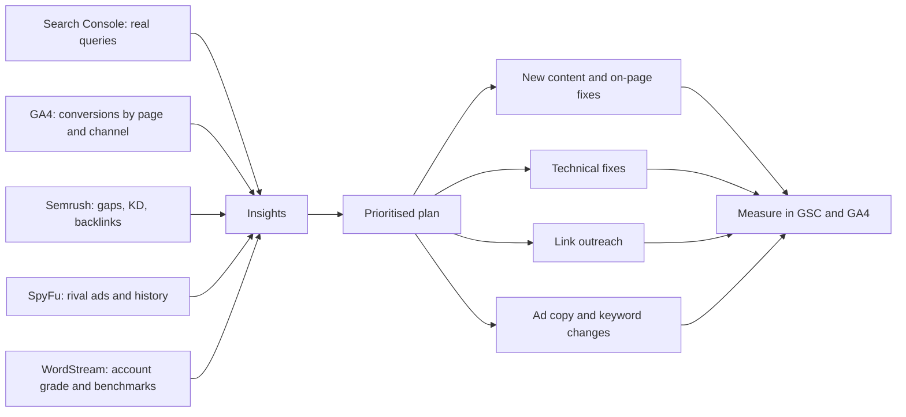
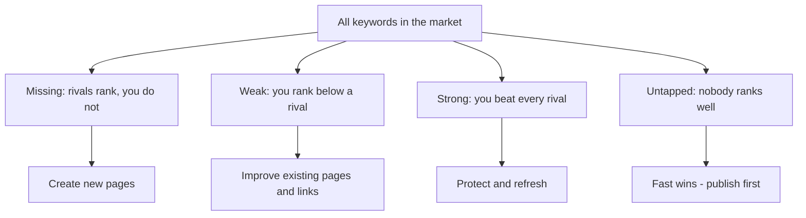
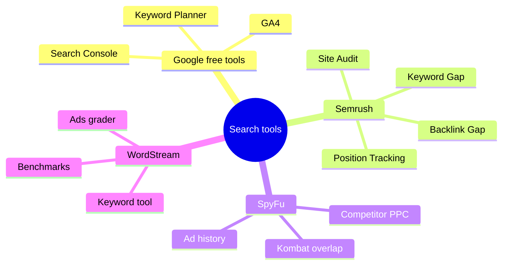
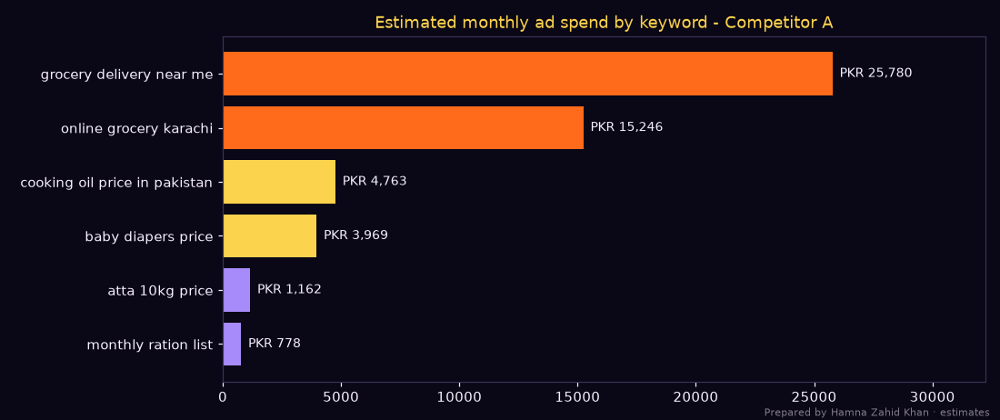
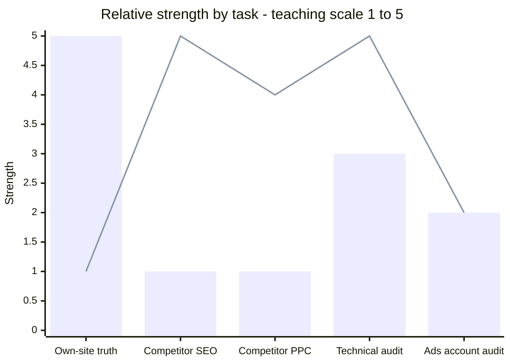

# Session 5 · SEO and Competitor Tools: Semrush, SpyFu, WordStream

> 🏠 [Diploma in Digital Marketing](../../README.md) › [Term 1](../README.md) › [Search and Display Marketing](README.md) › **Session 5**
>
> ⏱ **Estimated time:** 3 hours (1.5 h theory + 1.5 h lab) · 📋 **Prerequisites:** Sessions 1-4

[⬅ Previous: Session 4](session-04-google-analytics.md) · [Next: Search and Display Marketing practice test ➡](practice-test.md)

---

## 🎯 Learning objectives

By the end of this session you will be able to:

- Summarise **how search engines work** – crawling, indexing, retrieval and ranking – and why it matters to both SEO and paid search.
- Explain the four core **SEO strategies**: keyword research, on-page optimisation, technical optimisation and link building.
- Describe the main **SEO and SEM tools** and choose the right one for a task: Google Analytics, Google Search Console, **Semrush**, **SpyFu** and **WordStream**.
- Run a **keyword gap** analysis and an estimate of a **competitor's ad spend** with real calculations.
- Compare **Semrush and Google Analytics** and explain why marketers use both.
- Apply **SEO best practices** and turn tool data into a prioritised action plan.

## 📖 Concepts

### 1. How a search engine works (the four steps)

Module 3 introduced crawl → index → rank. For tools work, it helps to split ranking into two parts:

| Step | What happens | What the tools show you |
|---|---|---|
| **1. Crawling** | Bots follow links and sitemaps to discover pages | Site-audit crawlers (Semrush Site Audit, Screaming Frog) imitate this to find broken links and blocked pages |
| **2. Indexing** | Pages are analysed and stored | Search Console › Pages shows indexed vs not-indexed pages and why |
| **3. Retrieval** | For a query, the engine pulls candidate pages that could match | Keyword tools estimate which queries your pages appear for |
| **4. Ranking** | Candidates are ordered by relevance, quality, usability and context | Rank trackers and Search Console's average position |

Paid ads run the **same idea** in parallel: retrieve ads whose keywords match, then rank them by Ad Rank (Session 2). Both organic and paid tools are therefore trying to answer the same question: *"For which searches do we and our competitors appear, and how well?"*

### 2. Core SEO strategies

| Strategy | Goal | Key actions | Tools |
|---|---|---|---|
| **Keyword research** | Find what customers search | Seed → expand → measure volume, difficulty, CPC → intent → map to pages | Keyword Planner, Semrush Keyword Magic Tool, SpyFu, WordStream free keyword tool |
| **On-page optimisation** | Make each page relevant and clickable | Titles, meta descriptions, headings, content depth, images, internal links, structured data | Semrush On Page SEO Checker, Search Console |
| **Technical optimisation** | Make the site crawlable, fast and mobile-friendly | Fix errors, speed, Core Web Vitals, HTTPS, sitemaps, canonicals | Search Console, PageSpeed Insights, Semrush Site Audit |
| **Link building** | Earn authority and trust | Digital PR, guest expertise, local directories, partnerships, broken-link outreach | Semrush Backlink Analytics / Backlink Gap, Ahrefs, Moz |

### 3. The toolkit at a glance

| Tool | Data source | Cost | Best at |
|---|---|---|---|
| **Google Analytics 4** | Tag on **your** site | Free | What visitors do after arriving; conversions and revenue by channel |
| **Google Search Console** | Google's own search data for **your** site | Free | Real queries, impressions, clicks, CTR, position; indexing problems |
| **Google Ads Keyword Planner** | Google Ads data | Free with an Ads account | Volume ranges, CPC bids, keyword ideas |
| **Semrush** | Its own crawlers and clickstream-based estimates for **any** site | Paid (limited free) | All-in-one SEO + PPC + content + competitor research |
| **SpyFu** | Its own SERP and ad history database for **any** site | Paid (limited free) | Competitor keyword and ad-copy history, especially for PPC |
| **WordStream** | Your Google/Microsoft Ads account + its benchmarks | Free tools + paid software | Simplifying PPC: account grader, keyword tool, benchmarks, management |

> **Golden rule:** Google's own tools (GA4, Search Console, Ads) show **real data for your site**. Third-party tools (Semrush, SpyFu, WordStream benchmarks) show **estimates** – excellent for **comparing** and **spying on competitors**, not for reporting exact numbers to a client.

### 4. Semrush

**Semrush** is an all-in-one visibility platform with country databases (including **Pakistan**) for organic and paid search.

| Toolkit | Key tools | What you can do |
|---|---|---|
| **Competitive research** | Domain Overview, Organic Research, Traffic Analytics | Estimate any domain's organic and paid traffic, top pages and top keywords |
| **Keyword research** | Keyword Magic Tool, Keyword Overview, **Keyword Gap** | Find thousands of variations with volume, KD%, CPC, intent; compare up to five domains |
| **Link building** | Backlink Analytics, **Backlink Gap**, Link Building Tool | See who links to competitors but not to you |
| **On-page & technical** | **Site Audit**, On Page SEO Checker | Crawl your site for 100+ issues; get page-level ideas |
| **Rank tracking** | Position Tracking | Daily rankings by city/device |
| **Advertising** | Advertising Research, PLA Research | See competitors' paid keywords, ad copies and estimated spend |
| **Content** | Topic Research, SEO Writing Assistant | Plan and score content |

**Benefits:** enhanced online visibility, increased conversions through better targeting, refined content strategy, informed decision-making, and a competitive edge from seeing rivals' strategies.

**Semrush vs Google Analytics**

| | Semrush | Google Analytics 4 |
|---|---|---|
| Focus | Search visibility – yours **and competitors'** | Behaviour **on your own** site/app |
| Data | Estimates from crawlers and panels | Measured events from your tag |
| Answers | "Which keywords should we target? Who ranks? Who links to them?" | "Which channel brought buyers? Where do users drop off?" |
| Competitor insight | ✅ Strong | ❌ None |
| Conversions & revenue | ❌ | ✅ |
| Typical user | SEO/PPC strategist, content planner | Analyst, marketer, product owner |
| Cost | Paid | Free |

Use them together: Semrush to **decide what to target**, GA4 and Search Console to **prove what worked**.

### 5. SpyFu

**SpyFu** focuses on **competitor intelligence**: type a competitor's domain and see the keywords it buys on Google Ads, the keywords it ranks for organically, and **years of history** of its ads and rankings.

| Feature | Use |
|---|---|
| **Competitor research overview** | Estimated organic and paid keywords, clicks and monthly ad budget |
| **PPC keywords and ad history** | Every ad text a competitor has tested and how long it ran – long-running ads are probably profitable |
| **Kombat (keyword overlap)** | Venn view of keywords shared by up to three domains – find gaps |
| **SEO keywords and ranking history** | See when a competitor gained or lost positions |
| **Keyword research** | Related keywords, questions, CPC |
| **Backlink outreach and reports** | Prospects and white-label reports for clients |

**Benefits:** competitive edge, enhanced SEO, optimised Google Ads campaigns (learn from rivals' tested ad copy), content strategy ideas and efficiency gains.
**Caution:** SpyFu's coverage is strongest for the United States and a few other large markets. For Pakistan-focused keywords, check the country selector and treat numbers as rough.

### 6. WordStream

**WordStream** (owned by LocaliQ, part of Gannett, since 2018) is known for making **PPC simpler** for small businesses.

| Offering | What it does |
|---|---|
| **Free Google Ads Performance Grader** | Audits an Ads account: wasted spend, Quality Score, CTR, mobile, best practices |
| **Free Keyword Tool** | Keyword ideas with volume, CPC and competition by industry and location |
| **Free Facebook / Instagram ads grader** | Similar audit for Meta ads |
| **PPC industry benchmarks** | Published average CTR, CPC, CR and CPA by industry – useful starting points |
| **Management software ("Advisor")** | Guided to-do lists ("20-minute work week" style), reporting and optimisation tips |
| **Learning content** | Guides on Google Ads, landing pages and copywriting |

**Benefits:** enhanced visibility, improved conversions, efficient Ads management, high-quality content production, data-driven insights. **Caution:** benchmark averages come mostly from US/English-language accounts – use them as a rough reference, and compare your account **with its own past** first.

### 7. Choosing the right tool – quick guide

| Question | Best tool |
|---|---|
| "Which queries do we actually appear for?" | Search Console |
| "Which channel brought revenue last month?" | GA4 |
| "How many people search for 'bridal lehenga price'?" | Keyword Planner / Semrush |
| "What keywords does our rival rank for that we don't?" | Semrush Keyword Gap / SpyFu Kombat |
| "What ads has our rival tested over two years?" | SpyFu ad history |
| "Is our Google Ads account wasting money?" | WordStream Performance Grader + Ads Recommendations |
| "Which pages have broken links or missing titles?" | Semrush Site Audit / Screaming Frog |
| "Who links to competitors but not us?" | Semrush Backlink Gap / Ahrefs |

### 8. SEO best practices

1. **Create high-quality content** that fully answers the searcher's question and shows real experience (E-E-A-T).
2. **Optimise usability** – fast, mobile-friendly pages with clear navigation and calls to action.
3. **Do keyword research before writing** – one primary keyword per page, mapped in a sheet.
4. **Earn quality backlinks** – relevant, editorial links beat large numbers of weak ones.
5. **Stay updated on algorithms** – follow Google Search Central and industry news; check rankings after major updates.
6. **Leverage SEO tools wisely** – Google tools for truth, third-party tools for comparison and ideas.
7. **Connect SEO and PPC** – share keyword and conversion data between teams.

## 🧭 Diagrams

### From tool data to action



### Keyword gap logic



### How the tools divide the job



## 💻 Worked examples

### Example 1 – Keyword gap for an online grocery store

You run an online grocery site in Karachi. Two competitors rank for many keywords you don't. The script does what Semrush's **Keyword Gap** and SpyFu's **Kombat** do: compare keyword sets and sort them into actions.

📄 `code/session-05_keyword_gap.py`

```python
# Keyword gap analysis - the idea behind Semrush "Keyword Gap" and SpyFu "Kombat".
# Prepared by Hamna Zahid Khan, Junior Lecturer. Rankings and volumes are illustrative.

# keyword: (monthly volume, keyword difficulty 0-100)
KW = {
    "online grocery karachi": (6600, 41), "grocery delivery near me": (9900, 55),
    "atta 10kg price": (4400, 18), "cooking oil price in pakistan": (8100, 24),
    "fresh vegetables home delivery": (2900, 22), "monthly ration list": (3600, 12),
    "organic honey pakistan": (1900, 20), "baby diapers price": (5400, 30),
    "same day grocery delivery lahore": (1300, 28), "best basmati rice brand": (2400, 26),
    "frozen chicken home delivery": (1600, 15), "ramzan ration bag price": (2900, 14),
}
# your site and two competitors: keyword -> ranking position
you = {"online grocery karachi": 7, "atta 10kg price": 14, "organic honey pakistan": 3,
       "fresh vegetables home delivery": 22}
comp_a = {"online grocery karachi": 2, "grocery delivery near me": 4, "atta 10kg price": 3,
          "cooking oil price in pakistan": 5, "monthly ration list": 6, "baby diapers price": 8}
comp_b = {"online grocery karachi": 5, "cooking oil price in pakistan": 2, "fresh vegetables home delivery": 4,
          "monthly ration list": 3, "best basmati rice brand": 7, "same day grocery delivery lahore": 9}
competitors = {"Competitor A": comp_a, "Competitor B": comp_b}

all_comp = set(comp_a) | set(comp_b)
missing = sorted(all_comp - set(you), key=lambda k: -KW[k][0])
weak = sorted([k for k in you if k in all_comp and you[k] > min(c.get(k, 99) for c in competitors.values())],
              key=lambda k: -KW[k][0])
strong = [k for k in you if all(you[k] <= c.get(k, 99) for c in competitors.values())]
untapped = sorted(set(KW) - set(you) - all_comp)

def show(title, keys):
    print(f"\n{title} ({len(keys)})")
    for k in keys:
        vol, kd = KW[k]
        ranks = "  ".join(f"{n[-1]}:#{c[k]}" if k in c else f"{n[-1]}:-" for n, c in competitors.items())
        print(f"  {k:<36}vol {vol:>5,}  KD {kd:>2}  you:{'#'+str(you[k]) if k in you else '-':<4} {ranks}")

show("MISSING - competitors rank, you don't", missing)
show("WEAK - you rank below a competitor", weak)
show("STRONG - you beat every competitor", strong)
show("UNTAPPED - nobody in this set ranks", untapped)

print("\nPriority score for missing keywords = volume / (KD + 10):")
for k in sorted(missing, key=lambda k: -KW[k][0] / (KW[k][1] + 10))[:4]:
    vol, kd = KW[k]
    print(f"  {k:<36}{vol / (kd + 10):>7.1f}")
```

**Output**

```text

MISSING - competitors rank, you don't (6)
  grocery delivery near me            vol 9,900  KD 55  you:-    A:#4  B:-
  cooking oil price in pakistan       vol 8,100  KD 24  you:-    A:#5  B:#2
  baby diapers price                  vol 5,400  KD 30  you:-    A:#8  B:-
  monthly ration list                 vol 3,600  KD 12  you:-    A:#6  B:#3
  best basmati rice brand             vol 2,400  KD 26  you:-    A:-  B:#7
  same day grocery delivery lahore    vol 1,300  KD 28  you:-    A:-  B:#9

WEAK - you rank below a competitor (3)
  online grocery karachi              vol 6,600  KD 41  you:#7   A:#2  B:#5
  atta 10kg price                     vol 4,400  KD 18  you:#14  A:#3  B:-
  fresh vegetables home delivery      vol 2,900  KD 22  you:#22  A:-  B:#4

STRONG - you beat every competitor (1)
  organic honey pakistan              vol 1,900  KD 20  you:#3   A:-  B:-

UNTAPPED - nobody in this set ranks (2)
  frozen chicken home delivery        vol 1,600  KD 15  you:-    A:-  B:-
  ramzan ration bag price             vol 2,900  KD 14  you:-    A:-  B:-

Priority score for missing keywords = volume / (KD + 10):
  cooking oil price in pakistan         238.2
  monthly ration list                   163.6
  grocery delivery near me              152.3
  baby diapers price                    135.0
```

**From output to plan:**

| Priority | Keyword | Action | Why |
|---|---|---|---|
| 1 | cooking oil price in pakistan | New price-comparison page, updated weekly | High volume, KD 24, both rivals rank |
| 2 | monthly ration list | Downloadable ration checklist + "add whole list to cart" | KD 12, strong buyer intent |
| 3 | ramzan ration bag price | Seasonal landing page published 6 weeks before Ramzan | Untapped – nobody ranks yet |
| 4 | atta 10kg price | Improve the existing page (you're #14): price table, brands, reviews, internal links | Weak – close to page 1 |
| 5 | online grocery karachi | Strengthen home page, get local links and reviews | Weak – head term worth defending |
| Hold | grocery delivery near me | Local SEO (Business Profile) + paid search | KD 55, "near me" intent favours local pack and ads |

**Priority score check:** cooking oil = 8,100 ÷ (24 + 10) = **238.2**; monthly ration list = 3,600 ÷ (12 + 10) = **163.6**.

### Example 2 – Estimating a competitor's Google Ads spend

SpyFu and Semrush Advertising Research estimate competitor budgets with the logic below: *searches × share of auctions the ad appeared in × CTR at its position × CPC*.

📄 `code/session-05_competitor_ppc_estimate.py`

```python
# Estimate a competitor's monthly Google Ads clicks and spend, the way SpyFu-style tools do.
# Prepared by Hamna Zahid Khan, Junior Lecturer. Estimates only - tools model these from samples.
import matplotlib
matplotlib.use("Agg")
import matplotlib.pyplot as plt

BG, FIRE, GOLD, VIOLET, TEXT = "#0A0716", "#FF6B1A", "#FCD34D", "#A78BFA", "#F5EEFF"
AD_CTR = {1: 0.07, 2: 0.035, 3: 0.02, 4: 0.012}   # illustrative CTR by ad position
SHARE_SHOWN = 0.6                                 # share of searches where the ad actually appeared

# keyword: (monthly searches, observed ad position, average CPC in PKR)
seen_ads = {
    "grocery delivery near me": (9900, 1, 62),
    "online grocery karachi": (6600, 1, 55),
    "cooking oil price in pakistan": (8100, 2, 28),
    "baby diapers price": (5400, 2, 35),
    "monthly ration list": (3600, 3, 18),
    "atta 10kg price": (4400, 3, 22),
}

rows = []
for kw, (vol, pos, cpc) in seen_ads.items():
    clicks = vol * SHARE_SHOWN * AD_CTR[pos]
    rows.append((kw, vol, pos, cpc, clicks, clicks * cpc))
rows.sort(key=lambda r: -r[5])

print(f"{'Keyword':<32}{'Vol':>7}{'Pos':>4}{'CPC':>5}{'Clicks':>8}{'Spend PKR':>11}")
for kw, vol, pos, cpc, clk, spend in rows:
    print(f"{kw:<32}{vol:>7,}{pos:>4}{cpc:>5}{clk:>8.0f}{spend:>11,.0f}")
tc, ts = sum(r[4] for r in rows), sum(r[5] for r in rows)
print(f"{'TOTAL':<32}{'':>16}{tc:>8.0f}{ts:>11,.0f}")
print(f"\nEstimated competitor budget: about PKR {ts:,.0f}/month, PKR {ts/30:,.0f}/day")
print(f"Top 2 keywords take {sum(r[5] for r in rows[:2]) / ts:.0%} of the estimated spend")

fig, ax = plt.subplots(figsize=(10, 4.2), facecolor=BG)
ax.set_facecolor(BG); ax.tick_params(colors=TEXT)
for s in ax.spines.values(): s.set_color("#3b3355")
names = [r[0] for r in rows][::-1]
ax.barh(names, [r[5] for r in rows][::-1], color=[FIRE, FIRE, GOLD, GOLD, VIOLET, VIOLET][::-1])
for i, v in enumerate([r[5] for r in rows][::-1]):
    ax.text(v + 300, i, f"PKR {v:,.0f}", va="center", color=TEXT, fontsize=9)
ax.set_xlim(0, max(r[5] for r in rows) * 1.25)
ax.set_title("Estimated monthly ad spend by keyword - Competitor A", color=GOLD)
fig.text(0.99, 0.01, "Prepared by Hamna Zahid Khan · estimates", color=TEXT, alpha=0.5, ha="right", fontsize=7)
plt.tight_layout(); plt.savefig("session-05_competitor_spend.png", dpi=110, facecolor=BG)
print("Saved session-05_competitor_spend.png")
```

**Output**

```text
Keyword                             Vol Pos  CPC  Clicks  Spend PKR
grocery delivery near me          9,900   1   62     416     25,780
online grocery karachi            6,600   1   55     277     15,246
cooking oil price in pakistan     8,100   2   28     170      4,763
baby diapers price                5,400   2   35     113      3,969
atta 10kg price                   4,400   3   22      53      1,162
monthly ration list               3,600   3   18      43        778
TOTAL                                               1072     51,697

Estimated competitor budget: about PKR 51,697/month, PKR 1,723/day
Top 2 keywords take 79% of the estimated spend
Saved session-05_competitor_spend.png
```



**Hand-check the top row:** 9,900 × 0.6 × 0.07 = **415.8 clicks** ≈ 416; × PKR 62 = **PKR 25,780**.

**How to use this:** Competitor A puts **79%** of its estimated budget on two broad, local keywords. A smaller rival could avoid that expensive fight and instead buy cheaper, specific terms ("cooking oil price in pakistan", "monthly ration list") where Competitor A only holds positions 2–3 – while building SEO pages for the same terms.

### Example 3 – Running a Semrush competitor audit (walkthrough)

Client: an online furniture store in Lahore. Database: **Pakistan**.

1. **Domain Overview** – enter the client domain; note Authority Score, organic keywords, estimated organic traffic, referring domains, and the **main organic competitors** list.
2. **Organic Research › Positions** – export keywords in positions **4–20** ("striking distance").
3. **Keyword Gap** – client vs top 3 competitors → filter **Missing** and **Weak**, KD < 40, volume > 100.
4. **Backlink Gap** – find domains linking to two or more competitors but not the client → outreach list.
5. **Site Audit** – crawl 500 pages; fix errors first (broken links, 4xx, missing titles, duplicate content), then warnings.
6. **Advertising Research** – check which competitors run Google Ads, their keywords and ad copy.
7. **Position Tracking** – track 50 priority keywords for **Lahore, mobile**.
8. **Report** – combine with GA4 (revenue by landing page) and Search Console (real clicks) to prioritise.

### Example 4 – Grading a Google Ads account (WordStream-style walkthrough)

Run the free Performance Grader (or do the same checks manually) and record:

| Check | Account value | Benchmark / target | Action |
|---|---|---|---|
| Wasted spend on irrelevant search terms | 22% of budget | < 10% | Add negatives from search terms report |
| Average Quality Score (weighted by spend) | 4.6 | 7+ | Split ad groups by theme, rewrite ads, fix landing pages |
| CTR on Search | 2.1% | Compare with industry benchmark and own history | More specific headlines, add assets |
| Ads per ad group | 1 | 1–3 RSAs, "Good" or better strength | Add headlines to reach 10–15 |
| Mobile bid/landing page | Slow mobile page (LCP 5 s) | LCP ≤ 2.5 s | Compress images, simplify page |
| Conversion tracking | Only "page view" | Real leads/sales | Track forms, calls, WhatsApp |

**Worked impact:** budget PKR 200,000/month with 22% waste = **PKR 44,000** wasted. Cutting waste to 8% frees PKR 28,000. At CPC PKR 50 and CR 4%, that buys 560 more relevant clicks → **22 extra leads per month** at no extra cost.

## 📊 Chart · Tool coverage comparison



*Bars = Google's free tools (GA4 + Search Console + Ads), line = Semrush.* This is an instructor's teaching scale to show that the tools complement each other, not a vendor rating.

## 📋 Template · Competitor analysis sheet

| Item | You | Competitor A | Competitor B | Gap / opportunity |
|---|---|---|---|---|
| Estimated organic traffic | | | | |
| Organic keywords (top 10) | | | | |
| Referring domains | | | | |
| Paid keywords | | | | |
| Est. monthly ad spend | | | | |
| Top 3 landing pages | | | | |
| Long-running ad copy themes | | | | |
| Content formats used | | | | |
| Missing keywords (top 10) | | | | |
| Backlink-gap domains | | | | |

## ⚠️ Common mistakes

| Mistake | Better approach |
|---|---|
| Reporting Semrush traffic estimates to a client as fact | Use Search Console and GA4 for reporting; Semrush for comparison |
| Copying a competitor's whole keyword list | Filter by your offer, intent, KD and margin |
| Fixing every Site Audit "notice" first | Fix errors → warnings → notices, by business impact |
| Using US benchmarks as targets for a Pakistani account | Compare with your own history and local competitors |
| Copying competitor ad text word for word | Learn the angle (offer, proof, urgency), write your own; never use their trademark misleadingly |
| Buying three overlapping paid tools | Pick one main suite; use free tools for the rest |

## 🧪 Lab / practice tasks

**Task 1 (easy) – Tool matching.** Match each question to a tool: (a) "Why did organic clicks drop last week?" (b) "What ads has a rival run since 2023?" (c) "Which landing page converts best?" (d) "Who links to our competitors?" (e) "Is our Ads account wasting money?"

<details><summary>✅ Solution</summary>

(a) Search Console (Performance + Pages reports). (b) SpyFu ad history (or Semrush Advertising Research). (c) GA4 (landing page report with key events). (d) Semrush Backlink Gap / Ahrefs. (e) WordStream Performance Grader + Google Ads search terms and Recommendations.

</details>

**Task 2 (easy) – Free-tier research.** Using a free Semrush account (limited daily requests) and the Pakistan database, look up any two Pakistani e-commerce domains. Record Authority Score, estimated organic keywords and traffic, and their top 3 organic keywords.

**Task 3 (medium) – Gap analysis with code.** Edit `code/session-05_keyword_gap.py` for **your own idea** (e.g. a tuition academy) with 10 keywords, your site and two competitors. Produce the Missing/Weak/Strong/Untapped lists and a priority table of 5 actions.

<details><summary>💡 Hint</summary>

Get realistic volumes and KD from Keyword Planner or Semrush free; invent rankings if you have no real site, but keep them consistent. The priority formula `volume / (KD + 10)` is a simple teaching score – feel free to weight by intent too.

</details>

**Task 4 (medium) – Estimate spend.** Competitor B appears at position 1 for "laptop price in pakistan" (22,000 searches, CPC PKR 28) and position 2 for "gaming laptop price" (6,600 searches, CPC PKR 35). Using the CTRs and 60% share in the script, estimate monthly clicks and spend.

<details><summary>✅ Solution</summary>

Laptop: 22,000 × 0.6 × 0.07 = **924 clicks** × 28 = **PKR 25,872**. Gaming: 6,600 × 0.6 × 0.035 = **138.6 clicks** × 35 = **PKR 4,851**. Total ≈ **1,063 clicks** and **PKR 30,723** per month.

</details>

**Task 5 (challenge) – One-page audit report.** Choose a real local business website. Using Search Console-style thinking (or the client's access if available), PageSpeed Insights, a free Semrush lookup and a WordStream-style checklist, write a one-page report with: 3 strengths, 5 problems, a prioritised action plan (SEO + PPC), and the KPIs you would track monthly.

<details><summary>✅ Model structure</summary>

1. **Snapshot** – domain, Authority Score, organic keywords, top pages, mobile LCP/INP/CLS. 2. **Strengths** – e.g. strong brand searches, good reviews, fast home page. 3. **Problems** – e.g. no title tags on category pages, slow mobile product pages, missing for "price" keywords rivals win, no Google Ads negatives, UTMs missing on social links. 4. **Plan** – Month 1: tracking and technical fixes; Month 2: 4 gap pages + on-page rewrites; Month 3: link outreach to 10 backlink-gap domains + PPC restructure. 5. **KPIs** – organic clicks (GSC), key events by channel (GA4), keywords in top 10, wasted spend %, CPA.

</details>

## ✅ Quick quiz

1. Which tool shows **real** search queries and clicks for your own site?
   a) Semrush b) SpyFu c) Google Search Console d) WordStream benchmarks
2. SpyFu is especially known for:
   a) on-site behaviour tracking b) competitors' paid keyword and ad history c) email marketing d) social scheduling
3. A keyword where a competitor ranks but you don't is called:
   a) Strong b) Missing c) Untapped d) Branded
4. The main difference between Semrush and GA4 is that Semrush:
   a) measures conversions on your site b) estimates search visibility for any domain, including competitors c) is a free Google product d) only tracks social media
5. WordStream's free Performance Grader mainly helps you:
   a) audit a Google Ads account for waste and best practices b) build backlinks c) design logos d) host websites

<details><summary>Show answers</summary>

1-c · 2-b · 3-b · 4-b · 5-a

</details>

## 📝 Summary

- Search engines **crawl → index → retrieve → rank**; paid search follows the same logic with Ad Rank.
- SEO's four pillars: **keyword research, on-page, technical, link building**.
- **Google tools** (GA4, Search Console, Keyword Planner) = real data for your site; **Semrush, SpyFu, WordStream** = estimates, competitor insight and PPC efficiency.
- **Semrush**: all-in-one SEO/PPC/content, Keyword Gap, Site Audit, Backlink Gap.
- **SpyFu**: competitor PPC and SEO history, Kombat overlap.
- **WordStream**: Ads grader, keyword tool, benchmarks, guided management.
- Turn gaps into actions: **Missing → new pages, Weak → improve, Strong → protect, Untapped → publish first**.

**Formulas:** Estimated paid clicks = Volume × Impression share × CTR at position · Estimated spend = Clicks × CPC · Simple priority = Volume ÷ (KD + 10) · Wasted spend % = Spend on irrelevant terms ÷ Total spend × 100.

**Interview / viva questions**

1. A client asks why Semrush shows 12,000 monthly visits but GA4 shows 7,500. Explain.
2. Walk me through a keyword gap analysis and what you do with each group.
3. How would you use SpyFu's ad history to write better ads?
4. Which three free tools would you set up first for a new client, and why?
5. How do you estimate a competitor's Google Ads budget, and how reliable is the estimate?
6. What are the four core SEO strategies and one tool for each?

---

[⬅ Previous: Session 4](session-04-google-analytics.md) · [Next: Search and Display Marketing practice test ➡](practice-test.md)

<sub>Prepared by **Hamna Zahid Khan**, Junior Lecturer · Diploma in Digital Marketing</sub>
