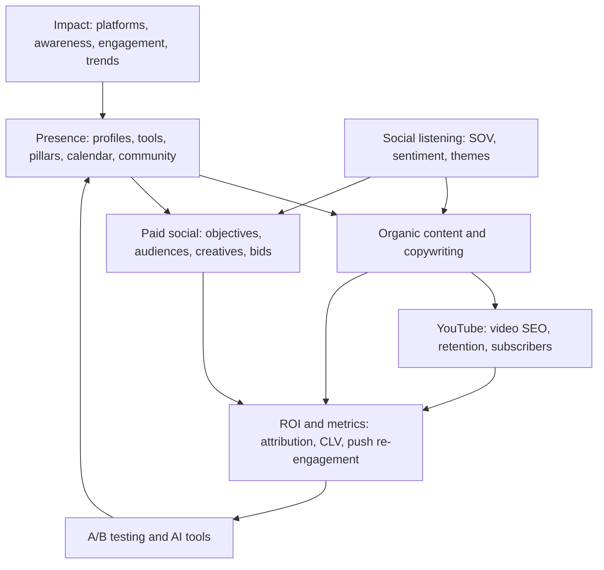

# Module 5 · Social Media Marketing

> 🏠 [Diploma in Digital Marketing](../../README.md) › [Term 1](../README.md) › **Module 5**

[⬅ Previous module](../04-search-and-display-marketing/README.md) · [Start Session 1 ➡](session-01-impact-of-social-media-on-business.md) · [Next module ➡](../06-email-marketing/README.md)

---

Social media is where Pakistani customers discover brands, ask questions, complain, compare and increasingly buy. This module starts with how social media changes business and which platforms matter, then teaches you to run a professional presence (profiles, tools, content calendars, community management), buy paid social ads with the right objectives, audiences, creatives and bids, listen to the market and write copy that stops the scroll, grow a YouTube channel, prove social ROI with honest numbers, and finish with A/B testing and AI tools.

## 🎯 Module objectives

- Identify the **major social platforms** and their audiences (with real Pakistan reach data), and explain social media's impact on **brand awareness and customer engagement**.
- Set up and manage **professional business profiles**, choose the right **tools**, build **content pillars** and a **content calendar**, and handle **community management and crises**.
- Plan **paid social campaigns**: objectives, formats, **custom / lookalike / retargeting audiences**, creatives, budgets and **bid strategies**.
- Run **social listening** (share of voice, net sentiment, themes) and write effective **copy** with hooks and frameworks (AIDA, PAS, BAB).
- Create, optimise and analyse **YouTube** videos: hooks, metadata, thumbnails, CTR, retention, watch time.
- Calculate **social ROI** with full costs, use **attribution** and **CLV**, track WhatsApp/COD sales, and use **push notifications** for re-engagement.
- Design and evaluate **A/B tests** with significance, and use **AI tools** responsibly.

## 📅 Sessions

| # | Session | Prerequisites |
|---|---|---|
| 1 | [Impact of Social Media on Businesses](session-01-impact-of-social-media-on-business.md) | Module 1 |
| 2 | [Managing and Enhancing Social Media Presence](session-02-managing-social-media-presence.md) | Session 1 |
| 3 | [Fundamentals of Social Media Advertising](session-03-social-media-advertising.md) | Session 2 |
| 4 | [Social Listening and Copywriting](session-04-social-listening-and-copywriting.md) | Session 3 |
| 5 | [YouTube Marketing](session-05-youtube-marketing.md) | Session 4 |
| 6 | [Social Media ROI and Performance Metrics](session-06-social-roi-and-performance-metrics.md) | Sessions 3-5 |
| 7 | [A/B Split Testing and AI in Social Media](session-07-ab-testing-and-ai-in-social.md) | Session 6 |
|  | 📝 [Module practice test](practice-test.md) | All sessions |

## 🧭 Concept map

## 💻 Code and charts in this module

All examples are runnable. See **[code/README.md](code/README.md)** for every file and how to run it. Python files need Python 3.10+; the chart scripts also need `pip install matplotlib`.

| Session | Code | Chart |
|---|---|---|
| 1 | Platform reach analysis (real DataReportal data), awareness metrics (SOV, ER, brand lift) | Pakistan ad reach by platform |
| 2 | Content calendar generator (CSV), weighted profile audit, link-in-bio HTML page | Posts per weekday heat-map |
| 3 | Paid social campaign comparison with bid what-if, budget from a sales goal | CPA vs ROAS bubble chart |
| 4 | English + Roman Urdu listening tool, caption checker | Mentions by sentiment |
| 5 | YouTube analytics and retention, video SEO checker | Audience retention curve |
| 6 | Social ROI with CLV view, weekly post-level engagement report | Revenue by social channel |
| 7 | A/B test with sample size and z-test, ad-copy variant generator | CTR with 95% confidence intervals |

## 📄 One-page cheat-sheet

| Topic | Remember this |
|---|---|
| Pakistan (Oct 2025, DataReportal) | 117 M internet users · 79.9 M social identities (31%) · Ad reach: TikTok 79.9 M (18+), YouTube 54.3 M, Facebook 52.9 M, Snapchat 41.1 M, Instagram 22.4 M, LinkedIn 18 M members · female share: YouTube 39.7%, Instagram 34.9%, Facebook 19.5% |
| Business roles of social | Media channel · service desk · research lab · shop |
| Awareness metrics | Reach, impressions, follower growth, SOV, branded search, brand lift |
| Engagement ladder | Discover → follow → interact → buy → support → advocate |
| Trends | Short video · algorithmic feeds · social commerce · creators · private communities · social search · UGC · AI · authenticity · platform risk |
| Profile setup | One handle everywhere · logo · keyword in name · bio formula · contact buttons · highlights · UTM link · Business Manager + 2FA |
| Bio formula | What you do · for whom · proof · location/delivery · CTA |
| Content pillars | Educate ~40 · Entertain ~25 · Community/UGC ~20 · Promote ~15 |
| Complaints | **HEARD**: Hear · Empathise · Apologise · Resolve · Diagnose; public then private then public follow-up |
| Crisis | Detect · pause schedules · assess · holding statement · update · review |
| Paid structure | Campaign (objective) → ad set (audience, budget, bid, optimisation) → ad (creative) |
| Objectives | Awareness · Traffic · Engagement · Leads · App promotion · Sales |
| Audiences | Core · custom · lookalike · retargeting · broad/Advantage+ |
| Specs | 9:16 Stories/Reels/TikTok · 4:5 feed · 1:1 universal · keep text out of top/bottom ~14% |
| Learning phase | ~50 optimisation events per ad set per week; avoid big edits |
| Bids | Lowest cost · cost cap · bid cap · ROAS goal · reach & frequency |
| Listening | Monitoring = react to mentions · Listening = patterns and decisions · include Roman Urdu |
| Caption | Hook → body → CTA → 3–5 specific hashtags |
| Copy frameworks | AIDA · PAS · BAB · FAB · 4 U's · story arc |
| YouTube ranking | CTR · watch time · retention · satisfaction · session behaviour · relevance |
| Video structure | Hook (0–15 s) → setup → value → payoff → CTA/end screen |
| Video SEO | Keyword-first title · thumbnail 1280×720 with 2–4 words · keyword in first 2 description lines · chapters from 00:00 · captions · playlists |
| Partner Programme | 1,000 subs + 4,000 public watch hours (12 months) or 10 M Shorts views (90 days) |
| CTR × retention | High/high winner · high CTR low retention = clickbait · low CTR high retention = fix thumbnail |
| Attribution | Last click · first click · linear · time decay · data-driven |
| WhatsApp/COD tracking | Source field · unique codes · pre-filled messages · labels · click-to-WhatsApp ads |
| A/B test | One variable · random equal split · sample size first · ≥ 7 days · p < 0.05 |
| Responsible AI | Fact-check · brand voice · no personal data in public tools · disclose realistic AI media · humans on complaints |

| Formula | Calculation |
|---|---|
| Engagement rate | (Likes + Comments + Shares + Saves) ÷ Reach × 100 |
| Frequency | Impressions ÷ Reach |
| Follower growth | (New − Old) ÷ Old × 100 |
| Share of voice | Brand mentions ÷ Category mentions × 100 |
| Net sentiment | (Positive − Negative) ÷ Total × 100 |
| Brand lift | Exposed awareness − Control awareness |
| CPM / CPC / CTR | Spend ÷ Impr × 1,000 · Spend ÷ Clicks · Clicks ÷ Impr × 100 |
| CPA / ROAS | Spend ÷ Conversions · Revenue ÷ Spend |
| Break-even ROAS / CPA | 1 ÷ Margin · AOV × Margin |
| Budget from goal | Orders ÷ CR = clicks → ÷ CTR = impressions → ÷ 1,000 × CPM |
| Hook rate / hold rate | 3-s views ÷ Impressions · ThruPlays ÷ 3-s views |
| YouTube | CTR = Views ÷ Impressions · Watch time = Views × AVD · Avg % viewed = AVD ÷ Length |
| Social ROI | (Attributed gross profit − All costs) ÷ All costs × 100 |
| Simple CLV | AOV × Orders per year × Years × Margin |
| z-test | p̂ = (x₁+x₂) ÷ (n₁+n₂) · SE = √[p̂(1−p̂)(1/n₁+1/n₂)] · z = (p₂ − p₁) ÷ SE |

**Common mistakes:** being on every platform · counting followers only · deleting complaints · posting only promotions · one admin with a shared password · no calendar · boosting posts instead of using the right objective · Traffic objective for sales · editing during the learning phase · no creative refresh · trusting automatic sentiment blindly · generic hashtags · slow video intros · clickbait titles · copyrighted music · ROI on revenue instead of profit · ignoring non-ad costs · no WhatsApp/COD tracking · changing several variables in one test · stopping tests early · publishing unchecked AI content.

---

Prepared by **Hamna Zahid Khan**, Junior Lecturer · Diploma in Digital Marketing
