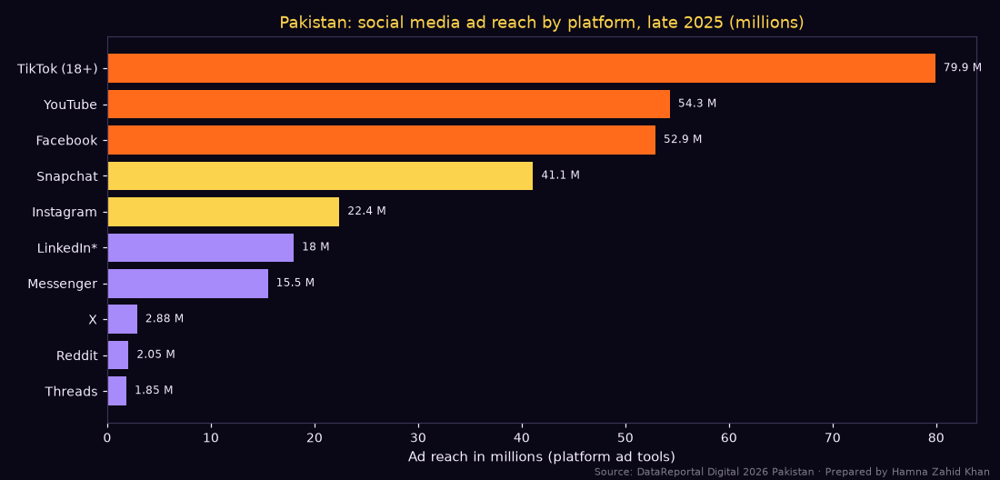
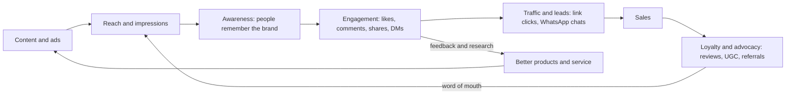
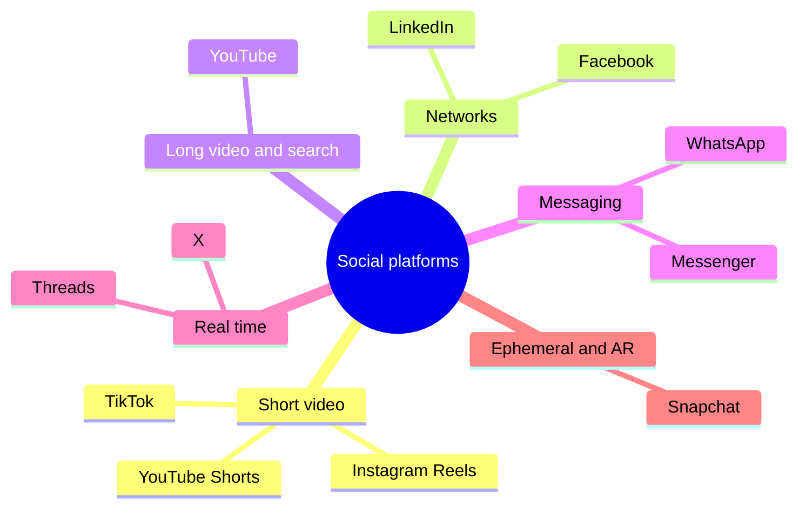
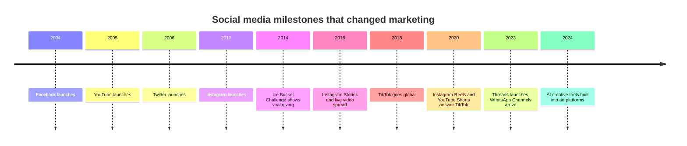
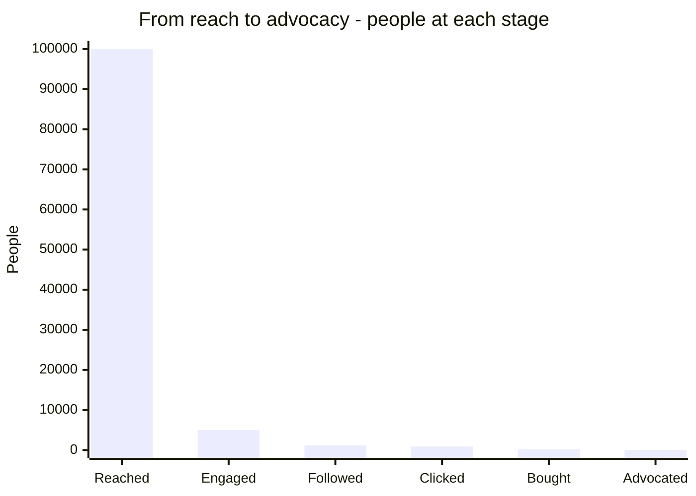

# Session 1 · Impact of Social Media on Businesses

> 🏠 [Diploma in Digital Marketing](../../README.md) › [Term 1](../README.md) › [Social Media Marketing](README.md) › **Session 1**
>
> ⏱ **Estimated time:** 3 hours (2 h theory + 1 h lab) · 📋 **Prerequisites:** Module 1

[⬅ Previous: Social Media Marketing overview](README.md) · [Next: Session 2 ➡](session-02-managing-social-media-presence.md)

---

## 🎯 Learning objectives

By the end of this session you will be able to:

- Identify the **major social media platforms** used in Pakistan and worldwide, and describe what each one is best at.
- Describe how social media **builds brand awareness**, and measure it with **reach, share of voice, engagement rate and brand lift**.
- Explain the role of social media in **customer engagement** – from the first follow to repeat purchase and advocacy.
- Summarise **case studies** of brands that grew (or got hurt) because of social media.
- Classify the **current trends** shaping social media: short video, social commerce, creators, private messaging, social search and AI.

## 📖 Concepts

### 1. What "social media" means for a business

**Social media** are online platforms where people create, share and react to content and talk to each other. For a business they are four things at once:

| Role | What it means | Example |
|---|---|---|
| **Media channel** | A place to publish content and buy ads | A Reel showing a new lawn collection |
| **Customer service desk** | People ask questions and complain publicly | "Where is my order?" in the comments |
| **Research lab** | You can hear what people really think | Reading 300 comments on a price increase |
| **Shop window and till** | Many people now discover **and** buy without leaving the app | Instagram shop, TikTok Shop, WhatsApp catalogue |

> 💡 **Analogy:** traditional advertising is a loudspeaker on a rooftop – you talk, people listen (maybe). Social media is a busy *bazaar*: everyone is talking, customers talk to each other about you, and you win by joining the conversation, not by shouting louder.

### 2. The major platforms

The numbers below come from each platform's own advertising tools, as compiled in DataReportal's *Digital 2026: Pakistan* report (data from October 2025). **Ad reach is not the same as unique monthly users**: one person can have several accounts, and some platforms count only adults.

| Platform | Pakistan ad reach (late 2025) | Format strength | Best business use |
|---|---|---|---|
| **TikTok** | 79.9 M adults (18+) | Short vertical video, trends, sounds | Mass awareness, young audiences, viral reach, TikTok Shop |
| **YouTube** | 54.3 M | Long video, Shorts, search | Tutorials, reviews, storytelling, video ads |
| **Facebook** | 52.9 M | Groups, pages, Marketplace, video | Broad targeting, community groups, older audiences, lead ads |
| **Snapchat** | 41.1 M | Disposable stories, AR lenses | Teens and young adults, playful brand lenses |
| **Instagram** | 22.4 M | Reels, carousels, Stories, shopping | Fashion, food, beauty, lifestyle, influencer marketing |
| **LinkedIn** | 18.0 M *members* | Professional posts, articles | B2B, hiring, employer brand, thought leadership |
| **Messenger** | 15.5 M | Chat | Customer service, click-to-message ads |
| **X (Twitter)** | 2.88 M | Short text, real-time | News, public conversations, crisis updates |
| **WhatsApp** | (not reported as ad reach) | Private chat, Channels, Business catalogue | Orders, support, broadcast offers, very high open rates |

Two facts from the same report that every Pakistani marketer should remember:

- Pakistan had about **117 million internet users** and **79.9 million social media user identities** in October 2025 – roughly **31% of the population**.
- Social audiences skew heavily male: only **28.8%** of social media user identities were female (TikTok), **19.5%** of Facebook's adult ad audience but **39.7%** of YouTube's and **34.9%** of Instagram's. A brand selling to women must choose platforms carefully.

📄 `code/session-01_platform_reach.py`

```python
# Social media advertising reach in Pakistan by platform (late 2025) and what it means for a brand.
# Prepared by Hamna Zahid Khan, Junior Lecturer.
# Source: DataReportal "Digital 2026: Pakistan" (Kepios, published 8 Nov 2025), figures from each
# platform's own ad-planning tools. Ad reach is NOT the same as unique monthly users.
import matplotlib
matplotlib.use("Agg")
import matplotlib.pyplot as plt

BG, FIRE, GOLD, VIOLET, EMBER, TEXT = "#0A0716", "#FF6B1A", "#FCD34D", "#A78BFA", "#F43F5E", "#F5EEFF"
INTERNET_USERS = 117.0      # million, Oct 2025
POPULATION = 256.0          # million, Oct 2025

# platform: (ad reach in millions, % of adult ad audience that is female)
reach = {
    "TikTok (18+)":  (79.9, 28.8),
    "YouTube":       (54.3, 39.7),
    "Facebook":      (52.9, 19.5),
    "Snapchat":      (41.1, 26.4),
    "Instagram":     (22.4, 34.9),
    "LinkedIn*":     (18.0, 24.5),
    "Messenger":     (15.5, 15.9),
    "X":             (2.88, 17.4),
    "Reddit":        (2.05, None),
    "Threads":       (1.85, 26.5),
}

print(f"{'Platform':<14}{'Reach (M)':>10}{'% of internet users':>21}{'% female':>10}")
for name, (m, fem) in reach.items():
    share = m / INTERNET_USERS * 100
    f = f"{fem:.1f}" if fem is not None else "n/a"
    print(f"{name:<14}{m:>10.2f}{share:>20.1f}%{f:>10}")
print("* LinkedIn reports registered members, not monthly active users.")

# A planning question: a Lahore modest-fashion brand targets women.
print("\nEstimated FEMALE ad audience (reach x female share):")
female = {n: m * f / 100 for n, (m, f) in reach.items() if f is not None}
for n, v in sorted(female.items(), key=lambda kv: -kv[1])[:5]:
    print(f"  {n:<14}{v:>6.1f} M")

fig, ax = plt.subplots(figsize=(10, 4.8), facecolor=BG)
ax.set_facecolor(BG)
names = list(reach)[::-1]
vals = [reach[n][0] for n in names]
cols = [FIRE if v > 50 else (GOLD if v > 20 else VIOLET) for v in vals]
bars = ax.barh(names, vals, color=cols)
for b, v in zip(bars, vals):
    ax.text(v + 0.8, b.get_y() + b.get_height() / 2, f"{v:g} M", va="center", color=TEXT, fontsize=8)
ax.set_title("Pakistan: social media ad reach by platform, late 2025 (millions)", color=GOLD)
ax.set_xlabel("Ad reach in millions (platform ad tools)", color=TEXT)
ax.tick_params(colors=TEXT, labelsize=9)
for s in ax.spines.values(): s.set_color("#3b3355")
fig.text(0.99, 0.01, "Source: DataReportal Digital 2026 Pakistan · Prepared by Hamna Zahid Khan", color=TEXT, alpha=0.5, ha="right", fontsize=7)
plt.tight_layout(); plt.savefig("session-01_platform_reach.png", dpi=110, facecolor=BG)
print("\nSaved session-01_platform_reach.png")
```

**Output**

```text
Platform       Reach (M)  % of internet users  % female
TikTok (18+)       79.90                68.3%      28.8
YouTube            54.30                46.4%      39.7
Facebook           52.90                45.2%      19.5
Snapchat           41.10                35.1%      26.4
Instagram          22.40                19.1%      34.9
LinkedIn*          18.00                15.4%      24.5
Messenger          15.50                13.2%      15.9
X                   2.88                 2.5%      17.4
Reddit              2.05                 1.8%       n/a
Threads             1.85                 1.6%      26.5
* LinkedIn reports registered members, not monthly active users.

Estimated FEMALE ad audience (reach x female share):
  TikTok (18+)    23.0 M
  YouTube         21.6 M
  Snapchat        10.9 M
  Facebook        10.3 M
  Instagram        7.8 M

Saved session-01_platform_reach.png
```



**Reading the output:** TikTok has the biggest total reach, but a modest-fashion brand targeting women would find YouTube's female audience (≈21.6 M) almost as large as TikTok's (≈23.0 M), and Instagram's female share (35%) is much higher than Facebook's (19.5%). Platform choice is about **who** you can reach, not just **how many**.

#### Platform types

| Type | Platforms | What people come for |
|---|---|---|
| **Social networks** | Facebook, LinkedIn | Connections, groups, news feed |
| **Media-sharing / short video** | TikTok, Instagram, Snapchat | Entertainment, inspiration |
| **Video and search** | YouTube | Learning, music, long entertainment |
| **Microblogging** | X, Threads | Real-time news and opinions |
| **Messaging** | WhatsApp, Messenger | Private conversation |
| **Discussion forums** | Reddit, Facebook Groups | Advice, niche communities |
| **Visual discovery** | Pinterest | Ideas and planning (small in Pakistan) |

### 3. How social media influences brand awareness

**Brand awareness** is how familiar people are with your brand and what it stands for. Social media builds it in five ways:

1. **Reach at low cost** – a strong Reel can be shown to thousands of non-followers by the algorithm for free (organic reach).
2. **Repetition** – people need to see a brand several times before they remember it (the "effective frequency" idea).
3. **Social proof** – likes, comments, reviews and shares tell new people "others trust this brand".
4. **Word of mouth at scale** – one happy customer's post reaches all of their friends; a meme can reach millions.
5. **Personality** – brands get a voice. Witty replies, behind-the-scenes clips and founders on camera make a brand memorable.

#### How to measure awareness

| Metric | Formula / method | What it tells you |
|---|---|---|
| **Reach** | Unique accounts that saw your content | Size of audience touched |
| **Impressions** | Total times content was shown | Reach × frequency |
| **Follower growth rate** | (New − Old followers) ÷ Old × 100 | Audience building speed |
| **Share of voice (SOV)** | Your mentions ÷ all category mentions × 100 | Your slice of the conversation |
| **Engagement rate** | Engagements ÷ Reach (or followers) × 100 | Whether content resonates |
| **Branded search volume** | Google Trends / Search Console | Whether social exposure makes people look you up |
| **Brand lift** | Awareness in exposed group − control group | True causal effect of a campaign |

📄 `code/session-01_awareness_metrics.py`

```python
# Measuring the effect of social media on brand awareness: share of voice, reach growth,
# engagement rate and an awareness-lift survey. Prepared by Hamna Zahid Khan, Junior Lecturer.
# Figures are an illustrative quarter for a Karachi chai cafe chain ("Chai Adda") and two rivals.

mentions = {"Chai Adda": 1_840, "Rival A": 2_600, "Rival B": 1_160}   # brand mentions in the quarter
total = sum(mentions.values())
print("Share of voice (SOV) = brand mentions / all mentions in the category")
for b, m in mentions.items():
    print(f"  {b:<10}{m:>6,} mentions -> SOV {m / total * 100:5.1f}%")

# Reach and engagement before vs after a 3-month content plan
before = dict(followers=12_400, reach=96_000, engagements=2_300)
after = dict(followers=19_850, reach=310_000, engagements=11_160)
for label, d in (("Before", before), ("After", after)):
    er_reach = d["engagements"] / d["reach"] * 100
    er_fol = d["engagements"] / d["followers"] * 100
    print(f"\n{label}: followers {d['followers']:,}, monthly reach {d['reach']:,}, engagements {d['engagements']:,}")
    print(f"  Engagement rate by reach     = {d['engagements']:,} / {d['reach']:,} x 100 = {er_reach:.2f}%")
    print(f"  Engagement rate by followers = {d['engagements']:,} / {d['followers']:,} x 100 = {er_fol:.2f}%")
growth = (after["followers"] - before["followers"]) / before["followers"] * 100
print(f"\nFollower growth = ({after['followers']:,} - {before['followers']:,}) / {before['followers']:,} x 100 = {growth:.1f}%")

# Brand-lift survey: two random groups of 400 people in Karachi
exposed, exposed_aware = 400, 172
control, control_aware = 400, 112
pe, pc = exposed_aware / exposed, control_aware / control
print(f"\nAided awareness: exposed {pe:.0%} vs control {pc:.0%}")
print(f"Absolute lift = {pe - pc:.0%} points; relative lift = {(pe - pc) / pc * 100:.1f}%")
```

**Output**

```text
Share of voice (SOV) = brand mentions / all mentions in the category
  Chai Adda  1,840 mentions -> SOV  32.9%
  Rival A    2,600 mentions -> SOV  46.4%
  Rival B    1,160 mentions -> SOV  20.7%

Before: followers 12,400, monthly reach 96,000, engagements 2,300
  Engagement rate by reach     = 2,300 / 96,000 x 100 = 2.40%
  Engagement rate by followers = 2,300 / 12,400 x 100 = 18.55%

After: followers 19,850, monthly reach 310,000, engagements 11,160
  Engagement rate by reach     = 11,160 / 310,000 x 100 = 3.60%
  Engagement rate by followers = 11,160 / 19,850 x 100 = 56.22%

Follower growth = (19,850 - 12,400) / 12,400 x 100 = 60.1%

Aided awareness: exposed 43% vs control 28%
Absolute lift = 15% points; relative lift = 53.6%
```

**Interpretation.** Chai Adda's reach tripled and its engagement rate by reach rose from 2.4% to 3.6%, so content got better *and* travelled further. Its share of voice (32.9%) still trails Rival A (46.4%), which is the next target. The brand-lift survey is the strongest evidence: people who saw the campaign were **15 percentage points** more likely to recognise the brand than a similar group who did not. (Note the engagement rate by followers is a *monthly total* – per-post rates are much lower.)

### 4. The role of social media in customer engagement

**Customer engagement** is every two-way interaction between a customer and a brand. On social media it follows a ladder:

| Stage | Customer behaviour | What the brand should do |
|---|---|---|
| **Discover** | Sees a Reel, a friend's share, an ad | Hook in 2 seconds, clear branding |
| **Follow** | Follows or subscribes | Consistent, useful content |
| **Interact** | Likes, comments, polls, DMs | Reply fast, ask questions, run polls |
| **Buy** | Clicks link in bio, WhatsApps, uses shop | Easy checkout, COD option, quick replies |
| **Support** | Asks for help, complains | Public acknowledgement, private resolution |
| **Advocate** | Posts reviews, tags the brand, refers friends | Repost UGC, reward loyalty, thank them |

Why it matters commercially:

- Engaged followers buy more often and are cheaper to re-reach.
- Public replies to complaints show **every** viewer how you treat customers.
- Comments and DMs are free market research.
- **Messaging commerce** is huge in Pakistan: many small businesses take most orders through WhatsApp or Instagram DMs, with cash on delivery.

### 5. Case studies

#### Case A – Global: the ALS Ice Bucket Challenge (2014)
People filmed themselves pouring ice water over their heads, donated, and nominated three friends. Celebrities joined, feeds filled with videos, and the ALS Association reported raising about **US$115 million** in roughly eight weeks.
**Lessons:** a simple, filmable action + a social nomination mechanic + a cause people feel good about = exponential spread.

#### Case B – Global: Dove "Real Beauty" (from 2004, still running)
Dove used real women instead of models and invited conversation about beauty standards. Its films became some of the most shared ads online, and the platform has run for two decades.
**Lessons:** a brand **truth** (Module 1) that people want to share is worth more than any ad budget.

#### Case C – Pakistan: Coke Studio Pakistan on YouTube
The music series moved its audience from TV to YouTube and social clips. "Pasoori" (Season 14, 2022) became a global hit with hundreds of millions of views, carrying the brand far beyond Pakistan.
**Lessons:** **content people choose to watch** builds awareness better than interruption; social sharing gives it global reach.

#### Case D – Pakistan: online sale events
Big marketplace sale days such as **11.11** are promoted heavily on TikTok, Facebook and Instagram with countdowns, influencer haul videos, live streams and game-style vouchers.
**Lessons:** urgency (countdowns), entertainment (live shows, games) and creators combine to turn social attention into sales on one day.

#### Case E – When it goes wrong: a pricing complaint goes viral (illustrative)
A Lahore restaurant deleted a customer's polite comment about a wrong bill. The customer posted screenshots of the deleted comment on a large food group; within hours thousands of people had shared it and the restaurant's rating fell.
**Lessons:** never delete genuine complaints; acknowledge publicly, fix privately, and follow up publicly when solved.

### 6. Trends in social media dynamics

| Trend | What is happening | What a business should do |
|---|---|---|
| **Short-form video first** | Reels, TikTok, Shorts dominate time spent | Plan vertical 9:16 video; hook in 1–2 s; add captions |
| **Algorithmic "for you" feeds** | Reach depends on content quality, not follower count | Make every post earn attention; study watch time and saves |
| **Social commerce** | Shops inside apps, live shopping, WhatsApp catalogues | Tag products, run live sales, enable click-to-WhatsApp |
| **Creator and influencer economy** | Micro-creators (10k–100k) drive trust | Partner with niche creators; track with codes and UTMs |
| **Private and community spaces** | WhatsApp Channels, groups, Discord, close friends | Build communities; broadcast lists with permission |
| **Social search** | Young people search TikTok/Instagram like Google | Use keywords in captions, on-screen text and voice-over |
| **User-generated content (UGC)** | Customers' own photos/videos outperform polished ads | Ask for reviews; repost with permission |
| **AI everywhere** | AI writes captions, edits video, targets ads | Use AI to draft and test faster – check facts and tone |
| **Authenticity and purpose** | Audiences reward honesty and punish fakeness | Show real people, real processes, admit mistakes |
| **Regulation and platform risk** | Platforms can be blocked or throttled; privacy rules tighten | Never depend on one platform; own your email/WhatsApp list |

## 🧭 Diagrams

### How social media creates business value



### Platform landscape



### Trend timeline



## 💻 Worked examples

### Example 1 – Choosing platforms for three Pakistani businesses (walkthrough)

**Step 1 – define the customer.** **Step 2 – match to platform audiences.** **Step 3 – match content you can actually produce.** **Step 4 – pick 1–2 core platforms and 1 support platform.**

| Business | Customer | Core platforms | Support | Why |
|---|---|---|---|---|
| Bridal makeup artist, Lahore | Brides 22–32 and their families | Instagram, TikTok | WhatsApp | Visual before/after, Reels; bookings by chat |
| Industrial pumps supplier, Karachi | Factory engineers and procurement managers | LinkedIn, YouTube | WhatsApp | Product demos and technical trust; B2B decision makers |
| Home-cooked tiffin service, Islamabad | Office workers and students | Facebook Groups, Instagram | WhatsApp broadcast | Local groups for discovery; daily menu by broadcast |

### Example 2 – Awareness maths for a campaign

A Peshawar honey brand runs a two-week Reels campaign.

| Data | Value |
|---|---|
| Impressions | 900,000 |
| Reach | 360,000 |
| Engagements (likes, comments, shares, saves) | 21,600 |
| Profile visits | 7,200 |
| New followers | 2,880 (from 9,600) |

| Metric | Working | Result |
|---|---|---|
| Frequency | 900,000 ÷ 360,000 | **2.5** views per person |
| Engagement rate by reach | 21,600 ÷ 360,000 × 100 | **6.0%** |
| Profile visit rate | 7,200 ÷ 360,000 × 100 | **2.0%** |
| Follow rate from visits | 2,880 ÷ 7,200 × 100 | **40%** |
| Follower growth | 2,880 ÷ 9,600 × 100 | **30%** in two weeks |

A 40% follow rate means the profile itself convinces visitors – the bio, highlights and grid are working.

### Example 3 – Responding to a public complaint (template)

> **Comment:** "Ordered 5 days ago, still no delivery. Nobody replies on WhatsApp. 😡"
>
> **Reply (within 1 hour):** "Assalam o Alaikum Sana, we're really sorry for the delay – that's not the experience we want for you. We've sent you a DM to get your order number and will update you within 2 hours. – Team Rangoli"
>
> **Follow-up (after solving):** "Update: Sana's parcel was delivered today with a small gift from us. Thank you for your patience! 💛"

Structure: **greet by name → apologise sincerely → move details to private → give a time → follow up publicly.**

## 📊 Chart · Engagement ladder (illustrative audience of 100,000 reached)



## 📋 Checklist · Is a business ready for social media?

- [ ] Customer profile written: age, gender, city, interests, language (Urdu, English, Roman Urdu, regional).
- [ ] 1–2 core platforms chosen with a reason based on audience data.
- [ ] Same handle and logo on all platforms.
- [ ] Brand voice defined (formal, friendly, witty?) with three example replies.
- [ ] Someone responsible for replying to comments and DMs daily.
- [ ] Complaint response template agreed.
- [ ] Baseline metrics recorded: followers, reach, engagement rate, mentions.
- [ ] Email or WhatsApp list started so the brand is not dependent on one platform.

## ⚠️ Common mistakes

| Mistake | Why it hurts | Fix |
|---|---|---|
| Being on every platform at once | Thin, inconsistent content everywhere | Master 1–2 platforms first |
| Choosing platforms by habit, not audience | You talk to the wrong people | Use audience data (gender, age, interests) |
| Counting followers only | Bought or inactive followers mean nothing | Track reach, engagement rate, clicks, sales |
| Deleting negative comments | Customers screenshot and repost | Reply publicly, solve privately |
| Only posting promotions | People unfollow "advert accounts" | Mix education, entertainment, community |
| Copying trends that don't fit the brand | Looks forced, can offend | Adapt trends to your brand truth |
| Relying on one platform | Bans, outages or algorithm changes wipe out reach | Build owned channels (email, WhatsApp, website) |

## ✅ Best practices

1. **Start with the customer, not the platform.**
2. **Be consistent** – a predictable posting rhythm beats occasional bursts.
3. **Lead with value** – teach, entertain or help before you sell.
4. **Respond fast** – aim for under 1 hour in business hours for complaints.
5. **Show real people** – founders, staff and customers build trust.
6. **Measure from day one** – record a baseline so you can prove impact later.

## 🧪 Lab / practice tasks

**Task 1 (easy) – Platform match.** Choose the best core platform for: (a) a software house hiring developers, (b) a Karachi street-food stall, (c) a cooking teacher selling online classes, (d) a clothing brand for teenage girls.

<details><summary>✅ Solution</summary>

(a) **LinkedIn** (professional audience, job posts, employer brand). (b) **TikTok/Instagram Reels + Google Maps profile** – food videos travel well locally. (c) **YouTube** (long tutorials build trust, free lessons lead to paid classes) with Instagram for reminders. (d) **Instagram and TikTok** – visual, trend-led, higher female share on Instagram; Snapchat lenses as support.

</details>

**Task 2 (easy) – Metrics.** A post had 48,000 impressions, 30,000 reach, 1,350 likes, 90 comments, 210 shares and 450 saves. Calculate frequency and engagement rate by reach and by impressions.

<details><summary>✅ Solution</summary>

Engagements = 1,350 + 90 + 210 + 450 = **2,100**. Frequency = 48,000 ÷ 30,000 = **1.6**. ER by reach = 2,100 ÷ 30,000 × 100 = **7.0%**. ER by impressions = 2,100 ÷ 48,000 × 100 = **4.375%**.

</details>

**Task 3 (medium) – Share of voice.** Edit `code/session-01_awareness_metrics.py`: in the next quarter Chai Adda gets 3,100 mentions, Rival A 2,700 and Rival B 1,200. Run it. What is the new SOV, and who leads?

<details><summary>💡 Hint</summary>

Change the `mentions` dictionary only. Total = 7,000.

</details>

<details><summary>✅ Solution</summary>

Chai Adda 3,100 ÷ 7,000 = **44.3%** (now leading), Rival A **38.6%**, Rival B **17.1%**.

</details>

**Task 4 (medium) – Female audience planning.** Using the platform table, estimate the female ad audience on Instagram and Facebook. Which gives more women, and which has the higher female *share*? Why might a brand still use Facebook?

<details><summary>✅ Solution</summary>

Instagram 22.4 M × 34.9% ≈ **7.8 M** women; Facebook 52.9 M × 19.5% ≈ **10.3 M** women. Facebook reaches more women in absolute terms, Instagram has the higher share (less wasted spend on men). Facebook also reaches older women and has Groups and Marketplace, so many brands use both.

</details>

**Task 5 (challenge) – Case study analysis.** Pick any brand you follow (Pakistani preferred). Write a one-page analysis: platforms used, posting frequency, content types, best-performing post (most comments/views), how it handles complaints, one trend it uses well, and two recommendations.

<details><summary>💡 Hint – structure</summary>

Use headings: *Overview · Platforms · Content mix · Engagement · Customer care · Trends · Recommendations*. Support every claim with a number you counted (e.g. "posted 12 Reels in 30 days, average 4,200 views").

</details>

## ✅ Quick quiz

1. In late 2025, which platform had the largest ad reach in Pakistan according to DataReportal?
   a) Facebook b) TikTok c) Instagram d) LinkedIn
2. Share of voice is calculated as:
   a) followers ÷ reach b) your mentions ÷ all category mentions × 100 c) likes ÷ posts d) clicks ÷ impressions
3. A brand-lift study compares:
   a) two ad budgets b) awareness in an exposed group vs a control group c) organic vs paid reach d) followers this month vs last month
4. The best response to a public complaint is to:
   a) delete it b) argue publicly c) acknowledge publicly, resolve privately, follow up d) ignore it
5. "Social search" means:
   a) using LinkedIn to find jobs b) people using TikTok/Instagram to search for products and ideas c) paying for search ads d) searching your own posts

<details><summary>Show answers</summary>

1-b · 2-b · 3-b · 4-c · 5-b

</details>

## 📝 Summary

- Social media is a **media channel, service desk, research lab and shop** at once.
- Pakistan (late 2025): **117 M internet users, 79.9 M social identities**; TikTok, YouTube and Facebook lead reach; audiences skew male, so check gender by platform.
- Awareness is built by low-cost reach, repetition, social proof, word of mouth and personality; measure with **reach, SOV, engagement rate, branded search and brand lift**.
- Engagement is a ladder: **discover → follow → interact → buy → support → advocate**.
- Case studies show the power of shareable actions, brand truth and content people choose to watch – and the danger of mishandling complaints.
- Trends: **short video, algorithmic feeds, social commerce, creators, private communities, social search, UGC, AI, authenticity, platform risk**.

**Formulas:** Engagement rate = Engagements ÷ Reach × 100 · Frequency = Impressions ÷ Reach · SOV = Brand mentions ÷ Category mentions × 100 · Follower growth = (New − Old) ÷ Old × 100 · Brand lift = Exposed awareness − Control awareness.

**Interview / viva questions**

1. Why is ad reach not the same as monthly active users?
2. How would you choose social platforms for a new B2B software company in Karachi?
3. Explain three ways social media increases brand awareness.
4. What is share of voice and how would you measure it?
5. Describe a social media case study and the lesson it teaches.
6. Why should a business build owned channels alongside social media?

---

[⬅ Previous: Social Media Marketing overview](README.md) · [Next: Session 2 ➡](session-02-managing-social-media-presence.md)

<sub>Prepared by **Hamna Zahid Khan**, Junior Lecturer · Diploma in Digital Marketing</sub>
