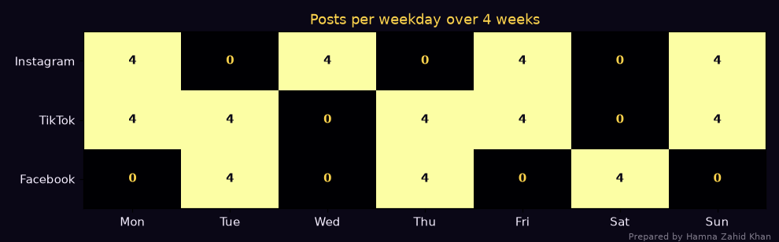
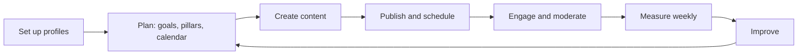
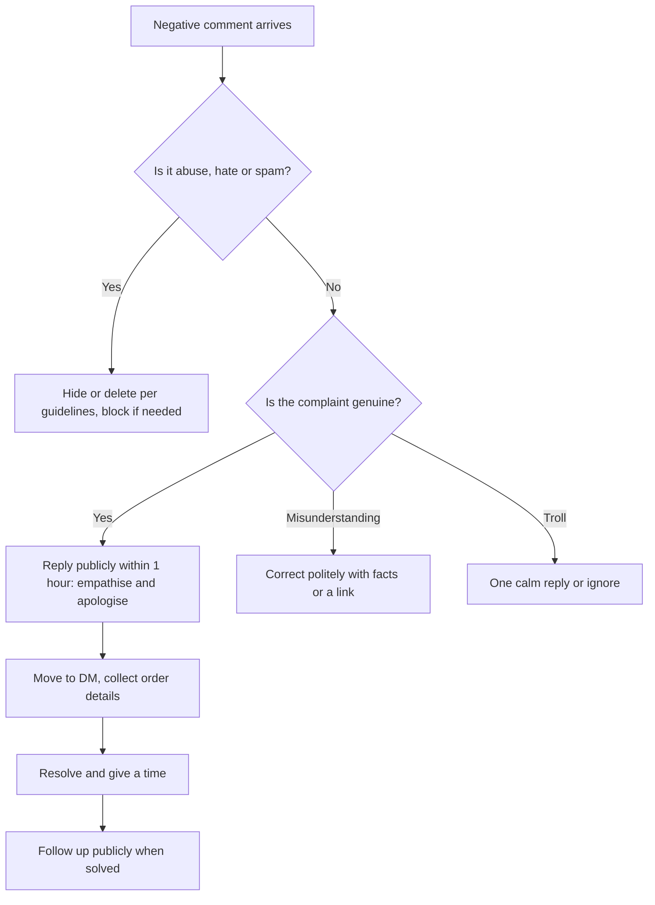
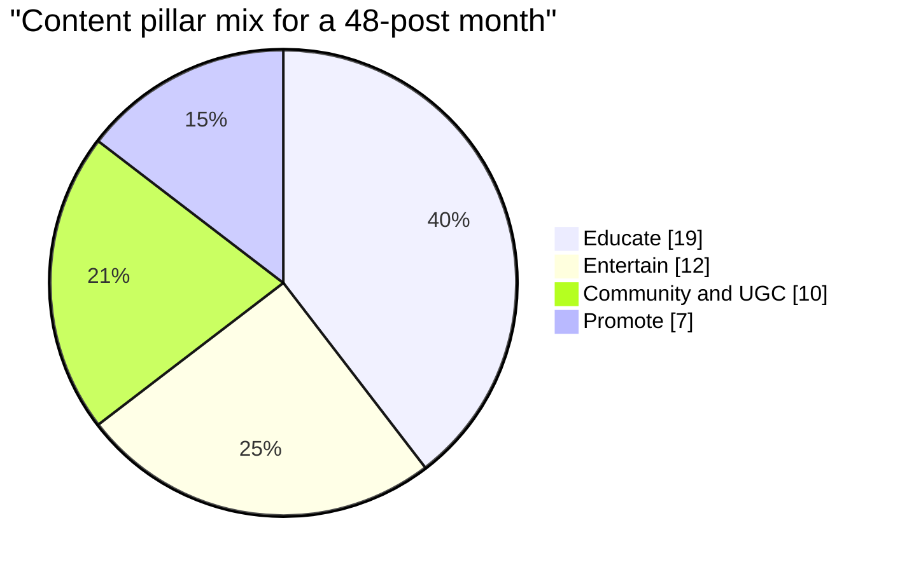

# Session 2 · Managing and Enhancing Social Media Presence

> 🏠 [Diploma in Digital Marketing](../../README.md) › [Term 1](../README.md) › [Social Media Marketing](README.md) › **Session 2**
>
> ⏱ **Estimated time:** 3 hours (1.5 h theory + 1.5 h lab) · 📋 **Prerequisites:** Session 1

[⬅ Previous: Session 1](session-01-impact-of-social-media-on-business.md) · [Next: Session 3 ➡](session-03-social-media-advertising.md)

---

## 🎯 Learning objectives

By the end of this session you will be able to:

- Define the **process of setting up** professional business profiles on the main platforms.
- List the **essential tools** for social media management: scheduling, design, video editing, analytics, listening and link-in-bio.
- Illustrate effective strategies for **growing and engaging** an audience organically.
- Explain why a **content calendar** and **content pillars** matter, and build one.
- Outline strategies for **community management** and handling **negative feedback and crises**.

## 📖 Concepts

### 1. The presence-management cycle

Managing a social presence is not "posting when you remember". It is a repeating cycle:

1. **Set up** – professional, consistent profiles.
2. **Plan** – goals, audience, content pillars, calendar.
3. **Create** – posts, Reels, carousels, Stories, captions.
4. **Publish** – at the right time, on schedule.
5. **Engage** – reply, comment, run polls, community management.
6. **Measure** – weekly and monthly reports.
7. **Improve** – do more of what works, drop what doesn't.

### 2. Setting up business profiles – step by step

#### Instagram professional account
1. Create the account with the **brand handle** (check it is free on all platforms first – e.g. `@sukoonskincare`).
2. Settings → *Account type and tools* → **Switch to professional account** → choose **Business** (or Creator for individuals).
3. Choose a **category** (e.g. *Health/Beauty*), add **contact buttons** (email, phone, WhatsApp) and **address** if you have a shop.
4. **Profile photo:** logo on a plain background, readable at 110 px.
5. **Name field** is searchable – include a keyword: *"Sukoon Skincare | Gentle Skincare PK"*.
6. **Bio (150 characters):** what you offer + for whom + proof + call to action.
7. **Link:** a link-in-bio page with UTM-tagged links (see `code/session-02_link_in_bio.html`).
8. Connect to a **Facebook Page** in Meta Business Suite so both are managed (and advertised) together.
9. Create **Story Highlights**: *Shop, Prices, Reviews, How to order, FAQ*.

#### Facebook Page
1. From a personal profile: *Pages → Create new Page* → name, category, bio.
2. Add **cover image** (1640 × 624 px works well across devices), logo, hours, location, WhatsApp button.
3. Set a **username** (facebook.com/yourbrand) and **action button** (*Send WhatsApp message*, *Shop now*, *Book now*).
4. Add team members in **Meta Business Suite / Business Manager** with the right roles – never share passwords.

#### TikTok Business account
1. Profile → menu → *Settings and privacy → Account → Switch to Business Account*.
2. Choose category, add bio, website link and email.
3. Business accounts get analytics and commercial music library (some trending sounds are not licensed for business use).

#### YouTube channel, LinkedIn Page, WhatsApp Business
- **YouTube:** create a **brand channel** (not personal), add banner (2560 × 1440 px, keep text in the central safe area), channel description with keywords, links, a channel trailer.
- **LinkedIn Page:** company logo, tagline, about section with keywords, website, industry, size; invite employees to follow.
- **WhatsApp Business app:** business profile, **catalogue**, **quick replies** (`/price`, `/delivery`), **greeting** and **away messages**, **labels** (*New order, Paid, Delivered*).

#### Bio formula

> **[What you do] for [who] · [proof or unique point] · [location/delivery] · [CTA] 👇**

✅ *"Gentle skincare for Pakistani weather 🌤️ · Dermatologist-tested · COD nationwide · Take the skin quiz 👇"*
❌ *"Welcome to our official page. We are a company. Follow for updates."*

### 3. Essential tools

| Need | Tools (free tier usually enough to start) | Use |
|---|---|---|
| **Scheduling & publishing** | Meta Business Suite (FB + IG), TikTok scheduler, YouTube Studio, Buffer, Hootsuite, Later | Plan a week of posts in one sitting |
| **Design** | Canva, Adobe Express, Figma | Posts, carousels, Story templates in brand colours |
| **Video editing** | CapCut, InShot, VN, Premiere Rush | Reels/TikToks with captions and transitions |
| **Analytics** | Native insights (Meta, TikTok, YouTube Studio), GA4 with UTMs | Reach, engagement, traffic, sales |
| **Listening & monitoring** | Brand24, Mention, Talkwalker, Meltwater; free: platform search and Google Alerts | Find mentions, sentiment, competitor activity |
| **Link in bio** | Linktree, Beacons, or your own page | One link → many destinations, with UTMs |
| **Inbox management** | Meta Business Suite inbox, WhatsApp Business labels | Answer comments/DMs from one place |
| **AI assistants** | ChatGPT, Gemini, Meta AI, CapCut AI features | Draft captions, ideas, subtitles – always edit |

### 4. Growing and engaging an audience organically

| Strategy | How | Example |
|---|---|---|
| **Hook fast** | First 1–2 seconds / first line must stop the scroll | "Your sunscreen is useless if you do this ❌" |
| **Native formats** | Use each platform's favourite format | Reels/TikTok vertical, LinkedIn document carousels |
| **Value posts that get saved** | Checklists, how-tos, price guides | "Skincare routine for load-shedding summers" carousel |
| **Conversation starters** | Questions, polls, "this or that", quizzes | Story poll: *Lawn or Khaddar?* |
| **Reply to every comment early** | The first hour's engagement helps distribution | Reply with a question to keep threads going |
| **Collaborations** | Instagram Collab posts, duets, stitches, creator partnerships | Collab Reel with a local makeup artist |
| **User-generated content** | Ask customers to tag you; repost with permission | "Show us your Eid look – tag us to be featured" |
| **Consistency** | Same days/times so the audience expects you | 4 Reels/week at 8:30 pm PKT |
| **Social SEO** | Keywords in captions, on-screen text and spoken audio | Say and write "Karachi bakery custom cake" |
| **Cross-promotion** | Share TikToks to IG/YouTube Shorts, add QR codes in shop | QR on the packaging insert |

### 5. Content pillars and the content calendar

**Content pillars** are 3–5 recurring themes that reflect the brand and audience needs. They stop random posting and keep the feed balanced.

| Pillar | Share | Purpose | Ideas |
|---|---|---|---|
| **Educate** | ~40% | Build trust and saves | Tips, how-tos, myths |
| **Entertain** | ~25% | Reach and shares | Trends, behind the scenes, humour |
| **Community / UGC** | ~20% | Belonging and proof | Reviews, Q&A, customer features |
| **Promote** | ~15% | Sales | Launches, offers, bundles |

A common rule of thumb is that roughly **80% of content should give value and 20% (or less) should sell**.

A **content calendar** lists, for each post: date, time, platform, format, pillar, idea/caption, asset status, owner and link. Benefits:

- **Consistency** without last-minute panic.
- **Balance** between pillars.
- **Planning around key dates**: Ramadan, Eid, Independence Day (14 August), 11.11, Black Friday/"White Friday", school reopening, wedding season, cricket series.
- **Team coordination**: designer, writer and approver all see the same plan.
- **Batch production**: shoot four Reels in one afternoon.

📄 `code/session-02_content_calendar.py`

```python
# Build a 4-week social media content calendar from content pillars and a posting plan,
# save it as CSV and draw a weekly heat-map. Prepared by Hamna Zahid Khan, Junior Lecturer.
# Example brand: "Sukoon Skincare", a Lahore D2C brand selling on Instagram, TikTok and Facebook.
import csv, datetime as dt
import matplotlib
matplotlib.use("Agg")
import matplotlib.pyplot as plt

BG, FIRE, GOLD, VIOLET, EMBER, TEXT = "#0A0716", "#FF6B1A", "#FCD34D", "#A78BFA", "#F43F5E", "#F5EEFF"
START = dt.date(2026, 11, 2)                      # a Monday
PILLARS = [("Educate", 0.40), ("Entertain", 0.25), ("Community/UGC", 0.20), ("Promote", 0.15)]
# platform -> (posts per week, best local posting time, preferred formats)
PLAN = {
    "Instagram": (4, "20:30", ["Reel", "Carousel", "Story poll"]),
    "TikTok":    (5, "21:30", ["Short video", "Trend remix"]),
    "Facebook":  (3, "13:00", ["Photo post", "Live Q&A", "Video"]),
}
IDEAS = {
    "Educate": ["Skin type quiz", "SPF myths in Lahore heat", "Night routine in 3 steps", "Ingredient explainer: niacinamide"],
    "Entertain": ["Behind the scenes at packing", "Before Eid glow trend", "Staff try-on challenge", "Expectation vs reality"],
    "Community/UGC": ["Customer review repost", "Ask me anything", "Dermatologist answers DMs", "Feature a follower routine"],
    "Promote": ["New serum launch", "Free delivery weekend", "Bundle offer", "Limited stock alert"],
}

total_posts = sum(p[0] for p in PLAN.values()) * 4
quota = {name: round(total_posts * share) for name, share in PILLARS}
diff = total_posts - sum(quota.values()); quota["Educate"] += diff
print(f"Total posts in 4 weeks: {total_posts}")
for k, v in quota.items():
    print(f"  {k:<14}{v:>3} posts ({v / total_posts:.0%})")

# Spread pillars evenly: build a cyclic sequence weighted by quota
seq, left = [], dict(quota)
while sum(left.values()):
    for name, _ in PILLARS:
        if left[name]:
            seq.append(name); left[name] -= 1
rows, i = [], 0
days_for = {4: [0, 2, 4, 6], 5: [0, 1, 3, 4, 6], 3: [1, 3, 5]}
for week in range(4):
    for plat, (n, time, formats) in PLAN.items():
        for j, d in enumerate(days_for[n]):
            date = START + dt.timedelta(days=week * 7 + d)
            pillar = seq[i % len(seq)]
            idea = IDEAS[pillar][(week + j) % 4]
            rows.append([date.isoformat(), date.strftime("%a"), time, plat, formats[j % len(formats)], pillar, idea])
            i += 1
rows.sort()
with open("session-02_content_calendar.csv", "w", newline="") as f:
    w = csv.writer(f); w.writerow(["date", "day", "time_pkt", "platform", "format", "pillar", "idea"]); w.writerows(rows)
print("\nFirst 8 rows of session-02_content_calendar.csv:")
for r in rows[:8]:
    print("  " + " | ".join(r))

# heat-map: posts per weekday per platform
days = ["Mon", "Tue", "Wed", "Thu", "Fri", "Sat", "Sun"]
grid = [[sum(1 for r in rows if r[3] == p and r[1] == d) for d in days] for p in PLAN]
fig, ax = plt.subplots(figsize=(9, 2.8), facecolor=BG)
ax.imshow(grid, cmap="inferno", aspect="auto")
ax.set_xticks(range(7)); ax.set_xticklabels(days, color=TEXT)
ax.set_yticks(range(len(PLAN))); ax.set_yticklabels(list(PLAN), color=TEXT)
for y, row in enumerate(grid):
    for x, v in enumerate(row):
        ax.text(x, y, v, ha="center", va="center", color=GOLD if v < 3 else BG, fontsize=10, weight="bold")
ax.set_title("Posts per weekday over 4 weeks", color=GOLD)
fig.text(0.99, 0.01, "Prepared by Hamna Zahid Khan", color=TEXT, alpha=0.5, ha="right", fontsize=7)
plt.tight_layout(); plt.savefig("session-02_content_calendar.png", dpi=110, facecolor=BG)
print("\nSaved session-02_content_calendar.csv and session-02_content_calendar.png")
```

**Output**

```text
Total posts in 4 weeks: 48
  Educate        19 posts (40%)
  Entertain      12 posts (25%)
  Community/UGC  10 posts (21%)
  Promote         7 posts (15%)

First 8 rows of session-02_content_calendar.csv:
  2026-11-02 | Mon | 20:30 | Instagram | Reel | Educate | Skin type quiz
  2026-11-02 | Mon | 21:30 | TikTok | Short video | Educate | Skin type quiz
  2026-11-03 | Tue | 13:00 | Facebook | Photo post | Entertain | Behind the scenes at packing
  2026-11-03 | Tue | 21:30 | TikTok | Trend remix | Entertain | Before Eid glow trend
  2026-11-04 | Wed | 20:30 | Instagram | Carousel | Entertain | Before Eid glow trend
  2026-11-05 | Thu | 13:00 | Facebook | Live Q&A | Community/UGC | Ask me anything
  2026-11-05 | Thu | 21:30 | TikTok | Short video | Community/UGC | Dermatologist answers DMs
  2026-11-06 | Fri | 20:30 | Instagram | Story poll | Community/UGC | Dermatologist answers DMs

Saved session-02_content_calendar.csv and session-02_content_calendar.png
```



The script produced `session-02_content_calendar.csv`, which opens in Excel or Google Sheets. In real life you add columns for *caption, asset link, status (idea / draft / approved / scheduled / live)* and *owner*.

#### Key Pakistani dates to plan around (example annual planner)

| Month | Opportunities |
|---|---|
| Jan–Feb | Winter sales, Kashmir Day (5 Feb), Valentine's (brand-dependent), PSL cricket season (usually Feb–Mar) |
| Mar–Apr | Ramadan (dates move ~11 days earlier each year), Pakistan Day (23 Mar), Eid ul Fitr |
| May–Jun | Summer lawn launches, Eid ul Adha (moves each year), budget announcements |
| Jul–Aug | Muharram (sensitive – no celebratory promotions on Ashura), Independence Day (14 Aug), back to school |
| Sep–Oct | Wedding season begins, Defence Day (6 Sep), Rabi ul Awal |
| Nov–Dec | 11.11 sales, Black/White Friday, wedding season peak, Quaid Day (25 Dec), year-end sales |

### 6. Community management

**Community management** is how a brand listens to and talks with its audience day to day.

**Response time targets** (good practice): comments within a few hours, DMs within 1–2 hours in business hours, complaints within 1 hour.

#### Handling negative feedback – the **HEARD** method

| Step | Action | Example |
|---|---|---|
| **H**ear | Read fully, understand the real problem | Order late *and* no reply on WhatsApp |
| **E**mpathise | Show you understand the feeling | "We know how frustrating it is to wait…" |
| **A**pologise | Sincere, no excuses | "We're sorry – this shouldn't have happened." |
| **R**esolve | Move to DM, fix it, give a time | "We've DM'd you; update within 2 hours." |
| **D**iagnose | Fix the root cause internally | Add a WhatsApp auto-reply and courier tracking |

**Types of negative comments and responses:**

| Type | Response |
|---|---|
| Genuine complaint | HEARD, publicly then privately |
| Misunderstanding | Polite correction with facts, a link or a screenshot |
| Troll (just wants a reaction) | One calm reply or ignore; don't argue |
| Abuse, hate, spam, scams | Hide/delete and block according to your **community guidelines** |
| Fake account impersonating you | Report to the platform; warn followers in a Story |

#### Social media crisis plan (small business version)

1. **Detect** – a sudden spike in negative mentions (listening tool alert).
2. **Pause** – stop scheduled promotional posts (a cheerful sale post during a crisis looks tone-deaf).
3. **Assess** – facts, scale, who is affected.
4. **Respond** – holding statement within hours: "We're aware and investigating; update by 6 pm."
5. **Update** – publish the facts and the fix.
6. **Review** – what failed, what to change.

### 7. Roles and governance

| Role | Responsibility |
|---|---|
| Social media manager | Strategy, calendar, reporting |
| Content creator / designer | Visuals, video, copy |
| Community manager | Replies, DMs, moderation |
| Approver (owner/marketing head) | Signs off content and crisis replies |

Governance basics: two-factor authentication on every account, admin access through Business Manager (not shared passwords), at least two admins, a written **brand voice guide** and **community guidelines** pinned or in the About section.

## 🧭 Diagrams

### Presence-management cycle



### Complaint handling decision tree



### Content pillar mix



## 💻 Worked examples

### Example 1 – Auditing a profile

A Multan bakery's Instagram profile is scored against a weighted 10-point checklist.

📄 `code/session-02_profile_audit.py`

```python
# Score a business profile against a 10-point social media presence audit.
# Prepared by Hamna Zahid Khan, Junior Lecturer. Example: a Multan bakery's Instagram profile.
CHECKS = [  # (item, weight)
    ("Handle matches brand on all platforms", 10),
    ("Profile photo is the logo, readable at small size", 8),
    ("Bio says what, where and for whom in <150 characters", 12),
    ("Clear call to action in bio (order/WhatsApp/visit)", 10),
    ("Link in bio with UTM-tagged links", 10),
    ("Contact button: phone, WhatsApp or email", 8),
    ("Business category and location set", 6),
    ("Story highlights: menu, prices, reviews, how to order", 10),
    ("Posted at least 3 times in the last 14 days", 14),
    ("Replies to comments and DMs within 24 hours", 12),
]
profile = {  # True = passes
    "Handle matches brand on all platforms": False,
    "Profile photo is the logo, readable at small size": True,
    "Bio says what, where and for whom in <150 characters": False,
    "Clear call to action in bio (order/WhatsApp/visit)": True,
    "Link in bio with UTM-tagged links": False,
    "Contact button: phone, WhatsApp or email": True,
    "Business category and location set": True,
    "Story highlights: menu, prices, reviews, how to order": False,
    "Posted at least 3 times in the last 14 days": True,
    "Replies to comments and DMs within 24 hours": False,
}
score = sum(w for item, w in CHECKS if profile[item])
total = sum(w for _, w in CHECKS)
print(f"{'Check':<56}{'Weight':>7}  Result")
for item, w in CHECKS:
    print(f"{item:<56}{w:>7}  {'PASS' if profile[item] else 'FIX'}")
print(f"\nScore: {score}/{total} = {score / total:.0%}")
grade = "Strong" if score >= 80 else "Needs work" if score >= 55 else "Weak"
print("Grade:", grade)
fixes = sorted(((w, i) for i, w in CHECKS if not profile[i]), reverse=True)
print("Fix first (highest weight):")
for w, i in fixes[:3]:
    print(f"  +{w:>2} pts  {i}")
```

**Output**

```text
Check                                                    Weight  Result
Handle matches brand on all platforms                        10  FIX
Profile photo is the logo, readable at small size             8  PASS
Bio says what, where and for whom in <150 characters         12  FIX
Clear call to action in bio (order/WhatsApp/visit)           10  PASS
Link in bio with UTM-tagged links                            10  FIX
Contact button: phone, WhatsApp or email                      8  PASS
Business category and location set                            6  PASS
Story highlights: menu, prices, reviews, how to order        10  FIX
Posted at least 3 times in the last 14 days                  14  PASS
Replies to comments and DMs within 24 hours                  12  FIX

Score: 46/100 = 46%
Grade: Weak
Fix first (highest weight):
  +12 pts  Replies to comments and DMs within 24 hours
  +12 pts  Bio says what, where and for whom in <150 characters
  +10 pts  Story highlights: menu, prices, reviews, how to order
```

**Action plan:** set up WhatsApp Business quick replies and a 24-hour reply rule (+12), rewrite the bio with what/where/who (+12), add Story Highlights for menu, prices, reviews and ordering (+10). Fixing just these three moves the score from 46% to 80%.

**Rewritten bio:** *"Fresh cakes & bakes in Multan 🎂 · Custom orders in 24 h · Delivery across the city · WhatsApp to order 👇"*

### Example 2 – Link-in-bio page with tracking

📄 `code/session-02_link_in_bio.html` is a complete, mobile-friendly link-in-bio page. Every button has UTM parameters (`utm_source=instagram&utm_medium=social&utm_campaign=bio_link&utm_content=…`), so GA4 will show exactly how many visitors and sales came from the Instagram bio and from which button. Open it in a browser, then change the brand name, colours and links for your own business.

### Example 3 – Organic growth maths

A tuition centre posts 12 Reels a month. Average Reel: 6,000 plays, 3.5% of viewers visit the profile, 25% of profile visitors follow, and 4% of new followers book a demo class worth PKR 8,000 per month in fees.

| Step | Working | Result |
|---|---|---|
| Monthly plays | 12 × 6,000 | 72,000 |
| Profile visits | 72,000 × 3.5% | 2,520 |
| New followers | 2,520 × 25% | 630 |
| Demo bookings | 630 × 4% | 25.2 ≈ **25** |
| If 60% enrol | 25 × 60% | **15 students** |
| Monthly fee revenue | 15 × 8,000 | **PKR 120,000** |

Improving the hook so plays double (12,000 per Reel) doubles the result – which is why the first two seconds matter so much.

### Example 4 – A week of community management (walkthrough)

| Day | Situation | Action taken |
|---|---|---|
| Mon | 40 comments on a giveaway post | Replied to every comment with a thank-you emoji + question in the first hour |
| Tue | "Price?" asked 15 times | Pinned a comment with the price list; added *Prices* highlight |
| Wed | Customer posts a photo of a damaged parcel | HEARD reply, DM, replacement sent same day, public update Thursday |
| Thu | Spam bot comments with links | Hid comments, added keyword filter (Settings → Hidden words) |
| Fri | Fake page copying the brand's posts and asking for advance payment | Reported to platform, posted warning Story: "We only sell through @handle and our website" |

## 📋 Templates

**Brand voice guide (one page)**

```text
Brand: ______________________
We are: (3 adjectives) e.g. warm, expert, playful
We are not: e.g. pushy, formal, sarcastic
Languages: English / Urdu / Roman Urdu - when to use each
Emojis: yes, max 3 per caption; never in complaint replies
We call customers: "aap", first name
Sign-off for support replies: "- Team ____"
Words we use: ___________   Words we avoid: ___________
Example reply to praise: ___________
Example reply to complaint: ___________
```

**Weekly social checklist**

- [ ] Next week's posts scheduled (check calendar balance).
- [ ] All comments/DMs answered; open complaints followed up.
- [ ] Top 3 posts of the week noted (format, topic, hook).
- [ ] Mentions and competitor activity checked.
- [ ] Weekly numbers recorded: followers, reach, engagement rate, link clicks, orders.

## ⚠️ Common mistakes

| Mistake | Fix |
|---|---|
| Different handles and logos on each platform | Reserve one handle everywhere before launch |
| Personal account used for business | Switch to professional/business accounts for insights and ads |
| One admin with a shared password | Business Manager roles, 2FA, at least two admins |
| No calendar, posting "when free" | Monthly calendar with pillars and key dates |
| Ignoring DMs while posting daily | Set reply targets and quick replies |
| Cheerful promos during a crisis or a national tragedy | Pause schedules; check the news before posts go live |
| Using copyrighted music on business accounts | Use the commercial music library or licensed tracks |

## 🧪 Lab / practice tasks

**Task 1 (easy) – Bio rewrite.** Rewrite these bios with the formula: (a) "Official page of Ali Electronics." (b) "Home chef 👩‍🍳 food lover".

<details><summary>✅ Model answers</summary>

(a) *"Phones, LEDs & home appliances at Hall Road prices 📱 · Official warranty · Delivery across Lahore · WhatsApp for today's rates 👇"*
(b) *"Home-cooked Hyderabadi food in Gulshan, Karachi 🍛 · Fresh daily, no preservatives · Order by 11 am for lunch 👇"*

</details>

**Task 2 (easy) – Tools.** Name one tool for each job: scheduling Instagram posts, editing a Reel with captions, finding brand mentions, tracking website visits from Instagram.

<details><summary>✅ Solution</summary>

Meta Business Suite (or Buffer/Later) · CapCut (or InShot) · Brand24/Mention (or platform search + Google Alerts) · GA4 with UTM-tagged links.

</details>

**Task 3 (medium) – Calendar.** Edit `code/session-02_content_calendar.py` for a Rawalpindi gym: pillars *Workouts 35%, Nutrition 25%, Member stories 25%, Offers 15%*; Instagram 3/week at 19:00, TikTok 4/week at 21:00, Facebook 2/week at 12:30. Run it and check the pillar counts.

<details><summary>💡 Hint</summary>

Update `PILLARS`, `PLAN` and `IDEAS`, and add `2: [1, 4]` to `days_for` so 2 posts per week are placed on Tuesday and Friday. Total posts = (3+4+2) × 4 = 36.

</details>

<details><summary>✅ Expected counts</summary>

36 posts: Workouts ≈ 13 (35%), Nutrition 9, Member stories 9, Offers ≈ 5. (Rounding moves the remainder into the first pillar.)

</details>

**Task 4 (medium) – Complaint reply.** Write HEARD replies (public + DM) to: "Your dupatta colour is totally different from the picture. Fraud!"

<details><summary>✅ Model answer</summary>

**Public:** "Assalam o Alaikum Hira, we're really sorry the colour wasn't what you expected – we understand how disappointing that is. We've sent you a DM to sort this out today. – Team Rangoli"
**DM:** "Could you share your order number and a photo in daylight? We'll arrange a free exchange or full refund, whichever you prefer, with pickup from your address within 3 working days." **Internal fix:** add a note "colours may vary slightly on screens" and photograph products in natural light.

</details>

**Task 5 (challenge) – Full presence plan.** For a real or imagined small business, produce: chosen platforms with reasons, bios for each, Story Highlights list, 4 content pillars with %, a 2-week calendar (CSV from the script), brand voice guide, community guidelines (5 rules) and a 6-step crisis plan.

## ✅ Quick quiz

1. Which account type on Instagram gives insights and ad access for a shop?
   a) Personal b) Private c) Business (professional) d) Close friends
2. Content pillars are:
   a) paid ads b) 3–5 recurring themes that structure your content c) hashtags d) follower groups
3. In the HEARD method, "R" stands for:
   a) Report b) Resolve c) Repost d) Remove
4. During a brand crisis, the first thing to do with scheduled promotional posts is:
   a) boost them b) pause them c) delete the account d) post more
5. Why add UTM parameters to link-in-bio buttons?
   a) To improve SEO b) To see in analytics which platform and button sent visitors c) To shorten the link d) It is required by Instagram

<details><summary>Show answers</summary>

1-c · 2-b · 3-b · 4-b · 5-b

</details>

## 📝 Summary

- Presence management is a cycle: **set up → plan → create → publish → engage → measure → improve**.
- Professional profiles: consistent handle, logo, keyword-rich name, bio formula, contact buttons, highlights, tracked link, Business Manager roles and 2FA.
- Core tools: schedulers, Canva, CapCut, native insights + GA4, listening tools, link-in-bio, unified inbox.
- Grow organically with fast hooks, native formats, saveable value, conversation, collaborations, UGC, consistency and social SEO.
- **Content pillars** (e.g. 40/25/20/15) and a **content calendar** built around local key dates keep content balanced and consistent.
- Community management: fast replies, **HEARD** for complaints, guidelines for trolls and spam, and a crisis plan.

**Interview / viva questions**

1. Walk me through setting up a business Instagram account properly.
2. What are content pillars, and how would you choose them for a bakery?
3. Why is a content calendar important? What columns would it have?
4. How do you handle a negative comment that is a genuine complaint?
5. Name five tools a social media manager uses and what each does.
6. What should be in a small business's social media crisis plan?

---

[⬅ Previous: Session 1](session-01-impact-of-social-media-on-business.md) · [Next: Session 3 ➡](session-03-social-media-advertising.md)

<sub>Prepared by **Hamna Zahid Khan**, Junior Lecturer · Diploma in Digital Marketing</sub>
