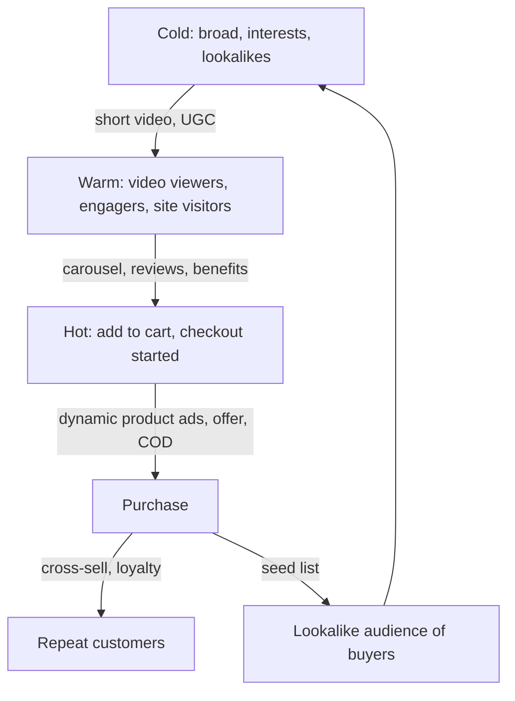
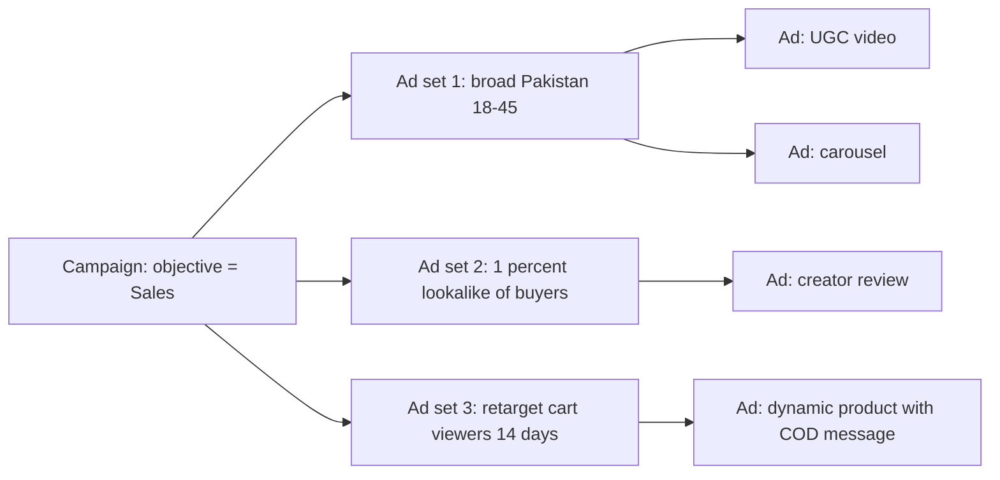
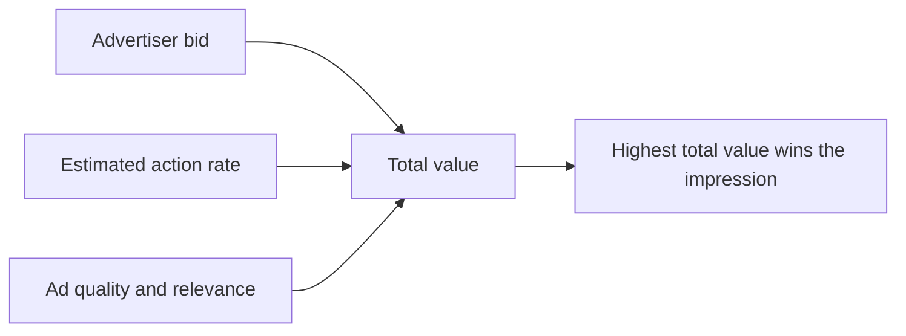
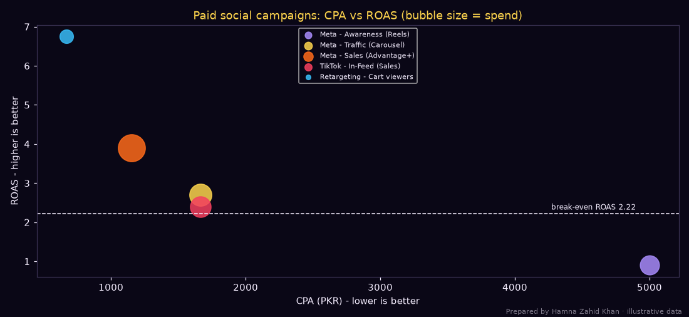

# Session 3 · Fundamentals of Social Media Advertising

> 🏠 [Diploma in Digital Marketing](../../README.md) › [Term 1](../README.md) › [Social Media Marketing](README.md) › **Session 3**
>
> ⏱ **Estimated time:** 3 hours (2 h theory + 1 h lab) · 📋 **Prerequisites:** Session 2

[⬅ Previous: Session 2](session-02-managing-social-media-presence.md) · [Next: Session 4 ➡](session-04-social-listening-and-copywriting.md)

---

## 🎯 Learning objectives

By the end of this session you will be able to:

- Explain what **social media advertising** is and how it differs from organic posting and search ads.
- List the main **ad formats and objectives** on Meta (Facebook/Instagram), TikTok, YouTube, LinkedIn and Snapchat.
- Elaborate on **targeting and audience segmentation**: core, custom, lookalike and retargeting audiences.
- Illustrate how to create **effective ad creatives and copy** for social feeds.
- Outline **budgeting and bid strategies**, and calculate reach, frequency, CPM, CPC, CPA and ROAS for social campaigns.

## 📖 Concepts

### 1. What social media advertising is

**Social media advertising** means paying a platform to show your content to people chosen by their demographics, interests, behaviour or relationship with your business. You pay through an **auction**, usually per 1,000 impressions (CPM), per click (CPC) or optimised towards an action (purchase, lead, install).

| | Organic social | Paid social | Search ads (Module 4) |
|---|---|---|---|
| Cost | Free (time and content) | Pay per impression/click | Pay per click |
| Reach | Followers + algorithm | Anyone in the targeting | People searching a keyword |
| Intent | Low–medium | Low (interrupts browsing) | High (actively searching) |
| Strength | Community, trust | Scale, precision, demand **creation** | Demand **capture** |
| Control | Low | High (who, when, how much) | High |

> 💡 Search ads catch people who already want something. Social ads **create** the want – so the creative (the image or video) does most of the work.

### 2. Campaign structure

All major platforms use a similar three-level structure:

| Level | Meta name | TikTok name | You decide |
|---|---|---|---|
| 1 | **Campaign** | Campaign | **Objective** (and sometimes budget) |
| 2 | **Ad set** | Ad group | **Audience, placements, budget, schedule, bid, optimisation event** |
| 3 | **Ad** | Ad | **Creative**: image/video, text, headline, CTA, link |

### 3. Objectives (Meta's simplified set)

| Objective | Use when you want | Typical KPI |
|---|---|---|
| **Awareness** | Many people to see and remember you | Reach, CPM, ad recall lift |
| **Traffic** | Visits to a website, app or WhatsApp | CPC, landing page views |
| **Engagement** | Likes, video views, messages, page follows | Cost per engagement/message |
| **Leads** | Contact details (instant forms, Messenger, calls) | Cost per lead (CPL) |
| **App promotion** | Installs and in-app actions | Cost per install (CPI) |
| **Sales** | Purchases, catalogue sales | CPA, ROAS |

TikTok, LinkedIn and Snapchat offer very similar groupings (awareness → consideration → conversion). Choosing the right objective matters because the platform's algorithm **finds people likely to do that action**: a Traffic campaign finds clickers, not buyers.

### 4. Ad formats by platform

| Platform | Main formats | Notes |
|---|---|---|
| **Facebook & Instagram** | Single image, single video, **carousel** (up to 10 cards), collection/instant experience, Stories, Reels, **lead forms**, click-to-WhatsApp/Messenger, catalogue (Advantage+ catalogue) ads | Placements across Feed, Stories, Reels, Explore, Marketplace, Audience Network |
| **TikTok** | In-feed video, **Spark Ads** (boost an organic or creator post), TopView, branded hashtag challenge, branded effects, Shop ads | Native, creator-style video wins |
| **YouTube** | Skippable/non-skippable in-stream, bumper, in-feed, Shorts | Bought through Google Ads (Module 4) |
| **LinkedIn** | Sponsored content (single image, video, document, carousel), message ads, lead gen forms, text ads | Expensive CPC but precise B2B targeting (job title, company, industry) |
| **Snapchat** | Single image/video, story ads, collection, AR lenses, filters | Young audience, playful formats |
| **X** | Promoted posts, video, carousel | Real-time conversations |

**Specs to remember:** vertical **9:16** (1080 × 1920) for Stories/Reels/TikTok; **4:5** (1080 × 1350) for feed; **1:1** works everywhere. Keep key text and logos away from the top and bottom ~14% where the interface covers them.

### 5. Targeting and audience segmentation

| Audience type | What it is | Example |
|---|---|---|
| **Core / saved audience** | Demographics, location, interests, behaviours | Women 22–40, Lahore + Islamabad, interests: bridal wear, makeup |
| **Custom audience** | People who already know you | Website visitors (via pixel), customer list, IG engagers, video viewers |
| **Lookalike audience** | New people similar to a source custom audience | 1% lookalike of past purchasers in Pakistan |
| **Retargeting** | Custom audiences used to bring people back | Viewed product, did not buy, last 14 days |
| **Broad / Advantage+ audience** | Minimal targeting; the algorithm finds buyers | Pakistan, 18–55, no interests – relies on strong pixel data |

**Segmentation** means splitting the market into groups that respond differently and giving each its own message:

| Segment | Message | Format |
|---|---|---|
| Cold (never heard of you) | Problem + brand intro | Short video, UGC style |
| Warm (engaged, visited) | Benefits, proof, reviews | Carousel, testimonials |
| Hot (added to cart, started checkout) | Offer, urgency, reassurance (COD, free returns) | Dynamic product ad |
| Existing customers | Cross-sell, loyalty | Catalogue, new arrivals |

#### Tracking makes targeting possible

- **Meta Pixel / TikTok Pixel** on the website + the **Conversions API** (server-side) send events like `ViewContent`, `AddToCart`, `Purchase`.
- Without them, the platform cannot optimise for sales or build retargeting audiences.
- Respect privacy: use a consent banner and never upload customer lists without permission and hashing (platforms hash automatically on upload).

### 6. Creating effective ad creatives

**The 3-second rule:** most people decide within about 3 seconds whether to stop scrolling.

| Principle | How |
|---|---|
| **Thumb-stopping opening** | Movement, a face, a bold claim, a problem in the first frame |
| **Native look** | Look like a creator post, not a TV ad – phone-shot UGC often beats studio work |
| **Sound-off friendly** | Burned-in captions; text overlays |
| **One message** | One product, one benefit, one CTA |
| **Show the product in use** | Demonstration beats description |
| **Social proof** | Reviews, "10,000+ orders", ratings, creator testimonials |
| **Local relevance** | Urdu/Roman Urdu, local settings, prices in PKR, COD mention |
| **Clear CTA** | *Shop now, Send WhatsApp message, Get quote, Sign up* |
| **Variety** | 3–6 creatives per ad set so the algorithm can find winners; refresh every 2–4 weeks |

#### Copy framework – **PAS** (Problem, Agitate, Solve)

> **Problem:** "Bijli gayi aur phone 5% pe? 🔋"
> **Agitate:** "Load-shedding 6 hours, power bank 2 hours. Not enough."
> **Solve:** "20,000 mAh fast-charge power bank – 4 full charges. COD across Pakistan. Shop now 👇"

Other useful frameworks: **AIDA** (Module 1), **Before–After–Bridge**, **Feature–Advantage–Benefit**.

### 7. Budgeting

| Concept | Meaning |
|---|---|
| **Daily vs lifetime budget** | Spend per day, or a total spread over the campaign dates |
| **Campaign budget (Advantage+ campaign budget / CBO)** | Platform moves budget between ad sets to the best performers |
| **Ad set budget (ABO)** | You fix each ad set's budget – useful for controlled tests |
| **Learning phase** | The algorithm needs about **50 optimisation events per ad set per week** (Meta's guidance) to stabilise; avoid big edits during it |
| **Scaling** | Increase budgets gradually (e.g. 20% every few days) or duplicate winning ad sets |

**Budget planning approaches:** (a) percentage of revenue, (b) competitor parity, (c) **objective-and-task** – work backwards from the goal (best), (d) test budget first (e.g. PKR 2,000–5,000/day for 7 days) then scale winners.

### 8. Bid strategies

| Strategy | How it works | When to use |
|---|---|---|
| **Highest volume / lowest cost** | Get as many results as possible for the budget | Default; new campaigns |
| **Cost per result goal (cost cap)** | Keep average CPA around a target | When you know your break-even CPA |
| **Bid cap** | Maximum bid in each auction | Experienced advertisers controlling cost strictly |
| **ROAS goal (minimum ROAS)** | Aim for a revenue ratio | E-commerce with purchase value tracking |
| **Reach & frequency (reservation)** | Book predictable reach at a fixed CPM | Big awareness launches |

Tighter controls (cost cap, bid cap) usually mean **lower CPA but less spend delivered** – the algorithm skips expensive auctions.

### 9. Key metrics and formulas

| Metric | Formula |
|---|---|
| **Frequency** | Impressions ÷ Reach |
| **CPM** | Spend ÷ Impressions × 1,000 |
| **CTR (link)** | Link clicks ÷ Impressions × 100 |
| **CPC** | Spend ÷ Link clicks |
| **Conversion rate** | Purchases ÷ Link clicks × 100 |
| **CPA / CPL** | Spend ÷ Purchases (or leads) |
| **ROAS** | Revenue ÷ Spend |
| **Break-even ROAS** | 1 ÷ Gross margin |
| **Thumb-stop rate (hook rate)** | 3-second video views ÷ Impressions × 100 |
| **Hold rate** | ThruPlays (15 s or complete) ÷ 3-second views × 100 |

## 🧭 Diagrams

### Paid social funnel with audiences



### Campaign structure



### How the ad auction picks a winner



## 💻 Worked examples

### Example 1 – Comparing five social campaigns

One month of campaigns for an Islamabad online shoe store with a **45% gross margin**.

📄 `code/session-03_social_ad_planner.py`

```python
# Plan and compare paid social campaigns: reach, frequency, CPM, CPC, CPA, ROAS, and
# the effect of the bid strategy. Prepared by Hamna Zahid Khan, Junior Lecturer.
# Illustrative one-month data in PKR for an Islamabad online shoe store ("Qadam").
import matplotlib
matplotlib.use("Agg")
import matplotlib.pyplot as plt

BG, FIRE, GOLD, VIOLET, EMBER, TEXT = "#0A0716", "#FF6B1A", "#FCD34D", "#A78BFA", "#F43F5E", "#F5EEFF"
MARGIN = 0.45   # gross margin before advertising

# name: spend, impressions, reach, link clicks, purchases, revenue
camps = {
    "Meta - Awareness (Reels)":   (60_000, 600_000, 240_000, 1_800,  12,  54_000),
    "Meta - Traffic (Carousel)":  (80_000, 320_000, 150_000, 4_800,  48, 216_000),
    "Meta - Sales (Advantage+)":  (120_000, 400_000, 170_000, 5_200, 104, 468_000),
    "TikTok - In-Feed (Sales)":   (70_000, 700_000, 310_000, 4_200,  42, 168_000),
    "Retargeting - Cart viewers": (30_000,  90_000,  18_000, 1_350,  45, 202_500),
}
print(f"{'Campaign':<28}{'Freq':>5}{'CPM':>6}{'CTR%':>6}{'CPC':>5}{'CR%':>5}{'CPA':>7}{'ROAS':>6}")
results = {}
for n, (spend, imp, reach, clk, buy, rev) in camps.items():
    freq = imp / reach
    cpm = spend / imp * 1000
    ctr = clk / imp * 100
    cpc = spend / clk
    cr = buy / clk * 100
    cpa = spend / buy
    roas = rev / spend
    results[n] = (cpa, roas)
    print(f"{n:<28}{freq:>5.1f}{cpm:>6.0f}{ctr:>6.2f}{cpc:>5.0f}{cr:>5.1f}{cpa:>7,.0f}{roas:>6.2f}")
tot = [sum(c[i] for c in camps.values()) for i in range(6)]
print(f"\nTotal spend PKR {tot[0]:,} -> revenue PKR {tot[5]:,}; blended ROAS {tot[5] / tot[0]:.2f}; break-even ROAS {1 / MARGIN:.2f}")
profit = tot[5] * MARGIN - tot[0]
print(f"Profit after ads = {tot[5]:,} x {MARGIN} - {tot[0]:,} = PKR {profit:,.0f}")

# Bid strategy comparison for the same PKR 100,000 budget (illustrative platform behaviour)
print("\nBid strategy what-if for PKR 100,000:")
for name, cpa in (("Lowest cost (no cap)", 1_150), ("Cost cap PKR 1,000", 980), ("Bid cap PKR 900", 870)):
    delivered = 1.0 if name.startswith("Lowest") else (0.82 if "Cost" in name else 0.55)
    spent = 100_000 * delivered
    print(f"  {name:<22} spends PKR {spent:>9,.0f}  ~CPA {cpa:>5,}  ~purchases {spent / cpa:>5.0f}")

fig, ax = plt.subplots(figsize=(10, 4.6), facecolor=BG); ax.set_facecolor(BG)
cols = [VIOLET, GOLD, FIRE, EMBER, "#38BDF8"]
for (n, (cpa, roas)), c in zip(results.items(), cols):
    ax.scatter(cpa, roas, s=camps[n][0] / 150, color=c, alpha=.85, label=n)
ax.axhline(1 / MARGIN, color=TEXT, ls="--", lw=1); ax.text(4_900, 1 / MARGIN + .1, "break-even ROAS 2.22", color=TEXT, fontsize=8, ha="right")
ax.set_xlabel("CPA (PKR) - lower is better", color=TEXT); ax.set_ylabel("ROAS - higher is better", color=TEXT)
ax.set_title("Paid social campaigns: CPA vs ROAS (bubble size = spend)", color=GOLD)
ax.tick_params(colors=TEXT)
for s in ax.spines.values(): s.set_color("#3b3355")
ax.legend(facecolor=BG, labelcolor=TEXT, fontsize=7, loc="upper center", markerscale=0.35)
fig.text(0.99, 0.01, "Prepared by Hamna Zahid Khan · illustrative data", color=TEXT, alpha=0.5, ha="right", fontsize=7)
plt.tight_layout(); plt.savefig("session-03_social_ad_planner.png", dpi=110, facecolor=BG)
print("Saved session-03_social_ad_planner.png")
```

**Output**

```text
Campaign                     Freq   CPM  CTR%  CPC  CR%    CPA  ROAS
Meta - Awareness (Reels)      2.5   100  0.30   33  0.7  5,000  0.90
Meta - Traffic (Carousel)     2.1   250  1.50   17  1.0  1,667  2.70
Meta - Sales (Advantage+)     2.4   300  1.30   23  2.0  1,154  3.90
TikTok - In-Feed (Sales)      2.3   100  0.60   17  1.0  1,667  2.40
Retargeting - Cart viewers    5.0   333  1.50   22  3.3    667  6.75

Total spend PKR 360,000 -> revenue PKR 1,108,500; blended ROAS 3.08; break-even ROAS 2.22
Profit after ads = 1,108,500 x 0.45 - 360,000 = PKR 138,825

Bid strategy what-if for PKR 100,000:
  Lowest cost (no cap)   spends PKR   100,000  ~CPA 1,150  ~purchases    87
  Cost cap PKR 1,000     spends PKR    82,000  ~CPA   980  ~purchases    84
  Bid cap PKR 900        spends PKR    55,000  ~CPA   870  ~purchases    63
Saved session-03_social_ad_planner.png
```



**Interpretation:**

- **Retargeting** is the most efficient (CPA PKR 667, ROAS 6.75) – but its audience is small and its frequency (5.0) is high; it can't be scaled much.
- **Advantage+ Sales** is the scalable winner (ROAS 3.9 on the largest budget).
- **Traffic** and **TikTok** campaigns are just above break-even (2.22). Test new creatives before adding budget.
- **Awareness** loses money on last-click sales (ROAS 0.9) – expected, because its job is to fill the warm and retargeting pools. Judge it on CPM (PKR 100), reach and whether retargeting audiences grow.
- The bid strategy what-if shows the trade-off: a **bid cap** gives the lowest CPA but spends only 55% of the budget, producing fewer total purchases.

### Example 2 – Budget from a sales goal

An online perfume brand wants **300 orders** in 30 days.

📄 `code/session-03_budget_from_goal.py`

```python
# Work backwards from a sales goal to a paid social budget, then check frequency.
# Prepared by Hamna Zahid Khan, Junior Lecturer.
goal_orders = 300          # orders wanted in 30 days
aov = 4_500                # average order value, PKR
margin = 0.40
cr = 0.012                 # landing page conversion rate from link clicks (1.2%)
ctr = 0.011                # link-click-through rate (1.1%)
cpm = 210                  # expected CPM, PKR
audience = 1_200_000       # estimated audience size in the ad tool

clicks = goal_orders / cr
impressions = clicks / ctr
budget = impressions / 1000 * cpm
cpa = budget / goal_orders
breakeven_cpa = aov * margin
reach_est = min(audience * 0.45, impressions)      # assume ~45% of audience reachable in a month
freq = impressions / reach_est
print(f"Clicks needed      = {goal_orders} / {cr} = {clicks:,.0f}")
print(f"Impressions needed = {clicks:,.0f} / {ctr} = {impressions:,.0f}")
print(f"Budget             = {impressions:,.0f} / 1000 x PKR {cpm} = PKR {budget:,.0f} (PKR {budget / 30:,.0f}/day)")
print(f"Expected CPA       = PKR {cpa:,.0f}  vs break-even CPA PKR {breakeven_cpa:,.0f}")
print(f"Estimated reach    = {reach_est:,.0f}; frequency = {freq:.1f} per person per month")
print("Verdict:", "profitable" if cpa < breakeven_cpa else "unprofitable - improve CR/CTR or raise AOV",
      "|", "frequency OK" if freq <= 6 else "frequency too high - widen audience or refresh creatives weekly")
```

**Output**

```text
Clicks needed      = 300 / 0.012 = 25,000
Impressions needed = 25,000 / 0.011 = 2,272,727
Budget             = 2,272,727 / 1000 x PKR 210 = PKR 477,273 (PKR 15,909/day)
Expected CPA       = PKR 1,591  vs break-even CPA PKR 1,800
Estimated reach    = 540,000; frequency = 4.2 per person per month
Verdict: profitable | frequency OK
```

**Hand-check:** 300 ÷ 0.012 = 25,000 clicks; 25,000 ÷ 0.011 ≈ 2.27 M impressions; 2.27 M ÷ 1,000 × 210 ≈ **PKR 477,000**. CPA ≈ PKR 1,591 < break-even CPA PKR 1,800, so the plan is profitable but tight. Raising the landing page conversion rate from 1.2% to 1.5% would cut the budget by 20%.

### Example 3 – Setting up a Meta sales campaign (step by step)

1. **Events Manager:** confirm Pixel + Conversions API send `Purchase` with value and currency (PKR).
2. **Ads Manager → Create → Sales** objective.
3. Campaign: turn on **Advantage+ campaign budget**, PKR 6,000/day.
4. Ad set 1: **Advantage+ audience**, Pakistan, 18–45, optimisation event **Purchase**, placements Advantage+.
5. Ad set 2: **Custom audience** – website visitors 30 days + IG engagers 60 days, excluding purchasers 30 days.
6. Ads: 3 videos (UGC unboxing, product demo, creator review) + 1 carousel of best-sellers; primary text with PAS; headline "Free delivery over PKR 3,000"; CTA *Shop now*; URL with UTMs (`utm_source=facebook&utm_medium=paid_social&utm_campaign=winter_sale`).
7. **Review:** check previews in Feed, Stories and Reels; spelling, prices, safe zones.
8. **Launch and wait** – leave it for about 7 days (learning phase) before judging; then pause creatives with CPA > break-even and add new ones.

### Example 4 – Creative diagnosis with video metrics

| Creative | Impressions | 3-s views | ThruPlays | Link clicks | Hook rate | Hold rate | CTR |
|---|---|---|---|---|---|---|---|
| Studio product shot | 100,000 | 18,000 | 2,700 | 600 | 18% | 15% | 0.60% |
| Phone-shot UGC review | 100,000 | 36,000 | 9,000 | 1,500 | 36% | 25% | 1.50% |

Hook rate = 3-s views ÷ impressions; hold rate = ThruPlays ÷ 3-s views. The UGC review doubles the hook rate and keeps people watching – make more creatives in that style.

## 📋 Checklist · Before launching a paid social campaign

- [ ] Objective matches the goal (Sales for purchases, not Traffic).
- [ ] Pixel/Conversions API tested; purchase value passing.
- [ ] Break-even CPA and ROAS calculated.
- [ ] Audiences: cold, warm and hot planned; purchasers excluded from acquisition ad sets.
- [ ] 3–6 creatives per ad set, in 9:16, 4:5 and 1:1; captions burned in.
- [ ] Copy checked: hook, benefit, proof, CTA, PKR prices, COD/returns.
- [ ] UTM parameters on all URLs.
- [ ] Budget large enough for about 50 conversions per ad set per week, or optimise for a higher-funnel event.
- [ ] Ad policies checked (no misleading claims, before/after restrictions for health and beauty, special categories).

## ⚠️ Common mistakes

| Mistake | Fix |
|---|---|
| "Boost post" button for every goal | Use Ads Manager with the right objective |
| Traffic objective when you want sales | Optimise for Purchase (needs Pixel) |
| Tiny audiences stacked with interests | Go broader; let creative and pixel data do the targeting |
| Editing the campaign every day | Let the learning phase finish; change one thing at a time |
| One creative for months | Rotate new creatives every 2–4 weeks; watch frequency |
| Not excluding existing buyers | Exclude purchasers from acquisition campaigns |
| Judging awareness ads on sales | Use reach, CPM, hook rate and retargeting pool growth |
| Ignoring comments on ads | Ads collect comments too – reply, hide spam |

## 🧪 Lab / practice tasks

**Task 1 (easy) – Objective match.** Pick the objective: (a) a new restaurant wants 200,000 Karachiites to know it exists; (b) a real-estate agent wants phone numbers of buyers; (c) an online store wants purchases; (d) a fintech app wants downloads.

<details><summary>✅ Solution</summary>

(a) Awareness · (b) Leads (instant form or click-to-WhatsApp) · (c) Sales · (d) App promotion.

</details>

**Task 2 (easy) – Metrics.** A TikTok campaign spent PKR 50,000 for 400,000 impressions, 160,000 reach, 3,200 link clicks and 64 purchases worth PKR 224,000. Margin 40%. Calculate frequency, CPM, CTR, CPC, CR, CPA, ROAS and say if it is profitable.

<details><summary>✅ Solution</summary>

Frequency 2.5 · CPM PKR 125 · CTR 0.8% · CPC PKR 15.6 · CR 2% · CPA PKR 781 · ROAS 4.48 · Break-even ROAS 2.5 → **profitable**.

</details>

**Task 3 (medium) – Audience plan.** For a Lahore bridal boutique, design four ad sets (cold, lookalike, warm, hot) with targeting, creative type and message for each.

<details><summary>✅ Model answer</summary>

**Cold:** women 21–32, Lahore/Islamabad/Karachi, interests bridal wear, weddings, engaged-life-event; creative: Reel of a bride's reveal; message: "Your dream bridal, made to measure". **Lookalike:** 1% lookalike of past enquirers; creative: carousel of 2026 collection. **Warm:** IG engagers and video viewers 60 days; creative: real bride testimonials; message: "Book a free trial appointment". **Hot:** website visitors who viewed the booking page, 30 days; creative: limited slots + WhatsApp CTA; exclude booked clients.

</details>

**Task 4 (medium) – Budget.** Edit `code/session-03_budget_from_goal.py`: goal 120 leads, CR 8% (lead form completion per click), CTR 1.4%, CPM PKR 180, AOV replaced by value per lead PKR 2,500 with margin 1.0. Is it profitable?

<details><summary>✅ Solution</summary>

Clicks = 1,500; impressions ≈ 107,143; budget ≈ **PKR 19,286**; CPL ≈ PKR 161 vs break-even PKR 2,500 → very profitable; frequency is low (audience is large).

</details>

**Task 5 (challenge) – Write three creatives.** For a Karachi solar company, write three ad concepts (UGC testimonial, demo, offer). For each give: first 3 seconds, on-screen text, primary text using PAS (≤ 125 characters before "more"), headline, CTA, and placement.

## ✅ Quick quiz

1. Which campaign level controls the audience and budget on Meta (without campaign budget)?
   a) Campaign b) Ad set c) Ad d) Page
2. A lookalike audience is:
   a) your existing customers b) new people similar to a source audience c) people who visited your site d) a random audience
3. Frequency is calculated as:
   a) Reach ÷ Impressions b) Impressions ÷ Reach c) Clicks ÷ Reach d) Spend ÷ Reach
4. With a 40% margin, break-even ROAS is:
   a) 1.4 b) 2.5 c) 4.0 d) 40
5. A bid cap typically leads to:
   a) higher CPA and more spend b) lower CPA but possibly less spend delivered c) no change d) free impressions

<details><summary>Show answers</summary>

1-b · 2-b · 3-b · 4-b · 5-b

</details>

## 📝 Summary

- Paid social **creates demand** with precise targeting; structure = **campaign (objective) → ad set (audience, budget, bid) → ad (creative)**.
- Choose the **objective** that matches the action you want – the algorithm optimises for it.
- Audiences: **core, custom, lookalike, retargeting, broad/Advantage+**; message by temperature (cold → warm → hot → customers).
- Creatives win or lose in **3 seconds**: native, captioned, one message, proof, local relevance, clear CTA; use PAS for copy.
- Budget with objective-and-task maths; respect the learning phase; choose **lowest cost, cost cap, bid cap or ROAS goal** knowingly.
- Measure: frequency, CPM, CTR, CPC, CR, CPA, ROAS, hook rate, hold rate.

**Interview / viva questions**

1. How is social advertising different from search advertising?
2. Explain custom, lookalike and retargeting audiences with an example.
3. Why might a Traffic campaign bring clicks but no sales?
4. What makes a social video ad "thumb-stopping"?
5. Explain cost cap vs bid cap vs lowest cost.
6. How would you plan a monthly budget for 500 online orders?

---

[⬅ Previous: Session 2](session-02-managing-social-media-presence.md) · [Next: Session 4 ➡](session-04-social-listening-and-copywriting.md)

<sub>Prepared by **Hamna Zahid Khan**, Junior Lecturer · Diploma in Digital Marketing</sub>
