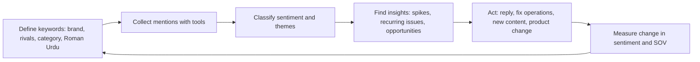
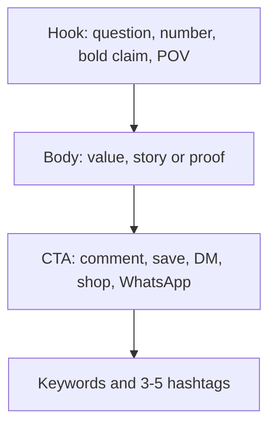
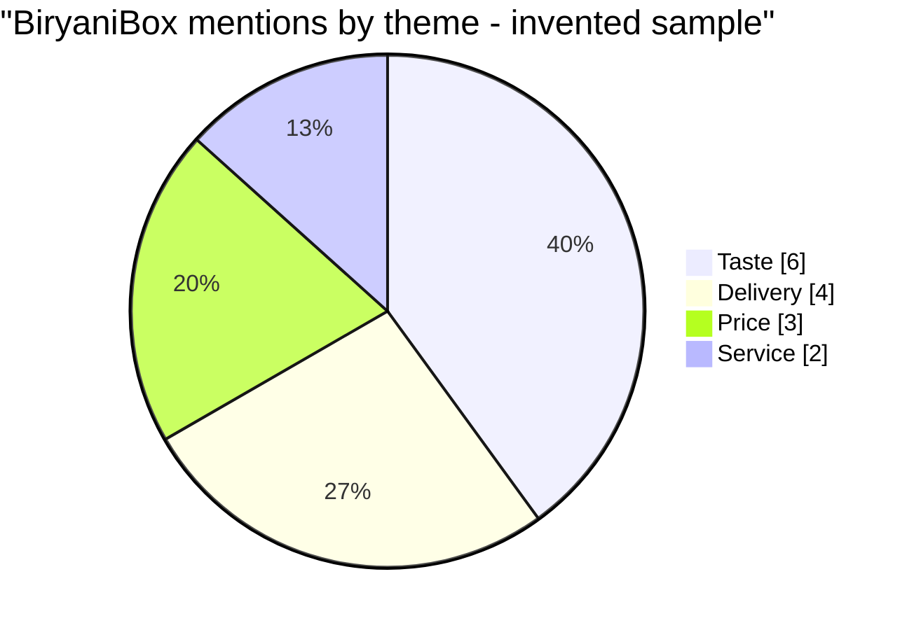
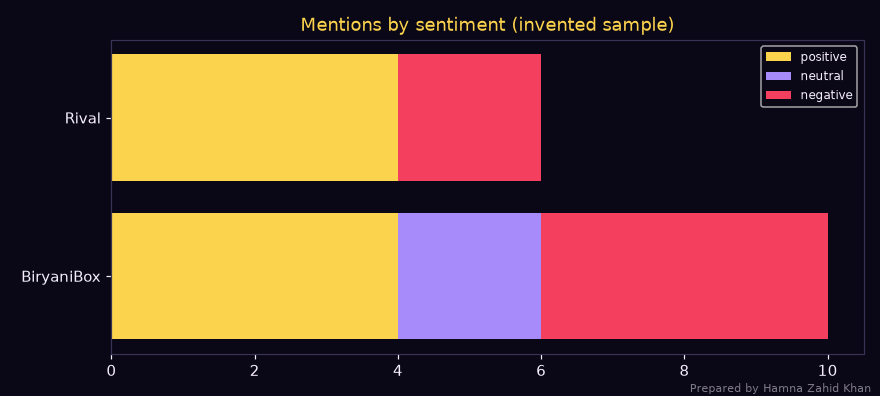

# Session 4 · Social Listening and Copywriting

> 🏠 [Diploma in Digital Marketing](../../README.md) › [Term 1](../README.md) › [Social Media Marketing](README.md) › **Session 4**
>
> ⏱ **Estimated time:** 3 hours (1.5 h theory + 1.5 h lab) · 📋 **Prerequisites:** Session 3

[⬅ Previous: Session 3](session-03-social-media-advertising.md) · [Next: Session 5 ➡](session-05-youtube-marketing.md)

---

## 🎯 Learning objectives

By the end of this session you will be able to:

- List techniques for effective **social listening** and explain how it differs from social monitoring.
- Outline the **tools** used to monitor brand mentions, sentiment and competitors.
- Explain the essentials of **social media copywriting**: hooks, voice, structure, CTAs and platform conventions.
- Define methods for **creating engaging content** using copy frameworks and storytelling.
- Illustrate techniques for **analysing content performance** and turning listening data into decisions.

## 📖 Concepts

### 1. Monitoring vs listening

| | Social **monitoring** | Social **listening** |
|---|---|---|
| Question | "What are people saying to/about us right now?" | "What does it mean, and what should we do?" |
| Focus | Individual mentions, tags, comments, DMs | Patterns, themes, sentiment trends, share of voice |
| Time | Real time, reactive | Over weeks and months, strategic |
| Output | Replies, support tickets | Insights for product, content, campaigns, PR |
| Example | Reply to a customer complaining about delivery | Notice that 30% of negative mentions this month are about delivery → change courier |

### 2. What to listen for

| Listening stream | Search terms / sources | Why |
|---|---|---|
| **Brand** | Brand name, misspellings, Urdu spelling, handle, hashtags, product names, CEO name | Reputation and service issues |
| **Competitors** | Their names and products | Their complaints = your opportunities |
| **Industry and category** | "best lawn brand", "solar panel price", "online tuition" | Demand trends and content ideas |
| **Campaigns** | Campaign hashtag, slogan | Measure buzz and reception |
| **Influencers and communities** | Key creators, Facebook groups, Reddit threads | Who drives conversation |
| **Crisis signals** | Brand + "scam", "fraud", "refund", "worst", "boycott" | Early warning |

**Pakistani listening tip:** customers write in English, Urdu script **and Roman Urdu** ("bohat bekar service", "zabardast taste"). Include all three in keyword lists and sentiment dictionaries, plus common misspellings.

### 3. Listening techniques

1. **Build a keyword query** with Boolean logic, e.g. `("BiryaniBox" OR "biryani box" OR #biryanibox) AND NOT (job OR hiring)`.
2. **Classify sentiment** – positive, neutral, negative (tools use AI; always check a sample by hand, sarcasm fools machines).
3. **Tag themes** – delivery, taste, price, service, packaging.
4. **Calculate share of voice and net sentiment** vs competitors.
5. **Spot spikes** – sudden jumps in volume; find the cause.
6. **Identify influencers** – which accounts drive the most engagement about your category.
7. **Close the loop** – send insights to the right team (product, operations, support, content) and track the fix.

**Net sentiment score (NSS)** = (Positive mentions − Negative mentions) ÷ Total mentions × 100. It ranges from −100 to +100.

### 4. Listening and monitoring tools

| Tool | Type | Good for |
|---|---|---|
| **Native search & notifications** (IG, TikTok, X, Facebook) | Free | Mentions, tags, hashtags |
| **Meta Business Suite inbox** | Free | Comments and DMs on FB/IG in one place |
| **Google Alerts** | Free | Web and news mentions |
| **Google Trends** | Free | Search interest over time and by province |
| **Brand24, Mention** | Paid (affordable) | Mentions across social/web, sentiment, SOV, influencer scores |
| **Talkwalker, Meltwater, Sprout Social, Brandwatch** | Enterprise | Large-scale listening, image recognition, reporting |
| **Hootsuite / Sprout streams** | Paid | Monitoring streams + publishing |

### 5. Copywriting essentials

**Social copywriting** is writing short, scroll-stopping text that makes people act: read, watch, comment, click or buy.

#### The anatomy of a caption

| Part | Job | Example |
|---|---|---|
| **Hook (first line)** | Stop the scroll – it's often all people see before "…more" | "3 shawls under PKR 2,500 that look like 10k? 🧣" |
| **Body** | Deliver value, story or proof | "Swipe for all three – pashmina feel, machine-washable." |
| **CTA** | Tell people exactly what to do | "Comment 'SHAWL' and we'll DM you the link." |
| **Hashtags / keywords** | Discovery and social search | `#karachifashion #winterwear #shawls` |

#### Hook formulas

| Formula | Example |
|---|---|
| **Question** | "Why does your chai taste different at dhabas?" |
| **Number / list** | "5 lunchbox ideas your kids will actually eat" |
| **Bold claim / myth-buster** | "Expensive sunscreen isn't better. Here's proof." |
| **"Stop doing this"** | "Stop storing atta like this ❌" |
| **POV / relatable** | "POV: bijli gayi right before your Zoom interview" |
| **Curiosity gap** | "The one thing every bride forgets on her mehndi day…" |
| **Result first** | "From 200 to 20,000 followers in 90 days – what we changed" |

#### Writing principles

1. **Write for one person** – "you/aap", not "our valued customers".
2. **Benefits over features** – "stays warm for 6 hours" beats "double-wall steel".
3. **Short sentences, white space** – line breaks, one idea per line.
4. **Specifics build trust** – numbers, prices, times, places.
5. **Match the platform's tone** – LinkedIn professional, TikTok casual, X punchy.
6. **Language choice** – English, Urdu or Roman Urdu depending on audience; code-mixing is normal and relatable in Pakistan, but stay consistent with the brand voice.
7. **Accessibility** – alt text on images, captions on videos, camel-case hashtags (`#KarachiFood`) so screen readers read them correctly.
8. **Honesty** – no fake scarcity or misleading claims (also breaks ad policies).

#### Platform conventions (character limits)

| Platform | Limit | Practical guidance |
|---|---|---|
| Instagram caption | 2,200 chars | Hook in first ~125 chars; 3–5 specific hashtags |
| TikTok caption | 4,000 chars | Short caption; keywords for search; text on screen matters more |
| Facebook post | ~63,000 chars | 40–80 chars often perform best for engagement |
| X post | 280 chars (free accounts) | One idea, punchy |
| LinkedIn post | 3,000 chars | Hook in first 2 lines (~210 chars) before "see more"; story + lesson |
| YouTube title | 100 chars | Keep the keyword near the start; ~60–70 chars visible |

### 6. Copy frameworks

| Framework | Steps | Best for |
|---|---|---|
| **AIDA** | Attention → Interest → Desire → Action | Product posts and ads |
| **PAS** | Problem → Agitate → Solve | Pain-point products (UPS, skincare, tuition) |
| **BAB** | Before → After → Bridge | Transformations (fitness, home decor) |
| **FAB** | Feature → Advantage → Benefit | Technical products |
| **4 U's** (headline check) | Useful, Urgent, Unique, Ultra-specific | Headlines and hooks |
| **Storytelling arc** | Character → Problem → Struggle → Solution → Result | Brand stories, founder posts, testimonials |

**BAB example (gym):**
*Before:* "Out of breath climbing two floors?" *After:* "Imagine taking the stairs at Dolmen Mall without stopping." *Bridge:* "Our 8-week beginners' programme gets you there. First week free – DM 'START'."

### 7. Creating engaging content – methods

- **Educational carousels** – each slide one step; last slide CTA. High saves.
- **Storytelling Reels** – show a journey (from fabric to finished kurta).
- **Interactive** – polls, quizzes, "this or that", question stickers, comment-to-get.
- **UGC and testimonials** – real customers on camera.
- **Trends adapted to the brand** – use the sound/format but keep your message.
- **Series** – recurring formats ("Myth Monday", "Founder Friday") train the audience to come back.
- **Behind the scenes** – process, team, packing orders – builds trust.

### 8. Analysing content performance

| Metric | What it tells you | Good signal |
|---|---|---|
| **Reach / views** | Did the algorithm distribute it? | Above your average |
| **Engagement rate by reach** | Did people react? | Platform and niche dependent – compare to your own average |
| **Saves** | Was it useful enough to keep? | High on educational posts |
| **Shares / sends** | Worth telling a friend? | The strongest growth signal |
| **Comments** | Did it start a conversation? | Questions in replies = buying interest |
| **Average watch time / completion** | Did the video hold attention? | > 50% completion on short video |
| **Link clicks / CTR** | Did it drive action? | Compare with similar posts |
| **Profile visits & follows from post** | Did it build the audience? | Follows per 1,000 reach |

**Method:** compare each post to your **own average** (benchmarks vary hugely by industry and account size). Tag every post by pillar, format, hook type and topic, then compare groups – e.g. "question hooks get 40% more comments than statement hooks".

## 🧭 Diagrams

### Listening loop



### Caption structure



### Mentions by theme (BiryaniBox sample)



## 💻 Worked examples

### Example 1 – A mini listening tool

A small lexicon-based classifier tags English and Roman Urdu mentions, handles simple negation ("not fresh", "reply hi nahi"), and calculates share of voice and net sentiment.

📄 `code/session-04_social_listening.py`

```python
# A tiny social listening tool: classify brand mentions (English + Roman Urdu) by sentiment
# with a keyword lexicon, find themes, compute net sentiment and share of voice, and chart it.
# Prepared by Hamna Zahid Khan, Junior Lecturer. The mentions below are invented for practice.
import re
from collections import Counter
import matplotlib
matplotlib.use("Agg")
import matplotlib.pyplot as plt

BG, FIRE, GOLD, VIOLET, EMBER, TEXT = "#0A0716", "#FF6B1A", "#FCD34D", "#A78BFA", "#F43F5E", "#F5EEFF"
POS = {"love", "great", "best", "zabardast", "behtareen", "acha", "achi", "fast", "fresh", "mazay", "recommend", "thanks", "shukriya", "kamaal"}
NEG = {"late", "cold", "worst", "bekar", "ganda", "refund", "rude", "missing", "kharab", "slow", "never", "disappointed", "mehnga", "expensive"}
NEGATORS = {"not", "nahi", "nahin", "na"}
THEMES = {"delivery": {"delivery", "late", "rider", "time", "fast", "slow"},
          "taste": {"taste", "mazay", "fresh", "cold", "biryani", "zinger"},
          "price": {"price", "mehnga", "expensive", "deal", "discount", "sasta"},
          "service": {"rude", "staff", "support", "refund", "reply", "helpline"}}

mentions = [
    ("BiryaniBox", "BiryaniBox ki biryani zabardast thi, delivery bhi fast!"),
    ("BiryaniBox", "Order 45 min late aur biryani cold. Bekar experience"),
    ("BiryaniBox", "Best deal in Karachi for family platter, recommend"),
    ("BiryaniBox", "Support ne reply hi nahi kiya, refund chahiye"),
    ("BiryaniBox", "Taste acha hai lekin price thora mehnga hai"),
    ("BiryaniBox", "Rider was rude, never ordering again"),
    ("BiryaniBox", "Shukriya BiryaniBox, fresh aur garam mila"),
    ("BiryaniBox", "Zinger not fresh today, disappointed"),
    ("BiryaniBox", "Eid deal kamaal hai, mazay aa gaye"),
    ("BiryaniBox", "Delivery time theek tha"),
    ("Rival", "Rival ka zinger behtareen, fast delivery"),
    ("Rival", "Rival app slow and expensive"),
    ("Rival", "Rival deal acha hai"),
    ("Rival", "Rival order missing items, worst"),
    ("Rival", "Rival biryani mazay ki"),
    ("Rival", "Rival staff helpful, thanks"),
]

def sentiment(text):
    words = re.findall(r"[a-z]+", text.lower())
    score = 0
    for i, w in enumerate(words):
        s = 1 if w in POS else -1 if w in NEG else 0
        if s and i > 0 and words[i - 1] in NEGATORS:
            s = -s                                     # "not fresh" -> negative
        if s and i + 1 < len(words) and words[i + 1] in NEGATORS and w in POS:
            s = -s
        score += s
    return "positive" if score > 0 else "negative" if score < 0 else "neutral"

counts = {"BiryaniBox": Counter(), "Rival": Counter()}
themes = Counter()
print(f"{'Brand':<11}{'Sentiment':<10}Mention")
for brand, text in mentions:
    s = sentiment(text)
    counts[brand][s] += 1
    words = set(re.findall(r"[a-z]+", text.lower()))
    if brand == "BiryaniBox":
        for t, kw in THEMES.items():
            if words & kw:
                themes[(t, s)] += 1
    print(f"{brand:<11}{s:<10}{text}")

total = len(mentions)
for b, c in counts.items():
    n = sum(c.values())
    nss = (c["positive"] - c["negative"]) / n * 100
    print(f"\n{b}: {n} mentions, SOV {n / total:.0%} | +{c['positive']} / ={c['neutral']} / -{c['negative']} | net sentiment {nss:+.0f}")
print("\nBiryaniBox themes (theme, sentiment): count")
for (t, s), v in sorted(themes.items()):
    print(f"  {t:<9}{s:<9}{v}")

fig, ax = plt.subplots(figsize=(8, 3.6), facecolor=BG); ax.set_facecolor(BG)
labels = list(counts)
left = [0, 0]
for s, col in (("positive", GOLD), ("neutral", VIOLET), ("negative", EMBER)):
    vals = [counts[b][s] for b in labels]
    ax.barh(labels, vals, left=left, color=col, label=s)
    left = [l + v for l, v in zip(left, vals)]
ax.set_title("Mentions by sentiment (invented sample)", color=GOLD); ax.tick_params(colors=TEXT)
for s in ax.spines.values(): s.set_color("#3b3355")
ax.legend(facecolor=BG, labelcolor=TEXT, fontsize=8)
fig.text(0.99, 0.01, "Prepared by Hamna Zahid Khan", color=TEXT, alpha=0.5, ha="right", fontsize=7)
plt.tight_layout(); plt.savefig("session-04_social_listening.png", dpi=110, facecolor=BG)
print("\nSaved session-04_social_listening.png")
```

**Output**

```text
Brand      Sentiment Mention
BiryaniBox positive  BiryaniBox ki biryani zabardast thi, delivery bhi fast!
BiryaniBox negative  Order 45 min late aur biryani cold. Bekar experience
BiryaniBox positive  Best deal in Karachi for family platter, recommend
BiryaniBox negative  Support ne reply hi nahi kiya, refund chahiye
BiryaniBox neutral   Taste acha hai lekin price thora mehnga hai
BiryaniBox negative  Rider was rude, never ordering again
BiryaniBox positive  Shukriya BiryaniBox, fresh aur garam mila
BiryaniBox negative  Zinger not fresh today, disappointed
BiryaniBox positive  Eid deal kamaal hai, mazay aa gaye
BiryaniBox neutral   Delivery time theek tha
Rival      positive  Rival ka zinger behtareen, fast delivery
Rival      negative  Rival app slow and expensive
Rival      positive  Rival deal acha hai
Rival      negative  Rival order missing items, worst
Rival      positive  Rival biryani mazay ki
Rival      positive  Rival staff helpful, thanks

BiryaniBox: 10 mentions, SOV 62% | +4 / =2 / -4 | net sentiment +0

Rival: 6 mentions, SOV 38% | +4 / =0 / -2 | net sentiment +33

BiryaniBox themes (theme, sentiment): count
  delivery negative 2
  delivery neutral  1
  delivery positive 1
  price    neutral  1
  price    positive 2
  service  negative 2
  taste    negative 2
  taste    neutral  1
  taste    positive 3

Saved session-04_social_listening.png
```



**Insights from the output:**

1. BiryaniBox has a larger **share of voice** (62%) but its **net sentiment** is 0, while the rival is at +33 – more talk, but not better talk.
2. **Taste** is mostly positive (3 of 6) – the product is fine.
3. **Delivery** and **service** drive the negatives (late, cold, rude rider, no reply to refund requests) – these are operations problems, not marketing problems.
4. **Actions:** WhatsApp auto-replies with a 2-hour response promise; insulated delivery bags; rider training; then a content series showing "hot in 30 minutes" with real timestamps.
5. **Limitation:** keyword lexicons miss sarcasm ("great, 2 hours late 👏" would count as positive). Commercial AI tools are better but still need human checks.

### Example 2 – Caption checker

📄 `code/session-04_caption_checker.py`

```python
# Check social captions for a hook, length, call to action, hashtags and emoji use.
# Prepared by Hamna Zahid Khan, Junior Lecturer.
import re
CTA = ["order", "shop", "dm", "whatsapp", "comment", "tag", "save", "share", "link in bio", "book", "try", "visit", "click"]
LIMITS = {"Instagram": 2200, "TikTok": 4000, "Facebook": 63206, "X": 280, "LinkedIn": 3000}

def check(platform, caption):
    first = re.split(r"[\n.!?]", caption.strip())[0]
    tags = re.findall(r"#\w+", caption)
    emojis = re.findall(r"[\U0001F300-\U0001FAFF\u2600-\u27BF]", caption)
    has_cta = any(c in caption.lower() for c in CTA)
    issues, score = [], 100
    if len(first) > 60: issues.append(f"hook is {len(first)} chars - keep the first line under ~60 so it shows before 'more'"); score -= 20
    if not re.search(r"\?|\d|you|aap|stop|secret|new|free", first.lower()): issues.append("hook has no question, number, 'you' or curiosity word"); score -= 15
    if not has_cta: issues.append("no call to action"); score -= 25
    if len(caption) > LIMITS[platform]: issues.append(f"over the {platform} limit of {LIMITS[platform]}"); score -= 40
    if len(tags) > 5: issues.append(f"{len(tags)} hashtags - use 3-5 specific ones"); score -= 10
    if len(tags) == 0 and platform in ("Instagram", "TikTok"): issues.append("no hashtags for discovery"); score -= 5
    if len(emojis) > 6: issues.append("too many emojis hurt readability"); score -= 5
    return max(score, 0), first, tags, issues

captions = [
    ("Instagram", "We are very happy to announce that our company has launched a brand new winter collection for everyone in all cities #fashion #style #winter #love #instagood #pakistan #ootd #new"),
    ("Instagram", "3 shawls under PKR 2,500 that look like 10k? 🧣\nSwipe to see all three and comment 'SHAWL' for the link. Free delivery in Karachi this week.\n#karachifashion #winterwear #shawls"),
    ("X", "Load-shedding schedule got you down? Our UPS battery lasts 6 hours on a single charge. Order today with free installation in Lahore: link below."),
    ("TikTok", "POV: aap ne pehli dafa hamari chai try ki ☕ Comment karo apna favourite flavour! #chai #karachi #foodtok"),
]
for platform, cap in captions:
    s, first, tags, issues = check(platform, cap)
    print(f"[{platform}] score {s}/100 | hook: \"{first[:70]}\" | hashtags: {len(tags)}")
    for i in issues:
        print("   - " + i)
    if not issues:
        print("   - looks good")
```

**Output**

```text
[Instagram] score 70/100 | hook: "We are very happy to announce that our company has launched a brand ne" | hashtags: 8
   - hook is 178 chars - keep the first line under ~60 so it shows before 'more'
   - 8 hashtags - use 3-5 specific ones
[Instagram] score 100/100 | hook: "3 shawls under PKR 2,500 that look like 10k" | hashtags: 3
   - looks good
[X] score 100/100 | hook: "Load-shedding schedule got you down" | hashtags: 0
   - looks good
[TikTok] score 80/100 | hook: "POV: aap ne pehli dafa hamari chai try ki ☕ Comment karo apna favourit" | hashtags: 3
   - hook is 79 chars - keep the first line under ~60 so it shows before 'more'
```

**Rewrite of caption 1 (score 70):**

> ❄️ Winter just landed in Lahore. Ready?
> Our new winter collection: shawls, sweaters and khaddar for the whole family.
> 👉 Shop now – link in bio. Free delivery on orders over PKR 3,000.
> #WinterCollection #LahoreFashion #Khaddar

Changes: short curiosity hook, specific benefit, CTA added, 3 relevant hashtags instead of 8 generic ones (`#love #instagood` attract the wrong audience).

### Example 3 – The same message on four platforms

**Message:** a Karachi coding bootcamp opens admissions for a 12-week web development course.

| Platform | Copy |
|---|---|
| **Instagram** | "From zero to your first website in 12 weeks 💻 Evening classes in PECHS · Laptop loan available. Comment 'CODE' for the brochure. #KarachiTech #LearnToCode #WebDevelopment" |
| **TikTok** (on-screen text + caption) | On screen: "I built this site in week 6 😳". Caption: "12-week web dev bootcamp, Karachi. Admissions open 👇 #codingtiktok #karachi" |
| **LinkedIn** | "Last year, 34 of our graduates got their first tech job within 6 months.\n\nMost had never written code before.\n\nOur next 12-week web development cohort starts 1 December. Evening schedule for working professionals. Link in comments." *(illustrative numbers)* |
| **X** | "12 weeks. Evenings. Your first real website. Web dev bootcamp admissions open in Karachi → link" |

### Example 4 – Analysing content performance (walkthrough)

A home-decor brand tags 30 posts by hook type:

| Hook type | Posts | Avg reach | Avg comments | Avg saves |
|---|---|---|---|---|
| Question | 10 | 14,200 | 86 | 120 |
| Number/list | 8 | 18,900 | 41 | 310 |
| Statement | 12 | 9,600 | 22 | 65 |

**Reading it:** list hooks get the most reach and saves (useful content), question hooks get the most comments (conversation), statement hooks underperform on everything. **Decision:** drop plain statements; use list hooks for educational posts and question hooks for community posts.

## 📋 Templates

**Listening report (monthly, one page)**

```text
Period: ________    Total mentions: ____ (vs last month ____ %)
Share of voice: us __% | rival A __% | rival B __%
Net sentiment: us ___ | rival A ___
Top 3 positive themes: 1) ____ 2) ____ 3) ____
Top 3 negative themes: 1) ____ 2) ____ 3) ____
Spikes and causes: ______________________________
Top influencers/accounts talking about us: ______
Actions taken / recommended (owner, deadline): ___
```

**Caption template**

```text
[HOOK - question / number / bold claim / POV, under ~60 chars]
[1-3 short lines of value, story or proof]
[CTA - one clear action]
[3-5 specific hashtags or keywords]
```

## ⚠️ Common mistakes

| Mistake | Fix |
|---|---|
| Only tracking tagged mentions | Also search untagged brand names, misspellings, Roman Urdu |
| Trusting automatic sentiment blindly | Hand-check a sample; watch for sarcasm |
| Collecting data without acting | Every report ends with owners and deadlines |
| Weak first line ("We are pleased to announce…") | Lead with the benefit, question or surprise |
| Generic hashtags (#love #instagood) | Use specific, niche and local hashtags |
| Same caption copy-pasted to every platform | Adapt length, tone and format |
| No CTA | Every post asks for one action |
| Judging posts against "industry averages" only | Compare to your own average and tag by format/hook |

## 🧪 Lab / practice tasks

**Task 1 (easy) – Monitoring or listening?** Classify: (a) replying to a DM asking for prices; (b) noticing that complaints about packaging doubled in three months; (c) comparing your share of voice with two competitors; (d) hiding a spam comment.

<details><summary>✅ Solution</summary>

(a) Monitoring · (b) Listening · (c) Listening · (d) Monitoring (moderation).

</details>

**Task 2 (easy) – Net sentiment.** A brand has 500 mentions: 220 positive, 180 neutral, 100 negative. Calculate the NSS.

<details><summary>✅ Solution</summary>

NSS = (220 − 100) ÷ 500 × 100 = **+24**.

</details>

**Task 3 (medium) – Improve the classifier.** In `code/session-04_social_listening.py`, add these mentions and words, then rerun: `("BiryaniBox", "Packing leak ho gayi, sab kharab")`, `("BiryaniBox", "Raita missing tha")`. Add a `packaging` theme with keywords `packing, leak, box, raita`.

<details><summary>💡 Hint</summary>

Add the tuples to `mentions`, add `"leak"` to `NEG` and a new key to `THEMES`. "kharab" and "missing" are already negative words.

</details>

<details><summary>✅ Expected change</summary>

BiryaniBox now has 12 mentions with 6 negative; net sentiment becomes (4 − 6) ÷ 12 × 100 ≈ **−17**, and a new `packaging negative 2` theme line appears.

</details>

**Task 4 (medium) – Hooks.** Write five different hooks (question, number, myth-buster, POV, curiosity) for a Hyderabad mango delivery service.

<details><summary>✅ Model answers</summary>

Question: "Ever tasted a Sindhri straight from the farm?" · Number: "3 ways to tell a naturally ripened mango 🥭" · Myth-buster: "Bigger mangoes aren't sweeter. Here's why." · POV: "POV: your Karachi office smells like a Hyderabad bagh" · Curiosity: "The mango variety farmers keep for themselves…"

</details>

**Task 5 (challenge) – Listening-to-content project.** Pick a category (e.g. food delivery in your city). Collect 30 public comments/posts about two brands from social platforms. Classify each by sentiment and theme in a spreadsheet, calculate SOV and NSS, write a one-page listening report, and propose a 4-post content plan with captions (using AIDA, PAS, BAB and a story arc) that responds to what you found.

## ✅ Quick quiz

1. Social listening differs from monitoring because it:
   a) only replies to DMs b) analyses patterns over time to guide strategy c) is free d) ignores competitors
2. Net sentiment for 300 positive, 100 negative out of 500 mentions is:
   a) +20 b) +40 c) +60 d) −40
3. Which part of a caption matters most for stopping the scroll?
   a) Hashtags b) The hook (first line) c) The emoji count d) The link
4. PAS stands for:
   a) Post, Analyse, Share b) Problem, Agitate, Solve c) Price, Audience, Sale d) Plan, Act, Scale
5. Why include Roman Urdu keywords in a Pakistani listening query?
   a) Tools require it b) Many customers write that way, so you'd miss mentions c) It improves SEO d) It isn't useful

<details><summary>Show answers</summary>

1-b · 2-b · 3-b · 4-b · 5-b

</details>

## 📝 Summary

- **Monitoring** reacts to individual mentions; **listening** finds patterns and drives decisions.
- Listen to **brand, competitors, category, campaigns, influencers and crisis signals** – in English, Urdu and Roman Urdu.
- Measure **share of voice** and **net sentiment** = (Positive − Negative) ÷ Total × 100; tag themes; act on insights.
- Copy = **hook + body + CTA + keywords**; write for one person, benefits over features, specific, platform-native and honest.
- Frameworks: **AIDA, PAS, BAB, FAB, 4 U's, story arc**.
- Analyse performance against your own average, tagging posts by pillar, format and hook type.

**Interview / viva questions**

1. What is the difference between social monitoring and social listening?
2. How would you set up listening for a Pakistani food brand?
3. Explain net sentiment score with an example.
4. Write a hook for a product in front of us right now.
5. When would you use PAS instead of AIDA?
6. How do you decide which type of post works best for an account?

---

[⬅ Previous: Session 3](session-03-social-media-advertising.md) · [Next: Session 5 ➡](session-05-youtube-marketing.md)

<sub>Prepared by **Hamna Zahid Khan**, Junior Lecturer · Diploma in Digital Marketing</sub>
