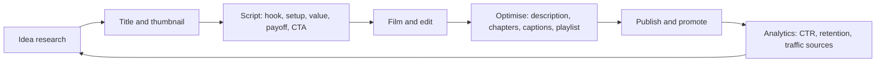
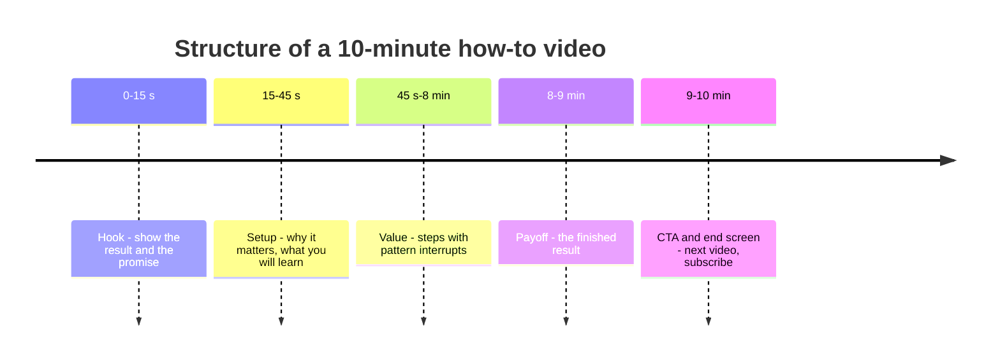
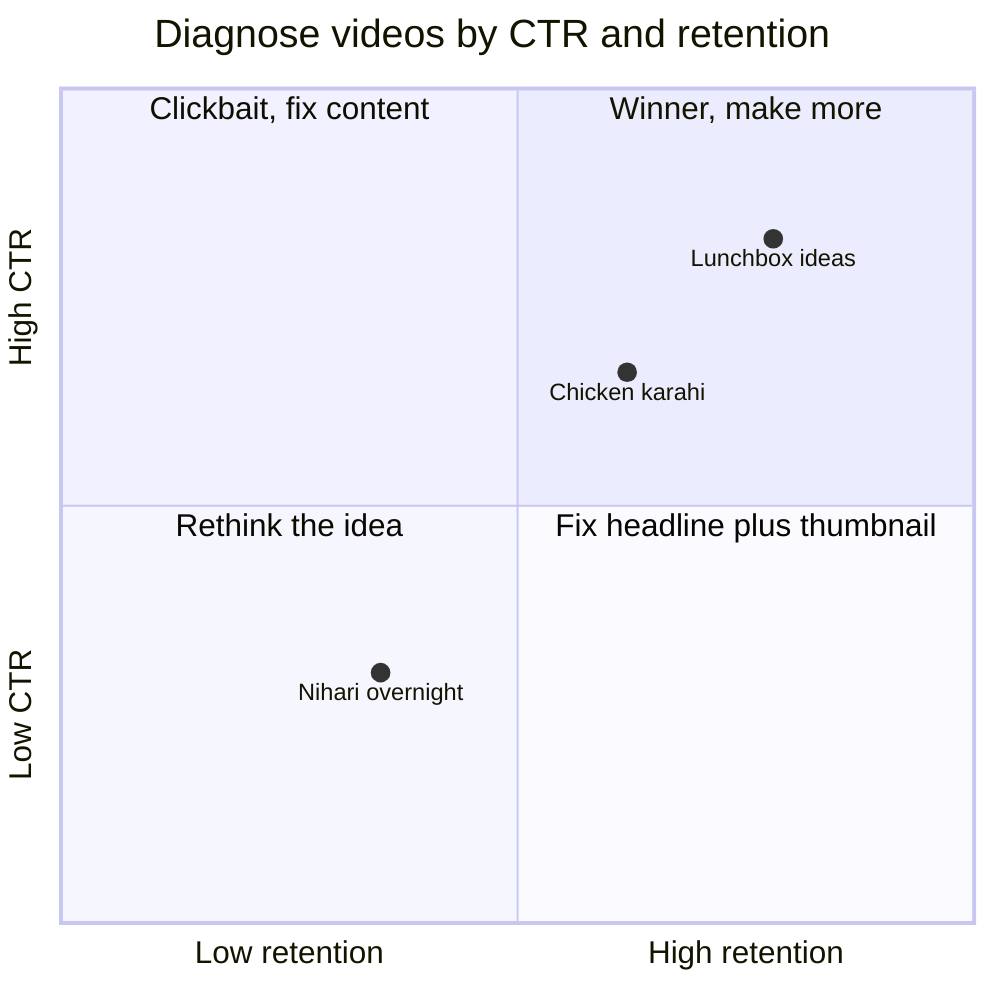
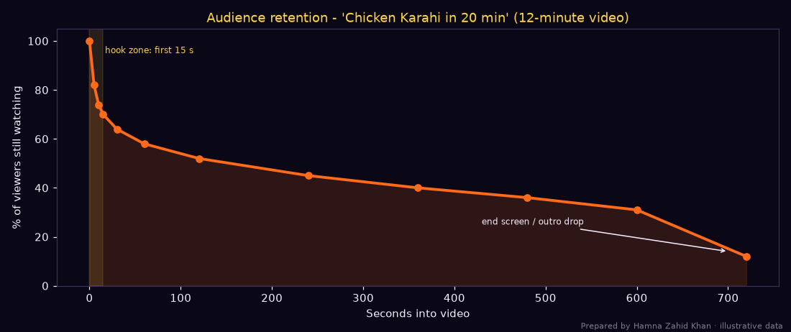

# Session 5 · YouTube Marketing

> 🏠 [Diploma in Digital Marketing](../../README.md) › [Term 1](../README.md) › [Social Media Marketing](README.md) › **Session 5**
>
> ⏱ **Estimated time:** 3 hours (1.5 h theory + 1.5 h lab) · 📋 **Prerequisites:** Session 4

[⬅ Previous: Session 4](session-04-social-listening-and-copywriting.md) · [Next: Session 6 ➡](session-06-social-roi-and-performance-metrics.md)

---

## 🎯 Learning objectives

By the end of this session you will be able to:

- Define the basics of **YouTube marketing**: how the platform works, channel types and how videos are recommended.
- Describe techniques for **creating engaging videos**: planning, hooks, structure, production on a budget and Shorts.
- Summarise methods to **optimise videos for search and discovery**: titles, descriptions, tags, chapters, thumbnails, captions.
- Outline strategies for **building a loyal subscriber base** and community.
- Explain how to **analyse YouTube Analytics** – CTR, average view duration, retention, watch time, traffic sources – and act on it.

## 📖 Concepts

### 1. Why YouTube matters

- YouTube is both a **video platform** and the world's second-most-used search destination – people come to **learn** ("how to make nihari"), **compare** ("best phone under 50k"), and **be entertained**.
- In Pakistan, Google's ad tools showed a **YouTube ad reach of 54.3 million** in late 2025 (DataReportal, *Digital 2026: Pakistan*), with a higher female share (**39.7%**) than most other platforms.
- Videos keep working for **years** (evergreen search traffic), unlike a feed post that fades in 48 hours.
- Content can be repurposed: one long video → 5 Shorts → Reels/TikToks → a blog post → quotes for LinkedIn.

### 2. How YouTube recommends videos

YouTube's systems try to show each viewer the videos they are most likely to **watch and be satisfied with**. Signals include:

| Signal | Meaning | What you control |
|---|---|---|
| **Click-through rate (CTR)** | % of impressions that become views | Title + thumbnail |
| **Watch time / average view duration** | How long people watch | Hook, pacing, structure |
| **Audience retention** | Where people drop off | Editing, delivering on the promise |
| **Satisfaction** | Likes, surveys, shares, "not interested" | Quality, honesty of title |
| **Session behaviour** | Do viewers keep watching more videos after yours? | Playlists, end screens, series |
| **Relevance** | Title, description, captions, topic | Metadata and spoken keywords |

**Traffic sources:** *Browse features* (home feed), *Suggested videos* (next to other videos), *YouTube search*, *Shorts feed*, *External* (WhatsApp, Facebook, websites), *Channel pages*, *Playlists*, *Notifications*.

### 3. Channel types and business uses

| Channel type | Example | Business goal |
|---|---|---|
| **Educational / how-to** | Cooking, tech reviews, tuition | Trust → sales of courses/products |
| **Product demos and reviews** | Electronics shop showing phones | Pre-purchase confidence |
| **Brand storytelling** | Brand films, documentaries, music series | Awareness and emotional connection |
| **Customer support** | "How to set up your router" | Fewer support calls |
| **Thought leadership / podcasts** | Business founders' interviews | B2B credibility |
| **Behind the scenes / vlogs** | Factory tours, day in the life | Authenticity |
| **Entertainment / series** | Web dramas, sketches | Reach and fandom |

### 4. Formats

| Format | Length | Strengths |
|---|---|---|
| **Long-form** | 8–20+ min | Search traffic, depth, watch time, mid-roll ads |
| **Shorts** | Up to 3 minutes (vertical) | Discovery, fast growth, repurposing |
| **Live streams** | Any | Real-time Q&A, launches, Super Chat |
| **Premieres** | Scheduled first showing | Event feeling, live chat |
| **Podcasts** | 30–90 min | Loyal audience, B2B |
| **Community posts** | Text, polls, images | Engagement between uploads |

### 5. Creating engaging videos – step by step

1. **Idea research** – YouTube search autocomplete, "People also ask", comments on competitors' videos, Google Trends (YouTube Search filter), your customers' questions.
2. **Promise** – one clear promise per video: "Restaurant-style karahi in 20 minutes".
3. **Title + thumbnail first** – if you can't make a clickable title and thumbnail, rethink the idea.
4. **Script/outline** using the **Hook → Setup → Value → Payoff → CTA** structure:
   - **Hook (0–15 s):** show the result, state the promise, create curiosity. No long intros or logo animations.
   - **Setup (15–45 s):** why this matters, what they'll learn.
   - **Value:** the steps, with pattern interrupts every 30–60 s (B-roll, zooms, on-screen text).
   - **Payoff:** deliver the promised result.
   - **CTA:** subscribe/next video/link – near the end, but before the drop-off.
5. **Production on a budget:** phone camera at 1080p or 4K, natural window light or a ring light, a PKR 2,000–5,000 lavalier mic (audio matters more than video), steady phone tripod.
6. **Editing:** CapCut, DaVinci Resolve (free), Premiere; cut pauses, add captions, music from YouTube Audio Library (copyright-safe).
7. **Shorts version:** vertical, hook in 1 second, loopable ending.

### 6. Optimising for search and discovery (video SEO)

| Element | Best practice | Example |
|---|---|---|
| **Title** | Keyword near the start, clear benefit, ~60–70 chars visible; honest | "Chicken Karahi Recipe in 20 Minutes \| Restaurant Style at Home" |
| **Thumbnail** | 1280 × 720, face with emotion, high contrast, 2–4 big words, readable on a phone | "20 MIN KARAHI" + steaming karahi + surprised face |
| **Description** | Keyword in first 1–2 lines (shown in search), summary, links with UTMs, chapters, 1–3 hashtags | See checker below |
| **Chapters** | Timestamps starting at 00:00, at least 3, each ≥ 10 s | 00:00 Intro, 00:35 Ingredients… |
| **Tags** | Minor signal; useful for misspellings | "karahi", "karhai" |
| **Captions/subtitles** | Upload accurate captions (English + Urdu) | Better accessibility and relevance |
| **Spoken keywords** | Say the keyword early – YouTube transcribes audio | "Today's chicken karahi recipe…" |
| **Playlists** | Group related videos, keyword-rich playlist titles | "Pakistani Dinner Recipes" |
| **End screens & cards** | Point to the next best video or playlist | Last 20 s: next recipe + subscribe |
| **Language & location** | Set video language; add Urdu translations of title/description | Reach Urdu searchers |

### 7. Building a loyal subscriber base

- **Consistency** – a schedule viewers can rely on ("new recipe every Friday").
- **Series and playlists** – binge-able sequences raise session watch time.
- **Community** – reply to comments (pin the best), heart comments, ask questions in videos, use Community posts and polls.
- **Collaborations** – guest appearances with creators in adjacent niches.
- **Subscriber-worthy promise** – tell people why to subscribe ("subscribe for one easy desi recipe every week"), not just "please subscribe".
- **Shorts as a funnel** – Shorts bring new viewers; link them to related long videos.
- **Live sessions** – Q&As build a relationship.
- **Cross-promotion** – share on WhatsApp Channels, Instagram, Facebook groups, email.
- **Memberships / Super Thanks** – once eligible, give fans a way to support you.

**YouTube Partner Programme (ad revenue sharing)** – the standard threshold is **1,000 subscribers** plus either **4,000 valid public watch hours in the last 12 months** or **10 million valid public Shorts views in the last 90 days**. (YouTube also offers a lower tier for fan-funding features in some countries.) Check YouTube's current rules before advising a client – they change.

### 8. YouTube Analytics – the metrics that matter

| Metric | Definition | Rough guide |
|---|---|---|
| **Impressions** | Times your thumbnail was shown on YouTube | – |
| **Impressions CTR** | Views from impressions ÷ impressions | Many channels sit around 2–10%; compare to your own average |
| **Views** | Counted plays | – |
| **Average view duration (AVD)** | Total watch time ÷ views | Higher = better content fit |
| **Average percentage viewed** | AVD ÷ video length | 40–60% is solid for long videos |
| **Audience retention curve** | % still watching at each second | Look for steep drops |
| **Watch time (hours)** | Views × AVD | Key ranking and Partner Programme metric |
| **Subscribers gained/lost** | Per video | Which videos convert viewers into fans |
| **Engagement** | Likes, comments, shares | Satisfaction signal |
| **Traffic sources** | Where views came from | Search vs browse vs suggested vs external |
| **Audience** | Age, gender, geography, returning vs new, when viewers are on YouTube | Posting time and content choices |
| **RPM** | Your revenue per 1,000 views (after YouTube's share) | Varies widely by audience country and topic |

**Diagnosing with CTR × retention:**

| | High retention | Low retention |
|---|---|---|
| **High CTR** | ⭐ Winner – make more like it | Clickbait or weak delivery – fix the content to match the promise |
| **Low CTR** | Great content nobody clicks – redo title/thumbnail | Rethink the idea |

## 🧭 Diagrams

### From upload to growth



### Video structure



### CTR and retention diagnosis



## 💻 Worked examples

### Example 1 – Analysing three videos and a retention curve

📄 `code/session-05_youtube_analytics.py`

```python
# YouTube channel analytics: impressions CTR, views, average view duration, audience retention
# curve, watch time and estimated earnings. Prepared by Hamna Zahid Khan, Junior Lecturer.
# Illustrative data for a Pakistani cooking channel ("Ammi Ka Kitchen"), three videos in PKR.
import matplotlib
matplotlib.use("Agg")
import matplotlib.pyplot as plt

BG, FIRE, GOLD, VIOLET, EMBER, TEXT = "#0A0716", "#FF6B1A", "#FCD34D", "#A78BFA", "#F43F5E", "#F5EEFF"
RPM = 120   # assumed revenue per 1,000 views (PKR) after YouTube's share; varies widely by audience

videos = {  # title: (length s, impressions, views, avg view duration s, subs gained, likes, comments, shares)
    "Chicken Karahi in 20 min":    (720, 410_000, 28_700, 312, 640, 2_150, 380, 260),
    "Nihari - overnight recipe":   (1_260, 180_000, 7_200, 410, 150, 540, 95, 40),
    "5 lunchbox ideas for school": (540, 520_000, 46_800, 270, 1_120, 3_900, 610, 980),
}
print(f"{'Video':<29}{'CTR%':>6}{'AVD':>6}{'AVD%':>6}{'WatchHrs':>9}{'Eng%':>6}{'Est PKR':>9}")
for t, (L, imp, v, avd, subs, lk, cm, sh) in videos.items():
    ctr = v / imp * 100
    avd_pct = avd / L * 100
    hours = v * avd / 3600
    eng = (lk + cm + sh) / v * 100
    print(f"{t:<29}{ctr:>6.1f}{avd // 60:>3.0f}:{avd % 60:02.0f}{avd_pct:>6.0f}{hours:>9,.0f}{eng:>6.1f}{v / 1000 * RPM:>9,.0f}")
total_hours = sum(v[2] * v[3] / 3600 for v in videos.values())
print(f"\nTotal watch time: {total_hours:,.0f} hours (Partner Programme needs 4,000 public watch hours in 12 months + 1,000 subscribers)")

# Retention curve: % of viewers still watching at each point of the karahi video
points = [0, 5, 10, 15, 30, 60, 120, 240, 360, 480, 600, 720]
retained = [100, 82, 74, 70, 64, 58, 52, 45, 40, 36, 31, 12]
drop_first_10 = 100 - retained[2]
print(f"Karahi video: {drop_first_10}% of viewers leave in the first 10 seconds; {retained[-2]}% reach the 10-minute mark")
fig, ax = plt.subplots(figsize=(10, 4.2), facecolor=BG); ax.set_facecolor(BG)
ax.plot(points, retained, color=FIRE, lw=2.5, marker="o")
ax.fill_between(points, retained, color=FIRE, alpha=.15)
ax.axvspan(0, 15, color=GOLD, alpha=.12); ax.text(17, 95, "hook zone: first 15 s", color=GOLD, fontsize=8)
ax.annotate("end screen / outro drop", xy=(700, 14), xytext=(430, 25), color=TEXT, fontsize=8, arrowprops=dict(color=TEXT, arrowstyle="->"))
ax.set_ylim(0, 105); ax.set_xlabel("Seconds into video", color=TEXT); ax.set_ylabel("% of viewers still watching", color=TEXT)
ax.set_title("Audience retention - 'Chicken Karahi in 20 min' (12-minute video)", color=GOLD)
ax.tick_params(colors=TEXT)
for s in ax.spines.values(): s.set_color("#3b3355")
fig.text(0.99, 0.01, "Prepared by Hamna Zahid Khan · illustrative data", color=TEXT, alpha=0.5, ha="right", fontsize=7)
plt.tight_layout(); plt.savefig("session-05_youtube_retention.png", dpi=110, facecolor=BG)
print("Saved session-05_youtube_retention.png")
```

**Output**

```text
Video                          CTR%   AVD  AVD% WatchHrs  Eng%  Est PKR
Chicken Karahi in 20 min        7.0  5:12    43    2,487   9.7    3,444
Nihari - overnight recipe       4.0  6:50    33      820   9.4      864
5 lunchbox ideas for school     9.0  4:30    50    3,510  11.7    5,616

Total watch time: 6,817 hours (Partner Programme needs 4,000 public watch hours in 12 months + 1,000 subscribers)
Karahi video: 26% of viewers leave in the first 10 seconds; 31% reach the 10-minute mark
Saved session-05_youtube_retention.png
```



**Reading the analytics:**

- **"5 lunchbox ideas"** wins on everything: 9% CTR, 50% average viewed, most watch time and subscribers – a **list format with a clear audience** (parents). Make a series: "5 breakfast ideas", "5 iftar ideas".
- **"Nihari"** has the lowest CTR (4%) and only 33% viewed of a 21-minute video. Fix: a stronger thumbnail ("NIHARI LIKE BURNS ROAD"), and a tighter edit (cut to ~12 min), or split into two parts.
- **Retention curve:** 26% leave in the first 10 seconds → the intro is too slow; open with the finished karahi sizzling. The drop at 11:00–12:00 is the long outro → move the CTA earlier and use an end screen.
- **Watch time:** 6,817 hours from three videos alone – enough watch hours for the Partner Programme threshold, if the subscriber requirement is also met.

### Example 2 – Pre-publish metadata check

📄 `code/session-05_video_seo_checker.py`

```python
# Check a YouTube video's metadata (title, description, tags, chapters) before publishing.
# Prepared by Hamna Zahid Khan, Junior Lecturer.
import re

video = {
    "keyword": "chicken karahi recipe",
    "title": "Chicken Karahi Recipe in 20 Minutes | Restaurant Style at Home",
    "description": """Chicken karahi recipe the quick way - restaurant style flavour at home in 20 minutes.
Ingredients list and steps below. Subscribe for a new Pakistani recipe every Friday.

00:00 Intro
00:35 Ingredients
02:10 Cooking the chicken
07:45 Adding tomatoes and spices
11:20 Serving tips

Full recipe: https://example.pk/karahi?utm_source=youtube&utm_medium=video&utm_campaign=karahi
#chickenkarahi #pakistanirecipes #karahi""",
    "tags": ["chicken karahi", "karahi recipe", "pakistani food", "desi cooking", "20 minute recipe"],
    "thumbnail_text": "20 MIN KARAHI",
}

def check(v):
    kw = v["keyword"].lower()
    out = []
    t = v["title"]
    out.append(("Title length 40-70 chars", 40 <= len(t) <= 70, f"{len(t)} chars"))
    out.append(("Keyword in title", kw in t.lower(), ""))
    out.append(("Keyword in first 40 chars of title", kw in t.lower()[:40], ""))
    first_two = " ".join(v["description"].splitlines()[:2]).lower()
    out.append(("Keyword in first 2 lines of description", kw in first_two, ""))
    chapters = re.findall(r"^(\d{1,2}:\d{2})\s+\S", v["description"], re.M)
    out.append(("Chapters: 3+ timestamps starting 00:00", len(chapters) >= 3 and chapters[0] == "00:00", f"{len(chapters)} found"))
    out.append(("Tracked link (UTM) in description", "utm_source=" in v["description"], ""))
    tags = re.findall(r"#\w+", v["description"])
    out.append(("1-3 hashtags in description", 1 <= len(tags) <= 3, f"{len(tags)} found"))
    out.append(("Tags 5-15 and include the keyword theme", 5 <= len(v["tags"]) <= 15 and any("karahi" in x for x in v["tags"]), f"{len(v['tags'])} tags"))
    out.append(("Thumbnail text 4 words or fewer", len(v["thumbnail_text"].split()) <= 4, v["thumbnail_text"]))
    return out

res = check(video)
for name, ok, note in res:
    print(f"{'PASS' if ok else 'FIX '}  {name:<44}{note}")
print(f"\nScore {sum(ok for _, ok, _ in res)}/{len(res)}")
```

**Output**

```text
PASS  Title length 40-70 chars                    62 chars
PASS  Keyword in title                            
PASS  Keyword in first 40 chars of title          
PASS  Keyword in first 2 lines of description     
PASS  Chapters: 3+ timestamps starting 00:00      5 found
PASS  Tracked link (UTM) in description           
PASS  1-3 hashtags in description                 3 found
PASS  Tags 5-15 and include the keyword theme     5 tags
PASS  Thumbnail text 4 words or fewer             20 MIN KARAHI

Score 9/9
```

All nine checks pass. Change the `video` dictionary to test your own video before publishing (try removing the chapters or adding ten hashtags and see what fails).

### Example 3 – Planning a channel for a business (walkthrough)

**Business:** a Lahore mobile-phone retailer.

1. **Goal:** more store visits and online orders; fewer pre-sale questions on WhatsApp.
2. **Audience:** men and women 18–35 comparing phones by budget.
3. **Content pillars:** *Reviews* ("Phone X after 30 days"), *Comparisons* ("Best phones under PKR 60,000"), *How-to* ("Transfer WhatsApp chats to a new phone"), *Deals* (Shorts of weekly prices).
4. **Schedule:** 1 long video/week (Saturday 7 pm PKT), 4 Shorts/week.
5. **SEO:** target searches like "best phone under 50000 in Pakistan", "PTA approved phones price".
6. **CTA:** description links to the store's price page with UTMs + pinned comment with WhatsApp number; "Visit our Hall Road store" on the end screen.
7. **KPIs:** watch time, subscribers, clicks to site (GA4 `utm_source=youtube`), "saw you on YouTube" mentions in store (track with a simple counter).

### Example 4 – Shorts maths

A skincare brand posts 20 Shorts in a month: 600,000 total views, 1.2% of viewers visit the channel, 18% of channel visitors subscribe, and 6% of channel visitors click the website link in the channel header.

| Step | Working | Result |
|---|---|---|
| Channel visits | 600,000 × 1.2% | 7,200 |
| New subscribers | 7,200 × 18% | **1,296** |
| Website clicks | 7,200 × 6% | **432** |
| Orders at 3% CR, AOV PKR 2,800 | 432 × 3% × 2,800 | 13 orders ≈ **PKR 36,300** |

Shorts build audiences quickly; most of their commercial value comes later, when subscribers watch long videos and buy.

## 📋 Checklists

**Before publishing**

- [ ] Title has the keyword near the start and an honest benefit (≤ 70 chars visible).
- [ ] Thumbnail readable at phone size; 2–4 words; consistent channel style.
- [ ] Hook in the first 15 seconds shows the result.
- [ ] Description: keyword in the first 2 lines, UTM links, chapters, 1–3 hashtags.
- [ ] Captions uploaded (English and/or Urdu).
- [ ] Added to a playlist; end screen and cards set.
- [ ] Music copyright-safe (Audio Library or licensed).
- [ ] Shorts cut-down planned.

**After 48 hours and 7 days**

- [ ] CTR vs channel average – change thumbnail/title if far below.
- [ ] Retention: where is the biggest drop? Note it for the next edit.
- [ ] Reply to and pin comments.
- [ ] Share to WhatsApp Channel, Instagram Story, Facebook group.

## ⚠️ Common mistakes

| Mistake | Fix |
|---|---|
| 30-second intros with logo animation | Start with the result or the hook |
| Clickbait titles that don't deliver | Match the title/thumbnail promise exactly – retention punishes clickbait |
| Tiny text in thumbnails | 2–4 big words; test at mobile size |
| Using copyrighted songs | YouTube Audio Library or licensed music (avoid Content ID claims and strikes) |
| Uploading randomly | Fixed schedule and series |
| Ignoring analytics | Review CTR, retention and traffic sources for every video |
| Treating YouTube like TV ads | Make content people *choose* to watch |
| No link or CTA | Tracked links in description and pinned comment |

## 🧪 Lab / practice tasks

**Task 1 (easy) – Metrics.** A video got 250,000 impressions and 15,000 views; it is 10 minutes long with an AVD of 4 minutes. Calculate CTR, average percentage viewed and watch time in hours.

<details><summary>✅ Solution</summary>

CTR = 15,000 ÷ 250,000 × 100 = **6%** · Average viewed = 4 ÷ 10 = **40%** · Watch time = 15,000 × 4 ÷ 60 = **1,000 hours**.

</details>

**Task 2 (easy) – Diagnose.** Video A: CTR 11%, average viewed 18%. Video B: CTR 2.5%, average viewed 62%. What is wrong with each and what do you fix?

<details><summary>✅ Solution</summary>

A: people click but leave → content doesn't deliver the title's promise (possible clickbait) or slow start → fix the hook and align content with the title. B: great content, nobody clicks → redesign thumbnail and rewrite title.

</details>

**Task 3 (medium) – Optimise metadata.** Use `code/session-05_video_seo_checker.py` to check this video, then fix it until it scores 9/9: keyword "lahore street food", title "My Vlog Part 3!!!", description "Hope you enjoy. Subscribe.", tags `["vlog"]`, thumbnail text "WE TRIED THE BEST FOOD IN WHOLE LAHORE".

<details><summary>✅ Model answer</summary>

Title: "Lahore Street Food Tour – 10 Must-Try Dishes Under PKR 500" (58 chars). Description starting "Lahore street food tour through Gawalmandi and Anarkali…", with 5+ chapters from 00:00, a UTM link, 2 hashtags (`#lahorefood #streetfood`). Tags: lahore street food, lahore food tour, gawalmandi food, pakistani street food, desi food. Thumbnail: "10 DISHES UNDER 500".

</details>

**Task 4 (medium) – Retention fix.** Edit the `retained` list in `code/session-05_youtube_analytics.py` to simulate a new edit where only 12% leave in the first 10 seconds (e.g. `[100, 92, 88, 85, ...]`). Rerun and describe how the chart changes and why watch time would rise.

**Task 5 (challenge) – Channel strategy.** For a business of your choice, write a YouTube strategy: goal, audience, 3–4 pillars, 10 video ideas with titles (keyword-first), a thumbnail concept for two of them, schedule, Shorts plan, subscriber-growth tactics, KPIs and a monthly analytics review template.

## ✅ Quick quiz

1. Impressions CTR on YouTube measures:
   a) likes ÷ views b) views from impressions ÷ impressions c) subscribers ÷ views d) watch time ÷ views
2. A video with high CTR but low retention most likely has:
   a) a weak thumbnail b) a title/content mismatch or slow start c) too many subscribers d) no tags
3. Chapters in the description must start at:
   a) 00:10 b) 00:00 c) 01:00 d) any time
4. Watch time is calculated as:
   a) views × average view duration b) impressions × CTR c) likes + comments d) subscribers × views
5. The best place for the main keyword in a video description is:
   a) the last line b) the first one or two lines c) hidden in tags only d) the comments

<details><summary>Show answers</summary>

1-b · 2-b · 3-b · 4-a · 5-b

</details>

## 📝 Summary

- YouTube is a **search engine and entertainment platform**; videos are evergreen and repurposable. Pakistan ad reach ≈ 54.3 M (late 2025).
- Recommendations reward **CTR, watch time, retention and satisfaction**.
- Make videos with **Hook → Setup → Value → Payoff → CTA**; audio quality and the first 15 seconds matter most.
- Optimise with keyword-first titles, strong thumbnails, rich descriptions, chapters, captions, playlists and end screens.
- Grow subscribers with consistency, series, community replies, collaborations, Shorts and cross-promotion.
- Analyse **CTR × retention**, traffic sources and audience data; fix thumbnails for low CTR and edits for low retention.

**Formulas:** CTR = Views from impressions ÷ Impressions × 100 · Watch time = Views × AVD · Average % viewed = AVD ÷ Length × 100 · Estimated revenue = Views ÷ 1,000 × RPM.

**Interview / viva questions**

1. What signals does YouTube use to recommend videos?
2. How would you structure the first 30 seconds of a product review video?
3. Explain how to optimise a video's title, description and thumbnail.
4. A video has a 3% CTR and 65% retention. What would you do?
5. How can Shorts help a business channel grow?
6. Which YouTube Analytics reports would you check weekly and why?

---

[⬅ Previous: Session 4](session-04-social-listening-and-copywriting.md) · [Next: Session 6 ➡](session-06-social-roi-and-performance-metrics.md)

<sub>Prepared by **Hamna Zahid Khan**, Junior Lecturer · Diploma in Digital Marketing</sub>
