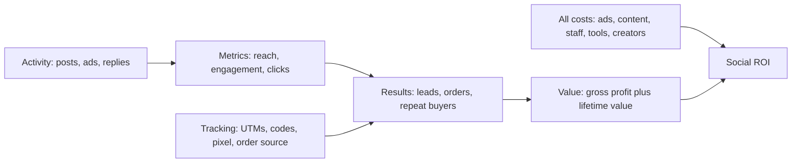
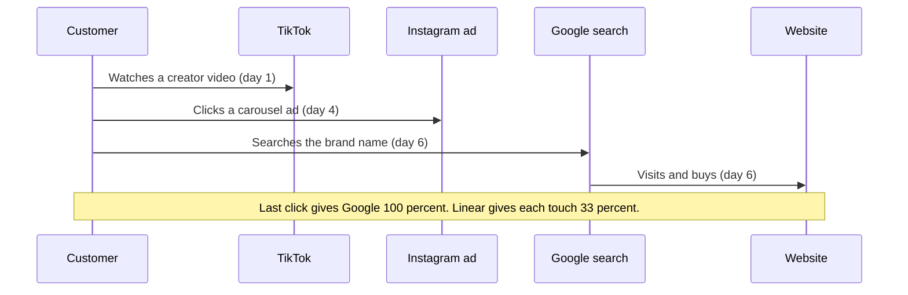
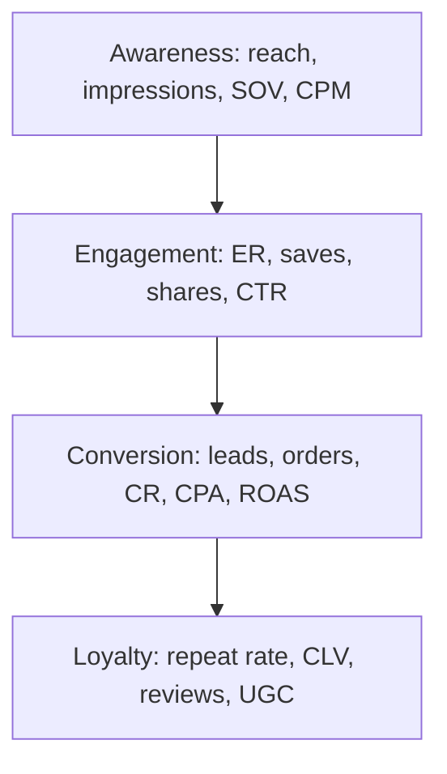
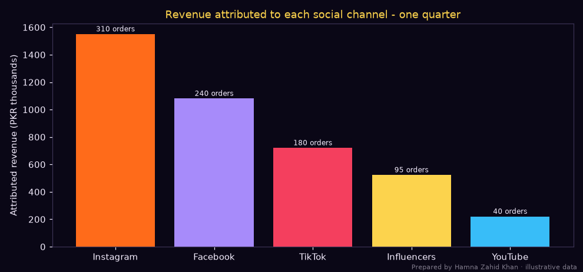

# Session 6 · Social Media ROI and Performance Metrics

> 🏠 [Diploma in Digital Marketing](../../README.md) › [Term 1](../README.md) › [Social Media Marketing](README.md) › **Session 6**
>
> ⏱ **Estimated time:** 3 hours (2 h theory + 1 h lab) · 📋 **Prerequisites:** Sessions 3-5

[⬅ Previous: Session 5](session-05-youtube-marketing.md) · [Next: Session 7 ➡](session-07-ab-testing-and-ai-in-social.md)

---

## 🎯 Learning objectives

By the end of this session you will be able to:

- Define **return on investment (ROI)** for social media and calculate it with full costs.
- Identify the **key metrics** for evaluating social performance at each funnel stage.
- List **tools** for monitoring social media metrics and attributing results.
- Explain methods to **assess the value** of social activity, including attribution, CLV and non-financial value.
- Describe ways to **improve social ROI**, and summarise the role of **push notifications** and messaging in re-engagement.

## 📖 Concepts

### 1. What social media ROI means

**ROI** answers: *"For every rupee we put into social media, how much profit did we get back?"*

> **ROI (%) = (Value gained − Total cost) ÷ Total cost × 100**

Two traps:

1. **Value gained should be profit, not revenue.** If you sell PKR 100,000 of clothes with a 40% gross margin, the value is PKR 40,000.
2. **Total cost is more than ad spend.** Include people's time, content production, tools, influencer fees and agency fees.

| Cost item | Example (monthly, PKR) |
|---|---|
| Ad spend | 150,000 |
| Content production (shoots, models, editing) | 60,000 |
| Staff time (social media executive, share of designer) | 90,000 |
| Tools (scheduler, listening, Canva Pro, CapCut Pro) | 15,000 |
| Influencer / creator fees | 50,000 |
| **Total** | **365,000** |

**ROAS vs ROI:**

| | ROAS | ROI |
|---|---|---|
| Formula | Revenue ÷ Ad spend | (Profit − All costs) ÷ All costs × 100 |
| Uses | Revenue | Profit |
| Costs | Ad spend only | Everything |
| Good for | Optimising ad campaigns day to day | Judging whether social media as a whole is worth it |

### 2. Linking metrics to goals – the funnel

| Funnel stage | Business goal | Key social metrics |
|---|---|---|
| **Awareness** | Be known | Reach, impressions, follower growth, share of voice, video views, CPM, brand lift |
| **Engagement / consideration** | Be liked and considered | Engagement rate, saves, shares, comments, profile visits, watch time, link clicks, CTR |
| **Conversion** | Get leads and sales | Leads, purchases, conversion rate, CPA/CPL, revenue, ROAS |
| **Loyalty / advocacy** | Keep and grow customers | Repeat purchase rate, CLV, UGC volume, reviews, referrals, NPS, net sentiment |
| **Customer care** | Solve problems | Response time, resolution rate, CSAT |

**Vanity vs actionable metrics.** Likes and follower counts feel good but rarely prove value on their own. Actionable metrics connect to decisions or money: CTR, conversion rate, CPA, revenue, retention.

### 3. Key formulas

| Metric | Formula |
|---|---|
| **Engagement rate (by reach)** | (Likes + Comments + Shares + Saves) ÷ Reach × 100 |
| **Engagement rate (by followers)** | Engagements ÷ Followers × 100 |
| **Amplification rate** | Shares ÷ Followers × 100 (or ÷ reach) |
| **Virality rate** | Shares ÷ Impressions × 100 |
| **Click-through rate** | Link clicks ÷ Impressions × 100 |
| **Conversion rate** | Conversions ÷ Clicks (or sessions) × 100 |
| **Cost per result** | Cost ÷ Results |
| **Average response time** | Total response time ÷ Messages answered |
| **Customer lifetime value (simple)** | AOV × Purchases per year × Years as customer × Margin |
| **Social ROI** | (Attributed profit − Total social cost) ÷ Total social cost × 100 |

### 4. Tools for monitoring social metrics

| Tool | What it measures |
|---|---|
| **Native analytics**: Meta Business Suite insights, Instagram Insights, TikTok Analytics, YouTube Studio, LinkedIn Page analytics | Reach, engagement, audience, video retention, follower growth |
| **Ads Managers** (Meta, TikTok, LinkedIn, Google Ads) | Spend, CPM, CPC, conversions, ROAS (platform-attributed) |
| **Google Analytics 4** with UTMs | Sessions, conversions and revenue by `utm_source` / `utm_medium` / `utm_campaign` – a neutral view across platforms |
| **Management suites**: Hootsuite, Sprout Social, Buffer, Later, Metricool | Cross-platform dashboards and reports |
| **Listening tools**: Brand24, Mention, Talkwalker | Share of voice, sentiment, mentions |
| **Dashboards**: Looker Studio, Power BI, Excel/Google Sheets | Combine sources into one monthly report |
| **CRM / e-commerce** (Shopify, WooCommerce, HubSpot, a WhatsApp order sheet) | Actual orders, repeat purchases, CLV |
| **Discount codes and dedicated links** | Attribution for influencers and offline orders |

### 5. Methods to assess the value of social media

#### 5a. Attribution

**Attribution** decides which touchpoint gets credit for a sale. A customer might see a TikTok, later click an Instagram ad, then search on Google and buy.

| Model | Credit goes to | Effect on social |
|---|---|---|
| **Last click** | The final click before purchase | Undervalues social (often an early touch) |
| **First click** | The first touch | Favours awareness channels |
| **Linear** | Equal credit to every touch | Balanced but simplistic |
| **Time decay** | More credit to recent touches | Middle ground |
| **Data-driven** (GA4 default) | Credit based on observed paths | Best when there is enough data |

**Platform vs GA4 numbers differ.** Meta might claim 120 purchases (it counts view-through and 7-day click windows) while GA4 shows 70 from `utm_source=facebook`. Neither is "wrong" – they use different rules. Use GA4 for cross-channel comparison and platform data for optimising within the platform.

#### 5b. Tracking tactics for Pakistani businesses

Many orders come through **WhatsApp, DMs and COD**, so website analytics miss them. Practical fixes:

- **Click-to-WhatsApp ads** report conversations started.
- Ask "**Where did you hear about us?**" at order time and log it in the order sheet.
- **Unique discount codes** per platform/influencer (`INSTA10`, `ZARA15`).
- **WhatsApp Business labels** by source (*IG lead, TikTok lead*).
- **Separate WhatsApp numbers or pre-filled messages** per channel ("Hi, I saw your TikTok…").

#### 5c. Incrementality

The most honest question: *would these sales have happened anyway?* Methods: **holdout tests** (pause ads in one city), **conversion lift studies** (offered by Meta/Google for larger advertisers), **before/after with a control group**.

#### 5d. Customer lifetime value

A customer acquired through social may buy many times. If first-purchase ROI is low but repeat rates are high, social can still be very profitable. Always compare **CPA with CLV**, not only with the first order.

#### 5e. Non-financial value

Some value is real but hard to price: customer insight from comments, lower support costs (FAQ videos), employer brand (easier hiring), crisis resilience, PR coverage. Report it with numbers where possible (e.g. "support calls fell 18% after the setup-video series").

### 6. Ways to improve social ROI

| Lever | Actions |
|---|---|
| **Reduce cost** | Batch content production, repurpose one shoot into many posts, use UGC, automate scheduling, kill underperforming ads quickly |
| **Increase conversion** | Faster landing pages, COD and easy returns, clear prices, quick WhatsApp replies (speed of reply strongly affects DM sales) |
| **Increase order value** | Bundles, free delivery thresholds, cross-sell in DMs |
| **Increase retention** | Post-purchase follow-ups, loyalty offers, community groups, retargeting existing customers with new arrivals |
| **Better targeting** | Exclude buyers from acquisition ads, use lookalikes of high-value customers |
| **Better creative** | Test hooks, UGC, offers (Session 7) |
| **Better measurement** | UTMs everywhere, codes, source field in order sheet – you can't improve what you can't see |

### 7. Push notifications and messaging in re-engagement

**Push notifications** are short messages sent to a user's device by an app or a website (with permission). Related channels are **WhatsApp broadcasts/Channels**, **Messenger/Instagram DM automation** and **SMS**.

| Channel | Strength | Watch out for |
|---|---|---|
| **App push** | Instant, free once installed, deep links into the app | Users disable them if spammed |
| **Web push** (browser) | No app needed | Low opt-in rates if asked too early |
| **WhatsApp Business (broadcast lists / API templates)** | Very high open rates in Pakistan, conversational | Only message people who opted in; API template messages are charged per conversation; spam gets numbers blocked |
| **Instagram/Messenger automation** | "Comment KEYWORD to get the link" flows | Must follow platform automation rules |
| **SMS** | Reaches every phone | Short, costly, mostly for OTPs and alerts |

**Role in ROI:** they re-engage people you already reached (cheaper than buying new reach). Uses: abandoned-cart reminders, back-in-stock alerts, order updates, limited-time offers, new content alerts.

**Best practices:** ask for permission at a meaningful moment ("Get notified when your size is back in stock?"), personalise (name, product viewed), keep them short with one CTA, respect quiet hours (avoid late-night messages; be considerate around prayer and iftar times in Ramadan), cap frequency, and measure **opt-in rate, open rate, click rate, conversion and opt-out rate**.

## 🧭 Diagrams

### From activity to ROI



### Attribution of one customer journey



### Metrics by funnel stage



## 💻 Worked examples

### Example 1 – Quarterly ROI for a home-textile brand

📄 `code/session-06_social_roi.py`

```python
# Social media ROI for a quarter: full cost, attributed revenue, ROI, ROAS, cost per result,
# customer lifetime value effect, and a channel chart. Prepared by Hamna Zahid Khan, Junior Lecturer.
# Illustrative quarter for a Faisalabad home-textile brand ("Rangoli Linen"), PKR.
import matplotlib
matplotlib.use("Agg")
import matplotlib.pyplot as plt

BG, FIRE, GOLD, VIOLET, EMBER, TEXT = "#0A0716", "#FF6B1A", "#FCD34D", "#A78BFA", "#F43F5E", "#F5EEFF"
MARGIN = 0.38
costs = {"Ad spend": 450_000, "Content production": 180_000, "Social media executive (3 months)": 270_000,
         "Tools (scheduler, listening, design)": 45_000, "Influencer fees": 150_000}
channels = {  # channel: (orders attributed in GA4, revenue)
    "Instagram": (310, 1_550_000), "Facebook": (240, 1_080_000), "TikTok": (180, 720_000),
    "Influencers": (95, 522_500), "YouTube": (40, 220_000)}

total_cost = sum(costs.values())
revenue = sum(r for _, r in channels.values())
orders = sum(o for o, _ in channels.values())
gross_profit = revenue * MARGIN
roi = (gross_profit - total_cost) / total_cost * 100
print("Costs:")
for k, v in costs.items(): print(f"  {k:<38}PKR {v:>9,}")
print(f"  {'TOTAL':<38}PKR {total_cost:>9,}")
print(f"\nAttributed revenue PKR {revenue:,} from {orders:,} orders (AOV PKR {revenue / orders:,.0f})")
print(f"Gross profit = {revenue:,} x {MARGIN} = PKR {gross_profit:,.0f}")
print(f"ROI = ({gross_profit:,.0f} - {total_cost:,}) / {total_cost:,} x 100 = {roi:.1f}%")
print(f"ROAS on ad spend only = {revenue:,} / {costs['Ad spend']:,} = {revenue / costs['Ad spend']:.2f}")
print(f"Cost per order (all-in) = PKR {total_cost / orders:,.0f}")

# Lifetime view: 35% of new customers buy again twice in a year
repeat_rate, repeat_orders = 0.35, 2
aov = revenue / orders
clv_extra = orders * repeat_rate * repeat_orders * aov * MARGIN
roi_clv = (gross_profit + clv_extra - total_cost) / total_cost * 100
print(f"\nWith repeat purchases (CLV view): extra gross profit PKR {clv_extra:,.0f} -> ROI {roi_clv:.1f}%")

fig, ax = plt.subplots(figsize=(9, 4.2), facecolor=BG); ax.set_facecolor(BG)
names = list(channels)
ax.bar(names, [channels[n][1] / 1000 for n in names], color=[FIRE, VIOLET, EMBER, GOLD, "#38BDF8"])
for i, n in enumerate(names):
    ax.text(i, channels[n][1] / 1000 + 20, f"{channels[n][0]} orders", ha="center", color=TEXT, fontsize=8)
ax.set_ylabel("Attributed revenue (PKR thousands)", color=TEXT)
ax.set_title("Revenue attributed to each social channel - one quarter", color=GOLD)
ax.tick_params(colors=TEXT)
for s in ax.spines.values(): s.set_color("#3b3355")
fig.text(0.99, 0.01, "Prepared by Hamna Zahid Khan · illustrative data", color=TEXT, alpha=0.5, ha="right", fontsize=7)
plt.tight_layout(); plt.savefig("session-06_social_roi.png", dpi=110, facecolor=BG)
print("Saved session-06_social_roi.png")
```

**Output**

```text
Costs:
  Ad spend                              PKR   450,000
  Content production                    PKR   180,000
  Social media executive (3 months)     PKR   270,000
  Tools (scheduler, listening, design)  PKR    45,000
  Influencer fees                       PKR   150,000
  TOTAL                                 PKR 1,095,000

Attributed revenue PKR 4,092,500 from 865 orders (AOV PKR 4,731)
Gross profit = 4,092,500 x 0.38 = PKR 1,555,150
ROI = (1,555,150 - 1,095,000) / 1,095,000 x 100 = 42.0%
ROAS on ad spend only = 4,092,500 / 450,000 = 9.09
Cost per order (all-in) = PKR 1,266

With repeat purchases (CLV view): extra gross profit PKR 1,088,605 -> ROI 141.4%
Saved session-06_social_roi.png
```



**Interpretation:**

- **ROAS of 9.09** sounds spectacular, but it ignores PKR 645,000 of non-ad costs. The honest **ROI is 42%** – still good: every PKR 1 invested returned PKR 1.42 of gross profit.
- With repeat purchases, ROI rises to **141%** – social media acquires customers who keep buying. Report both numbers and explain the assumption (35% buy twice more within a year).
- **Instagram** brings the most revenue; **influencers** have the highest AOV (PKR 5,500); **YouTube** is small in orders but may assist other channels – check GA4's conversion paths before cutting it.

### Example 2 – Weekly post-level report

📄 `code/session-06_engagement_report.py`

```python
# Weekly social KPI report from post-level data: engagement rate (by reach and by impressions),
# saves/shares share, click-through, and the best-performing format. Prepared by Hamna Zahid Khan.
import csv, io
from collections import defaultdict

DATA = """post,format,reach,impressions,likes,comments,shares,saves,link_clicks
P1,Reel,42000,51000,1900,140,620,880,310
P2,Carousel,18000,22000,820,95,140,610,260
P3,Static,9000,10500,310,22,15,40,45
P4,Reel,56000,70000,2600,210,950,1200,420
P5,Story,7000,7600,0,35,0,0,150
P6,Carousel,21000,26000,990,130,180,720,300
P7,Static,8500,9800,280,18,10,35,40
"""
rows = list(csv.DictReader(io.StringIO(DATA)))
agg = defaultdict(lambda: defaultdict(int))
print(f"{'Post':<5}{'Format':<9}{'ER/reach':>9}{'ER/impr':>9}{'Save+Share%':>12}{'CTR%':>6}")
for r in rows:
    n = {k: int(v) for k, v in r.items() if k not in ("post", "format")}
    eng = n["likes"] + n["comments"] + n["shares"] + n["saves"]
    print(f"{r['post']:<5}{r['format']:<9}{eng / n['reach'] * 100:>8.2f}%{eng / n['impressions'] * 100:>8.2f}%"
          f"{(n['shares'] + n['saves']) / max(eng, 1) * 100:>11.1f}%{n['link_clicks'] / n['impressions'] * 100:>6.2f}")
    for k, v in n.items(): agg[r["format"]][k] += v
    agg[r["format"]]["eng"] += eng; agg[r["format"]]["posts"] += 1
print("\nBy format (averages per post):")
best = None
for f, a in agg.items():
    er = a["eng"] / a["reach"] * 100
    print(f"  {f:<9} posts {a['posts']}  avg reach {a['reach'] / a['posts']:>8,.0f}  ER by reach {er:5.2f}%  clicks/post {a['link_clicks'] / a['posts']:.0f}")
    if best is None or er > best[1]: best = (f, er)
print(f"\nBest format by engagement rate: {best[0]} ({best[1]:.2f}%) -> plan more of it next week.")
print("Note: Stories have no likes in this export; judge them by replies, taps and link clicks.")
```

**Output**

```text
Post Format    ER/reach  ER/impr Save+Share%  CTR%
P1   Reel         8.43%    6.94%       42.4%  0.61
P2   Carousel     9.25%    7.57%       45.0%  1.18
P3   Static       4.30%    3.69%       14.2%  0.43
P4   Reel         8.86%    7.09%       43.3%  0.60
P5   Story        0.50%    0.46%        0.0%  1.97
P6   Carousel     9.62%    7.77%       44.6%  1.15
P7   Static       4.04%    3.50%       13.1%  0.41

By format (averages per post):
  Reel      posts 2  avg reach   49,000  ER by reach  8.67%  clicks/post 365
  Carousel  posts 2  avg reach   19,500  ER by reach  9.45%  clicks/post 280
  Static    posts 2  avg reach    8,750  ER by reach  4.17%  clicks/post 42
  Story     posts 1  avg reach    7,000  ER by reach  0.50%  clicks/post 150

Best format by engagement rate: Carousel (9.45%) -> plan more of it next week.
Note: Stories have no likes in this export; judge them by replies, taps and link clicks.
```

**Decisions:** carousels have the best engagement rate and strong clicks; Reels bring the most reach and clicks per post – keep both. Static posts underperform on every metric → replace with carousels. Stories: judge by link clicks (150 is good for 7,000 reach = 2.1%).

### Example 3 – Influencer campaign ROI (walkthrough)

A Karachi sneaker store pays three micro-creators PKR 40,000 each and gives each a unique code.

| Creator | Code uses | Revenue (PKR) | Gross profit at 40% |
|---|---|---|---|
| Creator A | 38 | 228,000 | 91,200 |
| Creator B | 11 | 66,000 | 26,400 |
| Creator C | 24 | 144,000 | 57,600 |
| **Total** | **73** | **438,000** | **175,200** |

Costs: fees 120,000 + free shoes 3 × 9,000 = 27,000 + discount given (10% of revenue) 43,800 → **190,800**.
ROI = (175,200 − 190,800) ÷ 190,800 × 100 = **−8.2%** overall.
Per creator: A's profit 91,200 vs cost (40,000 + 9,000 + 22,800) = 71,800 → **+27%**; B: 26,400 vs 55,600 → **−53%**; C: 57,600 vs 63,400 → **−9%**.
**Decision:** rebook Creator A, drop B, renegotiate C (lower fee or commission-only). Also note codes miss customers who bought without the code – compare total sales during the campaign with the weeks before.

### Example 4 – Push and WhatsApp re-engagement maths

An online grocery app sends a "your cart is waiting" push to 20,000 cart abandoners per month: 9% open, 30% of openers return to cart, 25% of those complete the order, AOV PKR 3,200, margin 18%. Push cost ≈ PKR 0.

| Step | Working | Result |
|---|---|---|
| Opens | 20,000 × 9% | 1,800 |
| Returns to cart | 1,800 × 30% | 540 |
| Orders | 540 × 25% | **135** |
| Revenue | 135 × 3,200 | **PKR 432,000** |
| Gross profit | 432,000 × 18% | **PKR 77,760** |

Via WhatsApp templates at an assumed PKR 10 per message with 70% open and the same later steps: 20,000 × 70% × 30% × 25% = **1,050 orders**, profit ≈ 1,050 × 3,200 × 18% = PKR 604,800 vs cost PKR 200,000 → ROI ≈ **202%**. Higher reach can justify a paid channel – but only for opted-in customers, and watch opt-outs.

## 📋 Template · Monthly social media report

| Section | Contents |
|---|---|
| 1. Summary | 3 wins, 2 problems, 3 actions for next month |
| 2. Goals vs actual | Table of targets and results (reach, followers, leads, orders, revenue) |
| 3. Awareness | Reach, impressions, follower growth, SOV |
| 4. Engagement | ER by reach, top 5 posts, best formats/hooks |
| 5. Conversions | Clicks, leads, orders, revenue by channel (GA4 + order sheet) |
| 6. Paid | Spend, CPM, CPC, CPA, ROAS by campaign |
| 7. Community & care | Response time, complaints resolved, net sentiment |
| 8. ROI | All costs, attributed profit, ROI, CLV view |
| 9. Next month | Tests to run, budget changes, content plan |

## ⚠️ Common mistakes

| Mistake | Fix |
|---|---|
| ROI calculated on revenue | Use gross profit |
| Ignoring staff and production costs | Include all costs |
| Reporting only likes and followers | Tie metrics to goals and money |
| Trusting platform-reported conversions as truth | Cross-check with GA4 and real orders |
| No tracking for WhatsApp/COD orders | Source field, codes, pre-filled messages |
| Judging social on last-click only | Look at assisted conversions, paths, lift tests |
| Spamming push/WhatsApp messages | Frequency caps, relevance, quiet hours, opt-out handling |

## 🧪 Lab / practice tasks

**Task 1 (easy) – ROI.** A brand spent PKR 200,000 in total on social media in a month and attributed PKR 900,000 revenue at a 30% margin. Calculate ROI and ROAS if ad spend was PKR 120,000.

<details><summary>✅ Solution</summary>

Gross profit = 900,000 × 0.30 = 270,000. ROI = (270,000 − 200,000) ÷ 200,000 × 100 = **35%**. ROAS = 900,000 ÷ 120,000 = **7.5**.

</details>

**Task 2 (easy) – Match metrics to goals.** Pick two metrics for each goal: (a) launch awareness, (b) more WhatsApp orders, (c) better customer service, (d) loyalty.

<details><summary>✅ Solution</summary>

(a) Reach, brand-lift/SOV · (b) conversations started, orders from WhatsApp source, cost per conversation · (c) average response time, resolution rate/CSAT · (d) repeat purchase rate, CLV (or UGC/reviews).

</details>

**Task 3 (medium) – Edit the ROI script.** In `code/session-06_social_roi.py` change `MARGIN` to 0.25. What happens to ROI? What is the break-even margin for this quarter?

<details><summary>✅ Solution</summary>

Gross profit = 4,092,500 × 0.25 = 1,023,125 → ROI = (1,023,125 − 1,095,000) ÷ 1,095,000 = **−6.6%**. Break-even margin = 1,095,000 ÷ 4,092,500 = **26.8%**.

</details>

**Task 4 (medium) – Attribution.** A customer touched: Instagram Reel (organic) → Facebook ad click → Google search → purchase of PKR 6,000. How much revenue does each touchpoint get under last-click, first-click and linear models?

<details><summary>✅ Solution</summary>

Last click: Google 6,000. First click: Instagram 6,000. Linear: 2,000 each.

</details>

**Task 5 (challenge) – Build a monthly report.** Using real data from a page you manage (or the sample data in the scripts), fill in the monthly report template, including an ROI calculation with all costs, a CLV view, a chart, and three specific improvement actions with expected impact.

## ✅ Quick quiz

1. Social ROI should use:
   a) revenue and ad spend only b) profit and all costs c) likes and followers d) reach and impressions
2. Which is a vanity metric when reported alone?
   a) Conversion rate b) Cost per acquisition c) Follower count d) Revenue
3. GA4 shows fewer Facebook conversions than Meta Ads Manager mainly because:
   a) GA4 is broken b) they use different attribution rules and windows c) Meta adds fake sales d) GA4 only counts organic
4. Unique influencer discount codes help with:
   a) SEO b) attribution c) design d) reach
5. A good push notification practice is:
   a) send hourly b) ask permission at a meaningful moment and personalise c) send at 2 am d) send to everyone without consent

<details><summary>Show answers</summary>

1-b · 2-c · 3-b · 4-b · 5-b

</details>

## 📝 Summary

- **ROI = (Attributed profit − All costs) ÷ All costs × 100**; ROAS is a narrower, revenue-only ad metric.
- Match metrics to funnel stages; prefer **actionable** metrics over vanity ones.
- Tools: native insights, Ads Managers, **GA4 + UTMs**, management suites, listening tools, dashboards, CRM, codes.
- Assess value with **attribution models, tracking for WhatsApp/COD, incrementality tests, CLV and non-financial benefits**.
- Improve ROI by cutting cost, raising conversion and order value, retaining customers, better targeting, creative and measurement.
- **Push notifications and WhatsApp** re-engage existing audiences cheaply – with permission, personalisation and frequency limits.

**Interview / viva questions**

1. How do you calculate social media ROI? What costs do you include?
2. What is the difference between ROAS and ROI?
3. Why do platform-reported conversions differ from GA4?
4. How would you track sales that happen through WhatsApp and COD?
5. Explain why CLV matters when judging social media.
6. How can push notifications improve ROI, and what are the risks?

---

[⬅ Previous: Session 5](session-05-youtube-marketing.md) · [Next: Session 7 ➡](session-07-ab-testing-and-ai-in-social.md)

<sub>Prepared by **Hamna Zahid Khan**, Junior Lecturer · Diploma in Digital Marketing</sub>
