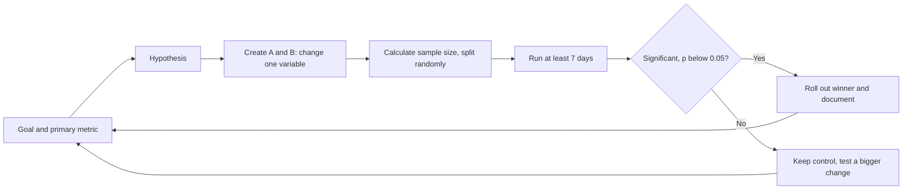
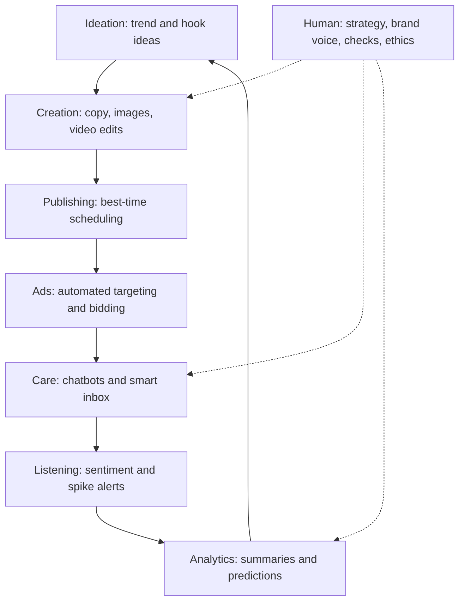
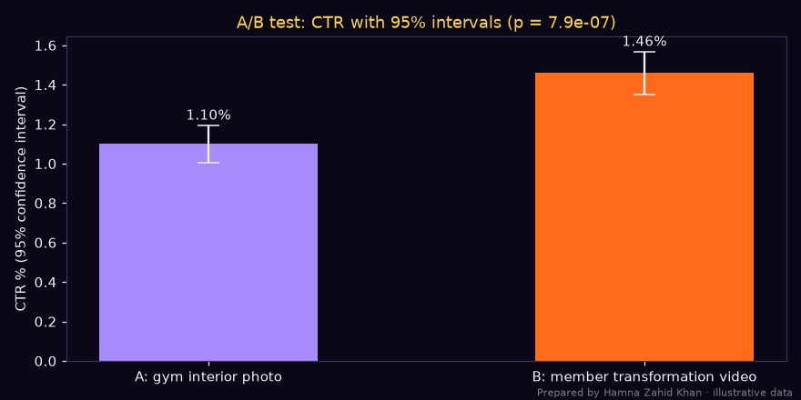

# Session 7 · A/B Split Testing and AI in Social Media

> 🏠 [Diploma in Digital Marketing](../../README.md) › [Term 1](../README.md) › [Social Media Marketing](README.md) › **Session 7**
>
> ⏱ **Estimated time:** 3 hours (1.5 h theory + 1.5 h lab) · 📋 **Prerequisites:** Session 6

[⬅ Previous: Session 6](session-06-social-roi-and-performance-metrics.md) · [Next: Social Media Marketing practice test ➡](practice-test.md)

---

## 🎯 Learning objectives

By the end of this session you will be able to:

- Define the basics of **A/B split testing** on social media and form a testable hypothesis.
- Explain how to **design and run** a valid test: one variable, sample size, duration, significance.
- Calculate whether a result is **statistically significant** with a two-proportion z-test.
- Explore how **artificial intelligence** is changing social media marketing.
- Identify key **AI tools** for content creation, scheduling, listening, ads and analytics, and apply **AI strategies** to improve engagement – responsibly.

## 📖 Concepts

### 1. What A/B testing is

An **A/B (split) test** shows two versions of something – **A (control)** and **B (variant)** – to comparable, randomly split audiences at the same time, changing **only one thing**, and measures which performs better on a chosen metric.

> 💡 Opinions in a meeting ("I think red is better") are replaced by evidence from real customers.

**What you can test on social media:**

| Element | A vs B examples |
|---|---|
| **Creative** | Studio photo vs UGC video; face vs product only |
| **Hook** | Question vs bold claim in the first 3 seconds |
| **Copy** | Short vs long primary text; Urdu vs English |
| **Offer** | 20% off vs free delivery; "Buy 2 get 1" vs PKR 500 off |
| **CTA** | "Shop now" vs "Send WhatsApp message" |
| **Format** | Carousel vs Reel |
| **Audience** | Interest-based vs lookalike vs broad |
| **Placement** | Reels only vs automatic placements |
| **Landing destination** | Website product page vs WhatsApp chat |
| **Posting time (organic)** | 1 pm vs 9 pm |

### 2. The testing process

1. **Pick the goal and primary metric** – CTR, cost per lead, CPA, conversion rate, ROAS. One primary metric decides the winner.
2. **Write a hypothesis:** *"If we use a member transformation video instead of a gym interior photo, CTR will increase, because real results are more persuasive."*
3. **Change one variable.** If you change the image *and* the headline, you won't know which caused the difference.
4. **Split the audience randomly and equally** – use the platform's **A/B test tool** (Meta Experiments, TikTok Split Test) so the same person doesn't see both versions.
5. **Calculate the sample size** you need before starting.
6. **Run long enough** – at least 7 days to cover weekday/weekend patterns, and until the sample size is reached. Don't stop the moment one version "looks" ahead.
7. **Check significance** – is the difference bigger than chance would produce?
8. **Act and document** – roll out the winner, record the learning, test the next idea.

### 3. Key statistical ideas (without fear)

| Term | Plain meaning |
|---|---|
| **Conversion rate / CTR** | The proportion we compare (clicks ÷ impressions) |
| **Baseline** | Current performance of A |
| **Minimum detectable effect (MDE)** | The smallest improvement worth detecting, e.g. +20% relative |
| **Significance level (α)** | Risk of declaring a winner when there is no real difference – usually 5% |
| **Confidence (1 − α)** | 95% is standard |
| **Power** | Chance of detecting a real effect of the MDE size – usually 80% |
| **p-value** | If A and B were really equal, the probability of seeing a difference this big. **p < 0.05 → significant** |
| **Confidence interval** | The range the true rate probably lies in |

**Sample size grows fast for small effects**: detecting a +10% lift needs about 4× the sample of a +20% lift. Small brands should test **big differences** (different concepts, offers) rather than tiny tweaks (button colours).

**Two-proportion z-test:**

> p̂ = (x₁ + x₂) ÷ (n₁ + n₂) · SE = √[p̂(1 − p̂)(1/n₁ + 1/n₂)] · z = (p₂ − p₁) ÷ SE

|z| > 1.96 ⇔ p < 0.05 (two-sided, 95% confidence).

### 4. A/B vs multivariate vs dynamic creative

| Method | What it does | When |
|---|---|---|
| **A/B test** | 2 (or a few) versions, one variable | Clear learning, small budgets |
| **Multivariate test** | Many combinations of several elements at once | Very high traffic only |
| **Dynamic creative / Advantage+ creative** | The platform mixes your images, headlines and texts and shows the best combinations | Fast optimisation; less clear "why" |
| **Holdout / lift test** | Some people see no ads at all | Measuring true incremental impact |

### 5. AI in social media marketing

Artificial intelligence is now built into almost every part of the social workflow:

| Area | What AI does | Examples |
|---|---|---|
| **Content ideation** | Suggests topics, hooks, trends | ChatGPT, Gemini, Claude, TikTok Creative Center trend data |
| **Copywriting** | Drafts captions, ad variants, translations (Urdu/Roman Urdu) | ChatGPT, Meta AI text variations in Ads Manager, Copy.ai |
| **Image creation & editing** | Generates visuals, removes backgrounds, expands images | Canva Magic Studio, Adobe Firefly, Meta AI image expansion |
| **Video** | Auto-captions, cuts long video into clips, AI avatars and voice-over | CapCut, Descript, Opus Clip, YouTube's AI features |
| **Scheduling** | Predicts best posting times | Hootsuite, Buffer, Later |
| **Ad delivery** | Automated targeting, bidding and creative selection | Meta Advantage+, TikTok Smart+, Google Performance Max |
| **Listening & sentiment** | Classifies mentions, detects topics and spikes, reads images | Brand24, Talkwalker, Sprout Social |
| **Customer service** | Chatbots and auto-replies in DMs and WhatsApp | ManyChat, WhatsApp Business API bots, Meta AI for business |
| **Analytics** | Summarises performance, finds anomalies, predicts results | GA4 insights, platform AI summaries |
| **Personalisation** | Recommends products/content to each user | Feed algorithms, catalogue ads |

### 6. AI strategies to enhance engagement

1. **Idea at scale, human selection** – generate 30 hooks, pick the best 5 to test.
2. **Repurpose** – turn a 20-minute YouTube video into 10 Shorts/Reels with AI clipping and captions.
3. **Localise** – adapt copy for Urdu, Roman Urdu, Sindhi or Pashto audiences (have a native speaker check).
4. **Faster testing** – AI makes many variants cheaply; A/B tests decide which really work.
5. **Always-on replies** – a chatbot answers FAQs (prices, delivery, sizes) instantly and hands complex issues to a human.
6. **Smarter listening** – AI flags negative spikes early for human response.
7. **Personalised retargeting** – catalogue ads show each person the products they viewed.

### 7. Responsible AI use

| Risk | Safeguard |
|---|---|
| **Wrong facts / "hallucinations"** | Check every claim, price and date |
| **Generic, robotic tone** | Edit into the brand voice; add real stories and local detail |
| **Copyright and likeness** | Don't generate images of real people or copy other brands' assets; check tool licences |
| **Misleading content** | Label AI-generated realistic images/video where platforms require it (Meta, TikTok and YouTube have disclosure rules) |
| **Bias** | Review targeting and imagery for stereotypes |
| **Privacy** | Never paste customer personal data into public AI tools |
| **Over-automation** | Keep humans on complaints, sensitive topics and crises |

## 🧭 Diagrams

### A/B testing cycle



### Where AI fits in the social workflow



## 💻 Worked examples

### Example 1 – Running and reading an A/B test

A Karachi gym tests two lead-ad creatives with equal budgets: **A** = gym interior photo, **B** = member transformation video.

📄 `code/session-07_ab_test.py`

```python
# A/B split test for two social ad creatives: sample size planning, a two-proportion z-test,
# confidence intervals and a chart. Standard library + matplotlib only.
# Prepared by Hamna Zahid Khan, Junior Lecturer. Illustrative data (PKR) for a Karachi gym's lead ads.
import math
from statistics import NormalDist
import matplotlib
matplotlib.use("Agg")
import matplotlib.pyplot as plt

BG, FIRE, GOLD, VIOLET, EMBER, TEXT = "#0A0716", "#FF6B1A", "#FCD34D", "#A78BFA", "#F43F5E", "#F5EEFF"
Z = NormalDist()

def sample_size(p1, mde_rel, alpha=0.05, power=0.80):
    """people needed PER variant to detect a relative lift of mde_rel over baseline p1"""
    p2 = p1 * (1 + mde_rel)
    za, zb = Z.inv_cdf(1 - alpha / 2), Z.inv_cdf(power)
    pbar = (p1 + p2) / 2
    n = (za * math.sqrt(2 * pbar * (1 - pbar)) + zb * math.sqrt(p1 * (1 - p1) + p2 * (1 - p2))) ** 2 / (p2 - p1) ** 2
    return math.ceil(n)

base_ctr = 0.012
for lift in (0.10, 0.20, 0.30):
    print(f"Baseline CTR 1.2%, detect +{lift:.0%} lift -> {sample_size(base_ctr, lift):,} impressions per variant")

# Results after 10 days (equal budget split)
A = dict(name="A: gym interior photo", imp=48_000, clicks=528, leads=42, spend=24_000)
B = dict(name="B: member transformation video", imp=47_500, clicks=693, leads=66, spend=24_000)

def ztest(x1, n1, x2, n2):
    p1, p2 = x1 / n1, x2 / n2
    p = (x1 + x2) / (n1 + n2)
    se = math.sqrt(p * (1 - p) * (1 / n1 + 1 / n2))
    z = (p2 - p1) / se
    return p1, p2, z, 2 * (1 - Z.cdf(abs(z)))

def ci(x, n):
    p = x / n; h = 1.96 * math.sqrt(p * (1 - p) / n)
    return p - h, p + h

p1, p2, z, pv = ztest(A["clicks"], A["imp"], B["clicks"], B["imp"])
print(f"\nCTR  A {p1:.2%}  vs  B {p2:.2%}  | relative lift {(p2 - p1) / p1:+.1%} | z = {z:.2f}, p = {pv:.1e}")
print("Result:", "significant at 95% - B wins on CTR" if pv < 0.05 else "not significant - keep testing")
l1, l2, zl, pl = ztest(A["leads"], A["clicks"], B["leads"], B["clicks"])
print(f"Lead rate per click  A {l1:.2%}  vs  B {l2:.2%} | z = {zl:.2f}, p = {pl:.3f}")
for v in (A, B):
    print(f"  {v['name']:<32} CPL = PKR {v['spend']:,} / {v['leads']} = PKR {v['spend'] / v['leads']:,.0f}")

fig, ax = plt.subplots(figsize=(8, 4), facecolor=BG); ax.set_facecolor(BG)
for i, (v, c) in enumerate(((A, VIOLET), (B, FIRE))):
    p = v["clicks"] / v["imp"]; lo, hi = ci(v["clicks"], v["imp"])
    ax.bar(i, p * 100, color=c, width=.5)
    ax.errorbar(i, p * 100, yerr=[[p * 100 - lo * 100], [hi * 100 - p * 100]], color=TEXT, capsize=8)
    ax.text(i, hi * 100 + .03, f"{p:.2%}", ha="center", color=TEXT)
ax.set_xticks([0, 1]); ax.set_xticklabels([A["name"], B["name"]], color=TEXT)
ax.set_ylabel("CTR % (95% confidence interval)", color=TEXT); ax.tick_params(colors=TEXT)
ax.set_title(f"A/B test: CTR with 95% intervals (p = {pv:.1e})", color=GOLD)
for s in ax.spines.values(): s.set_color("#3b3355")
fig.text(0.99, 0.01, "Prepared by Hamna Zahid Khan · illustrative data", color=TEXT, alpha=0.5, ha="right", fontsize=7)
plt.tight_layout(); plt.savefig("session-07_ab_test.png", dpi=110, facecolor=BG)
print("Saved session-07_ab_test.png")
```

**Output**

```text
Baseline CTR 1.2%, detect +10% lift -> 135,624 impressions per variant
Baseline CTR 1.2%, detect +20% lift -> 35,498 impressions per variant
Baseline CTR 1.2%, detect +30% lift -> 16,484 impressions per variant

CTR  A 1.10%  vs  B 1.46%  | relative lift +32.6% | z = 4.94, p = 7.9e-07
Result: significant at 95% - B wins on CTR
Lead rate per click  A 7.95%  vs  B 9.52% | z = 0.96, p = 0.339
  A: gym interior photo            CPL = PKR 24,000 / 42 = PKR 571
  B: member transformation video   CPL = PKR 24,000 / 66 = PKR 364
Saved session-07_ab_test.png
```



**Reading the result:**

1. **Sample size first:** to detect a +20% CTR lift from a 1.2% baseline, each variant needed about **35,500 impressions**. Both versions got ~48,000 – enough.
2. **CTR:** B's 1.46% vs A's 1.10% is a **+32.6% lift**, z = 4.94, p ≈ 0.0000008 – far below 0.05. **B wins on CTR.** The confidence intervals don't overlap.
3. **Lead rate per click:** 9.5% vs 8.0% – **not significant** (p = 0.34). The video gets more people to click; once on the form, both convert similarly.
4. **Business result:** cost per lead falls from **PKR 571 to PKR 364** (−36%).
5. **Next test:** keep B as the new control and test the hook of the video (transformation first vs trainer talking first).

### Example 2 – Hand calculation of the z-test

A = 528 clicks / 48,000 impressions = 0.0110; B = 693 / 47,500 = 0.01459.
Pooled p̂ = (528 + 693) ÷ (48,000 + 47,500) = 1,221 ÷ 95,500 = 0.012785.
SE = √[0.012785 × 0.987215 × (1/48,000 + 1/47,500)] = √[0.012622 × 0.00004189] = √(5.287 × 10⁻⁷) ≈ 0.000727.
z = (0.01459 − 0.01100) ÷ 0.000727 ≈ **4.94** → |z| > 1.96 → significant at 95%.

### Example 3 – AI-style variant generation

AI copy tools combine building blocks and predict winners. This transparent, rule-based version shows the idea for a solar company:

📄 `code/session-07_variant_generator.py`

```python
# Generate and pre-score ad copy variants from building blocks - the same idea AI copy tools use
# at scale (combine hooks, benefits and CTAs, then predict which will perform).
# This version is rule-based and transparent so students can see every step.
# Prepared by Hamna Zahid Khan, Junior Lecturer.
import itertools, re

hooks = ["Load-shedding again?", "Stop paying for fuel you don't need.", "3 hours of backup for PKR 999/month?"]
benefits = ["Our solar kit runs fans and lights all evening", "Save up to 40% on your electricity bill", "Installed in one day by certified engineers"]
ctas = ["Book a free site survey", "WhatsApp us for a quote", "Learn more"]
POWER = {"free": 3, "save": 3, "you": 2, "your": 2, "?": 2, "pkr": 2, "%": 2, "one day": 1, "whatsapp": 2, "book": 2}
WEAK = {"learn more": -3}

def score(text):
    t = text.lower()
    s = sum(v for k, v in POWER.items() if k in t) + sum(v for k, v in WEAK.items() if k in t)
    if len(text) > 125: s -= 2                       # primary text gets cut off on mobile feeds
    if re.search(r"\d", text): s += 1               # specific numbers build trust
    return s

variants = [f"{h} {b}. {c}." for h, b, c in itertools.product(hooks, benefits, ctas)]
ranked = sorted(((score(v), v) for v in variants), reverse=True)
print(f"Generated {len(variants)} variants (3 hooks x 3 benefits x 3 CTAs). Top 5 to test:")
for s, v in ranked[:5]:
    print(f"  [{s:>2}] ({len(v):>3} chars) {v}")
print("Bottom 2 (do not run):")
for s, v in ranked[-2:]:
    print(f"  [{s:>2}] ({len(v):>3} chars) {v}")
print("\nNext step: put the top 3 in a structured A/B test; the scores are a guess, the test is the truth.")
```

**Output**

```text
Generated 27 variants (3 hooks x 3 benefits x 3 CTAs). Top 5 to test:
  [19] (102 chars) 3 hours of backup for PKR 999/month? Save up to 40% on your electricity bill. Book a free site survey.
  [17] ( 86 chars) Load-shedding again? Save up to 40% on your electricity bill. Book a free site survey.
  [16] (102 chars) 3 hours of backup for PKR 999/month? Save up to 40% on your electricity bill. WhatsApp us for a quote.
  [15] (102 chars) Stop paying for fuel you don't need. Save up to 40% on your electricity bill. Book a free site survey.
  [14] ( 86 chars) Load-shedding again? Save up to 40% on your electricity bill. WhatsApp us for a quote.
Bottom 2 (do not run):
  [-1] ( 96 chars) Stop paying for fuel you don't need. Our solar kit runs fans and lights all evening. Learn more.
  [-1] ( 80 chars) Load-shedding again? Our solar kit runs fans and lights all evening. Learn more.

Next step: put the top 3 in a structured A/B test; the scores are a guess, the test is the truth.
```

**Lesson:** generation is cheap; **testing** is what turns guesses into knowledge. The scorer favours specific numbers, "you/your", "free" and strong CTAs and penalises the vague "Learn more" – but only an A/B test can say which version real customers prefer.

### Example 4 – Setting up a Meta A/B test (step by step)

1. Ads Manager → select the campaign → **A/B test** (or *Experiments* in the menu).
2. Choose the **variable**: *Creative*, *Audience*, *Placement* or *Custom*.
3. Duplicate the ad set/ad and change only that variable.
4. Choose the **key metric** (e.g. cost per lead) and the test **duration** (7–14 days; Meta shows an estimated chance of finding a winner).
5. Use **equal budgets**; Meta splits audiences so people don't see both versions.
6. Don't edit during the test.
7. At the end, read the **winner and the confidence level** reported; apply the winner and log the result in a testing sheet.

### Example 5 – A prompt template for social content (with human checks)

```text
Role: You are a social media copywriter for [brand], a [business type] in [city], Pakistan.
Audience: [age, gender, interests, language: English / Roman Urdu].
Brand voice: [3 adjectives]. Avoid: [words, claims].
Task: Write 10 Instagram Reel hooks (max 8 words each) and 3 captions (max 125 characters
before "more") for [product/offer]. Each caption ends with one CTA: [CTA].
Facts you may use: [price in PKR, delivery terms, real reviews]. Do not invent facts or numbers.
```

**Human review checklist:** facts and prices correct · brand voice · cultural and religious sensitivity · no exaggerated health/financial claims · spelling of Urdu/Roman Urdu · disclosure if AI imagery is realistic.

## 📋 Template · Testing log

| # | Date | Hypothesis | Variable | Metric | A result | B result | p-value | Winner | Learning |
|---|---|---|---|---|---|---|---|---|---|
| 1 | 3 Nov | Transformation video beats interior photo on CTR | Creative | CTR | 1.10% | 1.46% | < 0.001 | B | Real results persuade more |
| 2 | | | | | | | | | |

## ⚠️ Common mistakes

| Mistake | Fix |
|---|---|
| Changing several things at once | One variable per test |
| Stopping when one version "looks" better after a day | Pre-set sample size and run ≥ 7 days |
| Tiny audiences/budgets for tiny differences | Test big ideas; calculate sample size |
| Declaring a winner without significance | Use the z-test or the platform's confidence level |
| Testing on vanity metrics (likes) | Use the business metric (CPL, CPA, ROAS) |
| Not documenting results | Keep a testing log – learnings compound |
| Publishing AI content unchecked | Human review for facts, tone, sensitivity |
| Letting chatbots handle angry customers | Hand off to a human quickly |

## 🧪 Lab / practice tasks

**Task 1 (easy) – Hypotheses.** Write a proper hypothesis (if… then… because…) for testing: (a) Urdu vs English captions for a Faisalabad fabric brand, (b) WhatsApp vs website destination for a furniture store.

<details><summary>✅ Model answers</summary>

(a) *If we write captions in Roman Urdu instead of English, then engagement rate will rise, because our audience in Faisalabad mainly writes in Roman Urdu in comments.* (b) *If the ad sends people to WhatsApp instead of the website, then cost per lead will fall, because customers prefer to ask about price and delivery before buying furniture.*

</details>

**Task 2 (easy) – What's wrong?** A marketer tests ad A (photo, "20% off", Shop now) against ad B (video, "Free delivery", WhatsApp us) for two days and declares B the winner because it had 3 more sales. List the problems.

<details><summary>✅ Solution</summary>

Three variables changed at once (format, offer, CTA); far too short (2 days, no weekly cycle); tiny difference with no significance test; no pre-set sample size or primary metric.

</details>

**Task 3 (medium) – Run the test.** Edit `code/session-07_ab_test.py` with: A = 30,000 impressions, 360 clicks; B = 30,000 impressions, 400 clicks. Is B significantly better on CTR?

<details><summary>✅ Solution</summary>

CTR 1.20% vs 1.33% (+11%); pooled p̂ = 0.012667; SE ≈ 0.000914; z ≈ 1.46; p ≈ 0.14 → **not significant**. Keep testing (a +11% lift needs well over 100,000 impressions per variant at this baseline) or test a bigger change.

</details>

**Task 4 (medium) – Sample size.** Using the `sample_size` function, how many impressions per variant are needed for a 2% baseline CTR to detect a +25% lift? How many days at 5,000 impressions per variant per day?

<details><summary>💡 Hint</summary>

Call `sample_size(0.02, 0.25)` in Python after importing the function, or add a line to the script.

</details>

<details><summary>✅ Solution</summary>

About **14,000** impressions per variant (the function returns ≈ 13,800–14,000), so ≈ **3 days** of traffic – but still run for at least 7 days to cover a full week.

</details>

**Task 5 (challenge) – AI-assisted campaign.** For a real or imagined business: (1) use an AI assistant with the prompt template to generate 10 hooks and 3 captions; (2) edit them and explain each change; (3) choose two for an A/B test with a written hypothesis, metric, sample size and duration; (4) design a FAQ chatbot flow (5 questions + human hand-off); (5) list the AI risks you checked for.

## ✅ Quick quiz

1. In a valid A/B test you should change:
   a) everything at once b) only one variable c) the budget daily d) the audience mid-test
2. A p-value of 0.03 at 95% confidence means:
   a) not significant b) significant c) B is 3% better d) the test failed
3. Detecting a smaller lift requires:
   a) a smaller sample b) a larger sample c) the same sample d) no sample
4. Meta's Advantage+ and TikTok's Smart+ are examples of AI used for:
   a) customer service b) automated ad targeting, bidding and creative delivery c) video editing d) password security
5. Which is responsible AI practice?
   a) Pasting customer phone numbers into a public chatbot b) Publishing AI captions without checking c) Fact-checking and editing AI drafts into the brand voice d) Generating fake reviews

<details><summary>Show answers</summary>

1-b · 2-b · 3-b · 4-b · 5-c

</details>

## 📝 Summary

- **A/B testing** compares a control and a variant, changing **one variable**, on randomly split audiences, judged by one primary metric.
- Process: goal → hypothesis → one variable → sample size → run ≥ 7 days → significance → roll out and document.
- Significance: **two-proportion z-test**; |z| > 1.96 ⇔ p < 0.05. Small effects need big samples – small brands test big ideas.
- AI helps with ideation, copy, visuals, video, scheduling, ad delivery, listening, chatbots and analytics.
- Use AI to **generate more options faster** and let **tests** pick winners; keep humans in charge of facts, voice, ethics and complaints.

**Formulas:** CTR = Clicks ÷ Impressions · Pooled p̂ = (x₁ + x₂) ÷ (n₁ + n₂) · SE = √[p̂(1 − p̂)(1/n₁ + 1/n₂)] · z = (p₂ − p₁) ÷ SE · Relative lift = (p₂ − p₁) ÷ p₁ × 100.

**Interview / viva questions**

1. Explain how you would run an A/B test on a Facebook ad.
2. Why should you change only one variable at a time?
3. What does "statistically significant" mean in plain words?
4. Why do small brands struggle to test small changes?
5. Name four ways AI is used in social media marketing.
6. What are the risks of AI-generated content, and how do you manage them?

---

[⬅ Previous: Session 6](session-06-social-roi-and-performance-metrics.md) · [Next: Social Media Marketing practice test ➡](practice-test.md)

<sub>Prepared by **Hamna Zahid Khan**, Junior Lecturer · Diploma in Digital Marketing</sub>
