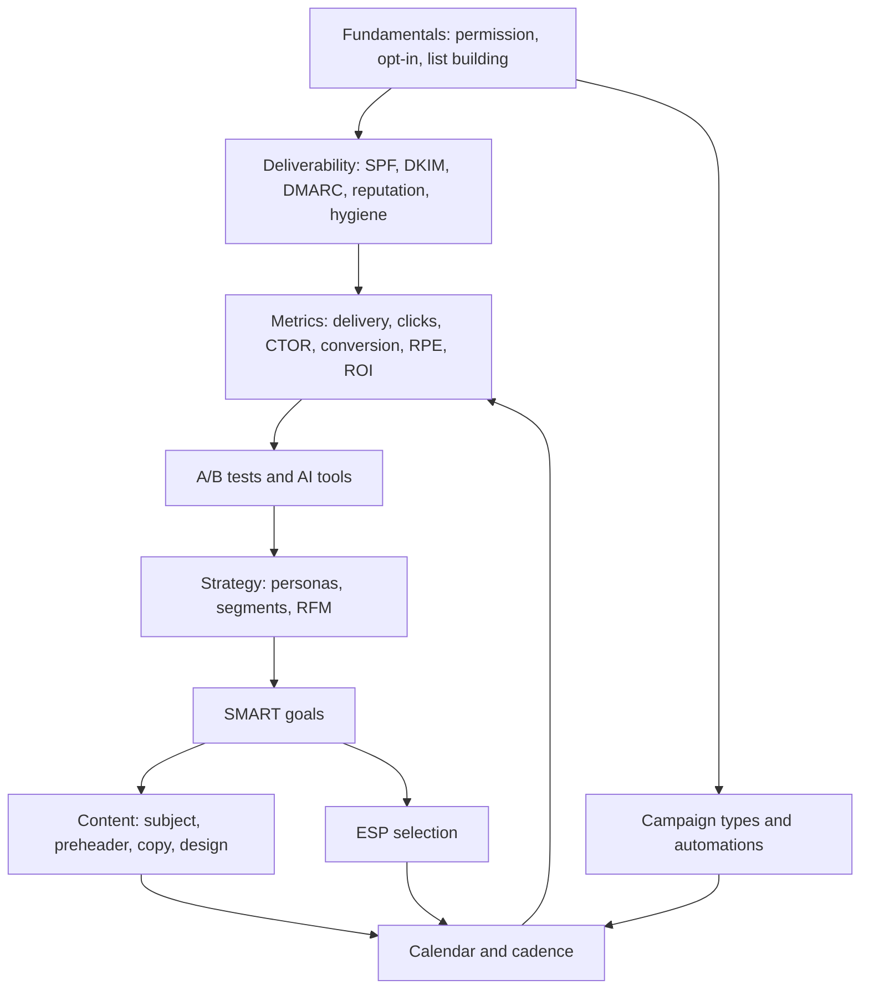

# Module 6 · Email Marketing

> 🏠 [Diploma in Digital Marketing](../../README.md) › [Term 1](../README.md) › **Module 6**

[⬅ Previous module](../05-social-media-marketing/README.md) · [Start Session 1 ➡](session-01-email-marketing-fundamentals.md) · [Next module ➡](../07-mobile-marketing/README.md)

---

Email is the channel a business truly owns: no algorithm decides who sees it, and it keeps delivering some of the highest returns in digital marketing. This module covers the fundamentals (permission, list building, automation, deliverability and authentication, campaign types, email design and the law), then shows how to build a complete strategy (personas, RFM segments, SMART goals, ESP selection, content and calendars), and finishes with measurement, diagnosis, A/B testing and the AI tools now built into every email platform.

## 🎯 Module objectives

- Define **email marketing** and explain **permission, opt-in, list building, segmentation, personalisation, automation and deliverability** (SPF, DKIM, DMARC).
- List and choose between the **types of email campaigns**: welcome, newsletter, promotional, seasonal, transactional, abandoned cart, re-engagement, educational drip and more.
- Prepare **email content**: subject lines, preheaders, copy, mobile-first design, compliant footers.
- Build **buyer personas** and **segments** (including RFM), set **SMART goals**, select an **ESP** with a weighted scorecard and plan an **email calendar**.
- Calculate and interpret **email KPIs** – delivery, click rate, CTOR, conversion, unsubscribe and spam rates, revenue per email, ROI – and diagnose problems.
- Run **A/B tests** and use **AI tools** responsibly.

## 📅 Sessions

| # | Session | Prerequisites |
|---|---|---|
| 1 | [Fundamentals of Email Marketing](session-01-email-marketing-fundamentals.md) | Module 1 |
| 2 | [Building an Email Marketing Strategy](session-02-building-email-strategy.md) | Session 1 |
| 3 | [Measuring Email Success and AI Tools](session-03-email-metrics-and-ai-tools.md) | Session 2 |
|  | 📝 [Module practice test](practice-test.md) | All sessions |

## 🧭 Concept map

## 💻 Code and charts in this module

All examples are runnable. See **[code/README.md](code/README.md)** for every file and how to run it. Python files need Python 3.10+; the chart scripts also need `pip install matplotlib`.

| Session | Code | Chart |
|---|---|---|
| 1 | List hygiene cleaner, 12-month list growth model, responsive HTML welcome email | List growth vs engaged contacts |
| 2 | RFM segmentation, weighted ESP scorecard, 13-week email calendar (CSV) | RFM customer map |
| 3 | Five-campaign KPI report, subject-line checker and A/B significance test | 11.11 email funnel |

## 📄 One-page cheat-sheet

| Topic | Remember this |
|---|---|
| Why email | Owned channel · high ROI · personal · measurable · automatable · full-funnel |
| Opt-in | Single (fast, messy) · **double** (clean, proof of consent) · never buy or scrape lists |
| List building | Forms · lead magnets · unticked checkout box · social lead ads · QR codes · referrals |
| Automations | Welcome · abandoned cart (1 h / 24 h / 72 h) · post-purchase · birthday · browse abandonment · win-back |
| Authentication | **SPF** = allowed servers · **DKIM** = signature · **DMARC** = policy + reports (p=none → quarantine → reject) |
| Bulk sender rules (Gmail/Yahoo, 2024) | SPF + DKIM + DMARC · one-click unsubscribe · spam rate < 0.3% (aim < 0.1%) |
| Bounces | Hard = permanent, remove now · soft = temporary, retry then remove |
| Laws | GDPR (EU consent) · CAN-SPAM (US: honest headers, address, opt-out in 10 business days) · PECA 2016 spamming offence (Pakistan) |
| Campaign types | Welcome · newsletter · promotional · seasonal · transactional · abandoned cart · re-engagement · drip · announcement · survey · event · VIP |
| Email anatomy | From name · own-domain address · subject 30–50 chars · preheader · hero · one CTA · compliant footer |
| Design | Single column · 600 px · mobile-first · buttons ≥ 44 px · alt text · live text · dark mode · plain-text version |
| Personas | Real data: goals, pains, objections, habits, message |
| Segments | Demographic · behavioural · lifecycle · engagement · preference · RFM |
| RFM | Recency · Frequency · Monetary → Champions, New, Loyal, At risk, Need nurturing, Lapsed |
| SMART | Specific · Measurable · Achievable · Relevant · Time-bound |
| ESP categories | Newsletter tools · e-commerce ESPs · CRM suites · developer APIs |
| ESP criteria | Price at your size · automation · deliverability · integrations · segmentation · support · export · compliance |
| Calendar | Fixed newsletter slot · frequency cap · preference centre · local retail and cultural moments |
| Opens | Directional only since Apple MPP (2021) – judge by clicks, conversions, revenue |
| Diagnosis | Delivery → list/auth · opens → subject/sender/time · CTOR → content/CTA · conversion → landing page/offer |
| AI | Copy · subject prediction · send-time optimisation · predictive segments · recommendations · analytics – human review always |

| Formula | Calculation |
|---|---|
| Delivery rate | Delivered ÷ Sent × 100 |
| Bounce rate | Bounces ÷ Sent × 100 |
| Open rate | Unique opens ÷ Delivered × 100 |
| Click rate | Unique clicks ÷ Delivered × 100 |
| CTOR | Unique clicks ÷ Unique opens × 100 |
| Conversion rate | Orders ÷ Unique clicks × 100 |
| Unsubscribe / spam rate | Unsubs (or complaints) ÷ Delivered × 100 |
| Revenue per email | Revenue ÷ Delivered |
| Email ROI | (Revenue × Margin − Cost) ÷ Cost × 100 |
| List growth rate | (New − Unsubs − Bounces) ÷ Start size × 100 |
| Expected orders | Delivered × Click rate × Conversion rate |
| z-test | p̂ = (x₁+x₂) ÷ (n₁+n₂) · SE = √[p̂(1−p̂)(1/n₁+1/n₂)] · z = (p₂ − p₁) ÷ SE |

**Common mistakes:** buying lists · sending from a free Gmail address · pre-ticked consent · hidden unsubscribe · image-only emails · no list cleaning · misleading subjects · personas without data · vague goals · picking the famous ESP · no frequency cap · no maths before sending · judging by open rate · dividing by sent instead of delivered · ignoring spam complaints · no UTMs · tiny-sample A/B winners · unchecked AI copy · customer data in public AI tools.

---

Prepared by **Hamna Zahid Khan**, Junior Lecturer · Diploma in Digital Marketing
