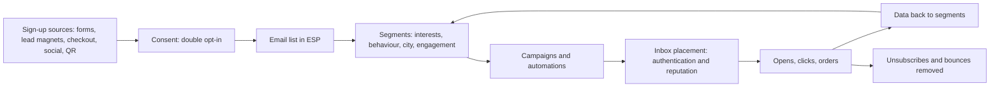
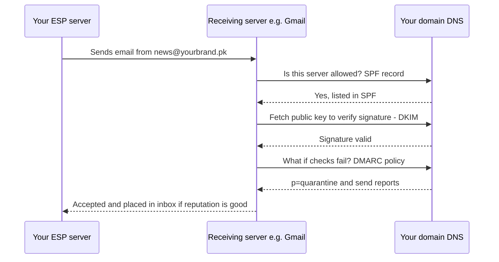
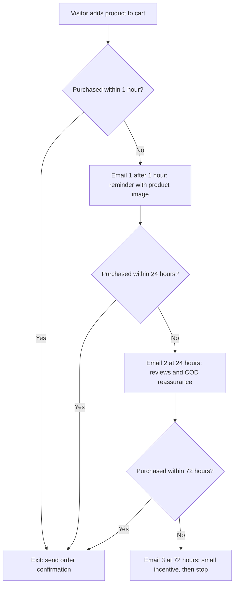
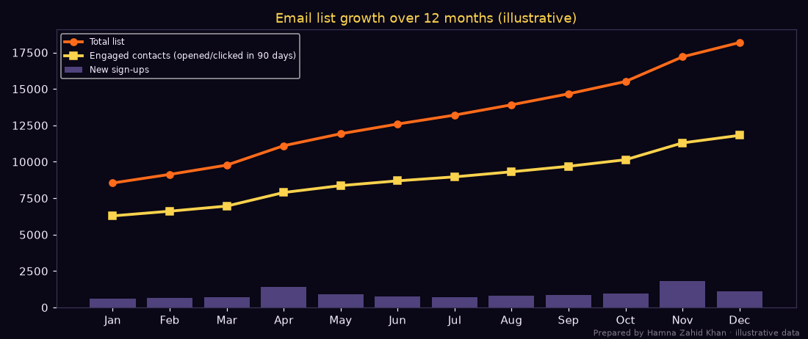
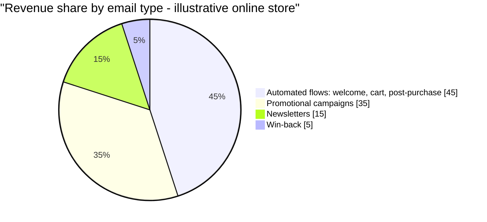

# Session 1 · Fundamentals of Email Marketing

> 🏠 [Diploma in Digital Marketing](../../README.md) › [Term 1](../README.md) › [Email Marketing](README.md) › **Session 1**
>
> ⏱ **Estimated time:** 3 hours (2 h theory + 1 h lab) · 📋 **Prerequisites:** Module 1

[⬅ Previous: Email Marketing overview](README.md) · [Next: Session 2 ➡](session-02-building-email-strategy.md)

---

## 🎯 Learning objectives

By the end of this session you will be able to:

- Define **email marketing** and explain why it remains one of the highest-ROI digital channels.
- Explain the **core concepts**: permission and opt-in, list building, segmentation, personalisation, automation, deliverability and authentication (SPF, DKIM, DMARC).
- List the main **types of email campaigns** and when to use each.
- Describe the **anatomy of a marketing email** and the rules that keep you legal and out of the spam folder.
- Clean an email list and model list growth with real code.

## 📖 Concepts

### 1. What email marketing is

**Email marketing** is sending commercial or relationship-building messages by email to people who have **given permission** to hear from you – to inform, engage, sell and retain.

Why businesses still love it:

| Advantage | Why it matters |
|---|---|
| **Owned channel** | You own the list. An algorithm change, account ban or platform block cannot take it away (unlike followers). |
| **High ROI** | Industry surveys regularly report returns of tens of rupees per rupee spent, because sending costs very little once the list exists. |
| **Direct and personal** | Lands in a personal inbox, can use the person's name, history and preferences. |
| **Measurable** | Every delivery, open, click, order and unsubscribe can be tracked. |
| **Automatable** | Welcome, abandoned-cart and birthday emails run 24/7 without staff. |
| **Works across the funnel** | Nurture leads, convert, onboard, retain and win back. |

**Email in Pakistan.** For consumer brands, WhatsApp is often the first messaging channel, but email remains essential for **e-commerce receipts and order updates, banking and fintech, education (admissions, LMS notices), B2B and corporate communication, SaaS and freelancing platforms, and job applications**. Most smartphone users have a Gmail account because Android requires one, so email reach is wide even when daily engagement is lower than WhatsApp's.

> 💡 **Analogy:** social media is renting a stall in someone else's bazaar – the landlord sets the rules. Your email list is your own shop with your own key.

### 2. Core concepts

#### 2a. Permission and opt-in

| Type | How it works | Quality |
|---|---|---|
| **Single opt-in** | Person enters email → added immediately | Faster growth, more typos and fake addresses |
| **Double opt-in (confirmed)** | Person enters email → receives a confirmation link → added only after clicking | Cleaner list, proof of consent, better deliverability |
| **Implied / soft opt-in** | Existing customers emailed about similar products (allowed in some laws, e.g. UK PECR) | Must offer an easy opt-out |
| **Purchased / scraped lists** | Buying or collecting addresses without consent | ❌ Illegal in many places, damages sender reputation, spam traps |

#### 2b. List building methods

- **Website sign-up forms** – header, footer, blog posts, exit-intent pop-up (use politely).
- **Lead magnets** – free e-book, checklist, discount code, quiz result, webinar seat. *"Get our free 'Ramadan meal planner' PDF."*
- **Checkout opt-in** – an **unticked** box: "Send me offers and new arrivals."
- **Social media** – lead ads, link in bio, giveaways that require email (follow platform rules).
- **Offline** – QR codes at the store counter, events and exhibitions (with clear consent).
- **Referral programmes** – "Give PKR 300, get PKR 300."

#### 2c. Segmentation and personalisation

- **Segmentation** = splitting the list into groups (city, gender, interests, purchase history, engagement level, customer vs prospect).
- **Personalisation** = tailoring content to the individual: name, recommended products, location, language, send time.
- **Dynamic content** = blocks that change per recipient inside one email (e.g. Lahore subscribers see a Lahore store event).

#### 2d. Automation

**Triggered emails** are sent automatically when someone does something (or nothing):

| Trigger | Email |
|---|---|
| Signs up | Welcome series |
| Adds to cart, doesn't buy | Abandoned cart reminder (1 h, 24 h, 72 h) |
| Buys | Order confirmation, shipping update, review request, cross-sell |
| Birthday / anniversary | Greeting + gift |
| Inactive for 90+ days | Re-engagement / win-back |
| Browses a product | Browse abandonment |

#### 2e. Deliverability

**Deliverability** = whether your email reaches the **inbox** (not spam, not bounced). It depends on:

| Factor | Explanation |
|---|---|
| **Sender reputation** | Mailbox providers (Gmail, Outlook, Yahoo) score your domain and sending IP based on past behaviour |
| **Authentication** | **SPF** (which servers may send for your domain), **DKIM** (a digital signature proving the email wasn't altered), **DMARC** (policy telling receivers what to do if SPF/DKIM fail, plus reports) |
| **Engagement** | Opens, clicks, replies help; ignores, deletes and spam complaints hurt |
| **List quality** | Hard bounces and spam traps ruin reputation |
| **Content** | Misleading subjects, spammy phrases, image-only emails and broken links hurt |
| **Unsubscribe** | Easy, visible, **one-click** unsubscribe reduces complaints |

Since February 2024, **Gmail and Yahoo require bulk senders** (roughly 5,000+ messages a day to their users) to authenticate with SPF, DKIM and DMARC, support one-click unsubscribe, and keep spam complaint rates below **0.3%** (aim for under 0.1%).

**Bounces:** a **hard bounce** is permanent (address doesn't exist) – remove immediately. A **soft bounce** is temporary (full inbox, server down) – retry, and remove after repeated failures.

#### 2f. Laws and ethics

| Law / rule | Where | Key points |
|---|---|---|
| **GDPR** | EU/EEA residents (applies to Pakistani businesses emailing them) | Freely given, specific, informed consent; right to withdraw and to erasure; records of consent |
| **CAN-SPAM Act** | USA | No deceptive subjects/headers, identify as an ad where relevant, physical postal address, honour opt-outs within 10 business days |
| **PECA 2016** | Pakistan | Includes an offence of sending unsolicited/misleading electronic messages (spamming) without the recipient's permission; a separate personal data protection law has been in draft |
| **Platform/ESP rules** | Everywhere | ESPs ban purchased lists and suspend accounts with high complaint rates |

**Good practice everywhere:** clear consent, honest subject lines, sender name people recognise, physical address, visible unsubscribe, honour it immediately, collect only data you need.

### 3. Types of email campaigns

| Type | Purpose | Example (Pakistani context) | Typical timing |
|---|---|---|---|
| **Welcome / onboarding** | First impression, set expectations, first purchase | "Welcome to Kitab Ghar – here's 10% off" | Immediately after sign-up, then 2–3 more over a week |
| **Newsletter** | Regular value and brand connection | Weekly arrivals, staff picks, tips | Fixed day/time weekly or monthly |
| **Promotional** | Drive sales | 11.11 sale, Eid collection launch | Around campaigns; don't over-send |
| **Seasonal / event** | Cultural moments | Ramadan iftar recipes, Independence Day, back to school | Aligned to calendar |
| **Transactional** | Receipts, shipping, password resets | "Your order is on its way with the courier" | Triggered; highest open rates |
| **Abandoned cart** | Recover lost sales | "You left the Sindhri mango box in your cart" | 1 h / 24 h / 72 h |
| **Re-engagement / win-back** | Wake up inactive subscribers or customers | "We miss you – here's what's new" | After 60–180 days inactive |
| **Educational / nurture (drip)** | Teach and build trust for considered purchases | 5-day email course on choosing solar panels | Spaced sequence |
| **Announcement** | News, new product, store opening | "Our Islamabad store opens 1 Dec" | One-off |
| **Survey / feedback** | Learn and collect reviews | "Rate your delivery – 1 click" | After delivery |
| **Event / webinar invitation** | Registrations | Free webinar on freelancing taxes | 2 weeks, 2 days, 2 hours before |
| **Loyalty / VIP** | Reward best customers | Early access for top spenders | Around launches |

### 4. Anatomy of a marketing email

| Part | Best practice |
|---|---|
| **From name** | Recognisable: "Kitab Ghar" or "Hira from Kitab Ghar" |
| **From address** | Your own domain (`news@kitabghar.pk`), not a free Gmail address |
| **Subject line** | 30–50 characters, specific, honest, benefit or curiosity |
| **Preheader** | The preview text after the subject; extends the subject (40–90 chars) |
| **Header / logo** | Small, brand-coloured, links to site |
| **Hero** | One main message with image or headline |
| **Body copy** | Short paragraphs, scannable, one main goal |
| **CTA button** | Large, contrasting, action verb ("Browse bestsellers"), tappable on mobile (≥ 44 px high) |
| **Secondary content** | Optional – related products, blog post |
| **Footer** | Why they get this email, physical address, **unsubscribe** and preferences links, social icons |

**Design rules:** mobile-first (most emails are opened on phones), single column, 600 px max width, alt text on images, sufficient colour contrast, not image-only (many apps block images by default), dark-mode check, plain-text version included.

📄 `code/session-01_welcome_email.html` is a complete responsive welcome email using tables and inline styles (the reliable way to code HTML email). Open it in a browser to see the layout.

## 🧭 Diagrams

### Email marketing system



### How authentication works



### Abandoned-cart automation



## 💻 Worked examples

### Example 1 – Cleaning a list before the first send

A shop exported contacts from several places (website, a spreadsheet from an exhibition, a list "a friend gave"). Before importing into an ESP, clean it:

📄 `code/session-01_list_hygiene.py`

```python
# Clean an email list before sending: validate format, fix common typos, remove duplicates,
# role addresses and unconfirmed or unsubscribed contacts. Prepared by Hamna Zahid Khan, Junior Lecturer.
# All addresses are invented (example domains) for practice.
import re

RAW = """name,email,consent,status
Ayesha Khan,ayesha.khan@gmail.com,double_opt_in,active
Bilal Ahmed,BILAL.AHMED@GMAIL.COM ,double_opt_in,active
Bilal A.,bilal.ahmed@gmail.com,single_opt_in,active
Sara Malik,sara.malik@gmial.com,double_opt_in,active
Info Desk,info@example-traders.pk,imported,active
Usman Tariq,usman.tariq@yahoo,double_opt_in,active
Hira Shah,hira.shah@hotmail.com,double_opt_in,unsubscribed
Zain Raza,zain.raza@outlook.com,purchased_list,active
Maryam Iqbal,maryam.iqbal@gmail.com,single_opt_in,active
Fahad Ali,fahad..ali@gmail.com,double_opt_in,active
Noor Fatima,noor.fatima@yaho.com,double_opt_in,active
Sales Team,sales@example-shop.pk,double_opt_in,active"""

PATTERN = re.compile(r"^[a-z0-9]+(?:[._%+-]+[a-z0-9]+)*@[a-z0-9-]+(?:\.[a-z0-9-]+)*\.[a-z]{2,}$")
TYPOS = {"gmial.com": "gmail.com", "gmal.com": "gmail.com", "yaho.com": "yahoo.com", "hotmial.com": "hotmail.com", "outlok.com": "outlook.com"}
ROLE = {"info", "sales", "admin", "support", "noreply", "contact"}
OK_CONSENT = {"double_opt_in", "single_opt_in"}

rows = [r.split(",") for r in RAW.splitlines()[1:]]
seen, keep, report = set(), [], []
for name, email, consent, status in rows:
    e = email.strip().lower()
    local, _, domain = e.partition("@")
    if domain in TYPOS:
        report.append(f"FIXED   {e} -> {local}@{TYPOS[domain]} (typo)"); domain = TYPOS[domain]; e = f"{local}@{domain}"
    if ".." in e or not PATTERN.match(e):
        report.append(f"REMOVED {e} (invalid format)"); continue
    if status == "unsubscribed":
        report.append(f"REMOVED {e} (unsubscribed - must never be emailed)"); continue
    if consent not in OK_CONSENT:
        report.append(f"REMOVED {e} (no valid consent: {consent})"); continue
    if local in ROLE:
        report.append(f"FLAGGED {e} (role address - low engagement, kept for B2B review)")
    if e in seen:
        report.append(f"REMOVED {e} (duplicate)"); continue
    seen.add(e); keep.append((name, e, consent))

print("\n".join(report))
print(f"\nStart: {len(rows)} contacts -> clean list: {len(keep)} contacts ({len(keep) / len(rows):.0%})")
for n, e, c in keep:
    print(f"  {n:<14}{e:<30}{c}")
```

**Output**

```text
REMOVED bilal.ahmed@gmail.com (duplicate)
FIXED   sara.malik@gmial.com -> sara.malik@gmail.com (typo)
REMOVED info@example-traders.pk (no valid consent: imported)
REMOVED usman.tariq@yahoo (invalid format)
REMOVED hira.shah@hotmail.com (unsubscribed - must never be emailed)
REMOVED zain.raza@outlook.com (no valid consent: purchased_list)
REMOVED fahad..ali@gmail.com (invalid format)
FIXED   noor.fatima@yaho.com -> noor.fatima@yahoo.com (typo)
FLAGGED sales@example-shop.pk (role address - low engagement, kept for B2B review)

Start: 12 contacts -> clean list: 6 contacts (50%)
  Ayesha Khan   ayesha.khan@gmail.com         double_opt_in
  Bilal Ahmed   bilal.ahmed@gmail.com         double_opt_in
  Sara Malik    sara.malik@gmail.com          double_opt_in
  Maryam Iqbal  maryam.iqbal@gmail.com        single_opt_in
  Noor Fatima   noor.fatima@yahoo.com         double_opt_in
  Sales Team    sales@example-shop.pk         double_opt_in
```

**What happened and why:**

- **Typos fixed** (`gmial.com`, `yaho.com`) – otherwise they hard-bounce.
- **Invalid formats** removed (`usman.tariq@yahoo` has no top-level domain; `fahad..ali` has double dots).
- **Unsubscribed** contact removed – emailing them again breaks the law and trust.
- **No consent** (imported/purchased) removed – the biggest deliverability risk (spam traps, complaints).
- **Duplicate** removed after lower-casing and trimming spaces.
- **Role address** (`sales@`) flagged: these often go to several people and engage poorly; keep only for B2B if consented.

Only **50%** of the raw list survived – normal for messy lists, and far better than damaging your sender reputation.

### Example 2 – How a list grows and decays

📄 `code/session-01_list_growth.py`

```python
# Model 12 months of email list growth and decay: new opt-ins, unsubscribes, bounces and
# inactive contacts, and chart the result. Prepared by Hamna Zahid Khan, Junior Lecturer.
# Illustrative figures for a Karachi online bookstore.
import matplotlib
matplotlib.use("Agg")
import matplotlib.pyplot as plt

BG, FIRE, GOLD, VIOLET, EMBER, TEXT = "#0A0716", "#FF6B1A", "#FCD34D", "#A78BFA", "#F43F5E", "#F5EEFF"
start = 8_000
signups = [600, 650, 700, 1_400, 900, 750, 700, 800, 850, 950, 1_800, 1_100]   # Apr = Ramadan offer, Nov = 11.11
UNSUB, BOUNCE, DECAY = 0.004, 0.003, 0.030    # monthly rates: unsubscribes, hard bounces, contacts going inactive
months = ["Jan", "Feb", "Mar", "Apr", "May", "Jun", "Jul", "Aug", "Sep", "Oct", "Nov", "Dec"]

size, active, sizes, actives = start, start * 0.75, [], []
print(f"{'Month':<6}{'New':>6}{'Lost':>7}{'List':>8}{'Engaged':>9}")
for m, new in zip(months, signups):
    lost = round(size * (UNSUB + BOUNCE))
    size = size + new - lost
    active = active * (1 - DECAY - UNSUB - BOUNCE) + new * 0.85
    sizes.append(size); actives.append(active)
    print(f"{m:<6}{new:>6}{lost:>7}{size:>8,}{active:>9,.0f}")
growth = (sizes[-1] - start) / start * 100
print(f"\nNet list growth in the year: {growth:.1f}%  |  engaged share at year end: {actives[-1] / sizes[-1]:.0%}")
print("Lesson: list size grows, but without re-engagement campaigns the engaged share slowly falls.")

fig, ax = plt.subplots(figsize=(10, 4.2), facecolor=BG); ax.set_facecolor(BG)
ax.plot(months, sizes, color=FIRE, lw=2.5, marker="o", label="Total list")
ax.plot(months, actives, color=GOLD, lw=2.5, marker="s", label="Engaged contacts (opened/clicked in 90 days)")
ax.bar(months, signups, color=VIOLET, alpha=.45, label="New sign-ups")
ax.set_title("Email list growth over 12 months (illustrative)", color=GOLD)
ax.tick_params(colors=TEXT)
for s in ax.spines.values(): s.set_color("#3b3355")
ax.legend(facecolor=BG, labelcolor=TEXT, fontsize=8, loc="upper left")
fig.text(0.99, 0.01, "Prepared by Hamna Zahid Khan · illustrative data", color=TEXT, alpha=0.5, ha="right", fontsize=7)
plt.tight_layout(); plt.savefig("session-01_list_growth.png", dpi=110, facecolor=BG)
print("Saved session-01_list_growth.png")
```

**Output**

```text
Month    New   Lost    List  Engaged
Jan      600     56   8,544    6,288
Feb      650     60   9,134    6,608
Mar      700     64   9,770    6,958
Apr     1400     68  11,102    7,891
May      900     78  11,924    8,364
Jun      750     83  12,591    8,692
Jul      700     88  13,203    8,965
Aug      800     92  13,911    9,314
Sep      850     97  14,664    9,692
Oct      950    103  15,511   10,140
Nov     1800    109  17,202   11,295
Dec     1100    120  18,182   11,812

Net list growth in the year: 127.3%  |  engaged share at year end: 65%
Lesson: list size grows, but without re-engagement campaigns the engaged share slowly falls.
Saved session-01_list_growth.png
```



**Interpretation:** big sign-up months (the Ramadan offer in April and 11.11 in November) drive growth, but every month some people unsubscribe, bounce or simply stop opening. The **engaged share falls to 65%** by year end. That is why list hygiene and **re-engagement campaigns** (Session 2) are essential – sending to unengaged contacts hurts deliverability for everyone else.

### Example 3 – Setting up SPF, DKIM and DMARC (walkthrough)

You own `kitabghar.pk` and send through an ESP.

1. In the ESP, go to *Domains → Add sending domain* → it shows DNS records to add.
2. **SPF** – add or edit one TXT record on the root domain, e.g.
   `v=spf1 include:_spf.youresp.com include:_spf.google.com ~all`
   (only one SPF record per domain; combine includes.)
3. **DKIM** – add the CNAME or TXT records the ESP gives, e.g. `esp1._domainkey.kitabghar.pk` → ESP's key.
4. **DMARC** – add a TXT record at `_dmarc.kitabghar.pk`:
   `v=DMARC1; p=none; rua=mailto:dmarc@kitabghar.pk`
   Start with `p=none` (monitor), review reports, then move to `p=quarantine` and later `p=reject`.
5. Click **Verify** in the ESP (DNS changes can take up to 24–48 hours).
6. Send a test to Gmail → *Show original* → check **SPF: PASS, DKIM: PASS, DMARC: PASS**.

### Example 4 – Choosing the right campaign type

| Situation | Campaign | Why |
|---|---|---|
| 1,200 people downloaded a free "Freelancing tax guide" | Educational drip (5 emails) → offer consultation | Considered purchase needs trust |
| 18% of carts abandoned last month | Abandoned-cart automation | Recovers revenue automatically |
| 4,000 subscribers haven't opened in 6 months | Re-engagement, then suppress non-responders | Protects deliverability |
| New Eid collection in 2 weeks | Teaser → launch → last chance (promotional + seasonal) | Builds anticipation and urgency |
| Customer received parcel yesterday | Review request + cross-sell | Fresh experience, social proof |

## 📊 Chart · Typical share of email revenue by campaign type (illustrative store)



Automations often produce a large share of email revenue from a small share of sends, because they reach people at the moment of intent.

## 📋 Checklist · Before your first campaign

- [ ] Sending domain set up with **SPF, DKIM, DMARC** (pass in a Gmail test).
- [ ] From name and address on your own domain.
- [ ] List has documented consent (preferably double opt-in); purchased/scraped contacts removed.
- [ ] List cleaned: invalid, duplicate, unsubscribed, bounced removed.
- [ ] Welcome email/series active.
- [ ] Footer has physical address, unsubscribe and preference links; one-click unsubscribe enabled.
- [ ] Template tested on mobile, Gmail, Outlook, dark mode; alt text on images.
- [ ] Links tagged with UTMs (`utm_source=newsletter&utm_medium=email`).
- [ ] Plain-text version present.

## ⚠️ Common mistakes

| Mistake | Fix |
|---|---|
| Buying an email list | Grow organically with lead magnets and checkout opt-in |
| Sending from a free Gmail/Yahoo address | Use your own authenticated domain |
| Pre-ticked consent boxes | Unticked box with clear wording |
| Hiding the unsubscribe link | Make it visible; one-click |
| Image-only emails | Mix live text and images; add alt text |
| Emailing everyone the same thing | Segment by interest, behaviour and engagement |
| Never cleaning the list | Remove hard bounces immediately; re-engage or suppress inactives |
| Misleading subject lines ("Re: your order") | Honest, specific subjects |

## 🧪 Lab / practice tasks

**Task 1 (easy) – Classify campaigns.** Name the campaign type: (a) "Your order #4471 has shipped"; (b) "We haven't seen you in a while – here's what's new"; (c) "Day 3 of 5: how to calculate your solar needs"; (d) "Eid collection: last 24 hours".

<details><summary>✅ Solution</summary>

(a) Transactional · (b) Re-engagement/win-back · (c) Educational drip/nurture · (d) Promotional/seasonal.

</details>

**Task 2 (easy) – Opt-in.** Explain why double opt-in leads to better deliverability than single opt-in, giving two reasons.

<details><summary>✅ Solution</summary>

(1) Typos and fake addresses never join the list, so fewer hard bounces and spam traps. (2) Every subscriber actively confirmed, so engagement is higher and complaints lower – both improve sender reputation. Bonus: it gives proof of consent.

</details>

**Task 3 (medium) – Extend the cleaner.** In `code/session-01_list_hygiene.py`, add `hotmial.com → hotmail.com` (already there) and a new rule that removes **disposable** domains such as `mailinator.com` and `10minutemail.com`. Add a test contact `test,abc@mailinator.com,double_opt_in,active` and rerun.

<details><summary>💡 Hint</summary>

Create `DISPOSABLE = {"mailinator.com", "10minutemail.com"}` and, after the typo fix, `if domain in DISPOSABLE: report.append(...); continue`.

</details>

**Task 4 (medium) – Write a welcome series.** Plan a 3-email welcome series for a Lahore online tutoring academy: for each email give the send time, subject line (≤ 50 chars), preheader, main content and CTA.

<details><summary>✅ Model answer</summary>

**Email 1 (immediately):** "Welcome! Your free trial class is ready" · preheader "Pick a time that suits you" · what to expect, how classes work · CTA *Book my free class*. **Email 2 (day 2):** "How Ali raised his O-Level maths grade" · preheader "A 6-week story" · testimonial + method · CTA *See our tutors*. **Email 3 (day 5):** "Questions parents ask us most" · preheader "Fees, timings, tutor checks" · FAQ, fees, safety · CTA *WhatsApp us* or *Enrol now*.

</details>

**Task 5 (challenge) – Code an email.** Copy `code/session-01_welcome_email.html` and turn it into an **abandoned-cart email** for a mango delivery business: product image block, price, "Complete my order" button with UTMs, delivery reassurance (COD, delivery in 48 h), and a compliant footer. Test it in a browser at mobile width (DevTools device mode).

## ✅ Quick quiz

1. Which list-building method is unacceptable?
   a) Checkout opt-in box (unticked) b) Lead magnet c) Buying a list of 50,000 emails d) QR code sign-up at the store
2. DKIM's job is to:
   a) list which servers may send for your domain b) prove with a digital signature that the email is genuine and unaltered c) design the email d) count opens
3. A hard bounce means:
   a) the inbox is full b) the address permanently doesn't exist – remove it c) the person opened the email d) the server was busy
4. Which campaign type usually has the highest open rate?
   a) Newsletter b) Transactional c) Promotional d) Win-back
5. Since 2024, Gmail and Yahoo require bulk senders to:
   a) send only on weekdays b) authenticate with SPF, DKIM and DMARC and offer one-click unsubscribe c) use images only d) pay per email

<details><summary>Show answers</summary>

1-c · 2-b · 3-b · 4-b · 5-b

</details>

## 📝 Summary

- Email marketing = permission-based messages to an **owned** list; high ROI, measurable, automatable.
- Core concepts: **opt-in (double is best), list building, segmentation, personalisation, automation, deliverability**.
- Deliverability rests on **reputation, SPF/DKIM/DMARC, engagement, list quality, honest content and easy unsubscribe**.
- Follow consent laws (GDPR, CAN-SPAM, PECA spamming provisions) and ESP rules; never buy lists.
- Campaign types: welcome, newsletter, promotional, seasonal, transactional, abandoned cart, re-engagement, educational drip, announcement, survey, event, loyalty.
- Good emails: recognisable sender, 30–50-character subject + preheader, one goal, mobile-first single column, clear CTA, compliant footer.

**Interview / viva questions**

1. Why is email called an "owned" channel, and why does that matter?
2. Explain single vs double opt-in.
3. What are SPF, DKIM and DMARC in simple words?
4. Name five types of email campaigns with an example of each.
5. What happens to a sender who emails a purchased list?
6. List the essential parts of a compliant marketing email footer.

---

[⬅ Previous: Email Marketing overview](README.md) · [Next: Session 2 ➡](session-02-building-email-strategy.md)

<sub>Prepared by **Hamna Zahid Khan**, Junior Lecturer · Diploma in Digital Marketing</sub>
