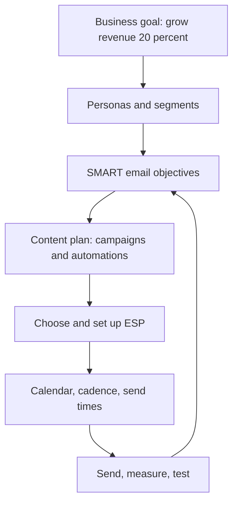
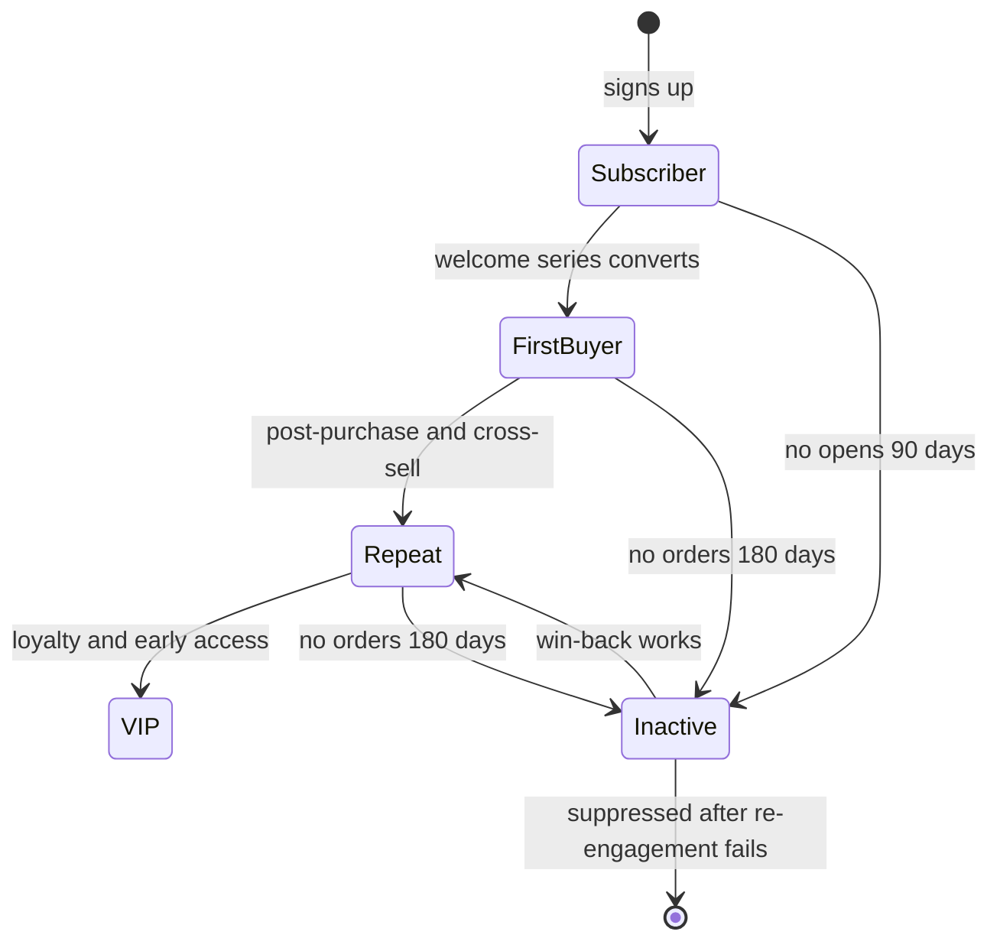
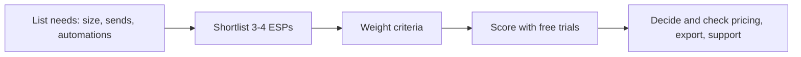
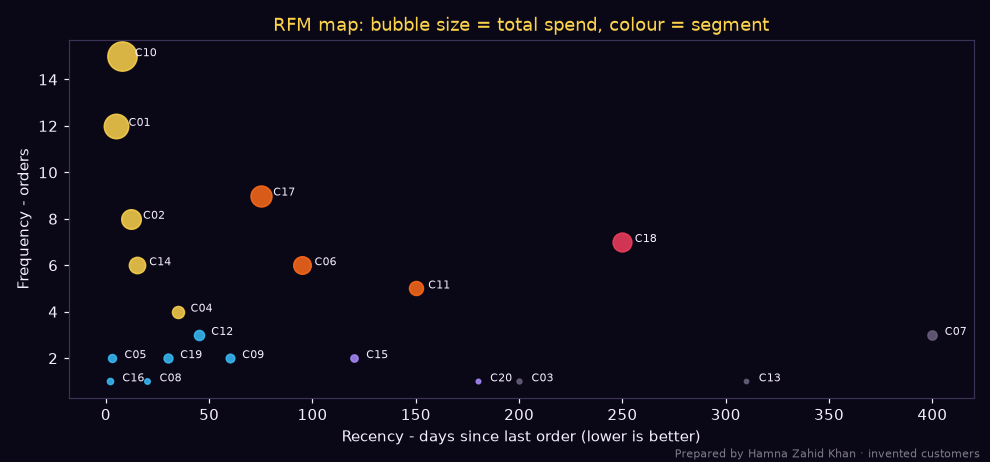

# Session 2 · Building an Email Marketing Strategy

> 🏠 [Diploma in Digital Marketing](../../README.md) › [Term 1](../README.md) › [Email Marketing](README.md) › **Session 2**
>
> ⏱ **Estimated time:** 3 hours (1.5 h theory + 1.5 h lab) · 📋 **Prerequisites:** Session 1

[⬅ Previous: Session 1](session-01-email-marketing-fundamentals.md) · [Next: Session 3 ➡](session-03-email-metrics-and-ai-tools.md)

---

## 🎯 Learning objectives

By the end of this session you will be able to:

- Explain how to **prepare email content**: subject lines, preheaders, copy, design, CTAs and personalisation.
- Identify the **ideal audience** and build **buyer personas** for email.
- Set **SMART goals and objectives** for an email programme.
- Elaborate how to **select an Email Service Provider (ESP)** with a weighted scorecard.
- Outline how to build an **email calendar** and schedule content, including segmentation with **RFM**.

## 📖 Concepts

### 1. The strategy stack

An email strategy answers six questions in order:

| # | Question | Output |
|---|---|---|
| 1 | **Who** are we emailing? | Audience and buyer personas, segments |
| 2 | **Why** – what do we want to achieve? | SMART goals and KPIs |
| 3 | **What** will we send? | Content types, campaigns, automations |
| 4 | **With what** tool? | ESP choice and setup |
| 5 | **When** and how often? | Calendar, cadence, send times |
| 6 | **How** will we know it worked? | Measurement plan (Session 3) |

### 2. Ideal audience and buyer personas

A **buyer persona** is a semi-fictional profile of an ideal customer based on real data (customer interviews, sales data, analytics, surveys, social comments).

**What to include:**

| Field | Example |
|---|---|
| Name and photo (fictional) | "Professional Parent Sana" |
| Demographics | 34, Karachi (DHA), married, two school-age children |
| Job and income | HR manager, household income PKR 450k/month |
| Goals | Keep kids reading less screen time, buy quality books quickly |
| Pain points | Little time to visit bookshops; worried about fake/poor prints; delivery delays |
| Channels | Email at work (laptop), Instagram evenings, WhatsApp family groups |
| Email behaviour | Reads emails at 9–11 am weekdays; prefers short, curated picks |
| Objections | "Is it the original print? Can I return it?" |
| What we offer her | Age-wise curated lists, original prints guarantee, COD and easy returns |
| Message | "Hand-picked books your kids will actually finish" |

**Second persona example:** *"Student Reader Hamza"* – 20, university student in Lahore, budget-conscious, reads on phone, wants exam guides and Urdu fiction, responds to discounts and bundles, opens emails late evening.

**From personas to segments:** personas guide tone and content; **segments** are the actual lists in your ESP (e.g. `parents_kids_books`, `students`, `urdu_fiction_fans`, `vip_customers`, `inactive_90d`).

#### Ways to segment an email list

| Basis | Examples |
|---|---|
| **Demographic** | Age, gender, city, language |
| **Behavioural** | Purchase history, pages browsed, emails clicked, cart abandoned |
| **Lifecycle stage** | Subscriber → first-time buyer → repeat → VIP → lapsed |
| **Engagement** | Opened/clicked in last 30 / 90 / 180 days |
| **Preference** | Topics chosen in the preference centre, frequency chosen |
| **Value (RFM)** | Recency, Frequency, Monetary scores (see Example 1) |

### 3. SMART goals and objectives

A **SMART** goal is **S**pecific, **M**easurable, **A**chievable, **R**elevant and **T**ime-bound.

| Weak goal | SMART goal |
|---|---|
| "Grow our list" | "Grow the email list from 8,000 to 12,000 confirmed subscribers by 31 March 2027 using a quiz lead magnet and checkout opt-in." |
| "Get more sales from email" | "Increase email-attributed revenue (GA4) from PKR 300,000 to PKR 450,000 per month by June 2027." |
| "Improve engagement" | "Raise newsletter click rate from 2.5% to 3.5% over the next 12 weeks by testing personalised subject lines and a single-CTA layout." |
| "Recover carts" | "Launch a 3-email abandoned-cart flow by 15 November and recover 10% of abandoned carts within 2 months." |

**Goal hierarchy:** business goal (grow revenue 20%) → email objective (email revenue +50%) → KPIs (click rate, conversion rate, revenue per email, list growth) → tactics (automations, segmentation, tests).

### 4. Preparing email content

#### 4a. Subject lines and preheaders

| Technique | Example |
|---|---|
| **Benefit** | "Save 2 hours of cooking this Ramadan" |
| **Curiosity** | "The book every O-Level student is hiding" |
| **Urgency (honest)** | "Last day: 11.11 prices end at midnight" |
| **Personalisation** | "Sana, new picks for 8-year-old readers" |
| **Numbers** | "7 Urdu novels under PKR 1,000" |
| **Question** | "Ready for winter school holidays?" |

Rules: 30–50 characters, avoid spam triggers (FREE!!!, all caps, "click here"), match the email content, write the **preheader** as a second line ("Plus free delivery over PKR 2,500"), test emojis carefully (one at most).

#### 4b. Copy

- **One email, one goal** – one primary CTA.
- **Inverted pyramid** – headline → short supporting copy → CTA button.
- **Scannable** – short paragraphs, bullets, bold key phrases.
- **Conversational** – "you", not "customers"; consistent brand voice; Urdu/English mix only if the brand voice uses it.
- **Benefits and proof** – reviews, numbers, guarantees.
- **P.S. line** – often read; repeat the offer or deadline.

#### 4c. Design

Single column, 600 px wide, mobile-first, 14–16 px+ body text, buttons at least 44 px tall, brand colours, plenty of white space, alt text, live text over images, dark-mode friendly logos (transparent PNG with outline), and a plain-text version.

#### 4d. Personalisation levels

| Level | Example |
|---|---|
| Basic | First name in subject or greeting (with fallback "Hi there") |
| Segment | Different hero image for parents vs students |
| Behavioural | "Because you bought *Peer-e-Kamil*, you might like…" |
| Predictive | Send-time optimisation, AI product recommendations |

#### 4e. Content mix

A healthy programme balances **value** and **selling** – e.g. for every promotional email, one or two that educate, entertain or inform. Content ideas: guides, staff picks, customer stories, behind the scenes, early access, exclusive subscriber discounts, events, polls ("Which genre next?").

### 5. Selecting an ESP

An **Email Service Provider** stores contacts, builds emails, sends them reliably, automates flows and reports results.

| Category | Typical examples | Good for |
|---|---|---|
| Newsletter / creator tools | Mailchimp, MailerLite, Brevo, Kit (formerly ConvertKit) | Small businesses, newsletters, simple automation |
| E-commerce focused | Klaviyo, Omnisend | Shopify/WooCommerce stores, product-based flows |
| CRM suites | HubSpot, Zoho Campaigns / Zoho CRM, Salesforce Marketing Cloud | B2B, sales pipelines, larger teams |
| Developer / transactional APIs | Amazon SES, SendGrid, Mailgun, Postmark | Apps, receipts, high volume at low cost (needs technical skill) |

**Selection criteria:** price at your list size (contact-based vs send-based pricing), ease of use and templates, automation depth, deliverability reputation and authentication support, integrations (Shopify, WooCommerce, forms, CRM), segmentation and personalisation, reporting, support quality and time zone, payment options from Pakistan (international card), data export (avoid lock-in), and compliance features (double opt-in, preference centre, one-click unsubscribe).

> Prices and free tiers change often – always check the provider's current pricing page before recommending.

### 6. Email calendar and scheduling

#### Cadence

| Type | Typical frequency |
|---|---|
| Newsletter | Weekly or fortnightly – same day/time |
| Promotional | Around sales events; avoid daily blasts outside big events |
| Automations | Triggered by behaviour (no calendar slot) |
| Re-engagement | Quarterly sweep of inactive contacts |

**Frequency cap:** decide a maximum (e.g. 2 marketing emails per week per subscriber) and let subscribers choose frequency in a **preference centre**.

#### Send time

There is no universal best time. Start with your audience's routine (B2B: weekday mornings 9–11 am PKT; consumers: lunch breaks or evenings), test, and use **send-time optimisation** if your ESP offers it. During **Ramadan**, routines shift – late evening after taraweeh and pre-sehri hours can perform differently; avoid iftar time.

#### Calendar contents

Date, send time and zone, campaign type, segment, subject idea, offer, owner, status (planning / copy / design / QA / scheduled / sent), and links to assets. Plan around Pakistani retail moments: Ramadan and the two Eids (dates move ~11 days earlier each year), 14 August, back-to-school, wedding season, 11.11, White/Black Friday, year-end.

## 🧭 Diagrams

### Strategy flow



### Subscriber lifecycle and emails



### ESP decision steps



## 💻 Worked examples

### Example 1 – RFM segmentation

RFM scores each customer on **Recency** (how recently they bought), **Frequency** (how often) and **Monetary** value (how much). Here 20 customers of a Lahore cosmetics store are scored 1–4 and grouped into segments, each with its own email strategy.

📄 `code/session-02_rfm_segments.py`

```python
# RFM segmentation of an e-commerce customer list for targeted email campaigns.
# R = days since last order, F = number of orders, M = total spend (PKR).
# Prepared by Hamna Zahid Khan, Junior Lecturer. 20 invented customers of a Lahore cosmetics store.
import matplotlib
matplotlib.use("Agg")
import matplotlib.pyplot as plt
from collections import Counter

BG, FIRE, GOLD, VIOLET, EMBER, TEXT = "#0A0716", "#FF6B1A", "#FCD34D", "#A78BFA", "#F43F5E", "#F5EEFF"
customers = [  # id, recency days, frequency, monetary PKR
    ("C01", 5, 12, 64_000), ("C02", 12, 8, 41_000), ("C03", 200, 1, 2_500), ("C04", 35, 4, 15_500),
    ("C05", 3, 2, 6_800), ("C06", 95, 6, 33_000), ("C07", 400, 3, 9_000), ("C08", 20, 1, 3_200),
    ("C09", 60, 2, 7_900), ("C10", 8, 15, 92_000), ("C11", 150, 5, 21_000), ("C12", 45, 3, 11_000),
    ("C13", 310, 1, 1_900), ("C14", 15, 6, 28_500), ("C15", 120, 2, 5_600), ("C16", 2, 1, 4_100),
    ("C17", 75, 9, 47_000), ("C18", 250, 7, 38_000), ("C19", 30, 2, 8_400), ("C20", 180, 1, 2_200),
]

def score(value, cuts, reverse=False):
    """1-4 score by thresholds; reverse=True means smaller is better (recency)"""
    s = 1 + sum(value > c for c in cuts)
    return 5 - s if reverse else s

def segment(r, f, m):
    if r >= 3 and f >= 3: return "Champions"
    if r >= 3 and f <= 2: return "New / promising"
    if r == 2 and f >= 3: return "Loyal - needs attention"
    if r <= 2 and f >= 3: return "At risk (were loyal)"
    if r == 2: return "Need nurturing"
    return "Lapsed"

EMAIL = {"Champions": "VIP early access, referral programme, no discounts needed",
         "New / promising": "Welcome series, how-to-use content, second-order incentive",
         "Loyal - needs attention": "Personal recommendations based on past orders",
         "At risk (were loyal)": "'We miss you' email with a meaningful offer and survey",
         "Need nurturing": "Best-sellers, reviews, bundle offers",
         "Lapsed": "Win-back sequence; suppress if no opens after 3 emails"}

print(f"{'ID':<5}{'R days':>7}{'F':>4}{'M PKR':>9}  R F M  Segment")
segs = Counter()
for cid, r, f, m in customers:
    rs = score(r, [14, 60, 180], reverse=True)
    fs = score(f, [1, 3, 7])
    ms = score(m, [5_000, 15_000, 40_000])
    sg = segment(rs, fs, ms); segs[sg] += 1
    print(f"{cid:<5}{r:>7}{f:>4}{m:>9,}  {rs} {fs} {ms}  {sg}")
print("\nSegment sizes and the email each one should get:")
for sg, n in segs.most_common():
    print(f"  {sg:<25}{n:>3}  -> {EMAIL[sg]}")

fig, ax = plt.subplots(figsize=(9, 4.2), facecolor=BG); ax.set_facecolor(BG)
for cid, r, f, m in customers:
    sg = segment(score(r, [14, 60, 180], True), score(f, [1, 3, 7]), 0)
    col = {"Champions": GOLD, "New / promising": "#38BDF8", "Loyal - needs attention": FIRE,
           "At risk (were loyal)": EMBER, "Need nurturing": VIOLET, "Lapsed": "#6b6280"}[sg]
    ax.scatter(r, f, s=m / 250, color=col, alpha=.85)
    ax.text(r + 6, f, cid, color=TEXT, fontsize=7)
ax.set_xlabel("Recency - days since last order (lower is better)", color=TEXT)
ax.set_ylabel("Frequency - orders", color=TEXT)
ax.set_title("RFM map: bubble size = total spend, colour = segment", color=GOLD)
ax.tick_params(colors=TEXT)
for s in ax.spines.values(): s.set_color("#3b3355")
fig.text(0.99, 0.01, "Prepared by Hamna Zahid Khan · invented customers", color=TEXT, alpha=0.5, ha="right", fontsize=7)
plt.tight_layout(); plt.savefig("session-02_rfm_segments.png", dpi=110, facecolor=BG)
print("Saved session-02_rfm_segments.png")
```

**Output**

```text
ID    R days   F    M PKR  R F M  Segment
C01        5  12   64,000  4 4 4  Champions
C02       12   8   41,000  4 4 4  Champions
C03      200   1    2,500  1 1 1  Lapsed
C04       35   4   15,500  3 3 3  Champions
C05        3   2    6,800  4 2 2  New / promising
C06       95   6   33,000  2 3 3  Loyal - needs attention
C07      400   3    9,000  1 2 2  Lapsed
C08       20   1    3,200  3 1 1  New / promising
C09       60   2    7,900  3 2 2  New / promising
C10        8  15   92,000  4 4 4  Champions
C11      150   5   21,000  2 3 3  Loyal - needs attention
C12       45   3   11,000  3 2 2  New / promising
C13      310   1    1,900  1 1 1  Lapsed
C14       15   6   28,500  3 3 3  Champions
C15      120   2    5,600  2 2 2  Need nurturing
C16        2   1    4,100  4 1 1  New / promising
C17       75   9   47,000  2 4 4  Loyal - needs attention
C18      250   7   38,000  1 3 3  At risk (were loyal)
C19       30   2    8,400  3 2 2  New / promising
C20      180   1    2,200  2 1 1  Need nurturing

Segment sizes and the email each one should get:
  New / promising            6  -> Welcome series, how-to-use content, second-order incentive
  Champions                  5  -> VIP early access, referral programme, no discounts needed
  Lapsed                     3  -> Win-back sequence; suppress if no opens after 3 emails
  Loyal - needs attention    3  -> Personal recommendations based on past orders
  Need nurturing             2  -> Best-sellers, reviews, bundle offers
  At risk (were loyal)       1  -> 'We miss you' email with a meaningful offer and survey
Saved session-02_rfm_segments.png
```



**How to use it:**

- **Champions (5)** – C01, C02, C10 spend the most and bought recently. Don't train them to wait for discounts; give early access and ask for referrals and reviews.
- **New / promising (6)** – recent but few orders. Goal: the **second order** (the hardest step) – how-to content plus a time-limited second-order incentive.
- **Loyal – needs attention (3)** and **At risk (1)** – C18 spent PKR 38,000 but hasn't ordered for 250 days. A personal "we miss you" email with a meaningful offer and a one-question survey is worth far more than a generic blast.
- **Lapsed (3)** – win-back sequence, then **suppress** if they stay silent, to protect deliverability.

### Example 2 – Choosing an ESP with a weighted scorecard

📄 `code/session-02_esp_scorecard.py`

```python
# Weighted decision matrix for choosing an Email Service Provider (ESP).
# Prepared by Hamna Zahid Khan, Junior Lecturer. Scores (1-5) are an example team's judgement for a
# small Pakistani online store with 5,000 contacts - re-score with your own needs and current prices.
criteria = {  # criterion: weight (sums to 100)
    "Price at 5,000 contacts": 20, "Ease of use / templates": 15, "Automation (welcome, cart)": 20,
    "Deliverability reputation": 15, "E-commerce integration (Shopify/WooCommerce)": 15,
    "Segmentation and personalisation": 10, "Support and local payment options": 5}
esps = {
    "Option A (budget newsletter tool)": [5, 4, 2, 3, 2, 2, 3],
    "Option B (e-commerce automation tool)": [2, 4, 5, 4, 5, 5, 3],
    "Option C (all-in-one CRM suite)": [1, 3, 5, 4, 4, 5, 4],
    "Option D (developer API service)": [4, 1, 3, 4, 3, 3, 2],
}
w = list(criteria.values())
assert sum(w) == 100
print("Weighted score = sum(score x weight) / 100  (max 5.00)\n")
results = []
for name, scores in esps.items():
    total = sum(s * wt for s, wt in zip(scores, w)) / 100
    results.append((total, name))
    print(f"{name:<40}{total:.2f}")
best = max(results)
print(f"\nRecommended: {best[1]} ({best[0]:.2f}/5)")
print("Check before signing: free trial, contact-based vs send-based pricing, SPF/DKIM/DMARC setup help, data export.")
```

**Output**

```text
Weighted score = sum(score x weight) / 100  (max 5.00)

Option A (budget newsletter tool)       3.10
Option B (e-commerce automation tool)   4.00
Option C (all-in-one CRM suite)         3.55
Option D (developer API service)        3.00

Recommended: Option B (e-commerce automation tool) (4.00/5)
Check before signing: free trial, contact-based vs send-based pricing, SPF/DKIM/DMARC setup help, data export.
```

**Reading it:** the cheapest tool (A) loses because automation and e-commerce integration matter most for this store (weights 20 + 15). The CRM suite (C) is powerful but expensive for 5,000 contacts. Option B wins. Change the weights for a B2B consultancy (more weight on CRM and segmentation) and the winner changes – which is the point: **the right ESP depends on your needs**, not on which brand is most famous.

### Example 3 – A 13-week email calendar

📄 `code/session-02_email_calendar.py`

```python
# Build a 3-month email calendar around Pakistani retail moments, mixing campaign types
# and respecting a weekly frequency cap. Prepared by Hamna Zahid Khan, Junior Lecturer.
import datetime as dt, csv

START, WEEKS, CAP = dt.date(2026, 10, 5), 13, 2      # Mondays from 5 Oct 2026; max 2 emails/week
EVENTS = {  # date: (campaign type, subject idea)  - verify dates each year
    dt.date(2026, 11, 6): ("Promotional", "11.11 early access starts now"),
    dt.date(2026, 11, 11): ("Promotional", "11.11: up to 40% off - today only"),
    dt.date(2026, 11, 27): ("Promotional", "White Friday deals inside"),
    dt.date(2026, 12, 11): ("Seasonal", "Wedding season gift guide"),
    dt.date(2026, 12, 24): ("Seasonal", "Year-end sale + Quaid Day reads"),
}
ROTATION = [("Newsletter", "This week's new arrivals + staff pick"), ("Educational", "How to choose your next book in 3 questions"),
            ("Newsletter", "Reader of the month"), ("Re-engagement", "Still interested? Pick your topics")]
rows, i = [], 0
for w in range(WEEKS):
    monday = START + dt.timedelta(weeks=w)
    week_days = [monday + dt.timedelta(days=d) for d in range(7)]
    planned = [(d, *EVENTS[d]) for d in week_days if d in EVENTS]
    friday = monday + dt.timedelta(days=4)
    slot = friday if friday not in EVENTS else monday + dt.timedelta(days=1)   # never two emails on one day
    if len(planned) < CAP:
        t, s = ROTATION[i % len(ROTATION)]; i += 1
        planned.append((slot, t, s))
    for d, t, s in sorted(planned)[:CAP]:
        rows.append([d.isoformat(), d.strftime("%a"), "11:00 PKT", t, s])
with open("session-02_email_calendar.csv", "w", newline="") as f:
    wr = csv.writer(f); wr.writerow(["date", "day", "send_time", "type", "subject_idea"]); wr.writerows(rows)
for r in rows:
    print(" | ".join(r))
types = {}
for r in rows: types[r[3]] = types.get(r[3], 0) + 1
print(f"\n{len(rows)} emails in {WEEKS} weeks (avg {len(rows) / WEEKS:.1f}/week):", types)
```

**Output**

```text
2026-10-09 | Fri | 11:00 PKT | Newsletter | This week's new arrivals + staff pick
2026-10-16 | Fri | 11:00 PKT | Educational | How to choose your next book in 3 questions
2026-10-23 | Fri | 11:00 PKT | Newsletter | Reader of the month
2026-10-30 | Fri | 11:00 PKT | Re-engagement | Still interested? Pick your topics
2026-11-03 | Tue | 11:00 PKT | Newsletter | This week's new arrivals + staff pick
2026-11-06 | Fri | 11:00 PKT | Promotional | 11.11 early access starts now
2026-11-11 | Wed | 11:00 PKT | Promotional | 11.11: up to 40% off - today only
2026-11-13 | Fri | 11:00 PKT | Educational | How to choose your next book in 3 questions
2026-11-20 | Fri | 11:00 PKT | Newsletter | Reader of the month
2026-11-24 | Tue | 11:00 PKT | Re-engagement | Still interested? Pick your topics
2026-11-27 | Fri | 11:00 PKT | Promotional | White Friday deals inside
2026-12-04 | Fri | 11:00 PKT | Newsletter | This week's new arrivals + staff pick
2026-12-08 | Tue | 11:00 PKT | Educational | How to choose your next book in 3 questions
2026-12-11 | Fri | 11:00 PKT | Seasonal | Wedding season gift guide
2026-12-18 | Fri | 11:00 PKT | Newsletter | Reader of the month
2026-12-24 | Thu | 11:00 PKT | Seasonal | Year-end sale + Quaid Day reads
2026-12-25 | Fri | 11:00 PKT | Re-engagement | Still interested? Pick your topics
2027-01-01 | Fri | 11:00 PKT | Newsletter | This week's new arrivals + staff pick

18 emails in 13 weeks (avg 1.4/week): {'Newsletter': 7, 'Educational': 3, 'Re-engagement': 3, 'Promotional': 3, 'Seasonal': 2}
```

The script respects a cap of 2 emails a week, never sends two emails on the same day (it moves the newsletter to Tuesday when a Friday is taken by a sale), and slots retail moments (11.11, White Friday, wedding season, year end) between the regular rotation of newsletters, educational emails and re-engagement. The output `session-02_email_calendar.csv` opens in any spreadsheet.

### Example 4 – Writing an email from brief to final (walkthrough)

**Brief:** Kitab Ghar wants parents (persona Sana) to buy winter-holiday reading bundles. Goal: 120 orders from a 6,000-person parent segment.

1. **Subject:** "Sana, 3 winter reading bundles for your kids" (44 chars)
2. **Preheader:** "Age-wise picks · original prints · COD nationwide"
3. **Hero headline:** "Screen-free winter holidays start here"
4. **Body:**
   > Our teachers' panel picked 3 bundles by age – 5–7, 8–10 and 11–13.
   > • 4 books per bundle, originals only
   > • Save 20% vs buying separately
   > • Free delivery, cash on delivery
5. **CTA button:** "Choose a bundle" → `…?utm_source=newsletter&utm_medium=email&utm_campaign=winter_bundles&utm_content=hero_button`
6. **Social proof:** "★★★★★ 'My daughter finished all four in a week!' – Ayesha, Rawalpindi"
7. **P.S.:** "Bundles ship within 48 hours – order by 20 December for delivery before the holidays."
8. **QA:** links, merge-tag fallback ("Hi there"), mobile preview, dark mode, spelling, unsubscribe present.

**Target check:** 6,000 delivered × 3% click rate × 15% conversion = **27 orders** – far short of 120. To reach 120 the plan must change: send to the whole engaged list, add a reminder email, improve conversion, or accept a lower target. Doing this maths **before** sending is part of strategy.

## 📋 Templates

**Persona card**

```text
Name: __________  Age: ___  City: ________  Occupation: __________
Goals: ______________________________________________
Pain points: ________________________________________
Objections: _________________________________________
Email habits (device, time, frequency): _____________
Content they value: _________________________________
Our key message to them: ____________________________
```

**Campaign brief**

```text
Campaign: ________   Segment: ________   Send: date/time PKT ______
SMART objective: ___________________________________
Offer: ________   Main CTA: ________   Landing page + UTMs: ________
Subject (A): ________   Subject (B): ________   Preheader: ________
Key points (max 3): _________________________________
Owner: ____   Approver: ____   QA checklist done: [ ]
```

## ⚠️ Common mistakes

| Mistake | Fix |
|---|---|
| Personas made up in a meeting | Base them on interviews, sales data and analytics |
| "Increase engagement" as a goal | Write SMART goals with numbers and dates |
| Choosing the ESP everyone talks about | Weighted scorecard against your real needs |
| Sending everyone every campaign | Segment by behaviour, value and engagement |
| Random sending days | Calendar with fixed newsletter slot and frequency cap |
| No maths before sending | Estimate delivered × click rate × conversion vs target |
| Ignoring cultural calendar | Plan for Ramadan, Eid, Muharram sensitivities, national days |

## 🧪 Lab / practice tasks

**Task 1 (easy) – SMART it.** Rewrite as SMART goals: (a) "More people should open our emails"; (b) "Use email to sell the new course".

<details><summary>✅ Model answers</summary>

(a) "Increase the weekly newsletter's unique click rate from 2% to 3% within 10 weeks by testing subject lines and removing contacts inactive for 180+ days." (b) "Enrol 60 students in the March 2027 digital marketing course through a 4-email nurture sequence sent to the 3,000-person 'interested in courses' segment between 1 and 28 February 2027."

</details>

**Task 2 (easy) – Persona.** Build a persona card for the customers of a Peshawar dry-fruit shop that sells online to overseas Pakistanis.

<details><summary>💡 Hint</summary>

Think about where they live (UAE, UK, Saudi Arabia), time zones for send times, gifting occasions (Eid, weddings), payment and delivery to family in Pakistan, and nostalgia as a motivator.

</details>

**Task 3 (medium) – Re-score RFM.** In `code/session-02_rfm_segments.py`, change the recency cuts to `[30, 90, 240]` (a slower-buying category such as furniture). Rerun – how many Champions and Lapsed customers are there now, and why does the category matter?

<details><summary>✅ Solution</summary>

Looser recency thresholds raise several R scores: C17 (75 days) moves from R=2 to R=3 and becomes a **Champion**, C14 and C19 move to R=4, and C03 (200 days) moves from Lapsed to Need nurturing. Result: **6 Champions** (was 5) and **2 Lapsed** (was 3). Customers of slow-purchase categories naturally buy less often, so "recent" must be defined per category – a 90-day gap is alarming for cosmetics but normal for furniture.

</details>

**Task 4 (medium) – ESP for B2B.** Change the weights in `code/session-02_esp_scorecard.py` for a B2B software company: Price 10, Ease 10, Automation 20, Deliverability 15, E-commerce integration 0, Segmentation 30, Support 15. Which option wins?

<details><summary>✅ Solution</summary>

A close call: Option B scores (2×10 + 4×10 + 5×20 + 4×15 + 5×0 + 5×30 + 3×15) ÷ 100 = **4.15** and Option C scores (1×10 + 3×10 + 5×20 + 4×15 + 4×0 + 5×30 + 4×15) ÷ 100 = **4.10**. Option A falls to 2.80. When two options are within about 0.1, the scorecard alone can't decide – run free trials, compare real prices for your contact count, and check whether you need built-in CRM pipelines (which favours C).

</details>

**Task 5 (challenge) – Full strategy document.** For a business of your choice, write a 2-page email strategy: 2 personas, 5 segments, 3 SMART goals, content mix, 3 automations, ESP scorecard (run the script with your weights), a 13-week calendar (run the script with your events), and the expected-results maths for one campaign.

## ✅ Quick quiz

1. A buyer persona should be based on:
   a) guesses b) real customer data and research c) competitor ads only d) the CEO's opinion
2. Which is a SMART goal?
   a) "Grow the list" b) "Reach 12,000 confirmed subscribers by 31 March 2027 using a quiz lead magnet" c) "Send better emails" d) "Be the best"
3. In RFM, "R" measures:
   a) revenue b) recency of last purchase c) referrals d) reach
4. The best way to choose an ESP is to:
   a) pick the most famous b) use a weighted scorecard against your needs and test with free trials c) pick the cheapest always d) ask a friend
5. A frequency cap means:
   a) a limit on how many marketing emails one person receives in a period b) the maximum list size c) a subject-line length d) a bounce limit

<details><summary>Show answers</summary>

1-b · 2-b · 3-b · 4-b · 5-a

</details>

## 📝 Summary

- Strategy answers **who, why, what, with what, when, how measured**.
- Build **personas** from real data; turn them into **segments** (demographic, behavioural, lifecycle, engagement, preference, RFM).
- Set **SMART** goals linked to business outcomes and KPIs.
- Prepare content: strong subject + preheader, one goal, scannable copy, mobile-first design, personalisation, healthy value/selling mix.
- Choose an **ESP** with a weighted scorecard (price, automation, deliverability, integrations, segmentation, support, export).
- Plan a **calendar** with fixed slots, frequency caps, local retail and cultural moments, and pre-send results maths.

**Interview / viva questions**

1. How do you create a buyer persona for email marketing?
2. Give an example of a SMART goal for an email newsletter.
3. Explain RFM segmentation and how you would use it.
4. What criteria matter when choosing an ESP for a Shopify store?
5. How often should a business send emails? How would you decide?
6. Walk me through writing a promotional email from brief to send.

---

[⬅ Previous: Session 1](session-01-email-marketing-fundamentals.md) · [Next: Session 3 ➡](session-03-email-metrics-and-ai-tools.md)

<sub>Prepared by **Hamna Zahid Khan**, Junior Lecturer · Diploma in Digital Marketing</sub>
