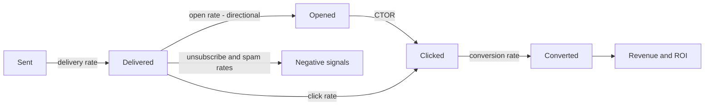
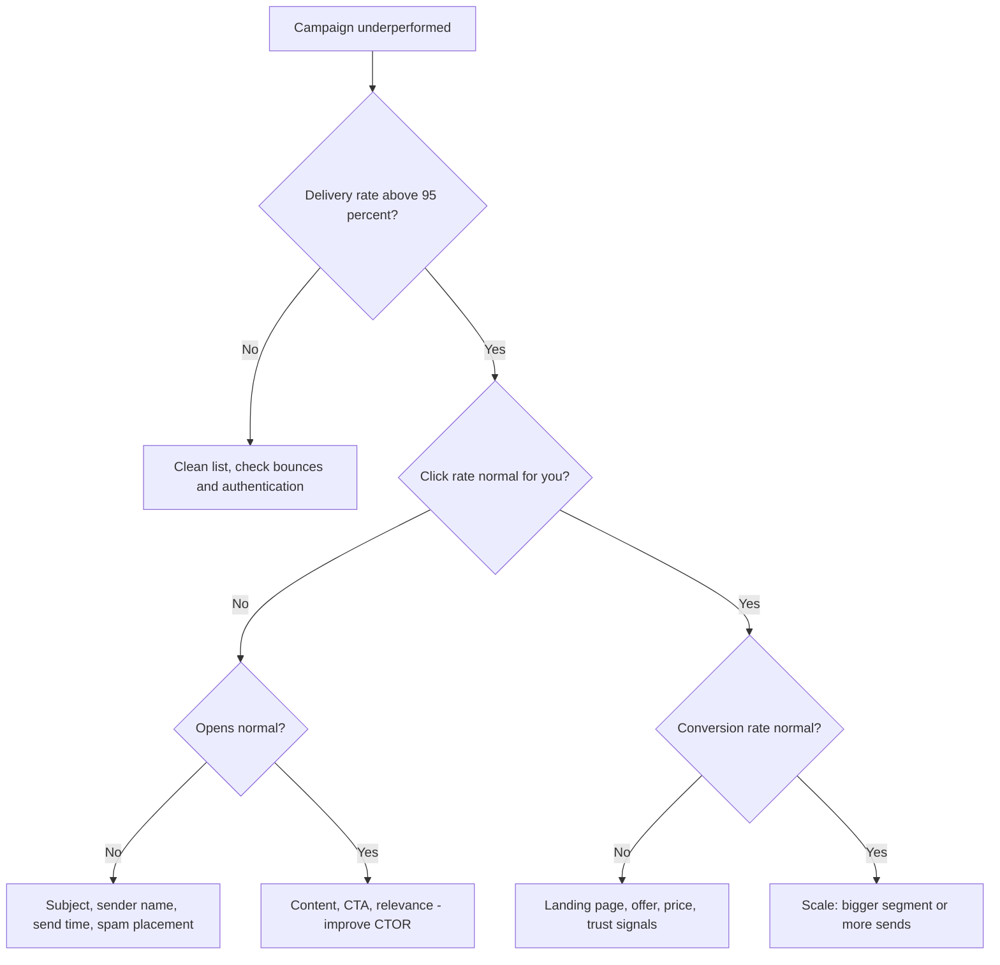
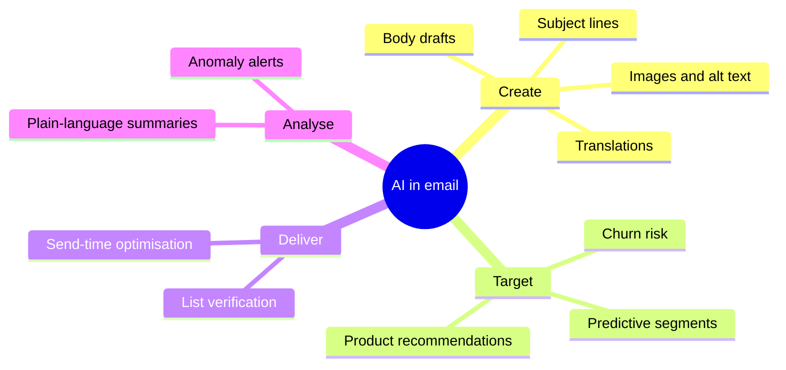
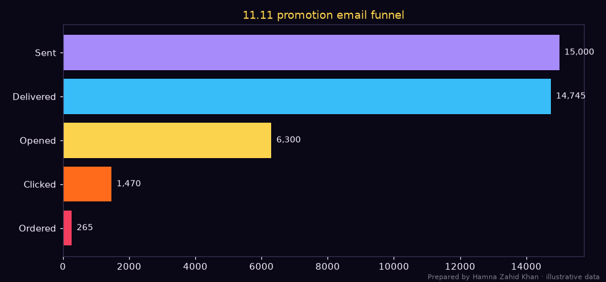
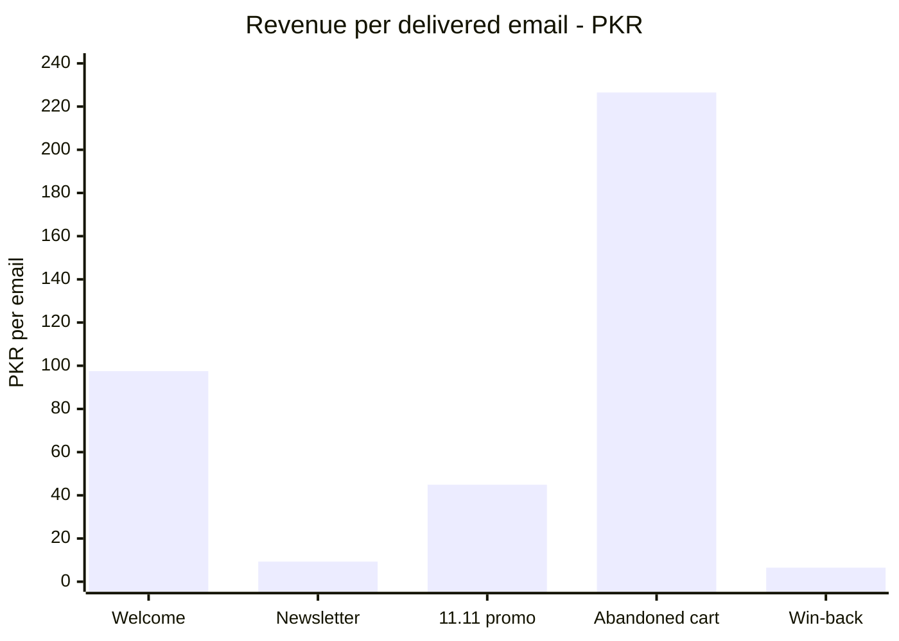

# Session 3 · Measuring Email Success and AI Tools

> 🏠 [Diploma in Digital Marketing](../../README.md) › [Term 1](../README.md) › [Email Marketing](README.md) › **Session 3**
>
> ⏱ **Estimated time:** 3 hours (1.5 h theory + 1.5 h lab) · 📋 **Prerequisites:** Session 2

[⬅ Previous: Session 2](session-02-building-email-strategy.md) · [Next: Email Marketing practice test ➡](practice-test.md)

---

## 🎯 Learning objectives

By the end of this session you will be able to:

- Explain the key **email marketing metrics and KPIs** – delivery, bounce, open, click, CTOR, conversion, unsubscribe, spam complaint, list growth, revenue per email and ROI – and calculate each.
- Interpret metrics correctly, including the effect of **Apple Mail Privacy Protection** on open rates.
- Diagnose problems in an email programme from its numbers and choose the right fix.
- Run and evaluate **A/B tests** on subject lines and content.
- Explain how to use **AI tools** in email marketing – writing, personalisation, send-time optimisation, predictive segments – responsibly.

## 📖 Concepts

### 1. The email metrics funnel

Every campaign moves people through a funnel. Each step has a metric:

| Step | Metric | Formula | What it tells you |
|---|---|---|---|
| Sent → Delivered | **Delivery rate** | Delivered ÷ Sent × 100 | List quality and technical setup |
| | **Bounce rate** | Bounces ÷ Sent × 100 (hard + soft) | Invalid or full addresses |
| Delivered → Opened | **Open rate** | Unique opens ÷ Delivered × 100 | Subject line, sender name, timing (now unreliable – see below) |
| Delivered → Clicked | **Click rate (CTR)** | Unique clicks ÷ Delivered × 100 | Overall effectiveness |
| Opened → Clicked | **Click-to-open rate (CTOR)** | Unique clicks ÷ Unique opens × 100 | Content and CTA quality |
| Clicked → Converted | **Conversion rate** | Conversions ÷ Unique clicks × 100 | Landing page and offer |
| Negative signals | **Unsubscribe rate** | Unsubscribes ÷ Delivered × 100 | Relevance and frequency |
| | **Spam complaint rate** | Complaints ÷ Delivered × 100 | Danger signal – keep < 0.1% (Gmail/Yahoo hard limit 0.3%) |
| Money | **Revenue per email (RPE)** | Revenue ÷ Delivered | Value of each send |
| | **Revenue per subscriber** | Monthly email revenue ÷ List size | Value of the list |
| | **Email ROI** | (Gross profit − Cost) ÷ Cost × 100 | Whether email pays |
| List health | **List growth rate** | (New − Unsubs − Bounces) ÷ Start size × 100 | Is the list growing? |
| | **Engaged share** | Contacts active in 90 days ÷ List | Deliverability health |

**Rough reference ranges** (vary widely by industry, list quality and region – compare with your own history first):

| Metric | Often seen |
|---|---|
| Delivery rate | 95–99% |
| Click rate | 1–5% for campaigns; much higher for automations |
| CTOR | 10–20% |
| Unsubscribe rate | Under 0.5% per campaign |
| Spam complaints | Under 0.1% |

### 2. Why open rates are less reliable now

Since 2021, **Apple Mail Privacy Protection (MPP)** pre-loads emails (including tracking pixels) for many Apple Mail users, recording an "open" even if the person never reads the message. Image blocking and security scanners distort opens too.

**What to do:** treat opens as a rough, directional signal; judge success by **clicks, conversions and revenue**; run subject-line tests on **click rate** or use ESPs that filter machine opens; don't trigger important automations on opens alone.

### 3. KPIs by goal

| Goal | Primary KPI | Secondary KPIs |
|---|---|---|
| Sales | Revenue, conversion rate, RPE | Click rate, AOV |
| Engagement / content | Click rate, CTOR | Reply rate, read time |
| List growth | Net list growth | Sign-up form conversion, source of sign-ups |
| Retention | Repeat purchase rate of email subscribers | Win-back conversion |
| Deliverability health | Spam complaints, bounce rate, inbox placement | Engaged share |

### 4. Tracking email results

- **UTM tags** on every link: `utm_source=newsletter&utm_medium=email&utm_campaign=1111_sale&utm_content=hero_button` → GA4 shows sessions, conversions and revenue by campaign and even by button.
- **ESP e-commerce integration** (Shopify/WooCommerce) attributes orders to emails within a window (e.g. 5 days after a click).
- **Unique codes** for offline or WhatsApp orders.
- **Holdout groups** – keep 5–10% of a segment from receiving a campaign to measure true lift.

### 5. Diagnosing problems

| Symptom | Likely cause | Fix |
|---|---|---|
| Delivery rate < 95% | Old/bought list, typos | Clean list, double opt-in, remove hard bounces |
| Many emails in spam | Missing SPF/DKIM/DMARC, complaints, spammy content | Authenticate, reduce frequency, send only to engaged, better content |
| Low opens (with good deliverability) | Weak subject/sender name, wrong time | Test subjects, recognisable sender, test send time |
| Good opens, low CTOR | Content doesn't match subject, weak CTA, too many links | One goal, clear button, relevant offer |
| Good clicks, low conversion | Landing page problems, price shock, slow site | Fix landing page, match offer, add COD/trust signals |
| High unsubscribes | Too frequent, irrelevant | Preference centre, segmentation, lower frequency |
| Spam complaints > 0.1% | No clear consent, hard-to-find unsubscribe | Clean consent, visible one-click unsubscribe, sunset inactives |

### 6. A/B testing emails

Test **one variable** at a time: subject line, preheader, sender name, CTA text or colour, layout, offer, personalisation, send time. Most ESPs can send A and B to a sample (e.g. 20% of the list), wait (e.g. 4 hours), then send the winner to the rest.

Statistics are the same as in social A/B tests: a **two-proportion z-test** on click rate (or conversion rate) with enough recipients per variant. Small lists should test big differences.

### 7. AI tools in email marketing

| Use | What AI does | Examples of tools/features |
|---|---|---|
| **Copywriting** | Drafts subject lines, preheaders, body copy, translations | ChatGPT, Gemini, Claude; built-in AI writers in Mailchimp, Klaviyo, HubSpot, Brevo |
| **Subject line prediction** | Scores subjects for likely performance | ESP subject-line helpers, Phrasee-style tools |
| **Send-time optimisation** | Sends to each person when they usually engage | Built into many ESPs |
| **Predictive segments** | Predicts likelihood to buy, churn, predicted CLV, next order date | Klaviyo predictive analytics, HubSpot AI |
| **Product recommendations** | Personalised products per subscriber | E-commerce ESP blocks |
| **Content and design** | Generates images, layouts, alt text | Canva AI, ESP design assistants |
| **List hygiene** | Detects invalid, risky, disposable addresses | Email verification services |
| **Analytics summaries** | Explains campaign results in plain language | ESP and GA4 AI insights |

**Responsible use:**

- **Fact-check** prices, dates and claims – AI can invent details.
- **Keep the brand voice** – edit generic AI phrases ("unlock", "elevate").
- **Protect data** – don't paste subscriber lists or personal data into public AI tools; use features inside your ESP that are covered by its data agreement.
- **Avoid manipulative urgency** – honest deadlines only.
- **Human approval** before anything is sent.
- **Test AI suggestions** – a predicted "best" subject line still needs an A/B test.

## 🧭 Diagrams

### Metrics funnel



### Diagnosis tree



### Where AI helps in the email workflow



## 💻 Worked examples

### Example 1 – A five-campaign KPI report

📄 `code/session-03_email_kpis.py`

```python
# Email campaign KPI report: deliverability, opens, clicks, CTOR, conversions, unsubscribes,
# revenue per email and ROI, with a funnel chart. Prepared by Hamna Zahid Khan, Junior Lecturer.
# Illustrative campaigns for a Karachi online bookstore, PKR. Opens are inflated by Apple Mail
# Privacy Protection, so clicks and conversions are the more reliable signals.
import matplotlib
matplotlib.use("Agg")
import matplotlib.pyplot as plt

BG, FIRE, GOLD, VIOLET, EMBER, TEXT = "#0A0716", "#FF6B1A", "#FCD34D", "#A78BFA", "#F43F5E", "#F5EEFF"
MARGIN = 0.30
campaigns = {  # name: sent, hard bounces, soft bounces, unique opens, unique clicks, orders, revenue, unsubs, spam complaints, cost
    "Welcome series (3 emails)": (2_400, 12, 24, 1_380, 410, 96, 230_400, 6, 1, 4_000),
    "Weekly newsletter":         (15_000, 90, 210, 5_100, 690, 62, 136_400, 45, 6, 9_000),
    "11.11 promotion":           (15_000, 75, 180, 6_300, 1_470, 265, 662_500, 60, 9, 12_000),
    "Abandoned cart (auto)":     (1_100, 4, 8, 640, 260, 88, 246_400, 3, 0, 2_500),
    "Win-back (lapsed)":         (3_000, 60, 45, 540, 75, 9, 18_900, 51, 4, 3_000),
}
hdr = f"{'Campaign':<27}{'Deliv%':>7}{'Open%':>7}{'CTR%':>6}{'CTOR%':>7}{'Conv%':>6}{'Unsub%':>7}{'Rev/email':>10}{'ROI%':>8}"
print(hdr)
funnel_data = None
for n, (sent, hb, sb, op, cl, orders, rev, un, sp, cost) in campaigns.items():
    delivered = sent - hb - sb
    deliv = delivered / sent * 100
    open_r = op / delivered * 100
    ctr = cl / delivered * 100
    ctor = cl / op * 100
    conv = orders / cl * 100
    unsub = un / delivered * 100
    rpe = rev / delivered
    roi = (rev * MARGIN - cost) / cost * 100
    flag = "  <- spam rate above 0.1%" if sp / delivered > 0.001 else ""
    print(f"{n:<27}{deliv:>7.1f}{open_r:>7.1f}{ctr:>6.1f}{ctor:>7.1f}{conv:>6.1f}{unsub:>7.2f}{rpe:>10.1f}{roi:>8.0f}{flag}")
    if n == "11.11 promotion":
        funnel_data = [sent, delivered, op, cl, orders]
tot_rev = sum(c[6] for c in campaigns.values()); tot_cost = sum(c[9] for c in campaigns.values())
print(f"\nTotal revenue PKR {tot_rev:,} | cost PKR {tot_cost:,} | ROI on gross profit {(tot_rev * MARGIN - tot_cost) / tot_cost * 100:,.0f}%")
print("Formulas use DELIVERED emails as the base; CTOR = clicks / opens.")

fig, ax = plt.subplots(figsize=(9, 4.2), facecolor=BG); ax.set_facecolor(BG)
labels = ["Sent", "Delivered", "Opened", "Clicked", "Ordered"]
cols = [VIOLET, "#38BDF8", GOLD, FIRE, EMBER]
bars = ax.barh(labels[::-1], funnel_data[::-1], color=cols[::-1])
for b, v in zip(bars, funnel_data[::-1]):
    ax.text(v + 150, b.get_y() + b.get_height() / 2, f"{v:,}", va="center", color=TEXT, fontsize=9)
ax.set_title("11.11 promotion email funnel", color=GOLD); ax.tick_params(colors=TEXT)
for s in ax.spines.values(): s.set_color("#3b3355")
fig.text(0.99, 0.01, "Prepared by Hamna Zahid Khan · illustrative data", color=TEXT, alpha=0.5, ha="right", fontsize=7)
plt.tight_layout(); plt.savefig("session-03_email_funnel.png", dpi=110, facecolor=BG)
print("Saved session-03_email_funnel.png")
```

**Output**

```text
Campaign                    Deliv%  Open%  CTR%  CTOR% Conv% Unsub% Rev/email    ROI%
Welcome series (3 emails)     98.5   58.4  17.3   29.7  23.4   0.25      97.5    1628
Weekly newsletter             98.0   34.7   4.7   13.5   9.0   0.31       9.3     355
11.11 promotion               98.3   42.7  10.0   23.3  18.0   0.41      44.9    1556
Abandoned cart (auto)         98.9   58.8  23.9   40.6  33.8   0.28     226.5    2857
Win-back (lapsed)             96.5   18.7   2.6   13.9  12.0   1.76       6.5      89  <- spam rate above 0.1%

Total revenue PKR 1,294,600 | cost PKR 30,500 | ROI on gross profit 1,173%
Formulas use DELIVERED emails as the base; CTOR = clicks / opens.
Saved session-03_email_funnel.png
```



**Interpretation:**

- **Automations win:** the abandoned-cart flow earns **PKR 226.5 per delivered email** and the welcome series PKR 97.5, versus PKR 9.3 for the weekly newsletter. They reach people at the moment of intent. If they aren't running yet, build them before anything else.
- **11.11 promotion** shows a strong CTOR (23.3%) – the offer matched the subject line.
- **Weekly newsletter** is profitable but its CTOR (13.5%) suggests content could be sharper: fewer links, one featured pick, a clear button.
- **Win-back** has a 1.76% unsubscribe rate and a spam complaint rate above 0.1% – expected with inactive contacts, but it's a warning. After this sequence, **suppress** non-responders to protect deliverability.
- **Total ROI of 1,173%** on gross profit (PKR 1.29 M revenue for PKR 30,500 cost) shows why email is called a high-ROI channel – but remember the list itself took time and money to build.

### Example 2 – Hand-calculating metrics

A newsletter: sent 10,000; hard bounces 120; soft bounces 80; unique opens 3,600; unique clicks 432; orders 39 (revenue PKR 97,500); unsubscribes 28; spam complaints 4; cost PKR 6,000; margin 35%.

| Metric | Working | Result |
|---|---|---|
| Delivered | 10,000 − 120 − 80 | **9,800** |
| Delivery rate | 9,800 ÷ 10,000 × 100 | **98%** |
| Open rate | 3,600 ÷ 9,800 × 100 | **36.7%** |
| Click rate | 432 ÷ 9,800 × 100 | **4.4%** |
| CTOR | 432 ÷ 3,600 × 100 | **12%** |
| Conversion rate | 39 ÷ 432 × 100 | **9.0%** |
| Unsubscribe rate | 28 ÷ 9,800 × 100 | **0.29%** |
| Spam complaint rate | 4 ÷ 9,800 × 100 | **0.04%** ✅ |
| Revenue per email | 97,500 ÷ 9,800 | **PKR 9.95** |
| ROI | (97,500 × 0.35 − 6,000) ÷ 6,000 × 100 | **469%** |

### Example 3 – Subject lines and an A/B test

📄 `code/session-03_subject_line_lab.py`

```python
# Subject-line lab: pre-check subject lines for length, spam triggers and personalisation,
# then evaluate an A/B test on click rate. Prepared by Hamna Zahid Khan, Junior Lecturer.
import math, re
from statistics import NormalDist

SPAM = ["free!!!", "100% free", "act now", "winner", "risk-free", "$$$", "click here", "guaranteed", "cash bonus"]

def check(subject, preheader=""):
    notes = []
    if len(subject) > 50: notes.append(f"{len(subject)} chars - may be cut on mobile (aim 30-50)")
    if sum(1 for c in subject if c.isupper()) > len(subject) * 0.5: notes.append("mostly CAPITALS - looks like spam")
    if subject.count("!") > 1: notes.append("multiple exclamation marks")
    for w in SPAM:
        if w in subject.lower(): notes.append(f"spam-trigger phrase '{w}'")
    if "{{first_name}}" in subject: notes.append("personalised (good - check the fallback value)")
    if not preheader: notes.append("no preheader text - inbox will show random body text")
    return notes or ["looks good"]

tests = [
    ("FREE!!! CLICK HERE TO WIN A CASH BONUS", ""),
    ("{{first_name}}, your 10% welcome code is inside", "Plus 5 Urdu novels readers love"),
    ("New arrivals: 12 books we can't stop talking about this week at Kitab Ghar Karachi", "Staff picks inside"),
    ("Last day: 11.11 prices end at midnight", "Up to 40% off bestsellers - COD available"),
]
for s, p in tests:
    print(f"'{s}'")
    for n in check(s, p): print("   - " + n)

# A/B test on unique clicks (clicks are not distorted by privacy-protected opens)
A = ("Our 11.11 sale is live", 7_400, 296)                       # name, delivered, clickers
B = ("Ayesha, your 11.11 wishlist is now 40% off", 7_400, 370)
pa, pb = A[2] / A[1], B[2] / B[1]
p = (A[2] + B[2]) / (A[1] + B[1])
se = math.sqrt(p * (1 - p) * (1 / A[1] + 1 / B[1]))
z = (pb - pa) / se
pv = 2 * (1 - NormalDist().cdf(abs(z)))
print(f"\nA/B on click rate: A {pa:.2%} vs B {pb:.2%} | lift {(pb - pa) / pa:+.0%} | z = {z:.2f}, p = {pv:.4f}")
print("Winner: B (personalised + specific)" if pv < 0.05 else "No significant winner - keep A or test again")
```

**Output**

```text
'FREE!!! CLICK HERE TO WIN A CASH BONUS'
   - mostly CAPITALS - looks like spam
   - multiple exclamation marks
   - spam-trigger phrase 'free!!!'
   - spam-trigger phrase 'click here'
   - spam-trigger phrase 'cash bonus'
   - no preheader text - inbox will show random body text
'{{first_name}}, your 10% welcome code is inside'
   - personalised (good - check the fallback value)
'New arrivals: 12 books we can't stop talking about this week at Kitab Ghar Karachi'
   - 82 chars - may be cut on mobile (aim 30-50)
'Last day: 11.11 prices end at midnight'
   - looks good

A/B on click rate: A 4.00% vs B 5.00% | lift +25% | z = 2.93, p = 0.0033
Winner: B (personalised + specific)
```

**Reading it:** the checker catches spam-style subjects (all caps, "click here", multiple "!") and long subjects that get cut off on phones. In the test, the personalised, specific subject "Ayesha, your 11.11 wishlist is now 40% off" raised the **click rate** from 4.0% to 5.0% (+25%), with p = 0.003 – significant. Testing on clicks avoids the distortion of privacy-protected opens.

### Example 4 – Using AI to draft, then improving it (walkthrough)

**Prompt to an AI assistant:**

```text
You are an email copywriter for Kitab Ghar, an online bookstore in Karachi.
Audience: parents of children aged 8-12. Voice: warm, simple, trustworthy.
Write 5 subject lines (max 45 characters) and 1 short email (max 120 words)
promoting winter-holiday reading bundles. Facts: 4 books per bundle, 20% saving,
COD nationwide, ships in 48 hours. Do not invent reviews, prices or statistics.
```

**AI draft subject (typical):** "Unlock a World of Adventure This Winter! 📚✨"
**Human edit:** "4 books your 10-year-old will actually finish" – specific, benefit-led, no generic "unlock", one clear idea.

**Review checklist applied:** facts match the brief ✅ · no invented review ✅ · price/saving correct ✅ · tone matches brand ✅ · Urdu words spelled consistently ✅ · CTA single and clear ✅ · then **A/B test** the AI-assisted subject against the team's best human subject.

### Example 5 – Predictive segment in practice

An ESP's AI predicts each customer's **churn risk** and **expected date of next order**.

| Segment (AI-predicted) | Size | Action |
|---|---|---|
| High churn risk, high past value | 420 | Personal win-back email from the founder + free delivery |
| Next order expected within 7 days | 1,150 | Reminder with recommended products, no discount |
| Low engagement, low value | 2,300 | Reduce frequency to monthly; sunset after 180 days |

Result to measure: compare repeat-purchase rate with a 10% **holdout** group that receives the normal newsletter only.

## 📊 Chart · Revenue per delivered email by campaign (from Example 1)



## 📋 Template · Monthly email report

| Section | Contents |
|---|---|
| Headline numbers | Emails delivered, click rate, conversions, revenue, ROI vs last month and target |
| Campaign table | Delivery, click rate, CTOR, conversion, unsubscribes, complaints, RPE per campaign |
| Automations | Revenue and conversion per flow (welcome, cart, post-purchase, win-back) |
| List health | Net growth, sign-up sources, engaged share, bounces, complaints |
| Tests | Hypothesis, result, significance, learning |
| Next month | 3 actions with owners |

## ⚠️ Common mistakes

| Mistake | Fix |
|---|---|
| Judging success by open rate | Use clicks, conversions, revenue |
| Dividing by "sent" instead of "delivered" | Use delivered as the base for engagement metrics |
| Ignoring spam complaints | Watch weekly; keep under 0.1% |
| No UTMs on links | Tag every link; check GA4 |
| Declaring A/B winners on tiny samples | Use the z-test or the ESP's confidence level |
| Sending AI-written emails unchecked | Human fact-check and brand-voice edit |
| Pasting customer data into public AI tools | Use ESP-integrated AI under its data terms |

## 🧪 Lab / practice tasks

**Task 1 (easy) – Calculate.** Sent 5,000; bounces 150; unique opens 1,700; unique clicks 204; orders 18; unsubscribes 20. Find delivery rate, click rate, CTOR, conversion rate and unsubscribe rate.

<details><summary>✅ Solution</summary>

Delivered = 4,850 → delivery rate **97%**; click rate = 204 ÷ 4,850 = **4.2%**; CTOR = 204 ÷ 1,700 = **12%**; conversion = 18 ÷ 204 = **8.8%**; unsubscribe = 20 ÷ 4,850 = **0.41%**.

</details>

**Task 2 (easy) – Diagnose.** Campaign X: delivery 99%, open rate 45%, CTOR 4%, conversion 12%. Which part of the email needs work?

<details><summary>✅ Solution</summary>

Opens are fine and those who click convert well, so the problem is **CTOR** – the email content/CTA doesn't persuade people to click (mismatch with the subject, weak button, too many links or no clear offer).

</details>

**Task 3 (medium) – Edit the KPI script.** Add a sixth campaign to `code/session-03_email_kpis.py`: "Post-purchase review request" – sent 2,000, hard 6, soft 10, opens 1,050, clicks 300, orders 22, revenue 55,000, unsubs 4, complaints 0, cost 1,500. Rerun. Where does it rank on revenue per email?

<details><summary>✅ Solution</summary>

Delivered = 1,984; RPE = 55,000 ÷ 1,984 ≈ **PKR 27.7** – below the cart, welcome and 11.11 emails but well above the newsletter. Its main job is reviews, so also track the number of reviews collected.

</details>

**Task 4 (medium) – Significance.** Edit the A/B section of `code/session-03_subject_line_lab.py`: A = 3,000 delivered, 105 clickers; B = 3,000 delivered, 126 clickers. Significant?

<details><summary>✅ Solution</summary>

A 3.5% vs B 4.2% (+20%); pooled p̂ = 0.0385; SE ≈ 0.00497; z ≈ 1.41; p ≈ 0.16 → **not significant**. A larger list or a bigger difference is needed.

</details>

**Task 5 (challenge) – AI-assisted campaign.** For a business of your choice: (1) write a precise prompt with facts and constraints; (2) generate 10 subject lines and an email with an AI assistant; (3) edit them, explaining each change; (4) run the subject checker on your final 5; (5) design an A/B test with sample size and success metric; (6) list the data-protection steps you followed.

## ✅ Quick quiz

1. CTOR is calculated as:
   a) clicks ÷ delivered b) unique clicks ÷ unique opens × 100 c) opens ÷ sent d) orders ÷ clicks
2. Why are open rates less reliable since 2021?
   a) Gmail stopped counting b) Apple Mail Privacy Protection pre-loads emails and records opens c) ESPs hide them d) Subject lines got longer
3. A spam complaint rate should be kept below about:
   a) 5% b) 1% c) 0.1% d) 10%
4. Good opens but low clicks most likely means a problem with:
   a) the sender domain b) the email content and CTA c) the landing page d) bounces
5. A responsible way to use AI in email marketing is:
   a) uploading your subscriber list to a public chatbot b) sending AI drafts without review c) using AI to draft, then fact-checking, editing and A/B testing d) inventing urgency

<details><summary>Show answers</summary>

1-b · 2-b · 3-c · 4-b · 5-c

</details>

## 📝 Summary

- Metrics follow the funnel: **delivery → opens (directional) → clicks → conversions → revenue**, with **unsubscribes and spam complaints** as warning signals.
- Use **delivered** as the base; judge success on **clicks, conversions, RPE and ROI** because MPP inflates opens.
- Diagnose with the funnel: delivery issues → list/authentication; low opens → subject/sender/time; low CTOR → content/CTA; low conversion → landing page/offer.
- A/B test one variable with enough recipients; check significance.
- AI helps write, personalise, time, predict and analyse – with human fact-checking, brand voice and data protection.

**Formulas:** Delivery rate = Delivered ÷ Sent · Open rate = Unique opens ÷ Delivered · Click rate = Unique clicks ÷ Delivered · CTOR = Unique clicks ÷ Unique opens · Conversion = Orders ÷ Clicks · Unsubscribe = Unsubs ÷ Delivered · RPE = Revenue ÷ Delivered · ROI = (Revenue × Margin − Cost) ÷ Cost × 100.

**Interview / viva questions**

1. What is the difference between click rate and click-to-open rate?
2. Why shouldn't you rely on open rates today?
3. Your campaign has a 0.4% spam complaint rate. What do you do?
4. How do you attribute revenue to an email campaign?
5. How would you A/B test subject lines on a list of 4,000 people?
6. Give three ways AI can improve email marketing and one risk of each.

---

[⬅ Previous: Session 2](session-02-building-email-strategy.md) · [Next: Email Marketing practice test ➡](practice-test.md)

<sub>Prepared by **Hamna Zahid Khan**, Junior Lecturer · Diploma in Digital Marketing</sub>
