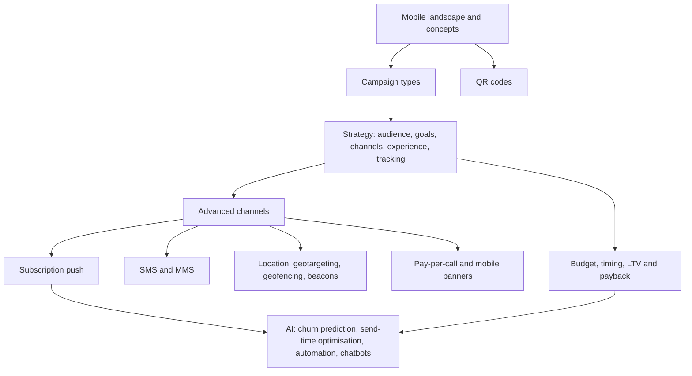

# Module 7 · Mobile Marketing

> 🏠 [Diploma in Digital Marketing](../../README.md) › [Term 1](../README.md) › **Module 7**

[⬅ Previous module](../06-email-marketing/README.md) · [Start Session 1 ➡](session-01-introduction-to-mobile-marketing.md) · [Next module ➡](../08-analytics/README.md)

---

For most Pakistanis the phone *is* the internet: mobile connections far outnumber fixed lines and the typical mobile connection is faster than the typical fixed one. This module explains mobile marketing concepts and trends with real Pakistan data, shows how to build a mobile strategy and plan a campaign's budget and timeline (with LTV and payback maths), covers the advanced channels – QR codes, SMS (including Urdu/Unicode costs), MMS, beacons, pay-per-call, mobile banners, location-based marketing and push – and ends with the AI tools that now drive mobile personalisation and automation.

## 🎯 Module objectives

- Define **mobile marketing**, its **key concepts** (mobile-first, micro-moments, apps vs web vs PWA, attribution) and current **trends**.
- Explain **QR codes** and classify the **types of mobile campaigns**.
- Create a **mobile marketing strategy**, state its key elements, and follow the **steps to develop, budget and time** a campaign.
- Use **SMS, MMS, Bluetooth proximity, pay-per-call, mobile banners, location-based and subscription push marketing** correctly and legally.
- Identify **AI tools** for mobile marketing and apply **prediction, personalisation and automation** responsibly.

## 📅 Sessions

| # | Session | Prerequisites |
|---|---|---|
| 1 | [Introduction to Mobile Marketing](session-01-introduction-to-mobile-marketing.md) | Module 1 |
| 2 | [Developing Mobile Marketing Strategies](session-02-mobile-marketing-strategy.md) | Session 1 |
| 3 | [Advanced Mobile Channels and Techniques](session-03-advanced-mobile-channels.md) | Session 2 |
| 4 | [AI Tools in Mobile Marketing](session-04-ai-tools-in-mobile-marketing.md) | Session 3 |
|  | 📝 [Module practice test](practice-test.md) | All sessions |

## 🧭 Concept map

## 💻 Code and charts in this module

All examples are runnable. See **[code/README.md](code/README.md)** for every file and how to run it. Python files need Python 3.10+; charts need `matplotlib`, the QR script needs `qrcode` and `pillow`, and the churn model needs `scikit-learn` and `numpy`.

| Session | Code | Chart / output |
|---|---|---|
| 1 | Pakistan mobile landscape (real DataReportal data), mobile page audit, mobile-first landing page | Mobile and digital audience |
| 2 | Campaign budget split, install and order forecast, timeline | Six-week Gantt chart |
| 3 | SMS segment and cost calculator (GSM-7 vs Unicode), trackable QR generator, haversine geofence | QR codes per location, geofence map |
| 4 | Churn prediction with logistic regression, send-time optimiser | Churn score histogram |

## 📄 One-page cheat-sheet

| Topic | Remember this |
|---|---|
| Pakistan (Oct 2025, DataReportal) | 256 M people · 194 M cellular connections (~76%) · ~80% on 3G/4G/5G · 117 M internet users · 139 M offline · median mobile 24.3 Mbps vs fixed 16.3 Mbps |
| Mobile-first | ≥ 16 px body text · ≥ 44 px tap targets · single column · fast pages · click-to-call and WhatsApp |
| Micro-moments | Know · Go · Do · Buy |
| Web vs app vs PWA | Site for reach · app for frequent use and push · PWA in between |
| QR | Static vs dynamic · CTA beside code · mobile page · one tracked code per location · trust |
| Campaign types | SMS · MMS · push · in-app · banners · search with call · social/video · app install · messaging · location · QR · pay-per-call · beacons · wallet · gamified |
| Strategy elements | Audience/context · goals · value proposition · channels · experience · creative · tracking · permission · budget/timeline · optimisation |
| Campaign steps | Research → SMART → channels → offer → experience → assets → tracking → compliance → soft launch → launch → optimise → report |
| ASO | Title and keywords · icon · first screenshots · preview video · ratings · localisation |
| Timing | Seasonality · day-parting · lead time · frequency caps · teaser → launch → sustain → re-engage |
| SMS | Opt-in · brand sender ID · STOP · PTA rules and Do Not Call Register · GSM-7 160/153 · Unicode 70/67 |
| MMS / rich media | Visual but costly → WhatsApp or RCS often used instead |
| Beacons | BLE · needs app + Bluetooth + permission · indoor precision |
| Pay-per-call | Call ads/assets · call tracking · qualified call (> 60 s) · cost per booked job |
| Mobile banners | 320×50 · 320×100 · 300×250 · interstitial · native · rewarded · watch accidental clicks |
| Location | Geotargeting · geofencing · geoconquesting · beacons · consent and caps |
| Push | Pre-permission prompt · personalise · deep link · caps · quiet hours · measure opt-outs |
| AI capabilities | Predict · classify · recommend · optimise · generate · converse · see |
| Model evaluation | AUC · precision · recall · business lift vs holdout |
| Responsible AI | Consent · minimisation · hard caps · bias checks · human approval · transparency |

| Formula | Calculation |
|---|---|
| CPI | Spend ÷ Installs |
| Cost per first order | Spend ÷ First orders |
| Install-to-order rate | First orders ÷ Installs × 100 |
| Day-N retention | Active on day N ÷ Installs × 100 |
| LTV (simple) | Σ (Share active × Orders × Profit per order) over months |
| LTV : CAC | LTV ÷ Acquisition cost (≥ 3 : 1 healthy rule of thumb) |
| SMS segments | ≤ 160 → 1 else ⌈len ÷ 153⌉ (GSM-7) · ≤ 70 → 1 else ⌈len ÷ 67⌉ (Unicode) |
| SMS cost | Recipients × Segments × Price per segment |
| Cost per call / per job | Spend ÷ Calls · Spend ÷ Booked jobs |
| QR scans estimate | Footfall × Days × Scan rate |
| Precision / recall | True flagged ÷ All flagged · True flagged ÷ All actual churners |

**Common mistakes:** desktop sites squeezed onto phones · heavy pages · tiny buttons · long forms · apps nobody needs · QR codes to desktop pages · messaging without consent · ignoring offline audiences · judging by installs only · no testing budget · launching before tracking works · emojis in bulk SMS without checking cost · push permission on first launch · geofencing without consent or caps · unstaffed call ads · junk banner placements · AI automation without conversion tracking or holdouts · AI copy published unreviewed.

---

Prepared by **Hamna Zahid Khan**, Junior Lecturer · Diploma in Digital Marketing
