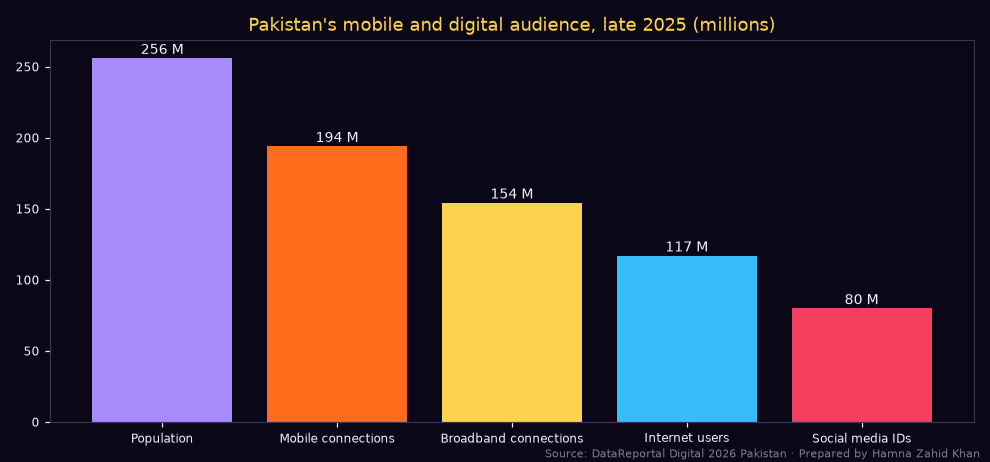
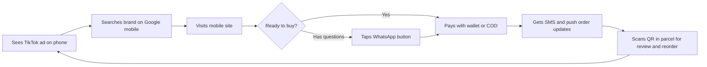
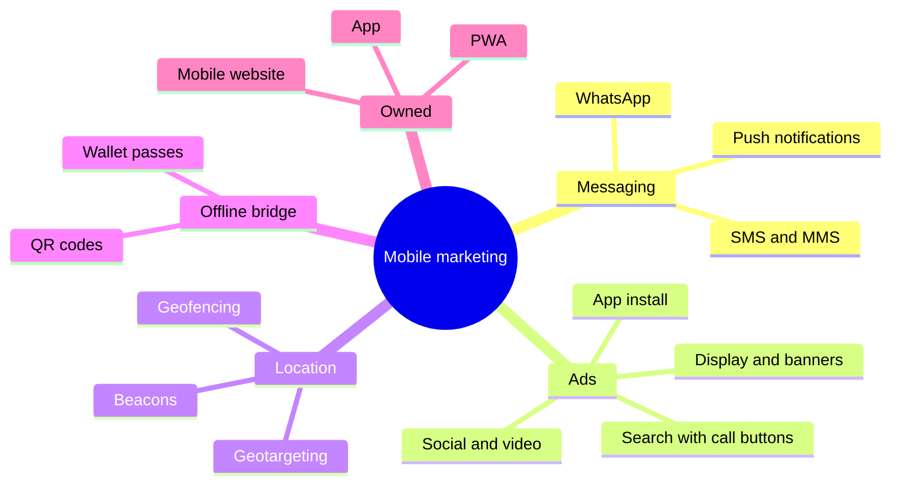
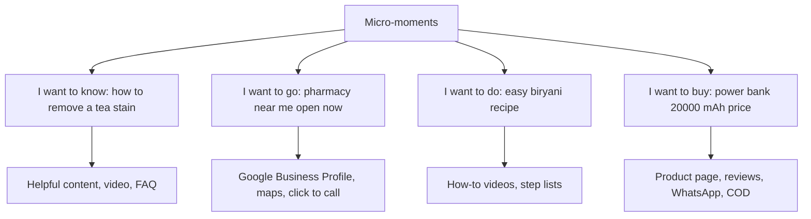
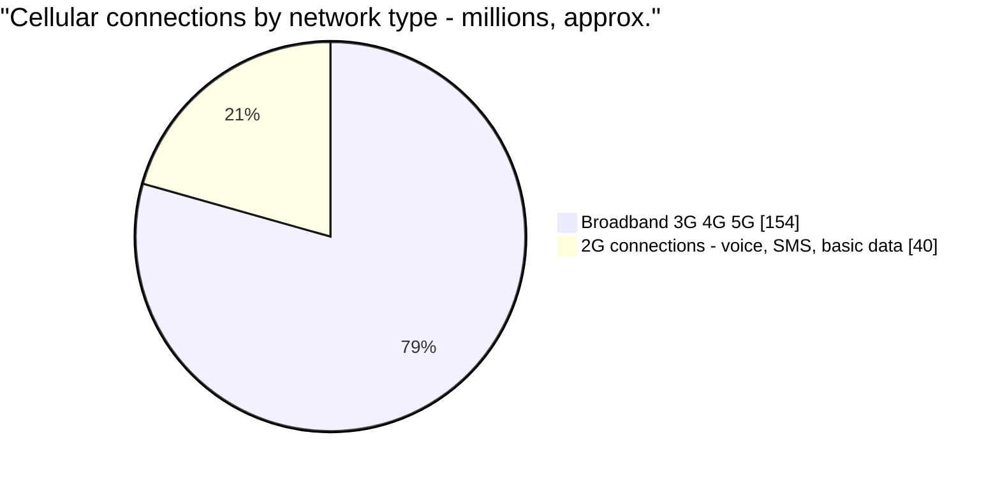

# Session 1 · Introduction to Mobile Marketing

> 🏠 [Diploma in Digital Marketing](../../README.md) › [Term 1](../README.md) › [Mobile Marketing](README.md) › **Session 1**
>
> ⏱ **Estimated time:** 3 hours (2 h theory + 1 h lab) · 📋 **Prerequisites:** Module 1

[⬅ Previous: Mobile Marketing overview](README.md) · [Next: Session 2 ➡](session-02-mobile-marketing-strategy.md)

---

## 🎯 Learning objectives

By the end of this session you will be able to:

- Define **mobile marketing** and explain why it matters so much in Pakistan.
- Explain the **key concepts**: mobile-first design, micro-moments, apps vs mobile web, location, permission and attribution on mobile.
- Describe current **trends** in mobile marketing: short video, super-apps and messaging, mobile commerce and wallets, 5G, privacy changes and AI.
- Define **QR codes** and explain how they connect offline and mobile experiences.
- Identify the main **types of mobile marketing campaigns**.

## 📖 Concepts

### 1. What mobile marketing is

**Mobile marketing** is reaching and engaging people on their **smartphones, tablets and basic phones** through channels designed for mobile: mobile websites, apps, SMS, push notifications, messaging apps, mobile ads, QR codes, location-based offers and mobile wallets.

It is not "desktop marketing made smaller". On a phone, people are:

- **always with the device** – it is the first thing many check in the morning;
- **on the move** – context and location matter;
- **short on attention** – thumb-scrolling, one hand, small screen;
- **ready to act** – one tap to call, WhatsApp, pay or navigate.

### 2. Why mobile matters in Pakistan

📄 `code/session-01_mobile_landscape.py`

```python
# Pakistan's mobile landscape in late 2025 and what it means for marketers.
# Prepared by Hamna Zahid Khan, Junior Lecturer.
# Source: DataReportal "Digital 2026: Pakistan" (Kepios, 8 Nov 2025): GSMA Intelligence for mobile
# connections, Kepios for internet and social users, Ookla for speeds, UN for population.
import matplotlib
matplotlib.use("Agg")
import matplotlib.pyplot as plt

BG, FIRE, GOLD, VIOLET, EMBER, TEXT = "#0A0716", "#FF6B1A", "#FCD34D", "#A78BFA", "#F43F5E", "#F5EEFF"
population = 256.0            # million
connections = 194.0           # cellular mobile connections, million
broadband_share = 0.795       # share of connections on 3G/4G/5G networks
internet_users = 117.0        # million
social_ids = 79.9             # million
mobile_speed, fixed_speed = 24.32, 16.28   # median download Mbps

print(f"Mobile connections : {connections:.0f} M = {connections / population:.1%} of population")
print(f"Broadband (3G/4G/5G): {connections * broadband_share:.0f} M connections ({broadband_share:.1%})")
print(f"Internet users     : {internet_users:.0f} M = {internet_users / population:.1%} of population")
print(f"Social media IDs   : {social_ids:.1f} M = {social_ids / population:.1%} of population")
print(f"Offline population : {population - internet_users:.0f} M ({(population - internet_users) / population:.1%})")
print(f"Median mobile download {mobile_speed} Mbps vs fixed {fixed_speed} Mbps -> mobile is faster than the typical fixed line")
print("\nMarketing implications:")
print(" 1. Design every page, ad and email for phones first.")
print(" 2. SMS still reaches people who are not online - over half the population.")
print(" 3. Keep pages light: speeds vary by city and network.")

fig, ax = plt.subplots(figsize=(9, 4.2), facecolor=BG); ax.set_facecolor(BG)
labels = ["Population", "Mobile connections", "Broadband connections", "Internet users", "Social media IDs"]
vals = [population, connections, connections * broadband_share, internet_users, social_ids]
bars = ax.bar(labels, vals, color=[VIOLET, FIRE, GOLD, "#38BDF8", EMBER])
for b, v in zip(bars, vals):
    ax.text(b.get_x() + b.get_width() / 2, v + 3, f"{v:.0f} M", ha="center", color=TEXT, fontsize=9)
ax.set_title("Pakistan's mobile and digital audience, late 2025 (millions)", color=GOLD)
ax.tick_params(colors=TEXT, labelsize=8)
for s in ax.spines.values(): s.set_color("#3b3355")
fig.text(0.99, 0.01, "Source: DataReportal Digital 2026 Pakistan · Prepared by Hamna Zahid Khan", color=TEXT, alpha=0.5, ha="right", fontsize=7)
plt.tight_layout(); plt.savefig("session-01_mobile_landscape.png", dpi=110, facecolor=BG)
print("Saved session-01_mobile_landscape.png")
```

**Output**

```text
Mobile connections : 194 M = 75.8% of population
Broadband (3G/4G/5G): 154 M connections (79.5%)
Internet users     : 117 M = 45.7% of population
Social media IDs   : 79.9 M = 31.2% of population
Offline population : 139 M (54.3%)
Median mobile download 24.32 Mbps vs fixed 16.28 Mbps -> mobile is faster than the typical fixed line

Marketing implications:
 1. Design every page, ad and email for phones first.
 2. SMS still reaches people who are not online - over half the population.
 3. Keep pages light: speeds vary by city and network.
Saved session-01_mobile_landscape.png
```



Key takeaways (DataReportal, *Digital 2026: Pakistan*, data from October 2025):

- **194 million cellular connections** (about 76% of the population) and nearly 80% of them on **3G/4G/5G** networks.
- **117 million internet users**, most of whom go online mainly through phones.
- The **median mobile download speed (24.3 Mbps) is higher than the median fixed broadband speed (16.3 Mbps)** – for many Pakistanis, the phone *is* the internet.
- **139 million people are still offline** – basic SMS and voice remain important for reaching them (rural audiences, older people, low-income segments).
- Mobile financial services – **JazzCash, Easypaisa**, bank apps and **Raast** instant payments – mean people increasingly pay from their phones.

### 3. Key concepts

| Concept | Meaning | Practical rule |
|---|---|---|
| **Mobile-first design** | Design for the small screen first, then expand for desktop | Big text (≥ 16 px body), thumb-friendly buttons (≥ 44 px), single column |
| **Micro-moments** | Intent-rich moments when people reach for their phone: *I want to know / go / do / buy* | Be present and useful at that moment: "restaurant near me", "how to tie a turban" |
| **Mobile web vs app** | Mobile site: no install, reached by search and links. App: installed, richer, push notifications | Most businesses need a great mobile site; apps suit frequent use (delivery, banking, shopping) |
| **Progressive Web App (PWA)** | A website that behaves like an app (add to home screen, offline cache) | Lighter alternative to a native app |
| **Click-to-call / click-to-WhatsApp** | One-tap contact links (`tel:`, `wa.me/`) | Essential in Pakistan, where many sales happen by chat or call |
| **Location awareness** | GPS, Wi-Fi and cell data tell where the user is (with permission) | Local offers, store finders, geofencing |
| **Permission** | Users must opt in to push, location, SMS marketing, tracking | Ask at a meaningful moment, explain the benefit |
| **Mobile attribution** | Tracking which ad led to an install or in-app purchase | Mobile Measurement Partners (MMPs) like AppsFlyer, Adjust, Branch; SKAdNetwork on iOS; UTMs on mobile web |
| **Page speed** | Slow pages lose visitors – mobile networks vary | Compress images (WebP), lazy-load, minimal scripts; check Core Web Vitals (Module 3) |

### 4. Trends in mobile marketing

| Trend | What's happening | What marketers do |
|---|---|---|
| **Short vertical video** | TikTok, Reels and Shorts dominate mobile time | Shoot 9:16, hook in 1–2 s, captions |
| **Messaging-first commerce** | WhatsApp catalogues, click-to-WhatsApp ads, WhatsApp Business API | Make WhatsApp a sales and support channel |
| **Super-apps and wallets** | Payments, bills, shopping, rides inside one app; JazzCash/Easypaisa adoption | Offer wallet payments; partner for in-app promotions |
| **Mobile commerce (m-commerce)** | Most e-commerce browsing is on phones; COD still common | One-page checkout, COD + wallets, trust signals |
| **Social commerce and live selling** | Live streams with buy buttons; creators selling | Live shopping events for launches |
| **5G and better 4G** | Richer media, AR experiences | AR try-ons, interactive ads |
| **Privacy changes** | Apple's App Tracking Transparency (2021), Android Privacy Sandbox, consent laws | First-party data, contextual targeting, modelled measurement |
| **AI personalisation** | Send-time optimisation, predictive churn, recommendations | Session 4 |
| **Voice and visual search** | "Hey Google…", Google Lens | Conversational FAQs; good product images |
| **QR codes everywhere** | Menus, payments (Raast QR), packaging, posters | Trackable QR codes linking to mobile pages |

### 5. QR codes

A **QR (Quick Response) code** is a two-dimensional barcode that a phone camera can scan to open a link, show text, add a contact, connect to Wi-Fi or start a payment. It was invented in 1994 by Denso Wave in Japan for tracking car parts, and became mainstream when phone cameras started reading QR codes natively.

| Type | Behaviour | Use |
|---|---|---|
| **Static QR** | The link is encoded permanently in the pattern | Wi-Fi details, fixed URL |
| **Dynamic QR** | Encodes a short redirect URL you can change later; tracks scans | Posters, packaging, campaigns |

**Where QR codes work:** posters and billboards, restaurant menus, product packaging (instructions, warranty registration, authenticity checks), shop counters (follow us, reviews, WhatsApp order), business cards, event tickets, TV ads, and **payments** (Raast and wallet QR at shops).

**Best practices:** add a clear call to action next to the code ("Scan for today's menu"), link to a **mobile-optimised** page, tag with UTMs (one code per location to compare), size it for scanning distance (roughly 1 cm of code per 10 cm of scanning distance as a rule of thumb), keep high contrast, test with several phones, and warn people only to scan codes from trusted sources (fake QR stickers are used in scams).

### 6. Types of mobile marketing campaigns

| Campaign type | How it works | Example |
|---|---|---|
| **SMS marketing** | Text messages to opted-in numbers | "Flash sale today: 30% off. Reply STOP to opt out." |
| **MMS marketing** | Picture/video messages | Product image + offer (limited availability and higher cost) |
| **Push notifications** | Alerts from an installed app or a website | "Your rider is 5 minutes away" / "Price dropped on your wishlist" |
| **In-app messaging and ads** | Messages or ads inside apps | Banner in a game; pop-up offer inside the shopping app |
| **Mobile display/banner ads** | Ads on mobile sites and apps | Responsive display ad on news apps |
| **Mobile search ads** | Search ads on phones, often with call buttons | Plumber ad with "Call" button |
| **Social and video ads on mobile** | Feed, Stories, Reels, Shorts | TikTok in-feed ad with WhatsApp CTA |
| **App install and app engagement campaigns** | Ads that drive installs or in-app actions | Google App campaign for a food-delivery app |
| **Messaging app marketing** | WhatsApp broadcasts, Channels, chatbots | WhatsApp catalogue + order confirmation |
| **Location-based marketing** | Geofencing, geotargeting, beacons | Push offer when near the store |
| **QR code campaigns** | Offline-to-mobile bridge | Poster QR → menu page |
| **Pay-per-call** | Advertiser pays per phone call generated | Insurance or tutoring ads with call extensions |
| **Proximity (Bluetooth) marketing** | Beacons send messages to nearby devices with the app | Mall app offers near a shop |
| **Mobile wallet marketing** | Coupons and loyalty cards saved in Google Wallet / Apple Wallet | Digital loyalty card with stamp updates |
| **Gamified / interactive** | Spin-the-wheel, AR filters, quizzes | Eid scratch-card game in the app |

Sessions 2 and 3 go deeper into strategy and into each advanced channel.

## 🧭 Diagrams

### The mobile customer journey



### Mobile marketing channels



### Micro-moments



## 💻 Worked examples

### Example 1 – Auditing a mobile landing page

📄 `code/session-01_mobile_landing.html` is a mobile-first landing page for a chai delivery campaign: one goal, large buttons, click-to-call, WhatsApp with a pre-filled message (so you know the lead came from the poster), a sticky "Order now" bar and lazy-loaded images. Add your own `hero.webp` image beside it. The audit script checks it:

📄 `code/session-01_mobile_page_audit.py`

```python
# A simple mobile-friendliness audit of an HTML page: viewport, font size, tap targets,
# image weight, click-to-call/WhatsApp links and page weight. Prepared by Hamna Zahid Khan.
import re, os

def audit(path, image_sizes_kb):
    html = open(path, encoding="utf-8").read()
    checks = []
    checks.append(("Viewport meta tag present", 'name="viewport"' in html))
    sizes = [int(x) for x in re.findall(r"font-size:\s*(\d+)px", html)]
    checks.append((f"All font sizes >= 14px (found {sorted(set(sizes))})", all(s >= 14 for s in sizes)))
    pads = [int(x) for x in re.findall(r"min-height:\s*(\d+)px", html)]
    checks.append(("Buttons have min-height >= 44px (tap targets)", bool(pads) and all(p >= 44 for p in pads)))
    checks.append(("Click-to-call link (tel:)", "href=\"tel:" in html))
    checks.append(("WhatsApp chat link (wa.me)", "wa.me/" in html))
    checks.append(("Images lazy-loaded", "loading=\"lazy\"" in html or "= 14px (found [14, 16, 18, 20, 26])
PASS  Buttons have min-height >= 44px (tap targets)
PASS  Click-to-call link (tel:)
PASS  WhatsApp chat link (wa.me)
PASS  Images lazy-loaded
PASS  Images total under 500 KB (planned 260 KB)
PASS  HTML under 100 KB (2.0 KB)
Score: 8/8
```

Try breaking it: change `min-height:52px` to `30px`, or delete the viewport tag, and rerun to see the failures.

### Example 2 – Mobile vs desktop performance (worked numbers)

A Lahore furniture store's GA4 data for one month:

| Device | Sessions | Conversions (WhatsApp clicks + orders) | Conversion rate | Avg page load |
|---|---|---|---|---|
| Mobile | 42,000 | 630 | 1.5% | 5.8 s |
| Desktop | 8,000 | 240 | 3.0% | 2.1 s |

**Analysis:** mobile brings **84%** of sessions but converts at half the desktop rate. If faster pages and a sticky WhatsApp button lifted mobile conversion just from 1.5% to 2.0%, mobile conversions would rise from 630 to **840** (+210 per month) with no extra ad spend. The biggest wins in mobile marketing often come from fixing the mobile experience before buying more traffic.

### Example 3 – Choosing campaign types for three businesses (walkthrough)

| Business | Goal | Campaign mix | Why |
|---|---|---|---|
| Pharmacy chain, Karachi | Store visits and home delivery orders | Google mobile search ads with call buttons, Google Business Profile, WhatsApp ordering, SMS refill reminders | Urgent "near me" intent; repeat medicines |
| Mobile game studio, Islamabad | Installs and in-app purchases | App install ads, Google App campaigns, push for daily rewards, in-app offers | App-first business |
| Rural agri-input dealer, Sahiwal | Farmers buying seeds and fertiliser before sowing | Opted-in SMS in Urdu, voice calls/IVR, WhatsApp for literate customers, local radio | Many customers offline or on basic phones |

## 📊 Chart · Where Pakistanis' connections sit (late 2025)



## 📋 Checklist · Is a business mobile-ready?

- [ ] Website passes a mobile-friendliness check (viewport, readable text, tap targets).
- [ ] Mobile pages load in under ~3 seconds on 4G (test with PageSpeed Insights).
- [ ] Click-to-call and click-to-WhatsApp buttons on key pages.
- [ ] Checkout works with one hand: few fields, autofill, wallet and COD options.
- [ ] Google Business Profile complete (hours, phone, location, photos).
- [ ] UTMs on all mobile campaign links; GA4 device reports reviewed monthly.
- [ ] Opt-in processes for SMS, push and WhatsApp marketing with easy opt-out.
- [ ] QR codes link to mobile pages and are tracked by location.

## ⚠️ Common mistakes

| Mistake | Fix |
|---|---|
| Desktop site squeezed onto phones | Mobile-first redesign |
| Heavy images and sliders | Compress, WebP, lazy-load, remove auto-sliders |
| Tiny buttons and links close together | ≥ 44 px tap targets with spacing |
| Forms with 12 fields | Ask only what's needed; autofill; WhatsApp alternative |
| Building an app nobody needs | Start with a great mobile site or PWA |
| QR codes that open desktop pages or PDFs | Link to a fast mobile page |
| Messaging without consent | Opt-in and clear opt-out in every message |
| Ignoring offline/basic-phone audiences | SMS and voice where relevant |

## 🧪 Lab / practice tasks

**Task 1 (easy) – Micro-moments.** Classify each search as know / go / do / buy: (a) "petrol pump near me", (b) "how to change iron settings for silk", (c) "Samsung A55 price in Pakistan", (d) "what is Raast".

<details><summary>✅ Solution</summary>

(a) Go · (b) Do · (c) Buy · (d) Know.

</details>

**Task 2 (easy) – Static or dynamic QR?** Choose for: (a) office Wi-Fi details on a reception sign, (b) a 6-month billboard campaign, (c) packaging printed in 100,000 units that should link to seasonal recipes.

<details><summary>✅ Solution</summary>

(a) Static – never changes, no tracking needed. (b) Dynamic – track scans, change the landing page during the campaign. (c) Dynamic – the destination can change each season without reprinting.

</details>

**Task 3 (medium) – Fix the page.** Copy `code/session-01_mobile_landing.html`, remove the `tel:` link and set the button height to 36 px, then run `code/session-01_mobile_page_audit.py` on your copy. Write down which checks fail and fix them.

<details><summary>💡 Hint</summary>

Change the file name in the last line of the audit script, or save your copy over a duplicate.

</details>

**Task 4 (medium) – Device maths.** A site gets 60,000 mobile sessions (CR 1.2%) and 10,000 desktop sessions (CR 2.8%), AOV PKR 4,000. How much monthly revenue is gained if mobile CR rises to 1.8%?

<details><summary>✅ Solution</summary>

Extra conversions = 60,000 × (1.8% − 1.2%) = **360**; extra revenue = 360 × 4,000 = **PKR 1,440,000** per month.

</details>

**Task 5 (challenge) – Mobile marketing audit.** Choose a local business. Test its website on your phone and in PageSpeed Insights, check its Google Business Profile, WhatsApp setup and social profiles on mobile. Write a one-page audit with scores, screenshots and five prioritised fixes.

## ✅ Quick quiz

1. In late 2025, Pakistan's median mobile download speed was:
   a) slower than fixed broadband b) faster than fixed broadband c) exactly equal d) not measured
2. "Restaurant near me open now" is which micro-moment?
   a) know b) go c) do d) buy
3. A dynamic QR code is useful because:
   a) it never changes b) the destination can be changed and scans tracked c) it needs no phone d) it is always free
4. A Progressive Web App is:
   a) a native Android app b) a website that can behave like an app c) an SMS service d) a QR code
5. Why are SMS and voice still important in Pakistan?
   a) They are trendy b) Over half the population is still offline c) Apps are banned d) They are free

<details><summary>Show answers</summary>

1-b · 2-b · 3-b · 4-b · 5-b

</details>

## 📝 Summary

- Mobile marketing reaches people on their phones through mobile web, apps, SMS, push, messaging, ads, QR, location and wallets.
- Pakistan: **194 M connections, 117 M internet users, mobile faster than fixed broadband, 139 M still offline** – mobile-first, with SMS for wider reach.
- Key concepts: **mobile-first design, micro-moments, web vs app vs PWA, click-to-call/WhatsApp, location, permission, attribution, speed**.
- Trends: short video, messaging commerce, wallets, m-commerce, live selling, 5G, privacy changes, AI, QR everywhere.
- **QR codes** bridge offline and mobile; use dynamic, tracked codes linked to mobile pages.
- Campaign types range from SMS and push to app installs, location-based and proximity marketing.

**Interview / viva questions**

1. What makes mobile marketing different from desktop marketing?
2. Explain micro-moments with Pakistani examples.
3. When should a business build an app instead of a mobile website?
4. How would you use QR codes in a restaurant's marketing?
5. Name six types of mobile marketing campaigns.
6. Why does mobile page speed matter, and how do you improve it?

---

[⬅ Previous: Mobile Marketing overview](README.md) · [Next: Session 2 ➡](session-02-mobile-marketing-strategy.md)

<sub>Prepared by **Hamna Zahid Khan**, Junior Lecturer · Diploma in Digital Marketing</sub>
