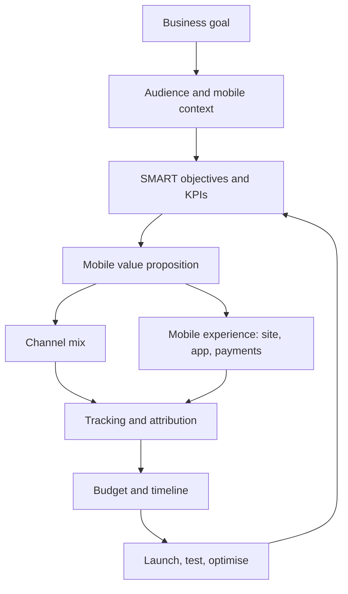
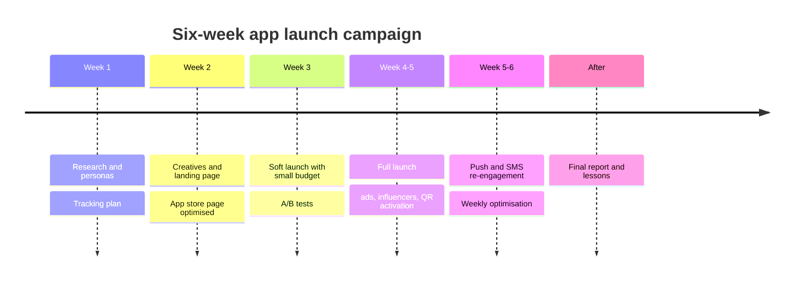
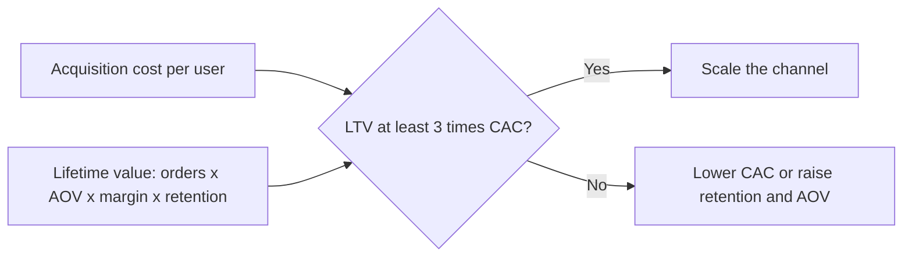
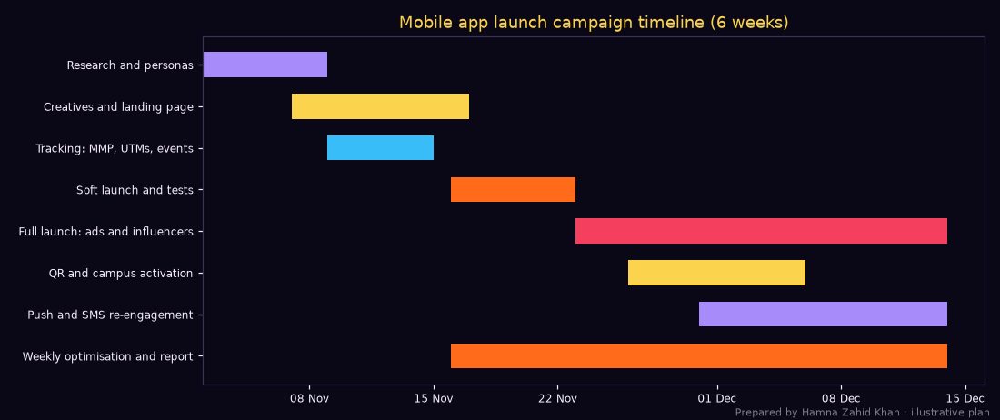

# Session 2 · Developing Mobile Marketing Strategies

> 🏠 [Diploma in Digital Marketing](../../README.md) › [Term 1](../README.md) › [Mobile Marketing](README.md) › **Session 2**
>
> ⏱ **Estimated time:** 3 hours (1.5 h theory + 1.5 h lab) · 📋 **Prerequisites:** Session 1

[⬅ Previous: Session 1](session-01-introduction-to-mobile-marketing.md) · [Next: Session 3 ➡](session-03-advanced-mobile-channels.md)

---

## 🎯 Learning objectives

By the end of this session you will be able to:

- Explain how a **mobile marketing strategy** is created and how it fits the overall marketing plan.
- State the **key elements** of a mobile strategy: audience, goals, channels, content, experience, data, compliance and measurement.
- Identify the **steps to develop a mobile campaign**, from research to optimisation.
- Explain how to **budget and time** a mobile campaign, with worked numbers and a timeline.
- Apply **tips and best practices** for launching a successful mobile campaign.

## 📖 Concepts

### 1. Where mobile strategy fits

A mobile strategy is not separate from marketing strategy – it is how the business wins **on the device customers use most**. It starts from business goals and customer behaviour, and decides which mobile channels, experiences and messages will help.

| Level | Example |
|---|---|
| Business goal | Grow online orders 40% this year |
| Marketing objective | Get 20,000 new app users in Faisalabad by March |
| Mobile strategy | App install ads + campus QR activation + push re-engagement, with wallet payments |
| Campaign | "Garam Khana in 30 minutes" winter launch |
| Tactics | TikTok/Meta install ads, Google App campaign, influencer codes, posters with QR, push sequences |

### 2. Key elements of a mobile marketing strategy

| Element | Questions to answer | Example answers |
|---|---|---|
| **1. Audience and context** | Who? Which devices, networks, languages? When and where do they use their phones? | Students 18–24, Android, mostly 4G, Roman Urdu, evenings |
| **2. Goals and KPIs** | What does success look like, in numbers? | 20,000 installs, 5,000 first orders, CPI ≤ PKR 60 |
| **3. Value proposition for mobile** | Why should someone tap, install or opt in? | "Hot meals in 30 min, COD or JazzCash, PKR 150 off first order" |
| **4. Channel mix** | Which mobile channels reach this audience? | Install ads, Google App, influencers, QR, push, SMS |
| **5. Mobile experience** | Is the site/app fast and easy one-handed? | 2-tap reorder, wallet payment, Urdu option |
| **6. Content and creative** | What formats fit small screens? | 9:16 video, short copy, big CTAs |
| **7. Data and tracking** | How will we measure and attribute? | MMP for installs, GA4 + UTMs, event tracking |
| **8. Permission and compliance** | Do we have consent for SMS/push/location? | Opt-in flows, STOP keyword, PTA and platform rules |
| **9. Budget and timeline** | How much, when? | PKR 1.2 M over 6 weeks |
| **10. Optimisation plan** | How will we learn and improve? | Weekly review, creative tests, budget shifts |

#### Mobile personas

Add mobile-specific details to personas: **device and OS** (Android dominates in Pakistan; iOS users skew higher income), **data budget** (prepaid bundles – avoid heavy pages and autoplay video on landing pages), **language** (Urdu script, Roman Urdu, English, regional), **payment preferences** (COD, JazzCash/Easypaisa, cards), **app habits** (which apps they use daily), **time patterns** (commute, lunch, late night).

### 3. Steps to develop a mobile campaign

| Step | What you do | Output |
|---|---|---|
| **1. Research** | Customer interviews, GA4 device data, competitor apps/ads, platform audience tools | Insight summary, personas |
| **2. Set SMART objectives** | Numbers, dates, KPIs | "20,000 installs by 15 Dec at CPI ≤ PKR 60" |
| **3. Choose channels** | Match channels to audience and goal | Channel plan with budget split |
| **4. Plan the offer and message** | One clear mobile value proposition | Offer, key message, CTA |
| **5. Build the experience** | Landing page/app store page, deep links, payment flow | Tested mobile funnel |
| **6. Create assets** | Videos, banners, SMS copy, push copy, QR posters | Creative pack in mobile sizes |
| **7. Set up tracking** | MMP/SDK events, UTMs, conversion events, QR per location | Measurement plan |
| **8. Compliance check** | Consent, opt-out, ad policies, data privacy | Approved campaign |
| **9. Soft launch / test** | Small budget, A/B tests, fix bugs | Learnings and winners |
| **10. Full launch** | Scale budgets on winning channels | Live campaign |
| **11. Optimise** | Daily checks, weekly reviews, shift budget | Improved CPI/CPA |
| **12. Report and learn** | Results vs goals, lessons for next time | Final report |

#### App Store Optimisation (ASO)

If the campaign drives app installs, the **app store page** is the landing page. ASO basics: keyword-rich **title and short description**, compelling **icon**, **screenshots** that show benefits (first two matter most), a short **preview video**, **ratings and reviews** (ask happy users in-app at the right moment), localised listing (Urdu), and regular updates.

### 4. Budgeting a mobile campaign

**Approaches:**

1. **Objective-and-task (recommended):** goal ÷ expected conversion rates × costs = budget.
2. **Percentage of revenue** (e.g. 5–10% of expected sales).
3. **Competitive parity:** match competitors' visible activity.
4. **Test-and-scale:** small test budget, then scale what works.

**Mobile cost metrics:**

| Metric | Formula |
|---|---|
| **CPI** (cost per install) | Spend ÷ Installs |
| **CPA / cost per first order** | Spend ÷ First orders |
| **Install-to-order rate** | First orders ÷ Installs × 100 |
| **Day-1 / Day-7 / Day-30 retention** | Users still active on day N ÷ Installs × 100 |
| **ARPU** | Revenue ÷ Active users |
| **LTV (lifetime value)** | Expected gross profit from a user over their lifetime |
| **LTV : CAC ratio** | LTV ÷ Customer acquisition cost (healthy ≥ 3 : 1 is a common rule of thumb) |
| **Payback period** | Months until gross profit from a user exceeds their acquisition cost |

**Budget split rule of thumb:** keep about **5–10% as a testing reserve**, spend most on proven channels, and leave room to move money weekly towards the lowest cost per result.

### 5. Timing a mobile campaign

| Timing decision | Guidance |
|---|---|
| **Campaign length** | Long enough to exit learning phases and gather data – usually 4–8 weeks for launches |
| **Seasonality** | Align with demand: school reopening, winter, Ramadan, Eid, 11.11, cricket tournaments |
| **Day-parting** | Ads/push at the hours your audience is active (food: 12–2 pm and 7–11 pm; banking: morning) |
| **Lead time** | Allow time for creative production, app review, ad approvals and tracking tests (1–3 weeks) |
| **Messaging frequency** | Cap push and SMS; avoid late night and sensitive times (e.g. Friday prayers, iftar) |
| **Phasing** | Teaser → launch → sustain → re-engage |

## 🧭 Diagrams

### Mobile strategy framework



### Campaign phases



### Unit economics of an app user



## 💻 Worked examples

### Example 1 – Budget split, forecast and timeline

A food-delivery app is launching in Faisalabad with PKR 1.2 million and a goal of 20,000 installs.

📄 `code/session-02_campaign_planner.py`

```python
# Plan a 6-week mobile campaign: split the budget across mobile channels, forecast results,
# and draw a timeline (Gantt chart). Prepared by Hamna Zahid Khan, Junior Lecturer.
# Illustrative launch of a food-delivery app in Faisalabad, PKR. Rates are assumptions to replace with your data.
import datetime as dt
import matplotlib
matplotlib.use("Agg")
import matplotlib.pyplot as plt
import matplotlib.dates as mdates

BG, FIRE, GOLD, VIOLET, EMBER, TEXT = "#0A0716", "#FF6B1A", "#FCD34D", "#A78BFA", "#F43F5E", "#F5EEFF"
BUDGET = 1_200_000
GOAL_INSTALLS = 20_000
# channel: (share of budget, cost per install or per result in PKR, install->first order rate)
channels = {
    "App install ads (Meta/TikTok)": (0.40, 55, 0.22),
    "Google App campaign":            (0.25, 60, 0.25),
    "Influencer Reels + promo code":  (0.15, 70, 0.30),
    "QR posters + campus activation": (0.08, 40, 0.35),
    "SMS to opted-in partner list":   (0.07, 90, 0.18),
    "Testing reserve":                (0.05, 60, 0.22),
}
assert abs(sum(c[0] for c in channels.values()) - 1) < 1e-9
tot_inst = tot_orders = 0
print(f"{'Channel':<32}{'Budget PKR':>12}{'CPI':>6}{'Installs':>10}{'1st orders':>11}")
for n, (share, cpi, rate) in channels.items():
    spend = BUDGET * share
    inst = spend / cpi
    orders = inst * rate
    tot_inst += inst; tot_orders += orders
    print(f"{n:<32}{spend:>12,.0f}{cpi:>6}{inst:>10,.0f}{orders:>11,.0f}")
print(f"{'TOTAL':<32}{BUDGET:>12,}{BUDGET / tot_inst:>6.0f}{tot_inst:>10,.0f}{tot_orders:>11,.0f}")
print(f"\nGoal {GOAL_INSTALLS:,} installs -> forecast {tot_inst:,.0f} ({tot_inst / GOAL_INSTALLS:.0%} of goal)")
print(f"Blended cost per first order: PKR {BUDGET / tot_orders:,.0f}")
aov, margin = 900, 0.20
print(f"First-order gross profit: {tot_orders:,.0f} x {aov} x {margin} = PKR {tot_orders * aov * margin:,.0f} "
      f"-> payback needs repeat orders (CLV), not first orders alone")

start = dt.date(2026, 11, 2)
tasks = [("Research and personas", 0, 7), ("Creatives and landing page", 5, 10), ("Tracking: MMP, UTMs, events", 7, 6),
         ("Soft launch and tests", 14, 7), ("Full launch: ads and influencers", 21, 21), ("QR and campus activation", 24, 10),
         ("Push and SMS re-engagement", 28, 14), ("Weekly optimisation and report", 14, 28)]
fig, ax = plt.subplots(figsize=(10, 4.2), facecolor=BG); ax.set_facecolor(BG)
cols = [VIOLET, GOLD, "#38BDF8", FIRE, EMBER, GOLD, VIOLET, FIRE]
for i, ((name, s, d), c) in enumerate(zip(tasks, cols)):
    ax.barh(i, d, left=mdates.date2num(start + dt.timedelta(days=s)), color=c, height=.6)
ax.set_yticks(range(len(tasks))); ax.set_yticklabels([t[0] for t in tasks], color=TEXT, fontsize=8)
ax.invert_yaxis(); ax.xaxis_date(); ax.xaxis.set_major_formatter(mdates.DateFormatter("%d %b"))
ax.tick_params(colors=TEXT, labelsize=8)
ax.set_title("Mobile app launch campaign timeline (6 weeks)", color=GOLD)
for s in ax.spines.values(): s.set_color("#3b3355")
fig.text(0.99, 0.01, "Prepared by Hamna Zahid Khan · illustrative plan", color=TEXT, alpha=0.5, ha="right", fontsize=7)
plt.tight_layout(); plt.savefig("session-02_campaign_timeline.png", dpi=110, facecolor=BG)
print("Saved session-02_campaign_timeline.png")
```

**Output**

```text
Channel                           Budget PKR   CPI  Installs 1st orders
App install ads (Meta/TikTok)        480,000    55     8,727      1,920
Google App campaign                  300,000    60     5,000      1,250
Influencer Reels + promo code        180,000    70     2,571        771
QR posters + campus activation        96,000    40     2,400        840
SMS to opted-in partner list          84,000    90       933        168
Testing reserve                       60,000    60     1,000        220
TOTAL                              1,200,000    58    20,632      5,169

Goal 20,000 installs -> forecast 20,632 (103% of goal)
Blended cost per first order: PKR 232
First-order gross profit: 5,169 x 900 x 0.2 = PKR 930,497 -> payback needs repeat orders (CLV), not first orders alone
Saved session-02_campaign_timeline.png
```



**Interpretation:**

- The plan forecasts **20,632 installs** (103% of goal) at a blended CPI of PKR 58 – on target, but with little margin for error, so the testing reserve matters.
- **QR posters and campus activation** have the cheapest installs and the highest install-to-order rate (students who see the stall are ready to order), but they can't scale like ads.
- First-order gross profit (≈ PKR 930,000) does **not** cover the PKR 1.2 M spend. The campaign only pays back if users **reorder** – which is why push re-engagement is part of the plan, and why the KPI dashboard must track Day-30 retention and repeat orders, not just installs.

### Example 2 – LTV, CAC and payback (hand calculation)

From the plan: cost per first-ordering customer ≈ **PKR 232**. Data from a similar city: customers order **2.5 times a month** in month 1, retention halves every two months, AOV PKR 900, margin 20% (PKR 180 profit per order).

| Month | Share still active | Orders per active user | Profit per acquired user | Cumulative |
|---|---|---|---|---|
| 1 | 100% | 2.5 | 2.5 × 180 = 450 | 450 |
| 2 | 70% | 2.5 | 0.70 × 450 = 315 | 765 |
| 3 | 50% | 2.5 | 225 | 990 |
| 4 | 35% | 2.5 | 158 | 1,148 |
| 5 | 25% | 2.5 | 113 | 1,260 |
| 6 | 18% | 2.5 | 81 | 1,341 |

- **6-month LTV ≈ PKR 1,341**; **LTV : CAC = 1,341 ÷ 232 ≈ 5.8 : 1** → healthy.
- **Payback** happens in month 1 (PKR 450 > 232).
- If CAC were measured per *install* instead (PKR 58) the ratio would look even better – but installs that never order produce no profit, so use **cost per first order**.

### Example 3 – Writing a one-page mobile strategy (walkthrough)

**Business:** a Rawalpindi bakery chain with 6 branches.

1. **Audience:** families and office workers within 5 km of branches; Android; Urdu/Roman Urdu; evening and weekend orders; cake orders for birthdays.
2. **Objectives:** 3,000 WhatsApp cake orders in 6 months; 25% repeat rate; Google Maps rating ≥ 4.5.
3. **Value proposition:** "Fresh custom cakes in 24 hours, order on WhatsApp, pay JazzCash or COD."
4. **Channels:** Google Business Profiles for all branches (calls, directions); geotargeted Meta/TikTok ads within 5 km with click-to-WhatsApp; QR on boxes ("Scan to reorder / review"); opted-in WhatsApp broadcasts for birthdays; SMS for customers without WhatsApp.
5. **Experience:** WhatsApp Business catalogue with prices, quick replies, labels; mobile order page with branch selector.
6. **Tracking:** pre-filled WhatsApp messages per channel ("Hi, I saw your Instagram ad"), UTMs, one QR per branch, order sheet with source column.
7. **Compliance:** opt-in for broadcasts, STOP option, no messages after 10 pm.
8. **Budget:** PKR 150,000/month (ads 60%, QR printing 10%, WhatsApp Business API 15%, creative 15%).
9. **Timing:** launch 4 weeks before wedding season; birthday reminders run automatically.
10. **Optimisation:** weekly review of cost per order by branch and channel; shift budget to best branches.

## 📋 Checklist · Launching a successful mobile campaign

- [ ] SMART objectives with mobile KPIs (CPI, cost per first order, retention, ROAS).
- [ ] Mobile experience tested on low-end Android phones and slow 4G.
- [ ] App store page optimised (title, screenshots, ratings) or mobile landing page ready.
- [ ] Deep links take users to the right screen (not the app home page).
- [ ] Tracking verified end-to-end: ad click → install/visit → purchase event.
- [ ] Creatives in 9:16, 4:5 and 1:1; SMS and push copy within limits.
- [ ] Opt-in and opt-out working for SMS, push and WhatsApp.
- [ ] Soft launch with a testing budget before scaling.
- [ ] Daily monitoring for the first week; weekly optimisation after.
- [ ] Re-engagement plan (push, SMS, WhatsApp) for new users.

## ✅ Best practices and tips

1. **Lead with one clear mobile benefit** – speed, convenience, savings.
2. **Reduce friction** – fewer steps, autofill, wallet payments, guest checkout, COD.
3. **Design for thumbs** – CTAs in the lower half of the screen; sticky buttons.
4. **Localise** – language, prices in PKR, local references.
5. **Respect data budgets** – light pages, compressed video, no autoplay with sound.
6. **Test before scaling** – creatives, offers, audiences.
7. **Plan the day after the install** – onboarding, first-order incentive, push sequence.
8. **Measure retention, not just acquisition.**

## ⚠️ Common mistakes

| Mistake | Fix |
|---|---|
| Judging the campaign only by installs | Track first orders, retention and LTV |
| Sending ad clicks to a desktop page or the app home screen | Mobile landing pages and deep links |
| No testing budget | Reserve 5–10% for tests |
| Launching before tracking works | Verify events end-to-end first |
| Ignoring iOS/Android differences | Check tracking limits (ATT) and device mix |
| Spamming new users with push | Onboarding sequence with frequency caps |
| One national campaign for every city | Localise by city, language and offer |

## 🧪 Lab / practice tasks

**Task 1 (easy) – Elements.** List the ten elements of a mobile strategy and give a one-line example for a Hyderabad clothing store.

**Task 2 (easy) – Metrics.** A campaign spent PKR 300,000 for 6,000 installs and 1,500 first orders. Day-7 active users: 2,100. Calculate CPI, cost per first order, install-to-order rate and Day-7 retention.

<details><summary>✅ Solution</summary>

CPI = 300,000 ÷ 6,000 = **PKR 50** · cost per first order = 300,000 ÷ 1,500 = **PKR 200** · install-to-order = 1,500 ÷ 6,000 = **25%** · Day-7 retention = 2,100 ÷ 6,000 = **35%**.

</details>

**Task 3 (medium) – Re-plan the budget.** Edit `code/session-02_campaign_planner.py`: the influencer CPI turned out to be PKR 110 and QR CPI PKR 30. Move 5% of budget from influencers to QR. Rerun – do you still hit 20,000 installs?

<details><summary>💡 Hint</summary>

Set influencers to `(0.10, 110, 0.30)` and QR to `(0.13, 30, 0.35)`; shares must still add up to 1.

</details>

<details><summary>✅ Solution</summary>

Influencer installs = 120,000 ÷ 110 ≈ 1,091; QR = 156,000 ÷ 30 = 5,200; total ≈ **21,951 installs** (110% of goal) – shifting money to the cheaper, better-converting channel improves the forecast, but check that campus activation can physically deliver 5,200 installs.

</details>

**Task 4 (medium) – LTV.** A grocery app: CAC PKR 400 per first-ordering customer, 3 orders/month, AOV PKR 2,500, margin 12%, retention 100% → 60% → 45% → 35% over months 1–4. Calculate 4-month LTV, LTV:CAC and payback month.

<details><summary>✅ Solution</summary>

Profit per order = 300; per active user per month = 900. Months: 900, 540, 405, 315 → cumulative **PKR 2,160**. LTV:CAC = 2,160 ÷ 400 = **5.4 : 1**. Payback in **month 1** (900 > 400).

</details>

**Task 5 (challenge) – One-page mobile strategy.** Write a one-page mobile strategy for a business of your choice using the 10-element structure in Example 3, with a budget table, a 6-week timeline (adapt the script's `tasks` list and rerun it to draw your chart) and a KPI dashboard.

## ✅ Quick quiz

1. The first step in developing a mobile campaign is:
   a) buying ads b) research on audience and context c) designing the logo d) sending SMS
2. CPI stands for:
   a) cost per impression b) cost per install c) clicks per interaction d) customer purchase index
3. A healthy LTV : CAC ratio is often said to be at least:
   a) 0.5 : 1 b) 1 : 1 c) 3 : 1 d) 100 : 1
4. Deep links are used to:
   a) shorten URLs b) send users to a specific screen inside an app c) block ads d) compress images
5. A testing reserve is typically:
   a) 0% b) 5–10% of budget c) 50% d) 100%

<details><summary>Show answers</summary>

1-b · 2-b · 3-c · 4-b · 5-b

</details>

## 📝 Summary

- Mobile strategy turns business goals into mobile objectives, channels, experiences and measurement.
- Ten elements: **audience/context, goals/KPIs, value proposition, channel mix, experience, creative, tracking, permission, budget/timeline, optimisation**.
- Campaign steps: research → SMART objectives → channels → offer → experience → assets → tracking → compliance → soft launch → full launch → optimise → report.
- Budget with objective-and-task maths; judge on **cost per first order, retention, LTV : CAC and payback**, not installs alone.
- Time campaigns around seasonality, day-parts and production lead times; phase them teaser → launch → sustain → re-engage.

**Interview / viva questions**

1. What are the key elements of a mobile marketing strategy?
2. Walk me through the steps of launching a mobile app campaign.
3. How would you calculate a budget for 10,000 app installs?
4. What is LTV : CAC and why does it matter more than CPI?
5. What is App Store Optimisation?
6. Give five tips for a successful mobile campaign launch.

---

[⬅ Previous: Session 1](session-01-introduction-to-mobile-marketing.md) · [Next: Session 3 ➡](session-03-advanced-mobile-channels.md)

<sub>Prepared by **Hamna Zahid Khan**, Junior Lecturer · Diploma in Digital Marketing</sub>
