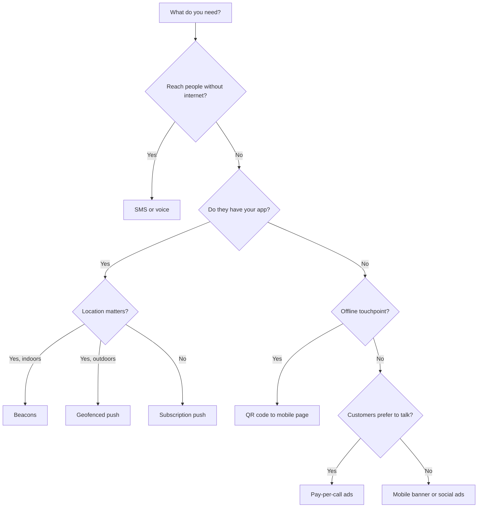
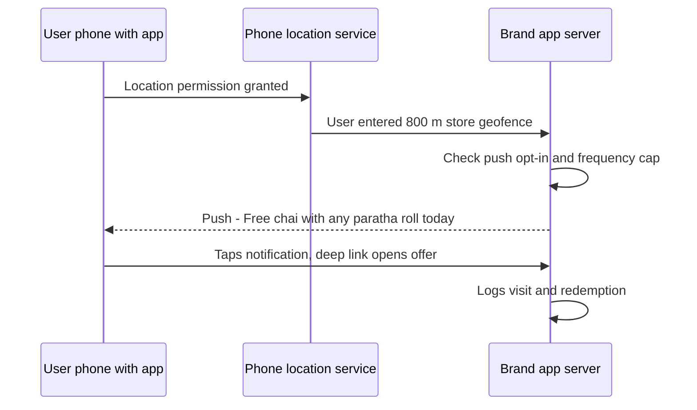
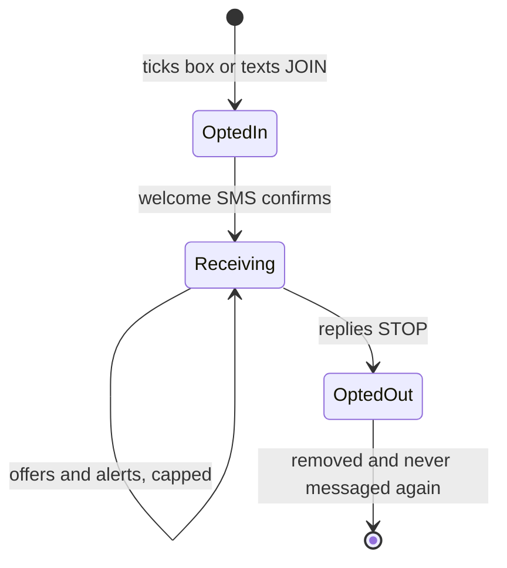
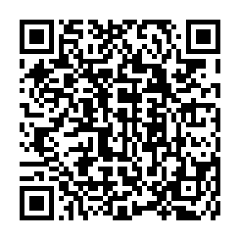
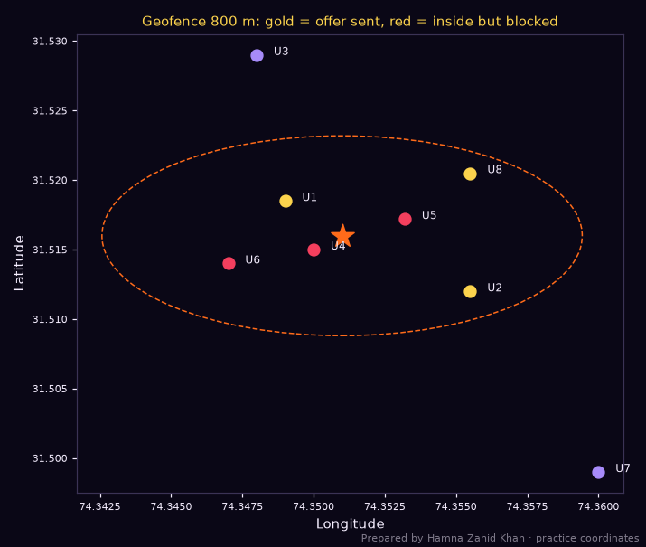
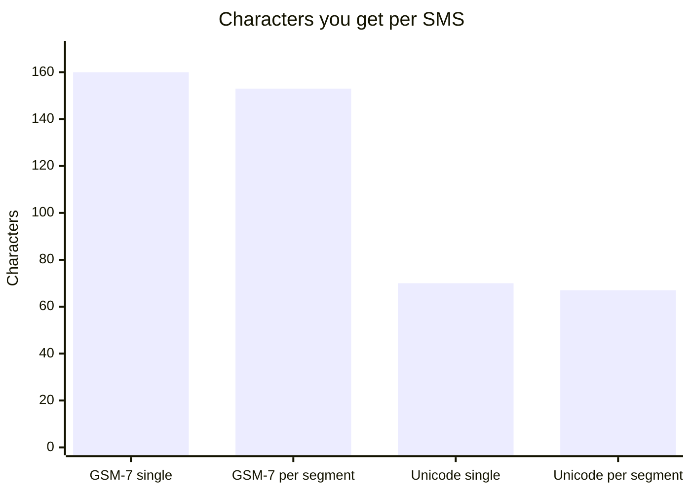

# Session 3 · Advanced Mobile Channels and Techniques

> 🏠 [Diploma in Digital Marketing](../../README.md) › [Term 1](../README.md) › [Mobile Marketing](README.md) › **Session 3**
>
> ⏱ **Estimated time:** 3 hours (1.5 h theory + 1.5 h lab) · 📋 **Prerequisites:** Session 2

[⬅ Previous: Session 2](session-02-mobile-marketing-strategy.md) · [Next: Session 4 ➡](session-04-ai-tools-in-mobile-marketing.md)

---

## 🎯 Learning objectives

By the end of this session you will be able to:

- Explain how to drive **QR code engagement** and generate trackable QR codes with code.
- List **SMS marketing strategies**, calculate SMS segments and costs (including Urdu/Unicode), and follow opt-in rules.
- Describe **MMS marketing** and **Bluetooth proximity (beacon) marketing** and when they make sense.
- Explain **pay-per-call** mobile marketing and the use of **mobile banner ads**.
- Classify **location-based marketing** (geotargeting, geofencing, geoconquesting, beacons) and illustrate **subscription-based push marketing**.

## 📖 Concepts

### 1. QR code engagement

Session 1 introduced QR codes. Engagement depends on four things:

| Driver | How to improve it |
|---|---|
| **Visibility** | Big enough, high contrast, at eye level, where people wait (queues, tables, bus stops) |
| **Reason to scan** | Clear value: "Scan for today's menu", "Scan for 10% off", "Scan to check authenticity" |
| **Fast destination** | Mobile page that loads in seconds; no app download required first |
| **Trust** | Show the brand and destination domain; use your own domain; never cover someone else's code |

**Measuring QR performance:** scans per location (dynamic code or UTMs), scan-to-action rate (orders, sign-ups), and scans per 1,000 passers-by.

### 2. SMS marketing

**SMS (Short Message Service)** reaches every mobile phone, including basic phones, without internet. It is excellent for **time-sensitive, short** messages.

#### Types of SMS

| Type | Example | Consent |
|---|---|---|
| **Transactional** | OTPs, order confirmations, delivery updates, bank alerts | Expected as part of the service |
| **Promotional** | Offers, launches, events | **Explicit opt-in** required |
| **Conversational (2-way)** | "Reply 1 to confirm your appointment" | Opt-in |
| **Alerts / reminders** | Appointment, bill due, refill reminder | Opt-in |

#### SMS strategies

1. **Build an opted-in list** – checkout checkbox, keyword ("SMS JOIN to 8xxx"), in-store sign-up.
2. **Keep it short and specific** – brand name first, offer, deadline, link or reply option.
3. **Include opt-out** – "Reply STOP to unsubscribe" (or the local equivalent).
4. **Time it well** – daytime and early evening; avoid late night and prayer times.
5. **Personalise** – name, last product, nearest branch.
6. **Segment** – city, purchase history, language.
7. **Track** – short links with UTMs or unique codes.
8. **Use registered sender IDs (masking)** – a brand name instead of a random number builds trust and is how bulk SMS is sent through Pakistani providers.

#### Rules in Pakistan

Telecom marketing is regulated by the **Pakistan Telecommunication Authority (PTA)**. PTA's regulations on spam and unsolicited communication restrict marketing messages to people who have not agreed to receive them, and bulk/masked SMS must go through authorised providers. PTA also operates a **Do Not Call Register** for subscribers who don't want marketing calls or texts. Always: get consent, include opt-out, honour it, and keep records. (Check current PTA rules with your SMS provider before launching.)

#### SMS length and encoding

| Encoding | When | Characters in 1 SMS | Per segment when longer |
|---|---|---|---|
| **GSM-7** | Only standard Latin letters, digits, common symbols | 160 | 153 |
| **Unicode (UCS-2)** | Any Urdu letter, emoji or special character | 70 | 67 |

**One Urdu letter or emoji switches the whole message to Unicode**, so a message can cost double or triple. Roman Urdu stays in GSM-7.

### 3. MMS marketing

**MMS (Multimedia Messaging Service)** sends images, short video, audio or longer text. Pros: visual, more engaging than plain SMS. Cons: **higher cost**, inconsistent support across networks and phones, file-size limits. In Pakistan, rich media is usually delivered through **WhatsApp** (images, video, catalogues) or **RCS** messaging (the "rich" upgrade of SMS on Android, where supported) instead of MMS. Use MMS-style content when you need visuals: product launches, event invitations, coupons with barcodes.

### 4. Bluetooth proximity and beacon marketing

**Proximity marketing** sends messages to devices near a specific spot. Modern versions use **Bluetooth Low Energy (BLE) beacons** – small transmitters that an app on the user's phone can detect.

| Aspect | Detail |
|---|---|
| **How it works** | Beacon broadcasts an ID → your app (with Bluetooth and permission enabled) recognises it → app triggers a notification or in-app content |
| **Range** | A few metres up to tens of metres |
| **Uses** | Mall navigation and shop offers, museum guides, airport info, stadium seat delivery, retail aisle promotions, attendance at events |
| **Requirements** | Your app installed, Bluetooth on, location/Bluetooth permissions granted, notifications allowed |
| **Limits** | Small reach (needs app users), battery and privacy concerns, early "Bluetooth spam" (pushing files to any nearby phone) is intrusive and unacceptable |

### 5. Pay-per-call mobile marketing

**Pay-per-call** means the advertiser pays for **phone calls** generated by an ad, rather than clicks. On mobile, a tap starts the call immediately.

- **Google Ads call ads and call assets** show a phone number/"Call" button; you can count calls longer than e.g. 60 seconds as conversions.
- **Call tracking numbers** (unique numbers per campaign) show which ads drive calls.
- **Best for:** services where people prefer to talk – plumbers, doctors, lawyers, tuition, insurance, real estate, travel agents, car rentals.

**Key metrics:** calls, call conversion rate (calls ÷ clicks or impressions), **cost per call**, qualified-call rate (e.g. > 60 s), and cost per booked job.

### 6. Mobile banner ads

**Mobile banner ads** are display ads on mobile websites and apps.

| Format | Common size | Note |
|---|---|---|
| Mobile leaderboard | 320 × 50 | Small, cheap, low CTR |
| Large mobile banner | 320 × 100 | More visible |
| Medium rectangle | 300 × 250 | Strong performer in content |
| Interstitial | Full screen | Between screens; must be closable; follow Better Ads rules |
| Native | Matches the app/site design | Labelled "Sponsored" |
| Rewarded video | User opts in for a reward | Popular in games |

**Use them for:** awareness, retargeting, app installs. **Watch out for:** accidental clicks ("fat finger" clicks in games), low-quality app placements, and ad fraud – review placement reports and exclude junk apps (Module 4).

### 7. Location-based marketing

| Type | Definition | Example |
|---|---|---|
| **Geotargeting** | Show ads to people in a defined area (city, radius, postcode) | Ads only within 5 km of each bakery branch |
| **Geofencing** | Trigger an action when a device **enters or leaves** a virtual boundary | Push "Your free coffee is waiting" when an app user is within 800 m of the store |
| **Geoconquesting** | Target people near a **competitor's** location | Offer at your shop shown to people near a rival's mall outlet (use carefully and ethically) |
| **Beacons** | Very precise indoor location (see section 4) | Offer when in the shoe section |
| **Local search / maps** | Appear in "near me" and Maps results | Google Business Profile, local ads |

**Privacy rules:** location data is sensitive. Ask for permission with a clear reason ("to show deals near you"), let users switch it off, don't store precise location longer than needed, and never sell it.

### 8. Subscription-based push marketing

**Push notifications** are messages from an app (or website) that the user has **subscribed** to by allowing notifications.

| Push type | Example |
|---|---|
| **Transactional** | "Order confirmed", "Rider arriving" |
| **Behavioural** | "Items in your cart are selling out" |
| **Promotional** | "Weekend deal: 20% off biryani" |
| **Content** | "New episode is live" |
| **Location-triggered** | Geofence offer |
| **Re-engagement** | "We've missed you – here's PKR 150 off" |

**Opt-in strategy:** don't ask on first launch with a bare system pop-up. Use a **pre-permission prompt** explaining the benefit ("Turn on notifications to track your order live"), then show the system dialog. iOS requires explicit opt-in; Android 13+ also requires users to grant notification permission.

**Best practices:** personalise, keep to ~40–60 characters for the title and a short body, deep-link to the exact screen, cap frequency, respect quiet hours, A/B test, and measure **opt-in rate, open rate (tap rate), conversion and opt-out/uninstall rate**.

## 🧭 Diagrams

### Choosing an advanced mobile channel



### Geofence push flow



### SMS opt-in lifecycle



## 💻 Worked examples

### Example 1 – SMS segments, cost and profit

The same offer written four ways for 25,000 opted-in subscribers at an assumed PKR 0.60 per segment:

📄 `code/session-03_sms_calculator.py`

```python
# SMS campaign calculator: detect GSM-7 vs Unicode (Urdu), count segments, estimate cost and
# results. Prepared by Hamna Zahid Khan, Junior Lecturer. Price per segment is an assumption -
# use your bulk SMS provider's quote.
GSM7 = set("@£$¥èéùìòÇ\nØø\rÅåΔ_ΦΓΛΩΠΨΣΘΞÆæßÉ !\"#¤%&'()*+,-./0123456789:;<=>?¡ABCDEFGHIJKLMNOPQRSTUVWXYZÄÖÑܧ¿abcdefghijklmnopqrstuvwxyzäöñüà")
GSM7_EXT = set("^{}\\[~]|€")          # count as 2 characters

def segments(text):
    if all(c in GSM7 or c in GSM7_EXT for c in text):
        length = sum(2 if c in GSM7_EXT else 1 for c in text)
        single, multi, enc = 160, 153, "GSM-7"
    else:
        length = len(text.encode("utf-16-le")) // 2
        single, multi, enc = 70, 67, "Unicode (UCS-2)"
    n = 1 if length <= single else -(-length // multi)
    return enc, length, n

messages = {
    "English offer": "GarmChai: Karak chai flask PKR 650, free delivery over 1000 tonight. Order: wa.me/920000000000 Reply STOP to opt out",
    "Roman Urdu offer": "GarmChai: Aaj raat karak chai flask sirf PKR 650! Free delivery 1000 se upar. Order: wa.me/920000000000 STOP likh kar opt-out karein",
    "Urdu script offer": "گرم چائے: آج رات کڑک چائے فلاسک صرف 650 روپے! آرڈر کے لیے واٹس ایپ کریں۔ بند کرنے کے لیے STOP لکھیں",
    "Emoji offer": "GarmChai ☕ Karak chai flask PKR 650 tonight! Order on WhatsApp. Reply STOP to opt out",
}
LIST = 25_000            # opted-in subscribers
PRICE = 0.60             # PKR per segment (assumption)
DELIVERY, CLICK, CONVERT, AOV, MARGIN = 0.95, 0.04, 0.20, 700, 0.35
for name, msg in messages.items():
    enc, length, n = segments(msg)
    cost = LIST * n * PRICE
    orders = LIST * DELIVERY * CLICK * CONVERT
    profit = orders * AOV * MARGIN - cost
    print(f"{name:<18} {enc:<16} {length:>3} chars -> {n} segment(s) | cost PKR {cost:>7,.0f} | "
          f"~{orders:.0f} orders | profit after SMS PKR {profit:,.0f}")
print("\nTip: one emoji or Urdu letter switches the WHOLE message to Unicode (70 chars per segment).")
```

**Output**

```text
English offer      GSM-7            116 chars -> 1 segment(s) | cost PKR  15,000 | ~190 orders | profit after SMS PKR 31,550
Roman Urdu offer   GSM-7            132 chars -> 1 segment(s) | cost PKR  15,000 | ~190 orders | profit after SMS PKR 31,550
Urdu script offer  Unicode (UCS-2)   99 chars -> 2 segment(s) | cost PKR  30,000 | ~190 orders | profit after SMS PKR 16,550
Emoji offer        Unicode (UCS-2)   85 chars -> 2 segment(s) | cost PKR  30,000 | ~190 orders | profit after SMS PKR 16,550

Tip: one emoji or Urdu letter switches the WHOLE message to Unicode (70 chars per segment).
```

**Lessons:** Urdu script and a single emoji switch the message to Unicode and **double the cost** here (2 segments) without changing expected orders. Roman Urdu keeps the local feel at GSM-7 prices. Urdu script is still the right choice when your audience reads Urdu more comfortably than Roman Urdu – just write shorter messages (≤ 70 characters for one segment) and budget for it.

### Example 2 – Trackable QR codes per location

📄 `code/session-03_qr_campaign.py`

```python
# Generate trackable QR codes for a poster campaign (one per location) and estimate results.
# Prepared by Hamna Zahid Khan, Junior Lecturer. Needs: pip install qrcode pillow
import qrcode
from urllib.parse import urlencode

BASE = "https://example.pk/menu"
locations = {"dolmen-mall": 1_800, "lums-campus": 950, "packages-mall": 1_400}   # estimated daily passers-by
SCAN_RATE, ORDER_RATE, DAYS = 0.004, 0.18, 14

total_scans = total_orders = 0
for loc, footfall in locations.items():
    params = {"utm_source": "poster", "utm_medium": "qr", "utm_campaign": "winter_launch", "utm_content": loc}
    url = f"{BASE}?{urlencode(params)}"
    img = qrcode.make(url, error_correction=qrcode.constants.ERROR_CORRECT_M, box_size=8, border=4)
    fname = f"session-03_qr_{loc}.png"
    img.save(fname)
    scans = footfall * DAYS * SCAN_RATE
    orders = scans * ORDER_RATE
    total_scans += scans; total_orders += orders
    print(f"{loc:<14} {url}")
    print(f"{'':<14} saved {fname} | est. {scans:.0f} scans, {orders:.0f} orders in {DAYS} days")
print(f"\nTotal: ~{total_scans:.0f} scans and ~{total_orders:.0f} orders. GA4 shows the real numbers by utm_content.")
```

**Output**

```text
dolmen-mall    https://example.pk/menu?utm_source=poster&utm_medium=qr&utm_campaign=winter_launch&utm_content=dolmen-mall
               saved session-03_qr_dolmen-mall.png | est. 101 scans, 18 orders in 14 days
lums-campus    https://example.pk/menu?utm_source=poster&utm_medium=qr&utm_campaign=winter_launch&utm_content=lums-campus
               saved session-03_qr_lums-campus.png | est. 53 scans, 10 orders in 14 days
packages-mall  https://example.pk/menu?utm_source=poster&utm_medium=qr&utm_campaign=winter_launch&utm_content=packages-mall
               saved session-03_qr_packages-mall.png | est. 78 scans, 14 orders in 14 days

Total: ~232 scans and ~42 orders. GA4 shows the real numbers by utm_content.
```

Each location gets its own QR image (`session-03_qr_dolmen-mall.png`, etc.) encoding a UTM-tagged URL, so GA4 reports scans and orders **by poster location**. After two weeks, move posters from the weakest location to places like the strongest one.



### Example 3 – Geofencing with consent checks

📄 `code/session-03_geofence.py`

```python
# Location-based marketing: decide which app users are inside a geofence around a store and
# should get a (consented) push offer, using the haversine distance. Prepared by Hamna Zahid Khan.
# Coordinates are approximate points in Lahore for practice.
import math
import matplotlib
matplotlib.use("Agg")
import matplotlib.pyplot as plt

BG, FIRE, GOLD, VIOLET, EMBER, TEXT = "#0A0716", "#FF6B1A", "#FCD34D", "#A78BFA", "#F43F5E", "#F5EEFF"
STORE = ("Store - Gulberg", 31.5160, 74.3510)
RADIUS_M = 800

def haversine(lat1, lon1, lat2, lon2):
    r = 6_371_000
    p1, p2 = math.radians(lat1), math.radians(lat2)
    dphi, dl = math.radians(lat2 - lat1), math.radians(lon2 - lon1)
    a = math.sin(dphi / 2) ** 2 + math.cos(p1) * math.cos(p2) * math.sin(dl / 2) ** 2
    return 2 * r * math.asin(math.sqrt(a))

users = [  # id, lat, lon, location consent, push opt-in, already got an offer today
    ("U1", 31.5185, 74.3490, True, True, False), ("U2", 31.5120, 74.3555, True, True, False),
    ("U3", 31.5290, 74.3480, True, True, False), ("U4", 31.5150, 74.3500, False, True, False),
    ("U5", 31.5172, 74.3532, True, False, False), ("U6", 31.5140, 74.3470, True, True, True),
    ("U7", 31.4990, 74.3600, True, True, False), ("U8", 31.5205, 74.3555, True, True, False),
]
fig, ax = plt.subplots(figsize=(6.5, 5.5), facecolor=BG); ax.set_facecolor(BG)
for uid, lat, lon, loc_ok, push_ok, capped in users:
    d = haversine(STORE[1], STORE[2], lat, lon)
    inside = d <= RADIUS_M
    send = inside and loc_ok and push_ok and not capped
    reason = ("SEND offer" if send else "outside fence" if not inside else
              "no location consent" if not loc_ok else "push not enabled" if not push_ok else "frequency cap reached")
    print(f"{uid}: {d:>6.0f} m from store -> {reason}")
    ax.scatter(lon, lat, color=GOLD if send else (EMBER if inside else VIOLET), s=70)
    ax.text(lon + 0.0006, lat, uid, color=TEXT, fontsize=8)
ax.scatter(STORE[2], STORE[1], marker="*", s=300, color=FIRE)
deg_lat = RADIUS_M / 111_320
deg_lon = RADIUS_M / (111_320 * math.cos(math.radians(STORE[1])))
ax.add_patch(plt.matplotlib.patches.Ellipse((STORE[2], STORE[1]), 2 * deg_lon, 2 * deg_lat, fill=False, color=FIRE, ls="--"))
ax.set_title("Geofence 800 m: gold = offer sent, red = inside but blocked", color=GOLD, fontsize=10)
ax.tick_params(colors=TEXT, labelsize=7)
for s in ax.spines.values(): s.set_color("#3b3355")
ax.set_xlabel("Longitude", color=TEXT); ax.set_ylabel("Latitude", color=TEXT)
fig.text(0.99, 0.01, "Prepared by Hamna Zahid Khan · practice coordinates", color=TEXT, alpha=0.5, ha="right", fontsize=7)
plt.tight_layout(); plt.savefig("session-03_geofence.png", dpi=110, facecolor=BG)
print("Saved session-03_geofence.png")
```

**Output**

```text
U1:    336 m from store -> SEND offer
U2:    616 m from store -> SEND offer
U3:   1473 m from store -> outside fence
U4:    146 m from store -> no location consent
U5:    248 m from store -> push not enabled
U6:    440 m from store -> frequency cap reached
U7:   2074 m from store -> outside fence
U8:    658 m from store -> SEND offer
Saved session-03_geofence.png
```



The script calculates real distances with the **haversine formula** and sends an offer only when **all** conditions hold: inside the fence, location consent, push enabled and not over the daily frequency cap. U4 is 146 m from the store but gave no location consent – no message. Good location marketing is as much about the rules as the radius.

### Example 4 – Pay-per-call maths

A Karachi AC repair service runs Google call ads for one month (June):

| Data | Value |
|---|---|
| Spend | PKR 90,000 |
| Calls | 600 |
| Calls longer than 60 s (qualified) | 390 |
| Jobs booked | 156 |
| Average job value | PKR 4,500 |
| Gross margin | 45% |

| Metric | Working | Result |
|---|---|---|
| Cost per call | 90,000 ÷ 600 | **PKR 150** |
| Qualified-call rate | 390 ÷ 600 | **65%** |
| Booking rate (from qualified calls) | 156 ÷ 390 | **40%** |
| Cost per booked job | 90,000 ÷ 156 | **PKR 577** |
| Gross profit | 156 × 4,500 × 0.45 | **PKR 315,900** |
| ROI | (315,900 − 90,000) ÷ 90,000 × 100 | **251%** |

Improving the **booking rate** (better call handling scripts, answering every call within 3 rings) is often cheaper than buying more calls.

### Example 5 – A push notification sequence for new app users

| Day | Trigger | Push copy | Goal |
|---|---|---|---|
| 0 | Install + opt-in | "Welcome! PKR 150 off your first order 🎉" | First order |
| 1 | No order yet, 7 pm | "Hungry? Hot biryani in 30 min near you" | First order |
| 3 | No order yet | "Your PKR 150 voucher expires tomorrow" | Urgency (honest) |
| After order | Delivered | "Rate your meal – 1 tap" | Feedback |
| 7 | After first order | "Order again in 2 taps – your favourites are saved" | Second order |
| 30 | Inactive 14 days | "We've added 12 new restaurants in Peoples Colony" | Re-engagement |

Cap at one marketing push per day, stop the sequence as soon as the goal is reached, and respect quiet hours.

## 📊 Chart · Characters per SMS segment



## 📋 Checklist · Advanced mobile channels

- [ ] QR: clear CTA, mobile page, UTM/dynamic code per location, tested on several phones.
- [ ] SMS: documented opt-in, brand sender ID, ≤ 160 GSM-7 or ≤ 70 Unicode characters where possible, STOP option, sensible hours.
- [ ] MMS/rich media: consider WhatsApp or RCS; check file sizes and cost.
- [ ] Beacons: app users only, permissions explained, useful (not spammy) messages.
- [ ] Pay-per-call: call tracking, qualified-call definition, call-handling script, business hours set.
- [ ] Mobile banners: placement reviews, exclusions, frequency caps.
- [ ] Location: consent, clear purpose, frequency caps, data retention limits.
- [ ] Push: pre-permission prompt, personalisation, deep links, caps, quiet hours, opt-out tracking.

## ⚠️ Common mistakes

| Mistake | Fix |
|---|---|
| Emojis in bulk SMS without realising the cost | Check encoding and segments before sending |
| SMS to numbers without consent | Opt-in only; honour STOP immediately |
| QR to a slow desktop page | Fast mobile landing page |
| Asking for push permission on first launch with no explanation | Pre-permission prompt with clear benefit |
| Geofencing everyone, every time | Consent, caps and relevance |
| Paying for calls nobody answers | Staff the phones; set ad schedules to business hours |
| Banners in junk game apps | Review placements and exclude |

## 🧪 Lab / practice tasks

**Task 1 (easy) – Segments.** How many segments and what encoding: (a) a 150-character English SMS; (b) a 170-character English SMS; (c) a 60-character Urdu-script SMS; (d) a 100-character Urdu-script SMS.

<details><summary>✅ Solution</summary>

(a) GSM-7, **1** segment · (b) GSM-7, ⌈170 ÷ 153⌉ = **2** · (c) Unicode, **1** · (d) Unicode, ⌈100 ÷ 67⌉ = **2**.

</details>

**Task 2 (easy) – Classify location tactics.** Geotargeting, geofencing, geoconquesting or beacon? (a) Ads shown only in Multan; (b) push when entering a petrol station's area; (c) offer shown near a competitor's branch; (d) offer when standing in the cosmetics aisle.

<details><summary>✅ Solution</summary>

(a) Geotargeting · (b) Geofencing · (c) Geoconquesting · (d) Beacon (indoor proximity).

</details>

**Task 3 (medium) – Rewrite for one segment.** Use `code/session-03_sms_calculator.py` to rewrite the Urdu-script message so it fits in **one Unicode segment** (≤ 70 characters) while keeping the brand, offer and opt-out.

<details><summary>💡 Hint</summary>

Shorten to the essentials, e.g. brand + price + "واٹس ایپ" + STOP. Add your message to the `messages` dictionary and rerun until it reports 1 segment.

</details>

**Task 4 (medium) – Geofence settings.** In `code/session-03_geofence.py` change the radius to 500 m. Which users now receive the offer? Then set it to 1,000 m. Discuss the trade-off between reach and relevance.

<details><summary>✅ Solution</summary>

At 500 m: only **U1** (336 m) is sent; U2 (616 m) and U8 (658 m) fall outside. At 1,000 m: U1, U2 and U8 still receive it (U3 at 1,473 m remains outside; U4, U5, U6 are blocked by consent, opt-in or cap). Smaller radius = more relevant (people are close enough to walk in) but fewer messages; larger radius = more reach but more people for whom the offer is inconvenient.

</details>

**Task 5 (challenge) – Multi-channel mobile plan.** For a Peshawar shoe store opening a new branch, design a launch using at least four channels from this session (e.g. QR flyers, SMS to opted-in customers, geotargeted ads, push for app users, call ads). For each: message, timing, consent method, tracking method and KPI. Generate QR codes for two flyer locations with the script.

## ✅ Quick quiz

1. A single Urdu-script SMS segment holds up to:
   a) 160 characters b) 153 characters c) 70 characters d) 1,000 characters
2. Geofencing means:
   a) blocking a country b) triggering an action when a device enters or leaves a virtual boundary c) showing ads nationwide d) a firewall
3. Pay-per-call is most suitable for:
   a) impulse snacks b) services where customers prefer to talk, e.g. plumbers or tutors c) mobile games d) newsletters
4. A beacon campaign requires:
   a) nothing from the user b) the brand's app, Bluetooth and permissions c) a desktop computer d) an email list
5. The best way to ask for push permission is:
   a) the system pop-up on first launch b) a pre-permission screen explaining the benefit, then the system prompt c) never ask d) ask by SMS

<details><summary>Show answers</summary>

1-c · 2-b · 3-b · 4-b · 5-b

</details>

## 📝 Summary

- **QR engagement** = visibility + reason to scan + fast destination + trust; track by location.
- **SMS** reaches everyone; opt-in, brand sender ID, short copy, STOP option, good timing; Unicode (Urdu/emoji) halves the characters per segment.
- **MMS** is visual but costly – WhatsApp and RCS often replace it; **beacons** give precise indoor proximity for app users.
- **Pay-per-call** charges for calls – measure cost per qualified call and booked job.
- **Mobile banners** suit awareness and retargeting – watch accidental clicks and placements.
- **Location-based marketing**: geotargeting, geofencing, geoconquesting, beacons – always with consent and caps.
- **Subscription push**: pre-permission prompts, personalisation, deep links, frequency caps, quiet hours.

**Formulas:** SMS segments = 1 if length ≤ 160 (GSM-7) / 70 (Unicode), else ⌈length ÷ 153⌉ / ⌈length ÷ 67⌉ · SMS cost = Recipients × Segments × Price · Cost per call = Spend ÷ Calls · Cost per booked job = Spend ÷ Jobs · Push opt-in rate = Opted-in users ÷ Active users × 100.

**Interview / viva questions**

1. How do you increase QR code scans for a poster campaign?
2. Why can an Urdu SMS cost more than an English one?
3. What is the difference between geotargeting and geofencing?
4. When would you recommend pay-per-call over pay-per-click?
5. How do beacons work, and what are their limits?
6. Describe a good push notification opt-in strategy.

---

[⬅ Previous: Session 2](session-02-mobile-marketing-strategy.md) · [Next: Session 4 ➡](session-04-ai-tools-in-mobile-marketing.md)

<sub>Prepared by **Hamna Zahid Khan**, Junior Lecturer · Diploma in Digital Marketing</sub>
