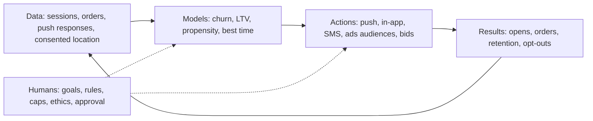
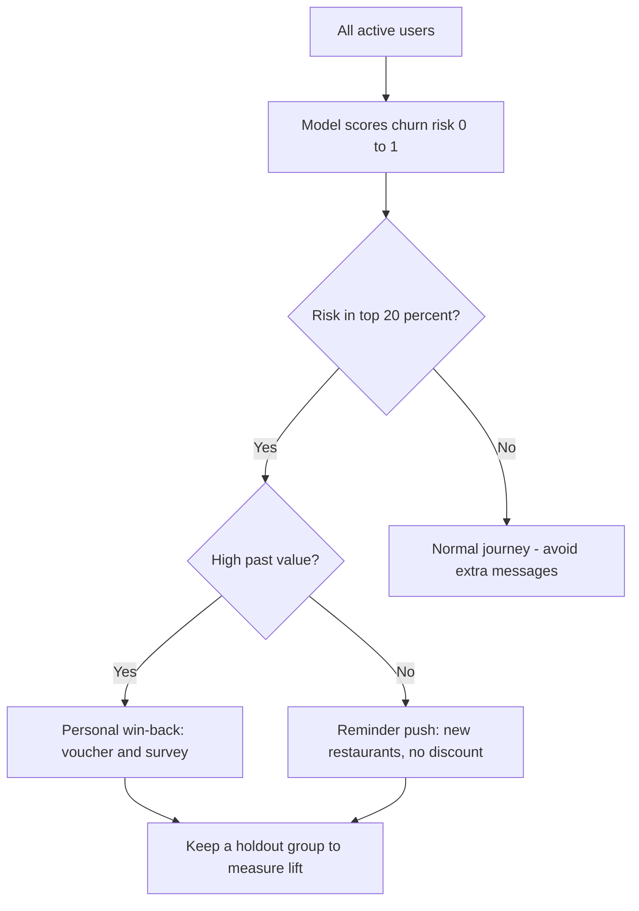
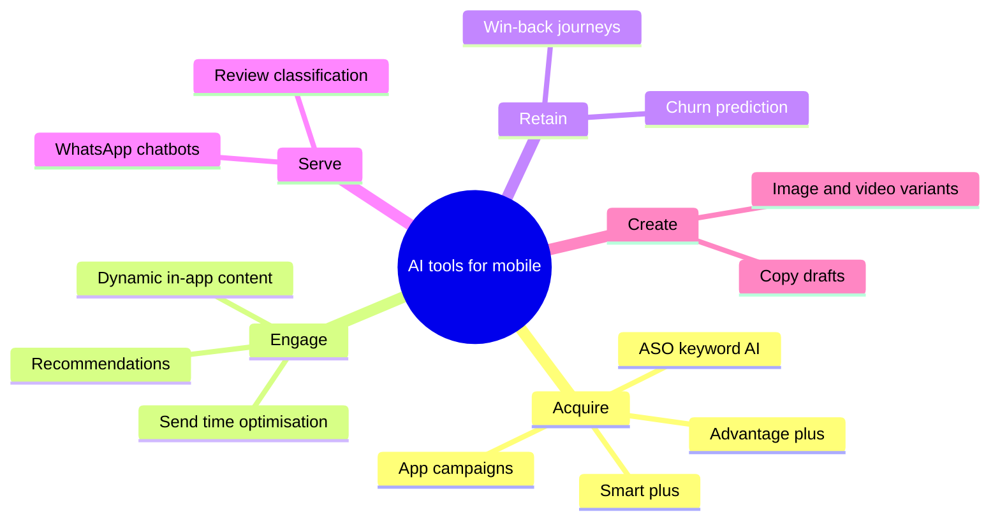
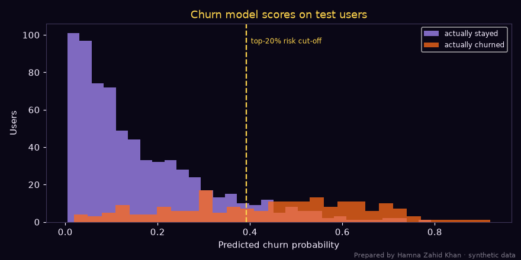

# Session 4 · AI Tools in Mobile Marketing

> 🏠 [Diploma in Digital Marketing](../../README.md) › [Term 1](../README.md) › [Mobile Marketing](README.md) › **Session 4**
>
> ⏱ **Estimated time:** 3 hours (1.5 h theory + 1.5 h lab) · 📋 **Prerequisites:** Session 3

[⬅ Previous: Session 3](session-03-advanced-mobile-channels.md) · [Next: Mobile Marketing practice test ➡](practice-test.md)

---

## 🎯 Learning objectives

By the end of this session you will be able to:

- Identify **AI tools** that support mobile marketing across creative, targeting, messaging, analytics and customer service.
- Explain how AI enables **personalisation** and **predictive analytics** (churn, LTV, next best action) in apps and mobile campaigns.
- Illustrate **AI-driven automation**: send-time optimisation, automated bidding, dynamic creative and chatbots.
- Build and interpret a simple **churn-prediction model** and a **send-time optimiser** in Python.
- Apply AI **responsibly**: privacy, consent, bias, transparency and human oversight.

## 📖 Concepts

### 1. Why AI fits mobile marketing

Mobile marketing produces huge amounts of **behavioural data** – app sessions, taps, locations (with consent), purchases, notification responses – far more than a person can analyse. **Artificial intelligence (AI)**, and especially **machine learning (ML)**, finds patterns in this data and acts on them automatically:

| Without AI | With AI |
|---|---|
| Same push to everyone at 8 pm | Each user gets the push at their best hour |
| Discount to all inactive users | Discount only to users predicted to churn – and who would respond |
| Marketer guesses best creative | Platform tests combinations and shifts spend to winners |
| Manual bids per keyword/audience | Algorithm bids per auction for the target CPA/ROAS |
| Support team answers "Where is my order?" 500 times a day | Chatbot answers instantly; humans handle complex cases |

### 2. Key AI capabilities for mobile marketers

| Capability | What it does | Mobile example |
|---|---|---|
| **Prediction** | Estimates future behaviour from past data | Churn risk, likelihood to buy, predicted LTV |
| **Classification** | Puts things into categories | Sentiment of app reviews; intent of chat messages |
| **Recommendation** | Suggests items a user is likely to want | "Because you ordered karahi…" carousel |
| **Optimisation** | Finds the best option under constraints | Send-time optimisation, bid optimisation, budget allocation |
| **Generation** | Creates text, images, video, voice | Push copy variants, ad images in many sizes, Urdu voice-overs |
| **Conversation** | Understands and replies in natural language | WhatsApp chatbot in English, Urdu and Roman Urdu |
| **Vision** | Understands images | Visual search ("find this shirt"), AR try-on |

### 3. AI tools for mobile marketing

| Area | Tools and features (examples) | What you use them for |
|---|---|---|
| **Ad platforms** | Google **App campaigns** and **Performance Max**, Meta **Advantage+ app campaigns**, TikTok **Smart+** | Automated targeting, bidding and creative selection for installs and in-app actions |
| **Customer engagement platforms** | Braze, CleverTap, MoEngage, OneSignal, Firebase (Cloud Messaging, Remote Config, A/B Testing) | Segmentation, push/in-app/SMS journeys, send-time optimisation, predictive segments |
| **Analytics and attribution** | Google Analytics 4 (predictive metrics such as purchase and churn probability), Firebase Analytics, AppsFlyer, Adjust | Funnels, cohorts, predictive audiences, attribution |
| **Creative** | Canva Magic Studio, Adobe Firefly, CapCut AI, Meta and Google generative ad tools | Resize, generate backgrounds, captions, variations |
| **Copywriting** | ChatGPT, Gemini, Claude, built-in AI writers | Push, SMS and app-store copy drafts, localisation |
| **Conversational AI** | WhatsApp Business Platform with chatbot builders (e.g. ManyChat, Wati), Dialogflow | Orders, FAQs, appointment booking in chat |
| **App Store Optimisation** | AI keyword suggestions in ASO tools (e.g. AppTweak, Sensor Tower) | Keywords, competitor analysis, review analysis |
| **Location intelligence** | Places/visits data (consented), Google Maps Platform | Store visit measurement, geofence planning |

> Tool names and features change quickly; evaluate them by **what problem they solve, what data they need, cost, and privacy terms**.

### 4. Personalisation with AI

| Level | Description | Example |
|---|---|---|
| **Rule-based** | If-then rules a marketer writes | If city = Lahore → show Lahore deals |
| **Segment-based** | Groups from analytics | "Students", "families", "late-night orderers" |
| **Predictive** | ML scores each user | Churn risk 0.82 → win-back journey |
| **1:1 real-time** | Content chosen per user, per moment | Home screen re-ordered by predicted preference and time of day |

**Next Best Action (NBA):** for each user, AI chooses the most valuable next step – a push, an in-app message, nothing at all (often the best choice for already-loyal users), or a discount only if needed.

### 5. Predictive analytics: churn, LTV and propensity

- **Churn prediction** – which users are likely to stop using the app. Inputs: days since last order, order frequency, sessions, notification settings, complaints.
- **LTV prediction** – expected value of a new user after their first few days, to guide how much to bid for similar users.
- **Propensity to buy** – likelihood to purchase in the next 7 days; used for audiences in ad platforms (GA4 offers predictive audiences when data thresholds are met).

**How to judge a model:** **AUC** (0.5 = random, 1.0 = perfect), **precision** (of those flagged, how many really churn), **recall** (of all churners, how many we caught), and – most importantly – **business lift**: does targeting the model's top users produce more saved customers per rupee than targeting at random?

### 6. AI-driven automation

| Automation | How AI helps |
|---|---|
| **Send-time optimisation (STO)** | Learns each user's active hours and sends then |
| **Frequency optimisation** | Reduces messages for users who show fatigue (fewer opens, more opt-outs) |
| **Automated bidding** | Target CPA/ROAS bids per auction (App campaigns, Advantage+) |
| **Dynamic creative** | Mixes headlines, images, videos; shifts impressions to best combinations |
| **Journey orchestration** | Moves users between flows based on behaviour and predictions |
| **Chatbots** | Answer FAQs, take orders, track deliveries, hand over to humans |
| **Review management** | Classifies app reviews by topic and sentiment, drafts replies |
| **Anomaly detection** | Alerts when installs drop or CPI spikes |

### 7. Responsible AI in mobile marketing

| Risk | Example | Safeguard |
|---|---|---|
| **Privacy** | Using location or contacts without clear consent | Explicit opt-in, data minimisation, retention limits, follow platform policies (ATT on iOS, Google Play data safety) |
| **Over-messaging** | Algorithm maximises opens by sending more | Hard frequency caps and quiet hours that AI cannot override |
| **Bias** | Model gives fewer offers to certain cities or genders | Check outcomes by segment; remove sensitive attributes; human review |
| **Manipulation** | Exploiting vulnerable users (e.g. gambling-like mechanics, debt offers) | Ethical guidelines; avoid dark patterns |
| **Hallucination** | AI writes a wrong price or delivery promise in push copy | Human approval; facts locked in templates |
| **Opacity** | Nobody knows why a user got an offer | Keep explainable features; document models |
| **Over-reliance** | Blind trust in automated campaigns | Holdout tests, regular audits |

## 🧭 Diagrams

### AI loop in mobile marketing



### Churn model to campaign



### Where AI tools sit



## 💻 Worked examples

### Example 1 – Predicting churn and targeting smartly

A food-delivery app wants to send a PKR 150 voucher to users who are about to stop ordering – but sending it to everyone would waste money on users who would order anyway. A logistic regression learns churn risk from four features (synthetic data):

📄 `code/session-04_churn_model.py`

```python
# AI for mobile marketing: predict which app users are likely to churn (stop ordering) with a
# logistic regression, then target only high-risk users with a re-engagement push.
# Prepared by Hamna Zahid Khan, Junior Lecturer. Data are synthetic (generated with a fixed seed).
import numpy as np
from sklearn.linear_model import LogisticRegression
from sklearn.model_selection import train_test_split
from sklearn.metrics import roc_auc_score, classification_report
import matplotlib
matplotlib.use("Agg")
import matplotlib.pyplot as plt

BG, FIRE, GOLD, VIOLET, EMBER, TEXT = "#0A0716", "#FF6B1A", "#FCD34D", "#A78BFA", "#F43F5E", "#F5EEFF"
rng = np.random.default_rng(42)
n = 3_000
days_since_order = rng.integers(0, 90, n)
orders_30d = rng.poisson(2.2, n)
sessions_7d = rng.poisson(4, n)
push_enabled = rng.random(n) < 0.6
# true (hidden) churn behaviour used to simulate labels
logit = -1.2 + 0.045 * days_since_order - 0.55 * orders_30d - 0.25 * sessions_7d - 0.5 * push_enabled
churn = rng.random(n) < 1 / (1 + np.exp(-logit))
X = np.column_stack([days_since_order, orders_30d, sessions_7d, push_enabled.astype(int)])
Xtr, Xte, ytr, yte = train_test_split(X, churn, test_size=0.3, random_state=0, stratify=churn)
model = LogisticRegression(max_iter=1000).fit(Xtr, ytr)
proba = model.predict_proba(Xte)[:, 1]
print(f"Users: {n:,} | churn rate in data: {churn.mean():.1%}")
print(f"Test AUC: {roc_auc_score(yte, proba):.3f}  (0.5 = random guessing, 1.0 = perfect)")
for name, coef in zip(["days_since_order", "orders_30d", "sessions_7d", "push_enabled"], model.coef_[0]):
    print(f"  {name:<17} coefficient {coef:+.3f} -> {'raises' if coef > 0 else 'lowers'} churn risk")
print(classification_report(yte, proba > 0.5, target_names=["stays", "churns"], digits=2))

# Business decision: push a PKR 150 voucher only to the riskiest 20%
cut = np.quantile(proba, 0.80)
target = proba >= cut
caught = (target & yte).sum()
print(f"Targeting top 20% risk ({target.sum()} users) reaches {caught} of {yte.sum()} churners "
      f"({caught / yte.sum():.0%}) - vs 20% if we picked at random.")

fig, ax = plt.subplots(figsize=(8, 4), facecolor=BG); ax.set_facecolor(BG)
ax.hist(proba[~yte], bins=30, color=VIOLET, alpha=.75, label="actually stayed")
ax.hist(proba[yte], bins=30, color=FIRE, alpha=.75, label="actually churned")
ax.axvline(cut, color=GOLD, ls="--"); ax.text(cut + .01, ax.get_ylim()[1] * .9, "top-20% risk cut-off", color=GOLD, fontsize=8)
ax.set_xlabel("Predicted churn probability", color=TEXT); ax.set_ylabel("Users", color=TEXT)
ax.set_title("Churn model scores on test users", color=GOLD); ax.tick_params(colors=TEXT)
for s in ax.spines.values(): s.set_color("#3b3355")
ax.legend(facecolor=BG, labelcolor=TEXT, fontsize=8)
fig.text(0.99, 0.01, "Prepared by Hamna Zahid Khan · synthetic data", color=TEXT, alpha=0.5, ha="right", fontsize=7)
plt.tight_layout(); plt.savefig("session-04_churn_model.png", dpi=110, facecolor=BG)
print("Saved session-04_churn_model.png")
```

**Output**

```text
Users: 3,000 | churn rate in data: 22.1%
Test AUC: 0.861  (0.5 = random guessing, 1.0 = perfect)
  days_since_order  coefficient +0.040 -> raises churn risk
  orders_30d        coefficient -0.521 -> lowers churn risk
  sessions_7d       coefficient -0.207 -> lowers churn risk
  push_enabled      coefficient -0.645 -> lowers churn risk
              precision    recall  f1-score   support

       stays       0.86      0.96      0.90       701
      churns       0.75      0.43      0.54       199

    accuracy                           0.84       900
   macro avg       0.80      0.69      0.72       900
weighted avg       0.83      0.84      0.83       900

Targeting top 20% risk (180 users) reaches 117 of 199 churners (59%) - vs 20% if we picked at random.
Saved session-04_churn_model.png
```



**Reading the model:**

- **AUC 0.86** – the model separates churners from stayers well.
- **Coefficients make business sense:** more days since the last order raises risk; more orders, more sessions and having push enabled lower it.
- **Recall of 43% at a 0.5 threshold** – the default threshold misses many churners, which is why marketers pick a threshold by **budget** instead: targeting the riskiest **20%** of users catches **59% of churners** (vs 20% by random selection) – nearly **3× more efficient**.
- **Next step:** send the voucher to the top-20% group but keep a **random 10% holdout** without the voucher, to measure how many customers were actually saved.

### Example 2 – Send-time optimisation

📄 `code/session-04_send_time.py`

```python
# Send-time optimisation: pick each user's best hour for a push notification from their past
# app opens, respecting quiet hours. This is the simple idea behind AI "smart send" features.
# Prepared by Hamna Zahid Khan, Junior Lecturer. Open hours are in PKT (UTC+5), invented.
from collections import Counter

QUIET = set(range(0, 9))        # no pushes 00:00-08:59 PKT
DEFAULT = 20                    # fall back to 8 pm when there is too little history
history = {
    "Ayesha": [13, 13, 14, 21, 13, 22, 13],
    "Bilal":  [23, 23, 0, 1, 23, 22, 23],       # night owl - quiet hours push him to the edge
    "Hira":   [9, 9, 10, 9, 18, 9],
    "Usman":  [20],                             # too little data
    "Zara":   [17, 18, 18, 19, 18, 18, 17, 18],
}
for user, hours in history.items():
    if len(hours) < 3:
        best, why = DEFAULT, "default (less than 3 opens)"
    else:
        allowed = [h for h in hours if h not in QUIET]
        if not allowed:
            best, why = DEFAULT, "all opens in quiet hours - default"
        else:
            best, cnt = Counter(allowed).most_common(1)[0]
            why = f"{cnt} of {len(hours)} opens at this hour"
    print(f"{user:<7} best send hour {best:02d}:00 PKT  ({why})")
print("\nAI tools do the same at scale, learning from millions of opens and re-learning every week.")
```

**Output**

```text
Ayesha  best send hour 13:00 PKT  (4 of 7 opens at this hour)
Bilal   best send hour 23:00 PKT  (4 of 7 opens at this hour)
Hira    best send hour 09:00 PKT  (4 of 6 opens at this hour)
Usman   best send hour 20:00 PKT  (default (less than 3 opens))
Zara    best send hour 18:00 PKT  (5 of 8 opens at this hour)

AI tools do the same at scale, learning from millions of opens and re-learning every week.
```

The rules mirror commercial STO features: learn each user's habitual hour from history, never send during quiet hours (00:00–08:59 PKT), and use a sensible default when there is too little data. Bilal's opens at 00:00 and 01:00 are ignored because of quiet hours, so he gets 23:00.

### Example 3 – An AI-assisted push campaign (walkthrough)

**Goal:** increase weekend orders by 15% from lapsed users of a grocery app in Islamabad.

1. **Predictive audience:** customer engagement platform builds "likely to churn in 14 days" (top 25%) and "high predicted LTV".
2. **Copy generation:** prompt an AI assistant – *"Write 10 push notifications (max 45 characters title, 90 body) for a grocery app in Islamabad. Benefit: fresh vegetables delivered in 2 hours. Tone: friendly, Roman Urdu allowed. No discounts above PKR 200. Do not invent facts."*
3. **Human edit and compliance check:** remove exaggerations, check Roman Urdu spelling, confirm the offer and delivery claims.
4. **A/B test:** 3 variants, 10% holdout, send-time optimisation on.
5. **Automation rules:** max one marketing push per day; stop the journey after an order; quiet hours.
6. **Measure:** orders per 1,000 users vs holdout, opt-out rate, uninstall rate, revenue per user.

**Result (illustrative):** test groups placed **1,240** orders per 10,000 users vs **1,050** in the holdout → **+18% lift**; opt-outs 0.6% (acceptable).

### Example 4 – WhatsApp chatbot design for a pharmacy

| User says | Bot does | Hand-off to human? |
|---|---|---|
| "Panadol hai?" | Checks stock, shows price and delivery time | No |
| Uploads a prescription photo | Confirms receipt, assigns to pharmacist | **Yes – pharmacist verifies** |
| "Where is my order?" | Fetches status from the order system | No |
| "I feel chest pain" | Shows emergency numbers immediately (e.g. Rescue 1122), advises seeking urgent care | **Yes – urgent, never automated advice** |
| "Talk to a person" | Transfers within business hours, otherwise promises a callback time | Yes |

**Design principles:** be clear it's a bot, give buttons for common choices, support English/Urdu/Roman Urdu, never give medical or financial advice automatically, log conversations securely, and make human help easy to reach.

### Example 5 – Measuring AI's business value

| Metric | Before AI journeys | After 8 weeks | Change |
|---|---|---|---|
| Day-30 retention | 22% | 27% | +5 points |
| Marketing pushes per user per week | 6.0 | 3.5 | −42% |
| Push opt-out rate (monthly) | 2.4% | 1.1% | −54% |
| Revenue per active user (monthly) | PKR 1,650 | PKR 1,880 | +14% |
| Vouchers issued | 18,000 | 7,500 | −58% |

**Interpretation (illustrative):** fewer but better-timed and better-targeted messages improved retention and revenue while cutting voucher costs and opt-outs – the usual pattern when AI replaces blanket campaigns.

## 📋 Checklist · Adopting an AI tool for mobile marketing

- [ ] Clear problem and KPI (e.g. Day-30 retention, cost per first order).
- [ ] Enough clean, consented data (events tracked consistently).
- [ ] Privacy review: what data the tool gets, where it's stored, retention, data processing terms.
- [ ] Guardrails set: frequency caps, quiet hours, banned claims, budget limits.
- [ ] Human approval for generated copy and creative.
- [ ] Holdout or A/B design to measure lift.
- [ ] Bias check: compare outcomes across cities, genders and income groups.
- [ ] Review cadence: weekly performance, monthly model and rule audit.

## ⚠️ Common mistakes

| Mistake | Fix |
|---|---|
| Turning on automation without conversion tracking | Fix events first – AI optimises what you measure |
| Judging a model only by accuracy | Use AUC, precision/recall and business lift vs holdout |
| Sending discounts to everyone the model flags | Combine risk with value and responsiveness |
| Letting AI increase frequency without limits | Hard caps and quiet hours |
| Publishing AI copy unreviewed | Human approval; lock facts like price and delivery time |
| Collecting location/contacts "just in case" | Data minimisation and explicit consent |
| No holdout group | Always measure incremental impact |

## 🧪 Lab / practice tasks

**Task 1 (easy) – Match the tool.** Match each need to an AI capability: (a) reduce support chats about order status; (b) find users about to leave; (c) send each push at the right hour; (d) produce 20 banner sizes from one design.

<details><summary>✅ Solution</summary>

(a) Conversational AI / chatbot · (b) Prediction (churn model) · (c) Optimisation (send-time optimisation) · (d) Generation (AI creative resizing/variants).

</details>

**Task 2 (easy) – Precision and recall.** A churn model flags 500 users; 300 of them really churn. Overall, 800 users churned. Calculate precision and recall.

<details><summary>✅ Solution</summary>

Precision = 300 ÷ 500 = **60%**; recall = 300 ÷ 800 = **37.5%**.

</details>

**Task 3 (medium) – Change the targeting budget.** In `code/session-04_churn_model.py` change the quantile from `0.80` to `0.70` (target the riskiest 30%). What share of churners is reached now? Is it worth the extra vouchers?

<details><summary>💡 Hint</summary>

Compare "users targeted" and "churners reached" for both settings; calculate churners reached per 100 vouchers.

</details>

**Task 4 (medium) – Extend send-time optimisation.** In `code/session-04_send_time.py` add a rule: if a user's best hour falls in Friday prayer time (13:00–14:00 PKT) on Fridays, move it to 15:00. Add a `day` dimension to the history to test it.

**Task 5 (challenge) – AI mobile plan.** For an app of your choice (food, ride-hailing, banking, education), write a one-page plan for using AI: 3 use cases (acquire, engage, retain), the data each needs, the tool category, guardrails, KPIs and a holdout test design. Include one generated push copy set and your human edits.

## ✅ Quick quiz

1. A model with AUC 0.5 is:
   a) perfect b) no better than random guessing c) very good d) overfitted
2. Send-time optimisation:
   a) sends all messages at 8 pm b) sends each user's message at the time they usually engage c) increases frequency d) writes the copy
3. Which is the best way to prove an AI campaign worked?
   a) Opens went up b) Compare against a random holdout group c) The vendor says so d) More messages were sent
4. A guardrail that AI should never override is:
   a) frequency caps and quiet hours b) the brand logo colour c) the app icon d) the font
5. A pharmacy chatbot should hand over to a human when:
   a) a user asks the price of a common product b) a user reports chest pain or sends a prescription c) a user asks for store hours d) never

<details><summary>Show answers</summary>

1-b · 2-b · 3-b · 4-a · 5-b

</details>

## 📝 Summary

- Mobile generates rich behavioural data; AI turns it into **predictions, recommendations, optimisations, generated content and conversations**.
- Tool categories: **ad platform automation, customer engagement platforms, analytics/attribution, creative and copy AI, conversational AI, ASO AI**.
- Personalisation grows from rules → segments → predictive → 1:1 real-time; **next best action** includes doing nothing.
- Judge models by **AUC, precision, recall and business lift vs a holdout**.
- Automation: STO, frequency optimisation, automated bidding, dynamic creative, journeys, chatbots, anomaly alerts.
- Responsible AI: consent, minimisation, caps, bias checks, human approval, transparency.

**Interview / viva questions**

1. Give three examples of AI tools used in mobile marketing and what each does.
2. How does a churn-prediction model help a marketing budget?
3. What is send-time optimisation?
4. Explain precision and recall to a marketing manager.
5. Why is a holdout group important in AI-driven campaigns?
6. What guardrails would you set before letting AI send push notifications?

---

[⬅ Previous: Session 3](session-03-advanced-mobile-channels.md) · [Next: Mobile Marketing practice test ➡](practice-test.md)

<sub>Prepared by **Hamna Zahid Khan**, Junior Lecturer · Diploma in Digital Marketing</sub>
