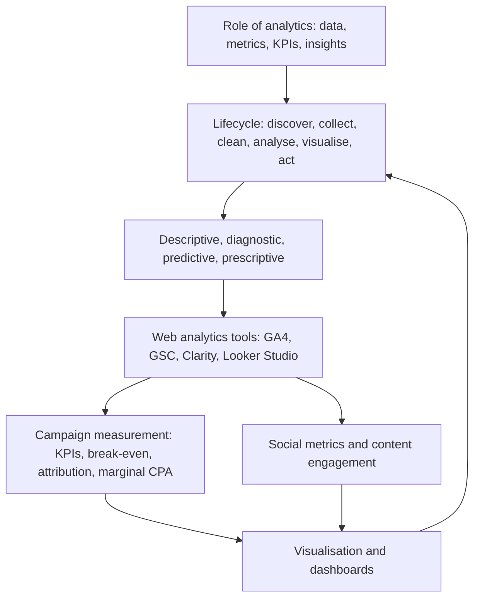

# Module 8 · Analytics

> 🏠 [Diploma in Digital Marketing](../../README.md) › [Term 1](../README.md) › **Module 8**

[⬅ Previous module](../07-mobile-marketing/README.md) · [Start Session 1 ➡](session-01-basics-of-marketing-analytics.md) · [Next module ➡](../09-smart-digital-marketing-with-ai/README.md)

---

Analytics is how marketers know what is working, why, and what to do next. This module covers the role of analytics and the full data analytics lifecycle, the four types of analytics and the web analytics tool kit (GA4, Search Console, Clarity, Looker Studio), how to measure and optimise campaigns (break-even metrics, attribution models, marginal-CPA budgeting), social media metrics and content-engagement analysis, and how to visualise data honestly in charts and dashboards. Every session includes real pandas/matplotlib analysis you can run.

## 🎯 Module objectives

- Outline the **importance and role of analytics**, distinguish data, metrics, KPIs and insights, and apply the **data analytics lifecycle**.
- Define **descriptive, diagnostic, predictive and prescriptive** analytics and use **web analytics tools** to track and analyse behaviour.
- **Measure and optimise** campaign performance with the right KPIs, break-even guards, attribution models and budget re-allocation.
- Define **social media metrics** and analyse **content engagement** by format, topic and timing.
- **Choose and design visualisations** and build dashboards, including in **Looker Studio**.

## 📅 Sessions

| # | Session | Prerequisites |
|---|---|---|
| 1 | [Basics of Digital Marketing Analytics](session-01-basics-of-marketing-analytics.md) | Basic spreadsheet skills |
| 2 | [Web Analytics Tools](session-02-web-analytics-tools.md) | Session 1 |
| 3 | [Measuring and Optimizing Campaign Performance](session-03-measuring-campaign-performance.md) | Session 2 |
| 4 | [Social Media Metrics and Content Engagement](session-04-social-metrics-and-engagement.md) | Session 3 |
| 5 | [Visualizing Marketing Data Effectively](session-05-visualizing-marketing-data.md) | Sessions 1-4 |
|  | 📝 [Module practice test](practice-test.md) | All sessions |

## 🧭 Concept map

## 💻 Code and charts in this module

All examples are runnable. See **[code/README.md](code/README.md)** for every file and how to run it. Python 3.10+ with `pip install pandas numpy matplotlib`.

| Session | Code | Chart / data |
|---|---|---|
| 1 | Full analytics lifecycle on a messy orders export | Revenue and ROAS by channel; raw CSV |
| 2 | Four types of analytics on monthly data; GA4-style metrics from raw events | Purchase funnel; events CSV |
| 3 | Marginal-CPA budget optimiser; five attribution models | Diminishing-returns curves |
| 4 | Post-level social analytics with format and timing analysis | Day × hour engagement heat-map; posts CSV |
| 5 | Chart makeover and four-panel dashboard | Bad vs good chart; dashboard |

## 📄 One-page cheat-sheet

| Topic | Remember this |
|---|---|
| Role of analytics | Measure · explain · predict · optimise · prove value · understand customers · reduce waste |
| Data → decision | Data → metrics → KPIs (with targets) → insights → actions |
| Data types | Quantitative/qualitative · first/second/third/zero-party · structured/unstructured |
| Lifecycle | Discover → collect → clean → analyse → visualise → act |
| Cleaning issues | Duplicates · missing values · inconsistent names · wrong types · impossible values · time zones · currencies |
| Analytics types | Descriptive (what) · diagnostic (why) · predictive (what next) · prescriptive (what to do) |
| Web analytics flow | Tag → event → session/user → attribution → report (with consent) |
| GA4 engaged session | > 10 s **or** key event **or** 2+ views · bounce = 100% − engagement rate |
| Tools | GA4 · GTM · Search Console · Clarity/Hotjar · Looker Studio · platform analytics |
| Measurement framework | Objective · KPIs · tracking · baseline · window · cadence · decision rules |
| Break-even | CPA = AOV × margin · ROAS = 1 ÷ margin |
| Attribution | Last · first · linear · time decay · position 40/20/40 · data-driven · validate with holdouts |
| Budgeting | Move money to the lowest **marginal** CPA until marginal CPAs are equal |
| Social metric families | Reach · engagement · amplification · audience · video · conversion · community |
| ER versions | By reach · by impressions · by followers · per post – always label |
| Content analysis | Tag format/topic/hook/day/hour · medians · enough data · decide and test |
| Chart choice | Line = time · bar = compare · pie ≤ 5 = composition · scatter = relationship · histogram = distribution · funnel = stages · heat-map = 2 dimensions · scorecard = KPI |
| Design | Insight title · sort · highlight · direct labels · zero-based bars · accessible colours |
| Dashboard | KPIs top-left · ≤ 8 visuals · filters · consistent colours · "what we'll do" note |
| Looker Studio | Connectors · dimensions vs metrics · calculated fields · blending · controls · sharing |

| Formula | Calculation |
|---|---|
| Conversion rate | Conversions ÷ Sessions (or clicks) × 100 |
| Engagement rate (GA4) | Engaged sessions ÷ Sessions × 100 |
| CTR / CPC / CPM | Clicks ÷ Impr × 100 · Cost ÷ Clicks · Cost ÷ Impr × 1,000 |
| CPA / ROAS / ROI | Cost ÷ Conversions · Revenue ÷ Cost · (Gross profit − Cost) ÷ Cost × 100 |
| AOV | Revenue ÷ Orders |
| CLV (simple) | AOV × Frequency × Lifespan × Margin |
| Marginal CPA | Extra cost ÷ Extra conversions |
| ER by reach / followers | Engagements ÷ Reach × 100 · Engagements ÷ Followers × 100 |
| Virality / save rate | Shares ÷ Impressions × 100 · Saves ÷ Reach × 100 |
| Follower growth | (End − Start) ÷ Start × 100 |
| Time-decay weights (halving) | 1, ½, ¼ … from the last touch backwards, then normalise |

**Common mistakes:** no business question · too many metrics · skipping data cleaning · unfair seasonal comparisons · correlation as causation · numbers without "so what" · duplicate tags · untagged links · ignoring device breakdowns · extrapolating models · no baseline · average instead of marginal CPA · last-click only · unlabelled ER versions · viral outliers in averages · pie charts with many slices · truncated axes · cluttered dashboards.

---

Prepared by **Hamna Zahid Khan**, Junior Lecturer · Diploma in Digital Marketing
