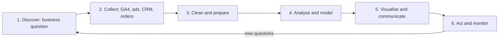
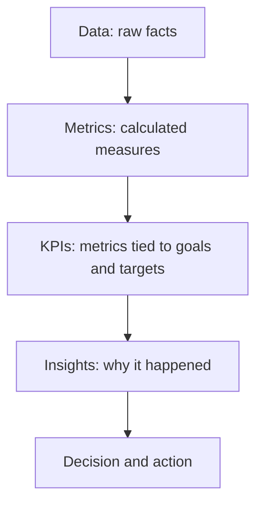
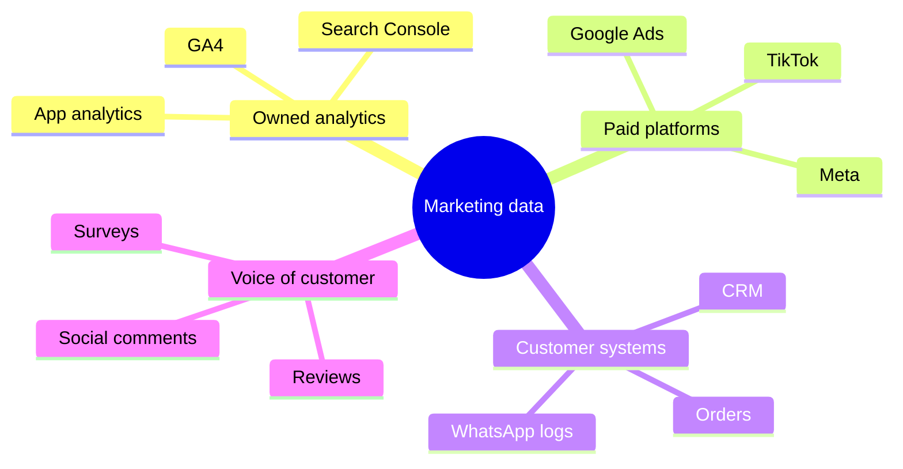
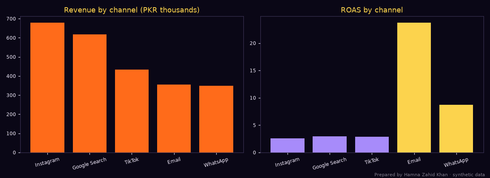
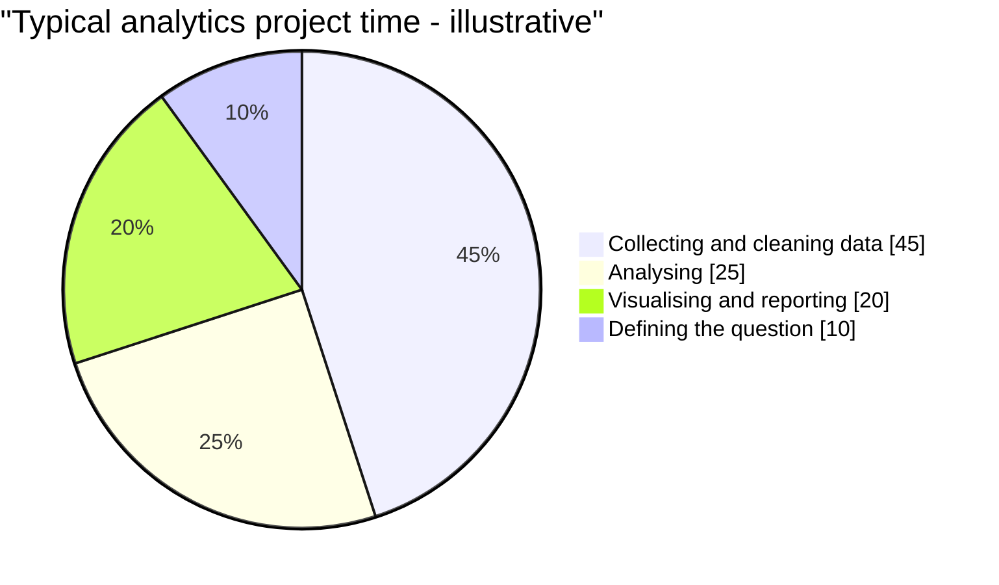

# Session 1 · Basics of Digital Marketing Analytics

> 🏠 [Diploma in Digital Marketing](../../README.md) › [Term 1](../README.md) › [Analytics](README.md) › **Session 1**
>
> ⏱ **Estimated time:** 3 hours (1.5 h theory + 1.5 h lab) · 📋 **Prerequisites:** Basic spreadsheet skills

[⬅ Previous: Analytics overview](README.md) · [Next: Session 2 ➡](session-02-web-analytics-tools.md)

---

## 🎯 Learning objectives

By the end of this session you will be able to:

- Outline the **importance and role of analytics** in digital marketing.
- Distinguish **data, metrics, KPIs and insights**, and choose KPIs that match business goals.
- Explain the **data analytics lifecycle** step by step: discover, collect, clean, analyse, visualise, act.
- Identify common **data sources** in marketing and the data quality problems they bring.
- Run a complete mini analytics project in Python, from raw export to recommendation.

## 📖 Concepts

### 1. What marketing analytics is

**Marketing analytics** is the practice of collecting, measuring, analysing and interpreting marketing data so that decisions are based on evidence instead of guesswork. It answers questions such as:

- Which channel brings customers at the lowest cost?
- Which campaign, creative or email actually caused sales?
- Where do visitors drop out of the purchase journey?
- How much should we spend next month, and where?

> 💡 **Analogy:** marketing without analytics is like driving from Karachi to Hyderabad at night without headlights or a fuel gauge. You may arrive, but you won't know why, and you may run out of fuel on the way.

### 2. Why analytics matters – its role

| Role | What it does | Example |
|---|---|---|
| **Measure** | Shows what happened | 12,400 sessions and 310 orders in October |
| **Explain** | Finds causes | Orders dropped because checkout broke on iPhones |
| **Predict** | Estimates the future | Expected Eid demand is 2.3× a normal month |
| **Optimise** | Improves results | Move budget from YouTube to Search, where CPA is lower |
| **Prove value** | Justifies spending | Social media ROI was 42% this quarter |
| **Understand customers** | Reveals behaviour and segments | Repeat buyers come mostly from email |
| **Reduce waste** | Stops what doesn't work | Pause ad sets with CPA above break-even |

### 3. Data, metrics, KPIs and insights

| Term | Meaning | Example |
|---|---|---|
| **Data** | Raw facts | 18 March, Instagram, order PKR 4,200 |
| **Metric** | A measurement calculated from data | Conversion rate 2.4% |
| **KPI (key performance indicator)** | A metric tied directly to a goal, with a target | "Cost per order ≤ PKR 900 by June" |
| **Insight** | An interpretation that explains *why* and suggests *what to do* | "Mobile users abandon checkout at the address step – shorten the form" |

Good KPIs are **few** (3–6 per goal), **actionable** (you can change them), **comparable over time**, and **linked to money or a strategic outcome**.

| Business goal | Example KPIs |
|---|---|
| Grow online sales | Revenue, orders, conversion rate, AOV, ROAS |
| Generate leads | Leads, cost per lead, lead-to-customer rate |
| Build awareness | Reach, branded search volume, share of voice |
| Retain customers | Repeat purchase rate, churn, CLV |
| Improve service | Response time, CSAT, resolution rate |

### 4. Types of data

| Type | Description | Examples |
|---|---|---|
| **Quantitative** | Numbers | Sessions, revenue, clicks |
| **Qualitative** | Words and opinions | Reviews, survey comments, social posts |
| **First-party** | Collected by you from your customers | Website analytics, CRM, email lists, orders |
| **Second-party** | Another company's first-party data shared with you | A partner's audience in a co-marketing deal |
| **Third-party** | Collected by others and sold/aggregated | Market reports, some audience data (shrinking due to privacy rules) |
| **Zero-party** | Data customers intentionally give you | Preferences in a quiz or preference centre |
| **Structured / unstructured** | Rows and columns vs free text, images, video | Order table vs Instagram comments |

### 5. Marketing data sources

| Source | What it gives |
|---|---|
| **Web/app analytics** (GA4, Firebase) | Visitors, sessions, pages, events, conversions, sources |
| **Ad platforms** (Google Ads, Meta, TikTok) | Impressions, clicks, spend, platform conversions |
| **Social platforms** | Reach, engagement, followers, demographics |
| **Email/SMS platforms** | Deliveries, clicks, unsubscribes, revenue |
| **CRM and e-commerce** (Shopify, WooCommerce, order sheets) | Customers, orders, revenue, repeat purchases |
| **Search Console** | Search queries, impressions, clicks, positions |
| **Surveys and reviews** | Satisfaction, reasons, NPS |
| **Call centre / WhatsApp logs** | Leads and orders that never touch the website |

### 6. The data analytics lifecycle

| Phase | Key activities | Output |
|---|---|---|
| **1. Discover / define** | Understand the business question, stakeholders, success criteria | A clear question and hypothesis |
| **2. Collect** | Identify sources, export or connect data, set up tracking if missing | Raw datasets |
| **3. Clean and prepare** | Remove duplicates, fix missing values, standardise formats, join tables | Analysis-ready dataset |
| **4. Analyse / model** | Calculate metrics, segment, compare, test, build models | Findings |
| **5. Visualise and communicate** | Charts, dashboards, a short story with recommendations | Report or dashboard |
| **6. Act and monitor** | Implement changes, track results, repeat | Better decisions; new questions |

**Data cleaning** often takes the most time. Common problems: duplicate rows (double exports), missing values (unknown source), inconsistent names ("Instagram", "instagram", "IG"), wrong data types (numbers stored as text), impossible values (negative prices), time-zone mismatches (an ad platform in UTC vs GA4 in Asia/Karachi) and currency mixing (USD vs PKR).

### 7. Analytics skills and tools

| Level | Tools |
|---|---|
| Spreadsheets | Excel, Google Sheets (pivot tables, formulas, charts) |
| Web analytics | GA4, Search Console, Microsoft Clarity/Hotjar (heatmaps, recordings) |
| Visualisation | Looker Studio (formerly Google Data Studio), Power BI, Tableau |
| Programming | Python (pandas, matplotlib), SQL, R |
| Experimentation | Platform A/B tools, statistical tests |

A good marketing analyst combines **business understanding**, **numeracy**, **tool skills**, **curiosity** and **storytelling**.

### 8. Ethics and privacy

Collect data with **consent**, keep only what you need, anonymise where possible, secure access, and never use data in ways customers would not reasonably expect. Analytics should help customers get better experiences, not manipulate them.

## 🧭 Diagrams

### The analytics lifecycle



### From data to decision



### Marketing data sources



## 💻 Worked examples

### Example 1 – A complete lifecycle in Python

A Lahore shoe store asks: *which channel brings the most valuable customers, and where should next month's budget go?* The script simulates a messy export (duplicates, missing sources, refund rows), cleans it, analyses it with pandas, charts it and recommends actions.

📄 `code/session-01_analytics_lifecycle.py`

```python
# The data analytics lifecycle on a small marketing dataset: discover -> collect -> clean ->
# analyse -> visualise -> act. Prepared by Hamna Zahid Khan, Junior Lecturer.
# Data: 600 synthetic online orders for a Lahore shoe store (fixed seed so results repeat).
import numpy as np, pandas as pd
import matplotlib
matplotlib.use("Agg")
import matplotlib.pyplot as plt

BG, FIRE, GOLD, VIOLET, EMBER, TEXT = "#0A0716", "#FF6B1A", "#FCD34D", "#A78BFA", "#F43F5E", "#F5EEFF"
# 1. DISCOVER - business question
print("Question: which marketing channel brings the most valuable customers, and where should next month's budget go?\n")

# 2. COLLECT - simulate an export from the shop + GA4 (with realistic mess)
rng = np.random.default_rng(7)
channels = np.array(["Instagram", "Google Search", "TikTok", "Email", "WhatsApp"])
probs = [0.30, 0.25, 0.20, 0.10, 0.15]
n = 600
df = pd.DataFrame({
    "order_id": np.arange(1001, 1001 + n),
    "channel": rng.choice(channels, n, p=probs),
    "order_value": rng.normal(4200, 1300, n).round(-1),
    "city": rng.choice(["Lahore", "Karachi", "Islamabad", "Faisalabad"], n, p=[.45, .25, .2, .1]),
})
df.loc[df.channel == "Email", "order_value"] += 600            # email buyers spend more
df.loc[df.channel == "TikTok", "order_value"] -= 500
df = pd.concat([df, df.sample(12, random_state=1)])              # duplicate rows from a double export
df.loc[df.sample(9, random_state=2).index, "channel"] = None     # missing source
df.loc[df.sample(3, random_state=3).index, "order_value"] = -1   # refund rows logged as -1
df.to_csv("session-01_orders_raw.csv", index=False)
print(f"Collected {len(df)} rows -> session-01_orders_raw.csv")

# 3. CLEAN
before = len(df)
df = df.drop_duplicates("order_id")
df["channel"] = df["channel"].fillna("Unknown")
df = df[df.order_value > 0]
print(f"Cleaning: removed {before - len(df)} rows (duplicates + invalid values); {(df.channel == 'Unknown').sum()} orders with unknown source kept as 'Unknown'")

# 4. ANALYSE
spend = {"Instagram": 260_000, "Google Search": 210_000, "TikTok": 150_000, "Email": 15_000, "WhatsApp": 40_000, "Unknown": 0}
summary = df.groupby("channel").agg(orders=("order_id", "count"), revenue=("order_value", "sum"), aov=("order_value", "mean"))
summary["spend"] = summary.index.map(spend)
summary["roas"] = (summary.revenue / summary.spend).replace(np.inf, np.nan)
summary["cpa"] = (summary.spend / summary.orders).replace(0, np.nan)
summary = summary.sort_values("revenue", ascending=False)
pd.set_option("display.width", 120)
print("\n" + summary.round({"aov": 0, "roas": 2, "cpa": 0}).to_string())

# 5. VISUALISE
s = summary.drop("Unknown", errors="ignore")
fig, (a1, a2) = plt.subplots(1, 2, figsize=(11, 4), facecolor=BG)
for ax in (a1, a2):
    ax.set_facecolor(BG); ax.tick_params(colors=TEXT, labelsize=8)
    for sp in ax.spines.values(): sp.set_color("#3b3355")
a1.bar(s.index, s.revenue / 1000, color=FIRE); a1.set_title("Revenue by channel (PKR thousands)", color=GOLD)
a2.bar(s.index, s.roas, color=[GOLD if r > 4 else VIOLET for r in s.roas]); a2.set_title("ROAS by channel", color=GOLD)
for ax in (a1, a2): ax.set_xticks(range(len(s))); ax.set_xticklabels(s.index, rotation=15)
fig.text(0.99, 0.01, "Prepared by Hamna Zahid Khan · synthetic data", color=TEXT, alpha=0.5, ha="right", fontsize=7)
plt.tight_layout(); plt.savefig("session-01_channel_analysis.png", dpi=110, facecolor=BG)

# 6. ACT
best = s.roas.idxmax(); worst = s.roas.idxmin()
print(f"\nInsight: {best} has the highest ROAS ({s.roas.max():.1f}); {worst} the lowest ({s.roas.min():.1f}).")
print(f"Action: grow the email list (cheap, high value), test new {worst} creatives and audiences before adding spend,")
print("        and fix source tracking for the 'Unknown' orders.")
print("Saved session-01_channel_analysis.png")
```

**Output**

```text
Question: which marketing channel brings the most valuable customers, and where should next month's budget go?

Collected 612 rows -> session-01_orders_raw.csv
Cleaning: removed 15 rows (duplicates + invalid values); 9 orders with unknown source kept as 'Unknown'

               orders   revenue     aov   spend   roas     cpa
channel                                                       
Instagram         165  679070.0  4116.0  260000   2.61  1576.0
Google Search     145  617610.0  4259.0  210000   2.94  1448.0
TikTok            123  433490.0  3524.0  150000   2.89  1220.0
Email              73  356120.0  4878.0   15000  23.74   205.0
WhatsApp           82  348070.0  4245.0   40000   8.70   488.0
Unknown             9   41630.0  4626.0       0    NaN     NaN

Insight: Email has the highest ROAS (23.7); Instagram the lowest (2.6).
Action: grow the email list (cheap, high value), test new Instagram creatives and audiences before adding spend,
        and fix source tracking for the 'Unknown' orders.
Saved session-01_channel_analysis.png
```



**What the lifecycle revealed:**

1. **Cleaning mattered** – 15 bad rows (12 duplicates from a double export, 3 refunds logged as −1) would have inflated revenue.
2. **Revenue ≠ efficiency** – Instagram brings the most revenue but the lowest ROAS (2.6); email brings less revenue but a ROAS of about 24 because it is cheap and reaches existing fans.
3. **Insight → action** – grow the email list, test new Instagram creatives before spending more, and fix tracking so "Unknown" orders get a source.
4. The raw file `session-01_orders_raw.csv` is saved so you can open it in Excel and repeat the analysis with a pivot table.

### Example 2 – Turning a vague request into an analytics question

**Manager:** "Is our marketing working?"

| Step | Analyst's work |
|---|---|
| Clarify goal | "Working" = profitable online sales growth this quarter |
| Define KPIs | Revenue, orders, ROAS by channel, CPA vs break-even CPA (AOV × margin) |
| Set the comparison | This quarter vs last quarter and vs same quarter last year (seasonality) |
| List data needed | GA4 (sessions, conversions by source), ad spend exports, order system |
| Analyse | Break-even CPA = 4,200 × 0.35 = PKR 1,470; channels above it lose money |
| Communicate | One page: 3 findings, 3 actions, 1 chart |

### Example 3 – Spreadsheet version of the analysis

In Google Sheets with the raw CSV:

1. **Data → Data cleanup → Remove duplicates** (on `order_id`).
2. Filter out rows where `order_value` ≤ 0.
3. Replace blank `channel` cells with "Unknown".
4. **Insert → Pivot table**: rows = channel; values = COUNTA(order_id), SUM(order_value), AVERAGE(order_value).
5. Add a spend column and a ROAS formula: `=C2/E2`.
6. **Insert → Chart** → bar chart of revenue and ROAS.

Same answers as Python – choose the tool that fits the data size and your skills.

## 📊 Chart · Where analysts typically spend their time (illustrative)



## 📋 Checklist · Before starting any analysis

- [ ] The business question is written down in one sentence.
- [ ] KPIs and their targets are agreed.
- [ ] Data sources and date ranges are listed; time zones and currencies checked.
- [ ] Tracking gaps are known (e.g. WhatsApp orders, offline sales).
- [ ] Data is cleaned and the cleaning steps are documented.
- [ ] Comparisons are fair (same period length, seasonality considered).
- [ ] The output ends with recommendations, not just numbers.

## ⚠️ Common mistakes

| Mistake | Fix |
|---|---|
| Collecting data without a question | Start with the decision you need to make |
| Tracking dozens of metrics | Pick 3–6 KPIs per goal |
| Not cleaning data | Remove duplicates, invalid and inconsistent values first |
| Comparing Eid month to a normal month | Compare with the same period last year |
| Confusing correlation with causation | Test with experiments or holdouts |
| Reporting numbers without "so what" | Every finding needs an insight and an action |
| Ignoring offline/WhatsApp sales | Add source tracking (codes, pre-filled messages, order sheet) |

## 🧪 Lab / practice tasks

**Task 1 (easy) – Classify.** Data, metric, KPI or insight? (a) "Conversion rate is 2.1%"; (b) "Order #4471, PKR 3,900, TikTok"; (c) "Cost per lead ≤ PKR 600 by March"; (d) "Leads from TikTok convert poorly because the form asks for CNIC".

<details><summary>✅ Solution</summary>

(a) Metric · (b) Data · (c) KPI · (d) Insight.

</details>

**Task 2 (easy) – KPIs.** Choose three KPIs for (a) a coaching academy wanting more admissions, (b) a new snack brand wanting to be known.

<details><summary>✅ Solution</summary>

(a) Leads, cost per lead, lead-to-admission rate (also revenue per admission). (b) Reach, branded search volume / brand-lift, share of voice (also video views).

</details>

**Task 3 (medium) – Change the data.** In `code/session-01_analytics_lifecycle.py` double the email spend to PKR 30,000 and halve Instagram spend. Rerun. How do ROAS and the recommendations change? Why might halving Instagram spend not halve its revenue in reality?

<details><summary>💡 Hint</summary>

The script's revenue doesn't depend on spend (it is historical data). In reality, revenue responds to spend with diminishing returns – Session 3 models this.

</details>

**Task 4 (medium) – Spreadsheet pivot.** Open `code/session-01_orders_raw.csv` in Sheets/Excel, clean it as in Example 3 and build a pivot of revenue by **city**. Which city has the highest AOV?

**Task 5 (challenge) – Mini project.** Choose a question for a real or imagined business (e.g. "Which day of the week should we post?"). Write the six lifecycle steps for it: question, data sources, cleaning steps, analysis method, chart type and the action you'd take for two possible results.

## ✅ Quick quiz

1. Which is a KPI?
   a) 5,000 sessions b) "Cost per order ≤ PKR 900 by June" c) An order record d) A screenshot
2. The first phase of the analytics lifecycle is:
   a) visualise b) discover/define the question c) clean d) act
3. Zero-party data is:
   a) bought from a broker b) data customers intentionally share, like quiz preferences c) data with no value d) server logs
4. Removing duplicate rows belongs to which phase?
   a) Discover b) Clean and prepare c) Visualise d) Act
5. An insight differs from a metric because it:
   a) is bigger b) explains why and suggests action c) is always a percentage d) comes from ads only

<details><summary>Show answers</summary>

1-b · 2-b · 3-b · 4-b · 5-b

</details>

## 📝 Summary

- Analytics turns marketing data into evidence-based decisions: **measure, explain, predict, optimise, prove value**.
- **Data → metrics → KPIs → insights → action**; keep KPIs few, actionable and tied to goals.
- Data types: quantitative/qualitative, first/second/third/zero-party, structured/unstructured.
- Lifecycle: **discover → collect → clean → analyse → visualise → act**, and repeat.
- Cleaning (duplicates, missing values, formats, time zones, currencies) is essential and time-consuming.
- Analyse ethically, with consent and data minimisation.

**Interview / viva questions**

1. Why is analytics important in digital marketing?
2. Explain the difference between a metric and a KPI.
3. Walk me through the data analytics lifecycle with an example.
4. What data-quality problems do you expect when combining ad and GA4 data?
5. What is first-party data and why is it becoming more valuable?
6. How do you turn a vague question like "Is marketing working?" into an analysis?

---

[⬅ Previous: Analytics overview](README.md) · [Next: Session 2 ➡](session-02-web-analytics-tools.md)

<sub>Prepared by **Hamna Zahid Khan**, Junior Lecturer · Diploma in Digital Marketing</sub>
