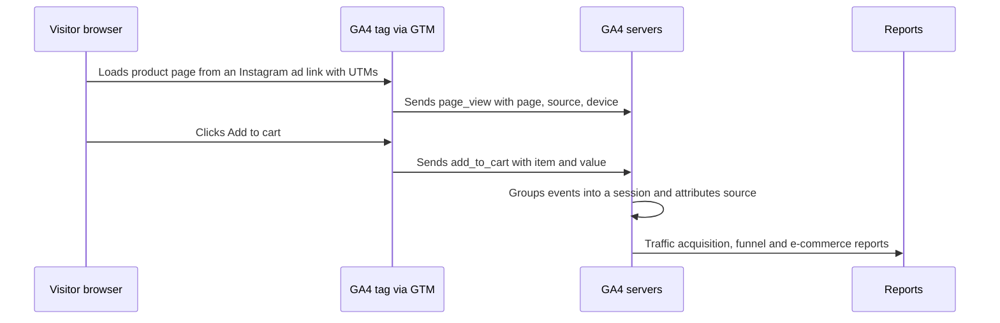
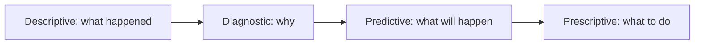
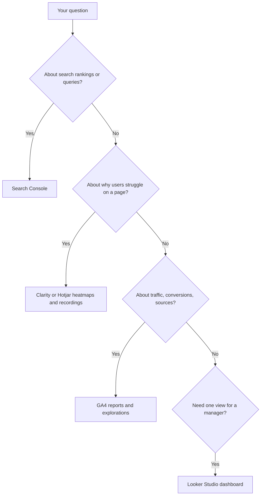
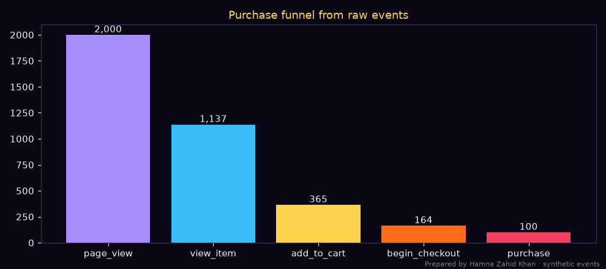
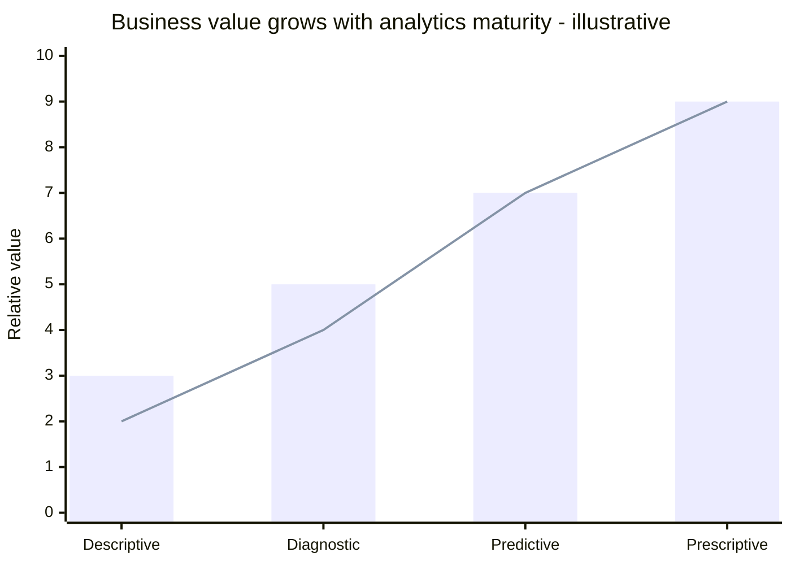

# Session 2 · Web Analytics Tools

> 🏠 [Diploma in Digital Marketing](../../README.md) › [Term 1](../README.md) › [Analytics](README.md) › **Session 2**
>
> ⏱ **Estimated time:** 3 hours (1.5 h theory + 1.5 h lab) · 📋 **Prerequisites:** Session 1

[⬅ Previous: Session 1](session-01-basics-of-marketing-analytics.md) · [Next: Session 3 ➡](session-03-measuring-campaign-performance.md)

---

## 🎯 Learning objectives

By the end of this session you will be able to:

- Define and explain the four **types of analytics**: descriptive, diagnostic, predictive and prescriptive.
- Explain how **web analytics tools** track and analyse user behaviour on websites.
- Compare the main tools: **Google Analytics 4, Search Console, Microsoft Clarity/Hotjar, Looker Studio** and platform analytics.
- Calculate users, sessions, engagement rate, conversion rate and funnel drop-offs from **raw event data**.
- Choose the right tool and report for a given marketing question.

## 📖 Concepts

### 1. Four types of analytics

| Type | Question | Techniques | Marketing example |
|---|---|---|---|
| **Descriptive** | What happened? | Totals, averages, trends, dashboards | "Orders rose 12% in November." |
| **Diagnostic** | Why did it happen? | Drill-downs, segmentation, correlation, funnel analysis | "Because 11.11 traffic from TikTok converted at 3%." |
| **Predictive** | What will happen? | Forecasting, regression, machine learning | "December orders will be about 1,250." |
| **Prescriptive** | What should we do? | Optimisation, simulations, recommendations | "Spend PKR 450k and shift 20% to Search." |

Each type builds on the previous one: you can't explain what you haven't measured, or predict what you don't understand. Value (and difficulty) increases from descriptive to prescriptive.

### 2. How web analytics works

1. **Tag** – a JavaScript snippet (e.g. GA4's `gtag.js` or Google Tag Manager) is placed on every page.
2. **Collect** – when a visitor loads a page or acts (clicks, scrolls, adds to cart), the tag sends an **event** with parameters (page, source, device, value) to the analytics server.
3. **Identify** – a first-party cookie or app instance ID recognises returning browsers; signed-in User-ID can connect devices.
4. **Process** – events are grouped into sessions and users; traffic sources are attributed from UTMs, referrers and ad click IDs.
5. **Report** – standard reports, explorations and exports (BigQuery) show the results.
6. **Consent** – in many regions, tags must wait for consent (Consent Mode adjusts behaviour and models missing data).

### 3. Core web analytics concepts (GA4)

| Concept | Meaning |
|---|---|
| **Event** | Any interaction: `page_view`, `scroll`, `click`, `view_item`, `add_to_cart`, `purchase` |
| **Parameter** | Detail attached to an event: `page_location`, `value`, `currency`, `item_name` |
| **User** | A unique browser/device (or signed-in person) |
| **Session** | A group of events from one user; ends after 30 minutes of inactivity by default |
| **Engaged session** | Lasts > 10 seconds, **or** has a key event, **or** has 2+ page/screen views |
| **Engagement rate** | Engaged sessions ÷ Sessions |
| **Bounce rate (GA4)** | 100% − engagement rate |
| **Key event** | An event marked as important (formerly "conversion") – e.g. `purchase`, `generate_lead` |
| **Session source / medium** | Where the session came from: `google / organic`, `instagram / paid_social` |
| **Landing page** | First page of the session |
| **Funnel exploration** | Steps users take towards a goal and where they drop off |
| **Path exploration** | Sequences of pages/events users actually follow |
| **Cohort / retention** | How groups of users return over time |

### 4. The web analytics tool kit

| Tool | Type | Best for | Cost |
|---|---|---|---|
| **Google Analytics 4** | Full web/app analytics | Traffic, behaviour, conversions, sources, funnels, audiences | Free (paid 360 tier for enterprises) |
| **Google Tag Manager** | Tag management | Deploying GA4, ad pixels and events without editing code each time | Free |
| **Google Search Console** | Search performance | Queries, impressions, clicks, positions, indexing, Core Web Vitals | Free |
| **Microsoft Clarity** | Behaviour analytics | Heatmaps, session recordings, rage clicks, dead clicks | Free |
| **Hotjar** | Behaviour + feedback | Heatmaps, recordings, on-site surveys | Freemium |
| **Looker Studio** | Visualisation | Dashboards combining GA4, Ads, Sheets, Search Console | Free |
| **Ad platform analytics** | Paid media | Platform-attributed conversions and costs | Free with ads |
| **Matomo / Plausible** | Privacy-focused analytics | Self-hosted or cookieless analytics | Free / paid |
| **Semrush / Similarweb** | Competitive intelligence | Estimates of competitor traffic and keywords | Paid |

### 5. Key GA4 reports for marketers

| Report (GA4 menu) | Question it answers |
|---|---|
| **Reports → Acquisition → Traffic acquisition** | Which sources/mediums bring sessions, engagement and conversions? |
| **Reports → Acquisition → User acquisition** | Which channels bring *new* users? |
| **Reports → Engagement → Pages and screens** | Which pages get views and engagement? |
| **Reports → Engagement → Landing page** | Which entry pages convert? |
| **Reports → Monetisation → E-commerce purchases** | Which products sell; add-to-cart and purchase rates |
| **Reports → Tech → Overview** | Device, browser, OS – is mobile underperforming? |
| **Explore → Funnel exploration** | Where do users drop out? |
| **Explore → Path exploration** | What do users do after the home page? |
| **Advertising → Attribution** | How do different models credit channels? |
| **Realtime / DebugView** | Is tracking working right now? |

### 6. Behaviour analytics: heatmaps and recordings

- **Click heatmaps** show where people click (and where they click on non-links – "dead clicks").
- **Scroll maps** show how far down people scroll – if only 30% reach your CTA, move it up.
- **Session recordings** show real journeys – watch 20 recordings of abandoned checkouts to spot problems analytics numbers can't explain.
- **Rage clicks** (repeated clicking) often mean something is broken or slow.

Respect privacy: mask form fields and personal data in recordings.

## 🧭 Diagrams

### How a page view becomes a report



### Four types of analytics



### Choosing a tool



## 💻 Worked examples

### Example 1 – The four types on one dataset

Twelve months of sessions, orders and ad spend for an online store:

📄 `code/session-02_four_types.py`

```python
# The four types of analytics on one monthly dataset: descriptive, diagnostic, predictive, prescriptive.
# Prepared by Hamna Zahid Khan, Junior Lecturer. Illustrative 12 months of an online store (PKR).
import numpy as np

months = ["Jan", "Feb", "Mar", "Apr", "May", "Jun", "Jul", "Aug", "Sep", "Oct", "Nov", "Dec"]
sessions = np.array([41, 43, 46, 62, 48, 47, 45, 49, 52, 55, 78, 60]) * 1000
orders = np.array([820, 870, 880, 1380, 930, 890, 905, 940, 1010, 1060, 1650, 1120])
ad_spend = np.array([300, 300, 320, 520, 330, 320, 310, 340, 360, 380, 700, 420]) * 1000
cr = orders / sessions * 100

# 1. Descriptive - what happened?
print("DESCRIPTIVE: what happened?")
print(f"  Total orders {orders.sum():,}; best month {months[orders.argmax()]} ({orders.max():,}); avg conversion rate {cr.mean():.2f}%")

# 2. Diagnostic - why did it happen?
r = np.corrcoef(ad_spend, orders)[0, 1]
print("DIAGNOSTIC: why?")
print(f"  Correlation between ad spend and orders r = {r:.2f}; Apr (Ramadan/Eid) and Nov (11.11) had both the highest spend and conversion")
print(f"  Conversion rate in Apr {cr[3]:.2f}% and Nov {cr[10]:.2f}% vs normal months ~{np.median(cr):.2f}% -> demand peaks, not only more traffic")

# 3. Predictive - what will happen? (orders grow with the LOG of spend: diminishing returns)
b, a = np.polyfit(np.log(ad_spend), orders, 1)
plan = 450_000
print("PREDICTIVE: what will happen?")
print(f"  Model: orders = {a:,.0f} + {b:,.0f} x ln(spend)   (each doubling of spend adds about {b * np.log(2):,.0f} orders)")
print(f"  With PKR {plan:,} next month -> about {a + b * np.log(plan):,.0f} orders")

# 4. Prescriptive - what should we do?
aov, margin = 3_800, 0.35
print("PRESCRIPTIVE: what should we do?")
best = None
for spend in range(300_000, 1_700_001, 200_000):
    o = a + b * np.log(spend)
    profit = o * aov * margin - spend
    if best is None or profit > best[1]: best = (spend, profit)
    print(f"  spend PKR {spend:>7,} -> orders {o:>6,.0f}, profit after ads PKR {profit:>10,.0f}")
print(f"  Profit peaks where one more rupee of ads earns one rupee of profit: spend* = b x AOV x margin = PKR {b * aov * margin:,.0f}")
print(f"  Best in this grid: PKR {best[0]:,}. But we only ever spent PKR 300k-700k, so anything far above that is extrapolation:")
print("  raise spend step by step (e.g. +20% a month) and re-fit the model with the new data.")
print("  Caution: correlation is not causation - confirm with a holdout or geo test before trusting the slope.")
```

**Output**

```text
DESCRIPTIVE: what happened?
  Total orders 12,455; best month Nov (1,650); avg conversion rate 1.98%
DIAGNOSTIC: why?
  Correlation between ad spend and orders r = 0.99; Apr (Ramadan/Eid) and Nov (11.11) had both the highest spend and conversion
  Conversion rate in Apr 2.23% and Nov 2.12% vs normal months ~1.94% -> demand peaks, not only more traffic
PREDICTIVE: what will happen?
  Model: orders = -11,188 + 953 x ln(spend)   (each doubling of spend adds about 661 orders)
  With PKR 450,000 next month -> about 1,223 orders
PRESCRIPTIVE: what should we do?
  spend PKR 300,000 -> orders    837, profit after ads PKR    812,566
  spend PKR 500,000 -> orders  1,324, profit after ads PKR  1,260,323
  spend PKR 700,000 -> orders  1,644, profit after ads PKR  1,486,989
  spend PKR 900,000 -> orders  1,884, profit after ads PKR  1,605,671
  spend PKR 1,100,000 -> orders  2,075, profit after ads PKR  1,660,133
  spend PKR 1,300,000 -> orders  2,235, profit after ads PKR  1,671,967
  spend PKR 1,500,000 -> orders  2,371, profit after ads PKR  1,653,428
  spend PKR 1,700,000 -> orders  2,490, profit after ads PKR  1,612,142
  Profit peaks where one more rupee of ads earns one rupee of profit: spend* = b x AOV x margin = PKR 1,268,059
  Best in this grid: PKR 1,300,000. But we only ever spent PKR 300k-700k, so anything far above that is extrapolation:
  raise spend step by step (e.g. +20% a month) and re-fit the model with the new data.
  Caution: correlation is not causation - confirm with a holdout or geo test before trusting the slope.
```

**Reading it:**

- **Descriptive:** November was the best month; average conversion rate ~2%.
- **Diagnostic:** April (Ramadan/Eid) and November (11.11) had higher spend *and* higher conversion rates – seasonal demand, not just more ads.
- **Predictive:** a log model captures **diminishing returns**: each doubling of spend adds about 661 orders, not double the orders.
- **Prescriptive:** profit is maximised where one more rupee of ads returns one rupee of gross profit. The model points to ~PKR 1.27 M, but that is far outside the PKR 300–700k actually tested, so the honest recommendation is to increase spend gradually and re-fit. The script also warns that the correlation (r = 0.99) is inflated by seasonality.

### Example 2 – Web analytics from raw events

GA4 is built on events. This script creates 2,000 sessions of synthetic events (written to `session-02_events.csv` when you run it – the file is generated, so it is not stored in the repo) and calculates what GA4 would show – using GA4's engaged-session rule:

📄 `code/session-02_event_log_analytics.py`

```python
# Web analytics from raw events, the way GA4 thinks: users, sessions, engaged sessions,
# engagement rate, traffic sources, top pages and a purchase funnel.
# Prepared by Hamna Zahid Khan, Junior Lecturer. Events are synthetic (fixed seed).
import numpy as np, pandas as pd
import matplotlib
matplotlib.use("Agg")
import matplotlib.pyplot as plt

BG, FIRE, GOLD, VIOLET, EMBER, TEXT = "#0A0716", "#FF6B1A", "#FCD34D", "#A78BFA", "#F43F5E", "#F5EEFF"
rng = np.random.default_rng(11)
sources = ["google / organic", "instagram / paid_social", "direct / (none)", "newsletter / email", "tiktok / paid_social"]
rows = []
for s_id in range(1, 2001):
    user = f"u{rng.integers(1, 1300)}"
    src = rng.choice(sources, p=[.34, .25, .18, .1, .13])
    t = 0
    steps = ["page_view"]
    dur = int(rng.exponential(14))
    if rng.random() < (.75 if "email" in src else .55): steps.append("view_item")
    if "view_item" in steps and rng.random() < .30: steps.append("add_to_cart")
    if "add_to_cart" in steps and rng.random() < .45: steps.append("begin_checkout")
    if "begin_checkout" in steps and rng.random() < .55 + (.15 if "email" in src else 0): steps.append("purchase")
    for e in steps:
        page = {"page_view": rng.choice(["/", "/sale", "/blog/winter-care"]), "view_item": "/product", "add_to_cart": "/product",
                "begin_checkout": "/checkout", "purchase": "/thank-you"}[e]
        rows.append((s_id, user, src, e, page, t)); t += rng.integers(5, 40)
    rows.append((s_id, user, src, "session_end", "", dur if len(steps) == 1 else max(dur, t)))
ev = pd.DataFrame(rows, columns=["session_id", "user_id", "source_medium", "event", "page", "sec"])
ev.to_csv("session-02_events.csv", index=False)

s = ev.groupby("session_id").agg(user=("user_id", "first"), src=("source_medium", "first"),
                                 dur=("sec", "max"), views=("event", lambda x: (x.isin(["page_view", "view_item"])).sum()),
                                 purchase=("event", lambda x: (x == "purchase").any()))
s["engaged"] = (s.dur > 10) | (s.views >= 2) | s.purchase       # GA4 engaged-session rule
print(f"Events: {len(ev):,} | Sessions: {len(s):,} | Users: {s.user.nunique():,}")
print(f"Engagement rate: {s.engaged.mean():.1%}  |  'Bounce rate' (100 - engagement): {1 - s.engaged.mean():.1%}")
print(f"Purchases: {s.purchase.sum()}  |  Session conversion rate: {s.purchase.mean():.2%}\n")
by = s.groupby("src").agg(sessions=("user", "count"), engaged=("engaged", "mean"), purchases=("purchase", "sum"))
by["conv_rate_%"] = (by.purchases / by.sessions * 100).round(2)
by["engaged"] = (by.engaged * 100).round(1)
print(by.sort_values("sessions", ascending=False).rename(columns={"engaged": "engaged_%"}).to_string())
print("\nTop landing pages:")
print(ev[ev.event == "page_view"].page.value_counts().to_string())

steps = ["page_view", "view_item", "add_to_cart", "begin_checkout", "purchase"]
counts = [ev[ev.event == e].session_id.nunique() for e in steps]
print("\nFunnel (sessions reaching each step):")
for i, (e, c) in enumerate(zip(steps, counts)):
    drop = "" if i == 0 else f"  ({c / counts[i - 1]:.0%} of previous step)"
    print(f"  {e:<15}{c:>6}{drop}")
fig, ax = plt.subplots(figsize=(9, 4), facecolor=BG); ax.set_facecolor(BG)
ax.bar(steps, counts, color=[VIOLET, "#38BDF8", GOLD, FIRE, EMBER])
for i, c in enumerate(counts): ax.text(i, c + 25, f"{c:,}", ha="center", color=TEXT)
ax.set_title("Purchase funnel from raw events", color=GOLD); ax.tick_params(colors=TEXT)
for sp in ax.spines.values(): sp.set_color("#3b3355")
fig.text(0.99, 0.01, "Prepared by Hamna Zahid Khan · synthetic events", color=TEXT, alpha=0.5, ha="right", fontsize=7)
plt.tight_layout(); plt.savefig("session-02_funnel.png", dpi=110, facecolor=BG)
print("Saved session-02_events.csv and session-02_funnel.png")
```

**Output**

```text
Events: 5,766 | Sessions: 2,000 | Users: 1,035
Engagement rate: 76.0%  |  'Bounce rate' (100 - engagement): 24.0%
Purchases: 100  |  Session conversion rate: 5.00%

                         sessions  engaged_%  purchases  conv_rate_%
src                                                                 
google / organic              765       72.5         40         5.23
instagram / paid_social       471       78.6         23         4.88
direct / (none)               351       74.9         12         3.42
tiktok / paid_social          239       77.0         14         5.86
newsletter / email            174       85.6         11         6.32

Top landing pages:
page
/blog/winter-care    672
/sale                671
/                    657

Funnel (sessions reaching each step):
  page_view        2000
  view_item        1137  (57% of previous step)
  add_to_cart       365  (32% of previous step)
  begin_checkout    164  (45% of previous step)
  purchase          100  (61% of previous step)
Saved session-02_events.csv and session-02_funnel.png
```



**Interpretation:**

- **Engagement rate 76%** (so GA4 "bounce rate" 24%).
- **Email** sessions are the most engaged and convert best (6.3%) – existing customers who already trust the brand.
- **Funnel:** the biggest leak is **product view → add to cart** (only ~31% continue). Diagnostic next steps: check product page prices, delivery charges, photos and reviews; watch Clarity recordings of product pages.
- **Checkout → purchase** (~55–58%) is the second leak: test COD visibility, fewer form fields and wallet payment options.

### Example 3 – Diagnosing a drop with GA4 (walkthrough)

**Symptom:** conversions fell 30% last week.

1. **Realtime/DebugView** – is the `purchase` event still firing? (A broken tag looks like a sales drop.)
2. **Traffic acquisition** – did sessions fall, or conversion rate? Sessions flat, conversion rate down.
3. **Tech → Device** – mobile conversion rate fell from 1.8% to 0.9%; desktop unchanged.
4. **Tech → Browser** – drop concentrated in Safari on iOS.
5. **Funnel exploration filtered to iOS** – users reach checkout but don't purchase.
6. **Clarity recordings** – the payment button is hidden behind a cookie banner on small iPhones.
7. **Fix and monitor** – adjust the banner; conversion recovers within two days.

Analytics told *where*; behaviour tools told *why*.

### Example 4 – Matching questions to reports

| Question | Tool and report |
|---|---|
| Which blog posts bring visitors from Google? | Search Console → Performance → Pages; GA4 → Landing page filtered to organic |
| Did the Instagram campaign drive sales? | GA4 → Traffic acquisition, filter `session campaign`, key events and revenue |
| Why don't people fill the contact form? | Clarity heatmap + recordings of the contact page |
| Which products are viewed but rarely bought? | GA4 → E-commerce purchases (views vs purchases) |
| Is the site fast on mobile? | Search Console → Core Web Vitals; PageSpeed Insights |
| How do new users return over 4 weeks? | GA4 → Explore → Cohort exploration |

## 📊 Chart · Value and difficulty of analytics types



The bars show relative business value and the line relative difficulty – both rise together.

## 📋 Checklist · Web analytics setup health

- [ ] One GA4 tag per page (no duplicates); deployed via GTM if possible.
- [ ] Key events defined (purchase, lead, WhatsApp click, call click).
- [ ] E-commerce events send `value`, `currency` (PKR) and `items`.
- [ ] Internal traffic filtered; data retention set to 14 months.
- [ ] Google Ads and Search Console linked.
- [ ] UTMs used consistently on campaigns.
- [ ] Consent banner and Consent Mode configured where required.
- [ ] Clarity/Hotjar on key pages with personal data masked.
- [ ] Monthly check of DebugView/Realtime after site changes.

## ⚠️ Common mistakes

| Mistake | Fix |
|---|---|
| Treating descriptive reports as the end of analysis | Ask "why?" and "what next?" |
| Duplicate tags doubling page views | Audit with Tag Assistant |
| Not marking key events | Configure them before campaigns start |
| Untagged campaign links showing as "direct" or "referral" | Use UTMs everywhere |
| Ignoring device and browser breakdowns | Segment – problems often hide in one device |
| Recording sessions without masking personal data | Enable masking; respect privacy |
| Extrapolating models far beyond observed data | Test gradually and re-fit |

## 🧪 Lab / practice tasks

**Task 1 (easy) – Classify.** Which type of analytics? (a) "Website sessions were 48,000 in October"; (b) "Sessions fell because Google rankings dropped after the site migration"; (c) "We expect 60,000 sessions in December"; (d) "Re-publish the top 10 posts with updated titles to recover traffic".

<details><summary>✅ Solution</summary>

(a) Descriptive · (b) Diagnostic · (c) Predictive · (d) Prescriptive.

</details>

**Task 2 (easy) – Engagement.** 5,000 sessions, 3,600 engaged. Engagement rate and GA4 bounce rate?

<details><summary>✅ Solution</summary>

Engagement rate = 3,600 ÷ 5,000 = **72%**; bounce rate = **28%**.

</details>

**Task 3 (medium) – Is it engaged?** Apply GA4's rule: (a) 8 s, 1 page view, no key event; (b) 6 s, 2 page views; (c) 4 s, 1 page view, purchase; (d) 45 s, 1 page view.

<details><summary>✅ Solution</summary>

(a) Not engaged · (b) Engaged (2+ views) · (c) Engaged (key event) · (d) Engaged (> 10 s).

</details>

**Task 4 (medium) – Explore the events.** Run the script to create `code/session-02_events.csv` (it is generated, not stored in the repo), then load it in pandas or a spreadsheet. Calculate the add-to-cart rate (sessions with `add_to_cart` ÷ sessions with `view_item`) for each source. Which source has the best product-page performance?

<details><summary>💡 Hint</summary>

In pandas: group by `session_id` to get each session's source and whether it contains each event, then group by source.

</details>

**Task 5 (challenge) – Tool plan.** For a Karachi furniture website, write a measurement plan: business goals, KPIs, GA4 key events (with parameters), UTM conventions, which reports you'll check weekly, where Clarity is installed, and one Looker Studio dashboard outline.

## ✅ Quick quiz

1. "Why did conversions drop?" is which type of analytics?
   a) Descriptive b) Diagnostic c) Predictive d) Prescriptive
2. In GA4, a session is "engaged" if it lasts more than:
   a) 3 s b) 10 s c) 60 s d) 5 minutes
3. GA4's bounce rate equals:
   a) exits ÷ views b) 100% − engagement rate c) sessions ÷ users d) key events ÷ sessions
4. Which tool shows the actual Google search queries for your site?
   a) Clarity b) Search Console c) Looker Studio d) Hotjar
5. Session recordings are most useful for:
   a) counting users b) seeing why users struggle on a page c) setting budgets d) keyword research

<details><summary>Show answers</summary>

1-b · 2-b · 3-b · 4-b · 5-b

</details>

## 📝 Summary

- Analytics types: **descriptive (what), diagnostic (why), predictive (what next), prescriptive (what to do)**.
- Web analytics tags send **events** that are grouped into sessions and users, attributed to sources and reported.
- GA4 essentials: events, parameters, sessions, **engaged sessions (> 10 s, key event or 2+ views)**, engagement rate, key events, source/medium, explorations.
- Tool kit: **GA4, GTM, Search Console, Clarity/Hotjar, Looker Studio**, platform analytics, privacy-first alternatives.
- Combine numbers (where) with behaviour tools (why); segment by device and source; beware extrapolation.

**Interview / viva questions**

1. Explain the four types of analytics with marketing examples.
2. How does GA4 collect data from a website?
3. What is an engaged session in GA4?
4. When would you use Microsoft Clarity instead of GA4?
5. How would you investigate a sudden drop in conversions?
6. Which GA4 reports would you show a marketing manager every week?

---

[⬅ Previous: Session 1](session-01-basics-of-marketing-analytics.md) · [Next: Session 3 ➡](session-03-measuring-campaign-performance.md)

<sub>Prepared by **Hamna Zahid Khan**, Junior Lecturer · Diploma in Digital Marketing</sub>
