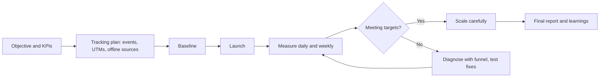
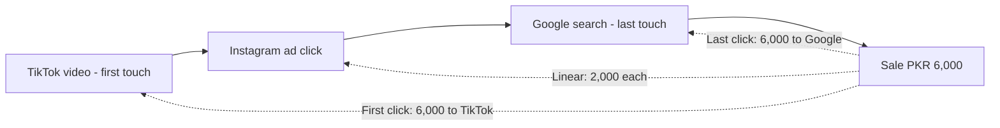
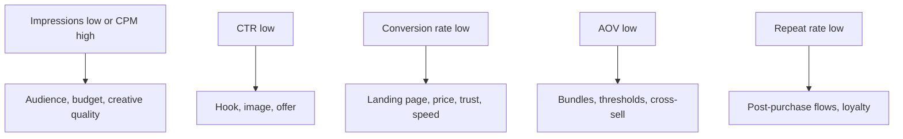
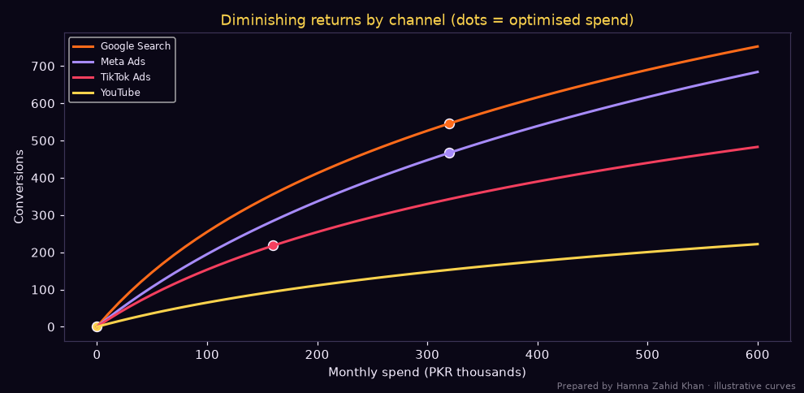
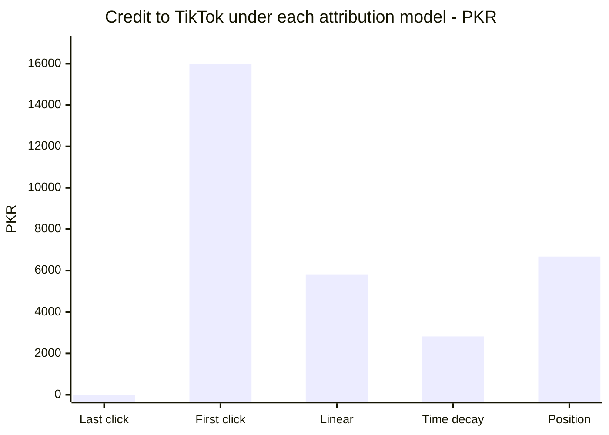

# Session 3 · Measuring and Optimizing Campaign Performance

> 🏠 [Diploma in Digital Marketing](../../README.md) › [Term 1](../README.md) › [Analytics](README.md) › **Session 3**
>
> ⏱ **Estimated time:** 3 hours (1.5 h theory + 1.5 h lab) · 📋 **Prerequisites:** Session 2

[⬅ Previous: Session 2](session-02-web-analytics-tools.md) · [Next: Session 4 ➡](session-04-social-metrics-and-engagement.md)

---

## 🎯 Learning objectives

By the end of this session you will be able to:

- Explain how to **measure** digital marketing campaign performance end to end: objectives, KPIs, tracking, baselines and reporting.
- Explain the **key metrics** for awareness, engagement, conversion, revenue and retention, and calculate them.
- Compare **attribution models** and explain how each changes the credit given to channels.
- **Optimise** campaigns: diagnose with the funnel, test, and re-allocate budget using **marginal CPA** and diminishing returns.
- Write a campaign performance report with clear recommendations.

## 📖 Concepts

### 1. The measurement framework

| Step | What to define | Example |
|---|---|---|
| **1. Objective** | What the campaign must achieve | 400 online orders during the winter sale |
| **2. KPIs and targets** | Primary KPI + supporting KPIs | CPA ≤ PKR 1,000; ROAS ≥ 4; CR ≥ 2% |
| **3. Tracking plan** | Events, UTMs, pixels, offline capture | `purchase` event with value; UTMs on all links; COD order source field |
| **4. Baseline** | Performance before the campaign | Normal month: 220 orders, CPA PKR 1,150 |
| **5. Measurement window** | Dates and attribution window | 1–30 Nov; 7-day click attribution |
| **6. Reporting cadence** | Who sees what, how often | Daily spend check, weekly optimisation, final report |
| **7. Success decision** | What counts as success, and what happens next | Scale if CPA ≤ 1,000 for 2 weeks |

### 2. Key metrics by funnel stage

| Stage | Metric | Formula |
|---|---|---|
| **Awareness** | Impressions, reach, frequency | Frequency = Impressions ÷ Reach |
| | CPM | Cost ÷ Impressions × 1,000 |
| | Share of voice, brand lift | Brand mentions ÷ category mentions; exposed − control awareness |
| **Engagement** | CTR | Clicks ÷ Impressions × 100 |
| | CPC | Cost ÷ Clicks |
| | Engagement rate | Engaged sessions ÷ Sessions (web) or engagements ÷ reach (social) |
| **Conversion** | Conversion rate (CR) | Conversions ÷ Clicks (or sessions) × 100 |
| | CPA / CPL | Cost ÷ Conversions |
| **Revenue** | Revenue, AOV | Revenue ÷ Orders |
| | ROAS | Revenue ÷ Ad cost |
| | ROI | (Gross profit − Total cost) ÷ Total cost × 100 |
| **Retention** | Repeat purchase rate | Customers with 2+ orders ÷ All customers |
| | CLV | AOV × Purchase frequency × Lifespan × Margin |
| | CLV : CAC | CLV ÷ Customer acquisition cost |

**Break-even guards:** break-even CPA = AOV × gross margin; break-even ROAS = 1 ÷ gross margin. A campaign above break-even CPA (or below break-even ROAS) loses money on first purchases unless CLV justifies it.

### 3. Attribution models

| Model | How credit is shared | Strength | Weakness |
|---|---|---|---|
| **Last click** | 100% to the final touch | Simple, good for closing channels | Ignores awareness channels |
| **First click** | 100% to the first touch | Values discovery | Ignores what closed the sale |
| **Linear** | Equal shares | Fair to every touch | Treats a passing view like the final push |
| **Time decay** | More to recent touches | Reflects recency | Undervalues early awareness |
| **Position-based (40/20/40)** | 40% first, 40% last, 20% shared in the middle | Balances discovery and closing | Arbitrary weights |
| **Data-driven** | Statistical model of real paths (GA4 default) | Uses actual behaviour | Needs volume; a "black box" |

Beyond attribution, the strongest evidence of impact comes from **incrementality tests** (holdouts, geo tests, conversion-lift studies) and, for large budgets, **marketing mix modelling (MMM)**.

### 4. Optimising campaigns

#### 4a. Diagnose with the funnel

| Weak metric | Likely cause | Optimisation |
|---|---|---|
| Low impressions / reach | Budget, bids or audience too small | Broaden audience, raise budget, improve quality |
| High CPM | Competitive audience, low ad quality | Better creatives, broader targeting, different placements |
| Low CTR | Creative/offer doesn't stop the scroll | Test hooks, images, headlines, offers |
| High CPC | Low CTR or competitive keywords | Improve relevance and Quality Score; long-tail keywords |
| Low CR | Landing page, price, trust, speed | Landing page tests, COD/returns messaging, faster page |
| Low AOV | No bundles or thresholds | Bundles, free-delivery threshold, cross-sell |
| Low repeat rate | Weak post-purchase journey | Email/WhatsApp flows, loyalty offers |

#### 4b. Test systematically

One variable at a time, enough data, significance check (Session 7 of Module 5), documented learnings.

#### 4c. Re-allocate budget with marginal thinking

Every channel shows **diminishing returns**: the first PKR 50,000 buys cheap conversions; the next PKR 50,000 buys more expensive ones. The question is not "which channel has the lowest *average* CPA?" but "where does the **next** rupee buy the most conversions?" – the **marginal CPA**.

> **Rule:** keep moving budget from channels with high marginal CPA to channels with low marginal CPA until marginal CPAs are roughly equal.

## 🧭 Diagrams

### Measurement and optimisation loop



### Attribution example



### Funnel diagnosis



## 💻 Worked examples

### Example 1 – Full campaign scorecard (hand calculation)

A Karachi electronics retailer's winter sale (gross margin 25%, AOV target PKR 9,000):

| Channel | Spend | Impressions | Clicks | Orders | Revenue |
|---|---|---|---|---|---|
| Google Search | 180,000 | 150,000 | 7,500 | 210 | 1,953,000 |
| Meta Ads | 220,000 | 1,100,000 | 13,200 | 190 | 1,634,000 |
| TikTok Ads | 120,000 | 1,500,000 | 9,000 | 60 | 450,000 |

| Channel | CTR | CPC | CR | CPA | AOV | ROAS |
|---|---|---|---|---|---|---|
| Google Search | 5.0% | 24 | 2.8% | **857** | 9,300 | **10.9** |
| Meta Ads | 1.2% | 16.7 | 1.44% | **1,158** | 8,600 | **7.4** |
| TikTok Ads | 0.6% | 13.3 | 0.67% | **2,000** | 7,500 | **3.75** |

Break-even ROAS = 1 ÷ 0.25 = **4.0**; break-even CPA ≈ 9,000 × 0.25 = **PKR 2,250**. TikTok is just below break-even ROAS on last click – before cutting it, check assisted conversions (it may be the first touch for many Search buyers – see Example 3).

### Example 2 – Re-allocating budget with diminishing returns

Four channels with diminishing-returns curves; the same PKR 800,000 budget is re-allocated by giving each PKR 10,000 to the channel with the lowest marginal CPA:

📄 `code/session-03_budget_optimizer.py`

```python
# Measure campaign performance and re-allocate budget using marginal CPA from diminishing-returns
# curves. Prepared by Hamna Zahid Khan, Junior Lecturer. Illustrative channels for a Karachi retailer.
import math
import matplotlib
matplotlib.use("Agg")
import matplotlib.pyplot as plt

BG, FIRE, GOLD, VIOLET, EMBER, TEXT = "#0A0716", "#FF6B1A", "#FCD34D", "#A78BFA", "#F43F5E", "#F5EEFF"
# conversions(spend) = a * ln(1 + spend / b): fast early gains, then diminishing returns
curves = {"Google Search": (420, 120_000), "Meta Ads": (520, 220_000), "TikTok Ads": (300, 150_000), "YouTube": (160, 200_000)}
current = {"Google Search": 150_000, "Meta Ads": 250_000, "TikTok Ads": 200_000, "YouTube": 200_000}
BUDGET = sum(current.values())

def conv(ch, spend):
    a, b = curves[ch]
    return a * math.log(1 + spend / b)

def report(alloc, title):
    print(title)
    tot = 0
    for ch, s in alloc.items():
        c = conv(ch, s); tot += c
        marginal = (conv(ch, s + 10_000) - c) / 10_000
        cpa = f"{s / c:>6,.0f}" if c else "     -"
        print(f"  {ch:<14} spend {s:>8,.0f}  conv {c:>6.0f}  CPA {cpa}  marginal CPA {1 / marginal:>6,.0f}")
    print(f"  TOTAL conversions {tot:,.0f}  blended CPA {BUDGET / tot:,.0f}\n")
    return tot

before = report(current, "Current allocation:")
# Greedy optimisation: give each PKR 10,000 to the channel with the lowest marginal CPA
alloc = {ch: 0 for ch in curves}
for _ in range(BUDGET // 10_000):
    best = max(curves, key=lambda ch: conv(ch, alloc[ch] + 10_000) - conv(ch, alloc[ch]))
    alloc[best] += 10_000
after = report(alloc, "Optimised allocation (equal marginal CPA):")
print(f"Same budget, {after - before:+.0f} conversions ({(after - before) / before:+.1%})")

fig, ax = plt.subplots(figsize=(9, 4.4), facecolor=BG); ax.set_facecolor(BG)
xs = range(0, 600_001, 10_000)
for (ch, c) in zip(curves, [FIRE, VIOLET, EMBER, GOLD]):
    ax.plot([x / 1000 for x in xs], [conv(ch, x) for x in xs], color=c, lw=2, label=ch)
    ax.scatter(alloc[ch] / 1000, conv(ch, alloc[ch]), color=c, s=60, edgecolor=TEXT)
ax.set_xlabel("Monthly spend (PKR thousands)", color=TEXT); ax.set_ylabel("Conversions", color=TEXT)
ax.set_title("Diminishing returns by channel (dots = optimised spend)", color=GOLD)
ax.tick_params(colors=TEXT)
for sp in ax.spines.values(): sp.set_color("#3b3355")
ax.legend(facecolor=BG, labelcolor=TEXT, fontsize=8)
fig.text(0.99, 0.01, "Prepared by Hamna Zahid Khan · illustrative curves", color=TEXT, alpha=0.5, ha="right", fontsize=7)
plt.tight_layout(); plt.savefig("session-03_budget_curves.png", dpi=110, facecolor=BG)
print("Saved session-03_budget_curves.png")
```

**Output**

```text
Current allocation:
  Google Search  spend  150,000  conv    341  CPA    440  marginal CPA    655
  Meta Ads       spend  250,000  conv    395  CPA    633  marginal CPA    913
  TikTok Ads     spend  200,000  conv    254  CPA    787  marginal CPA  1,183
  YouTube        spend  200,000  conv    111  CPA  1,803  marginal CPA  2,531
  TOTAL conversions 1,100  blended CPA 727

Optimised allocation (equal marginal CPA):
  Google Search  spend  320,000  conv    546  CPA    586  marginal CPA  1,059
  Meta Ads       spend  320,000  conv    467  CPA    685  marginal CPA  1,048
  TikTok Ads     spend  160,000  conv    218  CPA    735  marginal CPA  1,050
  YouTube        spend        0  conv      0  CPA      -  marginal CPA  1,281
  TOTAL conversions 1,230  blended CPA 650

Same budget, +130 conversions (+11.8%)
Saved session-03_budget_curves.png
```



**Interpretation:**

- In the current plan, YouTube's **average** CPA is PKR 1,803 and its **marginal** CPA PKR 2,531, while Search's marginal CPA is only PKR 655 – money is in the wrong place.
- The optimiser moves budget until marginal CPAs are roughly equal (~PKR 1,050), gaining **+130 conversions (+11.8%)** for the same money.
- It sets YouTube to zero because its curve is the flattest – but YouTube may build awareness that these conversion curves don't capture. Use such models as a guide, keep a minimum for strategic channels, and validate with tests.

### Example 3 – Attribution models compared

Seven customer journeys worth PKR 38,300 in total, credited by five models:

📄 `code/session-03_attribution.py`

```python
# Compare attribution models on customer journeys: last click, first click, linear,
# time decay and position-based (40/20/40). Prepared by Hamna Zahid Khan, Junior Lecturer.
from collections import defaultdict

journeys = [  # (touchpoints in order, revenue PKR)
    (["TikTok", "Instagram", "Google Search"], 6_000),
    (["Google Search"], 3_500),
    (["Instagram", "Email", "Email"], 4_800),
    (["TikTok", "Google Search", "Email"], 7_200),
    (["YouTube", "Instagram", "Google Search", "Email"], 9_000),
    (["Instagram", "Google Search"], 5_000),
    (["TikTok", "Instagram"], 2_800),
]

def weights(n, model):
    if model == "Last click": return [0] * (n - 1) + [1]
    if model == "First click": return [1] + [0] * (n - 1)
    if model == "Linear": return [1 / n] * n
    if model == "Time decay":                      # each step back counts half
        w = [0.5 ** (n - 1 - i) for i in range(n)]; s = sum(w); return [x / s for x in w]
    if model == "Position (40/20/40)":
        if n == 1: return [1]
        if n == 2: return [.5, .5]
        mid = 0.2 / (n - 2); return [.4] + [mid] * (n - 2) + [.4]

models = ["Last click", "First click", "Linear", "Time decay", "Position (40/20/40)"]
channels = sorted({t for j, _ in journeys for t in j})
table = {m: defaultdict(float) for m in models}
for m in models:
    for path, rev in journeys:
        for ch, w in zip(path, weights(len(path), m)):
            table[m][ch] += rev * w
print(f"{'Channel':<15}" + "".join(f"{m:>21}" for m in models))
for ch in channels:
    print(f"{ch:<15}" + "".join(f"{table[m][ch]:>21,.0f}" for m in models))
print(f"{'TOTAL':<15}" + "".join(f"{sum(table[m].values()):>21,.0f}" for m in models))
print("\nNotice: TikTok and YouTube get almost nothing under last click but real credit under first-click and position-based models.")
```

**Output**

```text
Channel                   Last click          First click               Linear           Time decay  Position (40/20/40)
Email                         21,000                    0                7,850               13,029                9,360
Google Search                 14,500                3,500               12,650               14,719               10,740
Instagram                      2,800                9,800                9,750                7,133                7,920
TikTok                             0               16,000                5,800                2,819                6,680
YouTube                            0                9,000                2,250                  600                3,600
TOTAL                         38,300               38,300               38,300               38,300               38,300

Notice: TikTok and YouTube get almost nothing under last click but real credit under first-click and position-based models.
```

**Reading it:** under **last click**, TikTok and YouTube get **zero** credit and Email looks like the hero (PKR 21,000). Under **first click**, TikTok gets PKR 16,000. **Position-based** and **linear** spread credit more fairly. If budget decisions were made only on last click, the channels that start journeys would be cut – and future Search and Email sales would shrink.

### Example 4 – Writing the campaign report (walkthrough)

**Structure (one page + appendix):**

1. **Headline:** "Winter sale delivered 460 orders (target 400) at CPA PKR 1,130 (target ≤ 1,000)."
2. **What worked:** Search (CPA 857, ROAS 10.9); Meta carousel with COD message (CTR 1.6% vs 0.9% for single image).
3. **What didn't:** TikTok CPA PKR 2,000 on last click; landing page CR on iOS 40% lower than Android.
4. **Why:** TikTok drives first touches (position-based credit 2× last click); iOS checkout bug found in recordings.
5. **Actions:** shift 15% of TikTok budget to Search for the next sale but keep TikTok for prospecting; fix iOS checkout; test bundles to raise AOV.
6. **Appendix:** full metrics table, charts, tracking notes and assumptions.

## 📊 Chart · Same revenue, different stories (from Example 3)



## 📋 Template · Campaign measurement plan

| Field | Entry |
|---|---|
| Campaign and dates | |
| Objective | |
| Primary KPI and target | |
| Secondary KPIs | |
| Baseline values | |
| Break-even CPA / ROAS | |
| Tracking (events, UTMs, pixels, offline) | |
| Attribution model and window | |
| Incrementality test (holdout/geo) | |
| Reporting cadence and owners | |
| Decision rules (scale / fix / stop) | |

## ⚠️ Common mistakes

| Mistake | Fix |
|---|---|
| No baseline | Record pre-campaign performance |
| Judging by average CPA only | Use marginal CPA for budget moves |
| Last-click only | Compare models; run incrementality tests |
| Changing many things at once | One change per test |
| Mixing platform-reported and GA4 numbers in one table without saying so | Label sources; reconcile differences |
| Ignoring margin | Calculate break-even CPA/ROAS |
| Reports without decisions | End every report with actions and owners |

## 🧪 Lab / practice tasks

**Task 1 (easy) – Calculate.** Spend PKR 75,000; impressions 500,000; clicks 6,000; orders 150; revenue PKR 600,000; margin 30%. Find CTR, CPC, CR, CPA, AOV, ROAS, break-even ROAS and ROI (ad cost only).

<details><summary>✅ Solution</summary>

CTR 1.2% · CPC PKR 12.5 · CR 2.5% · CPA PKR 500 · AOV PKR 4,000 · ROAS 8.0 · break-even ROAS 3.33 · ROI = (600,000 × 0.3 − 75,000) ÷ 75,000 × 100 = **140%**.

</details>

**Task 2 (easy) – Diagnose.** CTR is excellent (3%) but CR is 0.3%. Where do you look first?

<details><summary>✅ Solution</summary>

The **landing page and offer**: message match with the ad, page speed on mobile, price/delivery surprises, trust signals (COD, returns, reviews), form length, and whether the tracking of conversions works at all.

</details>

**Task 3 (medium) – Attribution by hand.** Journey: Facebook → Email → Google Search → purchase PKR 9,000. Credit each touch under linear, time decay (halving per step back) and position-based (40/20/40).

<details><summary>✅ Solution</summary>

Linear: 3,000 each. Time decay weights 0.25, 0.5, 1 → ÷ 1.75 → Facebook 1,286, Email 2,571, Google 5,143. Position-based: Facebook 3,600, Email 1,800, Google 3,600.

</details>

**Task 4 (medium) – Strategic minimum.** Edit `code/session-03_budget_optimizer.py` so YouTube always keeps at least PKR 80,000 (start `alloc["YouTube"] = 80_000` and loop over the remaining budget). How many conversions are lost compared with the unconstrained optimum, and is that a reasonable price for awareness?

<details><summary>💡 Hint</summary>

Change the loop to `for _ in range((BUDGET - 80_000) // 10_000):`.

</details>

**Task 5 (challenge) – Full report.** Using the Example 1 data plus your own assumptions about assisted conversions, write a one-page campaign report following Example 4's structure, with one chart and three prioritised recommendations.

## ✅ Quick quiz

1. Break-even CPA equals:
   a) Spend ÷ Clicks b) AOV × gross margin c) 1 ÷ margin d) Revenue ÷ Spend
2. Which attribution model gives 100% credit to the final touch?
   a) First click b) Linear c) Last click d) Position-based
3. Budget should be moved towards the channel with the lowest:
   a) average CPA b) marginal CPA c) CTR d) impressions
4. A holdout test measures:
   a) brand colours b) incremental impact compared with a group that saw no campaign c) CPM d) bounce rate
5. Low CTR usually points first to a problem with:
   a) the landing page b) the creative and offer c) the checkout d) repeat purchases

<details><summary>Show answers</summary>

1-b · 2-c · 3-b · 4-b · 5-b

</details>

## 📝 Summary

- Measure with a framework: **objective → KPIs → tracking → baseline → window → cadence → decision rules**.
- Key metrics span awareness (CPM, reach), engagement (CTR, CPC), conversion (CR, CPA), revenue (AOV, ROAS, ROI) and retention (repeat rate, CLV).
- Guard profits with **break-even CPA (AOV × margin)** and **break-even ROAS (1 ÷ margin)**.
- Attribution models tell different stories; validate with **incrementality tests**.
- Optimise by diagnosing the funnel, testing one change at a time, and moving budget to the lowest **marginal CPA**.

**Interview / viva questions**

1. How would you measure the success of a month-long sale campaign?
2. Explain break-even ROAS with an example.
3. Compare last-click and position-based attribution.
4. What is marginal CPA and why does it matter for budgeting?
5. A campaign has high CTR but low conversions. What do you check?
6. What should a campaign performance report contain?

---

[⬅ Previous: Session 2](session-02-web-analytics-tools.md) · [Next: Session 4 ➡](session-04-social-metrics-and-engagement.md)

<sub>Prepared by **Hamna Zahid Khan**, Junior Lecturer · Diploma in Digital Marketing</sub>
