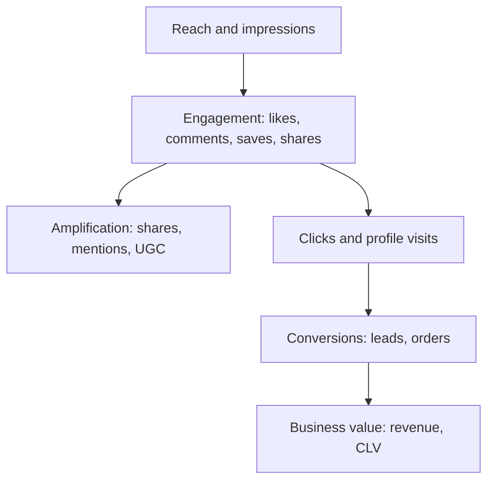
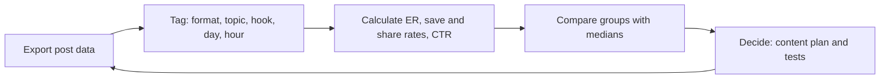
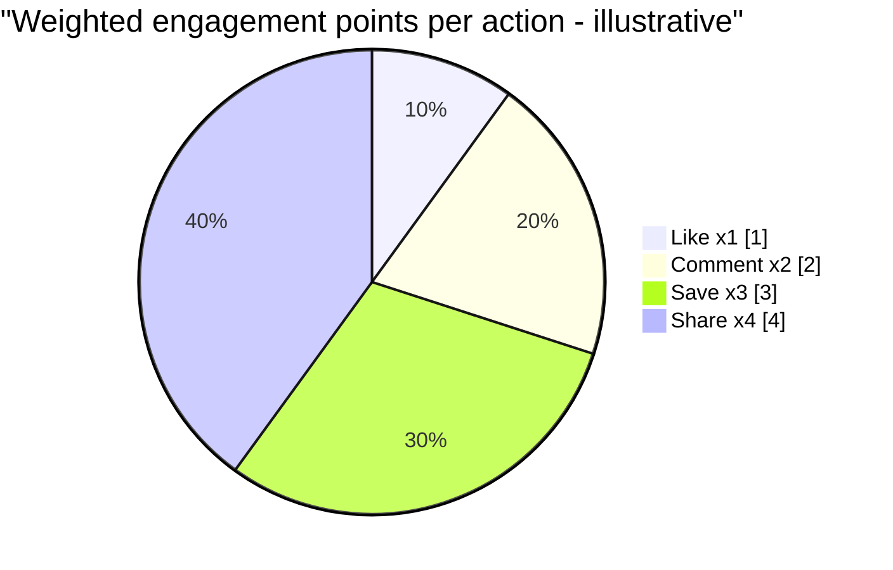
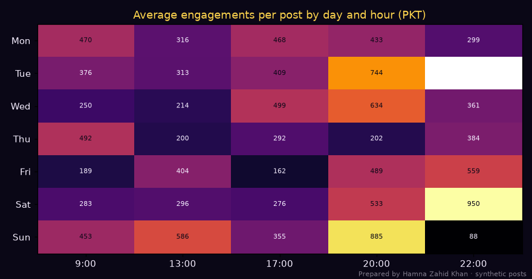

# Session 4 · Social Media Metrics and Content Engagement

> 🏠 [Diploma in Digital Marketing](../../README.md) › [Term 1](../README.md) › [Analytics](README.md) › **Session 4**
>
> ⏱ **Estimated time:** 3 hours (1.5 h theory + 1.5 h lab) · 📋 **Prerequisites:** Session 3

[⬅ Previous: Session 3](session-03-measuring-campaign-performance.md) · [Next: Session 5 ➡](session-05-visualizing-marketing-data.md)

---

## 🎯 Learning objectives

By the end of this session you will be able to:

- Define and explain the main **social media metrics**: reach, impressions, engagement, amplification, audience growth, video, conversion and sentiment metrics.
- Calculate different versions of **engagement rate** and know when to use each.
- Explain **content engagement** – what drives it and how to analyse it by format, topic, day and time.
- Analyse a post-level dataset with pandas to find the best formats and posting slots.
- Benchmark fairly and turn social data into a content plan.

## 📖 Concepts

### 1. Social media metric families

| Family | Metrics | What it tells you |
|---|---|---|
| **Reach and visibility** | Reach, impressions, frequency, views, profile visits | How many people saw you, and how often |
| **Engagement** | Likes/reactions, comments, shares/sends, saves, clicks, replies | Whether content resonates |
| **Amplification** | Shares, reposts, duets/stitches, mentions | Whether people spread your content |
| **Audience** | Followers, follower growth rate, demographics, active times | Who your audience is and how it changes |
| **Video** | 3-second views, average watch time, completion rate, retention | Whether video holds attention |
| **Conversion** | Link clicks, CTR, leads, sales, cost per result (paid) | Business results |
| **Community and care** | Response time, response rate, sentiment, share of voice | Reputation and service |

### 2. Engagement rate – four common versions

| Version | Formula | Use when |
|---|---|---|
| **ER by reach** | Engagements ÷ Reach × 100 | Judging how compelling content is to people who saw it (best for content analysis) |
| **ER by impressions** | Engagements ÷ Impressions × 100 | Paid campaigns, where impressions are the buying unit |
| **ER by followers** | Engagements ÷ Followers × 100 | Comparing with competitors (followers are public, reach is not) |
| **ER per post (average)** | Mean of each post's ER | Reporting a typical post |

Always state **which** version you use – the same post can show 2.7% by followers and 5% by reach.

**Weighted engagement.** Not all engagements are equal. Shares and saves signal more value than likes, and platforms' algorithms weigh them heavily. Some teams use a weighted score, e.g. likes × 1 + comments × 2 + saves × 3 + shares × 4.

### 3. Other key social formulas

| Metric | Formula |
|---|---|
| Follower growth rate | (Followers end − start) ÷ start × 100 |
| Amplification rate | Shares ÷ Followers × 100 |
| Virality rate | Shares ÷ Impressions × 100 |
| Save rate | Saves ÷ Reach × 100 |
| Video completion rate | Completed views ÷ Video starts × 100 |
| Average watch time | Total watch time ÷ Views |
| Link CTR | Link clicks ÷ Impressions × 100 |
| Response rate | Messages answered ÷ Messages received × 100 |
| Net sentiment | (Positive − Negative) ÷ Total mentions × 100 |
| Share of voice | Brand mentions ÷ Category mentions × 100 |

### 4. What drives content engagement

| Driver | Explanation | Example |
|---|---|---|
| **Format** | Each platform rewards certain formats | Carousels earn saves; Reels earn reach |
| **Hook** | First second / first line decides | "3 mistakes that ruin your biryani" |
| **Value** | Useful, entertaining or emotional content | Recipes, tips, humour, stories |
| **Relevance** | Fits the audience's interests and moment | Winter recipes in December |
| **Timing** | Posting when the audience is active | Evenings and weekends for many consumer audiences |
| **Consistency** | Regular posting trains audience and algorithm | 4 posts/week, fixed slots |
| **Interaction** | Questions, polls, replies to comments | Reply within the first hour |
| **Authenticity** | Real people, behind the scenes, UGC | Staff, customers, founders |
| **Localisation** | Language and cultural references | Roman Urdu captions, local humour |

### 5. Analysing content engagement – method

1. **Export** post-level data from native insights (Meta Business Suite, TikTok, YouTube Studio) or a management tool.
2. **Tag** each post: format, pillar/topic, hook type, CTA, day, hour, paid/organic.
3. **Calculate** ER by reach, save/share rate, CTR per post.
4. **Compare groups** – by format, topic, day/hour, hook type – using averages and medians (medians resist viral outliers).
5. **Check sample sizes** – a "best slot" based on 2 posts is noise.
6. **Decide** – more of what works, fewer of what doesn't, and new tests.

### 6. Benchmarking

- **Internal benchmarks first:** your own last 90 days by format.
- **Competitor benchmarks:** ER by followers from public data; follower growth; posting frequency.
- **Industry benchmarks:** reports from social tools vary widely by method and region – use them as rough context, not targets.

### 7. Linking social metrics to business results

Use UTMs on links, discount codes, click-to-WhatsApp tracking and GA4 to connect social activity with sessions, leads and sales (Module 5, Session 6). Report a **chain**: reach → engagement → clicks → leads/orders → revenue.

## 🧭 Diagrams

### Social metric hierarchy



### Content analysis workflow



### Engagement weights (illustrative)



## 💻 Worked examples

### Example 1 – Analysing 120 posts

A Karachi café exported 120 posts (synthetic data, saved as `session-04_posts.csv`). The script calculates engagement rates, compares formats and finds the best posting slot:

📄 `code/session-04_social_analytics.py`

```python
# Social media metrics and content engagement analysis on 120 posts: engagement rates,
# format comparison, best posting day/hour heat-map, and the save/share signal.
# Prepared by Hamna Zahid Khan, Junior Lecturer. Synthetic posts (fixed seed) for a Karachi cafe.
import numpy as np, pandas as pd
import matplotlib
matplotlib.use("Agg")
import matplotlib.pyplot as plt

BG, FIRE, GOLD, VIOLET, EMBER, TEXT = "#0A0716", "#FF6B1A", "#FCD34D", "#A78BFA", "#F43F5E", "#F5EEFF"
rng = np.random.default_rng(5)
n = 120
fmt = rng.choice(["Reel", "Carousel", "Static", "Story"], n, p=[.4, .25, .2, .15])
day = rng.choice(["Mon", "Tue", "Wed", "Thu", "Fri", "Sat", "Sun"], n)
hour = rng.choice([9, 13, 17, 20, 22], n)
base = {"Reel": 9000, "Carousel": 5000, "Static": 3000, "Story": 2500}
reach = np.array([base[f] for f in fmt]) * rng.lognormal(0, .35, n)
reach *= np.where(np.isin(hour, [20, 22]), 1.35, 1.0) * np.where(np.isin(day, ["Fri", "Sat", "Sun"]), 1.2, 1.0)
er = {"Reel": .055, "Carousel": .07, "Static": .035, "Story": .015}
eng_rate = np.array([er[f] for f in fmt]) * rng.lognormal(0, .25, n)
eng = reach * eng_rate
df = pd.DataFrame({"format": fmt, "day": day, "hour": hour, "reach": reach.round(), "likes": (eng * .7).round(),
                   "comments": (eng * .06).round(), "shares": (eng * .1).round(), "saves": (eng * .14).round(),
                   "followers": 15_000})
df["engagements"] = df[["likes", "comments", "shares", "saves"]].sum(axis=1)
df["er_reach"] = df.engagements / df.reach * 100
df["er_followers"] = df.engagements / df.followers * 100
df["save_share_rate"] = (df.saves + df.shares) / df.reach * 100
df.to_csv("session-04_posts.csv", index=False)

print(f"Posts analysed: {len(df)} | total reach {df.reach.sum():,.0f} | total engagements {df.engagements.sum():,.0f}")
print(f"Average ER by reach {df.er_reach.mean():.2f}% | by followers {df.er_followers.mean():.2f}%\n")
by = df.groupby("format").agg(posts=("reach", "size"), avg_reach=("reach", "mean"), er_reach=("er_reach", "mean"),
                              save_share=("save_share_rate", "mean"), comments=("comments", "mean"))
print(by.round(2).sort_values("er_reach", ascending=False).to_string())
pivot = df.pivot_table(index="day", columns="hour", values="engagements", aggfunc="mean").reindex(["Mon", "Tue", "Wed", "Thu", "Fri", "Sat", "Sun"])
best = pivot.stack().idxmax()
print(f"\nBest slot by average engagements: {best[0]} at {best[1]}:00 PKT")
top = df.sort_values("engagements", ascending=False).head(5)[["format", "day", "hour", "reach", "engagements", "er_reach"]]
print("\nTop 5 posts:\n" + top.round(1).to_string(index=False))

fig, ax = plt.subplots(figsize=(8, 4.2), facecolor=BG)
im = ax.imshow(pivot.values, cmap="inferno", aspect="auto")
ax.set_xticks(range(len(pivot.columns))); ax.set_xticklabels([f"{h}:00" for h in pivot.columns], color=TEXT)
ax.set_yticks(range(7)); ax.set_yticklabels(pivot.index, color=TEXT)
for y in range(7):
    for x in range(len(pivot.columns)):
        v = pivot.values[y, x]
        if not np.isnan(v): ax.text(x, y, f"{v:.0f}", ha="center", va="center", fontsize=7, color=BG if v > np.nanmean(pivot.values) else TEXT)
ax.set_title("Average engagements per post by day and hour (PKT)", color=GOLD)
fig.text(0.99, 0.01, "Prepared by Hamna Zahid Khan · synthetic posts", color=TEXT, alpha=0.5, ha="right", fontsize=7)
plt.tight_layout(); plt.savefig("session-04_engagement_heatmap.png", dpi=110, facecolor=BG)
print("Saved session-04_posts.csv and session-04_engagement_heatmap.png")
```

**Output**

```text
Posts analysed: 120 | total reach 852,260 | total engagements 48,108
Average ER by reach 5.06% | by followers 2.67%

          posts  avg_reach  er_reach  save_share  comments
format                                                    
Carousel     28    6465.64      7.52        1.81     29.07
Reel         46   11494.61      5.75        1.38     39.61
Static       26    3335.92      3.84        0.92      7.62
Story        20    2786.80      1.60        0.38      2.75

Best slot by average engagements: Sat at 22:00 PKT

Top 5 posts:
  format day  hour   reach  engagements  er_reach
    Reel Sat    22 30268.0       1856.0       6.1
    Reel Tue    20 15774.0       1243.0       7.9
    Reel Wed    20 18458.0       1209.0       6.6
    Reel Sun    13 13986.0       1144.0       8.2
Carousel Sun    20 15529.0       1102.0       7.1
Saved session-04_posts.csv and session-04_engagement_heatmap.png
```



**Insights:**

- **Carousels** have the highest ER by reach (≈ 7.5%) and the best save/share rate – people keep them. **Reels** have the largest reach (≈ 11,500 per post) and the most comments – the growth engine.
- **Stories** score low on ER by reach because they have no public likes/saves; judge them on replies, sticker taps and link clicks instead.
- **Timing:** evenings (20:00–22:00 PKT) and weekends perform best; the top post was a Saturday 22:00 Reel.
- Note the gap between **ER by reach (5.06%)** and **ER by followers (2.67%)** – always say which one you report.
- **Plan:** 2 Reels + 1 carousel per week in evening slots, Stories daily for interaction, fewer static posts; test Sunday 13:00 (one strong outlier) before trusting it.

### Example 2 – Engagement rate versions (hand calculation)

One post: followers 20,000; reach 32,000; impressions 41,000; likes 1,400; comments 120; shares 180; saves 300.

| Version | Working | Result |
|---|---|---|
| Engagements | 1,400 + 120 + 180 + 300 | **2,000** |
| ER by reach | 2,000 ÷ 32,000 × 100 | **6.25%** |
| ER by impressions | 2,000 ÷ 41,000 × 100 | **4.88%** |
| ER by followers | 2,000 ÷ 20,000 × 100 | **10%** |
| Save rate | 300 ÷ 32,000 × 100 | **0.94%** |
| Virality rate | 180 ÷ 41,000 × 100 | **0.44%** |
| Weighted score | 1,400 + 240 + 900 + 720 | **3,260 points** |

The post reached many non-followers (reach > followers), which inflates ER by followers – a sign it was pushed by the algorithm or shared.

### Example 3 – Competitor benchmarking (walkthrough)

Three Lahore bakeries, last 30 days, public data counted by hand:

| Brand | Followers | Posts | Avg likes + comments per post | ER by followers | Follower growth |
|---|---|---|---|---|---|
| Ours | 18,000 | 16 | 540 | 3.0% | +4.0% |
| Rival A | 45,000 | 30 | 900 | 2.0% | +2.5% |
| Rival B | 9,000 | 8 | 450 | 5.0% | +6.0% |

**Reading it:** Rival A is bigger but less engaging; Rival B posts less but has a very engaged community (custom cakes, customer features). Action: borrow B's community tactics (feature customers' celebrations), keep our frequency, and track whether our ER rises towards 4%.

### Example 4 – From social metrics to business results

| Stage | October number | Rate |
|---|---|---|
| Reach | 410,000 | – |
| Engagements | 20,500 | 5.0% of reach |
| Link clicks (UTM-tagged) | 4,100 | 1.0% of reach |
| WhatsApp chats started | 620 | 15% of clicks |
| Orders | 186 | 30% of chats |
| Revenue (AOV PKR 2,400) | PKR 446,400 | – |

This chain lets a manager see that improving the chat-to-order rate from 30% to 40% (faster replies) would add 62 orders – more than raising engagement by a full point.

## 📋 Template · Monthly social analytics report

| Section | Contents |
|---|---|
| Summary | 3 wins, 2 issues, 3 actions |
| Audience | Followers, growth rate, demographics changes |
| Reach and engagement | Reach, ER by reach (state version), saves, shares |
| Content | Top/bottom 5 posts; results by format, pillar, hook, slot |
| Video | Views, average watch time, completion |
| Business | Clicks, leads, orders, revenue (UTM/codes) |
| Community | Response time, sentiment, share of voice |
| Next month | Content plan changes and tests |

## ⚠️ Common mistakes

| Mistake | Fix |
|---|---|
| Not stating which ER formula you use | Label it every time |
| Averages distorted by one viral post | Use medians alongside means |
| Declaring a "best time" from a few posts | Require enough posts per slot |
| Comparing Stories with Reels on likes | Use format-appropriate metrics |
| Reporting likes as success | Add saves, shares, clicks and conversions |
| Copying industry benchmarks as targets | Benchmark against your own history first |
| No link to business results | UTMs, codes and WhatsApp tracking |

## 🧪 Lab / practice tasks

**Task 1 (easy) – ER versions.** Followers 8,000; reach 12,000; impressions 15,000; engagements 900. Calculate ER by reach, impressions and followers.

<details><summary>✅ Solution</summary>

By reach **7.5%**; by impressions **6.0%**; by followers **11.25%**.

</details>

**Task 2 (easy) – Growth.** Followers went from 12,500 to 13,750 in a month. Growth rate?

<details><summary>✅ Solution</summary>

(13,750 − 12,500) ÷ 12,500 × 100 = **10%**.

</details>

**Task 3 (medium) – Medians.** Modify `code/session-04_social_analytics.py` to show the **median** ER by format next to the mean. Do the rankings change?

<details><summary>💡 Hint</summary>

Add `er_median=("er_reach", "median")` inside the `.agg(...)` call.

</details>

**Task 4 (medium) – Topic analysis.** Add a `topic` column to the synthetic data (e.g. `rng.choice(["menu", "behind the scenes", "offer", "customer"], n)`) and compare ER by topic. What would you need to change in the simulation for topics to show real differences?

**Task 5 (challenge) – Real account audit.** Export 30–60 posts from an account you manage (or count public data for a brand). Tag format, topic, hook, day and hour; calculate ER by reach (or by followers if reach isn't available); produce a heat-map with the script; write five recommendations.

## ✅ Quick quiz

1. ER by reach is calculated as:
   a) followers ÷ reach b) engagements ÷ reach × 100 c) reach ÷ impressions d) likes ÷ posts
2. Which metric best shows that people found content useful enough to keep?
   a) Impressions b) Saves c) Followers d) CPM
3. Why use medians when comparing post formats?
   a) They are always larger b) They reduce the effect of viral outliers c) Platforms require it d) They include ads
4. Virality rate is:
   a) shares ÷ impressions × 100 b) likes ÷ followers c) comments ÷ reach d) reach ÷ followers
5. To compare engagement with competitors using public data, use ER by:
   a) reach b) impressions c) followers d) clicks

<details><summary>Show answers</summary>

1-b · 2-b · 3-b · 4-a · 5-c

</details>

## 📝 Summary

- Metric families: **reach, engagement, amplification, audience, video, conversion, community**.
- Engagement rate has versions (**by reach, impressions, followers, per post**) – always state which.
- Shares and saves signal more value than likes; weighted scores capture this.
- Analyse content by **format, topic, hook, day and hour**, using medians and enough data.
- Benchmark against yourself first, then competitors; connect social metrics to clicks, leads and revenue.

**Interview / viva questions**

1. What are the different ways to calculate engagement rate, and when would you use each?
2. Why might saves and shares matter more than likes?
3. How would you find the best time to post for a brand?
4. How do you benchmark a brand's social performance against competitors?
5. How do you show the business value of social media engagement?
6. What would you include in a monthly social analytics report?

---

[⬅ Previous: Session 3](session-03-measuring-campaign-performance.md) · [Next: Session 5 ➡](session-05-visualizing-marketing-data.md)

<sub>Prepared by **Hamna Zahid Khan**, Junior Lecturer · Diploma in Digital Marketing</sub>
